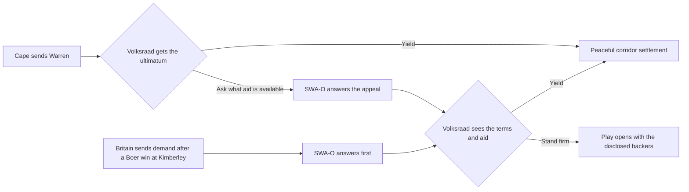
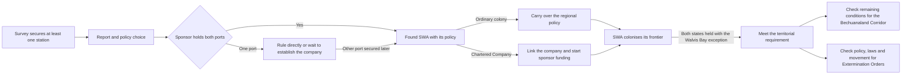

# Warren’s ultimatum and South West African colonial policy

**Design revision after playtest feedback · 24 November 2026**

Warren’s normal Cape route gives the Volksraad the initiative to ask for help. After a Boer win at Kimberley, Britain’s demand prompts a decision from the South West African overlord (SWA-O) before the Boer government sees the terms. The Bechuanaland Corridor opens once SWA owns Hereroland and Namaqualand, allowing for the Cape’s Walvis Bay enclave, and meets the other Corridor requirements. The survey report offers Religious Missions, Chartered Company, Settler Colony and Ruthless Extraction, with a ten-year policy or funding commitment as applicable.

## Warren’s ultimatum

The current first Boer event, `sb_bechuanaland_corridor.010`, reads as a refusal even though its tooltip describes an appeal. The sponsor’s direct and proxy answers then commit the Boer coalition and try to start a play. Standing aside also calls a war launcher. The missing decision is the Volksraad’s response to the terms of the sponsor’s actual offer. [Boer ultimatum and sponsor options](../events/sb_bechuanaland_corridor_events.txt#L31) · [Warren launch queue](../common/scripted_effects/sb_bechuanaland_corridor_effects.txt#L2157)

### Agreed sequences

- **Normal Cape route.** The Volksraad can accept immediately or ask SWA-O what help is available. If it asks, the reply brings a final choice to yield or stand firm. The sponsor can offer direct intervention, SWA’s forces alone or neutrality.
- **Boer victory at Kimberley.** GBR sends the demand. SWA-O gets its intervention event first. The Boers receive a single ultimatum with the territorial terms and the actual offer of aid. For example, after a Transvaal victory at Kimberley, Germany can offer to send only SWA. The Volksraad learns that before choosing whether to yield or stand firm. [Cape and British buttons](../common/scripted_buttons/sb_bechuanaland_corridor_buttons.txt#L189) · [Current direct and proxy routes](../common/scripted_effects/sb_bechuanaland_corridor_effects.txt#L3162)

**Draft opening for the normal route.** “Sir Charles Warren has sent his terms to the Volksraad. He demands that the corridor settlements be surrendered to Cape administration. Before sending its answer, the assembly may ask [SWA overlord] what aid it would give if the republic stood its ground.” Options are **“Accept Warren’s terms”** and **“Ask what aid we can count on”**. On both routes, the sponsor’s wording should describe a prospective commitment, and the final Boer event should name the backers and preview the risk of subjugation. The reviewed text requires DP’s approval of the replacement wording. GotB’s Black Mountain negotiations also return a variant after the other side answers. [Reviewed Warren text](../localization/english/sb_bechuanaland_corridor_l_english.yml#L110) · [Localisation policy](policies/localisation-review.md) · [Black Mountain reply](<../../Example Mods/gotb - gates of the bosphorus [1.13]/events/7-12_eqfm_karadag_events.txt#L417>)

Reserve one attempt for the exact Boer government and sponsor. The answer records conditional aid. The final Boer choice to stand firm authorises the launch, including if the reply was neutral. If the sponsor becomes ineligible or SWA changes hands, present an unbacked ultimatum while the dispute still has a valid target. A lost target ends the attempt. On timeout, the sponsor **stands aside** and the Boers **yield**. Charge the intervention costs and apply influence effects when the corresponding play opens. The final AI choice compares the forces actually offered. [Existing no-appeal scene](../events/sb_bechuanaland_corridor_events.txt#L1423) · [Dispatch and stale-choice rules](pitfalls/events.md#evt-01)

**The post-Kimberley case needs its own goal list.** The British button is eligible when a Boer sphere holds all of Bechuanaland and Griqualand West. Both supported and unsupported launch paths depend on a Cape fragment in Bechuanaland, and the supported path additionally expects Stellaland. My provisional terms use the existing Cape claims to demand both regions from their actual holders, with the same territorial terms for a concession and a play. A Boer demand for a formal British climbdown can use the existing story Humiliation goal when there is no Cape fragment to reclaim. The split Bechuanaland route uses its reciprocal Cape–Stellaland goals. Check on the exact play whether Britain backed down or the defensive goal was enforced before awarding a Boer victory. [British route eligibility](../common/scripted_triggers/sb_bechuanaland_corridor_triggers.txt#L808) · [Supported launch requirements](../common/scripted_triggers/sb_bechuanaland_corridor_triggers.txt#L589) · [Unsupported launch requirements](../common/scripted_effects/sb_bechuanaland_corridor_effects.txt#L3755) · [Existing decisive-goal evidence](../common/scripted_effects/sb_bechuanaland_corridor_effects.txt#L3577)

## South West Africa

### What the current completion event offers

On the non-British subject route, **Administer South West Africa** (`sb_nam.140`) shows one **Proclaim the administration** button. The Consolidation journal has already chosen the package from its harshness score. The separate **Play as South West Africa?** event offers the country switch after formation. [Package thresholds](../common/journal_entries/1-08_sb_namibia.txt#L128) · [Current formation event](../events/sb_namibia_events.txt#L1244) · [Play-as event](../events/sb_namibia_events.txt#L1366)

| Harshness | Current package | Main effects |
| ---: | --- | --- |
| Below 3 | **Mission Colony** | Oligarchy, Subjecthood, Agrarianism and Colonial Resettlement. Mission schooling where eligible. −5% radical gains from Open Prejudice. |
| 3 to below 6 | **Chartered Company** | Oligarchy, Subjecthood, Extraction Economy and Colonial Exploitation. +10% mining and plantation throughput. The script gives it the ordinary colony relationship. |
| 6 to below 9 | **Extractive Colony** | Oligarchy, Racial Segregation, Extraction Economy and Colonial Exploitation. +10% mining and plantation throughput, +10% radical gains among discriminated pops and +25% local colony growth. |
| 9 and up | **Exterminatory Settler-Extractive Colony** | Autocracy, Racial Segregation, Extraction Economy and Colonial Exploitation. +10% mining and plantation throughput, +20% radical gains and −2 SoL for discriminated pops, +50% local colony growth and +10% local migration attraction. |

The packages have additional common laws, including Colonial Administration. Their modifiers are permanent. The separate **South West Africa Proclaimed** acknowledgement seeds the colony’s minority-rights movement from the final score. [Current laws](../common/scripted_effects/sb_namibia_effects.txt#L422) · [Current modifiers](../common/static_modifiers/sb_namibia_modifiers.txt#L130) · [Subject relationship](../common/scripted_effects/sb_namibia_effects.txt#L325) · [Resistance acknowledgement](../events/sb_namibia_events.txt#L1334)

### How the current packages compare with vanilla

Vanilla’s **The Nature of Administration** gives the overlord choices when an African administration is founded. Its laws take effect immediately. Its special colony modifiers run for 7,300 days, about twenty years. SB’s existing outcomes come from the earlier harshness choices and add permanent modifiers. [Vanilla options](</Users/depro/Library/Application Support/Steam/steamapps/common/Victoria 3/game/events/colonial_administration_events.txt#L47>) · [Vanilla modifier values](</Users/depro/Library/Application Support/Steam/steamapps/common/Victoria 3/game/common/static_modifiers/content_3_modifiers.txt#L574>) · [Vanilla duration](</Users/depro/Library/Application Support/Steam/steamapps/common/Victoria 3/game/common/script_values/event_values.txt#L44>)

| Vanilla administration | Main vanilla effects | How current SWA differs |
| --- | --- | --- |
| **Chartered administration** | A chartered subject, with Extraction Economy, Colonial Exploitation and +10% mining and plantation throughput. | SB’s **Chartered Company** uses the same core laws and throughput values on an ordinary colony. |
| **Religious missions** | Oligarchy and amended Subjecthood, State Religion and Religious Schools, Extraction Economy and Colonial Exploitation. Its modifier gives +20% conversion. The option requires State Religion or Freedom of Conscience in the sponsor. | SB’s **Mission Colony** combines conditional mission schools with Agrarianism and Colonial Resettlement, the core economic and colonial laws of vanilla’s settler option. Its modifier lowers radical gains from Open Prejudice by 5%. |
| **Settlement campaigns** | Agrarianism and Colonial Resettlement, with +50% migration attraction and +10% radical gains among discriminated pops from the package modifier. | SB’s mission outcome borrows the settler laws. Its fastest expansion is in the exterminatory outcome. There is no separate settler outcome in the current four packages. |
| **Ruthless extraction** | A conditional option that enacts Slave Trade and Outlawed Dissent, alongside Autocracy and amended Subjecthood. Its modifier gives +20% mining and plantation throughput, +20% mortality and +10% radical gains among discriminated pops. | SB splits coercion between **Extractive Colony** and **Exterminatory Settler-Extractive Colony**. Both impose Racial Segregation and Censorship. Their regional growth bonuses are +25% and +50% respectively. The exterminatory package reduces SoL by 2 for the targeted acceptance groups. |

### What chartered company means in vanilla

The generic administration event creates a `chartered_company` diplomatic pact for the new territory. That subject type is sufficient for the Chartered Company government. The generic event has no Companies-panel business to attach. Charters of Commerce’s **Colonization Charter** starts from an actual company. The parent assigns it a colony and completion of the state region makes a chartered country linked to the company. Vanilla also sets up the Hudson’s Bay Company and British East India Company as real businesses linked to country tags at game start. [Generic charter option](</Users/depro/Library/Application Support/Steam/steamapps/common/Victoria 3/game/events/colonial_administration_events.txt#L47>) · [Native chartered government](</Users/depro/Library/Application Support/Steam/steamapps/common/Victoria 3/game/common/government_types/01_colonial_administrations.txt#L211>) · [Paradox’s company diary](https://www.reddit.com/r/victoria3/comments/1kn8zjs/victoria_3_dev_diary_147_everything_companies/) · [Vanilla company links](</Users/depro/Library/Application Support/Steam/steamapps/common/Victoria 3/game/common/history/countries/gbr - great britain.txt#L104>)

### Recommended flow · Choose the policy and found the two-port colony

The **Mission to South West Africa** handles the survey. Its success report, **The Survey Returns**, states which stations were secured and offers the policy. Found SWA when the eligible sponsor holds both Lüderitz and Swakopmund. The survey report and formation normally occur in the same event. The new SWA controls the sponsor’s local holdings, uses its chosen policy from the start and expands through native colonisation. **The Bechuanaland Corridor** uses the later territorial gate. [Survey conclusion](../common/journal_entries/1-08_sb_namibia.txt#L275) · [Expedition rewards](../common/scripted_effects/sb_namibia_effects.txt#L168) · [Current Corridor prerequisites](../common/scripted_triggers/sb_bechuanaland_corridor_triggers.txt#L873)

Award the survey rewards once when the foothold is secured. If only one station is available, the winner holds it directly. Religious Missions, Settler Colony and Ruthless Extraction can take effect there and carry their remaining term into SWA if the second port is secured. A selected company charter waits for the two-port founding before granting the slot and beginning the expense. If a rival already has SWA, the winner keeps its own territory. An otherwise eligible sponsor that secures the two ports by other means can use the common founding setup. A failed or beaten expedition takes its existing failure path. Recognised major powers that qualify for the survey can choose a policy under the same rules. Britain can use local policies and its separate Cape or SAF delegation. A player who founds SWA can still take the existing play-as offer. [Survey eligibility](../common/decisions/sb_namibia_decisions.txt#L3) · [British delegation](../common/decisions/sb_namibia_decisions.txt#L106) · [Country creation readiness](pitfalls/country-lifecycle.md#life-01)

Give the new SWA a valid incorporated capital, local claims and Namibian Coastal Access. Each proposed colonisation law enables the native Colonial Affairs institution. Apply the law after the subject has its land. Native defines give countries a minimum base colonial growth. Replay a two-port SWA growing into both regions under all four packages with the administrative barrier disabled and the intended claims and institution in place. [Native growth defines](</Users/depro/Library/Application Support/Steam/steamapps/common/Victoria 3/game/common/defines/00_defines.txt#L1639>) · [Colonial Resettlement](</Users/depro/Library/Application Support/Steam/steamapps/common/Victoria 3/game/common/laws/01_colonial_affairs.txt#L279>) · [Colonial Exploitation](</Users/depro/Library/Application Support/Steam/steamapps/common/Victoria 3/game/common/laws/01_colonial_affairs.txt#L386>) · [SB’s coastal barrier](../common/state_traits/sb_state_traits.txt#L27)

### Policy modifier matrix

*Draft opening.* “The expedition has returned with coastal charts and reports on the roads and wells inland. With [actual station or stations] secured, the government must give its officials instructions on trade, settlement and their dealings with the people already there.”

The table uses vanilla’s colony-side modifiers as the baseline. The three regional policies run for ten years. Their state modifiers apply to the administration’s own holdings in Namaqualand and Hereroland, including newly acquired fragments for the remaining term. An unrelated conquest ends the policy in its affected fragment. Use vanilla’s ten-year duration, `long_modifier_time` (3,650 days). [Vanilla package modifiers](</Users/depro/Library/Application Support/Steam/steamapps/common/Victoria 3/game/common/static_modifiers/content_3_modifiers.txt#L574>) · [Vanilla modifier durations](</Users/depro/Library/Application Support/Steam/steamapps/common/Victoria 3/game/common/script_values/event_values.txt#L38>) · [Vanilla example of distributing regional modifiers](</Users/depro/Library/Application Support/Steam/steamapps/common/Victoria 3/game/events/iberia_events/portuguese_colonialism_events.txt#L231>)

| Modifier or effect | Script field | Religious Missions | Chartered Company | Settler Colony | Ruthless Extraction |
| --- | --- | ---: | ---: | ---: | ---: |
| Colony growth speed | `state_colony_growth_speed_mult` | +10% | — | +50% | +100% |
| Conversion speed | `state_conversion_mult` | +20% | — | — | — |
| Loyalist gains · Violent Hostility (1) | `state_loyalism_increases_violent_hostility_mult` | +15%* | — | — | — |
| Loyalist gains · Cultural Erasure (2) | `state_loyalism_increases_cultural_erasure_mult` | +15%* | — | — | — |
| Loyalist gains · Open Prejudice (3) | `state_loyalism_increases_open_prejudice_mult` | +15%* | — | — | — |
| Radical gains · Violent Hostility (1) | `state_radicalism_increases_violent_hostility_mult` | — | — | +10% | +20% |
| Radical gains · Cultural Erasure (2) | `state_radicalism_increases_cultural_erasure_mult` | — | — | +10% | +20% |
| Radical gains · Open Prejudice (3) | `state_radicalism_increases_open_prejudice_mult` | — | — | +10% | +20% |
| Migration attraction | `state_migration_pull_mult` | — | — | +50% | — |
| Plantation throughput | `building_group_bg_plantations_throughput_add` | — | — | — | +20% |
| Mining throughput | `building_group_bg_mining_throughput_add` | — | — | — | +20% |
| Standard of Living · Violent Hostility (1) | `country_standard_of_living_violent_hostility_add` | — | — | — | −2† |
| Standard of Living · Cultural Erasure (2) | `country_standard_of_living_cultural_erasure_add` | — | — | — | −2† |
| Standard of Living · Open Prejudice (3) | `country_standard_of_living_open_prejudice_add` | — | — | — | −2† |
| Company capacity, SWA-O | `country_max_companies_add` | — | +1 | — | — |
| Funding, SWA-O | Monthly treasury debit | — | £2,000 per month for 120 months | — | — |

\* **+15%** provisionally carries the earlier magnitude over to loyalist gains for each of the three tiers. “Colonialism” means local colony growth speed. Replay the actual speed with the normal institution, malaria traits and native growth cap. [Native colony growth modifier](https://github.com/Victoria-3-Modding-Co-op/Modding-Digests/blob/main/1.15.0/docs/modifiers.log#L1907) · [Native loyalist gains](https://github.com/Victoria-3-Modding-Co-op/Modding-Digests/blob/main/1.15.0/docs/modifiers.log#L8749) · [Native radical gains](https://github.com/Victoria-3-Modding-Co-op/Modding-Digests/blob/main/1.15.0/docs/modifiers.log#L9401)

† Ruthless uses **−2 Standard of Living in acceptance tiers 1–3** because the available mortality modifiers have broader targeting. SB already uses these country modifiers at the same values. Apply them across SWA once it forms, for the remainder of the original policy term. A one-port administration under direct rule uses the state modifiers during that phase. [Native mortality fields](https://github.com/Victoria-3-Modding-Co-op/Modding-Digests/blob/main/1.15.0/docs/modifiers.log#L2099) · [Native acceptance-tier Standard of Living fields](https://github.com/Victoria-3-Modding-Co-op/Modding-Digests/blob/main/1.15.0/docs/modifiers.log#L6585) · [Existing SB precedent](../common/static_modifiers/sb_namibia_modifiers.txt#L157)

### Proposed SWA starting laws

Religious Missions keeps SB’s founding laws with two changes for healthcare and slavery. The other three packages use the proposed vanilla presets. The four options remain available on the survey report. “Founding default” means the law from SWA’s usual country setup for that law group. A direct-rule sponsor keeps its own laws when it selects a regional policy.

| Starting rule | Religious Missions | Chartered Company | Settler Colony | Ruthless Extraction |
| --- | --- | --- | --- | --- |
| Subject relationship | Colony | Chartered Company | Colony | Colony |
| Power distribution | Oligarchy | Oligarchy | Oligarchy | Autocracy |
| Economic system | Agrarianism | Extraction Economy | Agrarianism | Extraction Economy |
| Colonisation | Colonial Resettlement | Colonial Exploitation | Colonial Resettlement | Colonial Exploitation |
| Church and state | State Religion if sponsor has State Religion or Freedom of Conscience, otherwise founding default | Founding default | Founding default | Founding default |
| Education | Religious Schools with the same sponsor condition, otherwise No Schools | No Schools | No Schools | No Schools |
| Health system | Charity Hospitals if SWA has Medical Degrees, otherwise No Health System | No Health System | No Health System | No Health System |
| Free speech | Censorship | Censorship | Censorship | Outlawed Dissent |
| Slavery | Slavery Banned | Founding default | Founding default | Slave Trade |

All four set **Colonial Administration**, **Subjecthood** with **Colonial Racialization**, **No Workers’ Rights**, **Child Labor Allowed**, **No Social Security** and **Migration Controls**. Other law groups use the founding defaults. Laws carry their usual modifiers and stay in force until changed. Colonial Resettlement adds +50% migration attraction in unincorporated states for both Missions and Settler, with a further regional bonus for Settler. Colonial Exploitation adds +20% mining and plantation throughput in unincorporated states alongside Ruthless’s regional bonus. [SB mission laws](../common/scripted_effects/sb_namibia_effects.txt#L422) · [Vanilla company laws](</Users/depro/Library/Application Support/Steam/steamapps/common/Victoria 3/game/events/colonial_administration_events.txt#L47>) · [Vanilla settler laws](</Users/depro/Library/Application Support/Steam/steamapps/common/Victoria 3/game/events/colonial_administration_events.txt#L188>) · [Vanilla ruthless laws](</Users/depro/Library/Application Support/Steam/steamapps/common/Victoria 3/game/events/colonial_administration_events.txt#L234>) · [Resettlement law effects](</Users/depro/Library/Application Support/Steam/steamapps/common/Victoria 3/game/common/laws/01_colonial_affairs.txt#L279>) · [Exploitation law effects](</Users/depro/Library/Application Support/Steam/steamapps/common/Victoria 3/game/common/laws/01_colonial_affairs.txt#L386>)

Check **Medical Degrees** in SWA after its normal founding setup. Charity Hospitals unlocks the Health System institution and has its own technology requirement, so the schooling outcome is independent. Apply **Slavery Banned** once the colony has its starting territory. Vanilla’s separate +6 approval for aligned sponsor interest groups remains a separate design choice. [Charity Hospitals law](</Users/depro/Library/Application Support/Steam/steamapps/common/Victoria 3/game/common/laws/01_health_system.txt#L25>) · [Slavery Banned law](</Users/depro/Library/Application Support/Steam/steamapps/common/Victoria 3/game/common/laws/02_slavery.txt#L5>) · [Country founding and research inheritance](pitfalls/country-lifecycle.md#life-06) · [Vanilla approval values](</Users/depro/Library/Application Support/Steam/steamapps/common/Victoria 3/game/common/static_modifiers/content_3_modifiers.txt#L554>)

### SWA Company charter and cost

Found **SWA Company** on the fixed `SWA` tag and link it to a company record in the sponsor through the existing chartered-company pattern. Grant one added company slot on SWA-O to make room for the firm. The slot lasts while its company runs SWA, following the British South Africa Company precedent. Company-specific flags, icons and a unique company bonus are deferred. The chartered subject relationship carries its native rules. [BSA company formation](../events/sb_rhodesian_venture_events.txt#L203) · [BSA company slot](../common/static_modifiers/sb_rhodesian_venture_modifiers.txt#L1) · [Slot lifetime precedent](../common/scripted_effects/sb_rhodesian_venture_effects.txt#L649) · [Native subject types](</Users/depro/Library/Application Support/Steam/steamapps/common/Victoria 3/game/common/subject_types/00_subject_types.txt#L496>)

Debit the founding sponsor **£2,000 per monthly country pulse** for 120 payments, beginning with the first pulse after the company is founded, for **£240,000**. The proposed handling treats the amount as a fixed founding commitment. An overlord transfer or early end to the charter leaves the outstanding instalments with the founding sponsor. [Treasury effect](https://github.com/Victoria-3-Modding-Co-op/Modding-Digests/blob/main/1.15.0/docs/effects.log#L555)

### When the Corridor opens

**Agreed.** Require SWA to own all of Hereroland and all of Namaqualand, allowing **Cape-held Walvis Bay** as the sole exception. The exception applies to the named province `x8031D0`. A remaining Rehoboth, Oorlam or other holding elsewhere still keeps the journal closed. Once the map condition and the other prerequisites hold, the Bechuanaland Corridor can open. Walvis Bay can still be a prize for SWA in a supported Warren or Caprivi play. Apply the territorial rule on opening, then use the Corridor’s crisis rules for later ownership changes. [Cape’s Walvis Bay ownership](../common/history/states/00_states.txt#L5093) · [Warren’s return-state demand](../common/scripted_effects/sb_bechuanaland_corridor_effects.txt#L2886) · [Caprivi proxy route](../common/scripted_effects/sb_bechuanaland_corridor_effects.txt#L3121)

Give Britain’s Botswana claim and the British consolidation check an explicit territorial trigger at their corresponding stage. Both currently read the old Consolidation receipt. Starting a two-port colony records its founding and leaves the Corridor to open on mature ownership. Delaying the Corridor also gives Portugal more time to play its existing pre-Corridor Pink Map route. Test that precedence and the existing SAF or lost-Cape terminal conditions while SWA is expanding. [British Botswana claim](../common/scripted_effects/sb_bechuanaland_corridor_effects.txt#L773) · [Corridor opening and skip](../common/on_actions/sb_mineral_discoveries_on_actions.txt#L154) · [Pink Map decision](../common/decisions/zz_sb_pink_map_override.txt#L16)

### Extermination Orders

The existing event (`sb_nam.201`) can appear once for **Settler Colony** or **Ruthless Extraction**. Check these conditions on SWA when dispatching and delivering the event.

1. SWA chose one of the two eligible policies. Keep that choice after its ten-year modifiers expire.
2. SWA owns Hereroland and Namaqualand apart from the permitted Cape-held Walvis Bay enclave. Use the same ownership test as the Corridor. The Corridor’s journal status is independent of event eligibility.
3. SWA has **Colonial Exploitation**, **National Supremacy** or **Ethnostate**, and a **Minority Rights Movement at 75% radicalism or higher**. Those are the existing law and movement gates. Keep the existing two responses and record resolution once. [Existing event trigger and choices](../events/sb_namibia_events.txt#L1502) · [Current monthly dispatch](../common/on_actions/sb_namibia_on_actions.txt#L117)

Under the proposed starting laws, Ruthless starts with a qualifying law. Settler starts under Colonial Resettlement and amended Subjecthood, so it needs a qualifying law change even if its interior is complete and the movement has reached the threshold. A Ruthless SWA that takes more than ten years to finish colonising can still receive the event when it meets the law and movement conditions. Religious Missions and Chartered Company are outside this event’s policy eligibility. [Vanilla Minority Rights Movement](</Users/depro/Library/Application Support/Steam/steamapps/common/Victoria 3/game/common/political_movements/02_cultural_movement.txt#L1305>)

## Decision register

| Item | Status | Current position |
| --- | --- | --- |
| Normal Warren route | Agreed | Cape ultimatum, then the chance to yield or ask SWA-O, then a final Boer decision on the reply. |
| Warren after a Boer win at Kimberley | Agreed | GBR sends its demand, SWA-O answers first, and the Boers receive one combined ultimatum and aid offer. |
| Warren timeout defaults | Agreed | The sponsor stands aside and the Boers yield. |
| Post-Kimberley peace and war terms | Provisional | Use the actual claimed Boer-held fragments. A British climbdown is the proposed defensive demand. |
| Policy choices and term | Agreed | Religious Missions, Chartered Company, Settler Colony and Ruthless Extraction. The regional packages and funding commitment each run for ten years. |
| Policy modifiers | Agreed | Local colony growth of +10%, +50% and +100% for Missions, Settler and Ruthless, respectively. Missions gains loyalists, Settler gains +10% radicals and Ruthless gains +20% radicals, in each case for tiers 1–3. The matrix records the other package effects. |
| Religious Missions loyalist gain | Provisional | Carry over the earlier magnitude with +15% for each of the three tiers. |
| Ruthless Standard of Living | Agreed | Use −2 in each of tiers 1–3 in place of the proposed mortality modifier. Apply it across SWA for the remaining policy term once it forms. |
| Chartered Company | Agreed | Found SWA Company as a company-linked subject. Grant SWA-O +1 company capacity while the link lasts and charge £2,000 per month for ten years. |
| Company charge after charter ends or changes hands | Provisional | Treat the 120 exact monthly debits as a fixed commitment of the founding sponsor. |
| SWA Company presentation and unique bonus | Deferred | Design flags, icons and any bespoke company bonus separately. |
| Religious Missions founding laws | Agreed | Keep SB’s existing laws, including Agrarianism, Colonial Resettlement and conditional mission schooling. Add Slavery Banned and use Charity Hospitals when SWA has Medical Degrees. |
| Other founding laws and sponsor approval | Provisional | Use the three vanilla-based presets in the table. The proposal gives zero separate sponsor approval bonus. |
| Formation and scope | Provisional | Found SWA at both survey ports, give it a working native frontier and offer the existing player switch. Eligible one-port surveys use direct rule until both ports are ready. |
| Bechuanaland Corridor opening | Agreed | Wait for SWA to hold Hereroland and Namaqualand, with Cape-held Walvis Bay as the sole exception. |
| Extermination Orders eligibility | Agreed | Settler or Ruthless on the complete map with the same enclave exception, plus the existing qualifying law and 75% Minority Rights Movement radicalism. Retain the policy choice after expiry. |
| Policy balance and AI | Provisional | Check the local impact of the growth bonuses under the native cap and tune the policy weights. |
| Existing games | Provisional | Preserve formed administrations and active plays. Decide how to handle an old consolidation journal already in progress when planning the change. |

## Acceptance checks for the design

- Exercise the normal Cape consultation and the post-Kimberley sponsor-first consultation through each sponsor reply. Check the early and late surrender paths, one Boer popup in the post-Kimberley branch, and launch only after final Boer consent. Replay a changed sponsor, a held popup, reload and white peace. Check exact territorial terms and participants on the fully Boer-held map.
- Complete the survey with both stations, one station and neither station available. Check policy delivery and expiry, the capital and subject relationship, colonial growth under the native institution, and the existing play-as choice. Exercise an existing SWA controlled by a rival and the separate British delegation.
- Inspect the starting laws and native institutions for every package. For Missions, exercise religious and secular sponsors, SWA with and without Medical Degrees, and the Slavery Banned law after territorial transfer. Check the acceptance-specific gains and local growth cap in both state fragments. For Ruthless, check the −2 SoL in each of tiers 1–3 and zero direct change in tiers 4–5, including after formation from one-port direct rule and at policy expiry. Verify the owning-company link, one extra company slot, the first and 120th payments, disbanding, an overlord transfer, and a reload before a payment.
- Exercise Extermination Orders with all four policies, including Settler before and after a qualifying law change, radicalism below and at 75%, a remaining inland pocket, Cape-held Walvis Bay, and a colony that completes colonisation after its ten-year modifiers expire. Test a reload with the event pending and consume it once after either response.
- Check that a two-port SWA waits, an incomplete interior waits, and a mature SWA opens the Corridor when the other conditions hold. Test Cape Walvis Bay by itself, Cape ownership beyond the enclave, a remaining Rehoboth or Oorlam pocket, and full control including Walvis Bay. Replay the Botswana claim, the SAF terminal route, and Portugal’s Pink Map on both sides of opening. The source trace establishes the current wiring. Native growth, event delivery and the changed pacing require in-game replay.
