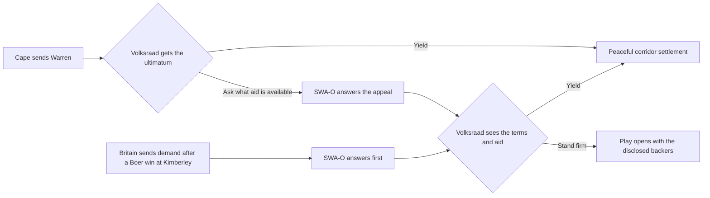
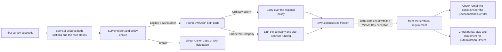
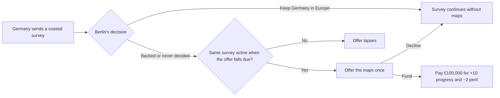
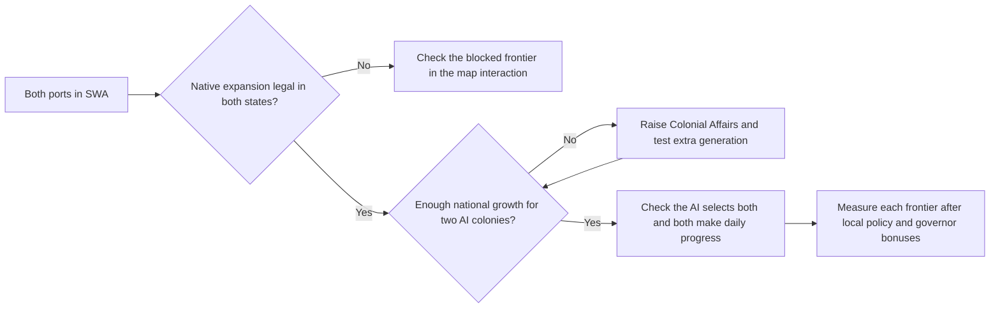

# Warren’s ultimatum and South West African colonial policy

**Design revision after playtest feedback · 24 November 2026**

Warren’s normal Cape route gives the Volksraad the initiative to ask for help. After a Boer win at Kimberley, Britain’s demand prompts a decision from the South West African overlord (SWA-O) before the Boer government sees the terms. The Bechuanaland Corridor opens once SWA owns Hereroland and Namaqualand, allowing for the Cape’s Walvis Bay enclave, and meets the other Corridor requirements. The survey report offers Religious Missions, Chartered Company, Settler Colony and Ruthless Extraction, with a ten-year policy or funding commitment as applicable.

The 25 November playtest follow-up covers [Germany’s missionary maps, the founding settlers, Colonial Affairs investment and the duration of SWA’s Bureaucracy bonus](#german-survey-and-swa-founding-playtest).
The agreed [survey AI weights](#how-the-sponsor-chooses-a-policy) show how the sponsor’s cabinet and ruler influence its choice.

The 26 November playtest adds the [two-port handover, German governor and competing frontier growth designs](#two-active-frontiers).

## Warren’s ultimatum

The current first Boer event, `sb_bechuanaland_corridor.010`, reads as a refusal even though its tooltip describes an appeal. The sponsor’s direct and proxy answers then commit the Boer coalition and try to start a play. Standing aside also calls a war launcher. The missing decision is the Volksraad’s response to the terms of the sponsor’s actual offer. [Boer ultimatum and sponsor options](../events/sb_bechuanaland_corridor_events.txt#L31) · [Warren launch queue](../common/scripted_effects/sb_bechuanaland_corridor_effects.txt#L2157)

### Agreed sequences

- **Normal Cape route.** The Volksraad can accept immediately or ask SWA-O what help is available. If it asks, the reply brings a final choice to yield or stand firm. The sponsor can offer direct intervention, SWA’s forces alone or neutrality.
- **Boer victory at Kimberley.** GBR sends the demand. SWA-O gets its intervention event first. The Boers receive a single ultimatum with the territorial terms and the actual offer of aid. For example, after a Transvaal victory at Kimberley, Germany can offer to send only SWA. The Volksraad learns that before choosing whether to yield or stand firm. [Cape and British buttons](../common/scripted_buttons/sb_bechuanaland_corridor_buttons.txt#L189) · [Current direct and proxy routes](../common/scripted_effects/sb_bechuanaland_corridor_effects.txt#L3162)

**Draft opening for the normal route.** “Sir Charles Warren has sent his terms to the Volksraad. He demands that the corridor settlements be surrendered to Cape administration. Before sending its answer, the assembly may ask [SWA overlord] what aid it would give if the republic stood its ground.” Options are **“Accept Warren’s terms”** and **“Ask what aid we can count on”**. On both routes, the sponsor’s wording should describe a prospective commitment, and the final Boer event should name the backers and preview the risk of subjugation. The reviewed text requires DP’s approval of the replacement wording. GotB’s Black Mountain negotiations also return a variant after the other side answers. [Reviewed Warren text](../localization/english/sb_bechuanaland_corridor_l_english.yml#L110) · [Localisation policy](policies/localisation-review.md) · [Black Mountain reply](<../../Example Mods/gotb - gates of the bosphorus [1.13]/events/7-12_eqfm_karadag_events.txt#L417>)

Reserve one attempt for the exact Boer government and sponsor. The answer records conditional aid. The final Boer choice to stand firm authorises the launch, including if the reply was neutral. If the sponsor becomes ineligible or SWA changes hands, present an unbacked ultimatum while the dispute still has a valid target. A lost target ends the attempt. On timeout, the sponsor **stands aside** and the Boers **yield**. Charge the intervention costs and apply influence effects when the corresponding play opens. The final AI choice compares the forces actually offered. [Existing no-appeal scene](../events/sb_bechuanaland_corridor_events.txt#L1423) · [Dispatch and stale-choice rules](pitfalls/events.md#evt-01)

**The post-Kimberley case needs its own goal list.** The British button is eligible when a Boer sphere holds all of Bechuanaland and Griqualand West. Both supported and unsupported launch paths depend on a Cape fragment in Bechuanaland, and the supported path additionally expects Stellaland. My provisional terms use the existing Cape claims to demand both regions from their actual holders, with the same territorial terms for a concession and a play. A Boer demand for a formal British climbdown can use the existing story Humiliation goal when there is no Cape fragment to reclaim. The split Bechuanaland route uses its reciprocal Cape–Stellaland goals. Check on the exact play whether Britain backed down or the defensive goal was enforced before awarding a Boer victory. [British route eligibility](../common/scripted_triggers/sb_bechuanaland_corridor_triggers.txt#L808) · [Supported launch requirements](../common/scripted_triggers/sb_bechuanaland_corridor_triggers.txt#L589) · [Unsupported launch requirements](../common/scripted_effects/sb_bechuanaland_corridor_effects.txt#L3755) · [Existing decisive-goal evidence](../common/scripted_effects/sb_bechuanaland_corridor_effects.txt#L3577)

## South West Africa

### Completion before the two-port rework

On the non-British subject route, **Administer South West Africa** (`sb_nam.140`) shows one **Proclaim the administration** button. The Consolidation journal has already chosen the package from its harshness score. The separate **Play as South West Africa?** event offers the country switch after formation. [Package thresholds](../common/journal_entries/1-08_sb_namibia.txt#L128) · [Current formation event](../events/sb_namibia_events.txt#L1244) · [Play-as event](../events/sb_namibia_events.txt#L1366)

| Harshness | Current package | Main effects |
| ---: | --- | --- |
| Below 3 | **Mission Colony** | Oligarchy, Subjecthood, Agrarianism and Colonial Resettlement. Mission schooling where eligible. −5% radical gains from Open Prejudice. |
| 3 to below 6 | **Chartered Company** | Oligarchy, Subjecthood, Extraction Economy and Colonial Exploitation. +10% mining and plantation throughput. The script gives it the ordinary colony relationship. |
| 6 to below 9 | **Extractive Colony** | Oligarchy, Racial Segregation, Extraction Economy and Colonial Exploitation. +10% mining and plantation throughput, +10% radical gains among discriminated pops and +25% local colony growth. |
| 9 and up | **Exterminatory Settler-Extractive Colony** | Autocracy, Racial Segregation, Extraction Economy and Colonial Exploitation. +10% mining and plantation throughput, +20% radical gains and −2 SoL for discriminated pops, +50% local colony growth and +10% local migration attraction. |

The packages have additional common laws, including Colonial Administration. Their modifiers are permanent. The separate **South West Africa Proclaimed** acknowledgement seeds the colony’s minority-rights movement from the final score. [Current laws](../common/scripted_effects/sb_namibia_effects.txt#L422) · [Current modifiers](../common/static_modifiers/sb_namibia_modifiers.txt#L130) · [Subject relationship](../common/scripted_effects/sb_namibia_effects.txt#L325) · [Resistance acknowledgement](../events/sb_namibia_events.txt#L1334)

### How the earlier packages compared with vanilla

Vanilla’s **The Nature of Administration** gives the overlord choices when an African administration is founded. Its laws take effect immediately. Its special colony modifiers run for 7,300 days, about twenty years. SB’s existing outcomes come from the earlier harshness choices and add permanent modifiers. [Vanilla options](</Users/depro/Library/Application Support/Steam/steamapps/common/Victoria 3/game/events/colonial_administration_events.txt#L47>) · [Vanilla modifier values](</Users/depro/Library/Application Support/Steam/steamapps/common/Victoria 3/game/common/static_modifiers/content_3_modifiers.txt#L574>) · [Vanilla duration](</Users/depro/Library/Application Support/Steam/steamapps/common/Victoria 3/game/common/script_values/event_values.txt#L44>)

| Vanilla administration | Main vanilla effects | How current SWA differs |
| --- | --- | --- |
| **Chartered administration** | A chartered subject, with Extraction Economy, Colonial Exploitation and +10% mining and plantation throughput. | SB’s **Chartered Company** uses the same core laws and throughput values on an ordinary colony. |
| **Religious missions** | Oligarchy and amended Subjecthood, State Religion and Religious Schools, Extraction Economy and Colonial Exploitation. Its modifier gives +20% conversion. The option requires State Religion or Freedom of Conscience in the sponsor. | SB’s **Mission Colony** combines conditional mission schools with Agrarianism and Colonial Resettlement, the core economic and colonial laws of vanilla’s settler option. Its modifier lowers radical gains from Open Prejudice by 5%. |
| **Settlement campaigns** | Agrarianism and Colonial Resettlement, with +50% migration attraction and +10% radical gains among discriminated pops from the package modifier. | SB’s mission outcome borrows the settler laws. Its fastest expansion is in the exterminatory outcome. There is no separate settler outcome in the current four packages. |
| **Ruthless extraction** | A conditional option that enacts Slave Trade and Outlawed Dissent, alongside Autocracy and amended Subjecthood. Its modifier gives +20% mining and plantation throughput, +20% mortality and +10% radical gains among discriminated pops. | SB splits coercion between **Extractive Colony** and **Exterminatory Settler-Extractive Colony**. Both impose Racial Segregation and Censorship. Their regional growth bonuses are +25% and +50% respectively. The exterminatory package reduces SoL by 2 for the targeted acceptance groups. |

### What chartered company means in vanilla

The generic administration event creates a `chartered_company` diplomatic pact for the new territory. That subject type is sufficient for the Chartered Company government. The generic event has no Companies-panel business to attach. Charters of Commerce’s **Colonization Charter** starts from an actual company. The parent assigns it a colony and completion of the state region makes a chartered country linked to the company. Vanilla also sets up the Hudson’s Bay Company and British East India Company as real businesses linked to country tags at game start. [Generic charter option](</Users/depro/Library/Application Support/Steam/steamapps/common/Victoria 3/game/events/colonial_administration_events.txt#L47>) · [Native chartered government](</Users/depro/Library/Application Support/Steam/steamapps/common/Victoria 3/game/common/government_types/01_colonial_administrations.txt#L211>) · [Paradox’s company diary](https://www.reddit.com/r/victoria3/comments/1kn8zjs/victoria_3_dev_diary_147_everything_companies/) · [Vanilla company links](</Users/depro/Library/Application Support/Steam/steamapps/common/Victoria 3/game/common/history/countries/gbr - great britain.txt#L104>)

### Recommended flow · Choose the policy and found the two-port colony

The **Mission to South West Africa** awards Lüderitz and Swakopmund to the first successful survey on the starting map, then closes the race. **The Survey Returns** gives the sponsor its policy choice. All four policies give an eligible founder’s two ports to SWA in a single country creation. The following day, the sponsor checks its entitlement and SWA’s ownership of both ports before transferring its remaining local holdings and setting up the administration. Britain can govern directly or delegate to the Cape or SAF. The Bechuanaland Corridor opens only after its separate interior-ownership requirement is met. [Survey report](../common/scripted_effects/sb_namibia_policy_effects.txt#L16) · [Two-port founding](../common/scripted_effects/sb_namibia_policy_effects.txt#L191)

Lüderitz starts in Nama territory and Swakopmund in Herero territory. The Cape enclave is Walvis Bay, a third province. The winner resolves both station transfers in the same effect. Other expeditions still at sea take the beaten outcome when the race closes. The separate ownership checks protect land that has already changed hands outside the survey. A single station on such a map is a fallback for existing games and externally acquired land. The common founding condition still requires both stations. [Starting owners](../common/history/states/00_states.txt#L5093) · [Two-station condition](../common/scripted_triggers/sb_namibia_triggers.txt#L93) · [Beaten expedition](../common/journal_entries/1-08_sb_namibia.txt#L347)

The playtest checkpoints show this handover on the map. On 1 September 1877 Nama held Lüderitz and Herero held Swakopmund. On 1 October SWA owned both. [September Lüderitz](<../../../save games/autosave_1.v3#L2800429>) · [September Swakopmund](<../../../save games/autosave_1.v3#L2801059>) · [October Lüderitz](<../../../save games/autosave.v3#L2861312>) · [October Swakopmund](<../../../save games/autosave.v3#L2538789>)

Give the new SWA a valid incorporated capital, local claims and Namibian Coastal Access. Each proposed colonisation law enables the native Colonial Affairs institution. Apply the law after the subject has its land, then set Colonial Affairs investment to SWA’s own maximum at formation. Native defines give countries a minimum base colonial growth. Replay a two-port SWA growing into both regions under all four packages with the administrative barrier disabled and the intended claims and institution in place. [Native growth defines](</Users/depro/Library/Application Support/Steam/steamapps/common/Victoria 3/game/common/defines/00_defines.txt#L1639>) · [Colonial Resettlement](</Users/depro/Library/Application Support/Steam/steamapps/common/Victoria 3/game/common/laws/01_colonial_affairs.txt#L279>) · [Colonial Exploitation](</Users/depro/Library/Application Support/Steam/steamapps/common/Victoria 3/game/common/laws/01_colonial_affairs.txt#L386>) · [SB’s coastal barrier](../common/state_traits/sb_state_traits.txt#L27)

### Policy modifier matrix

*Draft opening.* “The expedition has returned with coastal charts and reports on the roads and wells inland. With [actual station or stations] secured, the government must give its officials instructions on trade, settlement and their dealings with the people already there.”

The table uses vanilla’s colony-side modifiers as the baseline. The three regional policies run for ten years. Their state modifiers apply to the administration’s own holdings in Namaqualand and Hereroland, including newly acquired fragments for the remaining term. An unrelated conquest ends the policy in its affected fragment. Use vanilla’s ten-year duration, `long_modifier_time` (3,650 days). [Vanilla package modifiers](</Users/depro/Library/Application Support/Steam/steamapps/common/Victoria 3/game/common/static_modifiers/content_3_modifiers.txt#L574>) · [Vanilla modifier durations](</Users/depro/Library/Application Support/Steam/steamapps/common/Victoria 3/game/common/script_values/event_values.txt#L38>) · [Vanilla example of distributing regional modifiers](</Users/depro/Library/Application Support/Steam/steamapps/common/Victoria 3/game/events/iberia_events/portuguese_colonialism_events.txt#L231>)

| Modifier or effect | Script field | Religious Missions | Chartered Company | Settler Colony | Ruthless Extraction |
| --- | --- | ---: | ---: | ---: | ---: |
| Bureaucracy, SWA | `country_bureaucracy_mult` | +20% | +20% | +20% | +20% |
| Colony growth speed | `state_colony_growth_speed_mult` | +10% | — | +50% | +100% |
| Conversion speed | `state_conversion_mult` | +20% | — | — | — |
| Loyalist gains · Violent Hostility (1) | `state_loyalism_increases_violent_hostility_mult` | +15%* | — | — | — |
| Loyalist gains · Cultural Erasure (2) | `state_loyalism_increases_cultural_erasure_mult` | +15%* | — | — | — |
| Loyalist gains · Open Prejudice (3) | `state_loyalism_increases_open_prejudice_mult` | +15%* | — | — | — |
| Radical gains · Violent Hostility (1) | `state_radicalism_increases_violent_hostility_mult` | — | — | +10% | +20% |
| Radical gains · Cultural Erasure (2) | `state_radicalism_increases_cultural_erasure_mult` | — | — | +10% | +20% |
| Radical gains · Open Prejudice (3) | `state_radicalism_increases_open_prejudice_mult` | — | — | +10% | +20% |
| Migration attraction | `state_migration_pull_mult` | — | — | +50% | — |
| Plantation throughput | `building_group_bg_plantations_throughput_add` | — | — | — | +20% |
| Mining throughput | `building_group_bg_mining_throughput_add` | — | — | — | +20% |
| Standard of Living · Violent Hostility (1) | `country_standard_of_living_violent_hostility_add` | — | — | — | −2† |
| Standard of Living · Cultural Erasure (2) | `country_standard_of_living_cultural_erasure_add` | — | — | — | −2† |
| Standard of Living · Open Prejudice (3) | `country_standard_of_living_open_prejudice_add` | — | — | — | −2† |
| Company capacity, SWA-O | `country_max_companies_add` | — | +1 | — | — |
| Funding, SWA-O | Monthly treasury debit | — | £2,000 per month for 120 months | — | — |

\* **+15%** provisionally carries the earlier magnitude over to loyalist gains for each of the three tiers. “Colonialism” means local colony growth speed. Replay the actual speed with the normal institution, malaria traits and native growth cap. [Native colony growth modifier](https://github.com/Victoria-3-Modding-Co-op/Modding-Digests/blob/main/1.15.0/docs/modifiers.log#L1907) · [Native loyalist gains](https://github.com/Victoria-3-Modding-Co-op/Modding-Digests/blob/main/1.15.0/docs/modifiers.log#L8749) · [Native radical gains](https://github.com/Victoria-3-Modding-Co-op/Modding-Digests/blob/main/1.15.0/docs/modifiers.log#L9401)

† Ruthless uses **−2 Standard of Living in acceptance tiers 1–3** because the available mortality modifiers have broader targeting. SB already uses these country modifiers at the same values. Apply them across SWA once it forms, for the remainder of the original policy term. Directly governed land on an already altered map uses the state modifiers during that phase. [Native mortality fields](https://github.com/Victoria-3-Modding-Co-op/Modding-Digests/blob/main/1.15.0/docs/modifiers.log#L2099) · [Native acceptance-tier Standard of Living fields](https://github.com/Victoria-3-Modding-Co-op/Modding-Digests/blob/main/1.15.0/docs/modifiers.log#L6585) · [Existing SB precedent](../common/static_modifiers/sb_namibia_modifiers.txt#L157)

### SWA starting laws

All four policies found SWA with Frontier Colonisation. At handover, SWA receives the claims on Hereroland and Namaqualand and its sponsor relinquishes any claims there. SWA also receives its side’s Corridor settlement claims when it survives. The sponsor can still arbitrate a settlement. “Founding default” means the law from SWA’s usual country setup for that law group. A direct-rule sponsor keeps its own laws when it selects a regional policy.

In campaigns where SWA has already formed, its next monthly pulse clears the two coastal claims from the recorded founder, or from the survey-winning overlord in older campaigns. SWA keeps its enacted law. The 17 February 1886 checkpoint has both claims on SWA and the Netherlands. The Netherlands also claims Wallonia and Flanders.

Frontier Colonisation permits expansion along a coast that shares a sea zone with land connected to the capital. Hereroland and Namaqualand both open onto the Benguela Coast. Gabon opens onto the Gulf of Guinea and provides a separate test of the new colony’s reach. [Paradox’s Frontier Colonisation rule](https://forum.paradoxplaza.com/forum/developer-diary/victoria-3-dev-diary-138-pivot-of-empire-and-update-1-8-masala-chai-changelog.1716257/) · [SB state regions](../map_data/state_regions/04_subsaharan_africa.txt)

| Starting rule | Religious Missions | Chartered Company | Settler Colony | Ruthless Extraction |
| --- | --- | --- | --- | --- |
| Subject relationship | Colony | Chartered Company | Colony | Colony |
| Power distribution | Oligarchy | Oligarchy | Oligarchy | Autocracy |
| Economic system | Agrarianism | Extraction Economy | Agrarianism | Extraction Economy |
| Colonisation | Frontier Colonisation | Frontier Colonisation with Extractive Concessions | Frontier Colonisation | Frontier Colonisation with Extractive Concessions |
| Church and state | State Religion if sponsor has State Religion or Freedom of Conscience, otherwise founding default | Founding default | Founding default | Founding default |
| Education | Religious Schools with the same sponsor condition, otherwise No Schools | No Schools | No Schools | No Schools |
| Health system | Charity Hospitals if SWA has Medical Degrees, otherwise No Health System | No Health System | No Health System | No Health System |
| Free speech | Censorship | Censorship | Censorship | Outlawed Dissent |
| Slavery | Slavery Banned | Founding default | Founding default | Slave Trade |

All four set **Colonial Administration**, **Subjecthood** with **Colonial Racialization**, **No Workers’ Rights**, **Child Labor Allowed**, **No Social Security** and **Migration Controls**. Other law groups use the founding defaults. Missions and Settler receive Frontier Colonisation’s +50% migration attraction in unincorporated states. Settler also receives its ten-year regional bonus. [Frontier law](</Users/depro/Library/Application Support/Steam/steamapps/common/Victoria 3/game/common/laws/01_colonial_affairs.txt#L197>)

**Extractive Concessions.** At Company and Ruthless founding, SWA’s Industrialists sponsor this one-time amendment to Frontier Colonisation. IGs assess it as Colonial Exploitation. In unincorporated states it offsets Frontier’s +50% migration attraction, adds +20% plantation, rubber, logging and mining throughput, and reduces manufacturing throughput, starting wages and subsistence output by 10% each. National tension decay falls 25%. Ordinary repeal or a change of colonial law ends the amendment. Ruthless’s regional bonuses stack with it for the original policy term. [SWA amendment](../common/amendments/sb_amendments.txt#L217) · [Vanilla exploitation effects](</Users/depro/Library/Application Support/Steam/steamapps/common/Victoria 3/game/common/laws/01_colonial_affairs.txt#L401>)

Check **Medical Degrees** in SWA after its normal founding setup. Charity Hospitals unlocks the Health System institution and has its own technology requirement, so the schooling outcome is independent. Apply **Slavery Banned** once the colony has its starting territory. Vanilla’s separate +6 approval for aligned sponsor interest groups remains a separate design choice. [Charity Hospitals law](</Users/depro/Library/Application Support/Steam/steamapps/common/Victoria 3/game/common/laws/01_health_system.txt#L25>) · [Slavery Banned law](</Users/depro/Library/Application Support/Steam/steamapps/common/Victoria 3/game/common/laws/02_slavery.txt#L5>) · [Country founding and research inheritance](pitfalls/country-lifecycle.md#life-06) · [Vanilla approval values](</Users/depro/Library/Application Support/Steam/steamapps/common/Victoria 3/game/common/static_modifiers/content_3_modifiers.txt#L554>)

### SWA Company charter and cost

Found **SWA Company** on the fixed `SWA` tag and link it to a company record in the sponsor through the existing chartered-company pattern. Grant one added company slot on SWA-O to make room for the firm. The slot lasts while its company runs SWA, following the British South Africa Company precedent. Company-specific flags, icons and a unique company bonus are deferred. The chartered subject relationship carries its native rules. [BSA company formation](../events/sb_rhodesian_venture_events.txt#L203) · [BSA company slot](../common/static_modifiers/sb_rhodesian_venture_modifiers.txt#L1) · [Slot lifetime precedent](../common/scripted_effects/sb_rhodesian_venture_effects.txt#L649) · [Native subject types](</Users/depro/Library/Application Support/Steam/steamapps/common/Victoria 3/game/common/subject_types/00_subject_types.txt#L496>)

Debit the founding sponsor **£2,000 per monthly country pulse** for 120 payments, beginning with the first pulse after the company is founded, for **£240,000**. The proposed handling treats the amount as a fixed founding commitment. An overlord transfer or early end to the charter leaves the outstanding instalments with the founding sponsor. [Treasury effect](https://github.com/Victoria-3-Modding-Co-op/Modding-Digests/blob/main/1.15.0/docs/effects.log#L555)

### When the Corridor opens

**Agreed.** Require SWA to own all of Hereroland and all of Namaqualand, allowing **Cape-held Walvis Bay** as the sole exception. The exception applies to the named province `x8031D0`. A remaining Rehoboth, Oorlam or other holding elsewhere still keeps the journal closed. Once the map condition and the other prerequisites hold, the Bechuanaland Corridor can open. Walvis Bay can still be a prize for SWA in a supported Warren or Caprivi play. Apply the territorial rule on opening, then use the Corridor’s crisis rules for later ownership changes. [Cape’s Walvis Bay ownership](../common/history/states/00_states.txt#L5093) · [Warren’s return-state demand](../common/scripted_effects/sb_bechuanaland_corridor_effects.txt#L2886) · [Caprivi proxy route](../common/scripted_effects/sb_bechuanaland_corridor_effects.txt#L3121)

Give Britain’s Botswana claim and the British consolidation check an explicit territorial trigger at their corresponding stage. Both currently read the old Consolidation receipt. Starting a two-port colony records its founding and leaves the Corridor to open on mature ownership. Delaying the Corridor also gives Portugal more time to play its existing pre-Corridor Pink Map route. Test that precedence and the existing SAF or lost-Cape terminal conditions while SWA is expanding. [British Botswana claim](../common/scripted_effects/sb_bechuanaland_corridor_effects.txt#L773) · [Corridor opening and skip](../common/on_actions/sb_mineral_discoveries_on_actions.txt#L154) · [Pink Map decision](../common/decisions/zz_sb_pink_map_override.txt#L16)

### Extermination Orders

The existing event (`sb_nam.201`) can appear once for **Settler Colony** or **Ruthless Extraction**. Check these conditions on SWA when dispatching and delivering the event.

1. SWA chose one of the two eligible policies. Keep that choice after its ten-year modifiers expire.
2. SWA owns Hereroland and Namaqualand apart from the permitted Cape-held Walvis Bay enclave. Use the same ownership test as the Corridor. The Corridor’s journal status is independent of event eligibility.
3. SWA has **Colonial Exploitation**, **National Supremacy** or **Ethnostate**, or is a Ruthless administration with **Extractive Concessions** active on Frontier Colonisation. Every route also requires a **Minority Rights Movement at 75% radicalism or higher**. Keep the two responses and record resolution once. [Current shared predicate](../common/scripted_triggers/sb_namibia_triggers.txt#L290)

Ruthless can meet the law condition from founding. Repealing its concessions makes eligibility depend on the other qualifying laws. Settler needs a later qualifying law change. Either can qualify after its ten-year policy term expires. Missions and Company never pass the policy condition. [Vanilla Minority Rights Movement](</Users/depro/Library/Application Support/Steam/steamapps/common/Victoria 3/game/common/political_movements/02_cultural_movement.txt#L1305>)

## German survey and SWA founding playtest

### When Germany can buy the maps

From 1870, **Berlin Looks Overseas** can petition a Germany that lacks Colonial Affairs, has the Landowners or Armed Forces in government and has neither government-petition journal open. Acquiring Colonial Affairs closes a pending petition offer without recording a refusal. Endorsement starts a law petition and adds 250 to Germany’s AI weight for sending the survey. From 1875, Germany can also start the ordinary survey independently. The monthly pulse queues **The Missionaries’ Maps** for the active German expedition, with the original 390-day delay. The offer still reaches a Germany that already had Colonial Affairs and skipped Berlin. [Berlin eligibility](../common/scripted_triggers/sb_namibia_triggers.txt#L21) · [Survey decision](../common/decisions/sb_namibia_decisions.txt#L3) · [Maps dispatch](../common/on_actions/sb_namibia_on_actions.txt#L28) · [Delivery and funding](../events/sb_namibia_events.txt#L131)

**Agreed.** “Keep Germany in Europe” bars the maps even when Germany subsequently sends a survey. An endorsed programme and an undecided Berlin event both qualify. The two existing variables already distinguish the three outcomes in existing saves. Both choices record a decision, and only endorsement records backing. Check the political decision and the identity of the active survey when scheduling, delivering and answering the offer. A refusal while an offer is pending closes it without a charge. Keep the 390-day delay and one offer per expedition. The ordinary expedition decision remains available under its own conditions. [Berlin’s endorsement](../events/sb_namibia_events.txt#L23) · [Berlin’s refusal](../events/sb_namibia_events.txt#L102)

**Agreed funding rule.** A human Germany needs £100,000 in cash. AI Germany can borrow the shortfall if its projected principal is **at most 30% of its credit limit**. Cash in hand still pays first. The AI declines if the purchase would exceed the limit, and the game rechecks affordability and the active mission before charging. Vanilla uses `principal` and `credit` for this comparison. [Purchase eligibility](../common/scripted_triggers/sb_namibia_triggers.txt#L62) · [Vanilla Iberian negotiation](</Users/depro/Library/Application Support/Steam/steamapps/common/Victoria 3/game/events/iberia_events/negotiation_events.txt#L673>)

On **1 September 1877** Germany had backed the programme, and its survey had the maps dispatch marker. Its cash was £0, its principal was £7.596m and its credit limit was £86.876m. Paying then would have moved it from **8.74% to 8.86%**. The saved marker records scheduling. It cannot tell us which option Germany took. [German finances](<../../../save games/autosave_1.v3#L2147194>) · [German survey marker](<../../../save games/autosave_1.v3#L2148149>)

**27 November playtest.** Germany enacted Colonial Exploitation on 12 April 1872 and started the expedition on 19 January 1875. Around the maps delivery, its weekly debt reached £79.24m on 20 February 1876 and £79.59m on 27 February. By 1 September it held £0 reserves and owed £87.60m against £95.73m of credit. The journal records a resolved offer, which the old script wrote for either answer. It does not identify the button pressed. With those finances, a player controlling Germany would have seen only the free dismissal. The purchase now stays visible with its cash requirement, and future journals distinguish a purchase from closure without payment. [German colonial law](<../../../save games/pre-swa-forms-sb-21-2_1876_09_01.v3#L3201741>) · [Treasury history](<../../../save games/pre-swa-forms-sb-21-2_1876_09_01.v3#L2098004>) · [German expedition](<../../../save games/pre-swa-forms-sb-21-2_1876_09_01.v3#L5720903>)

### Who reaches the two ports

All four founding policies give SWA at least one level of Government Administration in its own Hereroland state at Swakopmund, on the day it receives the ports. An inherited office keeps its existing levels. [Two-port creation](../common/scripted_effects/sb_namibia_policy_effects.txt#L208)

On **1 October 1877**, SWA’s incorporated Hereroland capital had **2,947** residents and its unincorporated Namaqualand fragment had **565**. All 3,512 were Herero, Damara, Nama or San. SWA had both German primary cultures, Colonial Resettlement, Colonial Affairs at level 2 and Namibian Coastal Access. Its founder’s capital in Austria contained over 2.6 million South Germans. This checkpoint predates the settler transfer. New two-port administrations draw from the founder’s capital after receiving the land. [Founding effect](../common/scripted_effects/sb_namibia_policy_effects.txt#L210) · [October country and population record](<../../../save games/autosave.v3#L2179733>) · [Colonial Affairs investment](<../../../save games/autosave.v3#L3485718>)

**Agreed.** Send two parties of 1,000 people, **2,000 total**. On successful formation under any of the four policies, move one party to SWA’s actual Hereroland state and one to its actual Namaqualand state. Use free residents of any of the founding sponsor’s primary cultures in its capital. This accommodates an Austrian-led Germany and gives a French or Portuguese sponsor its own settlers. Count people including dependants. Draw from additional eligible cohorts where necessary. If the capital has fewer than 2,000, divide the available people evenly, giving any odd person to Hereroland. The transfer occurs once, after both destinations belong to SWA and before the play-as choice. British delegation follows its existing territorial handover. [Founding settler quotas](../common/scripted_effects/sb_namibia_policy_effects.txt#L127) · [Documented headcount move](https://github.com/Victoria-3-Modding-Co-op/Modding-Digests/blob/main/1.15.0/docs/effects.log#L10229-L10238) · [Vanilla Hokkaidō capital migration](</Users/depro/Library/Application Support/Steam/steamapps/common/Victoria 3/game/events/japan_events/ep2_hokkaido_events.txt#L353>)

### Colonial Affairs at formation

**Agreed.** After the colonial law is active and SWA has its founding land and technologies, read the maximum investment of SWA’s own Colonial Affairs institution. Set its actual investment to that level once, before offering the player the country. Use this for ordinary and chartered subjects. Subsequent investment decisions belong to SWA. The engine exposes `investment_max` on the country’s institution and a country-scoped effect to set investment. SB already applies an institution level after its founding laws in Griqualand East. [Native maximum](https://github.com/Victoria-3-Modding-Co-op/Modding-Digests/blob/main/1.15.0/docs/event_targets.log#L1723-L1726) · [SWA’s founding investment](../common/scripted_effects/sb_namibia_policy_effects.txt#L143) · [Investment effect](<../../References/Modding-Digests/1.15.0/docs/effects.log#L38635>) · [Griqualand East founding order](../common/scripted_effects/sb_griqualand_west_effects.txt#L879)

On 1 October, Germany and SWA both had Colonial Affairs at level 2. SWA had *Colonization* (+2 to its ceiling), *Quinine* (+1) and *Civilizing Mission* (+1). Its expected founding level in this replay is **4**. *Malaria Prevention* supplies a further level in a more advanced campaign. The effective maximum on the new country is authoritative in each playthrough. [SWA’s acquired technologies](<../../../save games/autosave.v3#L3732496>) · [Colonization](</Users/depro/Library/Application Support/Steam/steamapps/common/Victoria 3/game/common/technology/technologies/30_society.txt#L250>) · [Quinine](</Users/depro/Library/Application Support/Steam/steamapps/common/Victoria 3/game/common/technology/technologies/30_society.txt#L500>) · [SB’s technology modifiers](../common/technology/technologies/sb_society_technology_overrides.txt#L9)

Vanilla describes growth generation in terms of incorporated population and Colonial Affairs investment. For the September checkpoint, compare the existing founding setup, the settler transfer alone, maximum investment alone and the two agreed changes together. Read daily growth and check that both frontiers advance. Equal headcounts of local and sponsor-primary residents at the same investment level can isolate the role of primary culture. [Vanilla growth concept](</Users/depro/Library/Application Support/Steam/steamapps/common/Victoria 3/game/localization/english/concepts_l_english.yml#L1111>) · [Growth defines](</Users/depro/Library/Application Support/Steam/steamapps/common/Victoria 3/game/common/defines/00_defines.txt#L1641>)

### When the +20% Bureaucracy ends

The pre-patch Settler Colony save has a permanent Bureaucracy grant. Its first SWA pulse replaces that grant using the recorded policy expiry, **22 September 1887**, the same date as both state modifiers. [Capacity grant](../common/scripted_effects/sb_namibia_policy_effects.txt#L81) · [Existing-save repair](../common/on_actions/sb_namibia_on_actions.txt#L92) · [Settler policy expiry in Hereroland](<../../../save games/autosave.v3#L2538794>) · [Saved country modifier](<../../../save games/autosave.v3#L2180085>)

The agreed expiry for **all four policies** is 3,650 days from policy selection, with the remaining term applied to SWA at formation. The regular survey has already secured both stations when this choice is made. Chartered Company uses the same territorial handover and Bureaucracy term. Its business link starts the sponsor’s separate obligation of £2,000 on each of the next 120 monthly pulses. [Policy selection and expiry](../common/scripted_effects/sb_namibia_policy_effects.txt#L30) · [Company funding](../common/scripted_effects/sb_namibia_policy_effects.txt#L331)

For an existing administration with a recorded policy expiry, replace the permanent grant with its remaining term and prevent monthly renewal. For an older company with only an outstanding payment count, the end of that commitment gives a recoverable cutoff. Avoid a fresh ten-year award on loading. The population adjustment belongs to formation, which the 1 September checkpoint still precedes. [Policy expiry transfer](../common/scripted_effects/sb_namibia_policy_effects.txt#L232) · [Charter funding](../common/scripted_effects/sb_namibia_policy_effects.txt#L345)

### How the sponsor chooses a policy

**Strict-Historical.** Every AI sponsor chooses **Ruthless Extraction**, including Britain under direct rule. **Dynamic-Historical and Disabled.** Use the cabinet and ruler of the country answering *The Survey Returns*. A human sponsor keeps all eligible choices and the Missions timeout. The event weights the eligible options and records the selected policy once, before forming SWA. [AI game rule](../common/game_rules/sb_game_rules.txt#L1) · [Survey options](../events/sb_namibia_events.txt#L492) · [Policy selection](../common/scripted_effects/sb_namibia_policy_effects.txt#L30)

**Agreed split.** Give the cabinet **75%** of the choice and the ruler’s own interest group **25%**. Build the cabinet’s preferences from the table below, weighting each governing IG by its share of their combined national clout. Read the current ruler’s IG separately and use its row even if that group is in opposition. If it holds office, it contributes through both channels. For example, an IG with 40% of governing clout supplies 30% through the cabinet and another 25% through its ruler when all four options are available. [Sponsor policy weights](../common/scripted_modifiers/sb_namibia_policy_ai.txt#L1) · [IG preference values](../common/script_values/sb_namibia_policy_values.txt#L19) · [Vanilla ruler affiliation](</Users/depro/Library/Application Support/Steam/steamapps/common/Victoria 3/game/common/script_values/politics_values.txt#L60>)

| Sponsor interest group | Religious Missions | Chartered Company | Settler Colony | Ruthless Extraction |
| --- | ---: | ---: | ---: | ---: |
| Devout | 75% | 5% | 15% | 5% |
| Industrialists | 5% | 65% | 10% | 20% |
| Rural Folk | 10% | 5% | 80% | 5% |
| Petite Bourgeoisie | 10% | 15% | 60% | 15% |
| Landowners | 10% | 15% | 30% | 45% |
| Armed Forces | 5% | 10% | 30% | 55% |
| Intelligentsia | 40% | 15% | 45% | 0% |
| Trade Unions | 50% | 5% | 45% | 0% |

These are the agreed weights for the four SB packages. For example, Missions combines abolition with conditional charity hospitals, while Ruthless enacts Slave Trade. The Intelligentsia and Trade Unions can therefore each give Ruthless zero weight without vetoing the rest of the government’s choice. [Policy presets](#proposed-swa-starting-laws)

For each of the two inputs, remove unavailable options and rescale its remaining weights to 100% before combining them. This keeps the ruler’s quarter intact in Britain, where Chartered Company is unavailable. If the ruler has no IG, use the cabinet alone. If there is no governing IG with positive clout, use the ruler alone. If both inputs are absent, give the eligible policies equal weight. Draw once when the sponsor selects the policy. [Company eligibility](../common/scripted_triggers/sb_namibia_triggers.txt#L227)

The **1 September 1877** save gives examples of a ruler’s IG inside and outside the cabinet. Each cell shows the cabinet-only chance followed by the chance with the ruler included.

| Sponsor and ruler’s IG | Missions | Company | Settler | Ruthless |
| --- | ---: | ---: | ---: | ---: |
| Germany · Franz Josef, Petite Bourgeoisie in government | 35.6% → 29.2% | 11.1% → 12.0% | 33.1% → 39.8% | 20.3% → 19.0% |
| Britain · Victoria, Industrialists in opposition | 44.9% → 37.2% | Ineligible | 23.9% → 25.1% | 31.2% → 37.7% |

Germany’s cabinet comprised the Catholic Church (19.215% national clout), Landowners (14.986%) and Petite Bourgeoisie (14.571%). Franz Josef makes Settler the most likely choice. Britain’s Armed Forces (12.784%) and Devout (13.969%) governed without Victoria’s Industrialists. With the charter unavailable, her IG’s remaining preference leans towards Ruthless, which ends up almost level with Missions. These figures are calculated policy odds for those saved governments. [Franz Josef](<../../../save games/autosave_1.v3#L3533432>) · [German church](<../../../save games/autosave_1.v3#L3057841>) · [German Landowners](<../../../save games/autosave_1.v3#L3058385>) · [German Petite Bourgeoisie](<../../../save games/autosave_1.v3#L3058590>) · [Victoria](<../../../save games/autosave_1.v3#L3538875>) · [British Armed Forces](<../../../save games/autosave_1.v3#L3053808>) · [British Devout](<../../../save games/autosave_1.v3#L3053941>) · [British Industrialists](<../../../save games/autosave_1.v3#L3054083>)

An alternative would give the ruler the weight of one average cabinet member. That gives Franz Josef 25% in his three-IG government, Victoria 33⅓% in her two-IG government and a ruler 50% alongside a single governing IG. The fixed quarter keeps the cabinet decisive across all three and lets its composition determine which policies it favours.

## Two active frontiers

### What the German campaign shows

| Checkpoint | Hereroland | Namaqualand | Colonial Affairs | Governor |
| --- | --- | --- | --- | --- |
| 13 April 1880 | 1 province, no next colony province | 9 provinces, growing | 2 | Leopold Zink |
| 1 June 1883 | 1 province, no next colony province | 20 provinces, growing | 3 | Stefan Werlé |
| 1 October 1883 | 1 province, no next colony province | 22 provinces, growing | 3 | Stefan Werlé |

This was a German-founded Ruthless SWA. The April and October checkpoints both show technologies supporting level **4**, an interest in Southern Africa, and SWA as the sole claimant to both regions. In October, incorporated Hereroland had 7,569 residents. Swakopmund borders two passable Herero provinces. SWA had both Quinine and Namibian Coastal Access. Eleven other incorporated states in the same save had a next colony province. The records establish which frontier stalled. They do not record the AI’s reason for leaving it idle. The June–October files are rotating autosaves. [April checkpoint](<../../../save games/anglo-zul-war_1880_04_13.v3>) · [June checkpoint](<../../../save games/autosave_4.v3>) · [October checkpoint](<../../../save games/autosave.v3>) · [Hereroland map](../map_data/state_regions/04_subsaharan_africa.txt#L1196)

### Ports, investment and governor

- **Both ports change hands on the creation tick.** The founder must own Lüderitz and Swakopmund before creating SWA with those two provinces. The following day, the recorded founder and colony complete the subject pact, remaining sponsor land, settlers, government and play-as offer once. A monthly pulse can recover a missed delivery after that day. If either port has changed hands or either participant has become a subject, the pending handover lapses with the map as it stands. [Founding and handover](../common/scripted_effects/sb_namibia_policy_effects.txt#L191) · [Multi-province creation](https://github.com/Victoria-3-Modding-Co-op/Modding-Digests/blob/main/1.15.0/docs/effects.log#L920-L931)
- **Colonial Affairs starts at SWA’s own maximum.** A political strategy available to ordinary and chartered AI SWA gives the institution a priority of 10,000 and has a selection weight of 1,000. Subsequent investment responds to the native budget and technology ceiling. A human player can reduce investment and keep that choice. [SWA strategy](../common/ai_strategies/sb_ai_strategies.txt#L146) · [Vanilla investment budget](</Users/depro/Library/Application Support/Steam/steamapps/common/Victoria 3/game/common/defines/00_ai.txt#L698>)
- **Germany appoints an Expert Colonial Administrator after government and charter setup.** Heinrich Ernst Göring serves before 1891, Curt von François in 1891–93 and Theodor Leutwein from 1894. A living appointee already in SWA receives the same promotion. Expert replaces the lower ranks and gives the governor **+40% local colony growth speed** during his tenure. Later succession proceeds normally. [German appointment](../common/scripted_effects/sb_namibia_effects.txt#L45) · [Vanilla Expert trait](</Users/depro/Library/Application Support/Steam/steamapps/common/Victoria 3/game/common/character_traits/skill_traits.txt#L1696>)

### How to make both frontiers advance

The native AI budgets **one growing colony plus one per 0.01 national colonial-growth points**, up to five. Growth generated from the incorporated population is shared across active colonies. Each Colonial Affairs level gives +0.10 to the generation factor. The Ruthless and Expert modifiers instead affect final local speed. From 1 July to 1 September 1883 the *same next province* in Namaqualand advanced from 22.747% to 84.065%, equivalent to about **101 days per province** at that pace. That is a local observation. The national figure still needs a tooltip reading. The 1.15 scripting digest exposes a colonisation-state trigger, and the game exposes *Establish Colony* as a map interaction. I found no documented gameplay effect to start a particular native frontier on command. [AI colony budget](</Users/depro/Library/Application Support/Steam/steamapps/common/Victoria 3/game/common/defines/00_ai.txt#L685>) · [Institution generation](</Users/depro/Library/Application Support/Steam/steamapps/common/Victoria 3/game/common/institutions/00_institutions.txt#L1>) · [Native growth modifiers](https://github.com/Victoria-3-Modding-Co-op/Modding-Digests/blob/main/1.15.0/docs/modifiers.log#L1903-L1910) · [Establish Colony interaction](</Users/depro/Library/Application Support/Steam/steamapps/common/Victoria 3/game/common/map_interaction_types/map_interaction_types.txt#L80>)

| Replay comparison | Effect on SWA | What to measure |
| --- | --- | --- |
| Control | Use maximum Colonial Affairs and the same governor and policy as the trial run. | Record whether the native AI budgets and selects two frontiers. |
| **Implemented trial** | Add **+340 to the generation factor** in SWA’s incorporated capital while both frontiers are open during the ten-year policy term, under all four policies. | Record national growth points and actual progress on each frontier over the same interval. The native AI budgets its second colony at **0.01 national points**. |
| Further local speed bonus | Deferred. | DP closed the trial after verifying simultaneous growth. |

Each region must contain an SWA foothold and a decentralised state that borders SWA by land or shares a sea node with a coast in SWA’s capital land theater. This includes an idle or paused frontier. Cape-held Walvis Bay and centralised inland holdings cannot sustain eligibility. Founding, relevant ownership changes and the SWA monthly pulse update the capital modifier and remove it from a former capital. The grant expires alongside Bureaucracy, 3,650 days after the sponsor selected the policy. If a frontier reopens during that term, the capital regains the bonus for the remaining days. [Frontier geography](../common/scripted_triggers/sb_namibia_triggers.txt#L251) · [Capital modifier](../common/scripted_effects/sb_namibia_policy_effects.txt#L82) · [Vanilla land-adjacency check](</Users/depro/Library/Application Support/Steam/steamapps/common/Victoria 3/game/common/script_values/00_infamy_values.txt#L202>)

**Replay criteria.** The success condition was progress in both regions over the same interval. The original comparison used the 1 September 1876 pre-founding checkpoint, with maximum Colonial Affairs and the same governor and policy for each pair. The provisional pacing target was **100–150 days per comparable Ruthless Namaqualand province**. DP verified simultaneous growth in ordinary German SWA. Separate charter and maximum-investment-only measurements were outside that replay. [Pre-founding checkpoint](<../../../save games/pre-swa-forms-sb-21-2_1876_09_01.v3>) · [Native AI colony budget](</Users/depro/Library/Application Support/Steam/steamapps/common/Victoria 3/game/common/defines/00_ai.txt#L685>)

**1 October 1876 playtest.** In two replays of German Ruthless SWA, the administration took office on 4 September with Colonial Affairs at level 4. Each state received 1,000 primary-culture residents and the Hereroland capital had the +0.20 generation modifier. After 27 days both states still held one province apiece. Neither had a next province, progress or a pause recorded. DP confirmed that **Establish Colony** was available in both regions when controlling SWA. In both replays the AI adopted **Colonize Region** and chose Nama for its diplomatic objective of subjugation. The saves establish the delay in choosing a first province. They contain no reason for that decision or measured national generation value. [1 September replay checkpoint](<../../../save games/pre-swa-forms-sb-21-2_1876_09_01.v3>) · [Founding and investment](../common/scripted_effects/sb_namibia_policy_effects.txt#L279)

**November 1876 to July 1877, ordinary German Ruthless SWA.** All nine monthly saves show one active frontier. Hereroland held only Swakopmund and had no next province or pause. Colonial Affairs stayed at 4, Göring retained Expert Colonial Administrator, and the incorporated capital retained the +0.20 generation factor. The AI recorded roughly 6,650–7,700 incorporated residents across these saves. The three successive Namaqualand targets both belonged to Nama.

| On the first of | Namaqualand’s next province | Progress |
| --- | ---: | ---: |
| November 1876 | 4317 | 30.960% |
| December 1876 | 4317 | 61.920% |
| January 1877 | 4317 | 93.912% |
| February 1877 | 4330 | 25.800% |
| March 1877 | 4330 | 54.696% |
| April 1877 | 4330 | 86.688% |
| May 1877 | 4331 | 17.544% |
| June 1877 | 4331 | 49.536% |
| July 1877 | 4331 | 80.496% |

Each interval on the same province gives **1.032% local progress per day**, about 97 days per province with one front active. Ruthless and Expert together multiply local speed by 2.4. Namaqualand has 43 passable provinces, seven below the native baseline of 50, giving a further multiplier of 0.86. The recorded rate therefore implies **0.01032 ÷ (2.4 × 0.86) = 0.005 national growth points**. This matches the population-based minimum. The AI budgets one colony at that rate and gains a second at 0.01. The capital’s +0.20 factor was active throughout the trial. [Ruthless and the generation modifier](../common/static_modifiers/sb_namibia_modifiers.txt#L191) · [Expert trait](</Users/depro/Library/Application Support/Steam/steamapps/common/Victoria 3/game/common/character_traits/skill_traits.txt#L1696>) · [Namaqualand provinces](../map_data/state_regions/04_subsaharan_africa.txt#L1166) · [Growth and region size](</Users/depro/Library/Application Support/Steam/steamapps/common/Victoria 3/game/common/defines/00_defines.txt#L1641>) · [AI colony budget](</Users/depro/Library/Application Support/Steam/steamapps/common/Victoria 3/game/common/defines/00_ai.txt#L685>)

The 1 July 1878 German SWA save from the original trial records a Bureaucracy expiry of **3 September 1886** and an undated capital grant. The next SWA update should give the capital grant the same end date.

**+260 replay, March–July 1877.** All five saves show level 4 Colonial Affairs, Göring’s Expert trait and a capital grant ending on **3 September 1886**. SWA was at peace. Hereroland held only Swakopmund and had no next province. In Namaqualand, province 4331 went from 42.042% on 1 March to 92.169% on 1 April. Province 4327 went from 40.425% on 1 May to 90.552% on 1 June. Both intervals give **1.617% local progress per day**, up from 1.032% on the same dates with +0.20. Removing the Ruthless, governor and region-size factors gives **0.01617 ÷ (2.4 × 0.86) ≈ 0.00783 national points**. The earlier estimate of 0.0102 at +260 overstated growth. [Vanilla growth calculation](</Users/depro/Library/Application Support/Steam/steamapps/common/Victoria 3/game/common/defines/00_defines.txt#L1641>)

By **1 May 1878**, SWA held eleven provinces in Namaqualand and had selected its next province there. Hereroland still held only Swakopmund and had no selected province. Neither SWA state was occupied. The March–April 1878 progress on a single Namaqualand province implies **0.797% national growth per day**, consistent with DP’s **0.8%** reading in the country tooltip.

At the replay’s capital population of roughly 3,950–3,980, scaling the observed rate from +260 to **+340** projected about **0.0102 national points**, or **0.51% per colony** across two fronts before local modifiers. [Colonial growth tooltip](</Users/depro/Library/Application Support/Steam/steamapps/common/Victoria 3/game/localization/english/interfaces_l_english.yml#L10834>)

**Two-front trial closed, 27 November.** DP confirmed the +340 replay. On 1 November 1879, ordinary German SWA was growing in both states. Between 1 December 1881 and 1 January 1882, Namaqualand’s target advanced from 27.52% to 80.84%, while Hereroland finished its target and reached 63.36% on the next. [November checkpoint, Namaqualand](<../../../save games/anglo-zulu-war-buildup-sb-21-2_1879_11_01.v3#L2620534>) · [November checkpoint, Hereroland](<../../../save games/anglo-zulu-war-buildup-sb-21-2_1879_11_01.v3#L2621139>)

## Decision register

| Item | Status | Current position |
| --- | --- | --- |
| Normal Warren route | Agreed | Cape ultimatum, then the chance to yield or ask SWA-O, then a final Boer decision on the reply. |
| Warren after a Boer win at Kimberley | Agreed | GBR sends its demand, SWA-O answers first, and the Boers receive one combined ultimatum and aid offer. |
| Warren timeout defaults | Agreed | The sponsor stands aside and the Boers yield. |
| Post-Kimberley peace and war terms | Provisional | Use the actual claimed Boer-held fragments. A British climbdown is the proposed defensive demand. |
| Policy choices and term | Agreed | Religious Missions, Chartered Company, Settler Colony and Ruthless Extraction. The regional packages and funding commitment each run for ten years. |
| Policy modifiers | Agreed | Local colony growth of +10%, +50% and +100% for Missions, Settler and Ruthless, respectively. Missions gains loyalists, Settler gains +10% radicals and Ruthless gains +20% radicals, in each case for tiers 1–3. The matrix records the other package effects. |
| Religious Missions loyalist gain | Provisional | Carry over the earlier magnitude with +15% for each of the three tiers. |
| Ruthless Standard of Living | Agreed | Use −2 in each of tiers 1–3 in place of the proposed mortality modifier. Apply it across SWA for the remaining policy term once it forms. |
| Chartered Company | Agreed | Found SWA Company as a company-linked subject. Grant SWA-O +1 company capacity while the link lasts and charge £2,000 per month for ten years. |
| Company charge after charter ends or changes hands | Provisional | Treat the 120 exact monthly debits as a fixed commitment of the founding sponsor. |
| SWA Company presentation and unique bonus | Deferred | Design flags, icons and any bespoke company bonus separately. |
| Religious Missions founding laws | Agreed | Use Agrarianism, Frontier Colonisation, conditional mission schooling and Slavery Banned. Use Charity Hospitals when SWA has Medical Degrees. |
| Company and Ruthless founding law | Agreed | SWA’s Industrialists sponsor Extractive Concessions on Frontier Colonisation once. Apply the exploitation economics and offset Frontier’s migration attraction until repeal or a change of law. |
| Other founding laws and sponsor approval | Provisional | Use the three vanilla-based presets in the table. The proposal gives zero separate sponsor approval bonus. |
| Formation and scope | Agreed | The first successful survey secures both ports on the starting map. All four policies use that handover for an eligible founder. A map with independently altered ownership uses the existing safeguards. |
| Bechuanaland Corridor opening | Agreed | Wait for SWA to hold Hereroland and Namaqualand, with Cape-held Walvis Bay as the sole exception. |
| Extermination Orders eligibility | Agreed | Settler or Ruthless on the complete map with the same enclave exception, with a qualifying law and 75% Minority Rights Movement radicalism. Active concessions satisfy the law condition for Ruthless. Retain the policy choice after expiry. |
| Policy growth balance | Provisional | Check the local impact of the growth bonuses under the native cap. |
| Strict-Historical survey AI | Agreed | Every AI sponsor chooses Ruthless Extraction. |
| Political inputs to the survey AI | Agreed | Outside Strict-Historical, use SWA-O’s governing IGs and count its ruler’s IG separately, including when it is in opposition. |
| Survey AI weights | Agreed | Give the clout-weighted cabinet 75% and the ruler 25%, using the same [IG preferences](#how-the-sponsor-chooses-a-policy) for both. |
| German survey after a missed Berlin event | Implemented | Germany skips the petition if it already has Colonial Affairs. Its active expedition receives the maps offer on schedule. An unaffordable purchase displays the cash requirement. |
| Explicit Berlin refusal | Agreed | Only “Keep Germany in Europe” bars a German survey from receiving the maps. |
| German AI funding | Agreed | Borrow up to 30% of the credit limit after the £100,000 charge. Apply this to the AI’s maps purchase. |
| SWA founding settlers | Agreed | Transfer 1,000 free sponsor-primary residents from the sponsor’s capital to each SWA state once at formation. Split any shortfall evenly. |
| Founding Colonial Affairs | Agreed | Set actual investment to SWA’s own current maximum once, after applying its founding technologies and laws, under every policy. |
| Ports and frontier administration | Implemented | Create SWA with both ports and at least one level of Government Administration in Swakopmund. Bind the next-day setup to the founding pair and current ownership. |
| German governor | Agreed | The historical German governor should have Expert Colonial Administrator. |
| Governor and AI strategy scope | Agreed | Promote the named German appointee to Expert after the charter or ordinary government is in place. AI SWA pursues maximum Colonial Affairs with priority 10,000 and strategy weight 1,000. |
| Two-front generation | Closed after DP replay | Keep +340 while both regions have a reachable decentralised frontier, through the original policy deadline shared with Bureaucracy. |
| Native AI frontier selection | Confirmed in ordinary German Ruthless SWA | The 1879 and 1881–82 saves record both frontiers growing under +340. |
| SWA Bureaucracy | Agreed | All four policies give SWA +20% temporarily for the policy term. |
| Common Bureaucracy expiry date | Agreed | Date all four grants from policy selection for 3,650 days. The company’s separate business and payment rules begin with its link. |
| Initial colonial growth | Growth confirmed in the German replay | SWA developed both frontiers with the founding settlers, maximum initial investment and the +340 grant. The replay measured their combined effect. |
| Existing games | Agreed | Use fresh campaigns or pre-formation checkpoints for the SWA founding changes. Already-bound Corridor plays keep their settlement. Saves during the retired Consolidation journal are outside the supported rollout. |

## Acceptance checks for the design

The survey regressions reproduce the two cabinets’ September 1877 odds and the October colony’s Bureaucracy deadline. Running the settler effect against the September save’s 74 capital cohorts found 2,598,416 eligible residents in Austria. Hereroland and Namaqualand received 1,000 each, with a loss of 2,000 in the capital. DP’s in-game replay checks event delivery, the displayed institution level and daily frontier progress. [Survey regressions](../tests/test_namibia_survey.py)

- Check Strict-Historical AI always chooses Ruthless for Germany and Britain, and that the human timeout still selects Missions. In both other AI modes reproduce the September cabinet and ruler odds above. Exercise a shared IG, an opposition ruler, a ruler without an IG and an empty cabinet. Check Britain’s charter has zero chance and a succession or reload after selection leaves the chosen policy intact.
- A German survey gets one maps offer with Berlin’s endorsement or while Berlin is undecided. An express refusal suppresses it, including after dispatch. Test an ended survey, reload and a held offer. Check one debit and grant with full cash, partial cash or projected debt exactly at 30%, and a decline when borrowing would take debt above it.
- At two-port founding, check 2,000 people leave the sponsor and 1,000 arrive per SWA state under all four policies. Include multiple eligible cultures, a capital short of settlers, an interrupted formation and reload. Check that SWA’s actual Colonial Affairs level matches its own founding ceiling with the sponsor below or at maximum. Verify that a human’s later investment change persists and that an AI pursues an affordable higher level. Compare the country’s generation and progress on both frontiers using the replay above.
- Compare Bureaucracy expiry under all four policies. Check the shared policy deadline, charter establishment and payments, a transfer or closure, and a monthly pulse after expiry.
- Exercise the normal Cape consultation and the post-Kimberley sponsor-first consultation through each sponsor reply. Check the early and late surrender paths, one Boer popup in the post-Kimberley branch, and launch only after final Boer consent. Replay a changed sponsor, a held popup, reload and white peace. Check exact territorial terms and participants on the fully Boer-held map.
- Complete competing surveys from the starting map. The winner secures both stations before choosing any policy, and the losing expedition follows the beaten route. Test the existing ownership safeguards separately with a deliberately altered map. Check the capital, subject relationship, native growth, play-as offer and separate British delegation.
- Inspect the starting laws and native institutions for every package. For Missions, exercise religious and secular sponsors, SWA with and without Medical Degrees, and the Slavery Banned law after territorial transfer. Check the acceptance-specific gains and local growth cap in both state fragments. For Ruthless, check the −2 SoL in each of tiers 1–3 and zero direct change in tiers 4–5, at founding and at policy expiry. Verify the owning-company link, one extra company slot, the first and 120th payments, disbanding, an overlord transfer, and a reload before a payment.
- Exercise Extermination Orders with all four policies, including Ruthless with concessions active and repealed, Settler before and after a qualifying law change, and Company with concessions. Check radicalism below and at 75%, a remaining inland pocket, Cape-held Walvis Bay and a colony completing colonisation after its ten-year modifiers expire. Test a reload with the event pending and consume it once after either response.
- Check that a two-port SWA waits, an incomplete interior waits, and a mature SWA opens the Corridor when the other conditions hold. Test Cape Walvis Bay by itself, Cape ownership beyond the enclave, a remaining Rehoboth or Oorlam pocket, and full control including Walvis Bay. Replay the Botswana claim, the SAF terminal route, and Portugal’s Pink Map on both sides of opening. The source trace establishes the current wiring. Native growth, event delivery and the changed pacing require in-game replay.
