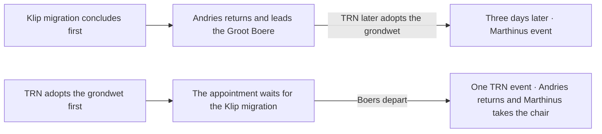

# Leadership in Winburg, Potchefstroom, Natal, Zoutpansberg and Lydenburg

Design record · Spes Bona 0.20.3 · Victoria 3 1.15.2 · Opened 21 November 2026 · Revised 22 November 2026

## Selected setup

| Occasion | Country leadership and cast |
| --- | --- |
| **January 1836 · ORA** | Gerrit Maritz governs Oranje and leads the Landowners. Hendrik Potgieter leads the Armed Forces. Piet Retief, Andries Pretorius, Stephanus Schoeman and Marthinus Wessel Pretorius complete the six-person cast. Ordinary succession can fill Maritz’s eventual vacancy in this patch. [Historical council and field command, Van der Merwe, pp. 119–120](https://scielo.org.za/pdf/funda/v23n1/06.pdf#page=9) |
| **Potchefstroom forms · TRN** | Hendrik founds TRN and leads its Armed Forces. Schoeman and Marthinus move inland. Andries leads TRN’s Landowners when present. If Bloedrivier has already taken Andries to Natal, Hendrik founds TRN while Andries stays in NAL. Maritz can continue governing ORA after the split. [A Republic Beyond the Vaal](../events/sb_great_trek_events.txt#L248) |
| **Boer victory at Bloedrivier · NAL** | Andries goes to Boer Natalia and leads it. If TRN already exists, its player can still follow him to Natal. The separate settlement in which Retief survives keeps its own Natal leadership. [Blood River founding](../common/scripted_effects/sb_natalia_effects.txt#L853) · [TRN player choice](../events/sb_natal_crisis_events.txt#L793) · [Retief settlement](../common/scripted_effects/sb_natalia_effects.txt) |
| **Zoutpansberg forms · ZPB** | Hendrik goes north as founding ruler and leads the Armed Forces. Stephanus Schoeman accompanies him and leads the Landowners, and serves as fallback founder if Hendrik is unavailable. Boer trekker arrivals, National Supremacy and startup-leader cleanup replace indigenous-generated founding leaders with Boer politicians. If Hendrik vacates the western office while Andries is in Natal, an ordinary local successor can govern TRN. [Northern founding](../common/scripted_effects/sb_trek_migration.txt) |
| **Klip River ends in Boer migration · TRN** | The living Andries returns to TRN as a Landowner. While the constitution is pending he takes leadership of the **Groot Boere**. If TRN has already adopted it, the same return event brings Andries home and seats an eligible Marthinus as Landowner leader. [Boer interest-group names](../common/scripted_effects/sb_interest_group_identity_effects.txt#L150) |
| **TRN adopts the grondwet** | Selecting adoption in **The Volksraad and the Commando** fulfils the constitutional condition. If the Klip migration ending has already concluded, Marthinus’s Landowner event follows **three days after adoption**. If migration comes later, the appointment belongs to the return event. Elections can subsequently make him president. [Constitutional choices](../events/sb_boer_republics_events.txt#L230) · [Presidential election rule](</Users/depro/Library/Application Support/Steam/steamapps/common/Victoria 3/game/localization/english/government_l_english.yml#L933>) |
| **Lydenburg secedes · LYD** | Cornelis Potgieter leads LYD using his existing character. Both choices in **A Break in the Volksraad** found the eastern republic. The player can stay in TRN or go east. [Secession options](../events/sb_boer_republics_events.txt#L335) · [Cornelis’s template](../common/character_templates/sb_southern_africa_character_template_overrides.txt#L973) · [Cornelis’s civil role, Jooste, pp. 89–90](https://repository.up.ac.za/server/api/core/bitstreams/a85edf52-a0b0-40ac-b775-f914a209248a/content#page=104) |

Marthinus starts as a Landowner politician aged sixteen with an extended politician career (`set_career_length = { role = politician years = 100 }`, also applied to Schoeman and transferred Boer founders) so natural career expiry cannot silently delete him before his appointment arc. **Youth** gives him −25 personal prominence and −25 personal popularity. He loses Youth at his scripted appointment or silently on his 35th birthday, 17 September 1854, whichever comes first. Only the scripted appointment grants **+15 personal popularity for 48 months**. An early organic faction leadership stands. [Marthinus’s template](../common/character_templates/sb_southern_africa_character_template_overrides.txt#L185) · [Opening cast](<../common/history/characters/ora - oranje.txt>)

## When Marthinus takes the Landowner leadership

**Two things must have happened.** The Klip River chain has concluded with the Boer migration ending, and TRN has chosen **Adopt the grondwet**. Whichever happens second determines how the appointment is delivered. An eligible Marthinus becomes leader of the Groot Boere once.

| Order | What the TRN player sees |
| --- | --- |
| **Klip migration first** | Andries returns and leads the Groot Boere if available. When TRN later adopts the constitution, it schedules one separate Marthinus event for three days later. |
| **Constitution first** | Adoption resolves normally. When the Boers later leave Natal, **one combined return event** covers Andries’s homecoming and Marthinus taking the Landowner leadership. The son holds the chair at the end of the event. |
| **Only one condition is met** | Ordinary politics continue. A frontier TRN can receive Andries and the emigrants. A constitutional TRN can hold elections even if no Klip migration occurs. Neither situation alone triggers the scripted appointment. |

The qualifying fact is the **migration ending**. Both the ordinary departure and the punitive Zulu-victory departure qualify. A secession white peace can mark the crisis resolved while leaving the families in place. A cancelled expedition can likewise mark it resolved. In the white-peace branch where KLR was annexed and the families subsequently depart, the completed departure qualifies. British takeover, a pending exodus and the identity of the selected refugee host are insufficient evidence on their own. [Standard departure](../common/scripted_effects/sb_klip_river_county_effects.txt#L140) · [Punitive Zulu victory](../common/scripted_effects/sb_klip_river_county_effects.txt#L842) · [White-peace outcomes](../common/scripted_effects/sb_klip_river_county_effects.txt#L731) · [Expedition cancellation](../common/scripted_effects/sb_klip_river_county_effects.txt#L421)

**One political announcement in TRN.** When Klip comes second and TRN is the refugee host, use the combined version of its ordinary **Natal Refugees in Transvaal** event or its punitive **The Wagons from Natal** event. On the ordinary route the existing acknowledgement also moves the families. On the punitive route the families have already moved when the notice is sent. When another republic receives the refugee notice, it keeps its own arrival effects and TRN gets the single combined political return event. This also covers a missing punitive notification host when the exodus still takes place. [Ordinary receiver selection](../common/scripted_effects/sb_natalia_colony_effects.txt#L518) · [Ordinary TRN arrival and migration](../events/sb_natal_crisis_events.txt#L2234) · [Punitive migration and notice](../common/scripted_effects/sb_klip_river_county_effects.txt#L866)

The order is determined by the committed departure outcome and the actual constitutional choice. Record which of the two deliveries is due at that point so answering a held host popup, processing both milestones on the same day or reloading a save cannot award the chair or move the families twice. The migration outcome must survive the loss of NAL or a later founding of TRN. A living Andries’s availability controls his personal return. Marthinus’s eligibility is checked separately. If Marthinus is unavailable, Andries can hold the chair on his return and the republic follows ordinary succession.

## Timing the constitution in TRN

**Keep the existing spacing.** Answering **The Mooi River Country** schedules **The Volksraad and the Commando** ten days later. If migration has already concluded, Marthinus’s separate event is due three days after the player actually adopts the constitution. If the migration ending comes second, use the return event at its normal time. Adoption independently schedules **A Break in the Volksraad** sixty days later when LYD is eligible. With immediate answers and migration already complete, those four popups fall on days **0, 10, 13 and 70**. [TRN territorial finale](../events/sb_great_trek_events.txt#L538) · [Ten-day dispatch](../common/scripted_effects/sb_trek_migration.txt#L174) · [Constitutional choice and Lydenburg dispatch](../events/sb_boer_republics_events.txt#L250)

TRN’s constitution remains available on its own Great Trek route. The **appointment** waits for both milestones. If Boer Natal stays independent, for example, TRN can adopt its constitution even though the Klip commission requires a British colony. [Commission conditions](../common/scripted_triggers/sb_klip_river_county_triggers.txt#L3)

## Implementation and replay

The one-off birthday action follows Marthinus between countries. The two political events share his appointment effect and check his identity again when their option runs. The ordinary household host moves the families on acknowledgement. If that host disappears with its notice unanswered, the next Natal monthly check sends the families to the surviving eligible republics. The punitive settlement has already moved them before notifying its host. [Leadership effects](../common/scripted_effects/sb_boer_leadership_effects.txt) · [Republic events](../events/sb_boer_republics_events.txt)

A punitive return-state demand can extinguish Natal before the final settlement runs. During that play the British authorities shelter the living former commandant. A settlement without migration restores him to Natal. A committed migration sends him to TRN when it exists and records his return for a later TRN founding otherwise.

A pending arrival from an older save still settles through its original event. A TRN host can recognise the son in that same notice. The ordinary flight marker on Natal and the punitive distribution marker on Zululand can establish an earlier migration. The centralising-republic modifier, a pending Lydenburg secession or TRN’s record of having founded Lydenburg provides evidence of an earlier constitutional vote. [Klip settlement](../common/scripted_effects/sb_klip_river_county_effects.txt)

## Decision register

| Status | Decision or outstanding choice |
| --- | --- |
| Agreed | Maritz governs ORA and leads its Landowners. Hendrik leads its Armed Forces. Retief, both Pretoriuses and Schoeman also start in ORA. |
| Agreed | Hendrik founds TRN and leads its Armed Forces. Andries chairs its Landowners when available. A Boer victory at Bloedrivier takes Andries to lead NAL. |
| Agreed | Hendrik and Stephanus go to ZPB together when it forms. Cornelis leads LYD when it secedes. |
| Agreed | A Klip ending with Boer migration and TRN’s adoption of the grondwet are both required for Marthinus’s Landowner appointment. Migration first gives Andries the chair on return and Marthinus a separate event three days after adoption. Constitution first folds Marthinus’s appointment into the single TRN return event. Elections provide his route to the presidency. |
| Agreed | Keep the constitution ten days after the TRN territorial finale and the eligible LYD secession sixty days after adoption. TRN can adopt before the Klip chain resolves. |
| Agreed | Youth lasts until the appointment or the 35th birthday. The appointment grants +15 personal popularity for 48 months, once. |
| Deferred | **Named successors to Gerrit Maritz in ORA** are an open historical and design question for a later patch. Jan Mocke is a previously researched possibility. [Mocke at Winburg, Gie, vol. II, p. 336](https://repository.up.ac.za/server/api/core/bitstreams/094dd3e1-57ae-4b7b-ac16-fd6b91365d72/content) |
| Deferred | **Further cast expansion, including Gert Kruger.** The named western caretaker, Piet Potgieter’s intervening northern command and a separate Willem François Joubert character at Lydenburg belong to later cast work. The present setup uses the existing characters. [Gert at Potchefstroom, Van den Bergh, p. 461](https://scielo.org.za/pdf/tvg/v53n3/13.pdf#page=10) · [Leadership research and sources](research/sb_boer_republic_leadership_research_brief_2026_11_21.md#L28) |

## DP’s checkpoint replay

- At the 1836 start, inspect the two personal penalties on Marthinus’s character card in ORA and again after the same politician moves to TRN. In a campaign where he has yet to be appointed, compare 16 and 17 September 1854. Reload from the 16th and verify that only Youth disappears on the 17th.
- Appoint him before 35, on his birthday and after 35. An early appointment removes Youth and adds 15 popularity for 48 months. The birthday pays nothing. Advance to the end of the modifier and check the character card again. If he already won the Groot Boere leadership organically, the appointment still recognises him once.
- Play both TRN–Natal founding orders. Check the Natal commando, Hendrik and Schoeman at Zoutpansberg and Cornelis at Lydenburg. A frontier constitution choice, an independent Natal or a settlement where the Boers stay leaves the appointment pending until both conditions have been met.
- Use the ordinary and punitive Klip outcomes with each milestone order. Hold a TRN arrival open across adoption and reload with the three-day appointment queued. Check the final Landowner leader, count the popups and compare family totals before and after acknowledgement. Repeat with another host, a lost host and a settlement without a living Andries. With only TRN and ORA eligible, 10,000 Boer people yield 8,550 in TRN, 950 in ORA and 500 at the origin.
