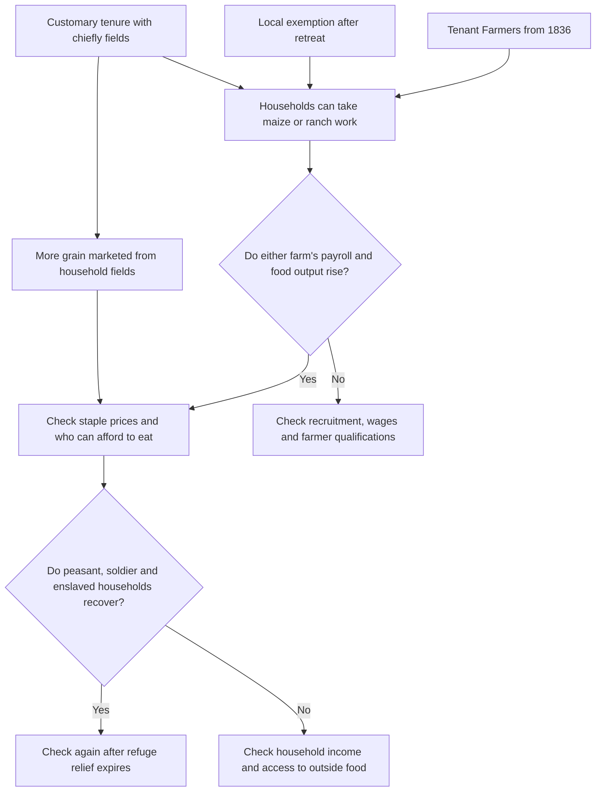

# Basotho land tenure and the Lesotho famine

Design discussion · Victoria 3 1.15.2 · 20–21 November 2026

**BST's selected 1836 land law is vanilla Tenant Farmers.** It gives the proposed local hiring freedom, peasant in-kind income and +25% Landowners political strength using an existing law. Its internal peasant migration restriction matters while BST holds two states. After the loss of the lowlands, the famine trial turns on whether Lesotho's maize farm and ranch hire enough workers and whether households can afford the food. The earlier customary-law comparison below records the historical trade-off. [Oorlam and Rehoboth comparison](oorlam_rehoboth_vanilla_land_reform_design_2026_11_21.md)

## What changed in this campaign

These are six saves from the same playthrough. Each row follows BST's incorporated share of Drakensberg, state 1154. Hunger shares count people, including dependants, by the saved Food Security of their Pop. The 1.15.2 thresholds are below 0.40 for starvation and below 0.20 for severe starvation. The severe group is included in the first column of percentages. [Installed Food Security defines](</Users/depro/Library/Application Support/Steam/steamapps/common/Victoria 3/game/common/defines/00_defines.txt>)

| Save date | Population | Starving | Severe | Maize workers | Ranch workers | BST's market |
| --- | ---: | ---: | ---: | ---: | ---: | --- |
| 10 Mar 1843, before the retreat | 31,272 | 0% | 0% | No maize farm | 4,967 | Basotho, with two BST states |
| 1 Oct 1852 | 30,045 | 64.7% | 7.5% | 10 | 912 | British |
| 1 Nov 1852 | 29,960 | 97.5% | 61.7% | 10 | 913 | British |
| 1 Dec 1852 | 29,879 | 97.7% | 61.5% | 10 | 915 | Basotho |
| 1 Jan 1853 | 29,779 | 97.6% | 61.3% | 10 | 916 | Basotho |
| 1 Feb 1853 | 29,677 | 97.8% | 61.8% | 10 | 909 | Basotho |

Serfdom was active throughout. The Mountain Refuge grant ran from 22 February 1848 to 22 February 1858. The game dates this famine to 25 October 1852, while BST still belonged to the British market. The five late saves establish prolonged distress across a market change. They leave the immediate cause of the October deterioration open. Save SHA-256 prefixes are `a4e83f0bf4dfee` for March 1843, `16505edbf468e4` for October 1852 and `cac33646a364d6` for February 1853. [Pre-retreat save](<../../../save games/natalia_1843_03_10.v3>) · [February autosave as inspected](<../../../save games/autosave.v3>)

In February the subsistence farms employed 2,983 of 30,000, just under 10%. Serfdom adds a 50% protected-employment floor, and peasants under its law family gain farmer qualifications at one fifth the usual rate. The maize farm had ten labourers, zero farmers and £24,880 in reserves. The peasants collectively had about 182 saved farmer qualifications. The 1.14.5 hiring investigation traced how the floor prevented transfers. The 1.15.2 law and staffing fit that explanation. The current saves cannot tell us what wage the farm would offer an eligible worker. [Land reform laws](</Users/depro/Library/Application Support/Steam/steamapps/common/Victoria 3/game/common/laws/01_land_reform.txt>) · [Farmer qualifications](</Users/depro/Library/Application Support/Steam/steamapps/common/Victoria 3/game/common/pop_types/farmers.txt>) · [Hiring investigation](compatibility/bst_lesotho_famine_2026_11_01.md)

Two outcomes matter. All 16,079 people in peasant households were severely starving, including the dependants of just 2,529 working peasants. All 8,608 people in soldiers' households and all 4,182 in enslaved households were below the starvation threshold. Household earnings matter to the first group, while the price and availability of staples matter across all three. The ranch supplied 10.03 meat in the healthy checkpoint and 1.82 in February. Meat meets the game's basic food need alongside grain. [Basic food needs](</Users/depro/Library/Application Support/Steam/steamapps/common/Victoria 3/game/common/pop_needs/00_pop_needs.txt>) · [Household income and food supply](compatibility/bst_subsistence_income_replay_2026_11_01.md)

## Vanilla choice and alternatives considered

| Direction | What the player and households experience | Trade-off |
| --- | --- | --- |
| **Selected. Tenant Farmers from 1836** | The law lifts Serfdom's local hiring floor and restores ordinary farmer qualification growth. The chiefs retain the land law's +25% Landowners bonus. | Tenant Farmers describes hereditary estate ownership and retains its restriction on internal peasant migration. BST can use its ordinary civilian hiring mechanics for the famine trial. |
| **A. Customary Land Tenure from 1836** | Chiefs retain authority to allocate fields and regulate grazing. A household keeps an allotment while resident, can take paid farm work and gives up its old allotment if it leaves. The game's arable-land reservation represents household access. After the retreat, farms can offer wages and the player can see whether grain or livestock production recovers before building further. | Fits the healthy opening as well as the crisis. The state can still lose fertile land, working adults and access to markets. A distinct law needs political stances and a working subsistence production method. |
| **B. Reallocate labour in the Mountain Refuge** | The existing retreat offsets Serfdom's 50-point hiring floor locally while BST holds Lesotho under that law. The maize farm and ranch can compete for staff. A trial can use the remaining duration of the existing ten-year refuge, ending earlier on reform or loss of the state. | Gives a clean test of hiring and a smaller change to existing campaigns. Serfdom still slows farmer qualification and governs BST before the retreat. When relief expires, the floor can bind again. This is a useful comparison if the desired feature is specifically recovery from displacement. |
| **C. Give chiefly fields an economic role** | Keep A's land access and mobility. Use the law's subsistence production method to direct a share of the harvest into local grain supply. Households retain less in kind than under A. Wage-earning families may gain from cheaper grain even before the maize farm can hire. A subsequent land reform changes that division of the crop. | Models the tension between provisioning others and leaving households enough to live on. It requires one additional production method. With few working cultivators the extra grain is small, and sale on the local market gives no household a guaranteed ration. |

Casalis describes both chiefly allocation and households returning their fields when they moved. He distinguishes work on a chief's fields from reciprocal work between households. The research brief also documents provisioning of dependants, chiefs' sales, cattle loans and personal bondage. Those differences support A and make C a meaningful alternative. Keep military service under Chiefly Levy and bondage under the separate slavery arrangements. [Casalis, pp. 159–163](https://archive.org/stream/basutosortwentyt00casa/basutosortwentyt00casa_djvu.txt) · [Customary tenure research brief](research/sb_customary_land_tenure_research_brief_2026_11_20.md)

### Tenant Farmers and the earlier customary proposal

Vanilla's Tenant Farmers describes hereditary estate owners whose tenants can seek other work. Under Basotho customary tenure, a chief could allocate a field, a resident household held the right to cultivate it, and departure returned it for reallocation. Grazing was shared under local rules. In game, a peasant can take a maize job **in Lesotho** under either law. While BST holds two states, the customary law would also let peasants move between them, subject to the separate migration rules. Once BST holds only Lesotho, that distinction has little immediate economic effect. Both laws give the same local hiring and food-income mechanics in the crisis. [Vanilla law descriptions](</Users/depro/Library/Application Support/Steam/steamapps/common/Victoria 3/game/localization/english/laws_l_english.yml>) · [Casalis, pp. 159–160](https://archive.org/stream/basutosortwentyt00casa/basutosortwentyt00casa_djvu.txt)

| Per-law contribution or associated subsistence method | Serfdom · saved campaign | Tenant Farmers · selected | Customary Land Tenure · shelved A |
| --- | ---: | ---: | ---: |
| Minimum incorporated arable land reserved for subsistence | +75 percentage points | **+25 points** | +25 points |
| Protected-employment floor in incorporated subsistence buildings | +50 percentage points | **0 points** | 0 points |
| Peasant internal migration prohibited by this land law | Yes | **Yes** | No |
| Peasant mass migration prohibited by this land law | Yes | **No** | No |
| Landowners interest-group political strength | +25% | **+25%** | +25% |
| Peasant-to-farmer qualification growth, land-law factor | ×0.2 | **×1** | ×1 |
| Annual in-kind income per employed peasant, before other modifiers | £3 | **£4** | £4 |
| Additional marketed grain from the tenure method, per fully staffed subsistence-farm level | +0.5 | **0** | 0 |
| Scripted progressiveness | −50 | **0** | 0 |

Tenant Farmers already provides `state_minimum_incorporated_subsistence_arable_land_add = 0.25`, `interest_group_ig_landowners_pol_str_mult = 0.25` and the ordinary non-serf production method, `pm_serfdom_no`. The grain contribution in the table is additional to the default subsistence farm's **1.0 grain** per fully staffed level before throughput. Closed Borders and the existing Mountain Refuge apply separately. [Land reform scripts](</Users/depro/Library/Application Support/Steam/steamapps/common/Victoria 3/game/common/laws/01_land_reform.txt>) · [Subsistence methods](</Users/depro/Library/Application Support/Steam/steamapps/common/Victoria 3/game/common/production_methods/12_subsistence.txt>)

**Why the Landowners gain strength.** In Casalis's account, a family that moved surrendered its field, a chief heard boundary disputes that neighbours could not settle, and village chiefs reserved winter pasture. In the pilot a family member can take a wage at the maize farm while the household still relies on the chief for its grazing and field rights. SB already places Moshoeshoe in the Landowners. Giving that group +25% political strength carries the chiefs' authority over land into national politics. It also preserves BST's starting land-law bonus while testing the effect of freer hiring on hunger. The group's eventual share of national clout depends on the strength of its supporters and of the other groups. [Casalis, pp. 159–160](https://archive.org/stream/basutosortwentyt00casa/basutosortwentyt00casa_djvu.txt) · [Moshoeshoe's character template](../common/character_templates/sb_southern_africa_character_template_overrides.txt) · [Vanilla definition of clout](</Users/depro/Library/Application Support/Steam/steamapps/common/Victoria 3/game/localization/english/concepts_l_english.yml>)

The Chiefly Levy gives the **aristocrat profession** political strength through the muster. Aristocrats contribute that strength to whichever interest groups they support. The two sources of chiefly influence respond independently to reform. [Chiefly Levy](../common/laws/04_sb_chiefly_levy.txt) · [Vanilla army models](</Users/depro/Library/Application Support/Steam/steamapps/common/Victoria 3/game/common/laws/00_army_model.txt>) · [Vanilla land reforms](</Users/depro/Library/Application Support/Steam/steamapps/common/Victoria 3/game/common/laws/01_land_reform.txt>)

| BST's laws after the player's choice | Landowners strength from land tenure | Aristocrat strength from the army law |
| --- | ---: | ---: |
| Keep Tenant Farmers and the Chiefly Levy | +25% | +10% |
| Adopt Professional Army and keep Tenant Farmers | +25% | 0% |
| Adopt Homesteading and keep the Chiefly Levy | 0% | +10% |

Under vanilla Tenant Farmers, **Agrarian** (Rural Folk) has `disapprove` and **Hierarchic** (Landowners) has `approve`. Both ideologies are present for BST in the February 1853 save. The shelved proposal would have given both groups `approve`. A later reform to Homesteading uses its parent Peasant Proprietorship's stances, `strongly_approve` for Agrarian and `strongly_disapprove` for Hierarchic. Homesteading is the variant available through Southern Africa's geographic designation. [Vanilla ideology table](</Users/depro/Library/Application Support/Steam/steamapps/common/Victoria 3/game/common/ideologies/00_ig_ideologies.txt>) · [Vanilla geographic regions](</Users/depro/Library/Application Support/Steam/steamapps/common/Victoria 3/game/common/geographic_regions/05_geographic_regions_content.txt>) · [Law inheritance](pitfalls/politics.md#pol-02)

**Hiring has to earn back the grain lost in the switch.** Tenant Farmers raises annual in-kind income from £3 to £4 per working peasant before modifiers, while removing Serfdom's +0.5 workforce-scaled marketed grain. At February's staffing that costs about **0.30 grain**. Simple maize farming supplies 20 grain per 5,000 workers. If all new hires come from ordinary subsistence farming, **about 80 additional maize workers** would cover that loss at the saved productivity. That is a break-even comparison for grain. Ending famine also depends on prices, wages, meat and the number of mouths each worker supports. For **C**, the earlier comparison kept the existing £3 and +0.5 grain coefficients while lifting the labour restrictions. [Subsistence production methods](</Users/depro/Library/Application Support/Steam/steamapps/common/Victoria 3/game/common/production_methods/12_subsistence.txt>) · [Simple farming](</Users/depro/Library/Application Support/Steam/steamapps/common/Victoria 3/game/common/production_methods/02_agro.txt>)

## Which polities should use it?

BST's country history now assigns Tenant Farmers. The table records the earlier comparisons considered for Lesotho. For ZUL, SWZ and GZA, the separate historical review recommends Tenant Farmers on the strength of household and chiefly land claims in 1836. [BST country history](<../common/history/countries/bst - basuto.txt>) · [ZUL, SWZ and GZA design](zul_swz_gza_vanilla_land_reform_design_2026_11_21.md) · [Four-country starting-position review](sb_bantu_starting_position_comparison_2026_10_25.md)

| Polity | Proposed treatment | What decides it |
| --- | --- | --- |
| **BST · Basotho** | Tenant Farmers from 1836. | Compare hiring and hunger against existing Serfdom through the same retreat and market change. |
| **SWZ · Swazi** | First extension to test with identical law values. | Allocation through chiefs and service obligations fit the baseline. Check maize and ranch hiring under Sobhuza. Let the existing Amabutho army law account for mobilisation. [Bonner on Swazi state formation](https://wiredspace.wits.ac.za/items/c52a3662-f007-4922-9ea3-88f668a0e2f4/full) |
| **ZUL · Zulu** | Test the same law for ordinary homesteads under Dingane. | Royal and regimental homesteads make a distinct claim on labour. Check peacetime household production, farm staffing during a muster, and the balance between Landowners and Armed Forces as employment changes under the same +25% Landowners bonus. [Study of royal and military homesteads](https://doi.org/10.1080/0067270X.2018.1540218) · [SB's 1836 Zulu government](<../common/history/countries/zul - zulu.txt>) |
| **GZA · Gaza** | Defer the nationwide starting grant. | The royal centre, captive labour and tributary communities faced different obligations. If the evidence supports customary tenure for ordinary cultivators, it could serve as the household baseline alongside separate tribute and slavery rules. A tribute payment alone tells us little about who allocated a family's field. [Mathebula on the Hlengwe frontier](https://newcontree.org.za/index.php/nc/article/view/247/986) |

For the wider map, **XHO** (Xhosa) and **TSW** (Tswana) are candidates for the next land-allocation review. Xhosa homesteads combined cultivation and grazing under increasing frontier pressure. TSW represents several southern Tswana communities in one decentralised tag. For **NGI, MTB and TSO**, assess local household rights separately from the tribute, warband and border arrangements SB already assigns. **PDI** (Pedi), **VND** (Venda), **OVB** (Ovambo) and **HRO** (Herero and Damara in SB) also merit their own evidence. In a decentralised start, check incorporation and the presence of civilian employers before expecting a change in the hiring floor to matter. [Xhosa homesteads and grazing](https://doi.org/10.1017/9781108659284.002) · [TSW history](<../common/history/countries/tsw - botswana.txt>) · [NGI history](<../common/history/countries/ngi - nguni chiefdoms.txt>) · [Regional country definitions](../common/country_definitions/zz_sb_southern_africa_country_definition_overrides.txt)

**STA and NGN** should carry the founding country's actual land law through formation, including any reform a player has already enacted. BST can form STA. ZUL, SWZ or GZA can form NGN. [STA formation](../common/country_formation/sb_formable_countries.txt) · [NGN decision](../common/decisions/sb_nguni_decisions.txt)

## Decision record and acceptance

| Status | Decision |
| --- | --- |
| Agreed | Historical dynamics must affect play, and persistent starvation in Lesotho must end. |
| Agreed | Select vanilla Tenant Farmers for BST from 1836, including its +25% Landowners political strength, ordinary subsistence method, migration rule and ideology stances. |
| Open | Can Tenant Farmers end the Lesotho famine under the same refuge, refugee cohort, military setup and borders as the Serfdom control? |
| Provisional | Preserve the founder's enacted land law through formation. SWZ and ZUL remain candidates for later comparison with their existing Amabutho obligations. |
| Deferred | The standalone customary law, a retreat-specific hiring exemption and the chiefly-fields production method were alternatives considered before selecting Tenant Farmers. |
| Deferred | The nationwide GZA grant, the wider regional starts and any separate work-party amendment need their own evidence or political purpose. |

Use the healthy 1843 checkpoint as a control, replay the 1848 retreat, and branch the February 1853 save for a recovery trial. Starting history takes effect in new campaigns. For the saved branch, explicitly apply the candidate to BST's original 1836 Serfdom with the player's knowledge. Keep any later reform chosen by a player. Observe employment, grain and meat sold, local staple prices, wages, worker/dependant counts and hunger by profession at weeks 4 and 12 and through the following year. The original refuge lasts until February 1858, so check six months beyond expiry too.

**Proposed success criterion.** During ordinary peace, the recorded famine ends and the state stays below the native state thresholds of 35% starving and 15% severely starving. Aim for under **5%** of residents starving and under **1%** severely starving for six consecutive months, with the major household groups improving. Check absolute numbers, deaths and outmigration to establish that people actually recovered. A healthy opening and the possibility of a genuine wartime food shock both belong in the comparison.
