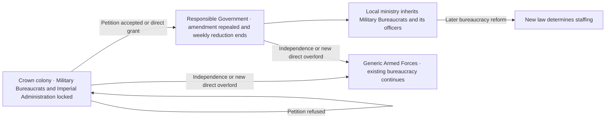
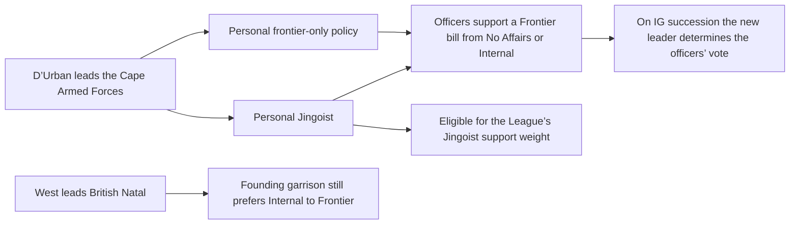

# The Cape and British Natal Armed Forces under Victoria 3 1.15.2

**Implemented · 24 November 2026.** The Cape and British Natal use Military Bureaucrats with an Imperial Administration amendment. Responsible Government ends Crown appointments and retains the British garrison. Independence or a change of direct overlord also ends the appointments and restores the generic Armed Forces. Each country keeps its bureaucracy until it reforms it locally. The petition base is −65. The two garrisons’ Anglo-Colonialism favours outward settlement. [Decision register](#decision-register) · [Playtest questions 1 and 2](playtest_triage_2026_11_24.md)

## Military Bureaucrats and the Crown appointment power

At the 1836 Cape start and on either route to British Natal, the Armed Forces sponsor one **Imperial Administration** amendment on vanilla **Military Bureaucrats**. Britain controls appointments while the amendment is active. Its sole modifier is **−0.10 weekly liberty desire**. Military Bureaucrats supplies the officer posts and political strength. [Cape start](<../common/history/countries/cap - cape colony.txt#L39>) · [British Natal setup](../common/scripted_effects/sb_natalia_colony_effects.txt#L165) · [Legacy liberty-desire modifier](../common/laws/04_sb_imperial_administration.txt#L25)

While Britain retains Crown appointments, the amendment and Military Bureaucrats are both locked. Apply this restriction to the two Crown colonies across player and AI enactment, imposed reforms and direct law changes. The existing government-form safeguard covers governance principles. Bureaucracy requires its own protection. British Natal’s 1883 checkpoint illustrates the gap. It had enacted Appointed Bureaucrats while still an ordinary colony. [Governance safeguard](../common/laws/sb_colonial_administration_guard.txt#L2) · [Amendment repeal lock](../common/amendments/sb_amendments.txt#L249) · [1883 checkpoint](<../../../save games/13-chiefs-local_1883_06_01.v3>)

**Granting Responsible Government automatically repeals Imperial Administration.** Repeal it once in the shared handoff for both an accepted petition and a direct grant. Britain hands appointment authority to the local ministry. The −0.10 weekly reduction ends immediately. The ministry inherits the existing imperial officers under Military Bureaucrats and can replace them through a later, ordinary bureaucracy reform. An unsuccessful petition leaves both the amendment and the lock in place. The diplomatic actions already give the colony a one-time −50 liberty desire on success. [Direct grant](../common/diplomatic_actions/sb_subject_autonomy_actions.txt#L39) · [Accepted petition](../common/diplomatic_actions/sb_subject_autonomy_actions.txt#L149) · [Shared constitutional handoff](../common/scripted_effects/sb_subject_autonomy_effects.txt#L3) · [SB example of removing a specific amendment](../common/scripted_effects/sb_natal_interwar_effects.txt#L880)

The Cape journal’s existing **0.10 monthly drift toward settlers** tests for the legacy standalone law. The agreed amendment affects only liberty desire. Any retargeting of that journal rule is a separate balance decision. The existing Cape grant event already gives **10 points toward the liberals** when its journal is active. [Monthly bureaucracy rule](../common/scripted_progress_bars/sb_progress_bars.txt#L190) · [Cape grant event](../events/sb_cape_events.txt#L1177)

The agreed **group Anglo-Imperialism** strongly approves Military Bureaucrats, is neutral toward Hereditary, disapproves of Appointed, and strongly disapproves of Elected and Communal. Crownland Diets follows its Hereditary parent. The British South Africa Company’s garrison also receives this group ideology. The separate character ideology used by Rhodes has its own table. [Current group and character tables](../common/ideologies/sb_ideologies.txt#L366) · [Vanilla Loyalist](</Users/depro/Library/Application Support/Steam/steamapps/common/Victoria 3/game/common/ideologies/00_ig_ideologies.txt#L585>) · [Company setup](../common/scripted_effects/sb_rhodesian_venture_effects.txt#L344)

## Responsible Government acceptance

An ordinary colony can petition its overlord. The **request** uses random approval and accepts obligations. The **grant** is unilateral and has its own AI conditions. These interactions serve ordinary colonies under any overlord. Both use an AI evaluation chance of `0.25`, with proposal weights **100** for the request and **10** for the grant. Evaluation controls whether the AI considers an action. [SB interactions](../common/diplomatic_actions/sb_subject_autonomy_actions.txt#L65) · [AI evaluation field](</Users/depro/Library/Application Support/Steam/steamapps/common/Victoria 3/game/common/diplomatic_actions/diplomatic_action.md#L119>)

| Contribution to the overlord's score on a request | Current value |
| --- | --- |
| Base | **−75** |
| Liberty desire of the colony | **2 × (liberty desire − 60)**, minimum **−50**, maximum **+75** |
| Overlord attitude toward the colony | Protective **+50**, domineering **−50**, otherwise **0** |
| Relations | Friendly **+50**, amicable **+25**, cordial **+10**, below cordial but above poor **−25**, poor or worse **−50** |
| Relative power in a potential diplomatic play | **50 × (colony's power ratio − 0.25)**, maximum **+100** |
| Ideology | Half the colony's ideological opinion of the overlord, from **−25 to +25** |
| Colony's infamy | Below infamous **0**, infamous **−10**, notorious **−25**, pariah **−50** |

On the installed 1.15.2 defines, **10** is the **50%** random-approval point and the point where the AI considers an offer acceptable to propose. **30** guarantees approval. Calling in an obligation ordinarily adds **50** to a diplomatic action, or **25** after recent repudiation. An AI colony considers petitioning under the *Increased Self-Reliance* or *Break Free* strategies and skips petitions it expects to fail. A rejection gives the colony **+10** liberty desire and **−20** relations. The request cooldown is **five years**. [Acceptance formula and proposer](../common/diplomatic_actions/sb_subject_autonomy_actions.txt#L203) · [AI approval and obligations](</Users/depro/Library/Application Support/Steam/steamapps/common/Victoria 3/game/common/defines/00_ai.txt#L67>) · [Rejection](../common/diplomatic_actions/sb_subject_autonomy_actions.txt#L186) · [SB cooldowns](../common/diplomatic_catalysts/sb_subject_autonomy_catalysts.txt#L3) · [Cooldown duration](</Users/depro/Library/Application Support/Steam/steamapps/common/Victoria 3/game/common/diplomatic_catalyst_categories/00_diplomatic_catalyst_categories.txt#L7>)

For an **unsolicited AI grant**, liberty desire must reach **60**. The overlord must also have either **(a)** at least amicable relations, a protective attitude and an anti-imperialist or balance-of-power strategy, or **(b)** a colony-to-overlord play power ratio of at least **0.50**. A human overlord can use the grant as soon as its ordinary eligibility conditions hold. [Grant eligibility and AI](../common/diplomatic_actions/sb_subject_autonomy_actions.txt#L20)

The agreed change raises the petition’s base acceptance from **−75 to −65** across eligible ordinary colonies. It adds ten acceptance points at every liberty-desire level. The separate unsolicited-grant threshold is **60 liberty desire**.

| Illustrative petition | Current base −75 | Agreed base −65 |
| --- | ---: | ---: |
| Protective, amicable, liberty desire 60 | 0 | **10** (50%) |
| Protective, amicable, liberty desire 70 | 20 | **30** (certain) |
| Protective, friendly, liberty desire 2.4 | −25 | **−15** |

These examples assume a play power ratio of 0.25, zero ideological opinion and infamy, and no obligation. Actual saves illustrate the range. On 1 May 1862 the Cape was an ordinary colony with **65.7** liberty desire. On 1 June 1883 it was responsible, while British Natal was still an ordinary colony with **2.4** liberty desire. The Cape can also receive **+0.75** weekly liberty desire after its Anglo-African awakening. Keeping the old **−0.10** on the amendment carries forward a pressure already present in these campaigns. [1862 checkpoint](<../../../save games/transvaal republic_1862_05_01.v3>) · [1883 checkpoint](<../../../save games/13-chiefs-local_1883_06_01.v3>) · [Cape pressure](../common/static_modifiers/sb_modifiers.txt#L17)

## Anglo-Colonialism and the frontier vote

The Cape Imperial Establishment and British Natal Colonial Garrison receive **Anglo-Colonialism** in place of vanilla Colonialist. It copies the installed Colonialist’s economic system, trade, land reform and labour rights positions. Its colonial-affairs stances favour outward settlement across changes of garrison leader, subject to the usual priority of a leader with a personal stance on the law group. [Vanilla Colonialist](</Users/depro/Library/Application Support/Steam/steamapps/common/Victoria 3/game/common/ideologies/00_ig_ideologies_flavored.txt#L756>) · [Cape and Natal identities](../common/scripted_effects/sb_interest_group_identity_effects.txt#L27)

| Colonial affairs law | Vanilla Colonialist | Agreed Anglo-Colonialism |
| --- | --- | --- |
| No Colonial Affairs | Neutral | Disapprove |
| Internal Colonisation | Approve | **Neutral** |
| Frontier Colonisation | Neutral | **Approve** |
| Colonial Resettlement | Neutral | **Approve** |
| Colonial Exploitation | Approve | **Strongly approve** |

The garrisons favour Frontier or Resettlement over Internal. Cape officers can therefore back a Frontier bill from either No Colonial Affairs or Internal. British Natal’s garrison usually starts under Frontier and would support a switch to Exploitation. Neutral is the ideological rating for Internal. Eligibility to enact the law follows its ordinary rules. [Cape petitions](../events/sb_cape_events.txt#L777) · [Frontier eligibility](../common/laws/00_sb_governance_principles.txt#L34) · [Internal Colonisation eligibility](</Users/depro/Library/Application Support/Steam/steamapps/common/Victoria 3/game/common/laws/01_colonial_affairs.txt#L77>)

Scope the swap at assignment. The British South Africa Company calls the Natal garrison helper, and a separate helper gives colonial Industrialists vanilla Colonialist. Assigning the new ideology to the two garrisons alone preserves the other groups' existing colonial-affairs votes. Extending it to the two colonies' Industrialists would create a second Frontier supporter until Responsible Government removes their colonial identity. Also count Anglo-Colonialism alongside Colonialist in SB's **cultural-minority secession** exclusion, which matches the ideology by exact ID. Otherwise a British colonial garrison could join a secession it is currently barred from supporting. [Shared company setup](../common/scripted_effects/sb_rhodesian_venture_effects.txt#L371) · [Industrialist identity](../common/scripted_effects/sb_interest_group_identity_effects.txt#L1) · [Responsible Government handoff](../common/scripted_effects/sb_subject_autonomy_effects.txt#L51) · [Secession eligibility](../common/political_movements/zz_sb_cultural_minority_movement_override.txt#L793)

## Where each colony begins

| | Cape Colony | British Natal |
| --- | --- | --- |
| Bureaucracy | The 1836 setup installs Imperial Administration. | The British handoff installs Imperial Administration. It replaces the Boer republic’s Elected Bureaucrats on the usual route. |
| Colonial affairs | Opens with No Colonial Affairs. The eastern districts can petition for Frontier. | The handoff preserves the existing law. Boer Natalia establishes Frontier, which the British usually inherit. Direct British founding creates a country of Cape origin and sets no specific colonial-affairs law. |
| Armed Forces | Sir Benjamin D’Urban is scripted as a Moderate and Armed Forces leader. The Frontier Settlers and Eastern Cape Separatist League strongly favour Frontier. | Martin West is a Moderate. The handoff seats him as both governor and Armed Forces leader, puts the garrison in government and removes Boer Commando Republicanism. |

The Cape assigns its opening laws in country history. Natal sets them in its founding and takeover effects. [Cape history, lines 39–59](<../common/history/countries/cap - cape colony.txt#L39>) · [Boer Natalia, lines 210–241](../common/scripted_effects/sb_natalia_effects.txt#L210) · [Fresh British Natal, lines 352–385](../common/scripted_effects/sb_natalia_effects.txt#L352) · [British law and IG handoff, lines 164–225](../common/scripted_effects/sb_natalia_colony_effects.txt#L164) · [West and his cabinet, lines 449–484](../common/scripted_effects/sb_natalia_colony_effects.txt#L449) · [D’Urban’s template](../common/character_templates/sb_southern_africa_character_template_overrides.txt#L479) · [Settler ideologies](../common/ideologies/sb_ideologies.txt#L55)

The dated saves show what happened in one campaign. On 6 April 1843 the Cape still had No Colonial Affairs. By 1 March 1846 its active Frontier law recorded **1 June 1845** as its enactment date. Natal’s Frontier law still carried its Boer enactment date of **12 February 1839**, across its switch to Imperial Administration on **1 February 1844**. In March 1846 both forces sat in government, with 17.2% clout under D’Urban and 26.5% under West. Frontier was politically possible in the Cape. Its sponsor remains unknown. Both colonies subsequently adopted Appointed Bureaucrats, the Cape in 1874 and Natal in 1877. [April 1843 checkpoint](<../../../save games/prussia_1843_04_06.v3>) · [March 1846 checkpoint](<../../../save games/prussia_1846_03_01.v3>) · [June 1883 checkpoint](<../../../save games/13-chiefs-local_1883_06_01.v3>)

## What the officers currently support

Both forces remove Jingoist and receive **Colonialist, Anglo-Imperialism, Patriotic and Loyalist** alongside Militarist. D’Urban and West supply no personal stance on either law group. The table gives the resulting rankings in the March 1846 checkpoint. A change of leader can change the comparison. [Cape and Natal IG assignments](../common/scripted_effects/sb_interest_group_identity_effects.txt#L27) · [Vanilla Colonialist, lines 784–790](</Users/depro/Library/Application Support/Steam/steamapps/common/Victoria 3/game/common/ideologies/00_ig_ideologies_flavored.txt#L784>) · [Vanilla Loyalist and Jingoist, lines 575–620](</Users/depro/Library/Application Support/Steam/steamapps/common/Victoria 3/game/common/ideologies/00_ig_ideologies.txt#L575>) · [SB Anglo-Imperialism, lines 332–385](../common/ideologies/sb_ideologies.txt#L332)

| Law group | Current position under both Moderate leaders |
| --- | --- |
| Colonial affairs | Approve Internal and Exploitation. Neutral on Frontier, Resettlement and No Colonial Affairs. |
| Bureaucracy | Strongly approve Imperial Administration through its Hereditary parent. Neutral on Military, disapprove of Appointed and strongly disapprove of Elected. |

Two details explain the current vote. First, Anglo-Imperialism has no colonial-affairs table, so vanilla Colonialist supplies it. The officers are indifferent when the Cape goes from **No Affairs to Frontier**, favour **No Affairs to Internal**, and oppose **Internal to Frontier**. The settler groups have their own reasons to push the last switch. The older SB Colonialist mirror already recorded Frontier as neutral. The evidence establishes the new alternative introduced in 1.15, while the precise vanilla 1.14.5 rating remains unverified. [Earlier version comparison](audit_issues_open.md#cape-colonial-affairs-playtest--19-november-2026)

Second, Loyalist explicitly approves Military Bureaucrats. Anglo-Imperialism specifies a bureaucracy table but omits that law. In 1.15.2 an omitted law inside a specified group receives a neutral rating. The leader takes precedence when they cover the group. Of equal-priority group ideologies, the later applicable one wins. Both saved forces list Anglo-Imperialism after Loyalist. With either proposed military law, this puts the founding officers in the odd position of preferring generic Hereditary Bureaucrats to their own administration. [Vanilla Loyalist, lines 585–591](</Users/depro/Library/Application Support/Steam/steamapps/common/Victoria 3/game/common/ideologies/00_ig_ideologies.txt#L585>) · [SB bureaucracy table](../common/ideologies/sb_ideologies.txt#L366) · [March 1846 ideology order](<../../../save games/prussia_1846_03_01.v3>) · [Installed 1.15.2 executable, `CIdeology::CacheLawStances` and `CInterestGroup::GetLawStance`](</Users/depro/Library/Application Support/Steam/steamapps/common/Victoria 3/binaries/victoria3.app/Contents/MacOS/victoria3>)

## What the laws do in play

**Internal Colonisation** gives +20% migration attraction in unincorporated states and +5% assimilation per Colonial Affairs level. Its −0.10 colonial growth generation per level cancels the institution’s normal +0.10. **Frontier** instead gives +50% migration attraction in unincorporated states and retains the growth generation. At level three, the institution contributes +15% assimilation and zero growth generation under Internal, or +0.30 growth generation under Frontier. Other sources of growth still count. Either law already adds 50 to the Armed Forces attraction weight of qualifying pops with acceptance status 4 or higher in unincorporated states. [Vanilla law, lines 70–98 and 163–202](</Users/depro/Library/Application Support/Steam/steamapps/common/Victoria 3/game/common/laws/01_colonial_affairs.txt#L70>) · [Institution, lines 1–7](</Users/depro/Library/Application Support/Steam/steamapps/common/Victoria 3/game/common/institutions/00_institutions.txt#L1>) · [SB Armed Forces attraction, lines 245–272](../common/interest_groups/zz_sb_armed_forces_override.txt#L245) · [Paradox’s 1.15.2 fix for states outside active incorporation](https://store.steampowered.com/news/app/529340/view/680767470935474875)

Internal needs Colonisation technology and either a colonial country type or an unincorporated state. The usual Cape/Natal Frontier route also needs the technology and a qualifying decentralised neighbour. The AI’s ordinary willingness to enact Internal checks for existing Exploitation, a navy of at least 50 or the *Develop the Frontier* journal entry. Giving a garrison a preference therefore has an immediate political effect without scripting either AI to adopt the law. [Internal eligibility and AI, lines 77–120](</Users/depro/Library/Application Support/Steam/steamapps/common/Victoria 3/game/common/laws/01_colonial_affairs.txt#L77>) · [SB Frontier eligibility, lines 34–79](../common/laws/00_sb_governance_principles.txt#L34)

**Military Bureaucrats** changes who holds offices. Its government-administration staffing method provides **250 officer and 250 bureaucrat jobs per level**, and the law grants both professions +25% political strength. It also adds 100 to bureaucrats’ Armed Forces attraction weight. **Imperial Administration** gives +10% aristocrat political strength, +50 aristocrat attraction to the Armed Forces, and −0.10 weekly liberty desire. Both laws cut population bureaucracy cost by 25%. Vanilla considers Military Bureaucrats for ordinary AI enactment when the ruler is Authoritarian or belongs to the Armed Forces. West’s appointment meets the latter condition. Responsible Government settles governance and subject status while leaving the civil-service choice to politics. [Military law, lines 108–140](</Users/depro/Library/Application Support/Steam/steamapps/common/Victoria 3/game/common/laws/00_bureaucracy.txt#L108>) · [Staffing method, lines 130–144](</Users/depro/Library/Application Support/Steam/steamapps/common/Victoria 3/game/common/production_methods/07_government.txt#L130>) · [SB Imperial Administration](../common/laws/04_sb_imperial_administration.txt) · [Bureaucrat attraction](../common/interest_groups/zz_sb_armed_forces_override.txt#L451) · [Responsible Government handoff](../common/scripted_effects/sb_subject_autonomy_effects.txt#L1)

## Three ways to represent the frontier

These were the personal-policy alternatives considered before DP selected [Anglo-Colonialism for the two garrisons](#anglo-colonialism-and-the-frontier-vote).

Vanilla **Colonialist** also governs other interests, including colonial Industrialists. The earlier shared-platform proposal would have added a higher-priority colonial-affairs table to **SB’s group Anglo-Imperialism**, which both forces receive. That would give every Cape and British Natal Armed Forces leader without a personal stance the same Frontier position. DP’s narrower proposal puts the preference on the named character. [Cape and Natal assignments, including colonial Industrialists](../common/scripted_effects/sb_interest_group_identity_effects.txt#L1)

| Who owns the position? | No Colonial Affairs | Internal | Frontier | Resettlement | Exploitation |
| --- | --- | --- | --- | --- | --- |
| The institution under a Moderate, as today | Neutral | Approve | Neutral | Neutral | Approve |
| D’Urban with vanilla **Jingoist** | Disapprove | Neutral | Approve | Approve | Strongly approve |
| D’Urban with a proposed SB personal ideology confined to colonial affairs | Neutral | Approve | Strongly approve | Neutral | Approve |

**Reuse Jingoist.** Assign `ideology_jingoist_leader` in D’Urban’s Cape template. From No Affairs he will support either Internal or Frontier and prefers Frontier if Internal has already passed. He will also favour Exploitation over Frontier, Mass Conscription over Professional Army, and Professional Navy over Diplomatic Navy. Jingoist has no bureaucracy table. The normal random draw excludes Armed Forces Jingoists. Named character templates can specify an ideology directly. Hail Columbia does this for Admiral Sigsbee and Gates of the Bosphorus for Egypt’s Muhammad Ali. SB itself already uses personal Jingoist for Theophilus Shepstone. [Vanilla personal stances, lines 2959–2985](</Users/depro/Library/Application Support/Steam/steamapps/common/Victoria 3/game/common/ideologies/01_character_ideologies.txt#L2959>) · [Vanilla generation filter](</Users/depro/Library/Application Support/Steam/steamapps/common/Victoria 3/game/common/scripted_triggers/00_victoria_scripted_triggers.txt#L858>) · [D’Urban](../common/character_templates/sb_southern_africa_character_template_overrides.txt#L479) · [Shepstone](../common/character_templates/sb_southern_africa_character_template_overrides.txt#L717) · [Hail Columbia](<../../Example Mods/hc - Hail Coloumbia %5B1.13%5D/common/character_templates/historical_commanders_usa.txt#L220>) · [Gates of the Bosphorus](<../../Example Mods/gotb - gates of the bosphorus %5B1.13%5D/common/character_templates/4-00_mgrbfm_egypt_characters.txt#L1>)

**The Cape-specific cost is separatism.** The Eastern Cape Separatist League accepts Armed Forces characters with Jingoist and multiplies their individual support weight from 250 to 1,250. That makes D’Urban a possible ally of the League when it exists. His actual affiliation still depends on the movement selection. His extension of the frontier to the Kei in 1835 is evidence for a personal expansion policy. Supporting the League’s wider programme is a separate design judgement. [League eligibility and weight, lines 104–135](../common/political_movements/sb_political_movements.txt#L104) · [D’Urban and Glenelg, *Imperial Incarceration*, p. 41, nn. 6–8](https://doi.org/10.1017/9781009004848.002)

**Write a narrow personal policy** if that extra alignment is undesirable. Give only D’Urban the third row above, using the existing scripted-only character-ideology pattern. His frontier vote then works from either No Affairs or Internal. His officers retain their institutional preference for a Professional Army, and the League’s existing Jingoist test gives him no special weight. This costs one ideology and its localisation. The active definitions offer no narrower existing fit. SB’s Anglo-Imperialist character ideology has no colonial affairs position, Rhodes’s Colonialist character ideology rates Frontier and No Affairs alike, and the pro-Frontier Volksraad leader ideology also champions Boer republican politics and a National Militia. SB’s Settler Colonialist is a group ideology. [SB character ideologies](../common/ideologies/sb_ideologies.txt#L388) · [Volksraad leader](../common/ideologies/sb_ideologies.txt#L545) · [Settler Colonialist](../common/ideologies/sb_ideologies.txt#L187)

The relevant succession is the **leadership of the Armed Forces**. In March 1846 Andrew Littlejohn was already Cape governor, but D’Urban still led the Imperial Establishment. A personal choice could therefore outlast his governorship. West’s garrison held the Frontier law inherited from Boer Natalia throughout this example. [March 1846 checkpoint](<../../../save games/prussia_1846_03_01.v3>)

The Cape’s eastern petition and the Colonial Office demand expressly call for outward expansion. Both can still press for Frontier after Internal passes. The balance bar already counts investment in the colonial institution under Internal. [Cape petitions and the Colonial Office demand](../events/sb_cape_events.txt#L777) · [Cape balance, lines 484–570](../common/scripted_progress_bars/sb_progress_bars.txt#L484)

## Which bureaucracy fits

### Law effects and jobs per administration level

All six setups below reduce population bureaucracy cost by **25%**. The strength bonuses apply to the named professions throughout the country. The attraction figures are additional weights for joining the Armed Forces. The jobs columns cover **one complete government administration level** using the methods observed in the 1862 save. Each level also offers **500 clerk and 250 clergy jobs**, bringing the total to **1,500**. [SB Imperial Administration](../common/laws/04_sb_imperial_administration.txt#L25) · [Vanilla Military Bureaucrats](</Users/depro/Library/Application Support/Steam/steamapps/common/Victoria 3/game/common/laws/00_bureaucracy.txt#L108>) · [Aristocrat and bureaucrat attraction](../common/interest_groups/zz_sb_armed_forces_override.txt#L378) · [Organisation, professionalism and religious staffing methods](</Users/depro/Library/Application Support/Steam/steamapps/common/Victoria 3/game/common/production_methods/07_government.txt#L50>)

| Law or design | Political strength bonus | Armed Forces attraction weights | Weekly liberty desire from law or amendment | Officer jobs | Bureaucrat jobs |
| --- | --- | --- | ---: | ---: | ---: |
| Current SB Imperial Administration | Aristocrats +10% | Aristocrats +50 | −0.10 | 0 | 750 |
| 1. Vanilla Military Bureaucrats | Officers and bureaucrats +25% each | Aristocrats +50, bureaucrats +100 | 0 | 250 | 500 |
| 2. Imperial, changing only its parent to Military | Aristocrats +10% | Aristocrats +50 | −0.10 | 0 | 750 |
| 2. Imperial with a mixed civil and military staff, illustrative | Officers and bureaucrats +25% each | Aristocrats +50, bureaucrats +100 | −0.10 | 125 | 625 |
| 2. Imperial with the full military staff | Officers and bureaucrats +25% each | Aristocrats +50, bureaucrats +100 | −0.10 | 250 | 500 |
| 3. Military with an Imperial Administration amendment | Officers and bureaucrats +25% each | Aristocrats +50, bureaucrats +100 | −0.10 until the constitutional grant, then 0 | 250 | 500 |

The **125-officer case** illustrated an alternative Imperial staffing policy. Of the 500 posts controlled by the bureaucracy method, it allocates 125 to officers and 375 to bureaucrats. The religious staffing method supplies another 250 bureaucrats and 250 clergy. The full military variant uses the native 250/250 split in those first 500 posts and attaches the loyalty benefit to the law. In the selected design the grant ends the amendment’s loyalty benefit while military staffing continues. Changing only the parent gives Imperial the ideological rating of Military and retains the current professional staffing. The current aristocrat bonus benefits aristocrats elsewhere in the country. [Government job definitions, lines 114–205](</Users/depro/Library/Application Support/Steam/steamapps/common/Victoria 3/game/common/production_methods/07_government.txt#L114>) · [Paradox on law variants](https://www.reddit.com/r/victoria3/comments/1l3zza2/victoria_3_dev_diary_149_other_changes/)

### Employment in the 1862 checkpoint

On **1 May 1862**, the Cape had two level-one administrations with **3,000 of 3,000** posts filled, including 1,000 clerks and 500 clergy. British Natal’s single level employed **952 of 1,500**, including 342 clerks and 170 clergy. Both had Imperial Administration, Professional Bureaucrats and Religious Bureaucrats. These counts sum the workforce of the pops whose workplace was one of the three government buildings. In the earlier March 1846 save CAP had one level and British Natal had none, so the military law would have offered 250 Cape officer posts and zero Natal administration posts at that earlier footprint. [May 1862 checkpoint](<../../../save games/transvaal republic_1862_05_01.v3>) · [March 1846 checkpoint](<../../../save games/prussia_1846_03_01.v3>)

| Staffing in the 1862 buildings | Cape officers | Cape bureaucrats | British Natal officers | British Natal bureaucrats |
| --- | ---: | ---: | ---: | ---: |
| Current Imperial, observed | 0 | 1,500 | 0 | 440 |
| Imperial with only its parent changed, estimate | 0 | 1,500 | 0 | 440 |
| Mixed Imperial, estimate | 250 | 1,250 | ≈73 | ≈367 |
| Vanilla Military, full military Imperial or amended Military, estimate | 500 | 1,000 | ≈147 | ≈293 |

The estimate fixes each colony’s observed clerks, clergy and total employment. It divides the remaining filled posts between officers and bureaucrats in proportion to the new capacities, rounding to whole workers. For Natal the military case gives **440 × 250/750 ≈ 147** employed officers, against capacity for **250** if the office fills. Promotion, qualifications and hiring can change that result in play. Switching the religious staffing method to Secular Bureaucrats would move the 250 clergy slots per level to bureaucrats. [Secular and religious staffing methods](</Users/depro/Library/Application Support/Steam/steamapps/common/Victoria 3/game/common/production_methods/07_government.txt#L177>)

### Design tradeoffs

This comparison records the earlier options. DP selected option 3 with [automatic repeal at Responsible Government](#military-bureaucrats-and-the-crown-appointment-power).

Vanilla already starts Russian Alyaska with Military Bureaucrats. Historically, West’s executive included the commandant alongside civil officers. Using Military in Natal prioritises SB’s aim of modelling their collective weight in the Colonial Garrison. [Vanilla Alyaska](</Users/depro/Library/Application Support/Steam/steamapps/common/Victoria 3/game/common/history/countries/alk - alyaska.txt#L11>) · [Maitland’s despatches and West’s commission, Bird, vol. II, pp. 471–478](https://upload.wikimedia.org/wikipedia/commons/f/fd/The_annals_of_Natal._1495_to_1845_%28IA_annalsofnatal02birdiala%29.pdf) · [Natal executive offices, Russell, p. 186](https://emandulo.apc.uct.ac.za/collection/FHYA%20Depot/Books%20and%20Published%20Records/Robert_Russell_Natal_the_Land_and_Its_Story.pdf)

| Choice | What the player gets in the Cape and British Natal | What SB needs to own |
| --- | --- | --- |
| **1. Use vanilla Military Bureaucrats** | The Cape starts with Military. British Natal replaces Elected Bureaucrats with Military at takeover. Other routes into British Natal install the same law. Enacting Appointed later ends the military jobs and law bonuses. The old law’s special liberty-desire reduction and aristocrat strength bonus fall away. | Swap the two assignments and give the local officers a preference for their own law. The engine supplies staffing, attraction and national modifiers. |
| **2. Reparent Imperial Administration to Military** | The player sees a distinct Crown civil service, and all ideologies evaluate it like Military. A parent-only change retains the SB numbers and professional staffing. That version suits a system where Crown officials and landed patrons belong to the garrison bloc. | For actual military staffing, explicitly include the SB law in the military method’s unlocking list and the professional method’s disallowing list. The +25% strength bonuses live on the law itself. Both Armed Forces attraction checks name vanilla Military exactly. If extending those checks, count the aristocrat +50 once. Keep the local law meaningfully distinct, for example through Crown patronage or a different constituency. Decide which family member is offered to the two colonies to avoid interchangeable choices. The current law ID and Cape drift check can be retained. |
| **3. Military with a local Imperial Administration amendment, selected** | Military supplies the officer jobs and class politics. The amendment supplies −0.10 weekly liberty desire under Crown appointments. At Responsible Government the amendment ends automatically and the local administration initially retains its officers. | Seed it in the Cape and British Natal, protect Military and the amendment before the grant, and remove the amendment in the [shared constitutional handoff](#military-bureaucrats-and-the-crown-appointment-power). |

A law’s **parent supplies ideological stances**. The installed production methods list permitted and disallowed laws explicitly, and the local attraction script tests the active law by exact ID. The current hereditary variant is a working example of the distinction. SB’s Armed Forces attraction term and the military law’s aristocrat term both give +50. Stacking them risks a +100 aristocrat attraction when modelling the same constituency. [Paradox, law variants](https://www.reddit.com/r/victoria3/comments/1l3zza2/victoria_3_dev_diary_149_other_changes/) · [Government method lists, lines 114–153](</Users/depro/Library/Application Support/Steam/steamapps/common/Victoria 3/game/common/production_methods/07_government.txt#L114>) · [Aristocrat and bureaucrat checks](../common/interest_groups/zz_sb_armed_forces_override.txt#L378) · [Cape monthly drift](../common/scripted_progress_bars/sb_progress_bars.txt#L190) · [Cape amendment eligibility](../common/amendments/sb_amendments.txt#L4) · [Natal’s existing AF-sponsored amendment](../common/scripted_effects/sb_natalia_colony_effects.txt#L170)

## Decision register

| Status | Item | Position after DP’s clarification |
| --- | --- | --- |
| agreed | Bureaucracy and repeal | The Cape and British Natal start with Military Bureaucrats and Imperial Administration. A petition’s acceptance or a direct grant of Responsible Government automatically repeals the amendment and ends its −0.10 weekly liberty-desire reduction. [Handoff](#military-bureaucrats-and-the-crown-appointment-power) |
| implemented | Reforming the bureaucracy | Crown appointments lock Military Bureaucrats. When appointments end, military staffing continues until the local government reforms the bureaucracy. |
| agreed | Anglo-Imperialism | Strongly approve Military, neutral Hereditary, disapprove Appointed, strongly disapprove Elected and Communal. |
| agreed | Responsible Government petitions | Raise the base acceptance score from −75 to −65 for eligible colonies. [Values and examples](#responsible-government-acceptance) |
| agreed | Anglo-Colonialism | The two garrisons strongly approve Exploitation, approve Frontier and Resettlement, are neutral on Internal and disapprove of No Colonial Affairs. [Colonial-affairs votes](#anglo-colonialism-and-the-frontier-vote) |
| agreed | Effect of Crown appointments | Imperial Administration reduces weekly liberty desire by 0.10. The Cape journal’s existing monthly settler drift is keyed to the legacy law. |
| implemented | Independence or transfer of the colony | The settled direct relationship determines the outcome. Independence and transfer end Crown appointments and restore the generic Armed Forces. This also applies after Responsible Government. A former garrison that has already adopted civilian bureaucracy keeps it. The Bechuanaland settlement preserves the same rule for a restored Natalia. |
| deferred | Wider scope | New Industrialist positions, Boer bureaucracy, chartered-company setups and changes to Rhodes personally remain deferred. |

### Save conversion and replay

The one-time conversion reads the existing bureaucracy and direct subject relationship. An ordinary British Crown colony holding the legacy law receives Military Bureaucrats with one Armed Forces–sponsored amendment. Other former holders receive the military law alone. An already enacted civilian law stays in force. A confirmed new direct overlord releases the garrison immediately. A callback that sees a gap between pacts checks again the next day, so replacing a subject pact under Britain preserves the garrison. The country pulse also covers existing saves and relationship changes that bypass those callbacks. [Conversion](../common/scripted_effects/sb_crown_administration.txt) · [Callbacks](../common/on_actions/sb_crown_administration.txt)

The source-executed conversion used the active law, pact and Armed Forces records from both checkpoints. On 1 May 1862 both countries held Imperial Administration as ordinary British colonies. Each received Military Bureaucrats and one amendment. On 1 June 1883 the Cape had Responsible Government and Natal was an ordinary colony. Both retained Appointed Bureaucrats and received zero amendments. A second delivery preserved all four results and each recorded garrison leader. [1862 checkpoint](<../../../save games/transvaal republic_1862_05_01.v3>) · [1883 checkpoint](<../../../save games/13-chiefs-local_1883_06_01.v3>)

Under Victoria 3 1.15.2 and CMF 1.67.9, the repository validator finished with zero failed checks on a snapshot excluding concurrent Namibia and Bechuanaland edits. The suite ran 1,258 tests with 11 skips. Tiger 1.19.0 targets game version 1.13.5 and produced no new diagnostics in a comparison against the same snapshot before this patch. [Crown administration regressions](../tests/test_crown_administration.py)

DP’s engine replay covers the 1836 Cape and both Natal founding routes. Verify one sponsored amendment and one weekly reduction, then compare a refusal, an accepted petition and a unilateral grant. Check military posts after repeal, displayed petition scores of 10 and 30, and the garrisons’ Frontier votes. Test independence and an enforced transfer before and after a grant, including an already reformed bureaucracy and a reload with a law repair pending. Inspect the Armed Forces name, leader and platform after settlement and after acknowledging Natalia’s restoration.
