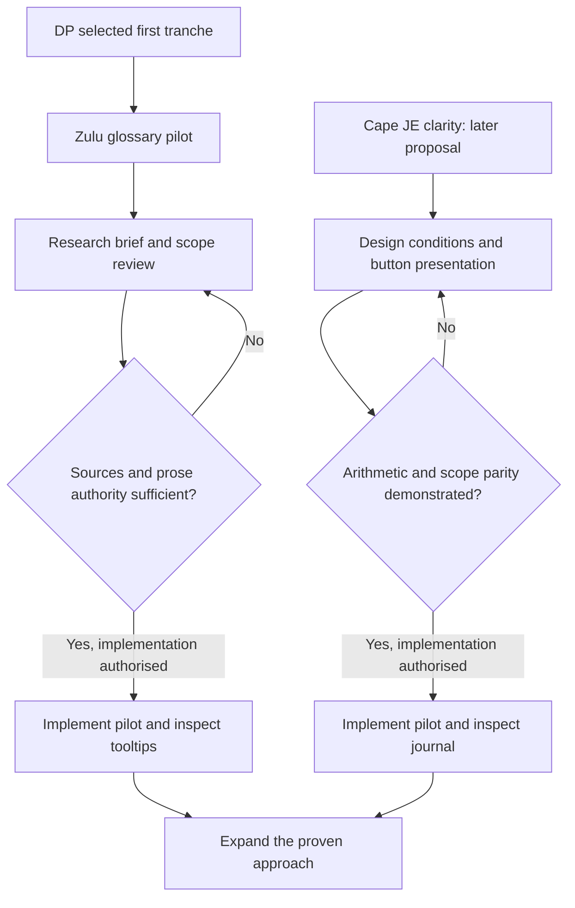

# Victoria 3 1.15 extensions — priority discussion

**7 November 2026; priority discussion and subsequent pilot status.** The
[core rebase is closed](1_15_0_closure_2026_11_07.md). DP asked to walk through
the deferred extensions and decide what to tackle first. The earlier
[feature destinations and glossary workflow](1_15_0_rebase_design_2026_11_05.md#feature-routing)
remain agreed. DP has now selected the Zulu glossary pilot first; the remaining
sequence and detailed candidate coverage below are provisional.

## First decision

**Agreed by DP, 7 November: Zulu glossary pilot first.** DP selected
“Zulu glossary pilot first (recommended; follows the agreed sequence)”. This
sets the first tranche and its broad court/institutions scope. It follows the
agreed immediate post-rebase glossary task and establishes the research/review
workflow. The comparison below records the alternatives considered; Cape journal
clarity remains a proposed later tranche. Neither requires a mechanical redesign.

| First tranche | Concrete experience and work | Tradeoff and acceptance |
| --- | --- | --- |
| **A — Glossary pilot; recommended** | Inventory a small coherent set of existing Zulu court/institution terms and their actual uses. Produce a sourced brief distinguishing period usage from later terminology. Main agent reviews; once implementation is authorised, the same scope owner adds definitions and useful links. A player can hover an unfamiliar term without interrupting the event/JE narrative. | Establishes consistent historical framing before broad rollout; research and prose review dominate the work. Ambiguous or inadequately sourced terms wait. Verify keys/escaping, appropriate link density and rendered tooltips. Existing reviewed prose and marker authority still apply. |
| **B — Cape JE clarity pilot** | Use the existing political-balance bar and two favour buttons. Expose meaningful active/inactive progress conditions and truthful button presentation; retain values, eligibility, payment, cooldowns and outcomes. The player can see why the balance moves and what an action really costs. | More immediate interface benefit, but the large bar contains mutually exclusive branches: replacing conditional syntax mechanically can alter arithmetic. Compare representative law/amendment combinations, both directions and inactive branches, then inspect rendering. Establish a thematic grouping design before rolling the approach across SB. |

The glossary route keeps the agreed scope-based delegation: main inventories
historical areas, an agent researches each assigned brief, main reviews, and the
same agent implements the accepted scope. Shared terms/files need one owner.
One scope agent has now researched the four Zulu candidates. The
[brief](../research/zulu_glossary_pilot_2026_11_07.md) and
[main review with Vanilla comparison](../research/zulu_glossary_review_2026_11_07.md)
are complete. DP subsequently authorised the four-term implementation; the same
scope agent added the accepted definitions and links. See the
[implementation record](1_15_0_zulu_glossary_pilot_2026_11_07.md) for checks and
pending DP inspection. Existing localisation review classifications remain in force.

## Zulu pilot inventory

The following table retains the original source inventory and research questions.
The completed brief and implementation record above hold the accepted definitions
and final link locations. Current spelling and displayed text are preserved.

| Candidate | Existing context | Research question and boundary |
| --- | --- | --- |
| **Amabutho** | `sb_prerogative_military`, “Co-operation of the Amabutho”, in [institution presentation](../../localization/english/sb_institutions_l_english.yml). | Establish the relevant organisation, service obligations and relationship to the crown across the period covered. Trace shared institutional profiles before placing a Zulu-specific explanation in a generic widget. |
| **amaKhosi** | `movement_sb_zulu_chiefly`, “amaKhosi — Great Chiefs”, in [law and movement presentation](../../localization/english/sb_zulu_institutions_laws_l_english.yml). | Establish the term's meaning and usage; distinguish it from SB's particular movement, council law and constitutional design. Do not present the game's faction structure as a historical definition. |
| **uSuthu** | `movement_sb_zulu_royal` in [law and movement presentation](../../localization/english/sb_zulu_institutions_laws_l_english.yml). | Establish dated usage and faction associations before explaining the current royal-movement label. Do not assume that one term fits every ruler, reign or royal supporter. |
| **Umkhosi** | `sb_court_gathering_royal`, “Umkhosi: Before the King”, and event `.200`'s first-fruits gathering in [court events](../../localization/english/sb_zulu_court_l_english.yml). | Establish the relevant ceremony, terminology and political setting; determine whether the existing event's intended context supports a precise glossary entry. |

Start by checking native/CMF definitions and existing concepts for overlap.
The existing [Thirteen Chiefdoms concept](../../common/game_concepts/sb_zululand_concepts.txt)
already has a gameplay explanation; duplicating that is outside this pilot.
Biographies, a general Zulu history survey, Prerogative arithmetic and the
Chiefly Council/Federated Chiefdoms game rules are also outside its first scope.
An English game label alone is not evidence for a historical institution.

The completed brief returns sources, period/context limits, four concise draft
definitions and exact proposed link locations with their review classifications.
Main review accepts the revised research proposals and prefers one body-text link
per entry. The uSuthu entry is tied to the Cetshwayo–Mbuyazi event context; it does
not validate every use of the generic royal-movement label. The current naming
questions remain separate. The four definitions and body-text links are now
implemented; in-game presentation remains untested.

## Proposed sequence and complete inventory

| Ticket | Feature and practical use | Proposed treatment |
| --- | --- | --- |
| `EXT115-02` | Glossaries: historical explanations at useful terms, without expanding every event's body text. | **First pilot implemented:** four Zulu definitions and body-text links after research, main review and DP implementation authority. Rendered inspection and DP prose review remain pending; see the implementation record. Later historical scopes are still to be selected. |
| `EXT115-05` | Progress conditions: show what advances or reverses a bar, including relevant unmet conditions. | First JE clarity work; Cape is the initial candidate. Preserve mutually exclusive contributions and signed arithmetic. |
| `EXT115-06` | Button cost/icon/tag presentation; possibly a future proclaim-heir action. | Pair presentation with the clarity pilot. A displayed cost neither checks nor pays it. Automation and any new proclamation mechanic need separate design. |
| `EXT115-11` | Thematic journal groups with useful ordering and illustrations. | Design alongside the clarity pass. Organise by the continuing situation; preserve country versus shared-JE contexts and activation. Avoid adding a group merely for each country/tag. |
| `EXT115-12` | Russia's Emperor and Autocrat as a Prerogative reference. | Inspect its groups, character/modifier/button widgets and linked entries before committing to Zulu presentation. Mission progression or rewards are separate design choices, not implied adoption. |
| `EXT115-03` | Native JE scaling modifiers can replace appropriate manual upkeep. | After the presentation pilot, audit candidates for equivalent values, refresh cadence, recipients, stacking and cleanup. Preserve deliberate thresholds; do not silently turn bands into a continuous balance curve. |
| `EXT115-04` | JE map modes make a geographic situation legible. | Add selectively where a territorial question warrants it; a corridor/border situation is a candidate, not an approved selection. Design the legend and test foreign ownership, split states and participant perspective. |
| `EXT115-07` | Objective-associated JEs preview potential content. | Consider after the content/grouping design. Use only with an appropriate objective; association does not activate JEs and is not a reason to invent a new objective. |
| `EXT115-08` | Regnal numbers, especially ZUL. | Small separate history/naming audit before adoption. Establish whether numbering fits each name and reconcile initial rulers, succession, repeated names and existing display conventions. |
| `EXT115-09` | Hidden modifier types for appropriate internal bookkeeping. | Opportunistic audit when touching that system. Hide no consequential player information merely to reduce clutter; no automatic performance benefit. |
| `EXT115-10` | Regional exile pools could constrain access and return. | Keep deferred until the intended “ZUZ” actor is clarified. Then design access, return, loss of the home country and fallback behaviour together; do not silently substitute ZUL. |
| `RES115-01` | Copper-focused resource audit: geology, capacity, technology/discovery timing and remaining lead rationale. | Separate balance/research task; timing remains open. The native-copper port stays accepted. Namaqualand's provisional lead and parent-total conservation remain explicit questions. |
| `CHAR115-01` | Dynamic institution names and character-role backgrounds. | Retain the agreed Characters, Companies, IDEOLOGY rework destination; `v0.23.*` remains tentative. |
| `RC115-01`, `RC115-02` | Weighted music and loading screens. | Retain the agreed `v1.0.0.rc` destination, conditional on suitable licensed music and SB artwork. |

Once-only events (`EXT115-01`) and cold-effect mapping are already part of the
accepted core port. Power-bloc effects and the strait grievance multiplier remain
skipped/N/A. `CMF115-01` is an upstream orphan debug-example diagnostic, not an
extension prerequisite. Broader release gates and performance work retain their
separate [open-register entries](../audit_issues_open.md).

A full Prerogative/Russian-style mission redesign as the first task was considered
but is not recommended: presentation lessons can be taken first, while new
progression, rewards and political incentives need their own settled design.
The strongest argument considered for B was more immediate interface benefit.
DP selected A; neither technically depends on finishing the other.

## Evidence and limits

The current installed 1.15 source provides the reference behaviour:

- [Feature digest](../../../References/Modding-Digests/1.15.0/changes_features.md)
  and [progress-bar contract](../../../References/Modding-Digests/1.15.0/types/scripted_progress_bars.md):
  progress conditions feed the advance/retreat lists; factors need descriptions,
  and factors hidden inside named script values are not listed automatically.
- [Cape bar](../../common/scripted_progress_bars/sb_progress_bars.txt) uses a
  signed range and conditional/else-if contribution chains. Its
  [modifier synchroniser](../../common/scripted_effects/sb_cape_politics_effects.txt)
  applies distinct bands at ±30 and ±60; linear scaling would be a gameplay
  change rather than a straightforward maintenance substitution.
- [Native Emperor and Autocrat](</Users/depro/Library/Application Support/Steam/steamapps/common/Victoria 3/game/common/journal_entries/08_tsarpoints.txt>)
  demonstrates a dedicated group, character/modifier/button widgets, active and
  featured JE lists and a scaling modifier. These are examples, not an SB design.
- [Prior grouping and Russia notes](1_15_0_playtest_1850_2026_11_07.md#journal-groups--ext115-11)
  retain the playtest motivation. [Localisation policy](../policies/localisation-review.md)
  governs both new prose and links added to reviewed text.

The prioritisation rests on source-based feasibility. The separate glossary pilot
adds definitions and localisation links; no gameplay or GUI change, new engine
observation, balance claim or performance measurement is implied. Each later
implementation needs proportionate static checks and DP's relevant in-game
inspection; the closed core rebase stays closed.

## Decision register

| Decision | Status | Current position |
| --- | --- | --- |
| First extension tranche | **Agreed** | DP selected Zulu glossary pilot A first on 7 November. |
| First glossary scope | **Agreed** | Zulu court/institutions, with shared terminology owned explicitly. |
| Pilot entries and link locations | **Implemented at DP's request** | Four researched definitions and preferred body-text links follow the Vanilla comparison. Existing TO REVIEW classifications remain; rendered validation is pending. |
| General royal-movement naming | **Open; separate from pilot** | Sources do not establish that uSuthu fits every ruler's royalist movement from 1836; a broader later lexical sense does exist. Preserve current labels pending a separate design decision. |
| First JE clarity scope | **Provisional** | Cape politics; larger/shared CMF interfaces follow only after a successful pilot. |
| Scaling, map and objective adoption | **Open** | Candidate audits and design selection precede implementation. |
| Resource audit timing | **Open** | Separate from the extension pilot; no native resource reversal proposed. |
| Exile-pool actor | **Open** | Clarify “ZUZ” when that work is selected. |
| Character and release-art destinations | **Agreed/deferred** | Preserve the earlier thematic rework and release-candidate routing. |
