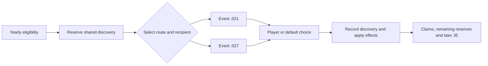

# Native once-only events — design investigation

**5 November 2026. [Implementation authorised](1_15_0_implementation_plan.md) for selective native once-only adoption in the core rebase.** The investigation below explains the preserved lifecycle boundaries; engine timing and performance remain unverified.
Requested by DP as part of the [1.15 rebase design](1_15_0_rebase_design_2026_11_05.md).
Follow-up: `EXT115-01` in the [open register](../audit_issues_open.md#victoria-3-115--rebase-and-secondary-extensions).

## Recommendation

Use native once-only eligibility for suitable individual events in this rebase,
as amended by DP; the original post-rebase timing is superseded. Remove a script flag only after proving that its
sole meaning is “this event has already fired” and that native behaviour covers
the required scope and lifecycle. Retain shared reservations, outcome state,
resource accounting and legitimate retries. Start with a small pilot; do not
replace every before/after flag across SB.

This can simplify ownership of duplicate suppression and eliminate redundant
bookkeeping. A tick-time improvement is a hypothesis until measured. Native
tracking still has a cost, and a native event flag does not by itself eliminate
the caller's yearly/monthly scans or unrelated calculations.

## What the available evidence establishes

- The [feature digest](../../../References/Modding-Digests/1.15.0/changes_features.md#one-time-events)
  introduces `fire_only_once` and `fire_only_once_globally` on event definitions.
- Installed [test examples](</Users/depro/Library/Application Support/Steam/steamapps/common/Victoria 3/game/events/test_events.txt>)
  label the first form “Fire Only Once Country” and distinguish the global form.
  Those examples are commented out; they are documentation, not observed tests.
- Installed [production-tech events](</Users/depro/Library/Application Support/Steam/steamapps/common/Victoria 3/game/events/tech_events/production_tech_events.txt>)
  actively use `fire_only_once = yes`, including `production_tech_events.1`.
  No uncommented `fire_only_once_globally` declaration was found in the installed
  `events/**/*.txt` search. Its availability is documented; its runtime behaviour
  has not been exercised here.
- The once-only fields belong to individual event definitions. No documented
  shared key was found that makes two different event IDs consume the same
  one-time allowance. An event occurrence also does not identify which option
  the player selected or whether its intended outcome completed.

The engine's exact consumption point remains unverified: reservation, queueing,
opening, answering, cancellation and failed delivery need distinguishing. No
claim of transactional atomicity across scripts, popups and effects follows from
the new field. Retag/recreation, save/load and already-queued duplicate behaviour
also remain test questions. Avoid filling those gaps with a test interpreter's
assumptions.

## The actual diamond mechanisms

### Kimberley opening and settlement

The [yearly router](../../common/on_actions/sb_mineral_discoveries_on_actions.txt)
checks [discovery eligibility](../../common/scripted_triggers/sb_mineral_discoveries_triggers.txt),
reserves `sb_kimberley_discovery_pending_var`, then queues either
`sb_griqualand_west.021` or `.027` for the selected country. Routing can involve
CAP, ORA, TRN, WBL or the actual mine-site owner. The event is delayed by one day;
discovery is applied by an option, not by the reservation itself.

This is the observed script structure, not an assertion about native queue
internals. [Both opening events](../../events/sb_griqualand_west_events.txt) read
the shared pending flag. Their [discovery effects](../../common/scripted_effects/sb_griqualand_west_effects.txt)
remove it and set `sb_kimberley_discovered_global_var`. That resolved state is
also read by later claim/proxy logic. The separate
`sb_kimberley_remaining_potential_seeded_var` protects the reserve grant and is
read by the [migrant-labour JE](../../common/journal_entries/1-06_sb_griqualand_west.txt)
and later events.

| State | Meaning | Can a per-event once flag replace it directly? |
| --- | --- | --- |
| Discovery pending | One shared discovery is reserved across alternative event IDs and recipients | No equivalence established; it coordinates the route before the answer |
| Discovery resolved | The world has reached a historical/mechanical outcome, also read outside the opener | Preserve unless all consumers are deliberately redesigned |
| Remaining potential seeded | Resource budget was granted once; later JE/content depends on it | Preserve the grant guard and consumers |
| A hypothetical event-local “already shown” flag with no other readers | This one event must not recur in the same intended scope | Good pilot candidate after delivery/cancellation tests |

The current post-discovery Kimberley check starts with cheap global-variable
guards and runs on a global yearly pulse. Native gating on the eventual event
alone does not remove that router call. Do not promise a material tick-time gain
from this particular opener without measurement.

### Regional diamond surveys

The [survey effects](../../common/scripted_effects/sb_diamond_surveys.txt) use
region-owned reserve size, remaining levels, a technology gate, a started marker
and a pending site. They schedule `sb_next_diamond_survey_year` and
`sb_deliver_diamond_survey` as delayed **on-actions**, not one-off event IDs.
They intentionally make repeated discoveries until the reserve is exhausted,
including ownership/technology checks at delivery. These records describe an
ongoing process; an event's once-only field does not replace them.

## Retained design alternatives

| Direction | Full behaviour and consequences | Assessment |
| --- | --- | --- |
| A — Selective native gating | Retain current eligibility and narrative routes. Classify each flag and reader. Replace only event-local duplicate-history bookkeeping with the correct native scope; preserve shared pending/result state and revalidation. Valid choices retain their current timing; cancelled/failed delivery must still allow required recovery. | Recommended first extension. Small behavioural surface and measurable reduction in redundant state; potentially modest performance gain. |
| B — One shared discovery controller | Introduce one global discovery owner, then route presentation to countries. If it commits discovery before notifying, an invalid recipient cannot lose the discovery, but discovery timing moves before the current player choice. If it only reserves before asking, pending/settled state and retry handling are still needed. A controller consumed before successful dispatch needs a separate recovery route. | A possible later arc redesign, not a flag substitution. It could consolidate ownership, but the early-commit variant changes player-facing timing and the reserve-first variant still needs state. Not part of the rebase or assumed extension design. |
| C — Retain explicit bookkeeping | Keep the existing route/receipt model and test it on 1.15. Adopt native gating elsewhere if the pilot cannot preserve cancellations, identity or retries here. | Valid fallback for complex arcs. Carries more manual state but avoids changing established story timing for an unmeasured gain. |

Adding `fire_only_once_globally` independently to both `.021` and `.027` does
not establish a shared allowance across them. A blanket “remove all pending and
resolved flags” variant is rejected on the inspected consumer relationships.

## Pilot acceptance criteria

1. Choose a country-local once event and an intended world-once event. Record
   every caller, flag writer/reader and the phase at which its effects belong.
2. Exercise repeated dispatch before delivery, an open held popup, ordinary
   answer, default answer, cancellation and failed delivery. Establish when the
   native allowance is consumed and whether a valid retry remains possible.
3. Exercise a second country, retag/formation, annexation/recreation and save/load
   only where those identities are relevant to the selected event's contract.
   Do not assume the engine keys history by the visible country tag.
4. For a Kimberley trial, test both opener IDs and changed mine-site ownership;
   verify a single discovery/resource grant, preserved claims and correct later
   JE eligibility. Retain the regional surveys as a repeatable negative control.
5. Compare event dispatches, queue counts and relevant handler timings on the
   same 1.15/CMF baseline. Removing variables is a maintainability result;
   improved performance requires measurements, not source operation counts.

Codex can prepare bounded fixtures and inspect sources/logs. DP performs the
engine session and profiling. Tests modelling a guessed native consumption point
would not prove the feature's behaviour. The separate historical-date fallback
under `FA-26R` remains a distinct design issue; this migration does not silently
change Kimberley's technology/date eligibility.
