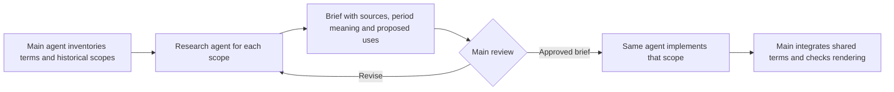

# Victoria 3 1.15 — rebase design, pass one

**5 November 2026. Approved design; [implementation authorised](1_15_0_implementation_plan.md).** Native once-only adoption is now part of this rebase. The pass-one timing below is historical where superseded by that approval.
DP's pass-one comments settle the scope below. The design remains open for
iteration. `Agreed` records DP's selection or an explicitly delegated choice;
`provisional` identifies an assistant recommendation; `deferred` means recorded
future work, not permission to implement it during the rebase.

## Read by question

- [D1–D8 decision register](1_15_0_modding_digest_review_2026_11_05.md#decisions-to-settle-when-building-the-plan)
- [Dependency baseline](#dependency-baseline)
- [Map, copper and cold effects](#map-copper-and-cold-effects)
- [Journal presentation and localisation](#journal-presentation-and-localisation)
- [Feature routing](#feature-routing)
- [Glossary workflow](#glossary-workflow)
- [Verification decision](#verification-decision)
- [Once-only alternatives and diamond trace](1_15_0_once_only_events_2026_11_05.md)
- [Open work register](../audit_issues_open.md#victoria-3-115--rebase-and-secondary-extensions)

The [original scan](1_15_0_pre_rebase_scan_2026_11_05.md) remains the conflict
inventory. The [digest reconciliation](1_15_0_modding_digest_review_2026_11_05.md)
records API evidence and caveats. Read only the workstream being planned.

## Dependency baseline

**D1–D2: agreed.** Rebase onto the latest CMF release compatible with 1.15,
currently [1.67.1](https://github.com/Victoria-3-Modding-Co-op/Community-Mod-Framework/releases/tag/1.67.1).
Recheck once when preparing execution, record any intervening change, then pin
the selected release for the port instead of changing it mid-validation.

The inspected 1.67.1 release was published at **11:23:24 UTC / 13:23:24 SAST**
on 5 November. Its tag resolves to
`f2dea1dde7b87098b504d120b2b20e963e1d4fb6`. The 23,212,921-byte archive matches
GitHub's SHA-256:
`8c7030df04c13ff47e9ade339abb3d96796c53122f73f0a0e2f3bb67e145264b`.
Inspection used temporary staging; installed CMF remains unchanged.

The [1.67.0 inspection](1_15_0_cmf_1_67_0_followup_2026_11_05.md) already found
the new journal GUI, outcomes, illustrations and direct quote-escaping changes.
The 1.67.1 hotfix also resolves its two remaining old-form population-share
calls and seven references to the removed `ideology_social_democrat`. All four
scanned `pop_type_percent_country` calls now use `target`/`value`. See the
[targeted release evidence](evidence/1_15_0_design_pass1_2026_11_05/cmf_1_67_1_targeted_check.json).
These checks do not certify the complete dependency or its interaction with SB.

D2 follows the new dependency: retire the superseded CMF territorial overrides
and calls to the traced always-yes hook. Preserve SB's Swazi restriction and
British–Zulu handoff while rebasing their full surrounding native definitions.
Review every old patch contract and SB replacement; do not apply
`sb-1.14.3-r1` wholesale. Decide packaging from the residual SB delta.

## Map, copper and cold effects

### D3 — Carry the authored delta onto the current map

**Agreed policy:** start from the 1.15 world/map and port SB's intentional
changes relative to its 1.14 Vanilla baseline. Yes, 1.15 changes the base map,
including global assets and state/history definitions. SB's old full-file
copies can hide those changes beyond its intended region.

| Situation | Result |
| --- | --- |
| SB had no intentional change; 1.15 changed the field or province | Keep 1.15, including inside Southern Africa |
| SB intentionally changed something; upstream left it alone | Carry SB's delta forward |
| Both changed the same area or definition | Preserve SB's intended geography/mechanic in the current schema; review the overlapping fields, not an automatic whole-file winner |
| SB splits or redraws a native state | Map the parent/province relationship explicitly; retain native additions without duplicating resource totals across children |

Recover the old exact source where possible, or reconstruct the authored delta
from retained source, history and research. Missing 1.14.5 map bytes remain an
engineering evidence gap. A current SB-versus-1.15 diff alone cannot identify
which differences SB authored. Do not blindly overlay the old raster or replace
all values throughout an SB geographical bounding box.

### D4 — Native copper first, research second

**Agreed policy:** phase one adopts native 1.15 copper in SB's scope and removes
lead allocations proven to stand for copper. Phase two is the copper-focused
resource audit `RES115-01`. This is not a blanket reset of SB's other resources.

The [source comparison](evidence/1_15_0_design_pass1_2026_11_05/resource_cold_comparison.json)
finds native copper capacities of **6 in Namaqualand, 18 in Zambia and 30 in
Katanga** in the file SB shadows. Northern Cape and Hereroland have no native
copper capacity there. Preserve native totals through any necessary state
mapping; do not convert eight proxy lead levels into eight new copper levels.

| Existing SB lead | Evidence and first-pass treatment |
| --- | --- |
| Northern Cape: 8 | Explicitly labelled a copper proxy in the [maintainer decisions](../../../References/Resource%20rework/sb_full_resource_audit_2026-08-24/data/input_snapshots/maintainer_decisions_2026-08-24.csv). Remove this proxy during the port; DP's new decision supersedes its former retention policy. |
| Hereroland: 10 | The [resource audit](../../../References/Resource%20rework/sb_full_resource_audit_2026-08-24/output/SB_full_resource_audit_2026-08-24.md) gives a Tsumeb lead rationale; the [gameplay record](../resource_gameplay_overrides.md) sets the live ten. Retain genuine lead unless new evidence shows a copper component. |
| Namaqualand: 2 | The [input recommendations](../../../References/Resource%20rework/sb_full_resource_audit_2026-08-24/data/input_snapshots/provisional_non_arable_resource_recommendations.csv) describe weak latent lead endowment, while the gameplay record describes a small base-metal allowance. **Provisional:** retain pending the audit; this is not proven to be another copper proxy. |
| Nigeria: 45; East Angola: 27; Zambia: 33 | Match the inspected native lead values. Do not remove them as SB copper proxies. |

The later audit must review literal resource identity, period extraction and
technology/discovery timing, province allocation, demand/production methods and
balance. Check other proxy evidence and all capacity writers before finalising
the implementation inventory. The historical resource CSVs remain evidence;
update live totals/tests alongside the eventual port, not during this design pass.

### Cold effects

**Agreed direction:** carry reasonable native cold effects; add/reconcile custom
state values only where the map delta requires it. Native 1.15 already has
`min_cold_effect = 0.00` and maxima including Namaqualand **0.03**, Vrystaat
**0.04**, Transvaal **0.02**, Eastern Cape **0.07**, Northern Cape **0.04** and
Botswana **0.01**. SB's shadowing file currently omits explicit cold fields.

Use native values as the provisional default for matching geography. Check
parent geography for Natal, Drakensberg and the split Transvaal states rather
than copying by similar name or applying each parent's total everywhere. Cold
minima/maxima are intensity bounds, not additive resource budgets. Source
values establish what Vanilla supplies; they do not prove climatic realism or
the resulting engine effects. No independent climate rebalance is selected.

## Journal presentation and localisation

**D5: agreed.** Restore existing behaviour on 1.15: port all 27 SB JEs to outcomes,
review CMF's five migrated JEs and effective GUI, translate the four obsolete
bar styles, retain the 11 still-valid styles, and supply suitable conclusion
presentation. Preserve shared-effect ownership, terminal cleanup, persistent
institutions and the intentionally disabled Highveld content. New JE mechanics
go into the secondary extension pass; this is not a thematic redesign.

**D6: agreed clarification.** The original question concerned required quote
escaping and conclusion text. For example, a quoted function argument containing
`$concept_pops$` now requires `$concept_pops|q$`. That syntax-only change can
preserve the approved sentence and intended presentation.

The [authoritative localisation policy](../policies/localisation-review.md)
now explicitly allows task-scoped revision of `TO REVIEW` text and minor
necessary syntax-only fixes in `REVIEWED` namespaces. Preserve every approval
marker and the exact namespace classification rules. Substantive changes to
reviewed wording, meaning, tone or presentation still need DP's replacement or
approval. New conclusion prose and glossary links are not automatically covered
by the syntax exception. Inspect the exact keys and diff; do not batch-rewrite
prose or repin reviewed-text evidence to conceal changes.

## Feature routing

**D7:** DP has selected the destinations below. Deferred means after the core
rebase; it does not mean forgotten. The `EXT115` work is the first extension
tranche afterwards, before unrelated expansion. Detailed designs remain open.
Links point to the pinned [feature digest](../../../References/Modding-Digests/1.15.0/changes_features.md).

| Feature | Status, destination and design boundary |
| --- | --- |
| [Once-only events](../../../References/Modding-Digests/1.15.0/changes_features.md#one-time-events) | **Amended by implementation approval:** `EXT115-01`, selective adoption in this rebase. DP requested investigation; the [diamond trace and alternatives](1_15_0_once_only_events_2026_11_05.md) support simpler event-local bookkeeping, not blanket removal of shared state or a promised speed-up. |
| [Glossaries](../../../References/Modding-Digests/1.15.0/changes_features.md#glossaries) | **Deferred:** `EXT115-02`, separate researched task immediately after rebase; workflow below. |
| [Dynamic institution names](../../../References/Modding-Digests/1.15.0/changes_features.md#dynamic-institution-names) | **Deferred:** `CHAR115-01`, Characters, Companies, IDEOLOGY rework. `v0.23.*` is tentative, not a fixed release promise. |
| [Character role backgrounds](../../../References/Modding-Digests/1.15.0/changes_features.md#character-role-backgrounds) | **Deferred:** same thematic patch and ticket; required schema repairs remain core rebase work. |
| [Power bloc effects](../../../References/Modding-Digests/1.15.0/changes_features.md#power-bloc-effects) | **Agreed:** skip / N/A; no extension ticket. |
| [JE scaling modifiers](../../../References/Modding-Digests/1.15.0/changes_features.md#journal-entry-scaling-modifiers) | **Deferred:** `EXT115-03`, priority JE extension. Compare outputs, scope, refresh/cleanup and stacking before replacing manual modifier updates. |
| [JE map modes](../../../References/Modding-Digests/1.15.0/changes_features.md#journal-entry-map-modes) | **Deferred:** `EXT115-04`, JE extension; select useful territorial information and test ownership/split states and legend readability. |
| [Progress-bar conditions](../../../References/Modding-Digests/1.15.0/changes_features.md#scripted-progress-bar-conditions) | **Deferred:** `EXT115-05`, priority JE extension. Expose real contributors without changing the existing calculation or double-counting terms. |
| [Regnal numbers](../../../References/Modding-Digests/1.15.0/changes_features.md#regnal-numbers-in-country-definitions) | **Deferred:** `EXT115-08`, ZUL-focused extension; reconcile historical names, succession and existing numbering first. |
| [Hidden modifiers](../../../References/Modding-Digests/1.15.0/changes_features.md#hidden-modifiers) | **Deferred:** `EXT115-09`, investigate AI-versus-AI historical/dynamic bookkeeping; hiding consequential player information is a separate design decision. |
| [Regional exile pools](../../../References/Modding-Digests/1.15.0/changes_features.md#regional-exile-pools) | **Deferred:** `EXT115-10`, potential use for “ZUZ”, as DP wrote. No matching country-definition tag was found; confirm intended actor before designing access, return and annexation behaviour. Do not silently substitute ZUL. |
| [Scripted button extensions](../../../References/Modding-Digests/1.15.0/changes_features.md#scripted-button-extensions) | **Deferred:** `EXT115-06`, JE extension, including the proposed proclaim-heir use. `cost` only displays a number: keep affordability/payment in script. `autocomplete` changes agency and may repeat; never enable it merely to gain icons/tags/cost presentation. |
| [State cold effects](../../../References/Modding-Digests/1.15.0/changes_features.md#state-region-cold-effect) | **Agreed:** core map port, conditional on native values/geography as above. |
| [Objective-associated JEs](../../../References/Modding-Digests/1.15.0/changes_features.md#objective-associated-journal-entries) | **Deferred:** `EXT115-07`, investigate in the JE extension. Association is a content preview; it does not activate the JEs or justify creating a new objective by itself. |
| [Weighted music](../../../References/Modding-Digests/1.15.0/changes_features.md#weighted-music) | **Deferred:** `RC115-01`, `v1.0.0.rc`, conditional on suitable music and verified Creative Commons licence/attribution and redistribution terms. |
| [Weighted loading screens](../../../References/Modding-Digests/1.15.0/changes_features.md#weighted-loading-screens) | **Deferred:** `RC115-02`, `v1.0.0.rc`, after SB's own screens exist. |
| [Strait grievance multiplier](../../../References/Modding-Digests/1.15.0/changes_features.md#straits-blocking-grievance-multiplier-114) | **Agreed:** skip / N/A. The digest labels it a 1.14 feature. |

Existing narrative hooks such as the [introduce-heir button](../../common/scripted_buttons/sb_court_buttons.txt)
are implementation evidence, not proof that a new proclamation action should
share their effects. The optional `enact_law` capability mentioned in the earlier
review remains outside the port unless an existing contract needs it; native
successful-enactment consequences must not be introduced accidentally.

## Glossary workflow

**Agreed future workflow; no glossary agents dispatched in this pass.**

Choose the number of agents from coherent scopes, such as Cape or Zulu; assign
one owner to shared terms and files before writing. Each brief should distinguish
attested period usage from later terminology, include exact target contexts and
uncertainty, and propose where a link actually helps the reader. The main review
deduplicates terms and checks historical framing, sources and localisation
approval boundaries. Use the JE/events prose skills where appropriate. Retain
`TO REVIEW` classification until DP approves it; main-agent research review is
not DP's approval of reviewed prose. Final checks cover key resolution, nested
quoting, visible tooltip usefulness and DP's rendered inspection.

## Verification decision

**D8: agreed by delegation.** Use staged source verification followed by DP's
fresh-campaign engine checks. The following is the selected acceptance approach,
not a claim that those checks have passed. Keep the existing all-DLC requirement.
Fresh campaigns remain the proposed compatibility scope; old-save migration is
not included without a separate scope decision.

| Gate | Required evidence before claiming completion |
| --- | --- |
| Target and provenance | Pin game build/manifest, CMF archive/commit, SB source and load order. Reconcile every touched exact/keyed override and old CMF patch contract before updating hashes. |
| Source/API | Target-aware parser and structural checks; references, scopes, localisation review classification and changed behaviour regressions. Confirm the validator understands 1.15 first. Unsupported schema output is not automatically a script defect or a pass. |
| Map and resources | Record recovered/reconstructed SB deltas, province/state membership, native additions, unique-parent copper totals, proxy removal and cold mapping. Repair naval validation against current Vanilla and controlled positive/negative cases before relying on it. |
| JE semantics | Review every outcome/cleanup contract. Exercise completion, failure, timeout and cancellation where supported; shared JEs must settle shared effects once. Preserve persistent/disabled designs and unchanged bar arithmetic. |
| DP presentation | Fresh start with the effective CMF stack: active/concluded/shared JEs, four translated bar styles, group visibility/art, concept links and quoted text; Fodo's portrait and representative CMF movements. |
| DP gameplay | Map load and actual land/naval movement; copper/lead capacities in relevant owned fragments; affected creation, war-goal, discovery and JE routes from checkpoints preceding each transition. Include changed ownership/foreign roots where applicable. |
| Results and follow-up | Separate static pass, source-model pass and engine result. Retain pending engine rows; record new errors against a clean target control. Keep unrelated existing failures visible without attributing them to this port. |

The old naval checker rejected **31/31 Vanilla ports**, so its SB failures cannot
certify disconnections. The digest's GUI snapshots omit methods used by native
1.15; obtain fresh engine-generated documentation if source examples cannot
resolve a contract. Installed Tiger 1.19.0 lacks the new outcome/once-only schema; see the [implementation evidence](evidence/1_15_0_implementation/tiger_schema.json). Do not
waive a relevant check merely by refreshing its baseline or deleting its test.

Preserve the [general verification limits](../pitfalls/verification.md). DP
launches Victoria 3 and supplies runtime observations; static work can establish
readiness for that session, not substitute for it. Once-only queue/cancellation
tests belong to `EXT115-01`, and tick-time claims require measurement under the
existing `PERF-20261028-01` audit. No promise of performance improvement is a
condition for accepting the compatibility port.

## Pass-one handoff (historical)

The following records the investigation state before implementation approval.
The [implementation report](1_15_0_implementation.md) supersedes its open source
work and timing; unrun engine checks remain pending.

Settled: dependency direction, authored-map policy, native-copper-first staging,
minimal JE port, prose authority, feature destinations and verification method.
Still provisional: selective once-only pilot design, Namaqualand's ambiguous
lead allowance and exact mappings for redrawn states. Still empirical: historical
map reconstruction, complete CMF/SB contracts and all new engine behaviour.
These items remain visible in the register; this pass neither installs CMF nor
changes gameplay, assets, localisation strings, version metadata or test pins.
