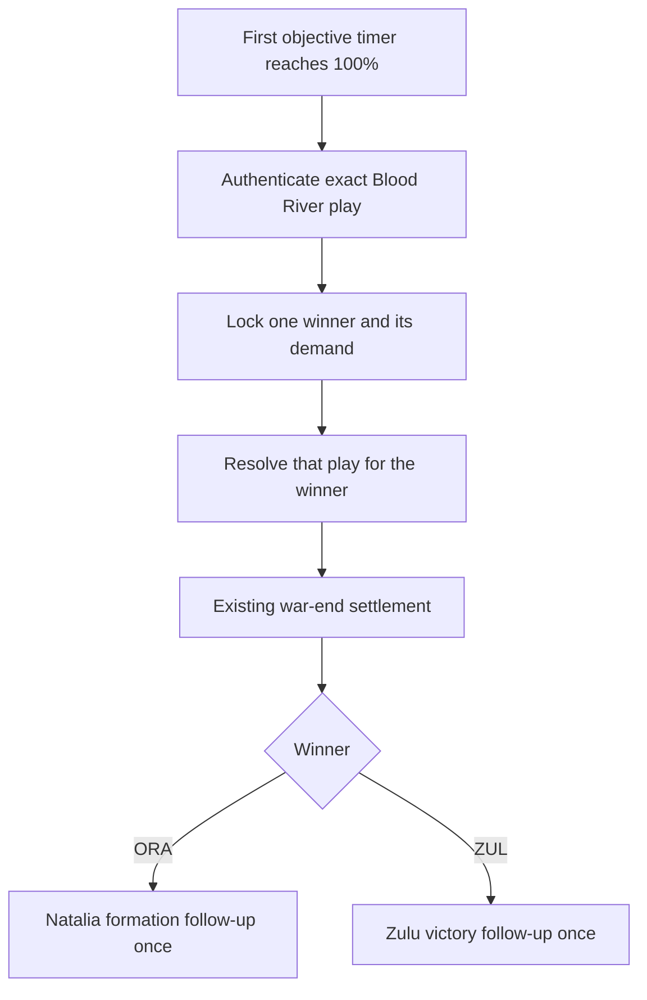

# Blood River: decisive timed victory

## Victoria 3 1.15.2, 19 November 2026

The first side to complete its Natal timer wins the Blood River war. ORA wins
by completing **Secure Natal** and ZUL wins by completing **Defend Natal**.
Both goals retain their native progress rates and `no_mirror`.

The January and February 1839 autosaves show why the war stayed open.
On 1 January, ORA was at 95% and ZUL at 0%. On 1 February,
ORA's goal had `status=executed` and `execution_method=occupation_timer`.
ZUL's original demand was still active at 0%. Play `16777220` still had a war,
both countries still pointed to that play, and only ORA's demand was recorded
as accepted.

The 1.15.2 timer callback identifies the winner and the play. Each Natal
goal's own enforcement effect records its holder's accepted demand. On the
next game day the mod checks both pieces of evidence and calls
`resolve_play_for` on the original war. The usual war-end event then delivers
the winner's settlement once. If both timers complete in one update, the
first timer decides the result. An ordinary peace before either timer
completes follows its agreed terms. [1.15.2 effect reference](https://github.com/Victoria-3-Modding-Co-op/Modding-Digests/blob/0e94618d6a1b1599d4c78cc074282598de4d59b2/1.15.2/docs/effects.log)

An existing save with a live Blood River war can recover on either original
participant's next monthly pulse. Exactly one accepted demand identifies an
earlier timer winner. With both demands accepted and no recorded timer winner,
the war continues under its existing peace rules.

**In-game checks pending.** After a full game restart, resume the 1 January
checkpoint through ORA's timer and the following day, or resume the 1 February
checkpoint through the next monthly pulse. In both, confirm the war closes for
all participants and ORA receives the Natalia founding event once. In a ZUL
defence victory, confirm the war closes and ZUL receives its victory event once.
The script tests cover both routes, both callback orders, contested settlements
and unrelated wars. The full suite ran 1,184 tests with 10 skipped and zero
failures. Integrated validation reported 15 passes and two existing warnings.
[Blood River regression tests](../../tests/test_blood_river_outcome_events.py)

## Historical 1.14.2 engine test and rollback, 12 September 2026

DP reports that completing the goal did not force the war to end. Read-only
inspection of the 13:18 `autosave.v3` (metadata date 1839.11.1) confirms:

- Play `50331651`, `dp_sb_natal_crisis`, remains active, with war `16777220` and
  `end_date=1.1.1`. Its initiator is ZUL `481`, target ORA `474`, with an additional
  target-side participant `16777730`.
- ORA goal `33554435`, `sb_natal_control`, targets ZUL and state `780`. It has
  `status=executed`, `execution_method=occupation_timer`, `enforcement_progress=100`.
- ZUL goal `33554440`, `sb_natal_defend`, is still active at zero progress.
- Both country play links and active flags remain. The global active flag and
  ORA-side accepted-demand flag are present, but the decisive-timer winner lock
  and resolved flag are absent.

This establishes successful native timer enforcement without entry into the new
locked resolution path. It does not establish why that callback/guard path failed,
or demonstrate that `resolve_play_for` was reached. No reliable correction was
identified, so DP's fallback instruction to revert was followed instead of adding
another unverified force-peace mechanism.

The retained `system.log` starts at 12:23:23, before the decisive callback was added
around 12:59. Incomplete live reloading is therefore a plausible explanation for
the absent callback. This run does not establish behavior after a full restart;
it also does not prove the proposed implementation reliable. The revert stands.

Runtime files and four descriptions were restored to the pre-experiment behavior.
The five experimental static tests were removed; the assent-only goal contracts
were restored and a regression check rejects the failed hook/lock. The earlier
static pass below is retained as historical evidence, not proof of engine behavior.
Rollback validation passed: all 34 story-war tests and the complete integrated
validator passed, with 16 checks passed or warned and zero failures. The five
previously deferred gates remain warnings. `git diff --check` passed. Output is
retained in `evidence/blood_river_timer_2026_09_12/rollback_validation.txt`.
No game was launched and no save was modified.
The already executed goal in the inspected save is not undone by this script rollback.

## Historical 1.14.2 implementation (reverted)

### Implemented behavior

Both Blood River goals now permit native occupation timers and use
`mirrored_wargoal = { method = no_mirror }`. ORA's objective remains ZUL's Natal
partition, selected after NGI absorption; ZUL defends the same state. CAP's Port
Natal enclave is excluded. Ordinary Story Humiliation stays assent-only.

The pinned 1.14.2 defaults remain +5/-5 per week on the 0–100 bar. No rate override
or global war-support change was added. ZUL can begin progressing while it retains
Natal; ORA must contest it. Before completion, lost control drains progress.

At the first timer-enforcement callback for the authenticated Blood River actors:

1. Check the timer marker, active route, unresolved result, both countries' exact
   play links, and the enforcing/opposing countries against that play's leaders.
2. Lock the winning country before any engine resolution. Clear previous accepted
   demand records and record only that side's victory. Recursive peace/backdown
   callbacks cannot overwrite it.
3. Call `resolve_play_for` on that exact diplomatic play for the locked winner.
   Do not use a random/current war lookup, support penalty, or white-peace effect.
4. The existing `on_war_end` resolver creates the once-only terminal receipt and
   queues ORA's Natalia formation or the Zulu victory follow-up. The standard and
   guns-bargain routes retain their existing event delivery and cleanup.

The lock rejects subsequent timer callbacks, including a second completion in the
same update. If the engine delivers two simultaneously, its first authenticated
callback wins. Cleanup removes the lock; the resolved/inactive guards reject late
callbacks. A fresh admitted play resets its lifecycle state. Negotiated peace,
capitulation and backdown before timer completion retain the existing settlement
rules. No formation is invoked directly from the timer callback.

The play prevents both sides from adding extra war goals and its start handler
installs only the two Natal objectives. The new hook is in `on_wargoal_enforced`,
where the engine explicitly documents the timer marker; it does not infer timer
completion from a generic goal's `on_enforced` effect.

### Engine API evidence

Read-only inspection of the installed 1.14.2 executable's effect registry help
confirms `resolve_play_for` is an effect that ends the play for one side with its
war goals, accepting `initiator` or a scoped country. No game was launched.

Local precedents and contracts:

- Vanilla `game/events/test_events.txt`, `test.69`: play-scoped calls for initiator,
  target, root and a named country.
- Vanilla `game/common/history/diplomatic_plays/00_carlist_war.txt`: live war use.
- Hail Columbia `events/american_civil_war/usfp_acw_events.txt`, `usfp_acw.13`:
  play-scoped country resolution. This is a usage precedent, not proof of the new
  timer callback's runtime ordering.
- Vanilla `game/common/on_actions/00_code_on_actions.txt`: `on_wargoal_enforced`
  provides actor, target, exact play and `scope:enforced_by_timer`.
- Vanilla `game/common/war_goal_types/war_goal_types.md`: timer rates, assent and
  `no_mirror` eligibility; `common/defines/00_defines.txt` supplies the rates.

### Verification

Five new regression checks cover timer eligibility, exact actor/play guards,
lock/record/resolution ordering, recursive callback protection and lifecycle reset,
and continued once-only settlement with guns-bargain receipt preservation. The
pre-change run failed four checks; the implementation passes all five. The existing
Blood River goal contract now expects decisive timers instead of assent-only goals.

Full integrated validation passed: 16 checks passed or warned, zero failures. The
five previously deferred release gates remain warnings. This includes the complete
unit suite, localization, script contracts, delayed-event lifecycle, map/naval
checks, exact Vanilla comparison and the pinned patched CMF dependency. The output
is retained in `evidence/blood_river_timer_2026_09_12/static_validation.txt`.

Advisory Tiger completed with 0 fatal, 1108 error and 102 warning diagnostics
(plus 1 untidy and 1 tip). It recognizes the new resolution effect; its older schema
rejects the two documented 1.14 `mirrored_wargoal` fields, replacing its former
complaints about those goals' `assent_required` settings. No diagnostic points into
the new decisive-timer effect. The overall warning count is one above the earlier
rebase run; that run predates the intervening Natal/TRN fixes and is not an exact
before/after diagnostic comparison. These totals are not a clean engine-load result.
`git diff --check` also passed.

### Fresh-game checks from the September investigation

- ORA timer reaches 100: Blood River ends with ORA victory and all its participants
  leave that conflict; Natalia's existing formation follow-up is delivered once.
- ZUL timer reaches 100: the war ends in ZUL victory and only its follow-up fires.
- Repeat through the guns-bargain route, with TRN/other permitted allies present.
- Lose control before completion: progress drains and no victory is awarded early.
- If both goals can complete in one update, verify a single winner and no duplicate
  event. Test save/reload during progress and ordinary peace/backdown beforehand.
- Confirm engine resolution emits the existing war-end callback and leaves any
  unrelated war untouched. No direct story fallback disguises failure to end combat.
- Check Natal control versus capital/half-country alternatives. A named target does
  not prove native timers exclude those broader engine alternatives; that behavior
  remains unverified. No workaround for the ORA–BST occupation issue was implemented.

Four goal-description keys were updated in their non-event/JE review group and
listed in `Docs/localisation_review_queue.md`. Approved event prose is unchanged.
