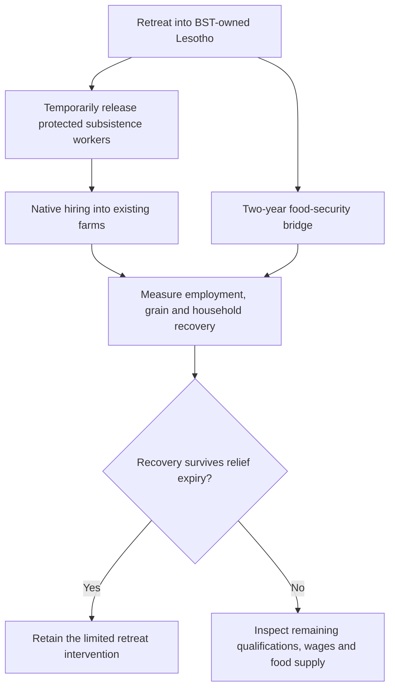

# Lesotho famine after the mountain retreat

1 November 2026. **DP's Shepstone-equivalent subsistence boost is implemented;
engine replay pending.** The investigation and superseded proposals below are retained
as evidence. No game launch or save migration.

## Current follow-up — match Shepstone's subsistence bonus

DP found the throughput-only trial insufficient and requested Shepstone's
subsistence bonus. Add **+30% Subsistence Output**
(`building_subsistence_output_mult = 0.30`), matching the exact value in
`amendment_sb_shepstone_system`. It increases in-kind household income alongside
the existing **+50% subsistence-farm throughput**. The grant remains **ten years**.
The additive interpretation was stated to DP before editing. No Shepstone tax,
employment protection, arable reservation or migration restrictions are copied.
This supersedes the sole-effect restriction in the earlier trial below.

Follow-up verification: all 49 focused remediation/Natal-interwar tests pass,
the runtime-script contract check passes, and independent review confirms the
exact Shepstone value, retained throughput/duration and absence of its unrelated
effects. The full suite/Tiger results recorded below belong to the preceding
throughput-only change; they were not rerun for this one-field addition.

<a id="implemented-decision--throughput-only-for-ten-years"></a>

## Earlier implemented trial — throughput only for ten years

DP selected **+50% subsistence-farm throughput as the sole effect of The Mountain
Refuge**, for **ten years**. `sb_bst_biding_time` now contains only its icon and
`building_subsistence_farm_throughput_add = 0.50`. The retreat option's only grant
uses `years = 10`, replacing `months = 60`.

The former −15% goods-input and +10% in-kind subsistence-output bonuses are
removed. The existing country scope, retreat conditions and 5,000-person transfer
remain. There is no hiring exemption, direct Food Security bonus, new state
modifier or Mountain King change. Serfdom's hiring restriction remains in force;
this is a production-balance trial, not a correction to that hiring rule.

Existing saved expiry dates are not extended by editing the event. Restart and
replay from before the modifier is granted to verify the new ten-year duration.

## Finding and choice

**Serfdom is blocking recruitment out of Lesotho's subsistence farms.** More
qualifications, more arable land or a larger in-kind subsistence bonus cannot
remove that hiring restriction. The saved maize farm has cash and vacant jobs,
but remains at 20 employees for all five retained months.

After DP's clarification about subsistence grain, the second proposal was
a **temporary local hiring exemption plus actual subsistence-farm throughput**.
Keep the existing population transfer unchanged for this first comparison. A
mixed-household transfer remains a useful separate demographic change, not a
substitute for diagnosing hiring. DP superseded this proposal with the narrower
implemented decision above.

<a id="revised-first-trial--actual-food-production"></a>

## Revised first trial — actual food production (superseded proposal)

Add two local effects to the mountain retreat for **60 months**, confined to
BST-owned Drakensberg:

| Effect | Purpose |
| --- | --- |
| `building_subsistence_farm_throughput_add = 0.50` | Increase actual grain and other subsistence goods from the existing workforce. |
| `building_minimum_incorporated_subsistence_employment_add = -0.50` | Cancel Serfdom's protected-employment floor locally, allowing native recruitment into the maize farm. |

Keep the existing 5,000-person transfer and other baseline effects for this
test. **Do not add the direct Food Security bonus proposed earlier below.**
Remove the new local effects on ownership loss; do not refresh them on reload
or reacquisition. National Serfdom and its other effects remain.

The saved subsistence throughput is 1.20. Adding 0.50 gives 1.70, so unchanged
staffing/production methods would produce `1.17212 × 1.70 / 1.20 = 1.66050` grain:
**about 42% more actual output**, not a 50% increase over the current result.
Installed Vanilla uses this exact throughput modifier in its bison-hunting
content. The increase also affects other goods produced by subsistence farms.

This is a first-pass value, not proof that famine ends. Stronger subsistence
earnings and changing grain prices may also change commercial-farm recruitment
and profitability. Measure both sectors, qualifications, wages and starvation
over 4–12 weeks and at expiry. If severe starvation persists, inspect the
remaining constraint before deciding on a stronger production bonus or a short
Food Security bridge; neither escalation is automatic.

Independent Sol 6.1 Max review confirmed the modifier, calculation and hiring
tradeoff. The original direct-relief proposal below remains historical design
evidence; neither earlier package is the implemented decision.

## Saved campaign

The five autosaves cover **1 July–1 November 1841**, with BST still owning
Lesotho. They are all after the retreat; none captures the transfer itself.
The campaign is Victoria 3 1.14.5 with SB and patched CMF. Country `514` is BST;
state `1149` is its fully incorporated `STATE_DRAKENSBERG`. Culture `259` is
Sotho. The active law database confirms Serfdom in every snapshot.

[Machine-readable evidence](evidence/bst_lesotho_famine_2026_11_01.json) retains
save hashes, country laws/modifiers, state demographics and building output.
[Native evidence](evidence/bst_lesotho_hiring_1_14_5_arm64/FINDINGS.md) records the
employment checks, executable hash and reproduction commands.

| Save date | Population | Workforce | Population starving | Subsistence employees | Maize employees |
| --- | ---: | ---: | ---: | ---: | ---: |
| 1841-07-01 | 32,288 | 5,389 | 31,374 | 3,432 | 20 |
| 1841-08-01 | 32,072 | 5,347 | 31,156 | 3,389 | 20 |
| 1841-09-01 | 31,850 | 5,304 | 31,473 | 3,346 | 20 |
| 1841-10-01 | 31,634 | 5,262 | 31,258 | 3,301 | 20 |
| 1841-11-01 | 31,414 | 5,220 | 31,037 | 3,256 | 20 |

Population falls by **874, or 2.71%, in four months**. That is a net population
change, not a reconstructed death count. The starvation column combines native
starvation and severe-starvation Pop states. Actual Pop sums can differ from the
cached state summary by 0–14 people; the table uses the actual sums consistently.

November details:

- **Six subsistence levels, about 30,000 jobs, only 3,256 employees.** This is
  spare capacity, not a shortage of arable land. There are eight arable units;
  the maize farm and livestock ranch occupy the other two.
- **21,568 peasants include only 2,702 workers.** Their 18,866 dependants make
  population totals a poor proxy for immediately available agricultural labour.
  Their saved farmer qualifications are about 90, despite the hiring blockage.
- The maize farm has **10 farmers and 10 labourers**, about **£24,920/£25,000**
  cash reserves, and produces **0.096 grain**. Its founding date is 4 December
  1840. Basic farming needs 1,000 farmers and 4,000 labourers per full level and
  has no goods inputs.
- Subsistence produces **1.17212 grain**; combined cached grain output is
  **1.26812**. These are saved output values, not a measured market-demand ratio.
  The market record does not retain the full live buy/sell-order breakdown.
- Regular barracks employ **1,556**; conscription is empty. Military employment
  is substantial, but the earlier suspicion of a mobilised 14-level conscription
  pool is not what these saves show.
- **The Mountain Refuge is active**, starting 4 December 1840 and ending
  9 November 1845. Missing application of that modifier is not the explanation.

The retained debug/error logs contain no refugee-transfer or farm-hiring error
that explains this sequence. They do not log individual hiring decisions or
prove that the original 5,000-person transfer succeeded. File-watcher and
unrelated GUI errors are not evidence of a famine-script exception.

## Why workers cannot take the jobs

Installed Serfdom supplies
`building_minimum_incorporated_subsistence_employment_add = 0.5`. The localisation
calls this **Protected Subsistence Employment**: other buildings cannot hire
from subsistence below this employment level.

Native inspection establishes that the comparison is **employees divided by
the subsistence building's maximum employment**, not the percentage of the
country employed as peasants. The rule applies here because Lesotho is fully
incorporated. In November:

```text
Subsistence staffing = 3,256 / 30,000 = 10.85%
Serfdom's protected floor = 50%
10.85% <= 50%: recruitment into another workplace is blocked.
```

The native employment collector flags those workers and the transfer selector
rejects them for another workplace. Thus existing farmer qualifications and
low job satisfaction do not establish that the maize farm may recruit them.
Other wage and qualification constraints can still matter after this is lifted.

The refuge modifier in the retained saves also misses this mechanism:

- `building_goods_input_mult = -0.15` does nothing for basic maize farming,
  because that production method has no input goods.
- `building_subsistence_output_mult = 0.10` improves peasants' **in-kind income**;
  it is not +10% market grain production. A building-throughput modifier would
  affect produced goods, but would not release protected workers.

## Earlier trial — direct food relief, superseded recommendation

On the mountain-retreat option, apply to **BST-owned Drakensberg**:

1. **A −0.50 protected-subsistence-employment offset for 60 months**, matching
   the existing refuge duration. It cancels Serfdom's +0.50 locally. Retain the
   national law, its political effects and its separate arable-land reservation.
2. **+0.50 Food Security for 24 months**, as a recovery bridge. This does not
   produce grain. It is a first-pass balance value, with expiry testing required.
3. Keep the existing retreat transfer, building-assistance rules and other
   national modifiers unchanged for this initial comparison.

At unchanged inputs, the November peasants' saved Food Security of 0.02424 plus
0.50 would become 0.52424: above the 0.40 starvation boundary, below the 0.60
moderate-insecurity boundary. This illustrates the intended bridge; subsequent
prices, shortages, wages and raw values can change the actual result.

The state-scoped employment modifier is supported by the native building/state
modifier inheritance path and by SB's existing chiefly-reserves implementation
of the same modifier. It is not necessary to change Vanilla or CMF.



Apply once through the retreat, not through daily scans. Revalidate the actual
destination if the event is held open. Remove this BST-specific state relief
if ownership changes; a timed state modifier otherwise risks benefiting the
conqueror. Do not restart its duration on reload or reacquisition. The hiring
floor returning does not itself dismiss workers already employed by farms, but
can limit later expansion; check that explicitly after expiry.

This was **the first proposal**; it was not implemented and has been superseded
by DP's throughput-only decision above.

## Alternatives and additional ideas

| Approach | Complete effect and limitation | Decision |
| --- | --- | --- |
| Raise the current refuge's in-kind/input bonuses | More household income and cheaper input-using buildings; basic maize still cannot recruit protected peasants. It can conceal symptoms without producing the missing grain. | Reject as the primary fix. |
| Increase actual subsistence throughput | Produces more market goods from existing staff without changing their occupation. It also boosts other subsistence goods; the required grain multiplier is unmeasured and recruitment remains blocked. | Reserve as a fallback if food remains inadequate after hiring works. |
| Transfer 10–20% of mixed Sotho households | Brings existing farmers/labourers as well as dependants; affects the donor's economy and adds food demand. Preserving occupations is important. It does not release the peasants already trapped behind the floor. | Separate demographic follow-up. |
| Increase arable land | Adds capacity to farms that already have vacant jobs; additional subsistence levels can raise the protected employment floor in absolute workers. | Reject for this incident. |
| Buff Mountain King | Attaches economic survival to one character's life and role. Neither extra in-kind output nor qualifications removes the hiring rule. | Keep the structural remedy on the affected state, not Moshoeshoe. |
| Change BST's land law or a custom land-law variant | Removes the hiring rule durably, but also raises broader historical/setup and political-balance questions. | Defer to the Bantu starting-position review. |
| Reduce military recruitment or transfer soldiers into farming | Frees labour and lowers competition, but the retained conscripts are already inactive; changing professions/military strength is a wider intervention. | Do not combine with the first trial. |
| Food imports/market access | Supplies actual grain without waiting for local hiring, but requires a valid supplier, route and affordable trade. Ownership of a foreign farm alone proves no delivered supply. | Useful player route; no scripted import entitlement proposed. |

### What the percentage transfer would mean

The current script selects **one largest qualifying Sotho Pop**, moves 5,000
people and preserves that Pop's profession. A set of smaller Pops can fail the
individual 5,000-person condition even when their aggregate is large enough.
The saves cannot tell us which profession was selected in December 1840.

In November, remaining Sotho in Transoranje number **24,545**. A hypothetical
20% transfer would move **4,909 people**, approximately the current fixed size,
not a major increase. It would include about **189 farmer workers, 571 labourers
and 40 peasants**, alongside other professions and dependants.

Definition matters: 20% excluding soldiers/officers is about **4,606 people**;
excluding slaves as well is about **3,146**. An all-Sotho transfer would also
move roughly 690 enslaved workers while preserving their status, which should
not be smuggled into a generic 'civilian refugees' rule. These are calculations
from the remaining November population, not a reconstruction of the earlier
donor or a forecast of destination employment.

If pursued separately, use the actual lost-frontier owner, an explicit eligible
cohort definition and BST-owned mountain destination; aggregate/split households
rather than require one large Pop. Preserve population, dependants and source
identities, and test a held event, small donors and duplicate delivery. That
demographic decision need not delay testing the confirmed hiring blocker.

## Verification and next replay

**Completed investigation:** five-save extraction and arithmetic, active-law/incorporation
checks, source/caller inspection, log inspection, native employment/modifier
inspection and independent Sol 6.1 Max review. No modified gameplay behaviour
has been observed in-engine.

**Implementation checks:** 20 focused remediation tests pass; independent
review confirms the sole modifier effect and single ten-year grant. Full
discovery runs 1,032 tests: 1,023 pass, eight skip and the existing unrelated
localisation regression fails. The full validator remains at 15/17 checks
passed/warned/skipped: that regression and the corresponding localisation gate
report the pre-existing dangling Swazi `.098` review row and reviewed-prose
drift in Klip `.060`/`.080` and Natal `.050`. CMF, override, map and naval checks
pass. Advisory Tiger reports zero fatal, 1,076 errors and 149 warnings under
its older 1.13.5 schema; neither changed script file is diagnosed. Whitespace
checks pass. Full output is archived locally at
`generated/diagnostics/bst_lesotho_famine_2026_11_01/static_validation.txt`.

**Pending engine replay of the implemented decision — DP launches:**

1. Use a checkpoint before the retreat. Verify that The Mountain Refuge shows
   +50% subsistence-farm throughput, +30% Subsistence Output and the ten-year
   expiry. The donor and refugee transfer are unchanged.
2. Compare the first 4–12 weeks with the same baseline. Check subsistence output,
   actual market grain, food prices and starvation. The maize farm may remain
   unable to hire under Serfdom; no exemption has been added.
3. Continue through the first harvest year: Food Security, starvation, deaths,
   workforce share, food prices and military recruitment. Confirm recruitment
   has not merely moved the shortage to another necessary building.
4. Test both bonuses ending after ten years and the post-expiry food balance.
   There is no direct Food Security bridge to expire separately.
5. Check reload/held popup and unrelated countries. This retains the existing
   country modifier and building-assistance difficulty gates; no state-ownership
   cleanup or new lifecycle controller has been introduced.

The retained July–November saves are suitable for inspecting the established
famine, but are too late to replay the original retreat transaction. The broader
population/technology audit and Institutional Reach expansion remain deferred.
