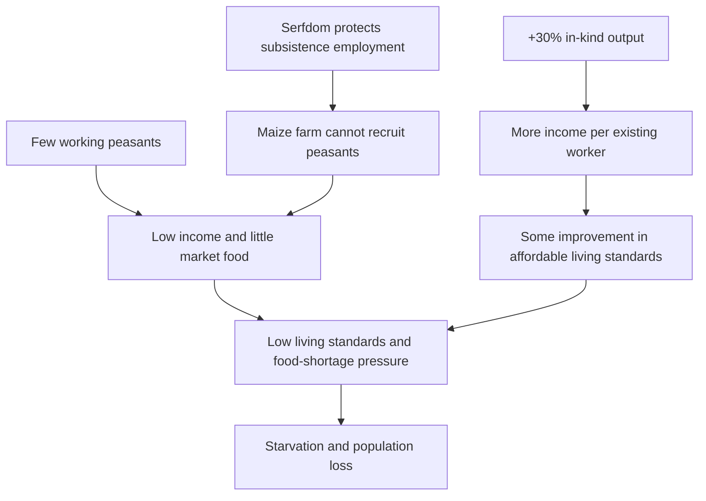

# Lesotho: why the +30% subsistence-income trial still starves

1 November 2026. **Read-only diagnosis; no gameplay changes or launch.** DP
disabled the throughput effect and tested only
`building_subsistence_output_mult = 0.30`. Preserve that user edit. This is a
different trial from the previously implemented combined package.

## Main finding

The bonus is active and calculates correctly. It improves household income,
but the remaining workforce produces very little market food. Serfdom still
blocks the maize farm from recruiting peasants. The engine's Food Security
calculation also applies a state-wide food-shortage penalty separately from
household income, including to peasants who buy only a small part of their
consumption on the market.

Copying Shepstone's percentage does not reproduce its economic circumstances:
BST has a lower base subsistence income under Serfdom and an unusually low
peasant workforce share. This is a production, household-composition and food
affordability problem; the saved country treasury is not bankrupt.

## Evidence

Five fresh autosaves, written around 13:33–13:34, cover **1 June–1 October 1841**.
BST is country 514, Lesotho state 1149, peasant Pop 30841 and Sotho culture 259.
The refuge is active from 4 December 1840 to 4 December 1850. Subsistence
throughput remains 1.20, confirming that the earlier +0.50 throughput trial is
not present in these building outputs.

[Save evidence](evidence/bst_subsistence_income_replay_2026_11_01.json) contains
hashes, demographics, buildings, budgets and active laws.
[Native findings and reproduction commands](evidence/bst_subsistence_income_1_14_5_arm64/FINDINGS.md)
establish the income and Food Security calculations. Original saves/logs are
archived locally under
`generated/diagnostics/bst_subsistence_output_only_2026_11_01`.

| Observation | June | October |
| --- | ---: | ---: |
| Total population | 32,574 | 31,848 |
| Starving population | 32,111 | 31,000 |
| Peasant workers | 2,914 | 2,794 |
| Peasant dependants | 19,724 | 19,179 |
| Peasant wealth level | 3 | 2 |
| Peasant Food Security | 0.11948 | 0.07565 |
| Grain output: subsistence plus maize | 1.35204 | 1.30192 |
| Maize employment | 20 | 20 |

The population loses **726 net people (2.23%)**; grain output falls **3.71%**.
This is net change, not a reconstructed death count. The maize farm remains at
0.4% of its 5,000 jobs and produces only 0.096 grain. October subsistence
employment is 3,350 across six levels: **11.17%** of 30,000 capacity, below
Serfdom's 50% protected-employment floor. About 94 farmer qualifications exist
among peasants, but that does not grant permission to leave protected jobs.

## Calculation 1: the bonus is not missing

Installed `pm_serfdom` supplies £3 of annual in-kind income per employed peasant.
The modifier multiplies this by 1.30. Native calculation divides by 52 and
multiplies by the **working** population; dependants do not receive this income.

```text
2,794 workers × £3 × 1.30 / 52 = £209.55 per week
```

That exactly matches the saved weekly-budget subsistence entry. The bonus adds
approximately **£48.36/week** over no bonus for this Pop. Relative to the original
refuge's +10%, +30% is an **18.18%** increase in the subsistence component, not
a 30% increase in all household income.

The October weekly household ledger is:

| Component | Amount |
| --- | ---: |
| Wages | +£44.07 |
| In-kind subsistence income | +£209.55 |
| Dependant income | +£119.68 |
| Purchases | −£323.00 |
| Grouped direct/per-capita taxes | −£37.61 |
| **Net** | **+£12.69** |

These categories are verified against native budget writers; the tax bucket is
not exclusively land tax. June and July have deficits of £17.72 and £16.90 at
wealth 3. August–October have modest surpluses at wealth 2. This supports the
interpretation that the budget cannot sustain the higher living standard under
the recorded conditions; it does not imply that every subsequent price remains
unchanged. BST's October treasury is about £15,556 and its retained money trend
is increasing, so the observation concerns household production/food balance
rather than sovereign insolvency.

## Calculation 2: many mouths, few producers

October peasants comprise **2,794 workers and 19,179 dependants**, or **6.86
dependants per worker**. Only **12.72%** of that Pop works. Vanilla's unmodified
reference working-adult share is 25%; it is a reference, not a promise that the
saved population immediately returns to it.

Dependants consume half a working adult's needs in the installed defines:

```text
Demand-equivalent adults = 2,794 + (19,179 × 0.5) = 12,383.5
Demand-equivalent adults per worker = 4.43
At a 25% worker share: 1 worker + 3 dependants = 2.5 equivalents
```

The current household therefore carries roughly **77% more consumption weight
per worker** than that reference. +30% to one income component does not cancel
that burden. This is not a recommendation to grant +77% output: wages, dependant
income, prices, taxes and Food Security interact separately.

The regular barracks and logistics centre employ about 1,595 of the state's
5,315 workers: **30% of the workforce** is in those buildings. Conscription is
inactive. More population is not automatically more food: the composition and
destination employment of refugees matter.

The low worker share's origin remains unproved. Prior casualties, wounded
soldiers redistributed as dependants, refugee composition and ongoing famine
are plausible contributors. The native casualty-distribution rules support
those possibilities, but these five post-retreat snapshots cannot distinguish
them. Do not claim the original 5,000-person transfer caused it without an
earlier checkpoint.

## Calculation 3: the same percentage is weaker here than under Shepstone

The ordinary subsistence PMs unlocked by Shepstone's permitted land laws have
base annual subsistence output **4**, while BST's Serfdom PM has **3**:

| Setting, holding other bonuses constant | Annual income per worker |
| --- | ---: |
| BST Serfdom +30% | £3 × 1.30 = **£3.90** |
| Shepstone-eligible land-system PM +30% | £4 × 1.30 = **£5.20** |

BST receives **25% less per worker**, even before differences in workforce
share, market supply and taxation. This is a production-method comparison,
not a claim about Natal's actual active law or full economy in this save.

## Calculation 4: a positive budget does not mean Food Security

The inspected 1.14.5 path calculates:

```text
Food Security = clamp(1 + state adjustment
                        − basic-food cost share
                        − basic-food shortage severity, 0, 1)
```

Food's cost share depends on the wealth-level consumption basket, culture and
local prices. Household subsistence income is **not** directly credited to this
score. Its influence is indirect, through wealth/consumption and prices.

The shortage function receives a need and state, not a Pop or its consumption
multiplier. Peasants have `consumption_mult = 0.05`, so only 5% of their buy
packages become market demand, but that does not directly exempt them from the
state-wide shortage penalty. This is a counterintuitive engine abstraction;
the investigation does not establish that it is an engine defect.

October's score is **0.07565**. Starvation begins below **0.40**, and severe
starvation below **0.20**. The native starvation-strength calculation also
matches the save: `(0.40 − 0.07565) × 2.5 = 0.810875`, approximately its recorded
0.81087. The Pop can therefore have a £12.69 current surplus and still suffer
severe starvation.

The saves do not retain the complete live market-order breakdown. We have not
split the combined food-cost/shortage pressure into exact contributions and
cannot responsibly calculate an exact grain multiplier that would end famine.



## Implication and limits

The income boost works, but it addresses only one part of the problem. The next
useful evidence is the live Food Security breakdown and market buy/sell orders,
plus a pre-retreat worker/dependant snapshot. Those distinguish a primarily
food-supply shortage from poverty and workforce damage. Raising the income
percentage again without that distinction would be another uncalibrated trial.

Independent Sol 6.1 Max review confirmed the native income calculation, budget
categories and common shortage penalty. Save arithmetic and archives were
checked; no gameplay scripts were edited and no game/tests were launched.
