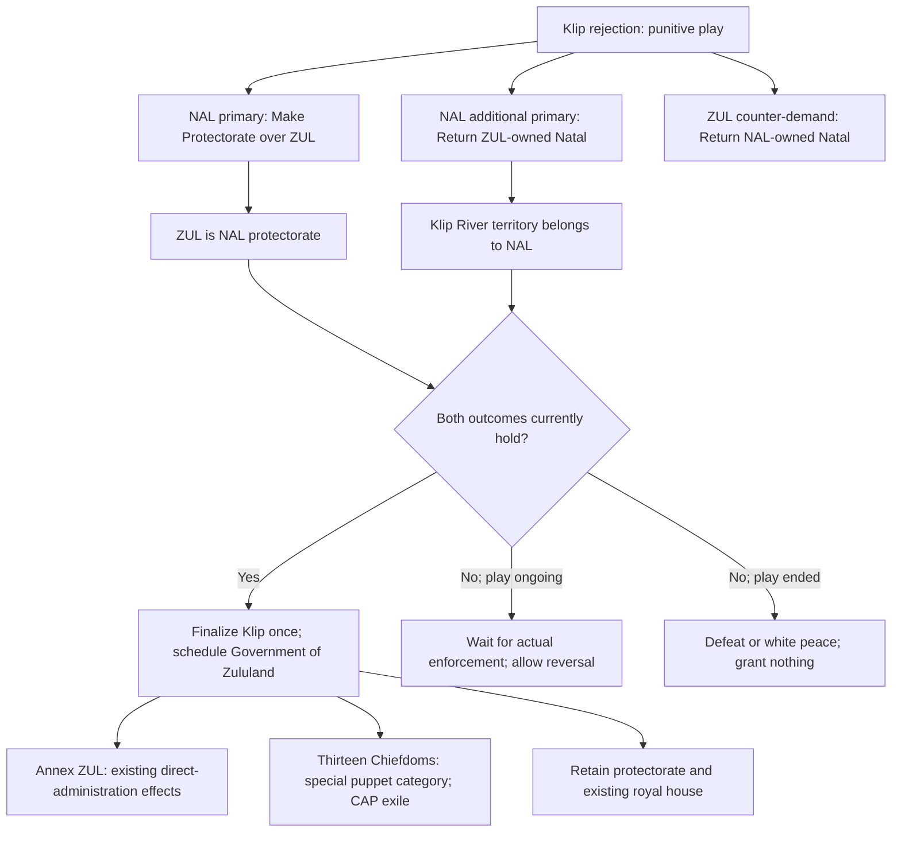

# Klip River: Return State and Make Protectorate

Implements DP's corrected two-demand punitive settlement. This supersedes the
custom annexation and NAL royal-custody experiments, not the other Klip play or
British handoff routes.

## Runtime changes

- The punitive primary goal is Vanilla `make_protectorate`. The added primary is
  `return_state`, holder NAL, target ZUL, state `s:STATE_NATAL.region_state:ZUL`,
  `primary_demand = yes`. The existing Zulu return-state counter-demand retains
  the separately captured NAL state. British backing and launch rules remain.
- Installed state history places `xBBCA32` in the ZUL-owned Natal state. Final
  evidence checks the Klip County footprint (`xBBCA32`, `xDE0EDE`, `x552449`) and
  retained Natal core (`x279045`), plus live ZUL's direct protectorate relationship
  with NAL. These province references survive split-state object merging.
- `sb_natal_klip_river_settlement_var` records this government event's origin on
  NAL and survives ordinary refugee/war cleanup. It keeps the two-demand condition
  active after partial peace and while a popup is open. Other live-protectorate
  handoff routes retain their existing entry behavior.
- Exact-play enforcement callbacks inspect positive outcomes; the monthly pulse
  retries after engine changes. War-end/backdown callbacks mark the exact play
  ended with `sb_klip_river_punitive_ended_var`, then monthly reconciliation reads
  the completed result. A deleted saved play also permits terminal reconciliation.
  No blanket peace requirement or scripted grant of missing demands is added.
- Successful reconciliation records Natal victory, clears transient punitive
  runtime, and calls the existing three-day government scheduler. Reservations,
  resolved guards, cancellation and option revalidation remain. Partial outcomes
  do not resolve positively; Zulu ownership of Natal's core is defeat, otherwise
  an incomplete terminal result follows the existing white-peace path.
- The government event again has one live-protectorate presentation and three
  options. Crown does not restore/recreate/transfer any character. Chiefdoms
  retains its special subject, Zibhebhu, actual royal exile to CAP and CAP claimant
  lookups. Direct administration retains its annexation/incorporation effects.
- Removed the custom annexation goal/effect, single-use NAL custody helper,
  punitive snapshots, annexed-Natal trigger/presentation/restoration branches,
  obsolete localisation aliases/queue rows and preservation tests. Shared archive
  and creation helpers used by British/later restoration paths remain.

## Localisation review for DP

Preserved these reviewed passages in `sb_natal_crisis_l_english.yml`, despite their
now-inaccurate claims; they need DP's wording or approval:

- `sb_klip_river_county.060.d` and `.060.a`: describe the immediate demand as conquest
  and annexation, rather than return of Klip River plus subjugation.
- `sb_klip_river_county.080.d`: states that Zululand was already annexed; the new
  successful outcome is a living protectorate, before the government choice.
- `sb_klip_river_county.081.d`: asserts neither side altered the frontier, which
  does not cover a peace in which only one of the two demands was enforced.

Updated the separately classified general `sb_klip_river_county_060_tt` and queued
it for review. Updated `.030` prose already marked TO REVIEW to describe a living
protectorate and retained Crown. Removing the abandoned `.030.a.direct.tt` also
removes its obsolete general review-queue row, the prior bookkeeping failure.

## Validation and engine handoff

- 102 focused tests pass: correct sides/states and primary flag; both enforcement
  orders; partial results; reversal; exact-play terminal signals; persistent
  eligibility after cleanup; three live-country options; CAP exile and return.
- These tests evaluate actual script expressions with a limited world fixture.
  They do not emulate engine goal admission, subject creation, or popup delivery.
- Effect syntax checked against the installed 1.14.2 executable's documentation:
  `add_war_goal` explicitly supports `primary_demand = yes`. Goal rules are the
  installed Vanilla/CMF definitions; no dependency modification is made.
- DP engine scenarios pending: visible correct goals/icons/control tooltips;
  both primary demands on backdown; capitulation/negotiated peace; timers in both
  orders; recapture/reversal; defeat/white peace; both outcomes before government
  delivery; held popup without duplicates; unrelated war ongoing; Crown identity;
  direct annexation; chiefdom CAP exiles; unaffected British and other Klip paths.
- Start from before the punitive play opens. Existing saved play goals are not
  migrated. No game launch or save modification was performed.

Final static run: 16/16 checks passed or warned, zero failures; the five existing
deferred release gates remain. Unit discovery passes after replacing the two
obsolete story-route assertions (440 tests discovered in the preceding run,
3 platform/environment skips). Output:
`/private/tmp/sb-klip-two-demands-validation-final.txt`. `git diff --check` passes.
No engine result is claimed by these static checks.
