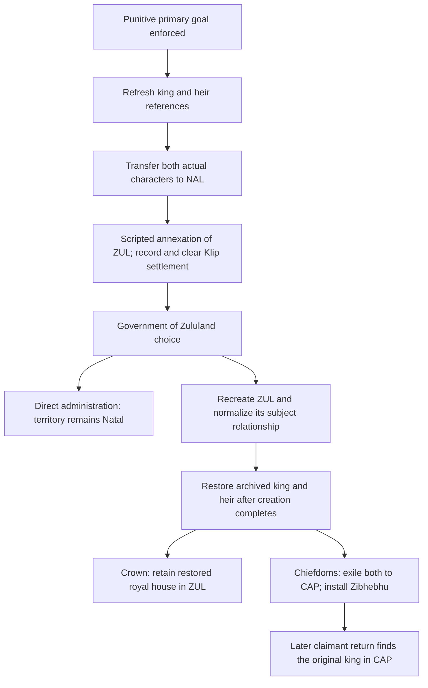

# Klip punitive settlement: preserve the royal house

> Superseded for the Klip punitive path by [klip_punitive_protectorate_cleanup_2026_09_13.md](klip_punitive_protectorate_cleanup_2026_09_13.md).
> Historical evidence retained; do not restore the abandoned annexation/custody approach.

DP approved moving the defeated royal house to NAL, returning it to ZUL for the
Crown route, and hosting exiles in CAP. The pre-annexation records identify
Mpande (4478) and Cetshwayo (4481); neither character remains in the tested
post-annexation character database. The Crown-selected save instead has
Sekethwayo Buthelezei (16777293) ruling recreated ZUL (16777217). Saving references
did not preserve the characters.

## Implementation and scope

- Only the primary goal of `dp_sb_klip_river_punitive_expedition` changes to
  `sb_klip_annex_zululand`. `kind = custom` allows the authored transfer to run
  before the script's `annex`, instead of after engine annexation has removed the
  court. Ordinary territorial goals, the other Klip play, and British annexation
  goals are unchanged.
- Retain the annexation objective's half-country control threshold, execution
  priority, territorial mirror declaration, CMF land-grab validity hook, and AI
  significance. No assent or peace requirement is introduced. The goal is only
  the event-created primary demand; that play already disables initial infamy.
  Its localisation aliases Vanilla's annexation wording.
- Enforcement validates the existing exact play reference, snapshots the current
  court, moves both members, then annexes. It records the Natal outcome and clears
  punitive runtime so subsequent callbacks cannot repeat that settlement.
- References are captured before any roles change. Preserved characters become
  politicians in NAL with its Landowners affiliation while awaiting the choice;
  no duplicate historical characters or immortality are introduced.
- The country-creation baseline no longer consumes the royal archive. The shared
  restoration helper reinstalls it after creation and subject normalization.
  Chiefdoms then exiles the actual restored ruler/heir to CAP. If CAP no longer
  exists, they remain in the ordinary exile pool; the option is not blocked.
- Both later claimant-return helpers search CAP before their existing exile-pool
  and successor paths. The heir is also preserved in CAP; this does not redesign
  the later chiefdom succession rules.

## Verification

- 72 focused tests pass. New tests check actual primary-goal wiring, transfer/
  annex/settlement order, exact character IDs and destinations under foreign
  ROOTs, archive consumption after country setup, exile capture order, and CAP
  lookup before successor fallback.
- The small survival fixture models deletion of characters still owned by the
  annexed country. It proves the script's reference/ordering contract, not the
  engine's character-transfer or custom-goal execution.
- Compared with installed Vanilla annexation and character effects, Hail
  Columbia's custom Mexican Cession goal, and Gates' custom Depose Bey goal.
- Engine checks remain pending DP: timer enforcement, negotiated victory and
  backdown; defeated/white-peace court untouched; both royal identities survive
  NAL custody; Crown restores both; Chiefdoms hosts both in CAP and later returns
  the same claimant; terminal outcomes occur once.
- Retest from before the punitive play starts. Saved plays retain their original
  goal, and this patch cannot recreate character records already deleted. No
  game launch, save edit, dependency patch, or historical-template resurrection
  is performed.

### Full static run

`/private/tmp/sb-klip-royal-preservation-validation.txt`: 14/16 checks passed or
warned. Unit discovery ran 444 tests (3 skipped), with one failing localisation
bookkeeping assertion; the localisation gate reports the same pre-existing row:
`localization/english/sb_natal_interwar_l_english.yml:sb_natal_interwar.030.a.direct.tt`
is in the general review queue despite belonging to an event namespace. This
patch only appended its five new Vanilla-alias rows to that queue and did not
change that existing row or the event localisation. All other checks pass or
retain the five existing deferred release warnings. Diff whitespace checks pass
for files changed by this patch; unrelated existing whitespace diagnostics in
the Natal event/localisation files remain unchanged.
