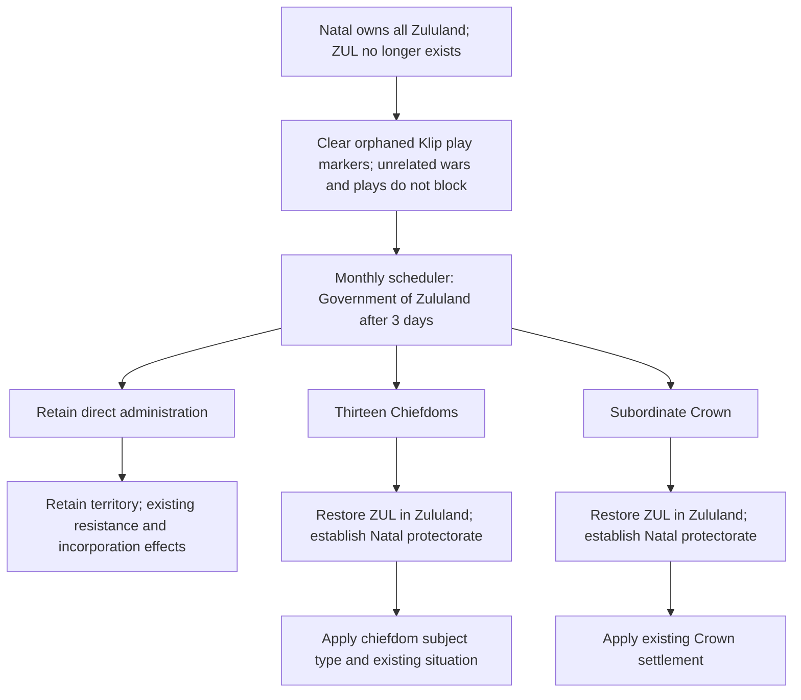

# Natal-owned Zululand settlement — 13 September 2026

> Superseded for the Klip punitive path by [klip_punitive_protectorate_cleanup_2026_09_13.md](klip_punitive_protectorate_cleanup_2026_09_13.md).
> Historical evidence retained; do not restore the abandoned annexation/custody approach.

Implements DP's approved direct entry: Zululand annexed into Natal → an annexed-
territory variant of “The Government of Zululand,” retaining the three choices.

## Implementation

- Both player and AI Natal qualify. Natal is excluded from the competing British
  ownership handoff. Britain and eligible other AI British subjects retain it.
- A surviving unrelated ZUL, partial ownership, a retained Klip play reference,
  or an already resolved settlement does not qualify for the annexed-territory entry.
  Unrelated wars and plays do not block eligibility or punitive orphan cleanup.
  The existing normalized-protectorate entry remains available.
- One event, exactly three options, unchanged AI weights. Conditional description
  and a customizable direct-rule label preserve the approved protectorate prose.
  Four general localization keys are listed in the review queue.
- Direct administration performs no restoration. The subject choices restore
  only the owner state in STATE_ZULULAND, with the actual owner as creation origin.
  Other annexed territory stays where it is.
- Normalization no longer schedules the event. The British handoff schedules it
  after verified setup; subject choices apply their result directly. A choice is
  marked resolved only after its required setup passes validation.
- All three effect entry points recheck settlement readiness. The existing
  120-day event reservation covers the three-month popup and three-day dispatch.
- The Klip punitive on-start callback archives Zulu firearms and the royal house
  on the correct target country before annexation. Restoration reuses those
  existing records. No retrospective save migration is included.

## Validation

- 91 focused tests pass. The five new tests produce seven failing assertions or
  subtests against the retained pre-change scripts, with zero test errors.
- Full static validation: 16/16 checks passed or warned, zero failures and the
  five existing deferred warnings. Output:
  `/private/tmp/sb-natal-owned-zululand-validation.txt`. `git diff --check` passes.
- Engine checks remain with DP: all three choices after Natal annexation; player
  and AI entry; held popup; no second choice after restoration; correct state
  footprint, dynasty and firearms; and the unchanged British handoff route.

`common_pitfalls.md` records lessons from these and earlier bug investigations.
`AGENTS.md` requires reading it before script changes/reviews and during regression
investigations, and updating it when a new cause or prevention is established.

## Follow-up: remove unapproved blanket peace gates

DP's autosaves show Natal acquired Zululand on 2 August 1851, with ZUL gone.
By 1 November, Natal still participated in the unrelated WTI–WAS uprising and
retained punitive active/play markers referencing deleted play `117440512`.
The government event was neither open nor queued. Both eligibility and punitive
orphan cleanup required global peace/no active play, blocking progression.
The reason the original war-end callback missed cleanup remains unestablished.

At DP's request, remove both blanket checks from annexed-settlement eligibility
and punitive orphan cleanup. Retain ownership, country existence, exact Klip
runtime and once-only guards. The monthly handler runs Klip cleanup before the
settlement scheduler, which queues the government choice with its existing
three-day delay. No game launch or save modification is performed.

The regression fixture evaluates unrelated war, unrelated play, and both together;
then evaluates the actual cleanup guard and conditional marker removals before
checking settlement eligibility. It also rejects cleanup with a living ZUL or
without an active punitive marker. Static verification is not engine delivery.

Follow-up validation: 62 focused tests pass. Full static validation reports
16/16 checks passed or warned, zero failures, and the same five deferred release
gates. Output: `/private/tmp/sb-zululand-peace-gates-validation.txt`.
Engine delivery remains pending DP.
