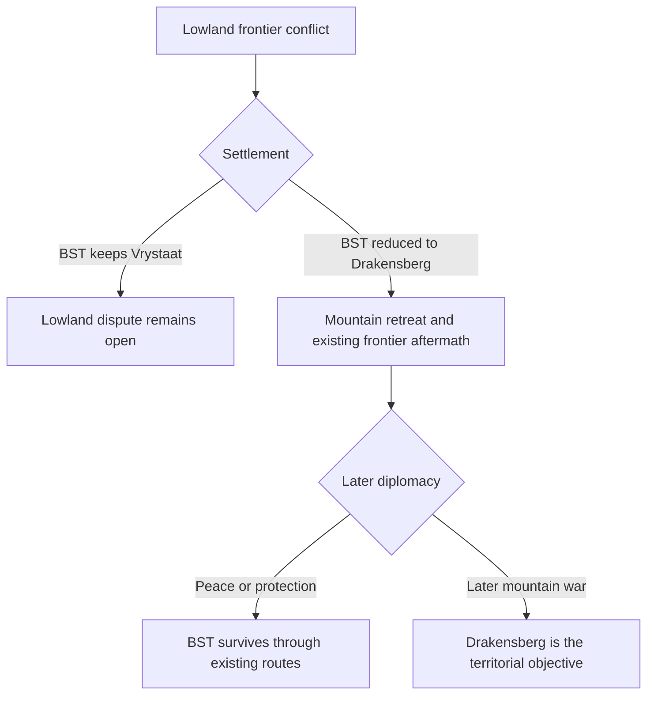

# ORA–BST territorial enforcement: design exploration

Status: **ON HOLD** at DP’s request (2026-09-06). DP has requested a balance change from Paradox for the next open-beta patch. Reassess that patch before considering an SB workaround; no two-stage gameplay changes have been implemented.

Update 2026-09-12: SB is rebased to 1.14.2. Vanilla's Conquer State and Return State definitions remain byte-identical to the opening beta. This does not establish whether engine occupation behaviour changed. The fresh-campaign retest is pending because UI control could not select New Game; see `1_14_2_runtime_matrix.md`, B142-05. The design remains on hold and no two-stage implementation was added.

## Objective and evidence

DP reports that occupying BST's Vrystaat satisfies the occupation timer for conquest of Drakensberg too. The desired invariant is that taking the lowlands must not automatically grant the mountain homeland.

The effective `common/war_goal_types/03_conquer_state.txt` already specifies `contestion_type = control_target_state`. Thus adding that line again is not a fix. Installed OB1 localisation describes additional control alternatives involving 50% of the opponent's incorporated states and its capital. DP's observed outcome is consistent with those broader alternatives feeding timer eligibility; the exact executable branch has not been independently traced in this exploration.

The exposed `NWar.STATE_PARTIAL_OCCUPATION_THRESHOLD = 0.5` concerns occupation *within an individual state*. It is distinct from the fraction of incorporated states belonging to a country. Raising it cannot guarantee that an unoccupied Drakensberg stops qualifying once Vrystaat is fully occupied.

The installed `war_goal_types.md` documents a named contestation type, numeric timer rates, mirrors, and `assent_required`. No separate scripted timer-eligibility trigger or switch disabling the broader alternatives was found in that interface. An engine-level remedy cannot presently be promised as a CMF script patch.

SB's `sb_bst_controls_only_drakensberg` already drives the retreat event, later frontier claims, and the British protection route. Losing both states in one enforcement window skips these systems. Those existing systems make a phased workaround a coherent design, rather than just a numerical delay.

## Proposals

### A. Separate exact occupation from general war-goal control in the engine

For Conquer State and Return State, increment the timer only when the attacking side controls the specific target state. Broader country/capital control may still influence pressure for peace. Losing the objective drains its timer. Occupying Vrystaat alone can transfer Vrystaat; Drakensberg's timer remains at zero. Occupying both can transfer both, with existing territorial mirrors.

This preserves free selection of goals, simultaneous offensives, and Vanilla's new wartime transfers. Peace/capitulation can still cede an unoccupied state: an additional rule would be needed if the design forbids that too.

Feasibility: best systemic solution, but an engine change or additional exposed setting is required unless further investigation discovers an existing hook. CMF cannot be assumed to provide this. It is suitable beta feedback, not a currently verified script-only implementation.

### B. Peace-only Drakensberg demand

Use a restricted territorial goal with `assent_required` for the protected BST mountain demand, covering both conquest and return-state access as applicable. Keep Vrystaat's ordinary timer. Taking Vrystaat then produces a mountain campaign, continued negotiation, or peace; Drakensberg does not flip automatically. Preserve normal transfer and costs when its demand is accepted or BST capitulates.

Strengths: relatively small intervention; keeps both goals in one war and retains native peace UI. Weakness: capitulation or accepted peace can still transfer unoccupied Drakensberg. Merely removing the mirror from all ordinary conquests would extend this restriction worldwide. This option solves the automatic-transfer complaint, not a strict requirement to fight in the mountains.

### C. Two-stage frontier conflict — recommended available SB workaround

During the lowland frontier phase, the applicable Boer–BST conflict can demand Vrystaat but not Drakensberg or total annexation. After the conflict ends with BST reduced to Drakensberg, run the existing retreat/claim progression. A later mountain conflict follows normal truce and diplomatic rules and can target Drakensberg.

The restriction must cover ordinary alternative play/goal entry points, conquest, claims allowing Return State, full annexation, and third-party holders in the same protected dispute. Closing only the custom play's add-goal buttons is insufficient. Unlock only after the first conflict closes, not immediately when Vrystaat flips mid-war. Do not assume the protected period is a fixed historical year.

When BST has only Drakensberg, taking some other BST state cannot activate the same shortcut because there is none. War support, voluntary concessions, outside allies and Britain still matter. If BST retains or acquires other territory, reassess eligibility rather than incorrectly treating it as the one-state mountain phase. Concurrent third-party wars need defined scope; this proposal protects the frontier route, not BST against every possible worldwide conquest.

Strengths: builds on existing content, preserves ordinary timers elsewhere, and reliably prevents bundling both territories into the opening demand. Costs: deliberately removes the freedom to annex both in the first war, adds a truce-separated campaign, and requires careful handling of alternative goal entry points. It guarantees a separate mountain dispute, not universal immunity from capitulation.

### D. One war with an explicitly scripted mountain settlement

Allow a lowland demand plus a custom mountain-campaign objective with no native annexation. Track actual allied occupation of the relevant Drakensberg state against the exact war. At peace, the custom demand authorizes the mountain settlement only if the occupation requirement was achieved. A lowland-only victory therefore leaves BST in Drakensberg. A failed campaign or white peace grants no mountain transfer.

Possible realizations: require occupation at the settlement, or require a sustained occupation milestone during the war. The former needs a verified callback before occupation is cleared; the latter must explain why later recapture does not cancel the earned result. A continuous milestone should reset on recapture and must not count unrelated wars or unrelated occupiers. Duration is provisional tuning, not a decision gate.

Strengths: permits one combined campaign while enforcing an actual mountain-fighting requirement. Costs: high implementation and testing burden, custom settlement text/AI handling, and potential mismatch between native control indicators and the scripted objective. Merely putting occupation in `valid` risks invalidating an unoccupied demand instead of pausing it. Silently withholding land after a normal Conquer State peace promise is unacceptable: the custom objective must describe its conditional outcome.

Feasibility: plausible scripted design, but exact occupation triggers, callback ordering, and peace presentation require a prototype before committing to it.

## Recommendation and decision register

| Item | Status | Position |
|---|---|---|
| Lowland occupation must not automatically award Drakensberg | Agreed | DP's requirement |
| Ordinary timers outside this conflict | Provisional | Preserve |
| Available SB implementation | Provisional | C, because it matches existing mountain-phase content |
| Systemic engine feedback | Provisional | A, independently of the SB workaround |
| Must both territories remain obtainable in one war? | Open | If essential, evaluate D rather than assuming C is acceptable |
| Must occupation be required even after voluntary peace/capitulation? | Open | Stronger requirement than stopping automatic enforcement |
| B as sufficient permanent fix | Open | Appropriate only if peace-only transfer is acceptable |

Do not substitute slower timers, artificial state splits, or incorporation changes for an objective rule: those delay or manipulate the shortcut rather than remove it. Timer callback ordering after Vrystaat transfers is also not a reliable design guarantee.

Acceptance cases: occupy only Vrystaat; occupy only Drakensberg; occupy both; recapture each; simultaneous timer completion; negotiated peace; white peace; capitulation; claimant/third-party goal holder; BST acquiring another state; British protection; save/reload. The recent Natal state-control goals should also be tested for broader control alternatives—naming a target state alone does not prove its occupation is exclusive.

## Two-stage implementation outline — 2026-09-06 follow-up

DP asked how proposal C could be implemented. This elaborates C; its conditional consideration is not approval to change gameplay.

Use the existing frontier journal as the presentation layer and retain ordinary Return State/Conquer State machinery. New plays, a second journal, a custom occupation timer, and calendar-based unlocks are not necessary for the basic implementation.

1. **Shared eligibility rules in `common/scripted_triggers/sb_bst_triggers.txt`.** During a qualifying Boer–BST lowland dispute, reject demands that take BST's Drakensberg partition or annex BST outright. Allow Vrystaat under its ordinary claim rules. Qualify the actor using the existing frontier-actor concept, rather than silently excluding a successor to ORA. Inside a play, apply the protection to goals added on behalf of an ally as well as goals held by the frontier actor. Outside a play, check the initiating/receiving countries so the first goal cannot bypass admission. British protection and the distinct Cape Gun War stay outside this territorial frontier rule.

2. **Apply those rules to the three existing SB goal overrides.** `03_conquer_state.txt` and `21_return_state.txt` consult a shared state-demand rule; `00_annex_country.txt` consults the corresponding country-demand rule. Use both selection filtering and actual validation, with a player-readable explanation. Do not globally turn off their mirrors. Keep CMF's existing compatibility hook intact. Update override hashes/manifests and the timer regression tests: the present tests intentionally expect each SB shadow to differ from pinned CMF only by its mirror, and must be revised to account for the explicit BST exception while preserving unrelated Vanilla behaviour.

3. **Bind the opening dispute and latch its phase.** At play start, remember the actual play and participants using the repository's established exact-play pattern. Eligibility for that play remains stage one until it closes, even if Vrystaat transfers during fighting. This is the important difference from checking only current ownership each month. Restrict full annexation from the beginning, including as the primary demand of an ordinary Annex Country play.

4. **Advance at final settlement, not at first enforcement.** Reconcile on war end and back-down. If BST survives only in Drakensberg and a qualified frontier actor holds the former lowland territory, advance to the mountain phase. If BST retains or recovers Vrystaat, leave the lowland phase unresolved. Mirror-based recapture before final peace must therefore prevent premature advancement. Cancel stale bindings on invalidation/death, and use an idempotent monthly recovery for old saves or missed delivery. Recovery must not infer a completed peace from a wartime ownership change.

5. **Reuse the existing aftermath.** Gate the existing monthly Drakensberg claim grant and `sb_bst_frontier.020` dispatch behind completed lowland settlement. The current script starts these when BST owns only Drakensberg, which OB1 can make true mid-war. Keep the retreat's one-time event guard separate from phase eligibility: it is an event receipt, not a sufficient definition of which demands are legal. The journal remains open; its existing overall completion already requires BST to lose its frontier holdings, not merely Vrystaat.

6. **Enable a later mountain dispute under normal diplomatic rules.** After the first settlement, claims make Return State available where appropriate; otherwise normal conquest rules apply. Normal truce restrictions still govern the next play. No forced war or arbitrary extra countdown is needed. BST's protection and later Cape routes continue to operate. If the lowlands are regained before a new declaration, re-evaluate the new conflict's phase instead of letting a permanent unlock defeat the staged rule. A previously admitted conflict retains its starting phase.

7. **Explain and test.** Add a status/tooltip explaining why Drakensberg is unavailable during the lowland dispute and what unlocks it. Preserve reviewed journal/event prose; use separate new UI keys where possible. Test ordinary primary and secondary demands, allied holders, Annex Country, Return State through claims, wartime transfers and mirrors, back-down, white peace, BST victory, successor frontier actors, protection, and save/reload. Existing illegal demands in an already-running saved war need an explicit migration or a pre-play reload; selection restrictions alone will not repair them.

Scope limitation: the basic mechanism guarantees separate disputes and prevents the reported lowland-to-mountain transfer. It does not require literal occupation in every conceivable peace settlement, nor grant BST blanket immunity from unrelated third-party wars. If BST acquires additional non-frontier territory, the one-state premise needs a deliberate extension rather than an automatic mountain unlock.
