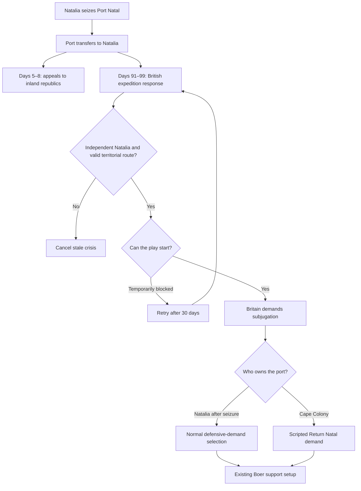

# Port Natal seizure response — 12 September 2026

## Cause and correction

Natalia's seizure decision immediately transfers province `x279045` to Natalia,
then queues Britain's `sb_natal_crisis.114` after 91–99 days. The response formerly
required Cape Colony to still own that province. Seizure therefore invalidated
its own response, which silently cleared the crisis markers.

The response now accepts either an independent Natalia that seized and still
owns the port, or the ordinary Cape-owned port under British suzerainty. Only the
ordinary refusal branch assigns Natalia a Return State goal against Cape-owned
Natal. The seizure branch opens the standard British Make Protectorate play with
normal opening-phase selection of Natalia's defensive demand. Vanilla 1.14.2's
`NDiplomacy.DEFAULT_WAR_GOAL` is empty; this does not add a scripted humiliation,
self-targeting territorial claim, or new custom war goal.

Temporary Natal war/play, diplomatic-permission and ordinary-truce blockers
retain the response and retry after 30 days. The existing special ultimatum truce
can still be consumed. A failed play creation also retries; an existing exact
GBR-to-NAL protectorate play or war between them suppresses that retry. Successful
play setup retains the Boer support and Oranje-dependent Cape liberation logic.
Permanent invalidation (for example Natalia becoming a subject) retains cleanup.
The existing nine-month support pledge durations and initial 91/96/99-day delays
are unchanged.

## Flow

## Zulu route

The ZUL raid uses `sb_natal_crisis.085`, not `.114`. Its existing British annexation
response does not require Cape ownership after seizure and already retries
blocked or failed launches after 30 days. Its 90/10 AI retaliation/stand-down
weights are unchanged. The Zulu decision now requires independence, no active
diplomatic play, and a port still owned by CAP or GBR. It cannot seize the port
from an unrelated owner or raid a port already held by the raider.

## Verification and limits

- Four new regression checks fail against the retained pre-fix scripts.
- All 52 focused Port Natal, ultimatum, Natal/Zululand and interwar checks pass.
- Delayed-dispatch inventory changes from 442 to 443 solely for the new `.114`
  30-day retry; the existing lifecycle classification remains unchanged.
- Full static validation: 16/16 checks passed or warned, zero failures. The five
  existing deferred release gates remain warnings (BC-20, BC-22, CP-07, QUAL-09,
  SUP-05). Evidence: `/private/tmp/sb-port-natal-validation.txt`.
- No reviewed localisation, saved game, dependency, map asset or war-goal
  definition was edited for this repair. Previously consumed responses are not
  reconstructed in old saves.
- Pending DP engine checks: fresh Natalia seizures from CAP and directly from
  GBR; ordinary ultimatum refusal; a temporary launch blocker followed by retry;
  ZUL seizure followed by British retaliation or stand-down. Game not launched.

## 13 September correction

The original repair overrestricted Britain by requiring global peace and no active
play. Those British conditions have been replaced with checks for an existing
Britain–Natalia confrontation; unrelated British wars no longer veto the response.
See [the save-backed regression repair](natal_refusal_retry_fix_2026_09_13.md).
