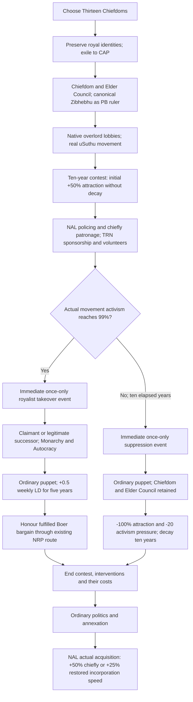

# Zululand Chiefdoms movement contest — implementation

19 September 2026. Implemented against Victoria 3 **1.14.3**, build **25347710**,
and installed **CMF 1.66.0 + sb-1.14.3-r1**. This implements the accepted brief in
[the design record](../zululand_chiefdoms_liberty_desire_exploration_2026_09_19.md).
Game launch and all engine scenarios remain **pending DP**. Use a new campaign or
checkpoint **before choosing Thirteen Chiefdoms**; no migration was implemented.

## Implemented flow

Victory takes precedence at the deadline. Actual Monarchy enacted during the
contest also reconciles to the royalist settlement. There is no minimum elapsed
window, blanket peace condition, compulsory independence play, or scripted
annexation. A ten-year timed marker controls expiry; the displayed month counter
is approximate. Weekly and monthly checks process the first qualifying tick.

Terminal events apply their effects on opening. Their acknowledgement does not
repeat them, and earlier incident options recheck the active contest. Monthly
housekeeping rechecks validity after terminal dispatch so cleanup cannot be
followed by a new incident. Hidden scheduling retains the existing initial
90/120/150/180-day and follow-up 61/90/120/150-day waits, plus 60-day spacing.

## Movement and interface

| Action | Native movement effect | Continuing cost / commitment |
|---|---|---|
| NAL policing | −20 points of calculated activism pressure | −100 Authority |
| NAL Support Loyalist Chiefs | −50% attraction | £500 weekly |
| TRN sponsorship | +50% attraction | £250 weekly; +2 commitment/month |
| TRN volunteers | +20 points of calculated activism pressure | Existing soldier mortality; +3 commitment/month |

These activism modifiers change pressure, not current activism immediately. The
99% trigger reads actual native movement activism. The movement starts with
+50% attraction without a duration/decay flag; terminal cleanup removes that
contest bonus. Suppression applies a native ten-year decaying modifier. Only
uSuthu's native revolution/secession initiation is blocked during the event-based
contest; other movements and post-contest ordinary politics remain available.

The main bar reads ZUL's native Liberty Desire and its native weekly breakdown.
The JE shows live movement activism/support, remaining months, and a tooltip
explaining available influence and active movement contributions. Boer Commitment
shows active monthly sources and caps at 100 without disabling ongoing influence.
Claimant return retains its separately scripted +0.1 monthly LD effect.

The named lobbies retain the native pro-/anti-overlord types, targeting NAL, so
native government/opposition clout calculations apply. The requested IG sets are
reconciled on setup. Returning claimants become royalist agitators and receive a
strong preference for the uSuthu movement; actual engine membership needs testing.
One canonical Vanilla Zibhebhu template is reused, assigned Petite Bourgeoisie,
and installed after law changes. A death marker prevents recreating a dead Zibhebhu.

The obsolete hut-tax JE action, modifier and `.111` event are removed. Vanilla's
ordinary Reduce Payments interaction remains available, following the accepted
brief. Existing Chiefly Reserves effects are unchanged. Citizenship is unchanged.

Refugee unloading moves 20% of eligible Natal Zulu peasants before applying the
20% loyalist effect to remaining Natal Zulu pops. Its repeal path retains the
other repeal consequences without stacking the old +25% Zulu radical effect.
An already-open indenture programme survives Shepstone repeal; opening a new one
still requires the Shepstone System.

## Compatibility and implementation evidence

- Inventory: **38 exact-path files, 112 keyed overrides**. Three added keyed
  replacements cover the two local law allowances and ordinary absolutist
  exclusion. CMF itself is unchanged.
- The ordinary absolutist replacement and custom uSuthu derivative preserve CMF's
  Bavarocrat eligibility and Grey PLP pop-support/state-weight hooks. A full-token
  comparison removes only the four SB lifecycle changes and reproduces CMF's
  effective native definition. Its dependency file/object hashes are pinned.
- Customizable localization rejects `REPLACE:`. The exact-path
  `00_ep1_custom_loc.txt` shadow changes only two overlord-lobby name functions.
  Tests compare every other function and both original fallback bodies against
  Vanilla. There is no same-path CMF collision.
- The movement, ideology, law and modifier forms follow installed Vanilla.
  Hail Columbia's progressive movement and Gates of the Bosphorus's Ottomanist
  movement also provide the country-scoped creation/support pattern. CMF's
  existing journal widgets remain the basis of the local bar presentation.
- Royal identities are captured and exiled before government-law changes; the
  canonical chief is installed afterwards. Returned agitator roles are removed
  before installation as ruler.
- Calendar expiry, scope-free international JE pulses, script-value operation
  order, held events, CMF preservation and local naming are covered by new
  regressions and recorded in `common_pitfalls.md`. AGENTS.md already requires
  reading/updating that file and leaves game launches to DP.

## Verification

**55 focused checks passed.** The full suite ran **464 tests: 456 passed, five
skipped, two failures and one error**. Static validation reports **15/17 gates
passed, warned or skipped**; unit tests and localisation are the two failing gates.
Compatibility, map, naval connectivity, lifecycle and script-contract gates pass.
`git diff --check` passes. Tiger reports 0 fatal, 1055 errors and 112 warnings
across the existing combined mod stack; it is not a clean engine validation.

Final static results and compact diagnostic evidence are recorded in
[evidence/zululand_movement_contest_2026_09_19.txt](evidence/zululand_movement_contest_2026_09_19.txt).
The full suite remains visibly failing for unrelated pre-existing issues; none of
those checks were disabled or their expected results changed for this task:

1. Reproducing the 1.14.2 → 1.14.3 depot delta cannot read the missing historical
   `529341_2887980275526736263.manifest`.
2. The existing Shepstone/indenture test rejects the already-present
   `je_sb_natal_indenture_program_v2_goal` localisation key. This implementation
   did not change that file or assertion.
3. `sb_boer_conventions.141` is marked reviewed but absent from the review-baseline
   snapshot. Its prose and approval marker are preserved. This also fails the
   aggregate localisation gate.

Tiger targets 1.13.5, so its findings are advisory for this 1.14.3 installation.
The changed-file review fixed real prefix/scope issues; remaining relevant
findings concern unsupported container syntax, the copied native
`days_since_movement_defeated` accessor, existing multi-widget journal usage,
CMF illustration scopes, and native law petition scopes. A successful static
check is not proof of in-game UI, movement calculation or delivery.

## DP engine verification — all pending

| Scenario | Required observation |
|---|---|
| Choose Chiefdoms | One canonical PB Zibhebhu ruler; old royal IDs in CAP; Chiefdom/Elder Council; correct lobby memberships and names; real uSuthu movement. |
| Open JE as NAL/TRN | Native LD matches diplomacy; native drift tooltip, actual movement support/activism, countdown and active commitment contributions display correctly. |
| Toggle each action | Correct movement modifier and cost; reversing removes both; commitment can cap without ending influence. |
| Return claimant | Existing living claimant or legitimate successor returns as a royalist agitator supporting uSuthu. |
| Actual activism ≥99% | Once-only immediate royalist outcome; same claimant/successor ruler; both laws; ordinary puppet; five-year LD modifier. |
| Ten-year deadline | Cannot fire early because of month-boundary count; suppression occurs on first qualifying check; two penalties decay for ten years; movement remains. |
| Boundary / held events | Victory wins at shared deadline; holding terminal or earlier incident popups does not duplicate, postpone, or restart the settlement. |
| Politics after resolution | Ordinary politics resumes; no bespoke forced war or annexation; native lobbies and subject interactions work. |
| Refugee unloading | 20% eligible Zulu peasants move; loyalist effect applies to those remaining; existing indenture remains open. |
| NRP bargain | Fulfilled commitment plus royalist victory follows existing territorial conditions; suppression gives no NRP award. |
| Ordinary NAL annexation | Only actual acquisition awards the applicable +50%/+25% incorporation-speed legacy for 120 months; original split territory alone does not. |
| Fresh launch/log audit | DP checks errors and warnings, including character uniqueness, law validity, global-scope references, movement and GUI accessors. |
