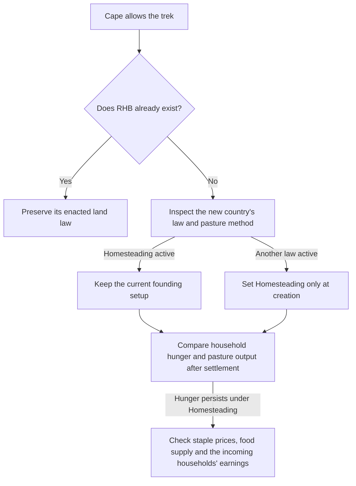

# Vanilla land reform and starvation in Oorlam and Rehoboth

Design discussion · Victoria 3 1.15.2 · 21 November 2026

**Trial Homesteading for Oorlam (ORL) from 1836. Keep Homesteading as the intended founding law for Rehoboth (RHB).** ORL has observed starvation and a pasture on which the law can change household earnings. For RHB, the first question is which law and production method a newly founded settlement actually receives. Tenant Farmers is the comparison for both. BST has a separate, agreed choice of Tenant Farmers. [Historical research brief](research/sb_oorlam_rehoboth_land_tenure_research_brief_2026_11_21.md) · [Lesotho decision](bst_customary_tenure_and_lesotho_famine_design_2026_11_20.md#decision-record-and-acceptance)

## Where households are going hungry

ORL owned one incorporated state in all six 1.15.2 saves from the same campaign. Its share of Hereroland had one arable land, one level of subsistence pasture and a manor house. All six saves have active Serfdom. The figures count residents, including dependants, by their Pop's Food Security. Starving means below 0.40 and severe means below 0.20. Each of the five monthly saves from October 1852 to February 1853 had 100% starving. The famine manager had no active entry for ORL's state in those saves. [March 1843 save](<../../../save games/natalia_1843_03_10.v3>) · [October 1852 save](<../../../save games/autosave_4.v3>) · [February 1853 save](<../../../save games/autosave.v3>) · [Vanilla thresholds](</Users/depro/Library/Application Support/Steam/steamapps/common/Victoria 3/game/common/defines/00_defines.txt>)

| ORL checkpoint | Residents | Starving | Severely starving | Workers on pasture |
| --- | ---: | ---: | ---: | ---: |
| 10 March 1843 | 4,651 | 4,267 (91.7%) | 283 (6.1%) | 1,057 |
| 1 October 1852 | 3,221 | 3,221 (100%) | 3,201 (99.4%) | 698 |
| 1 February 1853 | 3,119 | 3,119 (100%) | 2,706 (86.8%) | 672 |

In February the severe group comprised all 2,237 members of peasant households and all 469 members of enslaved households. Of 782 working people, 672 worked on the pasture and 110 in the manor house. Lesotho had a maize farm and a livestock ranch seeking workers. ORL's existing pasture must carry the initial recovery. The February record is country 747, state 656, pasture 5070, save SHA-256 prefix `cac33646a364d6`.

## What each vanilla law changes on a subsistence pasture

| Effect | Serfdom · observed ORL | Tenant Farmers | Homesteading |
| --- | ---: | ---: | ---: |
| Protected subsistence employment in incorporated states, from the law | +50 percentage points | 0 | 0 |
| Minimum incorporated arable land reserved for subsistence, from the law | +75 points | +25 points | +35 points |
| Peasant internal migration prohibited by the land law | Yes | Yes | No |
| Peasant-to-farmer qualification factor from Serfdom | ×0.2 | ×1 | ×1 |
| Annual in-kind income per working peasant, before other modifiers | £3 | £4 | £4 |
| Marketed food added by the tenure method per fully staffed level, before throughput | +0.33 meat | None | +0.25 grain |
| Jobs substituted per level | None | None | 100 peasant places become 100 farmer places |
| Political strength from the law | +25% Landowners | +25% Landowners | +25% farmers |

The pasture itself supplies 0.25 grain and 0.50 meat at full employment and normal throughput under all three. Homesteading also sets a 50% minimum worker-owned share for agricultural and ranching building levels. Actual jobs filled and ownership income received by local households belong in the replay. Southern Africa is explicitly in Victoria 3's *New World* geographic region, and SB puts both capitals in that strategic region. Homesteading satisfies the geographic visibility check here. Peasant Proprietorship is its *Old World* counterpart. Collectivised Agriculture requires Socialism and either Command Economy or Cooperative Ownership, well beyond these founding economies. [Land reform laws](</Users/depro/Library/Application Support/Steam/steamapps/common/Victoria 3/game/common/laws/01_land_reform.txt>) · [Pasture methods](</Users/depro/Library/Application Support/Steam/steamapps/common/Victoria 3/game/common/production_methods/12_subsistence.txt>) · [Farmer qualifications](</Users/depro/Library/Application Support/Steam/steamapps/common/Victoria 3/game/common/pop_types/farmers.txt>) · [Vanilla geographic regions](</Users/depro/Library/Application Support/Steam/steamapps/common/Victoria 3/game/common/geographic_regions/05_geographic_regions_content.txt>) · [SB strategic regions](../common/strategic_regions/sb_african_strategic_regions.txt)

### Oorlam from 1836

**Homesteading** gives households a route into paid farmer work on the pasture they already use. Its main historical compromise is the implication of private claims to grazing land. Jonker's power rested partly on the captaincy's control of water, herds and routes. The evidence for an 1836 system of household freehold is thin. **Tenant Farmers** preserves the political weight of that elite and every peasant job on the pasture. Its hereditary estate owners are also an imperfect fit. Both laws raise peasant in-kind income and lift Serfdom's qualification penalty. ORL's separate Debt Slavery, native conscription and borders would continue to shape who benefits. [ORL history](<../common/history/countries/orl - oorlam.txt>) · [Roland, Stevens and Simon on Oorlam settlement](https://link.springer.com/article/10.1007/s12132-023-09484-0)

At the February workforce of 672 out of 5,000 and the saved throughput of 0.60, Serfdom produced **0.02016 grain and 0.06693 meat**. At identical staffing, Tenant Farmers would supply **0.02016 grain and 0.04032 meat**. Homesteading would supply **0.04032 grain and 0.04032 meat**. This calculation holds the base and home-workshop methods fixed. It explains the preference for Homesteading over Tenant Farmers on an isolated pasture. Both alternatives give up some meat compared with Serfdom. The £1 gain accrues to working peasants, and the 100 farmer places are a full-level capacity. Enslaved households also need access to affordable staples. [Pasture methods](</Users/depro/Library/Application Support/Steam/steamapps/common/Victoria 3/game/common/production_methods/12_subsistence.txt>) · [Basic food substitutions](</Users/depro/Library/Application Support/Steam/steamapps/common/Victoria 3/game/common/pop_needs/00_pop_needs.txt>)

### Rehoboth when the Cape allows the trek, 1867–1871

**Keep Homesteading at foundation.** Settlers held houses and gardens individually and used common grazing. Broad distribution of private farms began around 1895. The vanilla law captures the household stake in settlement and lets the subsistence pasture employ farmers, while bringing forward the private-farm element. **Tenant Farmers** would keep pasture jobs in peasant households and offer the same £4 base income. Its hereditary estate model fits Rehoboth poorly, and its tenure method adds no grain. It is a useful comparison if farmer posts go vacant or the founding cohort struggles to buy food. [Lang on Rehoboth tenure, pp. 319–325](https://history.tucsin.org/wp-content/uploads/2019/10/Lang_1999_Transition_land_tenure_Basters.pdf)

RHB's country history already assigns Homesteading. The trek creates RHB with the Cape as its origin if the tag is absent, transfers six provinces, can move up to 2,500 people from a Cape Creole Pop, and grants a permanent **+0.30 Food Security** modifier. The event has no explicit land-law assignment. The six current-version saves predate the trek. The archived January 1875 save is from 1.15.0 and has the Cape's branch-resolved flag and no RHB country record. The founding law and RHB's starvation rate remain unobserved. [RHB history](<../common/history/countries/rhb - rehoboth basters.txt>) · [Trek event](../events/sb_namibia_events.txt) · [Pastoral modifier](../common/static_modifiers/sb_modifiers.txt) · [Archived 1875 save](../generated/playtest_1870_2026_11_07/autosave.v3)

## Decisions and acceptance

| Status | Decision or check |
| --- | --- |
| Agreed | Use stock land laws for this exploration. BST's selected starting law is Tenant Farmers. |
| Provisional | Trial Homesteading after ORL's traditional starting-politics setup. Compare with Tenant Farmers and current Serfdom under identical military, slavery, borders and market conditions. |
| Provisional | Retain Homesteading for a newly founded RHB. Check immediately after creation and after reload, including a Cape that has reformed its own land law. If an explicit assignment is needed, apply it only when the event creates RHB. An existing RHB keeps its reforms. Discouraging the trek creates no new settlement. |
| Open | Can Homesteading end ORL's starvation, and do RHB households have enough food under their actual founding law? |

Compare ORL from a fresh 1836 start and from the February 1853 crisis checkpoint. For RHB, branch the same trek with the same incoming cohort, territory, starting buildings and pastoral modifier. Record at foundation or law change, weeks 4 and 12, and monthly through one year. Check actual pasture method, farmer hires, local grain and meat sold, prices and household Food Security. Count deaths and migration alongside the number and share starving, including peasant and enslaved households separately wherever present.

For a provisional pass in ordinary peace, aim for **under 5% starving and under 1% severely starving for six consecutive months**, with the affected household groups recovering. If both vanilla alternatives leave persistent starvation, record that result and trace food supply and purchasing power before attributing recovery to a land law.
