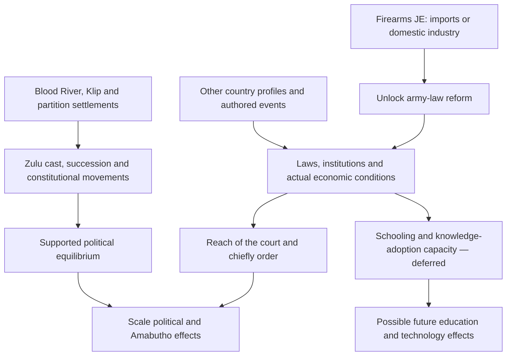
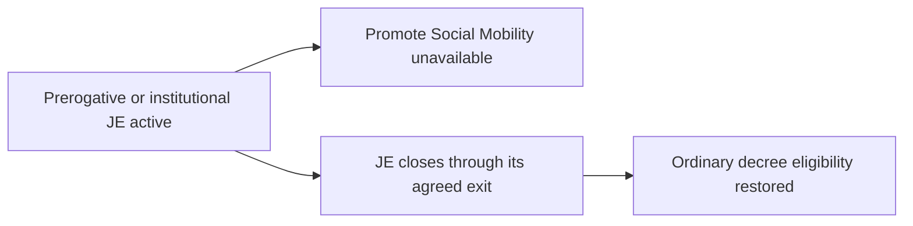
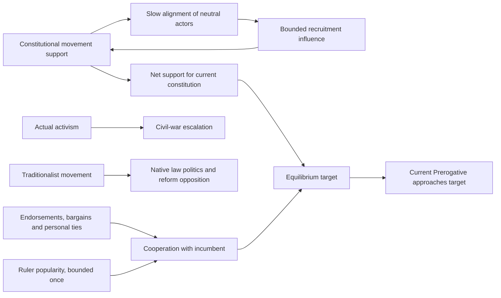
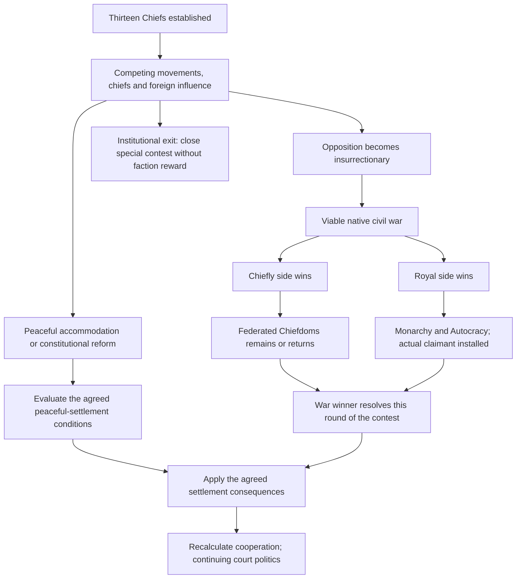

# Institutions, chiefly politics and constitutional conflict

18 October 2026. **Design exploration only.** This is the current extension of the [equilibrium exploration](zulu_royal_authority_exploration_2026_10_18.md), following DP's latest notes. It supersedes that document's proposed support-times-activism pressure formula and automatic restoration/showdown alternatives. No gameplay files were changed.

The [consolidated current plan](zulu_political_rework_current_plan_2026_10_18.md) brings this exploration together with the character, succession and settlement work. It separates accepted direction, working proposals and the decisions needed before implementation; this document retains the detailed comparisons and evidence.

## Recommended direction

Keep the equilibrium approach, with a reusable institutional foundation and a Zulu-specific political layer. Movement **support** influences constitutional alignment and the equilibrium; **activism** determines escalation towards civil war. Cooperation with a particular king remains separate from support for monarchy. A Traditionalist movement can defend customary institutions without automatically strengthening whichever government currently rules.

**Latest decisions:** DP defers the wider education/literacy/technology reform to the TODO list. Instead, the agreed Prerogative/institutional JE design blocks Promote Social Mobility while that JE is active. DP confirms the Traditionalist movement as a third movement, slow competing alignment opportunities for neutral chiefs, and ideological civil-war victory as decisive for the current contest. Movement crowding is a playtest question, not a reason to substitute an LO ideology for the Traditionalist movement.

Let an actual civil-war result settle who governs and who wins this round of the contest. Defeat vanquishes the opposing faction for now; no additional Prerogative, support or activism check delays recognition of that victory. Strong Prerogative and weak or reconciled opposition remain candidate conditions for peaceful settlement. Continuing court politics can produce later opposition without undoing the recorded war result.

The names **Royal/Chiefly Prerogative** remain working labels. They are not native Authority capacity or Landowners' Clout. The score is positive for a secure incumbent settlement under either constitution.

## Current decisions and assumptions

| Item | Status | Position |
|---|---|---|
| Equilibrium rather than endlessly accumulating drift | agreed | Current political position approaches the level supported by the coalition. |
| Opening political position 0, range −100 to +100 | agreed direction | Exact update rate, weights and action costs remain tuning. |
| No Police | agreed correction | Deduct 10 from the law-based maximum reach. Local Police remains 0. |
| Industry Banned | agreed correction | Deduct 0 rather than treating it as an ordinary modern economic system. |
| Constitutional exit | agreed | Political JE closes outside Monarchy/Social Monarchy/Federated Chiefdoms or at reach 0; no faction reward merely for exiting. |
| Morale sign | agreed | High Prerogative reduces morale loss; low increases it. Military benefits depend on Amabutho. |
| Elder Council | open/reopened | DP questions the old law, then considers a purpose-built variant. The PB-strength rationale stays rejected. |
| Reusable institutional mechanics; country-specific narrative | agreed direction | Keep the political foundation separate from Zulu's narrative. Wider education/adoption mechanics are deferred. |
| Promote Social Mobility | agreed, target clarified by DP | Block while the proposed Prerogative/institutional JE is active; restore ordinary availability when it closes. This is not the firearms JE gate. No runtime implementation yet because the new institutional JE remains design work. |
| Firearms and army reform | agreed, clarified by DP | Start with Amabutho/Basotho levy; firearms JE completion unlocks reform away. Completion does not force a replacement law. |
| Movement support and characters | agreed mechanism; provisional rates | Slow competing opportunities draw neutral named actors towards either constitutional camp. DP accepts this direction; illustrative yearly probabilities are still tuning. |
| Activism in equilibrium | agreed correction | Remove it from the target calculation. It belongs in escalation, not a second measure of backing. |
| Extreme activism | agreed direction | Ideological civil war rather than the old automatic event takeover. DP confirms a one-state country with multiple provinces can support ideological civil war; do not conflate this with secession. Authored routing still needs testing. |
| Third Traditionalist movement | agreed | Defend common customary institutions across eligible IGs, including Devout and AF as well as LO. No direct Traditionalist contribution to Prerogative. LO's ideology is not a substitute for this movement. |
| Traditionalist policing preference | agreed clarification | Local Police ++; Dedicated Police +. Moving from the former to the latter is a downgrade in preference and therefore faces resistance. |
| Civil-war victory | agreed | Resolves the current faction contest; opponents are vanquished for now. No second consolidation threshold before acknowledging the winner. |
| Bribe a neutral chief | provisional | Costly public alignment, with personal loyalty and other convictions kept distinct. |
| Peaceful consolidation | open package | Prerogative around +50 and weak/settled opposition; these conditions do not gate victory in an actual civil war. |
| Additional legitimacy threshold | recommendation: omit | Prerogative already changes legitimacy; adding the old ≥75 would partly count the same result twice. |
| Subject status, incorporation rewards and NRP bargain | partly open | The intended permanent chiefly +50% incorporation-speed reward remains. Restored-crown +10%, post-contest subject status, qualification and reward interaction remain open; do not silently resolve them through the equilibrium or a civil-war callback. |
| Deadline, minimum duration, PB/LO split | excluded | No ten-year suppression deadline, compulsory waiting period or chiefly PB estate returns. |
| Wider education diagnosis and reform | deferred TODO | DP suspects base literacy growth plus Promote Social Mobility. Decree effects are verified below; their contribution to the reported trajectory is not replayed. No new literacy or technology penalty is approved. |
| Engine verification | pending | DP launches and tests the game; this update records design decisions and source checks. |

## 1. Share the mechanics without sharing every country's story



The reusable pieces should be small: common law-reading values, common modifier application/cleanup, and the existing firearms-completion contract. Country setup opts into the relevant pieces. ZUL supplies its named cast, claimant relationships, constitutional movements and story consequences. Gaza can later supply its own actors and events without inheriting Cetshwayo's succession or the Thirteen Chiefs. BST already has a distinct military law and starting mission-related technology; shared mechanics must permit these differences. The wider schooling/adoption module is deferred and is not a prerequisite for this political design.

This does not require a general-purpose framework or a new abstract registry. Start with shared helpers used by the actual authored countries. Add a country's political layer only when its content exists. Preserve the existing NGN branch that can inherit Zulu content until explicitly redesigned.

The political and educational lifecycles must be separate. Adopting a republic can end the royal-political JE without instantly supplying teachers or spreading industrial expertise. Annexation or a new tag likewise does not by itself demonstrate educational development. Which education effects follow a state versus a country is part of the later implementation contract, not an excuse for a culture-wide permanent penalty.

### Corrected court-reach schedule

The existing proposal has a nominal maximum of 50, with additive deductions across law groups:

| Group | Deductions |
|---|---|
| Governance | Monarchy 0; Social Monarchy 10; Federated Chiefdoms 0 provisionally; other constitutions end the political JE |
| Economy | Traditionalism and Industry Banned 0; Agrarianism 5; other systems 10, subject to explicit variant review |
| Police | Local Police 0; Dedicated/Militarized 5; No Police 10 |
| Power | Autocracy 0; Oligarchy 5; Landed Voting 10; Wealth Voting 20; Census 30; Universal 50; the proposed chiefly council remains open |
| Bureaucracy | Hereditary 0; Appointed 5; Elected 10 |
| Army | Amabutho 0; replacement 5, with Amabutho-specific military effects ending |

Reach is clamped at zero. This is now better described as **the reach of the customary political order**, not a universal development score: No Police lowers its reach through weak enforcement, while Dedicated Police lowers dependence on personal rule through a standing institution. Those are different causes.

Consequently, a country with No Police and otherwise zero-deduction laws has reach 40, not 50. This arithmetic follows from DP's correction; do not secretly increase the baseline to compensate. SB's traditional-start helper does not explicitly install Local Police, so the effective opening law must be checked before asserting that starting ZUL reaches the full 50.

The previous effect formula remains: legitimacy = P/100 × E; Authority capacity and Amabutho training = P/100 × E/2 percent; Amabutho morale loss has the opposite sign. At P = +50, E = 40, this means +20 legitimacy, +10% capacity/training, −10% morale loss.

### What the firearm lock actually does

The current firearms JE completes through 24 qualifying monthly pulses on either an import-treaty or domestic-industry route. Neither route requires changing the army law. Its completion flag can therefore unlock reform without a circular prerequisite. Both army variants already prevent re-adoption after replacement; neither currently supplies the requested reform-away lock.

Retain this order: start with the customary military system → obtain sustained firearms access → finish the JE → normal law enactment becomes available → political military effects end when the law actually changes. Do not automatically turn firearms access into a Professional Army. The later implementation must also inspect forced law changes and any existing defeat/reform story effects so the intended rule has explicit boundaries.

Evidence: [firearms JE](../common/journal_entries/1-04_sb_firearms_acquisition.txt), [qualifying routes](../common/scripted_triggers/sb_firearms_triggers.txt), [Amabutho](../common/laws/03_sb_amabutho_system.txt), [Basotho levy](../common/laws/04_sb_chiefly_levy.txt).

## 2. Promote Social Mobility gate; wider reform deferred

DP selected the **Prerogative/institutional JE** as the gate. While that country's JE is active, Promote Social Mobility is unavailable in its states. When the JE closes through the agreed constitutional/reach exit, the decree returns to ordinary Vanilla eligibility. Firearms completion by itself does not unlock this decree. Do not attach the restriction to an old unrelated JE or to every African country by tag/culture.

Installed 1.14.5's decree gives `state_education_access_add = 0.25` and `state_pop_qualifications_mult = 0.25`: **+25 percentage points of Education Access and +25% Qualifications gain**. It does not directly modify literacy-growth speed. That extra access is a plausible contributor to DP's reported rise, but the causal share has not been measured. The inspected base growth contribution is global `base_values`; this source check does not establish the narrower assertion that it is exclusive to landed countries.

The existing decree has a state-level eligibility block. A future targeted replacement can retain that block, modifiers, cost and AI behavior, adding only the state owner's active-JE exclusion. Preserve Vanilla's existing caste-law/Hindu-state restriction. Verify what happens to an already-active decree when the JE opens or ownership changes; eligibility on new activation alone must not leave the agreed restriction bypassable. This behavior is pending engine verification, not grounds to add an untested recurring cleanup system.



Evidence: [installed decree](</Users/depro/Library/Application Support/Steam/steamapps/common/Victoria 3/game/common/decrees/00_decree.txt:202>).

### Earlier education alternatives — retained for the deferred TODO

The proposals below preserve the exploration for later work. DP has deferred them; they are not part of the current implementation scope and no numerical penalty is approved.

DP's reported 1847 literacy values are already recorded as `PT-20261017-05` in the [audit register](audit_issues_open.md). The different-year Ottoman comparison motivates investigation; it does not establish a historical benchmark or isolate which game mechanic caused the growth. Initial literacy, wealth-based education access, institutions, migration and population composition need separating from the rate at which existing pops learn.

| Approach | Complete progression | Strength | Principal cost |
|---|---|---|---|
| **A. One reach score controls everything** | Begin with high E and a proportional penalty; political reforms lower E and the penalty; E = 0 removes both court and education effects | Very legible, few new values | Police abolition and electoral reform become shortcuts to educational capacity; court exit can erase an unrelated constraint |
| **B. Shared law inputs, distinct education/adoption capacity** | Begin with an authored capacity deficit; schooling, administration and knowledge access reduce it; constitutional reforms separately weaken court dependence; each system ends on its own evidence | Reusable, preserves independent reform paths, avoids rewarding instability | One additional explanatory readout and an explicit choice of capacity indicators |
| **C. A reform JE with staged objectives** | Start an educational/adoption challenge; sustained school/mission/administrative objectives unlock successive reductions; completing the final stage removes the obstacle | Clear player agency and room for Gaza/Basotho flavour | More authored objectives, can become a checklist or a second mandatory modernisation bottleneck |

**A walkthrough:** at E = 50, a −50% ceiling gives the full penalty. Abolish Local Police, E falls to 40 and the penalty becomes −40%, even though no school improved. Universal Suffrage sets E to zero and removes the obstacle immediately. Alternatively, remaining a capable traditional monarchy preserves the penalty despite building schools. Those are substantive consequences, not tuning errors. Reject A as the common education model.

**B walkthrough:** a kingdom retains Monarchy/Autocracy and court politics but finances schools, develops administrative capacity and obtains access to outside knowledge. Its educational constraint eases while royal politics remains powerful. Another country liberalises its constitution without building the corresponding capacity: its court JE retires, but its education/adoption constraint remains. Country flavour can provide additional ways to establish that capacity rather than merely grant a permanent research bonus. This is the recommended foundation.

**C walkthrough:** a country begins with a modest schooling network and an explicit reform JE. It can choose, for example, mission-supported expansion or a locally administered network; sustained institutional coverage supplies progress. Each completed stage removes part of the penalty, and completion records the achieved transition. Losing the buildings midway stops progression rather than granting completion. No arbitrary deadline is required. This is a viable later flavour layer over B, but premature as a compulsory common JE before the literacy cause is measured.

Do not assume every proposed capacity measure is already approved. B's first prototype should use a small number of observable inputs, beginning with school provision and administrative/knowledge access, rather than another weighted index of every law. Avoid making research needed to escape the penalty effectively inaccessible under that same penalty.

### What “−50%” would mean

Keep four targets separate: literacy level, education access, learning speed, and technology progress. Reducing access can reduce the eventual literacy level; reducing learning speed changes how quickly a population approaches its accessible level. Neither is the same as directly removing half its literacy.

Installed Vanilla exposes `state_literacy_growth_add`, with a base value of `0.0005`, not an inspected generic literacy-growth multiplier. An additive `−0.00025` would halve that base contribution; it would not necessarily halve the final rate after all modifiers. This is a candidate to validate, not a verified implementation of “−50% literacy growth.” The registered society/production research-speed and spread modifiers are separate controls.

For the first balance comparison, retain **up to 50% slower learning** as DP's trial ceiling, not an approved final value. Compare an additional modest society-adoption penalty against no extra technology penalty. Do not simultaneously apply −50% to learning, active society research, society spread, production research and production spread without measuring the combined effect. Lower literacy already affects the native innovation ceiling, and SB's firearms obstacle already reduces military research speed by 25%.

Production is especially worth isolating: a large production-research penalty can delay the domestic arms-industry route needed for the military transition. Keep the import alternative usable. A production penalty remains an open design choice, not an automatic implication of slower literacy.

Evidence: [native literacy contribution](</Users/depro/Library/Application Support/Steam/steamapps/common/Victoria 3/game/common/static_modifiers/00_code_static_modifiers.txt:45>), [literacy modifier definition](</Users/depro/Library/Application Support/Steam/steamapps/common/Victoria 3/game/common/modifier_type_definitions/00_modifier_types.txt:1709>), [innovation and literacy](</Users/depro/Library/Application Support/Steam/steamapps/common/Victoria 3/game/common/static_modifiers/00_code_static_modifiers.txt:831>), [existing military obstacle](../common/static_modifiers/sb_firearms_modifiers.txt:12).

## 3. Constitutional movements and common traditional institutions

The two disputes should have different homes. Royalists versus great chiefs contest the locus of power. Traditionalists contest changes to customary administration, economy and military organisation. Supporting the latter does not establish whether a character supports this king, a rival king or a federation of chiefs.

The three-movement division and the named positive Traditionalist preferences are now agreed. Unresolved constitutional/council choices and the later proposed negative positions remain design candidates, not approved final ideology data. `N/A` means this package takes no position.

| Position | uSuthu constitutional movement | amaKhosi constitutional movement | Traditionalist movement |
|---|---|---|---|
| Monarchy | ++ | − | N/A |
| Federated Chiefdoms | −− | ++ | N/A |
| Social Monarchy | N/A pending compromise design | −, retained from the preceding proposal | N/A |
| Autocracy | ++ | − if a genuine council alternative is chosen; otherwise N/A | N/A |
| Proposed chiefly council | − if selected | ++ if selected | N/A |
| Amabutho | N/A | N/A | ++ |
| Hereditary Bureaucrats | N/A | N/A | ++ |
| Traditionalism | N/A | N/A | ++ |
| Local Police | N/A | N/A | ++ |
| Oligarchy | N/A | N/A | +, as DP proposed |
| Agrarianism | N/A | N/A | + |
| Dedicated Police | N/A | N/A | + |

This keeps approval of inherited economic and administrative laws out of the constitutional movements. The previous broad uSuthu derivative diluted its constitutional grievances with satisfaction about other laws; recreating that bundle would repeat the problem.

For the remaining Traditionalist positions, propose weak opposition to Appointed Bureaucrats and stronger opposition to Elected Bureaucrats; weak opposition to replacement military models and stronger opposition to Mass Conscription; weak opposition to No Police/Militarized Police compared with Local/Dedicated Police. These are design candidates requiring the full stance review, not inferred historical facts. Land and citizenship can stay N/A instead of inheriting the unrelated native Absolutist packages. Electoral positions beyond DP's Oligarchy preference remain open.

**Dedicated Police is deliberately less preferred than Local Police.** Local Police ++ versus Dedicated Police + gives resistance to that change without requiring an absolute negative position on Dedicated Police. This is DP's clarification, not a contradiction with the reach deduction. Other ideology stances should still be authored explicitly rather than mechanically derived from E: Industry Banned now preserves reach, while native Absolutists strongly oppose it, and native Absolutists approve Appointed Bureaucrats and Landed Voting. [Current native platform](</Users/depro/Library/Application Support/Steam/steamapps/common/Victoria 3/game/common/ideologies/03_ig_ideologies_movement.txt:66>).

### Three movements selected; earlier alternatives retained for reference

**Three separate movements — selected:** create/recruit the constitutional pair and replace ZUL's generic Absolutist opportunity with the narrower Traditionalist movement. On reform, Traditionalists mobilise around their own laws; on partition, the royalists organise for monarchy while chiefly supporters defend the federation. Traditionalists can pressure eligible IGs beyond LO, including Devout and AF, and can participate in native ideological conflict. Retain native support/eligibility requirements; do not invent an automatic coup from movement strength alone. LO's own ideological preferences remain relevant but do not supply this cross-IG movement or its mobilisation. Recruitment competition is a playtest observation to monitor, not a pre-emptive reason to remove the movement. Do not add perpetual enthusiasm resets to keep it alive.

**Two movements plus a shared IG platform — not selected:** this earlier alternative loses the Traditionalist movement's cross-IG pressure and mobilisation. DP explicitly prefers retaining the movement alongside LO's existing ideological role; this is no longer the fallback recommendation merely because recruitment competition is possible.

**Two broad movements:** give both constitutional movements the shared customary-law positions. This is smallest in the number of movement types, but it restores the inherited-law satisfaction problem and makes a school or policing reform alter both constitutional factions' activism simultaneously. It is not recommended.

In all cases, preserve CMF's unrelated Absolutist hooks outside the authored Zulu scope. Under political exit, retire the special interface coherently; do not leave a permanently excluded generic movement with no agreed successor. Low-support disappearance is not proof of victory by itself unless the relevant political outcome also holds.

### Autocracy or a chiefly council?

**Keep Autocracy in both constitutions:** the political distinction rests entirely on Monarchy versus Federated Chiefdoms. This is the smaller solution and does not need an invented distribution-of-power law. The chiefly government is a federation of locally autocratic chiefs. It gives the constitutional movements one main law conflict, which is sufficient in principle.

**Use a narrow chiefly-council variant:** Monarchy/Autocracy versus Federated Chiefdoms/the council becomes an institutional package. The council represents a body of great chiefs constraining a paramount ruler; it supplies a second law for bargaining and possible compromise. It must not carry the rejected PB attraction/strength machinery. A two-law package also needs an explicit position on mixed outcomes, such as Monarchy plus a chiefly council; otherwise a real negotiated compromise becomes an accidental unfinished state.

The second is worth retaining if the council itself creates choices DP wants. It is not necessary merely to make a movement oppose something. This remains a genuine design choice rather than a settled return to the earlier Elder Council hack.

## 4. Link people and movements in both directions, slowly

Japan's published design and installed scripts use daimyō loyalty to bias recruitment. They also weight revolutionary states and repair character placement during the civil-war split. This is a useful precedent, but not a ready-made “10% support means X% annual ideological conversion” rule. The documented native movement API can assign character ideologies to pressured **IG leaders**; that is different from changing every named non-leader chief. [Paradox's diary](https://www.reddit.com/r/victoria3/comments/1sgqipa/victoria_3_dev_diary_179_narrative_content_of_the/), [native movement API](</Users/depro/Library/Application Support/Steam/steamapps/common/Victoria 3/game/common/political_movements/political_movements.md>).

### A. Slow competing alignment opportunities — selected direction

DP accepts slow competing alignment opportunities. Eligible neutral named actors periodically decide whether to align. Each constitutional movement's actual support supplies a competing weight; influence, prior commitments and historical roles determine which actors are eligible. Resolve one mutually exclusive choice, not two independent rolls that can flip the same chief twice. There is no arbitrary 10% cliff. The yearly cadence and rates below remain illustrative tuning.

Illustrative yearly probabilities, before personality-specific variation:

```text
chance to align royal = 0.30 × royal movement support
chance to align chiefly = 0.30 × chiefly movement support
otherwise remain neutral
```

At 10% support each, the annual chances are 3% royal, 3% chiefly and 94% neutral. At 25% royal/5% chiefly they are 7.5%, 1.5% and 91%. If only one movement holds 10% consistently, a continuously eligible neutral actor has about a 26% chance of joining it within ten years. These are illustrative rates, not approvals.

Once aligned, the actor's following modestly biases recruitment, as in the Japan pattern. They are no longer in the neutral pool. Do not reroll committed historical actors, the ruler, claimant or heir as if all are opportunists. A later betrayal or realignment needs a concrete bargain, grievance, succession or event. Native IG-leader ideology replacement must be reconciled with the recorded alignment rather than becoming a second independent conversion system.

This gives movement support a slow elite consequence without making every actor instantly join the larger movement. It can snowball, so the recruitment contribution must be bounded and a new character must not create an extra copy of the same following's influence. Aggregate Zulu actors before producing state recruitment values; Japan's one-daimyō-per-state cache would overwrite them otherwise.

### B. Visible accumulating inclination

Each neutral actor accumulates a signed inclination from the difference in constitutional support, adjusted by personal ties. Crossing a threshold makes a commitment; patronage can advance or reverse the inclination. A close contest produces neutrals, while a stable advantage eventually wins them over. Death or succession replaces the actor without manufacturing duplicate following weight.

This is predictable and gives players a clear target for persuasion. It also adds a per-character value, update/display work and a tendency for any persistent majority eventually to convert every movable actor. It is viable if DP wants a detailed character-management game, but is more machinery than needed for the first version. Neither method should use activism as persuasion strength: readiness to fight is not the same as the breadth of a constitutional constituency.

### Bribe a chief

Use a costly, targeted bargain with an eligible neutral. Show the actual actor and following before payment. A large one-off payment wins a public constitutional alignment; it does not rewrite every law preference, historical relationship or opinion of the reigning sovereign. Cost can scale with the following's importance and the recipient country's economy rather than letting the old £500 button purchase anyone indiscriminately. Exact prices remain tuning.

The guaranteed neutral-alignment version is clearer than making an expensive button secretly fail. A temporary cooperation payment is also coherent, but is a different action: it belongs to personal loyalty, not constitutional conversion. Do not present one while implementing the other. Once committed, the actor leaves the neutral bribe pool; a dead or departed target cannot consume a stale payment or be replaced by a random chief without explanation.

## 5. Personal cooperation, popularity and the equilibrium

Native character loyalty is not purely affection for the sovereign. Installed definitions include IG approval and agreement with enacted/enacting laws. Native ruler popularity also already affects Authority capacity. Read these as existing inputs; do not relabel them as a new personal-allegiance score or unknowingly apply the same effect several times. [Native character definitions](</Users/depro/Library/Application Support/Steam/steamapps/common/Victoria 3/game/common/defines/00_defines.txt:1891>).

Retain an explicit endorsement: incumbent, named rival, or uncommitted. Separately retain constitutional alignment. A royalist backing a rival king remains royalist. A chiefly autonomist accepting the present king's concessions remains chiefly aligned. Exiled claimants' loyalty to CAP or NAL must not be read as loyalty to the Zulu sovereign.

A workable provisional target is:

```text
C = weighted personal cooperation, expressed from −100 to +100
M = 100 × (support for the current constitution − opposing constitutional support)
supported Prerogative = 0.75 × C + 0.25 × M
```

Support here means the native movement's combined support measure, not an invented division of LO Clout or the percentage of all people. When the constitution changes, reverse the interpretation of M and reassess personal cooperation with the new incumbent. Do not simply negate the saved P or grant the winner +50 for free.

**Popularity can enter once through C.** For example, derive an actor's current willingness to cooperate from their explicit stance plus a small bounded popularity adjustment, without overwriting their constitutional alignment or committed claimant. With a maximum adjustment of ±20 cooperation points, ruler popularity contributes at most ±15 to this target. A popular monarch can win over neutrals and soften hostility; popularity alone cannot turn a committed rival into a supporter or produce +50 Prerogative. These magnitudes are proposals.

The alternative is to keep C independent of popularity and use a separately displayed target term, for example 60% named cooperation +25% constitutional support +15% popularity. That is easier to show in a bar breakdown, but then popularity should not also be fully applied to every character's cooperation. Choose one path for the arithmetic; events can still make popularity relevant to bargaining.

**Traditionalist support supplies no direct positive target term.** It defends institutions used by both factions and could remain large under either settlement. Its lawful influence already works through IG approval, law politics and mobilisation against reforms. Adding it to the target rewards whichever faction happens to be incumbent and makes reform opposition look like personal loyalty. Likewise, do not derive E from Traditionalist support: that would turn a law-based attenuation rule into an additional feedback loop.



Example: cooperation C = 75 and net constitutional support M = 20 yield a target of +61.25. With C = 0, even M = 100 yields only +25: broad constitutional agreement does not by itself secure personal obedience. A highly mobilised opposition can still precipitate civil war despite a positive target; activism has its own consequence instead of being secretly counted as more supporters.

## 6. Thirteen Chiefs: constitutional victory and consolidation

DP's “over 99%” direction fits the installed native escalation scale: organising can begin at 75% activism, while the start threshold is 100%. It does **not** establish that reaching 99.1% instantly creates a viable war. The engine still needs an eligible civil war, progress and viable states/forces. Japan explicitly requires at least 5% support for its restorationist revolution; adopting that backing condition for ZUL would be a visible proposed rule, not an implicit guard. [Current defines](</Users/depro/Library/Application Support/Steam/steamapps/common/Victoria 3/game/common/defines/00_defines.txt:214>), [Japan revolution](</Users/depro/Library/Application Support/Steam/steamapps/common/Victoria 3/game/common/political_movements/04_country_specific_ideological_movements.txt:2134>).

Prefer the native revolutionary escalation route, with the extreme-activism point signifying exhausted compromise. Do not combine the old event takeover with it. SB currently suppresses the designated contest movement's revolution/secession while the contest flag is active; that rule belongs to the abandoned automatic-takeover design and would need replacement in a future implementation.



### Civil-war victory resolves the current contest — agreed

DP confirms that winning the ideological civil war vanquishes the opposing faction **for now**. The winning side installs its constitutional package and the immediate Thirteen Chiefs struggle ends. There is no further P ≥50, low-support or zero-activism condition before acknowledging that victory. Apply whatever victory consequences are agreed; their exact reward/status values remain open. The continuing court JE can model later opposition without treating the completed war as unresolved.

The previously discussed alternative requiring a second postwar consolidation phase is not selected. Foreign commitments earned in the war must still be accounted for. “Vanquished for now” does not require permanently deleting every possible future opposing movement or reconstructing dead characters later.

Peaceful consolidation remains possible without deliberately provoking a war; its conditions are discussed below and must not be reused as additional wartime victory gates.

### Assessment of the proposed peaceful AND conditions

Use the actual constitution plus P around +50 for a **strong incumbent**. Do not call this native Clout. If a restored monarchy is now the incumbent, positive P measures royal consolidation; under Federated Chiefdoms it measures chiefly consolidation.

Treat the opposition tests as two different political results:

- **Absent or below 5% native support:** a weak constitutional challenge. Below 5% is the native relevance boundary; it is not literally the same as a deleted movement.
- **0% actual activism with substantial support:** accommodation or demobilisation. The opposing constituency still exists. Native “Passive” also spans more than just exact zero; do not equate the label with the proposed 0% check.

The proposed OR is suitable if the result is **the government is secure enough to settle the present dispute**. It is less convincing as proof that a rival constitution has been permanently eliminated. A 40%-support movement temporarily reduced to 0% activism by policing could otherwise award a permanent incorporation benefit on one tick.

Three ways to resolve that consequence are developed here, without imposing an unrequested minimum duration:

1. Award the permanent reward for actual wartime defeat or a weak opposition; high-support accommodation remains a peaceful but reversible settlement.
2. Allow the zero-activism branch to qualify after an explicit accepted political bargain that records what was conceded. The bargain, not an invisible waiting timer, makes the settlement durable.
3. Accept momentary demobilisation as sufficient and grant the permanent benefit. This is the simplest literal implementation of the OR, but knowingly makes policing a possible permanent-reward shortcut.

Recommend 1, with 2 available where the authored character bargaining supports it. Do not add a separate legitimacy threshold by default. P already gives legitimacy, and low E deliberately reduces that bonus; requiring both would partly duplicate the backing test and alter reform incentives.

While the tracked constitutional civil war is active, an absent opposition in the incumbent country must not be counted as peaceful consolidation: its supporters or leaders may now be on the rebel side. Follow that war's actual outcome. This is a proposed condition specific to the dispute being resolved, not a requirement that every unrelated foreign war end.

No incorporation reward, subject-tier change, annexation or NRP formation should follow merely from movement disappearance, P crossing a threshold, or a new ruler appearing. Those follow the selected settlement and actual foreign bargain. The intended permanent chiefly +50% incorporation-speed reward remains; its qualification and interaction with the still-open restored-crown +10% proposal need to be settled together.

### Civil-war type correction and remaining verification

DP corrects the earlier concern: a one-state country with multiple provinces can undergo an **ideological civil war**, while secession has a different territorial constraint. Use the ideological/revolution route. Being a one-state ZUL is not a reason to require another state, substitute secession, or return to automatic restoration. This correction is supplied by DP; the authored ZUL routing has not yet been engine-tested here.

Both factions also inhabit LO. Their characters cannot simply be assumed to split correctly under native IG routing. Japan has explicit character transfers and role repair during its revolutionary split, which is a precedent for targeted handling, not permission to copy all Japanese logic. The ZUL version must preserve the actual king/heir, named followings, armies and overlord relationship on the correct sides. [Japan character handling](</Users/depro/Library/Application Support/Steam/steamapps/common/Victoria 3/game/common/scripted_effects/00_victoria_ep2_scripted_effects.txt:2200>).

The remaining checks concern the actual province/army split, character sides, subject continuity and once-only settlement in the authored scenario. Do not add an unrelated-war peace requirement or an extra generic state-count guard.

## 7. NAL and TRN retain meaningful, distinguishable actions

| Action | Immediate target | Downstream consequence |
|---|---|---|
| Boer sponsorship | Royal movement attraction | Native recruitment, support, later neutral-chief alignment and constitutional equilibrium |
| Boer volunteers | Actual-activism pressure; existing commitment accounting | Escalation and civil-war risk, not an extra equilibrium bonus |
| NAL policing | Opposition activism pressure | Opportunity to avert conflict or negotiate; does not prove the constituency has vanished |
| Support Loyalist Chiefs | Chiefly recruitment | Support for the chiefly constitution and later alignment opportunities |
| Bribe an eligible neutral | That named chief's public alignment | Their following affects recruitment; no instantaneous transfer of a block of pops |
| Personal patronage/concession | Cooperation with the incumbent | Named coalition backing and supported Prerogative |
| Reduced subject payments | Native subject relationship | Retain its native LD effect; do not relabel LD as royal or chiefly support |

The Boer commitment bar remains. The interface should show current P, its target and causes, law-derived reach and effects, each movement's native support/actual activism, and the named actors' alignment versus personal endorsement. An action tooltip should name its immediate effect and avoid promising instant movement support from an attraction modifier.

## Verification needed for a future implementation

For the agreed decree gate, verify unavailability while the institutional JE is active, restoration of ordinary eligibility after exit, unaffected unrelated countries, preserved Vanilla restrictions, and behavior of an already-active decree when the JE opens or ownership changes. The new JE itself remains unimplemented. The broader educational trajectory audit and penalty comparisons are deferred under `PT-20261017-05`; they do not block the political design.

For politics, test a popular but constitutionally opposed ruler, an unpopular king with royalist rivals, both neutral-alignment outcomes, a surviving strong but passive opposition, council/monarchy compromise, and institutional exit without rewards. Check all contributions once, including ruler popularity and shared followings.

For partition, test peaceful consolidation, each civil-war winner, reversals, claimant death, subject continuity, native character/army division and the smallest surviving ZUL. Confirm only the actual winner receives constitutional settlement and no independent old event handler also resolves it. Test foreign interventions without requiring unrelated wars to end.

These are future validation requirements. This exploration performed source inspection and illustrative arithmetic only; it supplies no engine acceptance result.
