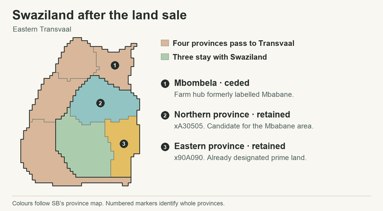

# Food security after the Swazi land sale and in Bechuanaland

26 November 2026 · Population and river trials implemented · Victoria 3 1.15.2 · SB 0.21.1

**An accepted Swazi land sale now returns half the displaced residents to the kingdom. The existing eastern province provides its prime land. The Orange River grants +5% Subsistence Output in Northern Cape, Bechuanaland, Griqualand West and Namaqualand.** Both campaigns in the playtest record reached a Swazi famine. The November 25 campaign also reproduced starvation on the Tswana side of Bechuanaland. [Earlier playtest](playtest_triage_2026_11_24.md#food-security) · [September 1879 autosave](<../../../save games/autosave.v3>)

## Where to put prime land

SWZ starts with seven provinces in Eastern Transvaal. The sale hands four to TRN, including the farm hub `x50A011` and the wood hub `x73CDE8`. An older SB localisation review calls the farm hub **Mbabane**. The current default and cultural names call it **Mbombela**. Of the three provinces SWZ retains, the eastern one (`x90A090`) already has prime land. The northern one (`xA30505`) is my candidate for the Mbabane area, inferred from the province raster and the UN map. SB assigns it no Mbabane hub label. The geography justifies representing a retained area of settlement and cultivation. It does not establish a particular increase in agricultural yield. [Starting ownership](../common/history/states/00_states.txt#L9176) · [Cession](../common/scripted_effects/sb_swazi_effects.txt#L307) · [Earlier label](../../docs/localisation_review.md#L347) · [Current hub](../localization/english/sb_l_english.yml#L448) · [UN Geospatial, Eswatini, map 3218 rev. 3](https://www.un.org/geospatial/sites/default/files/files/documents/2020/Aug/eswatini_3218_r3_may20.pdf)

| Prime-land placement | SWZ share before sale | SWZ share after sale | SWZ arable after sale, out of 35 |
|---|---:|---:|---:|
| Current eastern province | 11/24 | 7/24 | **10 observed** |
| Add a second, retained province | 15/28 | 11/28 | **13.75** before native rounding |
| Add the ceded farm hub | 15/28 | 7/28 | **8.75** before native rounding |

The region has 20 provinces, 35 arable land and one existing prime province. Vanilla gives a prime province five times the ordinary split weight. The saves reproduce the current shares and **16 → 10** arable land across the sale. The estimates hold the region total and the four-province border fixed. A second retained prime province also changes other owners’ shares of the region and the starting allocation in games where SWZ later refuses the sale. In a later civil-war split, the benefit follows the province’s owner. Moving the existing prime flag between the three retained provinces would leave their combined weight unchanged. [Eastern Transvaal](../map_data/state_regions/04_subsaharan_africa.txt#L1492) · [Vanilla split weight](</Users/depro/Library/Application Support/Steam/steamapps/common/Victoria 3/game/common/defines/00_defines.txt#L28>) · [April 1861](<../../../save games/trn-swz_1861_04_08.v3>) · [December 1870](<../../../save games/pre-kimberly-sb-21-1_1870_12_01.v3>)

## What should the kingdom keep?

| Course | What happens at the sale | Benefit and risk |
|---|---|---|
| **Additional prime land** · considered | TRN receives the same frontier. Native splitting allocates the population and buildings. | Simple and permanent. More arable land makes room for farms, but additional subsistence vacancies can make the protected-employment floor under Serfdom harder to reach. |
| **Existing prime land and half the displaced population** · implemented | After the native split, half the residents who would have passed from SWZ to TRN remain under the king. Apply once to a voluntary sale. Refusal and conquest use their ordinary rules. | Models households following the kingdom and preserves a larger workforce. Dependants come too. People moved by script arrive unemployed and must find work. |
| **Preserve a food employer** · deferred | If the sale removes the last operating maize farm, test allocating one existing maize level to the remnant at settlement, conserving the two sides’ combined levels. If a food producer survives but stands idle, test recruitment and food access before assigning another level. | Acts on local supply. A retained building needs staff, a buyer for its output and viable wages. Ownership, production methods and actual post-sale hiring need replay. |

In April 1861 the maize farm employed **344** and the two ranch levels employed **4,136**. No resident was starving. By December 1870 the remnant had no maize farm, its remaining ranch employed **zero**, and **19,780 of 27,453** residents were starving. In September 1879 its nine subsistence levels employed **4,565** against roughly **45,000** base positions. Serfdom was still active. The earlier campaign also reached famine under Tenant Farmers. These observations make employment and local staple supply more informative than a population or arable-land target alone. The checkpoints span several years and do not identify which buildings or jobs changed on the day of the sale. [April checkpoint](<../../../save games/trn-swz_1861_04_08.v3>) · [December checkpoint](<../../../save games/pre-kimberly-sb-21-1_1870_12_01.v3>) · [Other campaign under Tenant Farmers](<../../../save games/anglo-zulu-war-local_1882_06_01.v3>) · [Serfdom employment rule](</Users/depro/Library/Application Support/Steam/steamapps/common/Victoria 3/game/common/laws/01_land_reform.txt#L51>) · [Native recruitment evidence and its version limits](pitfalls/economy.md#econ-07)

**Define 50% at the border change.** Suppose 10,000 live in Swazi Eastern Transvaal and the actual handover on the chosen map leaves 6,000 under SWZ. Half of the 4,000 transferred means **8,000 remain and 2,000 pass to TRN**. Count workers and dependants of every affected culture and religion. For an odd transfer, round the number returning down once. The April checkpoint already has **138,681 residents** in TRN’s own Eastern Transvaal. Counting half the acquirer’s state would sweep in established communities. [April checkpoint](<../../../save games/trn-swz_1861_04_08.v3>)

At TRN’s acceptance, the settlement measures both countries’ Eastern Transvaal populations immediately around the native handover. The buyer’s established residents and any land acquired from a third party are counted first. For each culture and religion, only the matched loss and gain can supply returnees. An existing buyer pop contributes at most its increase. An odd person carries into the next cohort. The calculation and movement are hidden. Native movement sends the returning households to seek work in the surviving state. [Province transfer and pop movement](../../References/Modding-Digests/1.15.0/docs/effects.log#L38730) · [Pop movement contract](../../References/Modding-Digests/1.15.0/docs/effects.log#L10229) · [SB headcount precedent](../common/scripted_effects/sb_natalia_colony_effects.txt#L698)

## The Orange River

**The Orange River’s +5% Subsistence Output in Northern Cape, Bechuanaland, Griqualand West and Namaqualand** gives working peasants a small increase in household income in kind. Keep the proposed four regions and the existing aridity and colonisation rules. SB’s Zambezi has **+10% Subsistence Output and +15 infrastructure**. Only its subsistence effect serves the stated Orange design. Northern Cape has subsistence orchards, Namaqualand pastures, and the other two regions subsistence farms. A small common benefit can represent the river’s importance to both cropping and pastoral livelihoods. The regional averaging also reaches Namaqualand’s Walvis Bay and inland holdings far from the river. The Lower Orange environmental assessment places cultivation along specific stretches of the riverbanks. [SB Zambezi trait](../common/state_traits/sb_state_traits.txt#L16) · [Vanilla definition of Subsistence Output](</Users/depro/Library/Application Support/Steam/steamapps/common/Victoria 3/game/localization/english/concepts_l_english.yml#L826>) · [SB hub geography](../localization/english/replace/sb_hub_names_l_english.yml#L7) · [ORASECOM, Environmental Flow Requirements, §2.2.1–2, pp. 6–8](https://wis.orasecom.org/wp-content/uploads/2025/04/SAP_2012_TR22_EFR_FishRiver_Estuary_Delineation_resource_units.pdf)

| River design | Who receives it | What the player should see |
|---|---|---|
| **Regional household benefit** · implemented | Peasants in every owner’s fragment of the four regions, including CAP and TSW. | More in-kind income at the same staffing. Any improvement in Food Security is indirect. Simple static trait. |
| **Regional subsistence throughput** · food-supply comparison | Working subsistence farms, orchards and pastures across the same four regions. Use a separate **+5% throughput** trial for the relevant building types. | More of their ordinary market goods at fixed staffing, including grain, fruit or meat according to production method. Others buying that food can benefit. An idle building produces nothing. Hail Columbia’s Sierra Madre Watershed and Gates of the Bosphorus’s Nile traits use throughput for productive geography. |
| **Riverbank holdings only** · narrower alternative | Only a split-state owner holding a designated bank province. A state-scoped modifier would need to follow ownership through colonisation and conquest. A native state trait applies to a whole region. | More precise geography with more maintenance. It would reach the Cape, and miss the starving Tswana fragment entirely in the September 1879 save. |

All three passable north-bank provinces start under SAN. By September 1879 CAP owned **all ten** provinces that belonged to SAN in the pre-colonisation checkpoint, including those three. Only **24 of 24,983** people were starving on the Cape side, against **39,763 of 41,719** on the Tswana side. Of the latter, **23,606** were in peasant households, **9,882** in labourer households and **6,275** in enslaved households. The Tswana subsistence farms still had three levels, but their staff fell from **15,008 in December 1870 to 8,329**, and their recorded grain output from **2.70 to 1.22**. A regional income trait directly reaches the peasants. Staffing, local grain prices and access to supplies still matter to the other households. [Riverbank province IDs](bechuanaland_map_connectivity.md) · [Starting owners](../common/history/states/00_states.txt#L9127) · [December 1870](<../../../save games/pre-kimberly-sb-21-1_1870_12_01.v3>) · [September 1879](<../../../save games/autosave.v3>) · [Native state-trait scope](../../References/Modding-Digests/1.15.0/docs/effects.log#L441) · [Hail Columbia](<../../Example Mods/hc - Hail Coloumbia [1.13]/common/state_traits/usfp_state_traits.txt#L69>) · [Gates of the Bosphorus](<../../Example Mods/gotb - gates of the bosphorus [1.13]/common/state_traits/gbbf_state_traits.txt#L48>)

## Decisions and replay

| Item | Decision | Verification |
|---|---|---|
| Swazi land | Keep the existing prime province `x90A090` and the four-province frontier. | The unchanged map provides the control. |
| Swazi households | Apply the hidden return once on acceptance, including an offer pending in an earlier save. | Compare the native transfer and the return on the same tick. Check both sides, shared cultures and faiths, and an already populated buyer. |
| Orange River | Add one regional +5% household subsistence modifier at campaign start or the first monthly pulse in an older save. | Check every owner’s fragment, including Cape and Tswana land after colonisation. |
| Swazi and Bechuanaland famine | Both investigations remain open. | Compare subsistence and paid employment, staple prices, people below 40% and 20% Food Security, and famine deaths at one and five years. |

### Settlement replay

The 8 April 1861 save contains 69,906 people in Swazi Eastern Transvaal and 138,681 in Transvaal’s existing share. An instrumented replay on Victoria 3 1.15.2 counted residents three times in the same acceptance effect. By the sale tick the TRN population had grown by 59. [Pre-sale checkpoint](<../../../save games/trn-swz_1861_04_08.v3>) · [Settlement](../common/scripted_effects/sb_swazi_effects.txt#L307)

| Eastern Transvaal | Before sale | After native handover | After household return |
|---|---:|---:|---:|
| SWZ | 69,906 | 29,963 | **49,934** |
| TRN | 138,740 | 178,683 | **158,712** |
| Combined | 208,646 | 208,646 | 208,646 |

Of the 39,943 people transferred, **19,971 returned**. This included 18,778 Swazi Animists and 1,193 Tsonga Animists. The correction drew exclusively from the increase in those two groups. Every TRN Pop ID present before the grant had the same final headcount as under the native grant. A second replay loaded a disposable copy with TRN’s acceptance event already queued. The actual option executed once, returning 19,997 of 39,995 people. The focused regression also exercises merged incumbents, all 81 ownership arrangements for the four districts, a missing remnant and repeated acceptance. [Regression cases](../tests/test_swazi_cession_and_orange_river.py)

The 1 September 1879 save acquired the Orange River on its first monthly pulse. The native state-trait check succeeded for all four regions, including both the Cape and Tswana states in Bechuanaland. The 1836 trial recorded assignment at the bookmark and found the trait on the San and Tswana fragments. [River assignment](../common/on_actions/sb_orange_river.txt) · [September 1879 checkpoint](<../../../save games/autosave.v3>)

The paired campaigns stopped before the five-year comparison. Both famine investigations remain open for DP’s playtest. Record employment, local staple prices, residents below each Food Security threshold and famine deaths at one and five years.

The September figures above refer to the rotating autosave dated **1 September 1879**, SHA-256 `7f17034f59c0baabf68d409dc5635f5a329aac88640eb26f96fd3d8e74e9edda`. In SWZ, **22,311 of 23,266** people were below 0.40, including **14,497** below 0.20. The formal famine dated to 9 July 1876 and recorded **1,897 deaths**. Neither Bechuanaland fragment had a registered famine on that date. Population counts include workers and dependants. Building staffing counts workers at the recorded workplace.
