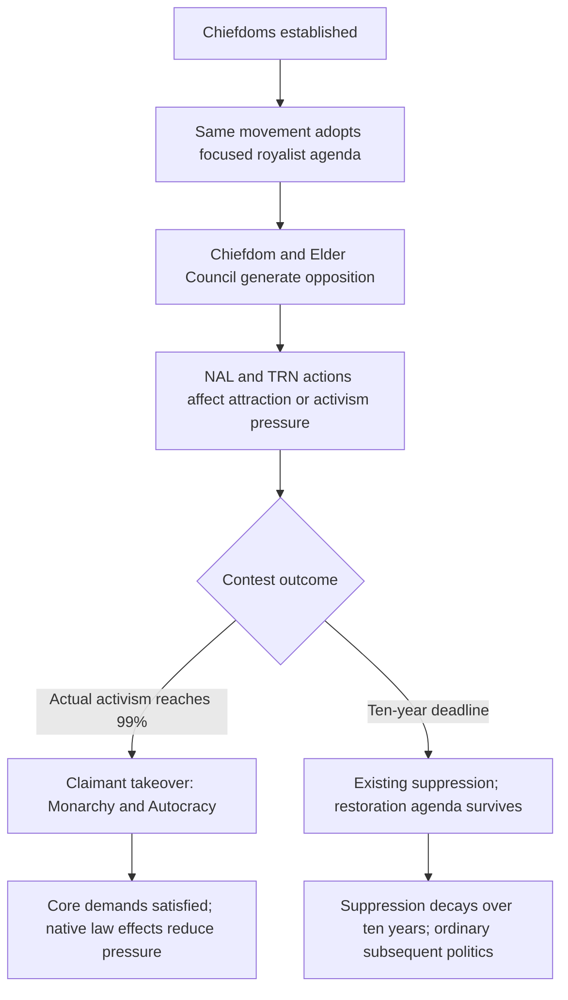
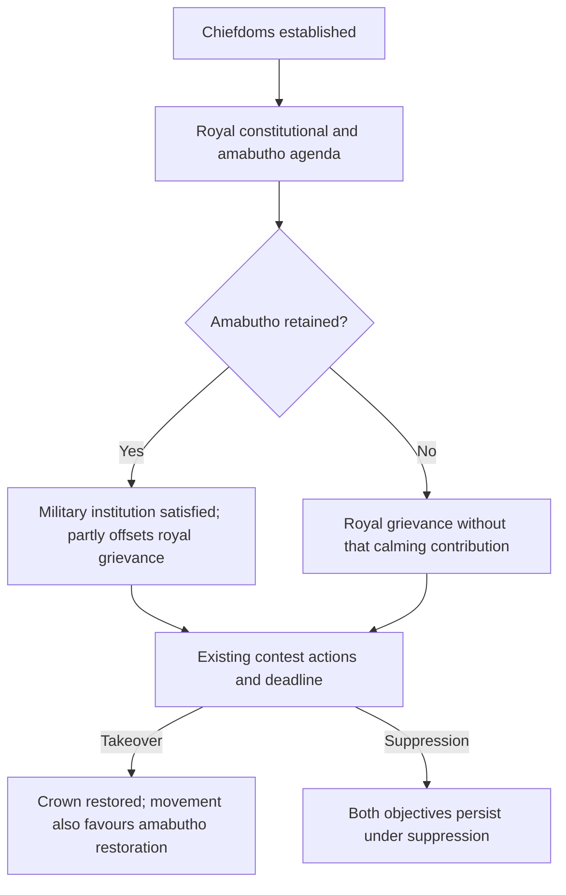
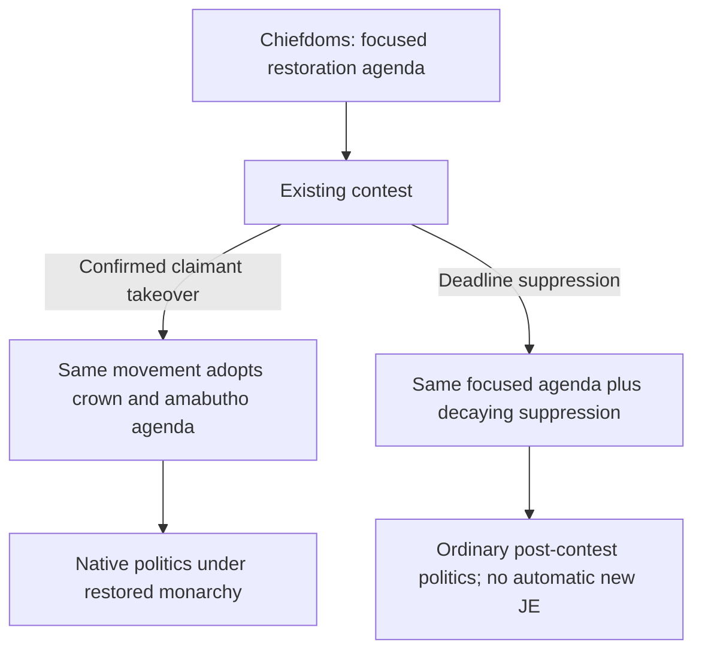

# uSuthu restorationist ideology — design exploration

Status: proposals for DP, 20 September 2026. No ideology redesign implemented.
This extends the accepted Chiefdoms contest in
`zululand_chiefdoms_liberty_desire_exploration_2026_09_19.md`; it does not replace
its actions, deadline, thresholds, subject outcomes or annexation treatment.

## Problem and evidence

DP observes that the Chiefdoms inherit laws which the restorationists already
support. The current `common/ideologies/sb_usuthu_ideology.txt` copies most of
Vanilla's Absolutist agenda, adding hostility to Chiefdom and Elder Council.
It also approves Traditionalism, Subjecthood, and both hereditary and appointed
bureaucrats. Chiefdom creation changes governance and distribution of power,
leaving those other law groups alone.

Installed 1.14.3 `common/defines/00_defines.txt` explicitly makes positive stances
on each active law reduce calculated movement activism. Radical and loyalist
supporters, law enactments, movement modifiers and other factors also contribute.
Current activism approaches its calculated target over time. This establishes
an offset in the design; it does not establish that inherited laws alone caused
the screenshot's zero activism or that removing them guarantees 99% activism.

The native `political_movements.md` distinguishes core `ideology` (law agenda)
from `character_ideologies` (ideologies the movement can assign to pressured IG
leaders). The Royalist, Authoritarian and CMF Bavarocrat entries are not three
automatically stacked movement platforms. The immediate design target is the
uSuthu core ideology. Keep the native character pool unchanged in this proposal;
a ZUL-specific leader-generation redesign would need separate scoping evidence.

Prior work has changed setup to configure the existing native Absolutist movement
in place, creating it only when absent. All proposals below use that same object;
none calls for a second movement or resets its supporters and activism.

## Historical constraints

Cetshwayo sought to strengthen royal authority and the amabutho system against
the diffusion of authority to territorial chiefs. Restoration after defeat was
restricted territorially and militarily. These support a crown-centred agenda
and a possible military dimension. They do not establish a comprehensive stance
on Victoria 3's modern economic or citizenship laws.
[South African History Online, King Cetshwayo](https://sahistory.org.za/people/king-cetshwayo)

The civil conflict involved royalist followers, rival chiefs and external support;
Zibhebhu himself belonged to the royal family. Treating it as modernizers against
an undifferentiated traditional society would be misleading.
[Ken Gillings, The Zulu Civil War, 1883–1888](https://www.samilitaryhistory.org/lectures/zuluwar.html)

Research on colonial repression describes royal networks, chiefly supporters,
land and cattle dispossession, and constraints on movement. My design inference
is that allegiance and the imposed settlement are better foundations than
assigning a generic reactionary programme. Later developments covered by this
study should not be projected wholesale onto the original restoration struggle.
[Siyabonga Nxumalo, Journal of African History, 2026](https://www.cambridge.org/core/journals/journal-of-african-history/article/british-political-hegemony-and-imperialism-crushing-of-the-usuthu-and-the-onkweni-sections-of-the-zulu-royal-family-1880s1913/07EC250864BDC9DDC04451959454E07B)

Chiefdom/Elder Council opposition is therefore a game abstraction for this
imposed division of royal authority, not a claim that uSuthu opposed all chiefs
or councils. Autocracy is the already-agreed gameplay representation of restored
royal authority, not an assertion that Zulu kings ruled without constraints.

## A — Focused restoration platform (recommended)

One persistent core ideology with a constitutional agenda. Neutrality outside
that agenda means the faction has no collective programme on those laws, not
that each supporter lacks views.

| Law area | Proposed stance |
|---|---|
| Monarchy | Strongly approve |
| Chiefdom | Strongly disapprove: the imposed Chiefdoms settlement |
| Social Monarchy | Approve: a crown, but not the preferred royal settlement |
| Presidential/Parliamentary Republic, Theocracy | Disapprove |
| Council Republic | Strongly disapprove |
| Corporate State | Neutral; retain existing treatment |
| Autocracy | Strongly approve |
| Elder Council | Strongly disapprove: the imposed distribution of authority |
| Landed Voting and Oligarchy | Neutral, replacing existing approval |
| Other distribution-of-power laws | Retain current stances for the first revision |
| Bureaucracy, economy, land reform, citizenship | No movement-specific stance; remove these agenda blocks |
| Military, religion, policing, other law groups | No new stances |

The full matrix is provisional. Removing the economic/citizenship/bureaucratic
agenda is the substantive recommendation, rather than tuning every remote
constitutional alternative as a separate decision.

Walkthrough: Chiefdoms inherit Traditionalism, Subjecthood and hereditary
administration. These now contribute no approval from the core movement agenda.
The constitutional conflict remains, while policing, patronage, volunteers,
sponsorship and supporters' political conditions determine its intensity.
Victory fulfils its principal demands; failure suppresses the same dissatisfied
movement under the accepted deadline rules.

Advantages: smallest substantive change, understandable contest, same ideology
before and after victory, no artificial starting-law changes. Modernized ZUL
also works: adopting a different economy does not distract from restoration.
Cost: uSuthu has little distinctive economic or military agenda after victory.
This is acceptable if it primarily represents dynastic allegiance. Its existing
native support weights still shape its constituency; narrowing the agenda is
not a redesign of pop recruitment.

## B — Restoration of the crown and royal military institutions

Use A's constitutional platform and add strong approval of SB's Amabutho System.
Provisionally leave other army models neutral rather than inventing a preference
ordering unsupported by this research. Economy, citizenship and bureaucracy
remain outside the platform. This is a narrower historical extension than
copying the whole Absolutist programme.

Walkthrough: after a settlement that keeps the military law, royalists oppose
the new rulers but approve preservation of their military institution. If ZUL
had previously changed its army law, restoring the crown does not satisfy the
movement's preferred military arrangement. Normal law politics can continue
after the contest; the takeover still changes only the two agreed laws.

Advantages: specific historical character and a continuing post-restoration
agenda. Cost: SB often retains Amabutho already, so this deliberately reintroduces
an approval offset. Adding a compensating activism modifier merely to cancel it
would obscure the system. Nor should we forcibly abolish Amabutho at Chiefdom
creation just to manufacture opposition. Both would require new design decisions.

Feasible as an ideology extension. Prefer it only if representing the shared
military institution is more important than a tightly focused restoration contest.
A still broader Traditionalism/Subjecthood platform was considered and rejected:
it recreates more of the present problem with weaker evidence for those exact
game-law mappings.

## C — Restoration agenda, followed by a royal governing agenda

Use A during the contest. On the confirmed claimant takeover, change the same
movement's core ideology to B. Suppression keeps A. No object replacement, no
new timer, and no reset of support or activism.

Walkthrough: Traditionalism and Amabutho do not calm the initial constitutional
struggle. After victory, royal government gains a positive military programme;
retained Amabutho helps consolidate it, while a different military law leaves a
remaining preference. If suppressed, the movement still seeks restoration and
never receives a governing platform merely because ten years elapsed.

Advantages: separates the immediate coalition's objective from restored rule,
and preserves a historically specific military dimension without the initial
offset. Costs: two ideologies and a transition to maintain; the platform change
needs explanation to avoid looking arbitrary. Concessions, claimant succession
and later ordinary restoration must have an explicit phase interpretation.

`set_core_ideology` is used in installed Vanilla's Meiji/communist events and
Gates of the Bosphorus's Tanzimat events/journal. Feasibility is established;
the new lifecycle is not engine-tested. Hail Columbia's movement definitions
also separate core agenda from eligible character ideologies; neither example
establishes the historical appropriateness of this particular phase transition.

For a minimal realization, switch only inside the existing successful claimant
takeover effect. Do not add a worldwide monarchy watcher or reopen a completed
JE. A later ordinary restoration would then retain A: that limitation must be
accepted, or a broader lifecycle would need designing. This makes C less
attractive than A for the present scope.

## Comparison and recommendation

| Criterion | A: focused | B: crown + amabutho | C: phased |
|---|---|---|---|
| Removes inherited broad-law offsets | Yes | Yes, but adds a military offset | Yes during contest |
| Historical interpretation | Dynastic/constitutional objective | Dynastic and military institutions | Objectives change after victory |
| Post-victory role | Defends restored constitution | Also favours amabutho | Also favours amabutho after scripted takeover |
| Maintenance | One narrower ideology | One ideology, added law group | Two ideologies and transition rules |
| Main risk | Less broad flavour | Softer conflict when Amabutho retained | Inconsistent later-restoration treatment |

Recommend A. It addresses the observed design mismatch at its source and does
not require a new political lifecycle. Preserve historical military and chiefly
context through the existing characters, coalition and narrative rather than
assigning speculative positions across every law group.

## Boundaries and checks for a later implementation

- Preserve the one-movement setup and existing identities/support/activism.
- Verify native law-stance breakdowns before and after Chiefdom creation, with
  inherited and modernized law sets. No unrelated law should affect activism
  through the removed core-agenda groups; other native effects may still do so.
- Compare calculated activism and actual activism separately. NAL patronage and
  sponsorship change attraction; policing and volunteers change activism pressure.
- Verify victory and suppression retain all already-agreed outcomes and the true
  deadline. No forced independence, new laws or new peace requirements.
- Existing code reconciles ordinary Monarchy enactment to the claimant outcome.
  Preserve this unless DP reopens it; do not silently add an Autocracy prerequisite
  or equate every hypothetical monarch with the intended claimant in a new phase.
- A satisfied movement may still be active because of radicals, modifiers or the
  native legitimacy factor. Do not promise zero activism on restoration.
- Leave native movements outside the scoped ZUL context and CMF hooks unchanged.
- Static checks establish definitions and scope; DP checks engine behaviour from
  before Chiefdom creation. No save migration or game launch.
- Preserve DP-reviewed prose. Any necessary substantive wording change is a
  separately proposed text, not permission to edit approved narrative.

## Decision register

| Item | Status | Position |
|---|---|---|
| Historical grounding and inherited-law concern | Agreed | Both required by DP |
| Existing NAL/TRN actions, deadline and outcomes | Agreed | Retained from accepted contest |
| Narrow constitutional platform A | Provisional | Recommendation for DP |
| Detailed constitutional stance matrix | Provisional | Proposed together, not individual numeric gates |
| Add military programme B or phase C | Open | Developed alternatives; not recommended for current scope |
| Broader economic/citizenship programme | Provisional | Recommend removing from core ideology |
| New character-ideology selection rules | Deferred | Distinct mechanism; no evidence needed to change it for this issue |
| 99% attainability and pacing | Open empirical question | Inspect actual engine breakdown with DP; do not infer from static text |
| Implementation | Deferred | Await selection/authorization for this redesign |

Follow-up: DP prefers exploring a variant of B together with ZUL's IG identities
and a chiefly militia law. See
`zulu_interest_groups_and_militias_exploration_2026_09_20.md`. The recommendation
of A above records the earlier comparison; it is not an agreed selection.
