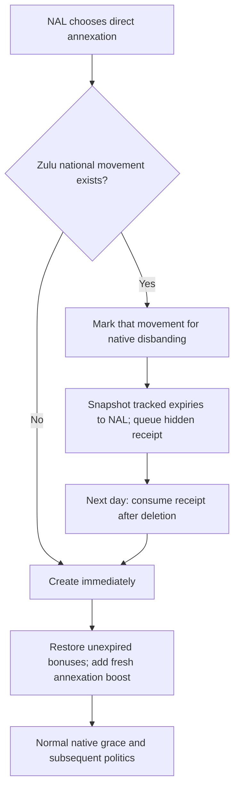
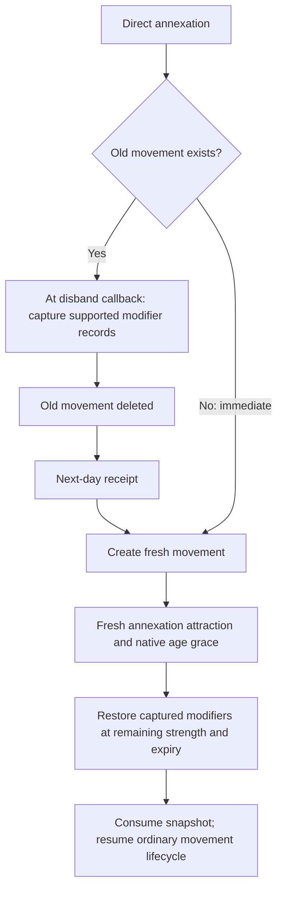
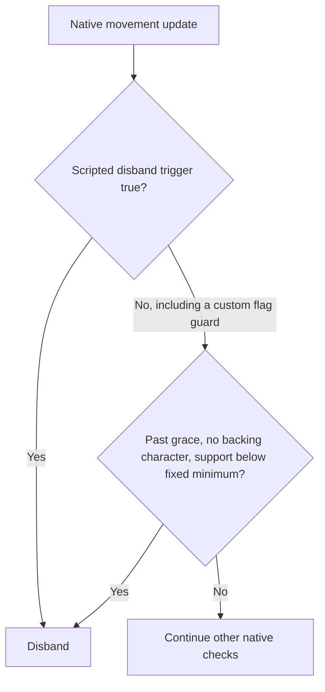
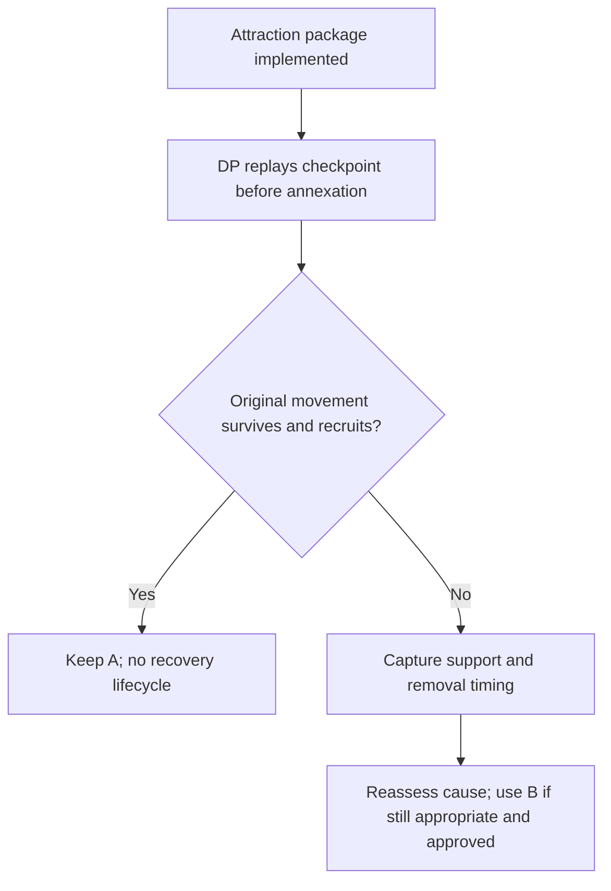
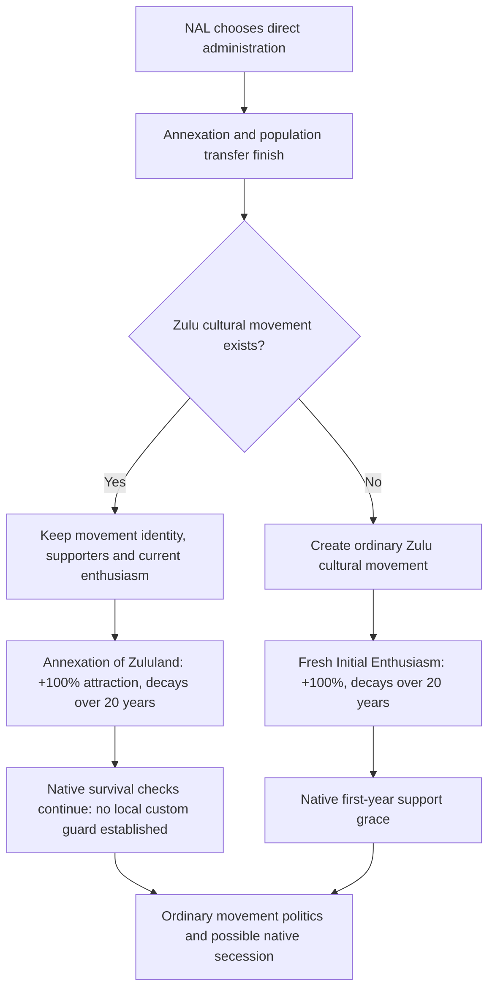
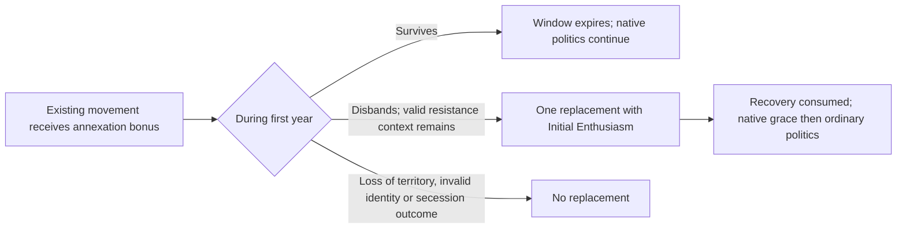

# Zulu movement after annexation — design exploration

Status: **B works in DP’s early replay; preservation of Initial Enthusiasm and
the two Shepstone bonuses is implemented; engine-testing TODO explicitly deferred by DP**,
17 October 2026. The current
implemented instruction is to disband an existing movement and
recreate it at annexation. This supersedes A and the earlier provisional B design
of waiting for a disappearance within a year. Assigning 2,500 existing peasants
remains unsupported and was not implemented.
The guard investigation and alternative proposals below are retained as design
history. This follows the
[save investigation](compatibility/zulu_national_movement_2026_10_17.md)
and concerns NAL's direct-administration choice after Klip River or the later
Anglo-Zulu route. It does not revise Chiefdoms, Crown restoration, or GBR's
separate direct-rule branch.

## Current decision — replace at annexation

The new instance receives Annexation of Zululand (+100% attraction, twenty-year
decay), separately from preserved Initial Enthusiasm and the two Shepstone
attraction bonuses. Their hidden grant records preserve remaining strength and
expiry at whole-day precision. Untracked pre-change grants cannot be recovered.
The old supporters, activism and history are not preserved. There is no recurring
resurrection or new visible event; existing option tooltips remain unchanged.
See the [implemented preservation contract](compatibility/zulu_national_movement_2026_10_17.md#authorized-modifier-preservation).

Native disbanding waits for the movement update; the one-day delay starts at its
callback, not at annexation. This is required because the callback precedes
deletion and creation refuses duplicate identities. Full CMF-body parity outside
the two local hooks passes. The preservation follow-up passes 31 focused tests;
the earlier replacement-only run passed 91. DP must replay with tracked grants,
verify their retained remainders and the fresh annexation boost, then observe
support and survival. The prior proposals below remain historical, not current
implementation instructions.

## Historical preservation proposal — now implemented for three named grants

DP reports that replacement works in the early-annexation replay. This does not
establish the late route, every delivery edge case, or survival beyond the native
first-year grace. DP now proposes preserving the old movement's modifiers,
including remaining Initial Enthusiasm, while granting a fresh annexation boost.
The feasibility review below predates the implementation documented above.

| Item | Status | Decision or limitation |
|---|---|---|
| Proactive replacement and its fresh creation date | Agreed; implemented | Retain the working handoff. |
| Preserve old modifiers as well as grant fresh attraction | DP proposal | Preserve remaining strength and expiry, including penalties, rather than renewing every grant. |
| Fresh Initial Enthusiasm plus old enthusiasm under Annexation of Zululand | DP proposal | Numerically coherent if the old remainder can be recovered. |
| Keep old Initial Enthusiasm under its own name; label the fresh grant Annexation of Zululand | Provisional recommendation | The grace period depends on movement age, so the modifier names need not exchange meanings. |
| Automatic copying of arbitrary Vanilla/mod modifiers | Unsupported by inspected interface | No generic copying, timed-modifier iterator, or movement-specific remaining-duration script accessor was found. |
| Explicit preservation of named bonuses | Provisional implementation direction | Requires tracking original grant timing and multiplier; arbitrary existing modifiers cannot be assumed to have that information. |

This proposal describes the intended flow; it does not establish a generic snapshot facility. Capture would
belong immediately before deletion, so modifiers added while the marked movement
awaits its update are not missed. Any named ledger must belong to the actual NAL
owner and survive the one-day delivery and save/reload. Expiry continues during
delivery. Expired grants are omitted; later ordinary movement death still does
not trigger recreation. This proposal preserves modifiers only, not supporters,
activism history, backing-character assignments, or old movement identity.

For example, an old +60% Initial Enthusiasm with twelve years remaining and a
+40% Shepstone repeal bonus with eight years remaining would be retained alongside
the fresh +100% annexation bonus for twenty years. The old grants keep their
separate decay and end dates. The illustrative total is +200% attraction at the
handoff; that is not 200% movement support or a guarantee of survival.

### Feasibility and alternatives

1. **Generic modifier snapshot:** best coverage in principle, including unknown
   third-party modifiers. The installed 1.14.5 interface search did not establish
   a script API to enumerate and clone those records. UI methods such as
   `PoliticalMovement.GetTimedModifiers` and `TimedModifier.GetRemainingDuration`
   display them; they are not evidence of an event-script iterator or accessor.
   Do not promise this implementation or substitute a dead movement reference
   for a copied record.
2. **Named preservation:** retain the three known grants (Initial Enthusiasm,
   Shepstone refusal and Shepstone repeal), with original timing/multiplier
   recorded when granted. Reconstruct only the unexpired remainder at replacement.
   This is a bounded, feasible direction using variables and scaled timed grants,
   but its concrete hooks and engine behavior still need verification. Vanilla
   event modifiers require an explicit inventory and timing coverage of their
   grant paths. Existing untracked grants do not magically acquire timestamps.
3. **One aggregate attraction snapshot:** retain the old total attraction in one
   custom grant alongside the fresh boost. It can approximate the immediate
   total, but loses individual expiration/decay, labels, and non-attraction effects
   such as activism. It can also capture contributions that should recalculate.
   This does not meet exact modifier preservation and is not recommended as an
   undisclosed substitute.

Follow-up native inspection also excludes the aggregate approach: `modifier:`
has no political-movement scope branch in this build. Named grant-time records
are required. The selected implementation uses those records; broad
Vanilla-event coverage remains open. Do not reset Shepstone's country-level
"already applied" flags and regrant full-duration modifiers as a shortcut.
Initial Enthusiasm's ordinary grant is +100% decaying over twenty years in
Vanilla `common/scripted_effects/00_movement_effects.txt`. Shepstone refusal and
repeal are +100% over 300 months and +50% over 120 months respectively in SB.

Evidence: inspected current Vanilla, CMF, Hail Columbia and Gates of the Bosphorus
script examples; installed executable script-name/symbol search recorded in
`/private/tmp/sb-zulu-movement-2026-10-17/modifier-api-symbols.txt`; the existing
native movement-age investigation remains applicable. No game launch, runtime
script change, modifier transfer test, or save migration was performed here.

## Historical A recommendation and feasibility boundary

Retain DP's two-way recruitment treatment: an existing native Zulu cultural
movement receives **Annexation of Zululand**, +100% pop attraction decaying
linearly over twenty years; an absent movement is created with fresh native
Initial Enthusiasm. Preserve any remaining enthusiasm on an existing movement.
Use actual movement existence, not a calendar-year or route threshold.

The proposed renewed survival guard is a separate, unresolved mechanism. The
native twelve-month grace has not been disabled in SB: it expires with movement
age. The inspected 1.14.5 script examples and executable effect registry expose
no effect to reset that age or temporarily disable the native minimum-support
check. An attraction modifier and a false scripted `disband_trigger` do not
override that independent check. `set_movement_defeated` concerns the defeat
date, not the creation date or support grace.

The attraction policy is selected. **No local custom survival guard for the same
native movement is supported by the inspected interface.** The follow-up below
checks a scripted veto and a conditional category threshold, beyond the earlier
search for a grace-reset effect. Do not substitute recovery or an organizer for
DP's selected design, or describe the attraction bonus as guaranteed survival.

## Custom-guard feasibility follow-up

The installed 1.14.5 arm64 executable supplies two decisive checks:

1. `CPoliticalMovementType::ShouldDisband` (`0x1019420d8`) evaluates the scripted
   disband trigger. In `CPoliticalMovement::ShouldDisband` (`0x1010bc890`), a false
   result continues into the independent age, backing-character and support
   checks. It is not a veto on those checks. A timed variable tested only by
   `disband_trigger` therefore cannot protect the movement from low support.
2. `CPoliticalMovementCategory::ReadMember` (`0x101931160`) reads the support
   thresholds into `CFixedPoint` fields. The survival check directly compares
   support with the category's stored number. `minimum_support_to_maintain` is
   not a scripted value and cannot conditionally become zero for NAL's Zulu
   movement while an annexation guard is active.

The diagram isolates the two relevant checks; native civil-war handling is also
present and is not changed or proposed as a workaround. No registered movement
effect was found to change creation age, minimum support, movement type or
category for an existing instance. No minimum-support immunity modifier was
found. A custom flag alone cannot add a hook the engine does not consult.

The remaining architectural approaches exceed the selected local repair:

| Approach | Consequence |
|---|---|
| Give the native cultural-minority type a category with no native support minimum, then rebuild support-based disbanding in script | Preserves movement identities, but replaces native survival handling for cultural-minority movements worldwide. It would need exact coverage of grace, backing characters and other native boundaries; parity is not established. Changing the shared native category directly would also affect slave-revolt movements. |
| Introduce a dedicated Zulu movement and category with its own scripted survival rules | Can isolate future behavior, but needs a new movement type, effective CMF-body compatibility work, eligibility exclusions and caller updates. No in-place conversion effect was found for the existing native movement. This is a redesign, not a guard attached to it. |

Neither approach is approved or implemented. The original attraction policy
remains selected; the requested local guarantee is not deliverable through the
verified hooks. This result does not prove that the attraction bonus itself
will prevent the observed removal: DP's engine replay remains necessary.

The investigation read the installed category documentation and parser, the
native/type removal functions, the effect/trigger registry and the Vanilla/CMF
category consumers. Temporary disassembly evidence is retained under
`/private/tmp/sb-zulu-movement-2026-10-17/` as `category-read.txt`,
`type-should-disband.txt` and `should-disband.txt`. No executable, runtime script,
save or dependency was modified and no game was launched.

## Follow-up decision: test attraction before adding recovery

DP accepted **testing A first, retaining B as a conditional fallback**, then
authorized implementation. A is now implemented. The attraction package preserves
the existing movement and has the smallest scope; the evidence does not yet
establish whether it will recruit quickly enough to prevent removal. B still
requires a further decision if the replay shows it is needed.

The installed executable's registered script effects expose movement creation
and modifiers, but no effect was found to add, set or transfer pop supporters to
an existing movement. `move_pop` and `move_partial_pop` relocate populations;
`recalculate_pop_ig_support` concerns interest groups. None supplies the proposed
movement-membership assignment. The inspected Vanilla and example-mod effects
provide no direct supporter-seeding precedent. Treat that route as unavailable
through the inspected interface, rather than inventing an effect or altering pop
culture, class or residence to force it indirectly.

Native defines limit how much of a pop can change movement allegiance per update
(`MAX_POP_FRACTION_JOIN_OR_LEAVE_MOVEMENT = 0.1`, with a minimum-number override).
This establishes gradual recruitment, not its update cadence. A +100% attraction
modifier neither grants an immediate fixed number of supporters nor doubles
current support. The original movement's death ten days after annexation makes
that timing material.

For the early replay, record the movement identity and native identity support
before and after annexation; continue past the original disappearance date and
through several monthly updates. A save after the movement has died cannot test
preservation of the original instance. Also check a later
surviving movement and an absent movement with the old country enthusiasm marker.
No survival result is verified yet; DP performs these engine checks.

If A fails, B remains the bounded design below: at most one replacement during
the provisional first-year window, fresh Initial Enthusiasm only, no repeated
revival and no recovery after legitimate invalidation or secession. Its visible
disband/reform, lost history and cooldown/order questions remain real costs.
Do not compensate for a removal-order problem by escalating attraction values
without evidence.

## Shared recruitment policy

| Actual state at annexation | Treatment |
|---|---|
| Early annexation; old enthusiasm remains | Retain its remaining strength and end date; add the new annexation modifier once. |
| Later annexation; movement survives but enthusiasm expired | Same existing movement, fresh annexation modifier. No new Initial Enthusiasm. |
| Movement absent, including an early annexation | Create it after territory/population transfers; apply Initial Enthusiasm to this new instance. |
| Movement absent but country remembers its 1839 enthusiasm grant | The old country marker must not suppress the explicitly authorised new-instance grant. Do not clear the general foundation marker or refresh every other caller. |

The new modifier contributes +100% at annexation, +75% after five years, +50%
after ten, +25% after fifteen, and expires after twenty. This is attraction, not
an assignment of support, activism or a guaranteed rebellion. Competition with
other movements and native recruitment still apply.

In the inspected early campaign, the 1839 enthusiasm has about +47% remaining in
June 1850. Together these two modifiers would contribute about +147% attraction
at annexation, before other modifiers. That additional early strength is a real
tradeoff: a still-active national movement is reinvigorated by a second shock.
It is not inherently an error, and both effects decay independently. This agrees
with DP's proposed early stacking. A newly created late movement receives only
Initial Enthusiasm, avoiding a second fresh +100% at the same instant.

## A — Attraction with ordinary native survival

DP selected and authorized this recruitment policy after the custom-guard
investigation. The feasibility result above leaves the survival limitation explicit.

After the shared policy, make no further intervention. The existing movement
recruits from the expanded Zulu population under its new bonus. If it maintains
10% identity support, it survives. If it falls below the minimum, is past its
first year and has no backing character, it can disband; ordinary native creation
may later produce another movement. An absent movement created at annexation
does receive its native initial grace.

For the June 1850 case this preserves the 1839 movement perfectly if recruitment
catches up before its next removal check. It does not establish that the movement
will survive 16 June. Increasing the attraction value does not make that ordering
safe by definition.

Strengths: smallest change, preserves identity and all native outcomes. Weakness:
it may leave the reported rapid-disappearance bug intact. Suitable only if DP
accepts ordinary disbanding and engine testing shows the bonus suffices; it does
not fulfill a guaranteed guard requirement.

## B — One recovery opportunity after annexation

Reopened for comparison by DP, then deferred as a conditional fallback; not
authorized for implementation.

Keep the existing movement and the annexation bonus. Arm a **one-use recovery
opportunity lasting twelve months**, provisionally, only for the existing-movement
branch. If it disappears during that window while the same colonial resistance
remains applicable, create one replacement with Initial Enthusiasm and let that
new instance's native grace apply. Consume the opportunity. There is no repeated
recreation and no twenty-year survival guarantee.

Concrete early example: the existing movement still disbands on 16 June. A
subsequent safe reconciliation creates a replacement, rather than leaving NAL
without the intended resistance. The old movement's supporters, accumulated
activism and movement-local modifiers are lost through native disbanding. The
replacement gets Initial Enthusiasm only; the destroyed annexation modifier is
not recreated alongside it. Country-owned Shepstone reactions use their existing
synchronization. Thus recovery may reduce the early stacked bonus, which is
preferable to accidentally granting two new twenty-year bonuses.

The implementation would have to distinguish an accidental low-support loss
from a legitimate secession/identity/territorial outcome. The native disband
callback has a movement root and does not document a reason argument. It also
runs before native removal completes: do not create the replacement inside that
same callback. A later existing country reconciliation is the simplest candidate,
with a temporary visible gap until it runs. Exact callback/reconciliation ordering
and native failed-creation cooldown handling need engine verification.

Strengths: uses the already available creation mechanism, adds no fictional
organizer and preserves the old movement whenever it survives. Weaknesses: it
cannot prevent the disband/reform notifications, loses movement continuity after
death, and adds a small recovery lifecycle. Recommended fallback only if those
costs are acceptable; not a transparent substitute for resetting age.

## C — A genuine Zulu organizer

Earlier alternative; not selected by DP.

Apply the same recruitment policy and provide a real, politically appropriate
Zulu agitator who supports this cultural movement. The inspected native removal
check exempts movements with backing characters from its low-support clause.
Other scripted invalidation still applies. The organizer remains a normal
political character; death, exile, loss of backing or an ordinary political
outcome can remove that protection. Do not delete the character after twelve
months merely to simulate a timer.

For the early campaign this makes the annexation create organized opposition,
not just increased attraction. The movement retains its 1839 history while the
organizer helps it endure. In a late campaign the same organizer can support a
newly created movement. A royalist claimant is not automatically eligible:
current CMF's cultural movement requires matching culture and one of its
eligible ideologies, such as Sovereignist or Humanitarian Royalist, and backing
must actually be established in the engine.

Strengths: native reason for continued existence, continuity, possible character
story. Weaknesses: changes the cast and political pressure, may protect the
movement far longer than a year, and introduces character-selection/attachment
work. It must not fabricate an invisible placeholder, recreate a dead royal,
or borrow the separate uSuthu contest's claimant without an explicit design.
Not recommended as incidental bug repair.

## Boundaries, comparison and acceptance

| Criterion | A: bonus only | B: one recovery | C: organizer |
|---|---|---|---|
| Preserve an existing movement's identity | Yes, until native death | Yes until native death; replacement loses it | Yes while backing persists |
| Protect against immediate low-support removal | No guarantee | Restores once after removal | Native protection while actually backed |
| New political character | No | No | Yes or an explicitly chosen surviving character |
| Extra lifecycle work | Minimal | Bounded recovery and invalidation checks | Character eligibility/backing and normal exit |
| Main risk | Original disappearance persists | Visible disband/reform; lost history | Broader and potentially long-lived political impact |

Pruned approaches: refreshing Initial Enthusiasm alone does not reset grace;
changing only the scripted disband trigger does not stop native low-support
removal; changing the global category/define affects unrelated movements;
proactively deleting a surviving movement sacrifices its history; repeatedly
recreating it makes successful pacification meaningless. No such change is
proposed.

The recruitment package must execute once for the authored direct-administration
settlement, after ownership transfers. Routine monthly checks, reloads and Boer
Natalia's conversion to British Natal must not refresh its timers. A completed
incorporation does not itself erase cultural opposition. The movement remains
native and can start secession normally; unrelated wars impose no new gate.

Engine checks belong to DP: early existing movement, late surviving movement,
absent movement with an old country marker, and actual support/grace behavior.
For B additionally verify one recovery only, native cooldowns, no creation inside
the deletion callback, and no revival following legitimate invalidation or
secession. For C verify actual backing, compatible ideology, and ordinary
death/exile behavior. Static checks must preserve foreign event-root scope,
single application, modifier duration/decay and unchanged unrelated callers.

## Historical decision register before the final B instruction

| Item | Status | Position |
|---|---|---|
| Implement A; ordinary Zulu cultural movement | agreed | DP authorized the attraction-only package; source implementation complete, engine replay pending. |
| Existing movement: Annexation of Zululand, +100%, twenty-year decay | agreed | DP selected the original recruitment design. |
| Retain remaining Initial Enthusiasm on an existing movement | agreed | Early stacking remains part of DP's selected design. |
| Absent movement: recreate with fresh Initial Enthusiasm | agreed | Old country marker cannot veto this explicit new-instance grant. |
| Branch on actual existence, including atypical early/late cases | agreed | Implemented without historical-date gates. |
| Custom survival guard for the same native movement | deferred | Direct reset, scripted veto and conditional threshold routes are unavailable in the inspected interface. DP accepted testing A without a guard; a broader rewrite is not authorized. |
| Guard duration | deferred | A one-year duration was provisional; no local guard mechanism was established. |
| Test attraction alone before adding recovery | agreed | A implemented; DP subsequently reports that disappearance persists. No fresh removal-day support or date was supplied. |
| Directly assign pop supporters | deferred | DP requested 2,500 existing Zululand peasants if possible. Rechecking the native effect registry and movement documentation found no supporting effect; no membership assignment or tooltip seeding text implemented. |
| Substitute one bounded recovery (B) | deferred | Conditional fallback if A fails; not authorized or implemented. |
| Substitute genuine organizer (C) | deferred | Not selected; no character change authorized. |
| GBR direct rule and wider Chiefdoms redesign | deferred | Outside this proposal. |

Implementation and validation are recorded in the
[investigation follow-up](compatibility/zulu_national_movement_2026_10_17.md#authorized-implementation--attraction-only).

## Inspected precedents

- Vanilla `common/scripted_effects/00_movement_effects.txt` and
  `common/static_modifiers/09_movement_modifiers.txt`: native +100%, twenty-year
  decaying Initial Enthusiasm.
- Vanilla `common/defines/00_defines.txt` and
  `common/political_movement_categories/00_political_movement_categories.txt`:
  twelve-month grace and 10% within-culture survival threshold.
- CMF `common/political_movements/ycom_02_cultural_movement.txt`: effective
  cultural movement and character eligibility.
- Gates of the Bosphorus `common/history/political_movements/gbbf_movements.txt`:
  create missing cultural movement, find it and apply missing enthusiasm.
- Hail Columbia `common/political_movements/usfp_political_movements.txt`:
  enthusiasm in a movement's `on_created` effect.
- Read-only installed executable inspection: the movement-related registered
  effects expose creation and defeat-date handling, not a creation-age reset.
  Native `ShouldDisband` separates scripted invalidation from age/support/backer
  checks. These observations establish mechanisms, not a replayed fix.
