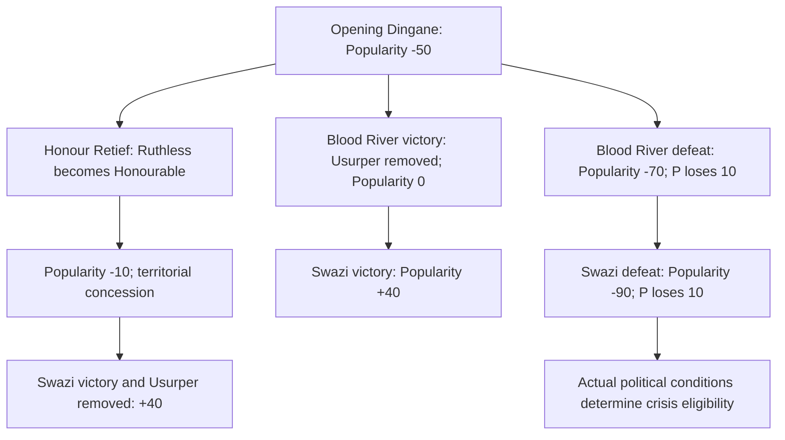

# Zulu character package: agreed playtest baseline

25 October 2026. **Agreed by DP and implemented in source; engine checks pending.** DP accepted this complete bundle with “Yes it looks good, agreed and locked.” Approval covers the thirteen opening packages, controlled initial generation, reputation values and durations, and the Retief trait exchange below. This brings together the [historical assessment](zulu_starting_character_traits_research_2026_10_25.md), [Vanilla package comparison](zulu_vanilla_character_packages_2026_10_25.md), and [permanent-reward design](zulu_court_rewards_and_claimant_wars_2026_10_25.md); it does not replace their evidence qualifications. The accompanying event package and later annual/deck revision are now implemented too. See [implementation and validation](compatibility/zulu_court_events_2026_10_25.md).

## Recommendation and boundaries

Use a selective revision: preserve the opening commanders' authored packages; replace weaker assumptions about temperament with modest political skills; give the added historical officials controlled, evidence-informed opening packages; and separate Dingane's earned reputation from his initial personality.

The alternatives have already been developed in the linked reports. Keeping the Vanilla packages wholesale preserves command balance but retains Dingane's −65 intrinsic Popularity and leaves SB's prince asymmetry unresolved. The sparse historical package avoids more temperament inferences but removes substantial military benefits from Ndlela and command capacity from Komfiya. This proposal keeps those benefits explicitly; it does not claim that retaining them proves every associated personality label historically certain.

Scope is the thirteen authored opening characters, their initial generation, and the closely connected Retief/Blood River/Swazi reputation changes. Existing ideologies, IG membership, offices, house membership, allegiance, future pledges, constitutional alignment and dated availability are separate records and are not silently changed by this package. Later adult cast packages, including Zibhebhu and Mzilikazi, are not retuned here.

| Decision | Status |
|---|---|
| Historically informed traits, including attributable oral tradition | agreed direction |
| Permanent rewards for the two major victories | agreed direction |
| Actual coalition prominence matters; no numerical constituency from descent alone | agreed, existing system |
| Trial −10 P shocks for the two campaign defeats | agreed trial direction |
| Explicit four-outcome historical-sequence war trigger | **deferred: playtest first** |
| Exact roster, generation policy, reputation values/durations and Retief exchange below | **implemented; pending DP playtest** |
| Native same-constitution claimant-war delivery | unverified test prototype; unchanged boundary |

## 1. Opening packages

Q is intrinsic trait Popularity; R is **direct trait Prominence**, before popularity-derived prominence, offices, house status, age where excluded, and other modifiers. R is not the final coalition weight. Political Operator and Diplomat mean their basic native tiers. Historical confidence and source qualifications remain in the linked assessment.

| Character | Agreed opening package | Q | R | Reason for this choice |
|---|---|---:|---:|---|
| **Dingane** | **Reserved, Ruthless, Political Operator** | −40 | +10 | Deliberate reserve and coercive politics, with modest governing experience. Drops Hedonist and Imperious; retains a difficult but recoverable personal position. |
| **Mpande** | **Tactful, Political Operator** | 0 | +5 | Retains the accommodating political operator interpretation without innate submissiveness, a moral endorsement, or SB's additional Reserved penalty. Tactful is a bounded continuity/gameplay interpretation. |
| **Gqugqu** | **Political Operator** | 0 | +5 | Modest adult-prince experience as an explicit abstraction. Drops unsupported starting Ambitious/Imperious; later rivalry is represented by actual commitments and events. |
| **Mkabayi** | **Tactful, Elder, Experienced Political Operator** | +25 | +15 | Senior standing and political brokerage. Replaces Ambitious with experience while retaining the same intrinsic Popularity/direct Prominence and +10% IG political strength. |
| **Ndlela** | **Ambitious, Tactful, Elder** | +25 | +15 | Retains Vanilla's military/political package for the first playtest; Ambitious remains an inherited interpretation rather than a newly established historical fact. |
| **Zulu / Komfiya** | **Imposing, Brave, Popular Commander** | +25 | +5 | Retains Vanilla's martial-reputation package and command capacity; oral testimony and its chronological limits are documented. |
| **Dambuza** | **Political Operator** | 0 | +5 | Attested senior council work, without inventing a personal temperament. |
| **Mawa** | **Elder** | +25 | +5 | Senior institutional standing; this does not assign her later documented faction allegiance in 1836. |
| **Nongalaza** | **Political Operator** | 0 | +5 | Administration of a military establishment and participation in royal deliberation; no unearned tactical speciality. |
| **Sotobe** | **Diplomat** | +10 | 0 | Earlier envoy work, with proficiency deliberately kept at the basic tier. |
| **Cetshwayo** | **Child only; no adult personality/skill package** | −25 | −25 | No adult career accomplishments at nine. |
| **Mbuyazi** | **Child only; no adult personality/skill package** | −25 | −25 | No adult career accomplishments at eight. |
| **Uthumbu** | **Child only; no adult personality/skill package** | −25 | −25 | Remains explicitly authored alternate history, without an invented adult biography. |

The three child rows include the native age trait; their negative numbers describe age mechanics, not historical dislike. They continue to have no adult following. No new fixed personality package is injected at their eighteenth birthday under this proposal; normal ageing, experience and earned story changes remain available. This does not change the dates at which they can take political roles.

Mpande and Gqugqu now share the same intrinsic Q/R baseline. This does **not** force equal total coalitions or erase either prince's commitments: actual offices, house members, gained experience and player choices can differentiate them. There is still no designated opening heir.

### Relevant role effects

These are effects of the proposed traits, not extra scripted rewards. Country effects require the ruler role, command effects the applicable command context, and IG effects leadership of that group. Full native definitions and caveats are in the Vanilla comparison.

| Package | If ruler | If commander | If IG leader |
|---|---|---|---|
| Dingane | **Authority +10% net**; Piracy Income +5 percentage points. Loses Vanilla's −20% decree cost and its movement-generated loyalist/radical modifiers. | Morale loss −10%; naval critical-hit chance −10%; careful-manoeuvre weight; coup strength +5%. He remains ruler-only at opening. | Political strength +20%. |
| Mpande | Authority +5%; Improve Relations speed +20%. | Defence +5 flat; inflicted morale damage −5%; careful-manoeuvre weight; coup strength +5%. | Political strength +5%; attraction +2%; approval +1. |
| Gqugqu / Dambuza / Nongalaza | Authority +5%. | Coup strength +5%; no additional ordinary combat modifier. | Political strength +5%. |
| Mkabayi | Authority +10%; Improve Relations speed +20%; Elder's ruler blocks require the existing caveat. | Home Offence/Defence +10%; Defence +5 flat; supply consumption −10%; inflicted morale damage −5%; careful-manoeuvre weight; coup strength +10%. She is not an opening commander. | Political strength +10%; attraction +2%; approval +3 in government / −1 in opposition. |
| Ndlela | Inherited Vanilla ruler effects, if ever relevant. | **Unchanged authored package:** Offence +5%, Defence +5 flat, home Offence/Defence +10%, supply consumption −10%; recovery and morale-damage drawbacks retained. | Political strength +10%; attraction +2%; approval +3 in government / −1 in opposition. |
| Zulu / Komfiya | Prestige +10%; army/navy power-projection prestige +5%; Infamy decay −25%. | **Unchanged authored package:** command limit +20%, morale loss −20%, aggressive-manoeuvre weight; naval effects retained. | Political strength +2%; approval +1 in government / −1 in opposition. |
| Mawa | Elder's two ruler blocks remain an unverified runtime composition. | Home Offence/Defence +10%; supply consumption −10%, only if appointed to command. | Approval +2 in government / −2 in opposition. |
| Sotobe | Influence +5%. | Morale recovery +25%, only if appointed to command. | N/A. |

No new military offices are granted by this table. It shows the consequences if a role applies. Elder's duplicate native ruler blocks are not repaired or silently flattened into an engine-proven sum. Popular Commander still contributes no direct Popularity. Preserving a command package does not guarantee identical save totals after initial random generation is controlled.

## 2. Controlled initial generation

Give the authored opening cast the displayed packages reliably. Do not leave the native default free to fill an empty adult list or add an unplanned opening skill to a character over 45. Use the installed per-template `trait_generation` facility, which Vanilla itself overrides in examples such as `BUK_nasrullah_khan`.

The local creation policy must preserve the native age trait and appropriate initial experience bookkeeping while omitting random initial additions for these authored identities. Do not change the global default. Do not erase later earned experience, personality changes, injuries or normal mortality. The scope is new campaigns; there is no migration or removal of traits from an existing save.

Verify childhood and subsequent ageing in the engine. The inspected `on_character_became_adult` script is a notification hook, not proof of a particular personality-generation policy at adulthood. This proposal does not invent an automatic adult historical package behind that hook.

## 3. Dingane's durable reputation arc

Keep the existing **−10 Usurper** opening modifier. There is no additional −25 contested-accession penalty. With the proposed −40 intrinsic package, the authored opening total is **−50 Popularity**.

Give each distinct qualifying Blood River and Swazi victory a separate, permanent **+40 Popularity achievement**. Remove the existing Usurper penalty after the first qualifying victory. These are character achievements, not temporary country triumphs or an award of personal bravery for other men's military success.

Use a separate permanent **−20 Popularity defeat modifier** for each of the two campaign defeats, with the agreed **−10 immediate P shock**. Those numbers and the lifetime duration of the defeat penalties are agreed first-pass tuning, not historical measurements. Changed allegiances still change the target as proposed in the separate event package; this package does not replace them.

| Route, excluding other character events/modifiers | Authored Popularity | Immediate defeat shock |
|---|---:|---:|
| Opening | **−50** | N/A |
| One major victory | **0** | N/A |
| Both major victories | **+40** | N/A |
| One defeat | **−70** | −10 P |
| Both defeats | **−90** | −10 P on each confirmed defeat |
| One victory and one defeat, either order | **−20** | −10 P for the defeat |

The two victories produce a 90-point turnaround from the proposed opening. They improve the target through Q/2 and may affect prominence through native calculations. Add neither an extra scripted prominence award nor an automatic direct P victory grant. P continues approaching its target rather than jumping to maximum authority.

At fixed house backing and movement support, without clamping, that 90-point Popularity improvement contributes +33.75 to the target. The existing voluntary-acknowledgement probability rises from 0% at the opening to 5% after one victory and 13% after both. These are per-eligible-representative annual probabilities, not guaranteed new supporters. They illustrate the durable political value without an additional victory recruitment roll beyond the already proposed campaign effects.

Apply each campaign result once to the actual sovereign credited at that result, preserving the captured character identity through popup delay. Do not substitute a successor, an exiled living Dingane or a random current ruler because the original recipient is unavailable. No trait inheritance, replay farming, generic-war duplication or white-peace reward. Preserve the existing verified territorial/firearms benefits and unrelated achievements.

For these redesigned two campaigns, replace the old overlapping character popularity awards and automatic Brave grants rather than stacking this package on top. A victory in one campaign does not silently clear the other campaign's defeat modifier. Native Popularity caps and unrelated later modifiers still apply, so +40 is the isolated package total, not an unconditional guarantee against every later scandal.

## 4. Retief's personality consequences

Keeping Ruthless in the starting package means the honour option deserves an explicit decision rather than accidentally layering conflicting personality interpretations.

**Agreed exchange:** honouring the bargain replaces **Ruthless with Honourable**. This keeps DP's native Honourable reward and makes its full consequence visible: **+40 Popularity from the trait change**, not +25, because removing Ruthless also restores 15. It loses Ruthless's +5 direct Prominence and +5% ruler Authority. With the initial Usurper penalty still present, the opening total moves from −50 to **−10**. Land concessions and the foregone Blood River victory are the substantive cost; do not add a free court supporter as well.

If the same king then wins the Swazi campaign, the +40 achievement and removal of Usurper take that route to **+40**. This produces a viable diplomatic route to personal acceptance, with different territorial consequences from winning both wars.

The native random-selection rules avoid Ruthless with Honourable, but that is **not** an engine prohibition on possessing both after scripted events. Replacing one is a deliberate design choice. The alternative would retain Ruthless and award a separate reputation modifier for this one honoured agreement; that avoids rewriting temperament but introduces another bespoke reputation reward. The recommended native-trait exchange keeps the previously discussed reward and avoids an unexplained coexistence of the two labels.

Killing Retief gives **Wrathful once**, with no escalation to Cruel when Wrathful is already present. Wrathful contributes no direct Popularity; its ruler Authority +100 remains a substantial consequence. The proposed court acknowledgement and diplomatic consequences are accounted for by their own event effects. Neither branch additionally applies its old direct P gain/loss beneath the new design.

This diagram illustrates distinct campaign paths, not exhaustive event ordering. There is **no** special trigger that forces a claimant war merely because the historical four-step sequence was followed. Playtest the resulting popularity, actual house allegiances, claimant backing, target and P trajectory first. Native claimant-war verification remains a separate unresolved engine task.

## 5. Acceptance and handoff

- Check all thirteen new-game authored packages, deterministic initial generation and absence of a designated opening heir. Verify that generated non-historical court members retain normal native generation.
- Check the trait totals by role, not merely by label. In particular, Dingane's Authority becomes +10%, his command effects require command, and Ndlela/Komfiya retain their authored combat packages.
- Recalculate complete house prominence with actual roles and members. Mpande/Gqugqu matching intrinsic totals does not prove identical coalition strength or a scripted military split.
- Exercise honour, murder with Wrathful already present, each victory/defeat, mixed results in both orders, both victories, both defeats and delayed popups. Confirm no stacked old awards, duplicate result, automatic Cruel/Brave, successor inheritance or unrelated penalty removal.
- Confirm the intended Popularity totals without extraneous modifiers, then record P/target and allegiance changes through representative campaigns. Do not claim that two −10 P shocks guarantee crossing −50.
- Leave all launches and runtime verification to DP. No save migration, wider country rollout, global trait rebalance or dependency patch.

**Verification performed for this proposal:** extracted current native trait modifiers and checked the thirteen roster totals plus victory, defeat and honour arithmetic using decimal values. Preserved Elder's duplicate ruler blocks separately. These are arithmetic/source checks; every runtime case remains pending.

## Source trail

- [Historical trait research and primary/oral-history references](zulu_starting_character_traits_research_2026_10_25.md). Trait-to-history mappings remain interpretations; empty evidence does not prove that a character had no personality.
- [Installed Vanilla package comparison, full role tables and provenance](zulu_vanilla_character_packages_2026_10_25.md).
- [Native default trait generation](</Users/depro/Library/Application Support/Steam/steamapps/common/Victoria 3/game/common/character_templates/00_default_template.txt>) and [Vanilla per-template example](</Users/depro/Library/Application Support/Steam/steamapps/common/Victoria 3/game/common/character_templates/country_afg.txt>), inspected 25 October 2026.
- [Existing Retief and Blood River events](../events/sb_natal_crisis_events.txt), [Zulu dynasty events](../events/sb_zulu_dynasty_events.txt) and [Usurper modifier](../common/static_modifiers/sb_modifiers.txt). Existing gameplay source remains unchanged by this proposal.
