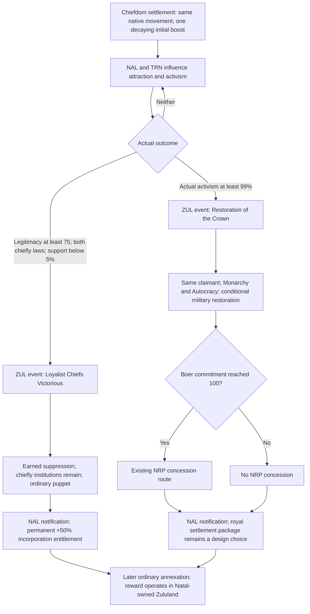

# ZUL institutions and the outcome-driven Chiefdoms journal

Design revision for DP, 20 September 2026. **No gameplay implementation.**
The [consolidated current plan of 18 October](zulu_chiefdoms_rework_plan_2026_10_18.md)
takes precedence over conflicting proposals below; this document retains the
exploration and decision history.
This updates the earlier A/B/C exploration after DP selected A. The persistent
LO/PB design continues from `zulu_interest_groups_and_militias_exploration_2026_09_20.md`.
The complete old/new ideology comparison is in
[zulu_ideology_effect_matrix_2026_09_20.md](zulu_ideology_effect_matrix_2026_09_20.md).

## DP clarification — 17 October 2026

This clarification takes precedence over the September incentive recommendations
and opening-boost tuning below. It updates design only; no gameplay was changed.

| Item | Status | Current direction |
|---|---|---|
| Narrow uSuthu platform | Agreed direction reaffirmed | Restoration of royal institutions; no generic economic/citizenship/bureaucracy agenda. The broader IG work is related, not a prerequisite for this fix. Reconfigure the existing native movement, not a duplicate. |
| LO/PB work | Agreed to develop together | Royal establishment and chiefly/local notables throughout ZUL's campaign; AF remains outside the rework. Law-granted privileges can change without deleting constituencies or forcing every chief into one faction. |
| Deadline | Rejected explicitly | No ten-year or substitute timeout. The current implemented timer still needs removal when this redesign is implemented. |
| Chief and royal victory conditions | Accepted in principle | Legitimacy >=75 plus chiefly institutions and uSuthu support <5%; actual activism >=99% for royalist takeover. These are gameplay thresholds, not historically derived constants; the exact chiefly-law pair remains the proposed constitutional pair. |
| Opening uSuthu attraction boost | Reopened | DP asks why it is needed. It originally represented royal networks and made recruitment viable; it is not a native survival guard or technical requirement. Recommend first assessing the narrowed movement and revised constituencies without an extra automatic story bonus; this recommendation is provisional. |
| Cost of royalist victory | Risk/reward principle accepted | A Boer-backed victory can cede territory to NRP. Do not assess a restored puppet and its incorporation reward as if this loss, disruption and intervention costs did not exist. |
| +10% restored / +25% initial Crown proposals | Open, no automatic correction selected | The earlier recommendation to remove +10% or compensate Control the Crown is not an agreed requirement. Assess the whole route, including conditional NRP loss. |

Terminology: **Control the Crown** means choosing that option in the initial
Government of Zululand settlement, preserving the crown/protectorate without
opening the Chiefdoms contest. **Chiefdom settlement overturned** means uSuthu
wins after Natal first imposed chiefly government; the earlier shorthand
“failed partition” did not mean a separate lost war or automatically losing all
Zululand.

The current source marks Boer commitment at 100 in
`sb_zululand_mark_boer_commitment`. `sb_zululand_apply_crown_victory` preserves that
entitlement before cleanup and calls `sb_nrp_create_greater_republic`.
Creation requires live TRN/ZUL, no existing NRP and the required ZUL-owned seed
province; finalization assigns five authored Zululand provinces to NRP. Thus
this is a real territorial downside but not an automatic result of every uSuthu
victory. The land initially belongs to ZUL, so Natal loses territory controlled
through its subject and potential future annexation, rather than necessarily
ceding an already NAL-owned state. Later boundary outcomes remain their own chain.

For later reform, the recommended institutional interpretation is persistent
constituencies with privileges supplied by laws: retaining chiefly office keeps
Chiefly Notables relevant; replacing chiefly administration/militias removes the
associated attraction advantages without erasing supporters. Chiefly figures can
support a king, and royalist interests can survive a republic. Contextual labels
such as Local Notables are presentation proposals, not automatic ideological
conversion or a calendar-based expiry. Keep the urban PB constituency available
as occupations and laws change. Do not map a modern party directly onto one IG.
The IFP's 2024 manifesto itself supports both traditional leadership and the
king's custodianship; it illustrates overlapping institutions, not proof of an
unchanged nineteenth-century faction alignment.
[IFP manifesto](https://ifp.org.za/wp-content/uploads/2024/04/Inkatha-Freedom-Party-2024-Manifesto-English-V3-WEB_compressed-1.pdf).

## Accepted direction and latest clarifications

- Keep native LO and PB slots as **Royal Establishment** and **Chiefly Notables**.
  AF receives no new identity, ideology or attraction-definition package.
- Use outcome model A: political consolidation or royalist takeover, no fixed
  deadline, replacement countdown or minimum duration.
- Council of Chiefs: **+25 aristocrat attraction weight towards PB**, **150 authority**.
  Chiefly Militias: **+25 officer attraction weight towards PB**. These are flat
  pop-weight contributions, not +25 percentage points of clout or +25% global attraction.
- Chiefly victory: **legitimacy >=75**, chiefly institutions, **native uSuthu
  movement support <5%**. The exact law pair is proposed below.
- DP explicitly clarified that royalist victory stays at **actual activism >=99%**,
  not 99% support.
- First resolve and reward the winner in a **ZUL event**, then notify/reward NAL.
- Chiefly victory earns NAL **permanent +50% incorporation speed in Zululand**.
  The royalist +10% suggestion is open because of the Crown-route incentive problem.
- Replace remaining story-specific LD effects with attraction/activism effects.
  Native subject diplomacy and the movement are still distinct systems.
- Opening attraction was previously to become decaying (+50% or +100%, over
  five or ten years). DP reopened whether any extra opening boost is warranted
  on 17 October; those profiles below are alternatives, not a settled requirement.

The old PB-in-government/PB-over-LO-clout/<25%-activism chief-victory proposal is
superseded by DP's conditions. Do not retain those extra gates silently. The old
ten-year expiry on incorporation legacies is superseded by the permanent reward.

## Institutions: each effect and what remains unchanged

| Law | Proposed political effect | Treatment of existing modifiers |
|---|---|---|
| Federated Chiefdoms, Chiefdom variant | +25% PB political strength | Keep Chiefdom's +100 authority and +20 head-of-state legitimacy; the PB strength is the earlier recommended allocation, carried forward provisionally |
| Council of Chiefs, Elder Council variant | +25 PB attraction weight for aristocrats; +150 authority | Replace the parent's +200 authority; remove its blanket +50% aristocrat/officer/clergy strength as previously proposed; retain its legitimacy base +20, government-clout factor +100, government-size allowance +2 and incoherence multiplier -10% |
| Chiefly Militias, National Militia variant | +25 PB attraction weight for officers | No blanket PB-strength bonus here; military recruitment/cap values are a separate balance choice, not implied by the +25 instruction |

The two constitutional laws together provide **250 authority**, not 150 total.
Attraction cannot bypass `pop_potential`: ZUL's chiefly PB must admit the relevant
aristocrats and officers, and have the previously proposed rural constituency,
before these law bonuses do anything. Keep that exception scoped to ZUL. Do not
turn occupations into chiefs or rewrite AF to achieve this.

The earlier military design remains: use Chiefly Militias in place of Amabutho
or Peasant Levies at partition, preserve an already modern army, and restore
Amabutho on takeover only if the army is still Chiefly Militias. Its exact military
package is still provisional: native National Militia has 5% conscription and
5/100 barracks/conscript caps, versus SB Amabutho's 30% and 25/25. These differences
must be visible in an implementation plan, not smuggled in as political flavour.
The ZUL-specific scripted restoration also needs to account for Amabutho's present
one-way availability without changing SWZ/GZA/NGN.

## Ideology packages and full comparison

| Actor | Package |
|---|---|
| Royal Establishment / LO | Royal Prerogative + Homestead Order + existing Patriarchal |
| Chiefly Notables / PB | Chiefly Authority + Homestead Order + existing Patriarchal |
| uSuthu movement | Focused royal constitutional and military platform |
| AF | Existing package |

The companion matrix maps **105 law rows across 21 law groups**, including every
old package stance, each proposed stance, unchanged positions and deliberate
removals. It includes PB's often-overlooked native **Mercantile** addition under
Traditionalism. Merely replacing its initial three ideologies would leave a
contradictory fourth package.

The most consequential differences are constitutional and military. Chiefly
Notables prefer Chiefdoms/Council but can approve monarchy. Royal Establishment
strongly prefers Monarchy/Autocracy and royal military institutions. Both groups
share a narrowly defined social conservatism, rather than treating chiefs as
modern urban nationalists. Patriarchal adds explicit women's-rights stances to
PB while leaving its existing free-speech positions numerically unchanged.

Homestead Order provisionally supports Traditionalism, Agrarianism, land-based
tribute, local policing and Subjecthood. The full matrix deliberately drops many
generic conservative opinions on modern taxation, trade, welfare, migration,
caste and racial classifications. That makes these packages less obstructive to
some later reforms; it is a material design tradeoff, not an unchanged behaviour.
Land/slavery law is not rewritten to force a questionable equivalence with
customary tenure. No starting law changes follow from assigning an ideology.

The movement does **not** inherit those IG packages. Its bureaucracy, economy,
land and citizenship agenda disappears; inherited Traditionalism and Subjecthood
therefore no longer calm it through its core ideology. Chiefdoms, Council and
Chiefly Militias supply its actual institutional grievances.

This division is an interpretation of shared homestead institutions and differing
centres of authority, not an attested list of policy platforms. Kuper's publisher
extract supports the shared social foundation; Cetshwayo's strengthening of royal
military authority supports the institutional difference. Royalist chiefs also
existed, so movement recruitment must cross IG membership.
[Kuper, 1993](https://www.cambridge.org/core/journals/journal-of-african-history/article/abs/house-and-zulu-political-structure-in-the-nineteenth-century1/3845DBD388FD72AEA89A9D169FEB113B),
[SAHO, King Cetshwayo](https://sahistory.org.za/people/king-cetshwayo),
[Nxumalo, 2026](https://www.cambridge.org/core/journals/journal-of-african-history/article/british-political-hegemony-and-imperialism-crushing-of-the-usuthu-and-the-onkweni-sections-of-the-zulu-royal-family-1880s1913/07EC250864BDC9DDC04451959454E07B).

## All Chiefdoms LD effects and action mappings

Attraction affects recruitment; it does not directly add support percentage points.
An activism modifier changes the calculated target that actual activism approaches.
It does not instantly add to current activism and is not a monthly increment.
All new conversion magnitudes/durations below are provisional tuning, not an LD
exchange rate. Existing non-LD effects remain unless a row explicitly changes them.

| Source | Current script | Proposed movement effect | Duration / other consequences |
|---|---|---|---|
| Opening royalist networks | +50% attraction, no expiry | Prefer +100% attraction, decaying | Five years, once at creation; no renewal on reconciliation |
| Chiefdoms subject dependence | -0.05 weekly LD modifier | -10% uSuthu attraction from the imposed chiefly patronage network | While contest active; distinct from optional paid support |
| NAL Support Loyalist Chiefs | -50% attraction | Retain | £500 weekly while active; stop removes cost and effect |
| NAL policing | -20 points calculated activism | Retain | -100 authority while active |
| TRN sponsorship | +50% attraction | Retain | £250 weekly; +2 Boer commitment/month |
| TRN volunteers | +20 points calculated activism | Retain | Existing soldier mortality cost; +3 commitment/month |
| Skirmish, .110 | +/-5 immediate LD | +/-5 points calculated activism, by winning side | One year; a newer skirmish replaces/refreshes this incident modifier, no uncapped stacking |
| Defection, .112 | +/-5 immediate LD | +/-25% attraction, by destination | Two years; replace previous defection result. Existing acceptance >=50 and Natal-versus-ZUL Zulu SoL comparison still decides direction |
| Return refugees | +5 immediate LD through the shared helper | +10% attraction in ZUL | Two years. Retain 20% eligible Zulu-peasant transfer and 20% loyalists among remaining NAL Zulu pops; preserve indenture separation |
| Return claimant | +0.1 LD each month | Use the returned claimant's **native agitator attraction** | While actually an agitator; no extra scripted recruitment modifier for the same person's presence. Retain existing NAL loyalists and fate scheduling |
| Claimant survives, .113 | +7 immediate LD | +10 points calculated activism | Two years, morale boost |
| Claimant killed, .113 | -10 immediate LD | -10 points calculated activism | Two years, organizational disruption; preserve successor and Boer-appeal routes |
| Boer appeal accepted, .115 | +7 immediate LD | +10 points calculated activism | Two years; retain 500-soldier transfer and +20 commitment |
| uSuthu victorious | +0.5 weekly LD for five years | +25% attraction for the victorious royal movement | Five years; constitutional demands now satisfied. Do not add agitation against its own restored institutions |
| Chiefs victorious | Current suppression at timeout | Move existing -100% attraction and -20 points calculated activism to earned victory | Both decay over ten years; this is the proposed ZUL reward, not a new deadline |

The modest replacement for subject dependence and the additional refugee
attraction are proposed explicit story effects. If testing shows too many layered
recruitment modifiers, cut these first rather than silently weakening DP's paid
actions or the initial royalist boost. The native agitator already supplies a
claimant recruitment mechanism, so it is the cleanest replacement for his monthly LD.

Two important **readers** also change: the JE's LD<50 faction label becomes actual
movement status, and .115's dynamic AI appeal weighting uses movement strength
(e.g. native significant support >=25%) instead of LD>=50. The same provisional
80/20 versus 60/40 choice weights can remain; there is no new eligibility gate.
The main bar reports actual activism; support and legitimacy are visible readouts,
with the three chief-victory requirements listed explicitly. Boer Commitment stays.
Tooltips must show current decayed modifiers and actual active actions, not the
current hardcoded +50% opening entry.

Native economic dependence, overlord lobbies and ordinary subject interactions
still calculate **native LD**. They are not copied into movement recruitment.
The LD<=0 check found in `sb_zululand_nal_can_annex_subject` belongs to the separate
integration decision, not faction victory; audit it with the existing commitment
to ordinary annexation mechanics rather than mechanically replacing it with activism.
The special Chiefdom pact currently blocks ordinary annex/autonomy actions during
the contest. An indefinite JE must not silently preserve a diplomatic prison:
review that existing restriction explicitly against the prior normal-annexation
agreement. No new annexation shortcut is part of this design.

The native pro-/anti-overlord lobbies retain their diplomatic function. Do not
freeze membership or equate all PB supporters with colonial loyalism.

## Opening strength: four concrete tuning profiles

| Opening bonus / decay | Experience | Main tradeoff |
|---|---|---|
| +50% / five years | Modest, short recovery window | Weak opposition could consolidate away very quickly |
| **+100% / five years** | Strong early royalist constituency, then a declining advantage | Recommended starting test; Natal must weather the opening without a ten-year artificial tail |
| +50% / ten years | Less acute but persistent royalist organization | Greater chance of a long low-intensity contest |
| +100% / ten years | Strongest and longest resistance | Hardest chief consolidation; greatest pressure to fund actions for years |

This table compares magnitude and expiry, not an asserted exact engine decay curve.
No expiry awards victory. A well-supported royalist movement can survive long after
the opening modifier is gone. Conversely genuine early chief consolidation is valid:
no hidden five-year floor, support reset, or requirement to wait for this modifier.
Existing movement support/activism survives reconfiguration.

## Outcome flow

Recommend interpreting **chiefdom laws** as the two constitutional variants:
**Federated Chiefdoms AND Council of Chiefs**. Do not require Chiefly Militias:
a chiefly government should be able to modernize its army without losing eligibility.
No additional PB-government, PB-clout or low-activism gate is carried forward.

Retain current reconciliation when Monarchy is enacted through ordinary politics
while the contest is active; it must not leave the restoration JE stranded. It is
not a new blanket monarchy watcher after resolution.

**Chief example:** legitimacy 82, both chiefly laws, 4% movement support: chief
victory. At 4% support but legitimacy 62 it remains unresolved. At 18% support and
0% activism it also remains unresolved: policing alone has not consolidated the
settlement. Professional Army does not invalidate the constitutional result.

**Royalist example:** 28% support, actual activism 98%, calculated target 100%:
no takeover yet. The event opens when actual activism reaches 99%. Boer commitment
is captured then; holding the popup cannot accumulate another month's commitment
or postpone which outcome won.

**Overlap:** <5% support can coexist with >=99% activism. The agreed rules impose
no minimum support for takeover. Recommend evaluating the royalist threshold first
if both qualify on the same evaluation; flag this priority as provisional. That
permits a small intensely militant movement to take over. A support floor would
be a new gameplay rule requiring agreement, not an implementation safeguard.

Reserve and resolve once in the ZUL event's immediate effects, then notify NAL;
acknowledgements repeat no effects. Clear ongoing action costs, incident queues and
contest-only modifiers. Chief suppression remains on the same movement and can
wear off. ZUL's reward works even when NAL is AI; NAL does not need to click a
foreign winner's popup to allow the outcome. Do not destroy/recreate the movement.

Independence, a different overlord or an unrelated constitutional exit terminates
inapplicable contest actions without inventing a chief/royal victory. Annexation
before victory provisionally grants no consolidation reward, rather than marking
the chief route won at setup as the present code does. That interruption treatment
is still a proposal. No peace or minimum-time requirement is introduced.

## Crown-route incentive: verified baseline and two complete solutions

Current `sb_zululand_choose_subordinate_crown` keeps a **protectorate**, gives 10%
Zulu loyalists in ZUL and NAL, and starts no Chiefdom contest. It does **not** grant
the special incorporation legacy. Current royalist victory after Chiefdoms instead
creates an ordinary **puppet**, grants the same loyalists, and later supplies the
current +25% ten-year legacy (the earlier discussion proposed changing it to +10%).
The concern is therefore real: a failed partition can buy a lower autonomy tier.
It is not strictly superior in every scenario: patronage costs, delay, disruption
and NRP concessions can outweigh that benefit. But those costs are contingent.

The accepted movement design separated domestic institutions from allegiance to
Natal. The closest continuation is **package 1** below. Package 2 changes the
international settlement deliberately; neither uses LD as a faction meter.

| Route | Package 1: preserve the domestic contest, recommended | Package 2: victorious restoration renegotiates dependence |
|---|---|---|
| Choose Control the Crown initially | Protectorate; existing loyalists; **new permanent +25% incorporation entitlement** | Same |
| Chiefly consolidation | Ordinary puppet; **permanent +50%** entitlement | Same |
| uSuthu restores crown | Ordinary puppet; **no incorporation bonus** | **Protectorate**; no incorporation bonus |
| Boer-backed uSuthu victory | Same subject result plus existing NRP route | Same subject result plus existing NRP route |
| Annexation | Ordinary mechanics; no reward itself annexes ZUL | Ordinary mechanics; restored route needs the additional autonomy step too |

**Package 1 walkthrough:** Natal can preserve the crown now, avoid the partition
contest and bank a moderate integration benefit. Or it can impose chiefly rule,
finance consolidation and aim for a larger benefit plus tighter control. If it
loses, it keeps the already-imposed low autonomy but receives no special help
integrating Zululand, and may face the Boer concession. Someone prioritizing the
next war's subject troops may still choose this risk; someone prioritizing a
predictable integration route can rationally choose Crown.

Advantages: preserves model A's domestic focus and the previously accepted puppet
outcome; no forced independence play or new demand chain. Cost: a free or rapid
uSuthu takeover still gives cheaper access to a puppet. The +25% safe-route reward
creates a competing benefit; it cannot guarantee equal value in every campaign.

**Package 2 walkthrough:** Natal accepts the crown initially for a protectorate
and +25%. If it instead attempts partition and royalists overthrow it, the restored
king obtains protectorate terms but no integration concession. Natal gains tighter
control and +50% only if its chiefs actually win. Native LD continues separately;
a restored protectorate can still be friendly and a chiefly puppet can still resist.

Advantages: the failed-partition shortcut disappears; the chief route has a clear
upside and downside. Cost: internal royalist victory now automatically changes an
international subject contract. That is a new settlement concession, not merely
an implementation of activism, and reopens the earlier puppet decision. Explain
it as the terms of recognizing the successful restored government, not as proof
that monarchy inherently means anti-Natal loyalty. No forced war is needed.

Historical inspiration supports restricted royal restoration, but it does not
settle which native subject category is correct. The 1883 settlement limited both
Cetshwayo's territory and military capacity. [SAHO, King Cetshwayo](https://sahistory.org.za/people/king-cetshwayo).

In either package, drop the proposed **+10% reward for losing the chief contest**.
Retain ZUL's royalist-consolidation reward and existing loyalists separately from
NAL's integration benefit. Do not present removal of the +10% alone as sufficient
balance: package 1 also adds a meaningful benefit to the initial Crown choice.

For scale, with no other speed modifiers a 20-year incorporation takes about
13.3 years at +50%, 16 years at +25%, and 20 years at +0%. Add actual contest duration
and the time/cost of reaching an annexable subject relationship. Those preceding
costs may be larger than the speed saving, so engine observation must compare
whole routes, not only the final percentage. Literal Vassal is not a substitute
for Puppet: native Vassal requires an unrecognized overlord, whereas NAL is colonial.

## What permanent means and what receives the bonus

The reward is incorporation **speed**, not immediate incorporation progress or
free annexation. Record NAL's entitlement at its victory notification; apply it
to the appropriate NAL-owned state in STATE_ZULULAND when that territory is actually
owned. There is no ten-year expiry, no global bonus to other states, and no bonus
for ZUL or another country's portion of the region. Ownership/split/merge handling
must be tested; retaining NAL's unrelated Natal territory cannot satisfy it.

Take DP's permanent reward literally: no expiry, and no silent revocation merely
because a later ordinary government changes laws. The old monthly conversion of
a banked chief legacy into a crown legacy is therefore not retained in this
proposal. A genuine chief victory and later constitutional evolution are different
from losing the still-open contest. Keep the permanent entitlement even after
incorporation completes; the speed modifier then has no remaining progress to
accelerate. Never stack chief and Crown bonuses. Revocation on later restoration
would require an explicit new reward condition.

## Source inspection and acceptance for a later implementation

Inspected current SB settlement effects/events, movement setup, drift values,
buttons, subject type/pact, integration decision and modifiers; installed 1.14.3
IG/ideology/law definitions, global initialization and movement defines; HC's
separate governmental/economic ideologies and GOTB's in-place movement changes.
The complete stance table records source versus proposed values. No runtime test
or game launch was performed for this design.

The September **package 1 or 2** comparison below records proposals, not a
mandatory correction. DP’s October feedback accepts territorial risk as a reason
for higher rewards and reopens whether either compensation package is needed.
Ideology stances, incident tuning and any opening recruitment bonus should be
assessed together with the conditional NRP cost. The army's numerical profile remains explicitly outside
what the +25 attraction notes settled. Acceptance scenarios should cover:

- ZUL aristocrat/officer PB eligibility, added weight and laws' individual totals;
  other countries and AF definitions remain unchanged.
- No duplicate or reinitialized movement; no hidden Mercantile ideology leftover;
  full active-law activism breakdown matches the narrowed agenda.
- All mapped LD writers removed from this contest; native diplomacy still works.
  Refugee and claimant routes use their distinct mapped movement consequences.
- Decaying opening boost applied once and displayed at current strength; ending
  it never ends the JE. Paid modifiers stop when actions or the contest stop.
- Chief thresholds, high-activism overlap, actual-versus-target activism, ordinary
  restoration and modernized army all resolve according to their visible rules.
- ZUL event then NAL notification, once, with held popups and AI ownership; no
  minimum time or unrelated peace condition.
- Both NRP and no-NRP restoration; claimant identity and CAP handling preserved.
- Permanent NAL-only incorporation entitlement after ordinary annexation, early
  annexation interruption, later constitutional change, and split-state ownership.
- Direct Crown versus both Chiefdom outcomes compared across cost, elapsed time,
  native subject obligations, territorial concessions and incorporation speed.

| Decision | Status | Current position |
|---|---|---|
| Persistent LO/PB; AF excluded | Agreed | Institutional identities across the campaign |
| Model A; no deadline/minimum duration | Agreed | Outcome-driven contest |
| Council +25 aristocrat pull /150 authority | Agreed | Flat targeted weight; 150 belongs to this law |
| Militias +25 officer pull | Agreed | Flat targeted weight |
| Chiefdom +25% PB strength; Council class-bonus removal | Provisional carried forward | Separate political functions |
| Army numerical package | Open tuning with material impact | Do not imply +25 settles recruitment and caps |
| Full ideology matrix | Provisional | 105-row old/new comparison supplied |
| Chief legitimacy >=75 and movement support <5% | Agreed | No old extra clout/government gate |
| Chiefdom-law interpretation | Provisional | Federated Chiefdoms AND Council; no army gate |
| Actual activism >=99% | Agreed clarification | Not 99% support |
| Simultaneous threshold priority | Provisional | Royalist first; no added support floor |
| ZUL-first events and NAL follow-up | Agreed | Automatic outcome; acknowledgements repeat nothing |
| Permanent chief +50% incorporation | Agreed | Speed; NAL-owned Zululand; no expiry |
| Royalist +10% legacy | Open after October feedback | Do not remove automatically; assess territorial risk and the full route |
| Initial Crown +25%; restored subject type | Unselected proposals | Neither reward compensation nor protectorate restoration is agreed |
| Initial attraction bonus | Reopened 17 October | Whether an extra boost is needed, not merely its strength/decay |
| Remaining LD conversions | Agreed direction / provisional mapping | Table above; native diplomacy retained |
| Annexation before consolidation | Provisional | No earned chief reward; ordinary route access needs audit |
| Implementation | Deferred | Design only; DP performs engine verification |
