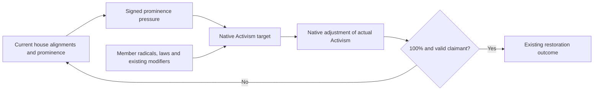

# Chiefdoms: prominence pressure and Natal AI

15 November 2026. **DP approved implementation; source implemented, engine replay
pending.** The approved formula uses full political backing, adds 0.1 percentage
point per point of royal prominence advantage to the native target, caps the
modifier at ±30 points, and retains the 100% restoration threshold. The
[implementation report](compatibility/chiefdoms_prominence_2026_11_15.md) records
the changes and verification limits. Alternatives below retain the design reasoning.

## Decision register

| Item | Status | Position |
| --- | --- | --- |
| Natal return policy | Agreed | Dynamic: ≥20% Natal Zulu radicals permits claimant return; the same live unrest threshold plus the current claimant returned/present permits offloading. Strict: three-year delay. Off: disabled. |
| Prominence affects Activism directly | Agreed | Use a native target modifier. |
| Units and time | Agreed | 0.1 **percentage point** per prominence point, recomputed from current backing without monthly accumulation. |
| Limits and backing pool | Agreed | ±30 percentage points; full political house backing, including local agitators once. |
| Restoration endpoint | Agreed | Retain 100%; no adoption of the former 75% alternative. |
| Native population Support | Deferred | This change would affect pressure to restore the crown; it would not make population membership proportional to house backing. |

## Natal's two actions have different beneficiaries

Current [refugee and claimant effects](../common/scripted_effects/sb_zululand_settlement_effects.txt)
give Natal a one-off 20% Zulu loyalist effect for each initial action. Refugee
return moves 20% of Natal's Zulu peasant Pops into Zululand, repeals the Shepstone
amendment, and grants a decaying five-year +5% royal movement attraction bonus.
It also carries the existing British-relations, fervour and garrison effects.
Claimant return brings the valid adult claimant into ZUL as an agitator and can
open the Boer appeal. Later successors do not repeat the loyalist reward/appeal.
These actions can relieve Natal's own political pressure while strengthening
the royal opposition to its chiefly settlement. They are not direct reductions
of uSuthu Activism.

The policy directions considered before approval:

| Policy | Flow | Benefit | Cost / failure case |
| --- | --- | --- | --- |
| Historical delay | After three years of the actual contest, AI considers each eligible return; an unavailable claimant waits until eligible. Existing locks and once-only guards remain. | Produces a dependable opportunity for the historical chain to develop. | Can destabilise an otherwise quiet protectorate, and three years is relative pacing rather than a fixed historical-date guarantee. |
| Domestic pressure | Dynamic AI considers refugee return when Natal's own Zulu population is substantially radical; claimant return is a possible reconciliation concession under that pressure. Calm Natal can continue supporting the chiefs. | Gives the action a reason connected to its actual domestic benefit. | The return may further strengthen uSuthu. It cannot promise that unrest in ZUL falls, and may never occur in a calm campaign. |

Approved policy: Dynamic Historical uses ≥20% radicals among Natal's Zulu Pops.
The claimant action receives the existing AI chance 25 when eligible. Offloading
receives that chance only when the current eligible claimant has returned and
is present in ZUL. The threshold is checked again at each evaluation: returning
the claimant may lower radicals below 20%, in which case offloading waits.
An old country-wide return receipt, a departed/dead claimant or a successor
still in exile does not satisfy the current-return condition. Strict Historical
retains its 1,095-day gate for both actions; the additional ordering applies to
Dynamic. Off stays zero, and human action requirements are unchanged. Later
successor returns do not repeat Natal's initial loyalist reward or Boer appeal.

The documented country `radical_fraction` trigger accepts a culture filter;
see [1.15 documentation](../../References/Modding-Digests/1.15.0/docs/triggers.log).
This supplies the Natal-Zulu pressure gate without a daily global Pop scan.
Native AI dispatch and balance still need replay. The prominence bonus does
not supply this AI gate or promise that return will calm Zululand.

## Prominence pressure

Let U and C be the current political backing of royal and chiefly houses. In
player-facing percentage points, the approved formula is:

`P = clamp(0.1 × (U − C), −30, +30)`

In engine units, this is `clamp(0.001 × (U − C), −0.30, +0.30)` applied through
`political_movement_radicalism_add` to the royal movement during this contest.
The native calculation continues to combine member radicals/loyalists, law
stances, volunteers, policing and other modifiers. Do not add those existing
effects a second time. Replace the computed prominence modifier when backing
changes; never calculate a new bonus from a target already containing it.

| U | C | Uncapped pressure | Bounded pressure |
| ---: | ---: | ---: | ---: |
| 100 | 100 | 0 points | 0 points |
| 200 | 100 | +10 points | +10 points |
| 254 | 100 | +15.4 points | +15.4 points |
| 358 | 100 | +25.8 points | +25.8 points |
| 100 | 200 | −10 points | −10 points |
| 600 | 100 | +50 points | +30 points |

The 254/100 and 358/100 inputs come from the retained
[May–September save evidence](compatibility/evidence/chiefdoms_followup_2026_11_14.json).
They illustrate scale; saved **current** Activism is not the unmodified target.
For a separate hypothetical example, native pressure of 60%, prominence +25.8
points and volunteers +20 points can produce a target of 100% after bounding.
That does not mean an immediate jump of current Activism to 100%. Installed
[defines](</Users/depro/Library/Application Support/Steam/steamapps/common/Victoria 3/game/common/defines/00_defines.txt:97>)
set a base weekly movement towards target; other growth effects can alter timing.
They also radicalise supporters at sufficiently high Activism, so native
feedback still matters even without a scripted accumulator.

### Alternatives considered

- **Raw difference, bounded (selected):** directly rewards the absolute
  political weight bought, persuaded or lost. A neutral house of weight 100
  joining uSuthu adds ten target points before the cap. A switch of that house
  from chiefly to royal changes the gap by 200, hence twenty points. The cap
  keeps a larger late-game cast from determining the result by itself. Further
  recruitment remains useful after reaching the pressure cap.
- **Normalised difference:** `P = 50 × (U − C) / (U + C + neutral backing)` in
  percentage points, with zero when the denominator is zero. This gives the
  same pressure to equally divided small and large courts; a 358/100/109
  example gives +22.75 points. Here 109 is an illustrative neutral remainder,
  not a verified full political-backing classification. A large neutral bloc dilutes pressure.
  It is less directly explained by an individual chief's raw prominence and
  changes the user's proposed arithmetic more substantially.
- **Repeated addition to current Activism:** rejected as the default reading of
  `+=`. With a 258-point lead, +25.8 points each month would force a rapid result;
  even a tiny persistent lead would eventually win without further unrest.
  A separate accumulator also undermines the aim of displaying native Activism.

### Backing and lifecycle boundaries

Use full, deduplicated political house backing for this modifier. The
[counter](../common/scripted_effects/sb_court_politics_effects.txt) retains
`sb_court_royal_weight_var` and `sb_court_chiefly_weight_var` for **attraction**,
excluding locally hosted agitators. New `sb_court_royal_political_weight_var`
and `sb_court_chiefly_political_weight_var` count full represented house weights.
The JE and target modifier read those political totals. Returning the claimant
does not remove his contribution from political backing.
Preserve the existing house-head alignment rule, adult eligibility and treatment
of eligible home-court exiles. Neutral houses contribute no signed raw pressure.

Re-evaluate on the existing bounded court updates and explicit alignment/return
actions, not through a daily global scan. Death, defection, changed house head,
changed prominence, return and loss of eligibility must alter the next computed
bonus. Keep one modifier; remove it when the contest ends. During the separate
native-war test, route to the actual royal movement and avoid counting a person
in both countries. Missing movement or zero backing must be safe. No second
royal movement, resurrected claimant or new war controller is required.

## Evidence and acceptance limits

Native [Liberation Army modifiers](</Users/depro/Library/Application Support/Steam/steamapps/common/Victoria 3/game/common/static_modifiers/00_ip4_02_modifiers.txt:293>),
[GotB's positive/negative movement modifiers](</Users/depro/Documents/Paradox Interactive/Victoria 3/mod/Example Mods/gotb - gates of the bosphorus [1.13]/common/static_modifiers/2-02_balkfm_yugoslavia_modifiers.txt:73>)
and [HC's Gag Rule](</Users/depro/Documents/Paradox Interactive/Victoria 3/mod/Example Mods/hc - Hail Coloumbia [1.13]/common/amendments/usfp_amendments.txt:190>)
use the native modifier family. They establish a mechanism precedent, not the
balance or engine behaviour of the proposed dynamic calculation.

Source-executed checks cover ties, signed caps, house deduplication, returned
agitators, deaths/alignment changes, foreign roots, both split orientations,
missing movements, repeated replacement/cleanup and Dynamic/Strict/Off AI gates.
Native target/current comparison, actual AI dispatch, claimant attachment,
timing and fresh/reload tests remain pending. The 100% endpoint remains in place
so prominence tuning is assessed without simultaneously lowering it. Successful
static calculation does not certify recruitment growth or attainable restoration.
