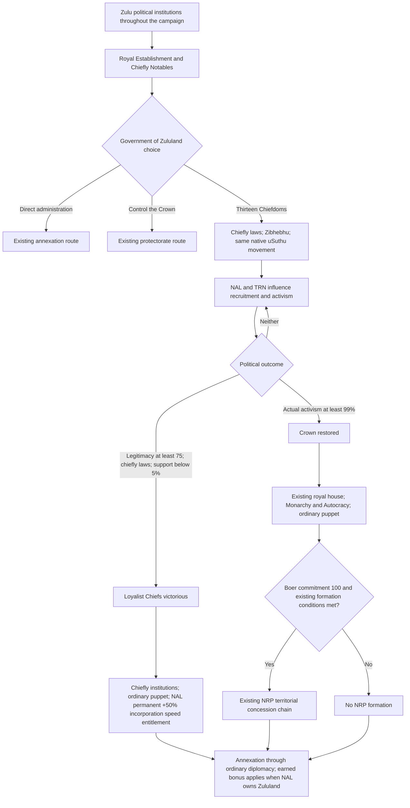

# Superseded ZUL institutions and Thirteen Chiefdoms plan

Consolidated for DP, 18 October 2026. **Design only; no gameplay implementation.**

**Superseded later on 18 October:** DP rejected the PB-as-chiefs / LO-as-royals
architecture and the accompanying broad ideological and law package. See the
[crown-and-chiefs exploration](zulu_crown_and_chiefs_exploration_2026_10_18.md)
for the current alternatives. The material below records the earlier discussion;
its “agreed” labels do not reinstate choices superseded by that decision.

This consolidation previously superseded conflicting September recommendations.
The live implementation still contains the intermediate ten-year contest and
broader uSuthu ideology. This document does not claim that the redesign is installed.

Later clarification on 18 October: DP has reopened the broad IG bureaucracy,
policing, economics, land and related policy changes for review against the
[individual Vanilla ideologies and descriptions](zulu_vanilla_ideology_reference_2026_10_18.md).
The packages below remain proposals. New army opinions are limited to Amabutho and
Chiefly Militias; no new positions on ordinary army laws are proposed.

## 1. Overall model

Implement the narrow uSuthu platform together with the persistent ZUL LO/PB
rework. The movement represents restoration of royal institutions; the interest
groups represent longer-lived constituencies. Native Liberty Desire continues
to measure the relationship with Natal. It does not choose the domestic winner.

No deadline, replacement countdown, minimum duration, LD victory threshold,
mandatory independence play or automatic annexation belongs to the revised JE.
Timed action/incident modifiers and decaying victory rewards are separate from
a deadline: their expiry never determines who wins.

## 2. Persistent interest groups and ideological packages

Use the native IG slots with ZUL-specific names and initialization. Names below
are working labels. AF receives no identity, ideology or attraction-definition
rework.

| Slot | Identity | Proposed package | Change from current generic package |
|---|---|---|---|
| Landowners | Royal Establishment | Royal Prerogative + Homestead Order + Patriarchal | Replace Paternalistic/Hierarchic; retain Patriarchal |
| Petite Bourgeoisie | Chiefly Notables | Chiefly Authority + Homestead Order + Patriarchal | Replace Reactionary/Meritocratic/Patriotic; account for the additional Mercantile ideology supplied under Traditionalism |
| Armed Forces | Existing identity | Existing package | No package change |
| uSuthu movement | Royal restorationists | One narrow constitutional/military core | Remove its broad bureaucracy, economic, land and citizenship agenda |

Royal Prerogative favours monarchy, concentrated royal authority and the royal
military institution. Chiefly Authority favours chiefly government, councils and
local command, while still accepting monarchy. Both IGs share the proposed
homestead-oriented social conservatism. A chief can be a royalist; PB membership
does not automatically mean allegiance to Natal.

The full proposed old/new comparison covers 105 law rows in 21 groups in
[the ideology matrix](zulu_ideology_effect_matrix_2026_09_20.md). Its stances remain
proposed, rather than silently approved by this consolidation. The main movement
changes are Monarchy/Autocracy strongly approved, Chiefdom/Council strongly
opposed, Amabutho approved and Chiefly Militias opposed. Ordinary army laws have
no position from these proposed packages. Traditionalism,
Subjecthood and inherited bureaucracy no longer appease the movement through
its core ideology. The movement does not inherit the IGs' wider policy packages.

Broaden ZUL's PB eligibility to admit the relevant aristocrats, officers and rural
constituency, retaining its ordinary urban base. Law attraction bonuses cannot
recruit pops excluded by `pop_potential`. Exact additional baseline rural weights
remain tuning, not permission to move occupations or manufacture clout.

Apply the IG identities/packages throughout ZUL's campaign, including 1836, without
forcing the partition's laws on the starting monarchy. Later reform removes the
privileges attached to replaced laws, not the IGs or their supporters. No calendar
expiry, compulsory faction membership or automatic ideology reset follows from
modernization. Contextual names such as Local Notables remain optional presentation
work. Historical rationale and sources remain in the linked matrix and
[institutional exploration](zulu_interest_groups_and_militias_exploration_2026_09_20.md).

## 3. Three law variants

| Law | Political effect | Status and retained mechanics |
|---|---|---|
| Federated Chiefdoms, a Chiefdom variant | +25% PB political strength | Strength amount proposed; keep +100 authority and +20 head-of-state legitimacy |
| Council of Chiefs, an Elder Council variant | +25 aristocrat attraction weight towards PB; 150 authority | These two values agreed. Proposed: remove the parent's blanket +50% aristocrat/officer/clergy strength; keep its other legitimacy, government-size and incoherence effects |
| Chiefly Militias, a National Militia variant | +25 officer attraction weight towards PB | Attraction agreed. Military recruitment and capacity profile still requires an explicit choice |

The attraction contributions are **flat pop attraction weights**, not 25% clout
or guaranteed recruitment percentages. The two constitutional laws supply
**250 authority together**, with the Council supplying 150 of that total.

Chiefly Militias' military profile must be settled openly: native National Militia
has 5% conscription and 5/100 barracks/conscript caps, whereas SB Amabutho has 30%
and 25/25. Copying the parent changes military capacity substantially, beyond the
agreed officer attraction. The current plan does not label either profile approved.

At partition, replace Amabutho/Peasant Levies with Chiefly Militias; preserve an
already modern army. On royal restoration, restore Amabutho only when Chiefly
Militias is still active. Account for Amabutho's current one-way availability with
a ZUL-specific exception; do not alter SWZ/GZA/NGN. Modernizing the army does not
invalidate chief-victory eligibility.

## 4. Creating the Thirteen Chiefdoms

- Keep the existing puppet-category Chiefdoms relationship during the contest.
- Install the single canonical Zibhebhu, aligned with PB, and the chiefly
  constitutional laws. Preserve the existing royal identities, exile to CAP,
  claimant return and successor handling.
- Reconfigure the existing native Absolutist movement as uSuthu in place. Preserve
  its members, support, actual activism and existing modifier lifetimes; create it
  only if absent. Do not create a parallel Absolutist movement or refresh its age.
- Retain the native pro-/anti-overlord lobby setup: the royalist grouping draws
  from LO/AF/Devout and the chiefly grouping from PB/Intelligentsia/Industrialists.
  Let ordinary lobby maintenance operate; do not freeze every IG into a side.
- Do not impose the previously scrapped Racial Segregation change.

**Opening attraction is reopened.** Proposed first pass: remove the extra automatic
story recruitment boost and assess the narrower movement plus revised IGs/laws.
Preserve any ordinary native Initial Enthusiasm already present. There is no
technical requirement to grant a permanent +50% or decaying +100% story bonus.
If recruitment proves inadequate, use the recorded profiles as balance options,
not a hidden survival guard. This is a recommendation, not a new DP-approved value.

This is distinct from the Zulu national movement in NAL after direct annexation.
Its recently implemented modifier-preservation work and deferred engine test stay
separate from this redesign.

## 5. JE interface and player actions

Use the JE as NAL/TRN's interface for the real movement. The main bar reports
**actual activism**; show native movement support, ZUL legitimacy and the chiefly
law conditions alongside it. Retain Boer Commitment and display active sources,
current decayed strengths and costs. Show native LD separately if useful, labelled
as diplomacy rather than “chiefs versus uSuthu.” Keep incident sequencing invisible.

| Actor/action | Movement effect | Existing cost/contribution to retain |
|---|---|---|
| NAL: Support Loyalist Chiefs | -50% uSuthu attraction | £500 weekly while active |
| NAL: Policing | -20 points calculated activism | -100 authority while active |
| TRN: Sponsorship | +50% attraction | £250 weekly; +2 Boer Commitment per month |
| TRN: Volunteers | +20 points calculated activism | Existing soldier mortality; +3 commitment per month |

Attraction changes recruitment; it does not add support percentage points. The
activism effects change calculated pressure that actual activism approaches, not
an instant jump or a repeated monthly grant. The 99% outcome reads actual activism.
Commitment caps at 100; reaching it need not prevent continued intervention.

Keep the native Decrease Subject Payments interaction and its native diplomatic
effects. Do not restore the superseded custom hut-tax/payment lever. Native
economic dependence and lobbies remain native LD mechanics, without duplicating
their effects in movement recruitment.

## 6. Retool remaining story LD effects

The following is the complete proposed first-pass conversion table. Magnitudes
and durations are tuning proposals, not an agreed universal LD exchange rate.
Retain other event effects unless explicitly listed here.

| Existing source | Proposed replacement |
|---|---|
| Chiefdom-specific -0.05 weekly LD dependence | -10% uSuthu attraction while contest active; provisional and first to cut if unnecessary layering |
| Skirmish result, .110: +/-5 LD | +/-5 calculated activism points for one year, according to winner |
| Defection, .112: +/-5 LD | +/-25% attraction for two years, according to destination; retain existing acceptance/relative-SoL logic |
| Refugee return: +5 LD | +10% attraction for two years; retain 20% eligible Zulu-peasant transfer and 20% loyalists among remaining NAL Zulu pops |
| Claimant return: +0.1 monthly LD | Returned claimant's native agitator attraction; no additional duplicate recruitment modifier |
| Claimant survives, .113: +7 LD | +10 calculated activism points for two years |
| Claimant killed, .113: -10 LD | -10 calculated activism points for two years; preserve successor/appeal routes |
| Boer appeal accepted, .115: +7 LD | +10 calculated activism points for two years; preserve 500 soldiers and +20 commitment |
| Royal victory: +0.5 weekly LD for five years | +25% movement attraction for five years; no agitation bonus against restored institutions |
| Suppression currently awarded at timeout | Award on earned chiefly victory: -100% attraction and -20 calculated activism, both decaying over ten years |

Repeated incidents replace/refresh their corresponding result rather than
stacking without limit. Keep refugee returns independent of the indenture JE;
unloading refugees does not close an already open indenture scheme.

Replace faction labels and incident AI weighting that read LD with movement
information. The proposed .115 weighting uses significant native support (25%)
without introducing a new eligibility gate. Native annexation/diplomacy checks
must not be mechanically converted from LD into activism.

## 7. Outcomes and rewards

| Outcome | Qualification | ZUL result | NAL result |
|---|---|---|---|
| Loyalist Chiefs victorious | Legitimacy >=75; chiefly constitutional laws; native uSuthu support <5% | Chiefly institutions remain; ordinary Puppet; earned suppression reward | **Agreed permanent +50% incorporation speed entitlement in Zululand** |
| uSuthu victorious | Actual activism >=99% | Existing claimant/successor restored; Monarchy + Autocracy; conditional Amabutho restoration; ordinary Puppet | **Proposed permanent +10% incorporation speed entitlement**, still open |

Proposed precise chiefly-law pair: Federated Chiefdoms **and** Council of Chiefs.
No army-law gate, PB-in-government requirement, PB-over-LO clout test, extra low
activism condition, peace requirement or minimum duration is added.

Retain reconciliation if Monarchy is restored through ordinary law change during
the contest. There is no blanket monarchy watcher that rewrites a completed
outcome later. If both scripted victory tests qualify together, proposed priority
is royal takeover. Adding a minimum support floor would be a new rule, not a guard.
If the movement has genuinely disbanded, proposed treatment is no remaining
movement opposition, while still requiring legitimacy and chiefly laws for victory;
do not resurrect it monthly merely to keep the contest running.

Reserve the outcome and Boer Commitment once when qualification is confirmed.
Resolve through the ZUL event's immediate effects, then send NAL its notification
and reward. Leaving a popup open cannot change the winner, farm more commitment
or duplicate effects. Clear ongoing costs, incident queues and contest-only state.
Keep the same movement object; later politics resumes through normal mechanics.

At 100 commitment, royal victory can invoke the existing NRP concession chain.
Creation still requires the live countries and authored territory conditions. The
current chain transfers five ZUL-owned provinces, reducing Natal's subject territory
and potential future annexation. This is a substantial conditional risk, not an
automatic loss in every restoration or a new mandatory independence war.

The permanent reward is **incorporation speed**, not immediate progress, ownership
or free annexation. Bank it once and apply it only to NAL-owned territory in
STATE_ZULULAND when acquired. No ten-year expiry, unrelated-state benefit, stacking
of chief/royal rewards or automatic downgrade after later constitutional reform.

## 8. Initial Crown route, diplomacy and interruptions

Control the Crown remains the separate initial choice: retain the existing crown
and protectorate, existing relations effects (+15 with NAL and GBR) and no Chiefdoms
contest. **No new +25% incorporation reward is agreed.** The earlier proposal to
remove the royalists' +10% and compensate this route is not the current instruction.
Assess the whole risk/reward bundle, including intervention costs and NRP losses.
Keep an ordinary Puppet after either contest outcome as the current working
continuation; restored Protectorate is an unselected alternative. Literal Vassal
does not fit colonial NAL's native subject rules.

Annexation remains ordinary subject diplomacy. Remove the contest-specific block
that would otherwise trap ZUL indefinitely in its special relationship, while
retaining native eligibility. Reconcile the existing SB integration decisions
against that rule; do not add an instant-annex shortcut or replace diplomatic LD
requirements with movement victory.

Proposed interruption handling: independence, another overlord, annexation or an
unrelated constitutional exit closes inapplicable actions and costs without
inventing a faction victory. Annexation before chiefly victory earns no +50%
consolidation entitlement. An entitlement already earned remains permanent.
Resolve applicable royal-victory reconciliation before treating constitutional
change as an unrelated exit.

## 9. Implementation sequence and verification

1. Recheck the proposed ideology matrix against current Vanilla/CMF; implement the
   ZUL-only packages, PB eligibility and three law variants. Verify each law's
   effects separately and test unrelated-country/AF controls.
2. Narrow the existing movement and revise Chiefdom initialization. Verify a single
   movement, preserved membership/activism/modifier lifetimes, canonical Zibhebhu
   and unchanged royal identities.
3. Replace the deadline and faction-LD paths with the two outcome tests, one-time
   events and earned rewards. Convert incidents/actions and update dynamic JE
   explanations. Remove obsolete timer/suppression and reward-expiry logic.
4. Reconcile ordinary diplomacy, interruption cleanup, NRP concessions and permanent
   reward ownership/split/merge handling. Preserve shared helpers used elsewhere.
5. Update focused regressions, documentation, compatibility inventory and pitfalls;
   run focused tests and the full static suite. Preserve reviewed prose; flag
   contradictory reviewed text for DP rather than silently rewriting it.
6. DP performs engine checks in new campaigns: early/late partition; both victories;
   natural law restoration; both thresholds together; modernized army; claimant
   death/succession; intervention toggles; commitment below/at 100; conditional NRP;
   long unresolved contest; ordinary diplomacy/early annexation; future incorporation.

No game launch, save migration or unrelated gameplay redesign is included. The
separate annexation-movement modifier-preservation test remains deferred by DP.

## Decision register

| Status | Items |
|---|---|
| Agreed | Narrow movement; persistent LO/PB work without AF rework; no deadline/minimum time; Council +25 aristocrat weight and 150 authority; militia +25 officer weight; chiefly legitimacy/support condition; actual activism >=99%; ZUL then NAL events; permanent chief +50%; movement-based interventions; no forced war/annexation |
| Agreed army-opinion scope | New stances only for Amabutho and Chiefly Militias; ordinary army laws N/A in the proposed packages |
| Reopened ideological package choices | Bureaucracy, policing, economics, land, tax and other broad IG changes; review each original ideology and its description before settling replacements |
| Proposed implementation details | Exact chiefly-law pair; +25% PB strength on Chiefdom variant; Council blanket-strength removal; detailed ideology stances/rural weights; incident conversion tuning; overlap/interruption handling; earned suppression reward; ordinary Puppet continuation |
| Reopened/proposed balance | Whether any extra opening story boost is needed (recommend none initially); restored-route +10% incorporation reward; Chiefly Militias' military capacity profile |
| Not selected | New +25% initial Crown reward; automatic deletion of the proposed royal +10%; restored Protectorate alternative |
| Rejected/superseded | Ten-year suppression deadline; LD deciding crown/chiefs; automatic annexation/independence; Racial Segregation; duplicate movement; hidden extra victory gates |
| Deferred and separate | Engine testing of annexation movement modifier preservation |

Local evidence: `sb_zululand_settlement_effects.txt`, `sb_usuthu_politics_effects.txt`,
`sb_usuthu_ideology.txt`, `sb_zululand_settlement_triggers.txt`,
`sb_natal_interwar_decisions.txt`, the Chiefdom subject definition and the existing
law overrides. September source comparisons and rejected options remain in
[the historical design](zulu_chiefdoms_outcome_design_2026_09_20.md).
