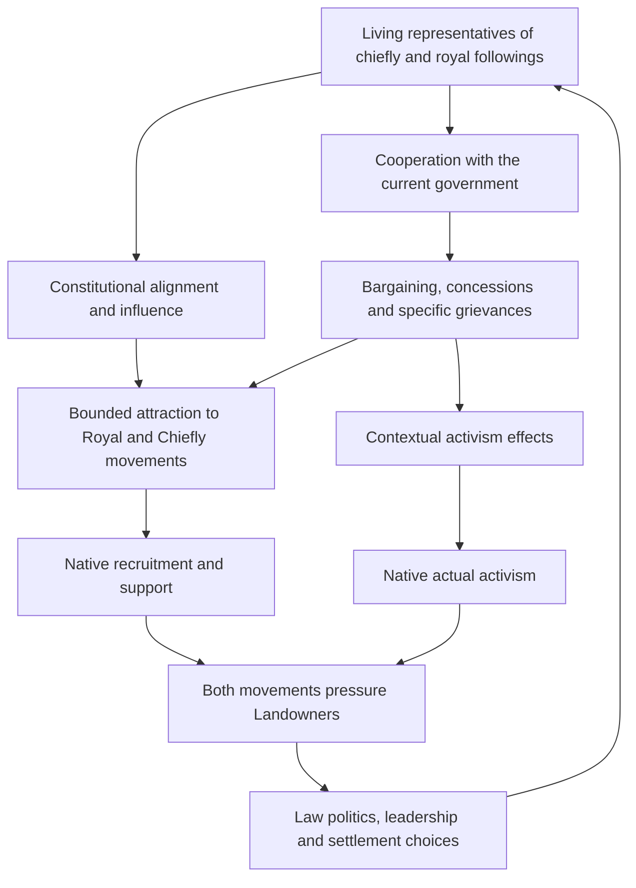
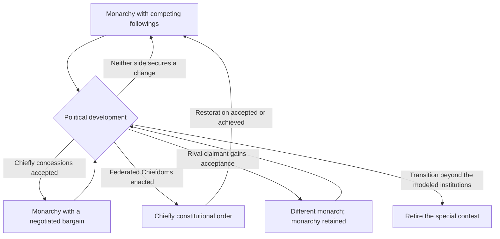
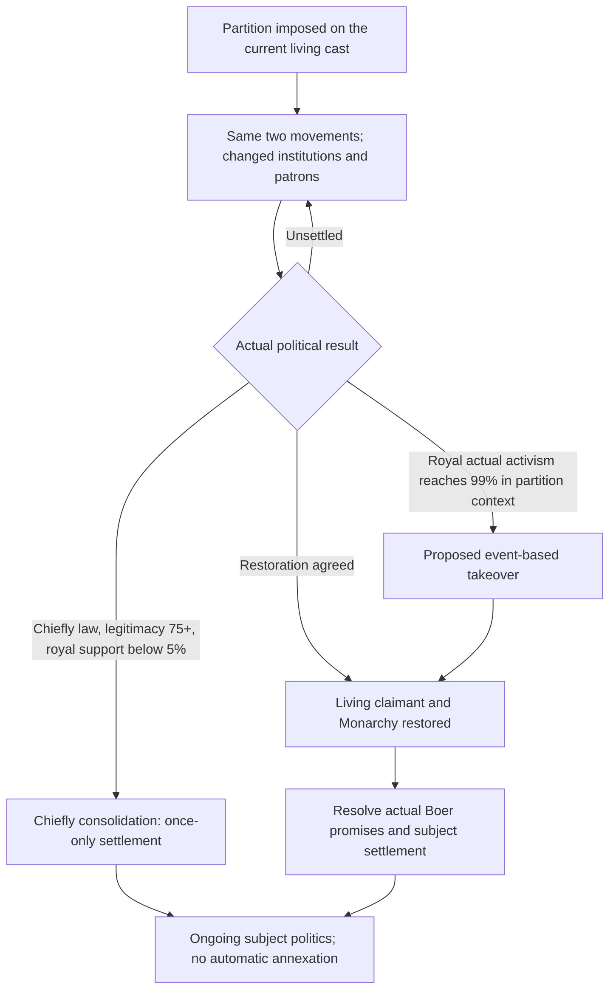

# Zulu crown and chiefly coalitions — developing B

18 October 2026. **Design only. B is selected; the detailed mechanics below are proposals.**

DP chose the named-character approach and identified its connection to Japan's movements. This develops B as an extension of A, replacing the earlier recommendation to start with A alone. The [original comparison](zulu_crown_and_chiefs_exploration_2026_10_18.md) remains the record of the alternatives. The [historical research brief](zulu_chiefly_coalitions_research_2026_10_18.md) separates sourced identities from proposed gameplay roles.

The recommended experience is: **bargain with identifiable political actors; their followings help recruit the two native movements; those movements pressure the same landed establishment.** Constitutional preferences, cooperation with the current government, and foreign allegiance remain distinguishable. No new PB estate, compulsory deadline or permanent civil war.

**Latest iteration:** the [consolidated current plan](zulu_political_rework_current_plan_2026_10_18.md) owns the implementation handoff and open decisions. DP has accepted equilibrium, law-based attenuation, constitutional exit, three movements and decisive civil-war outcomes. The [equilibrium exploration](zulu_royal_authority_exploration_2026_10_18.md) and [institutions and constitutional-conflict exploration](southern_african_institutions_and_zulu_politics_2026_10_18.md) retain the detailed comparisons. Wider education/adoption reform is deferred; the narrower Social Mobility gate is agreed. The sections below preserve the preceding B proposal rather than override the current plan.

## What Japan contributes

Installed Vanilla 1.14.5 provides a stronger precedent than a portrait list. Its Meiji and Tokugawa movements directly use cached daimyō loyalty in their pop-attraction calculations:

| Normalized loyalty input | Meiji recruitment multiplier | Tokugawa recruitment multiplier |
|---|---:|---:|
| 0 | 1.5× | 0.5× |
| 0.5 | 1× | 1× |
| 1 | 0.5× | 1.5× |

These multiply recruitment weights. They do not move that percentage of pops instantly or set movement support. The loyalty input is inverted when the emperor is in power. Thus the implementation already interprets loyalty in a political context.

Japan also caches one character's loyalty per state and uses it in movement and revolutionary-state calculations. ZUL cannot copy that literally: several named followings would inhabit the same game state. Writing each into one state variable would leave the last processed value. The proposed ZUL version aggregates the relevant actors first, then supplies bounded recruitment factors.

Source anchors:

- [Meiji and Tokugawa movement definitions](</Users/depro/Library/Application Support/Steam/steamapps/common/Victoria 3/game/common/political_movements/04_country_specific_ideological_movements.txt:2118>) and [Tokugawa factor](</Users/depro/Library/Application Support/Steam/steamapps/common/Victoria 3/game/common/political_movements/04_country_specific_ideological_movements.txt:2632>).
- [Normalization and inversion](</Users/depro/Library/Application Support/Steam/steamapps/common/Victoria 3/game/common/script_values/ep2_japan_values.txt:183>).
- [Per-state loyalty cache](</Users/depro/Library/Application Support/Steam/steamapps/common/Victoria 3/game/common/scripted_effects/00_victoria_ep2_scripted_effects.txt:1307>).
- [Portrait/list interface](</Users/depro/Library/Application Support/Steam/steamapps/common/Victoria 3/game/gui/journal_entry_widgets/ep2_japan_widgets.gui>) and [list construction](</Users/depro/Library/Application Support/Steam/steamapps/common/Victoria 3/game/common/scripted_effects/00_sgui_effects.txt:79>).

This establishes source feasibility for the pattern. It does not establish that a new ZUL widget, category, character lifecycle or recruitment definition has passed an engine test.

## Two realizations within B

| | B1 — allegiance to the current order | B2 — constitutional preference plus cooperation |
|---|---|---|
| Character state | Influence and native loyalty | Influence, a narrow constitutional alignment, and native loyalty |
| Movement link | Loyal actors recruit for the ruling order; disloyal actors for its opponent | Alignment supplies recruitment; dissatisfaction affects willingness to cooperate and pressure for action |
| Succession | Reinterpret loyalty under the new ruler | Preserve institutional preference; reassess personal cooperation |
| Best experience | Managing support for a government | Bargaining over authority inside a shared elite |
| Main strength | Close to Japan; fewer authored distinctions | A rival monarchist need not become an advocate of abolishing monarchy |
| Main cost | Conflates rejection of a ruler with rejection of the constitution | Requires a small explicit alignment system and contextual defection choices |

### B1 through its lifecycle

Start with the monarchy and named notables. Their weighted loyalty biases recruitment towards the royal movement or chiefly opposition. Patronage raises cooperation; dismissals reduce it. Movement support and activism then feed native law politics. If Federated Chiefdoms replaces Monarchy, interpret loyalty as backing the chiefly government, with restorationists as its opposition. Under imposed partition, NAL can maintain cooperating chiefs while TRN assists disaffected actors. A recognized institutional result closes the immediate foreign settlement; the roster continues under the new order.

This can produce a coherent post-partition management game. Its weakness appears in a succession dispute: a chief backing a different king would recruit for the anti-monarchy movement. Adding special cases for every claimant would eventually recreate B2 less clearly. B1 also makes a purchased loyalty improvement look like a change in constitutional convictions. It is viable if the intended question is simply confidence in the current government, but is not recommended for the whole Zulu timeline.

### B2 through its lifecycle — recommended

Each important following has a living representative and a bounded influence weight. The representative favours royal primacy, chiefly autonomy, or remains uncommitted. Native character loyalty measures cooperation with the government; it is not renamed constitutional allegiance. Contextual choices can change alignment, while ordinary patronage need not.

The existing royalist movement and a chiefly movement express recruitment, actual activism and pressure on LO. Succession changes who rules without making every opponent anti-monarchist. Partition changes institutions and patronage opportunities without replacing the entire cast. A settlement is recognized from actual institutions and political outcomes; a majority of portrait cards alone cannot enact laws, annex the country or create NRP.



The return arrow means named political consequences, such as an appointment or a broken bargain. It is not an automatic monthly rule that converts high movement support into more influence, then more support indefinitely.

## The people and their followings

The researched candidate list covers the opening court, later ministerial and chiefly connections, and partition-era rivals. It supports a changing cast; it does not justify thirteen permanent actors from 1836. Consult the [roster and confidence notes](zulu_chiefly_coalitions_research_2026_10_18.md) before authoring individual records.

Use one **following record** for a political base, with a current representative. A regent or rival claimant can appear as an associated character without duplicating that base's full influence. Existing commanders can remain AF characters while participating in bargaining; the movements' institutional pressure still targets LO. This preserves the agreed absence of an AF ideological rework.

Minimal information on a card:

| Field | Meaning | What it must not imply |
|---|---|---|
| Person and following | Current representative; continuity through succession | Every named relative owns another equal political bloc |
| Royal / Chiefly / Uncommitted | Preferred locus of sovereign authority | Royal birth automatically means royal alignment |
| Influence: limited / substantial / major | Authored strength of this following | A percentage of native LO clout or counted clan pops |
| Native loyalty | Cooperation with the government | Allegiance to a particular dynasty through every succession |
| Active bargain, where relevant | A concrete appointment, local concession or foreign pledge | A fourth permanent faction meter |

Use modest provisional influence bands of **1 / 2 / 3**, with changes tied to explicit political events. A ruler's title, a general's rank and a newly created character must not each mint another full following. The royal establishment can be represented, but the ruler does not receive an overwhelming extra vote merely for holding office.

Historical succession takes priority when a suitable living successor exists. Otherwise use a regency or a clearly counterfactual successor to that following, with reviewed presentation. No historical death date forces a surviving character to die. No adult later-generation chief is created to fill an early colonial settlement. If a following has genuinely ceased to matter, retire it instead of automatically awarding its weight to the crown.

### A transparent recruitment model

Provisional starting model, deliberately simpler than a full territorial simulation:

1. Sum active influence aligned with royal primacy, chiefly autonomy and neither.
2. Divide each coalition's influence by the total, including uncommitted influence.
3. Let `balance = royal share - chiefly share`, bounded from −1 to +1.
4. Apply `1 + 0.5 × balance` to royal recruitment and `1 - 0.5 × balance` to chiefly recruitment, before separately documented contextual effects.

Example: Royal 5, Chiefly 3, Uncommitted 2 gives balance 0.2, hence **1.10× royal** and **0.90× chiefly** attraction. With no eligible actors, both factors are 1×. These are proposed tuning values inspired by Japan's range, not a historical formula or a percentage of support transferred.

This includes an uncommitted middle, stays bounded, and prevents a newly added minor character from deciding the constitution instantly. Loyalty does not automatically flip the sign. A dissatisfied royalist continues to recruit royalists; their grievance can raise pressure for a different monarch or a concession. Only an actual political realignment changes their constitutional column.

An exiled claimant can retain a following. Exile removes office and direct control, not necessarily all political connections. The record must distinguish a displaced representative from an extinguished following; otherwise colonial exile would erase restorationism by bookkeeping.

## What the player actually does

The ordinary JE remains available through the traditional institutional contest. It presents choices when their material circumstances exist, not a monthly queue of required clicks.

| Action | Immediate political effect | Cost or consequence |
|---|---|---|
| **Patronize a notable** | Improve cooperation; strengthen that actor's ability to organize | Money or authority. A chiefly autonomist can become cooperative without converting to royal primacy. |
| **Appoint a chief councillor** | One office grants its holder a limited additional organizing advantage | Strengthens that following. Dismissal withdraws the office benefit and may create a grievance; there is only one such office. |
| **Recognize local prerogatives** | A chiefly actor accepts a bargain; opposition becomes less urgent | Reduced central authority while the bargain stands. It may strengthen chiefly recruitment even while lowering activism. |
| **Press royal prerogatives** | Offers a route to align an uncommitted or persuadable following with the crown | Refusal creates opposition; cannot repeatedly buy guaranteed conversion with a cheap click. |
| **Reconcile a succession dispute** | Resolve support for an eligible claimant without necessarily changing the constitution | Acknowledged succession, an office or a concession. No third permanent national movement is required for every prince. |

The exact cost scales and office bonuses are tuning. The consequential design is that cooperation can be purchased at the cost of stronger autonomous institutions; the player cannot cheaply maximize both central control and everyone's approval.

Native `patronize` is a useful precedent, but its installed definition requires `ep2_content`. Do not make the design silently depend on that interaction or promise DLC-independent behavior without testing. The core JE actions can express the selected bargains; reuse native interaction behavior where the supported configuration permits it. See [interaction definition](</Users/depro/Library/Application Support/Steam/steamapps/common/Victoria 3/game/common/character_interactions/01_additional_interactions.txt:743>).

### Interface sketch

```text
THE CROWN AND THE GREAT CHIEFS                         [working title]
Government: Monarchy       Ruler: current living ruler

Royal movement       Support [live]  Activism [live]  LO pressure [live]
Chiefly movement     Support [live]  Activism [live]  LO pressure [live]

Chiefly alignment: Royal [5] | Uncommitted [2] | Chiefly [3]
Recruitment from these followings: Royal ×1.10; Chiefly ×0.90
Influence points; not Landowner clout or population shares.

[Portrait] Representative — Following
           Royal primacy · Substantial influence · Loyalty [native]
           Current bargain and its actual effects
           [View character] [Available political actions]

If partitioned: Natal backing / Boer commitments / promised settlement
```

Keep the movement readouts in native units and show active causes, not static claims about drift. A tooltip can separate the following factor, current patronage and native law grievances. The list can expand as the cast changes; it does not need thirteen permanently visible slots.

## Constitution, succession and outcomes

Retain the proposed narrow platforms:

| Law | Royal movement | Chiefly movement |
|---|---|---|
| Monarchy | ++ | − |
| Federated Chiefdoms | −− | ++ |
| Social Monarchy | N/A | − |
| Other laws, including Autocracy and army models | N/A | N/A |

Federated Chiefdoms means collective chiefly sovereignty if it replaces Monarchy. A bargain that leaves a king in place can remain Monarchy, with a material concession to chiefs. Do not add the abandoned Council of Chiefs or Chiefly Militias laws to distinguish those two situations.

Ordinary politics use enactment and movement pressure. A chief coalition gaining attraction is not an order to replace the government. A king can accommodate a strong chiefly coalition without instantly abolishing the monarchy; the price is the concessions they negotiated. The starting configuration should express the existing monarchy, not manufacture equally strong modern parties for symmetry.

Matching narrow **character ideologies** can express institutional preferences where appropriate. Do not add both platforms as permanent LO ideology packages. Check precedence against existing LO positions during a prototype: a movement's pressure and its pool of leader ideologies are distinct mechanisms. Any narrow correction needed for Federated Chiefdoms must be specified, not expanded into the old bureaucracy/economic package.



Under later reform, these actors do not become a perpetual independent estate with a veto over industrial politics. Their native movement strength can decline. A transition to institutions outside the narrow platform retires this particular JE; a surviving traditionalist or royalist movement can continue under an explicitly defined native lifecycle. Extending the platform to every republic or later regime is outside the current proposal.

## Thirteen Chiefdoms as an imposed phase of the same contest

Partition should reorganize the existing political world. It removes royal government, empowers cooperating chiefly actors, and leaves an opposition able to recruit. It does not replace the entire roster with later historical appointees or prove that every chief favours Natal.

**Early Klip River:** choose an eligible living representative from the actual campaign's cast. **Later partition:** use the later roster where those people have actually emerged. Existing exile, claimant identity and CAP return handling must remain coherent. The live forced assignment of Zibhebhu to PB belongs to the superseded framing and should be removed when this redesign is implemented.

NAL and TRN retain a shared external-facing JE. It reads ZUL's movements and relevant actors; it does not maintain competing copies of their support.

| External action or event | Proposed mapping |
|---|---|
| NAL supports loyalist chiefs | Existing −£500 action becomes support for cooperating chiefly actors: chiefly attraction plus a clearly explained reduction in restorationist recruitment. It cannot buy a random royalist's constitutional conversion. |
| NAL policing | Lowers the royal movement's calculated activism through the existing policing action. Does not relabel Liberty Desire as faction strength. |
| Reduced subject payments | Preserve the selected native payment concession and its native LD effect in the JE. It concerns the subject relationship, not chief/royal alignment. |
| Boer sponsorship | Increases royal recruitment; where a patronized representative is shown, identify that beneficiary. |
| Boer volunteers | Increase calculated royal activism and the existing Boer commitment meter. Actual activism must still reach the relevant native value. |
| Claimant return | Restores the actual eligible person and organizational access. Proposed modest attraction contribution replaces the old LD drift; avoid granting the same benefit both through a new following and a duplicate generic bonus. |
| Refugee return | Retain its selected population/loyalist behavior; audit the shared helpers before remapping its political consequence. It must not become generic activism just because a former LD helper was shared. |
| Skirmishes or defections | Affect the named following and a documented temporary mobilization effect. A local defeat alone does not change a law or transfer sovereignty. |

The two forced IG lobby blocs cannot continue to stand in for these coalitions: both movements now pressure LO. Retain foreign diplomacy where appropriate, but remove the scripted equivalence “LO = anti-Natal, PB = pro-Natal” in this route. Native LD remains a separate display and mechanic.

### Proposed settlement contract

Recommended continuation of the earlier outcome-based direction:

- **Chiefly consolidation:** Federated Chiefdoms is active, legitimacy is at least 75, and royal movement support is below 5%. Recognize the result once; inform ZUL and NAL. A weak or absent royal movement alone is insufficient without the institutional and legitimacy conditions. These are the earlier proposed conditions, not a new timer.
- **Negotiated restoration:** a concrete political settlement restores the living claimant and Monarchy. Chiefly concessions may survive. Do not make accepting a settlement wait until 99% activism.
- **Contested restoration after partition:** retain **99% actual activism** as the proposed trigger for the event-based takeover route, with a valid royal claimant. No new war is automatically added. Because the architecture changed, this is a proposed carry-forward of the old rule, not approval of a general 99% takeover for every movement.
- **No outcome:** if none of those results occurs, contention continues. There is no ten-year suppression event or minimum waiting period.

At implementation design review, also settle whether the takeover requires the native movement to be at least Relevant. This would prevent negligible support plus scripted activism from winning; it is a proposed substantive guard, not an already-authorized hidden condition. Ordinary peaceful enactment must remain available below the confrontation threshold.



**Rewards remain a settlement choice.** Chiefly consolidation can preserve the proposed permanent +50% incorporation benefit for NAL as its reward. Restoration must resolve the NRP bargain if it was actually earned and promised; no land is ceded just because a chief changed sides. The earlier +10% restoration incorporation reward and the restored subject type remain open together. Recommended package to compare: ordinary Puppet on restoration, no restoration incorporation reward, and keep the initially offered Crown route's existing settlement; the alternative is the earlier +10% compensation for a riskier failed partition. Neither package is implemented or recorded as agreed here. A direct-annexation outcome is governed by its own route and normal mechanics, not this influence calculation.

## Worked campaign paths

**Independent ZUL; a dissatisfied royalist.** A royal-aligned councillor loses office. Cooperation falls and a succession dispute becomes more dangerous, but the following still recruits for royal government. The player can reconcile the councillor, back an eligible alternative monarch, or accept the risk of unrest. Appointing a chiefly autonomist instead may stabilize the cabinet while strengthening the movement for collective chiefly sovereignty. This is B2's central tradeoff; B1 cannot express it cleanly.

**Early colonial partition.** NAL wins the existing two-demand settlement and selects chiefdoms. Current adult chiefs receive the relevant appointments; the living royal claimant is displaced under the existing exile rules. Natal finances a cooperative chief; Boer aid strengthens restorationist recruitment and activism. If the royal movement remains marginal and chiefly rule is legitimate, the settlement consolidates. If it mobilizes successfully or a restoration is negotiated, resolve the crown and actual foreign bargain. No later historical leader appears merely because the settlement button was clicked.

**Later modernization.** The same followings persist where socially relevant, with successors and changed views. Their movements compete through native politics as wealth and occupations change. An industrialized ZUL is not held forever by six authored influence weights: those weights bias eligible recruitment rather than supplying an independent national clout pool. Reform beyond this constitutional contest closes the bespoke interface rather than inventing a second version of every later political struggle.

## Implementation shape and checks, after design approval

Keep the model small: following identity, current representative, alignment, influence and any active bargain. Read native loyalty. Recalculate the aggregate on relevant events and a bounded reconciliation pulse; avoid per-pop scripted transfers, whole-world scans each tick, or individual clan populations. Recruitment reads cached values. This is a small roster calculation, not a population simulation; actual performance remains to be measured.

Use one configured royalist movement, building on the live in-place core-ideology approach, and one chiefly movement. Do not reintroduce the duplicate native absolutist. Recruitment may use existing pop data and the aggregate; it cannot infer an individual pop's clan patron. Permanent movement presence is a separate requirement from initial creation. Test an appropriately scoped category if both must persist below native ideological maintenance thresholds; never refresh Initial Enthusiasm monthly to keep them alive.

| Check | Required evidence |
|---|---|
| Several chiefs in one state | All eligible followings contribute once; no last-write overwrite. |
| Royalist opposing incumbent | Cooperation changes without switching constitutional alignment. |
| Chiefly supporter cooperating with king | Material bargain works without automatically enacting a different law. |
| Recruitment and UI | Factors are bounded, current and distinguished from support, activism and LO pressure. |
| Leadership/law precedence | Native LO leadership and negotiations respond; existing IG stances do not silently invalidate the intended choice. |
| Cast lifecycle | Birth/adulthood, death, succession, regency, exile and return preserve one identity and one following. |
| Early versus late partition | Uses the appropriate living cast; no underage Zibhebhu, duplicate royalist movement or fictional Sigananda mistaken for the historical chief. |
| External layer | Domestic allegiance and foreign cooperation can differ; no partial-clout lobby trick. |
| Settlement | Actual institutions/outcome, one delivery, no unrelated-war gate, no timer-forced result. |
| Eligibility and DLC | Supported feature configuration verified; no silently added DLC requirement. |
| Modernization and annexation | Special contest retires cleanly; NAL's separate cultural movement is not repurposed. |

Do not port the Spanish guerrilla-war machinery as part of B. A later armed expansion could follow a genuine breakdown, but would need its own territorial and war-resolution design. The current research and source review do not constitute an engine prototype. **All engine scenarios remain pending DP.**

## Decision register

| Item | Status | Decision or next interpretation |
|---|---|---|
| Named-character B | agreed; movement link reopened | DP selected B; the latest exploration now compares alternative movement integrations. |
| Continuing political equilibrium | agreed approach; details in linked iteration | DP accepted equilibrium and Amabutho-specific military effects; law attenuation is now specified, naming and movement integration remain open. |
| Historical characters and succession | agreed direction | Research-backed cast; candidates are not yet a fully verified spawn list. |
| PB chiefs versus LO royals; broad ideology packages | agreed | Abandoned. |
| Council of Chiefs / Chiefly Militias proposals | agreed | Dropped; unrelated live Amabutho remains outside this change. |
| B2 separation of constitution and cooperation | provisional | Recommended over B1 for the whole timeline. |
| Influence bands and bounded recruitment formula | provisional | Worked defaults for testing, not historical percentages. |
| Native pressure on LO; no second clout pool | provisional implementation | Source-supported; new definitions require engine checks. |
| Two movements available from the start | provisional | Use contextual names and plausible asymmetry; prove lifecycle before promising permanent presence. |
| Native loyalty and patronage | provisional | Reuse where suitable; native interaction has a DLC feature gate. |
| Personal bargains and chief-councillor office | provisional | Material, bounded actions; no extended issue simulator. |
| No deadline or minimum duration | agreed | Outcome-driven contest. |
| 99% actual activism | prior agreement; mapping provisional | Carry forward only as the proposed post-partition confrontation route; not support, not a general regime-change trigger. |
| Chief consolidation conditions and +50% benefit | provisional continuation | Prior proposal retained for comparison; not granted by portrait alignment alone. |
| Restored subject status, +10% reward and initial Crown comparison | open | Decide as one settlement package, with NRP risks included. |
| Carlist-style armed extension | deferred | Not needed to make B complete. |
| Annexed movement modifier-preservation engine test | deferred | Separate existing DP todo. |

No script, localization, dependency, save or game process was changed for this exploration.
