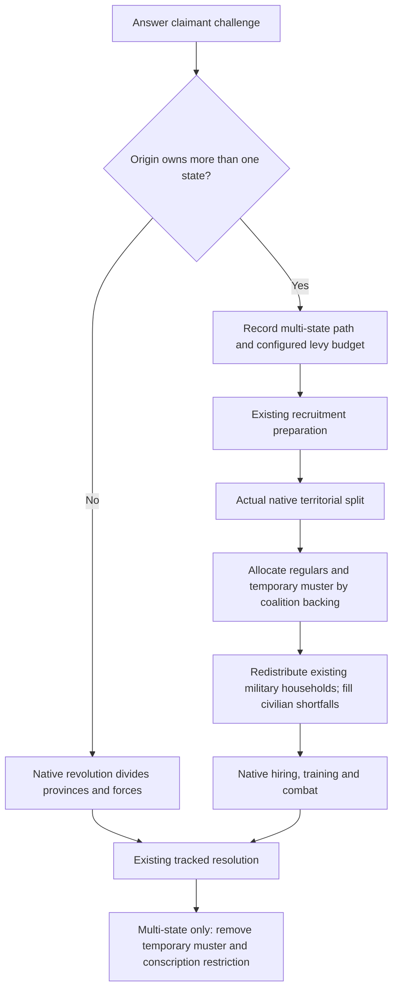

# Zulu civil-war muster — updated proposal and implementation record

29 October 2026. DP authorised implementation after checkpoint **`1a3d7c3`**. Source implemented; native recruitment and battle balance remain **pending DP**. The checkpoint preserves the preceding proposal and maintenance batch.

## 1. The revised boundary

DP confirms that a one-state Zulu civil war already divides resources through the native movement-strength mechanism. Preserve that behaviour. Classify the origin when the challenge is answered, **before the native split**, and retain that classification through the conflict.

| Origin before the split | Allocation |
|---|---|
| One owned state, including Zululand after Klip River | Entirely native military and population division. No recruitment relocation, army rebuilding, temporary muster, civilian transfer or conscription restriction. |
| More than one owned state | Scripted military muster after the actual split; retain existing pre-creation recruitment preparation. |

A post-split country having one state does not make it a one-state-origin war. Conversely, two actual state objects in `STATE_ZULULAND` do not justify rebuilding a native provincial split. Resolve actual country and state identities; NAL and other owners of the same region are excluded.

Existing stronger-coalition preference for Zululand applies only while the origin owns both its Zululand and Natal portions. Other territorial selection remains native. Character routing, sponsorship, coalition quotes, Firearms JEs, Prerogative and victory rewards are unchanged.



## 2. Multi-state force budget

The frozen claimant share remains:

```text
claimant committed Prominence / (incumbent + claimant committed Prominence)
```

Do not count third claimants, unpledged influence or Popularity again.

- **R:** completed regular recruitment levels across both actual countries immediately after splitting.
- **L:** configured conscript levels recorded before splitting. Native caps can truncate these when a small state becomes independent, so counting only afterwards loses the intended budget.
- Existing training methods are read from the largest centre for each service. Reuse the installed training groups; grant no technology. The previously authorised reconstruction still resets unit manpower, experience and mix. Native default types follow the country's available technology.
- For unequal coalitions, reserve one existing regular level for the weaker side, then split the remainder by backing. For an exact tie, divide evenly. Round one quota and assign the other the exact remainder; never invent levels for a small pool.
- Divide L by backing with the same remainder rule. Additional levies are capped by surviving eligible workforce after reserving the regulars and the 20% recruitment buffer. Existing regular levels are retained even if understrength.

Example: four regulars plus sixteen configured levies, at 60:40 backing, produce **2 + 10** and **2 + 6** recruitment levels. These are capacity targets, not instant full battalions or guaranteed battle results.

## 3. Temporary muster and native conscription

`building_sb_court_muster` is a separate, script-created military building using `bg_army`, `recruits_combat_units = yes` and `pmg_training_conscription`. It cannot be built, expanded or downsized normally. Ordinary barracks retain R; the temporary type supplies L as standing recruitment during this war.

Reusing the conscription training group preserves the customary **99:1 servicemen/officer mix**, rather than replacing it with the ordinary barracks' starting 97:3 ratio. All installed training ratios are covered by source tests. Employment and training remain native.

Both actual participants receive `sb_court_muster_conscription_suspended` while the muster is active. Its **−10 conscription-rate multiplier** drives the native multiplier to its zero floor, with headroom for ordinary positive modifiers. This is a temporary technical restriction, not a combat penalty or an army-law change. The UI may display the underlying −1,000% modifier. Installed arithmetic clamps multiplicative factors at zero; a negative additive rate is deliberately avoided. Native uprising bonuses are additive and cannot restore a zero multiplier. An external mod adding more than +900% multiplicative conscription is outside this supported contract.

A building `potential` guard was investigated and rejected as the suppression mechanism: the native maximum-capacity path does not evaluate that scripted trigger. No override of Vanilla's conscription-building definition is shipped. [Native inspection and limits](compatibility/zulu_muster_native_contract_2026_10_29.md).

**Engine acceptance is still required:** the custom recruitment building must create usable units and formations, AI must use them, and no second native conscript pool may survive or reappear. Source arithmetic does not establish these behaviours. Failure is a blocker for this muster prototype, not permission to add repeated army resets.

## 4. Recruitment workforce

Allocation runs once, after both real factions exist:

1. Select each country's most populous actual owned state as its recruitment location, before transfers change populations.
2. Bring existing servicemen/officers within that country to its recruitment state.
3. Divide each profession between the countries according to its jobs across **both regulars and muster**. Officer and serviceman shares can differ because the two services have different profession ratios.
4. Fill civilian shortfalls first from the country's own other states, then from the opposing country's surplus after reserving its full requirement.

```text
recruitment requirement = 1.2 × 1,000 × (regular quota + levy quota)
```

Count workforce, not dependants. Eligible civilians are peasants and unemployed free workers. Exclude slaves and employed non-peasant civilian workers. Moving a fraction of a Pop carries the corresponding dependants, culture and religion; no new population or scripted profession conversion is created.

Existing officers are distributed separately. Civilians are not treated as already qualified officers: qualifications, hiring and training still need inspection in-game. Small per-Pop rounding differences are expected.

If combined eligible workforce cannot cover R + L and the reserve, reduce L before splitting it. No repeated transfer replaces casualties. The initial 20% reserve is finite. Native wages, equipment, supply and combat continue; the existing AI-only supply-consumption aid is unchanged.

DP's first replay exposed a separate food shortage: the smaller faction receives recruits while commercial food production remains across the border. DP selected temporary **Wartime Provisions** for this test. Both actual multi-state factions receive +1.5 Food Security when their muster begins, removed by the same terminal cleanup. The native pre-clamp calculation requires a stronger value than the displayed zero suggests. This is relief rather than extra grain, wages or a redistribution of civilian buildings; food prices and other economic effects remain. [Evidence, tuning and limits](compatibility/zulu_muster_famine_2026_10_29.md). One-state origins receive none.

## 5. Cleanup and scope

On the tracked conflict's resolution or cancellation, remove the temporary muster, its conscription restriction and Wartime Provisions from the two participants. Preserve ordinary barracks, subsequent construction and surviving regular units. The dedicated building type can be removed after native state merging without guessing which barracks were temporary. Repeated callbacks are harmless.

People remain in their new locations after demobilisation. Repatriation after employment changes, merging and casualties would not be lossless. This is a lasting geographical effect in multi-state wars; there is no change to 1836 population history or maps.

Cancellation before a split creates no muster or population transfer. The existing pre-creation relocation of an available recruitment level is not reversed. The next crisis classifies its then-current state count afresh.

No game launch, save migration, dependency patch, foreign-war replacement, global define change, additional combat bonus or wider country rollout.

## 6. Verification and handoff

The [validation record](compatibility/zulu_muster_validation_2026_10_29.md) preserves the original 85 passing focused checks, the existing full-suite localisation review failure and advisory Tiger results. The subsequent provisioning follow-up passes 87 focused checks; its in-game effect remains pending.

The [runtime matrix](zulu_civil_war_muster_runtime_matrix_2026_10_29.md) covers both territorial paths, both player choices and winners, one-state splits after Klip River, uneven multi-state recruitment, low workforce, cancellation, repeated callbacks and demobilisation. All unperformed engine scenarios remain **pending DP**.

Source tests execute the shipped scope routing and arithmetic with explicit native split inputs. They cover conservation, native one-state bypass, pre-split levy receipts, combined-service staffing, civilian deficits, safe cleanup, method ratios and unrelated-country negative controls. They do not simulate native province allocation, recruitment, AI or war outcomes.

Use a checkpoint **before answering the claimant challenge**, or a new campaign. Existing wars retain their old preparation and allocation; no migration is attempted.
