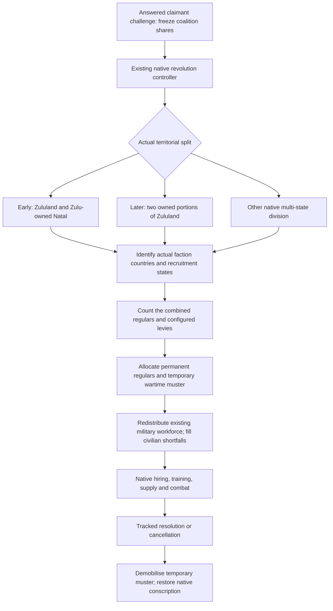

# Zulu civil-war muster — proposal for both territorial splits

29 October 2026. **Proposal, not an implementation instruction. Gameplay remains unchanged.** Builds on the [force-balance investigation](zulu_civil_war_force_balance_exploration_2026_10_29.md).

## Intended result

Coalition Prominence should determine a faction's initial military allocation in both early and later claimant wars. Geography should still affect campaigning and the ability to sustain a long war, but should not turn a near-even coalition contest into a tenfold difference in available troops.

DP's correction is a requirement: after losing Klip River, ZUL can undergo a native civil war dividing **Zululand itself**. The muster cannot depend on one faction owning Natal. A kingdom that retains both regions and a kingdom divided within one region must use the same manpower rules.

No changes to 1836 population history, provincial boundaries, the native war controller, the political coalition calculation, character routing or victory rewards are proposed here. This is a reusable military helper for the existing claimant conflict. Extension to a differently triggered constitutional war requires its own verified faction inputs; this proposal does not replace that settlement logic.

## 1. Territorial handling

| Situation at the crisis | Territorial behaviour | Military behaviour |
|---|---|---|
| ZUL owns Zululand and its Natal portion | Retain the current stronger-coalition preference for Zululand and weaker-coalition preference for Natal. | Allocate by the frozen contender shares after the actual split. |
| Klip River is no longer owned; ZUL is split within Zululand | Allow the engine's provincial division. Two countries can own separate state objects in `STATE_ZULULAND`. Do not try to find a Natal recipient. | Use those two actual countries and their owned state objects. Move people only to cover recruitment deficits. |
| A later kingdom owns additional regions | Retain native selection outside the existing two-region preference. | Sum each faction's actual recruitment resources and use its owned recruitment states. |

The current `sb_court_dynastic_state_weight` already limits its explicit Natal/Zululand weights to an origin that owns both regions. Retain that boundary. The force replacement helper also currently chooses an actual owned state rather than a hard-coded Natal state. What needs changing is the recruitment budget and its staffing, not a new unconditional map rule.

Never select recipients by `s:STATE_ZULULAND` alone: after an internal split that region contains both countries. Resolve the exact incumbent and claimant countries from the tracked war, then their owned state objects. Exclude NAL, other countries and third-party armies even when they own another portion of the same region.



## 2. One army budget, two constituencies

Retain the existing frozen political shares:

```text
claimant share = claimant committed Prominence / both contenders' committed Prominence
```

Do not add Popularity, the unpledged discount, movement support or other princes again. Geography's 10–75% native target bounds do not redefine the army share.

At the actual split, before destructive reconstruction, count the combined resources of the two real factions:

- **R:** existing regular battalions/recruitment capacity.
- **L:** existing configured conscript battalions, bounded by their valid pre-split capacity. Not every theoretical level the laws could eventually allow.
- Existing military workforce, officers, civilian recruitment workforce, training methods and unit types.

Preparation needed to make the native revolution possible remains separate and once-only. Count any relocated recruitment level once. Political shares remain frozen, but do not recreate people or manpower lost between the challenge and the actual split.

Allocate the regulars using the existing weaker-side minimum: one level comes from the available total, and the remainder follows coalition strength. **For an exact tie, divide evenly rather than applying a unilateral weaker-side advantage.** Round one allocation and give the other side the exact remainder. If fewer than two regulars exist, do not invent regulars merely to satisfy two minima; the levy allocation must be assessed too.

Divide L by coalition share, with the same exact-remainder rule. Keep regular and levy entitlements separate even if both eventually use military buildings that recruit standing units in the engine.

### Illustrative 60:40 case

With four regulars and sixteen configured levies:

| Allocation | Stronger coalition | Weaker coalition | Total |
|---|---:|---:|---:|
| Regulars, including weaker-side minimum | 2 | 2 | 4 |
| Wartime levies | 10 | 6 | 16 |
| Initial battalion capacity | **12** | **8** | **20** |

These quotas apply whether the weaker country is in Klip River or a provincial portion of Zululand. They are capacity targets, not a promise of twenty instantly full battalions or an exact 60:40 battle result.

## 3. Recommended implementation direction: distinct wartime muster

The full proposal replaces the **allocated levy pool for this war** with temporary recruitment capacity. This prevents the mainland from independently regenerating a much larger native levy pool after the scripted division.

The preferred prototype is a separate, script-created **wartime muster building** using the documented military-building interface (`recruits_combat_units = yes`), with the relevant customary training/occupation mix. Ordinary barracks remain the permanent R allocation. Muster buildings provide L and are unavailable for normal construction or AI expansion.

Why separate buildings: adding temporary levels to ordinary barracks makes it difficult to distinguish them later from player construction, downsizing or native merging of two pieces of Zululand. A separate type makes demobilisation auditable: remove the temporary muster, rather than wipe and recreate every surviving regular formation.

For Amabutho, retain the existing customary levies' **99% servicemen / 1% officers** requirements. Do not silently turn them into ordinary starting barracks' 97:3 officer requirement. Preserve actual available unit quality and military technology. Later reformed armies need an explicit training/occupation mapping; no free upgrade to a higher infantry tier.

**Required feasibility checks before choosing this for production:**

1. Native recruitment, formations, mobilisation, AI control and victory transfer must recognise the custom military building. The generic interface is present; this exact new building has not been engine-tested.
2. Suppress additional native conscription only for the two tracked participants while the replacement muster exists. Verify that automatic centre recalculation, native civil-war bonuses and player/AI orders cannot duplicate L. Deleting centres once is insufficient.
3. Respect military-building limits and ensure quotas survive subsequent native updates.
4. Separate state pieces merging after victory must retain enough identity to remove all temporary muster and preserve ordinary barracks.

If any check fails, report the specific blocker. Do not quietly ship both levy pools, switch to recurring army resets, or remove the army model law. The smaller recruitment-only alternative below remains available.

## 4. Recruit people, not empty building levels

Allocate soldiers and officers according to the jobs in **R + L**, not just R as at present. Existing military households are the first source; preserve their people, culture, religion and dependants.

Then calculate each side's remaining requirement using its actual post-split population. Proposed first-pass civilian recruitment buffer:

```text
required recruitment workforce = 120% of the workforce needed for the allocated force
shortfall = max(0, required recruitment workforce − locally available eligible workforce)
```

The 20% buffer is provisional replacement capacity, not extra battalions or extra population. Count employable local peasants/unemployed workers and the military workforce once; exclude workers who do not meet the relevant hiring conditions. Do not count dependants as workers, and do not treat all civilians as qualified officers.

- Move only the deficit from the other faction, and only from its surplus after reserving its own requirement.
- Preserve population across the two sides. No `create_pop` soldier grant and no recurring transfer to replace casualties.
- If combined recruits are insufficient, reduce the proposed additional levy muster proportionately. Do not invent workers or erase existing regulars to manufacture the quoted total.
- Vanilla servicemen have `can_always_hire = yes`, so moving eligible civilian workers and letting recruitment employ them is the first approach. A blanket conversion of entire peasant groups is unnecessary. Officers have separate qualification rules and must be checked independently.
- If the native intra-Zululand division already supplies both factions adequately, **move no extra civilian population**. Do not force a fixed 5,000-worker transfer or an equal population split.

For the example above, a 1,000-worker-per-battalion illustration gives recruitment targets of 14,400 and 9,600 workers. Actual employment ratios must come from the chosen military methods. The people needed can be much more numerous once dependants are included; this is why a 5,000-person transfer is not the same intervention as 5,000 available workers.

Native hiring and training still occur. First test this during the normal play build-up. Add no combat bonus or instant full-manpower claim. A temporary recruitment aid is a tuning option only if measured staffing remains too slow despite sufficient qualified workers.

## 5. Supply, casualties and the longer war

Retain the existing AI-only −50% supply-consumption aid. Apply the same muster rules regardless of which contender the player selects. Keep normal wages, equipment availability, battlefield losses, commanders and Prerogative effects.

This proposal balances the initial muster and a finite reserve; it does not promise identical economies or replenish both sides forever. Longer wars can still favour the country with more people and resources. Capture finance and supply alongside manpower before adding subsidies. If one faction cannot maintain even its allocated initial force, a bounded war chest is a separate tuning decision, not an unmentioned infinite treasury.

Do not continuously reapply quotas or cancel ordinary casualties. Any ongoing construction or outside intervention is recorded separately from whether the initial split worked.

## 6. Resolution and demographic consequences

Use the tracked war's existing once-only resolution/cancellation handling, for either winner and either selected side:

1. Remove temporary muster capacity and its remaining temporary units safely, without recreating casualties.
2. Release the conscription restriction and let native capacity recalculate.
3. Preserve surviving ordinary barracks, normal player/AI construction and surviving regular units; do not restore a destroyed prewar army.
4. Remove only this crisis's modifiers and records. Keep the existing character outcome, Firearms JE reconciliation and victory reward unchanged.
5. Allow demobilised people to seek civilian employment.

**Population movement has a lasting geographical consequence.** The first version would not attempt to identify and transport every surviving household back after the war. People moved between two pieces of Zululand become part of the reunited region; people moved into Klip River can remain there. There is no lossless reversal after native merging, employment changes, births and casualties. No change to starting population history is required.

If the crisis ends before the actual split, no post-split muster or population transfer occurs. Existing preparation receipts still prevent duplicate restructuring. A missing participant or invalid tracked conflict must not trigger global army cleanup.

## 7. Smaller alternative: native levies plus recruitment transfers

Keep ordinary barracks and native conscription. At the actual early or intra-Zululand split, redistribute military workforce and fill civilian recruitment deficits by the rules above; verify the resulting conscript centres and army strength. At the end, native levies demobilise normally, with no custom building or suppression mechanism.

This is much less invasive and may be sufficient after Klip River, when the engine divides a large population between both sides. It may remain inadequate in the early two-region war: meeting a native conscription quota can require transferring a much larger civilian population, and the mainland can retain far more recruitment capacity.

| Criterion | Recruitment-only alternative | Distinct wartime muster |
|---|---|---|
| Works with either map | Yes, uses actual factions | Yes, uses actual factions |
| Fewer new engine assumptions | **Yes** | Custom building and conscription suppression need proof |
| Political share controls initial regulars and levies | Partial; native capacity can dominate | **Intended full control**, subject to staffing verification |
| Demobilisation | Native | Explicit temporary-type cleanup |
| Population moves | Potentially large to satisfy native conscription | Only job/reserve shortfalls; still real and lasting |
| Recommended use | Baseline comparison / smaller fallback | Preferred experimental direction for consistent early and late balance |

Neither approach requires map changes or starting-population edits. The previous investigation's territorial redesign option is unnecessary for the later case DP describes; the engine already supplies that intra-Zululand division.

## 8. Acceptance before deployment

All unperformed engine scenarios remain **pending DP**. Compare the existing implementation and the prototype from the same pre-crisis checkpoint:

| Map | Backing | Player sides / outcomes |
|---|---|---|
| Zululand + Zulu-owned Natal | 50:50, 60:40, 75:25 | Either contender; both winners |
| Zululand only after Klip River | 50:50, 60:40, 75:25 | Either contender; both winners; inspect two state objects in the same region |
| Later multi-state kingdom | Uneven recruitment buildings | Both owners; no NAL or third-country population touched |

For each: record quotas, surviving building levels, separate military/civilian workforce, officers/qualifications, manpower, organisation, finance and supply immediately after splitting and at weeks four and eight. Check no extra native conscript pool appears. Repeat comparisons to distinguish coalition influence from commander/battle randomness.

Also test cancellation, contender death, repeated callbacks, save/reload, player construction/downsizing, state merging, casualties and demobilisation. No manpower/experience restoration or population creation is permitted.

Release requires usable forces on both sides, a repeatable relationship between coalition backing and available manpower, and no tenfold discrepancy in an otherwise near-even test. It does not require predetermined winners. Static arithmetic and lifecycle tests cannot substitute for these runtime checks.

## Decision register

| Status | Item |
|---|---|
| Agreed requirement | Support the post-Klip River internal division of Zululand as well as the early two-region map. |
| Existing constraints retained | Native conflict and two actual factions; coalition shares; identity outcomes; no unrelated-war peace gate. |
| Provisional recommendation | Prototype distinct temporary muster plus deficit-based workforce transfers; compare against recruitment-only changes. |
| Provisional tuning | 20% finite recruitment reserve; existing weaker-side regular minimum with an even split on ties; no extra combat bonus. |
| Open technical dependency | Custom muster recruitment, non-duplicating suppression of native levies, officer staffing and safe demobilisation. |
| Open design acceptance | Temporary muster and lasting relocation of existing households. |
| Deferred | Starting demography, map redraw, ongoing war subsidies, broader country rollout. |

Only this proposal and the investigation's cross-reference were changed. No gameplay or save edits; no launch or runtime validation.
