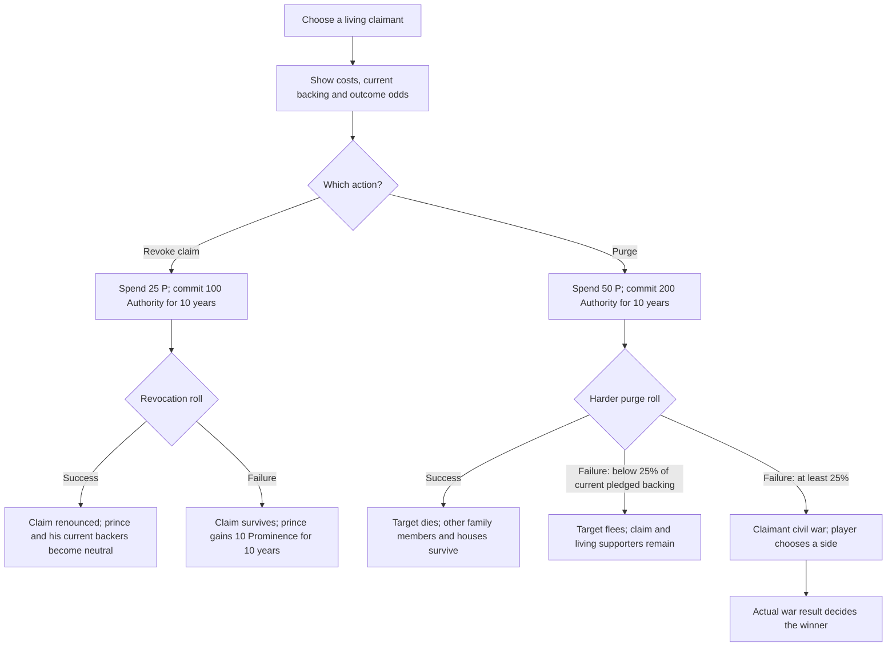

# Zulu claims: revocation and purge

25 October 2026. **Implemented in source following DP’s approval; engine checks pending.** Model B below is the selected first-pass balance. Renunciation and purge now have separate costs, outcomes and allowances. The separately implemented debt-funded pledge purchase is unchanged. Strong-rival purge remains restricted to the explicit native-war prototype; this update does not claim to resolve that dependency. The alternative calculations below preserve the design comparison.

## Decision register

| Item | Status | Direction |
|---|---|---|
| Purge harder than revocation | agreed requirement | Lower success probability for the same two coalitions. |
| Prerogative matters | implemented | Require and spend political capital before committing the outcome roll. |
| Entry thresholds | implemented | Revocation P ≥25; purge P ≥50. |
| Authority costs | implemented | Revocation uses 100 Authority for ten years; purge uses 200 for ten years. |
| Prerogative expenditure | implemented | Spend 25/50 P respectively, in addition to the Authority commitment. |
| Revocation outcomes | implemented | Success removes the claim and neutralises its coalition; failure gives the prince +10 Prominence for ten years. |
| Purge outcomes | implemented; war test-only | Success kills the target; failed attempt causes flight below 25% pledged backing, civil war at or above 25%. |
| Backing and probability | implemented: model B, β=0.5 | Current personal allegiances, including the king's and prince's own houses. Penalise the king's effective backing for the purge roll. |
| Visible odds | agreed requirement | Named outcomes, actual percentages and the applicable failure branch, before paying. |
| Independent action limits | agreed, DP follow-up | Renunciation and purge do not consume or block each other's allowance. |
| Purge allowance | agreed, DP clarification | One purge attempt against a given rival per ruler, not once for the rival's entire lifetime. |
| Renunciation cooldown | agreed, DP follow-up | Ten years between renunciation attempts against the same rival. |
| Same-constitution claimant civil war | unverified dependency | Native split, delivery and prominence-derived military strength remain test-only. |
| Additional confrontation conditions | not proposed | Preserve operational validity/concurrency checks; add no unrelated-war peace requirement. |

## Previous behaviour: reason for the rework

The previous calculation was `clamp(50 + (king share − rival share)/2 + (king popularity − rival popularity)/4, 10, 90)%` for submission, with half that chance for capture. A minor target nevertheless leaves court on either purge outcome: capture kills him and exposure exiles him. Submission also currently makes a renouncing rival personally loyal, rather than neutral. The latest 50-P charge limits access but does not change those outcomes.

The previous coercion backing combined present adherents and future succession pledgers. The [claimant-war design](zulu_court_rewards_and_claimant_wars_2026_10_25.md) already distinguishes these: a chief may support Dingane now and Mpande after Dingane's death. The new calculation should preserve that distinction.

## Shared flow

All numbers in this diagram are proposed. The war branch is a design destination, not verified production functionality.

### Costs and commitments

The recommended expenditure makes the threshold meaningful after clicking: a king at P=50 falls to 25 after revocation or to 0 after a purge. Both success and failure incur the full cost. Cancelling or an invalidated participant incurs none. Gate-only Prerogative is the lighter alternative: it preserves P but allows several successive targets while above the threshold. Authority remains its only accumulating expense. That is coherent if DP intends a readiness test rather than spending P, but fits the stated political-capital requirement less closely.

Authority is capacity committed for ten years, using a positive native `country_authority_cost_add`, not cash or an Authority multiplier. Each valid attempt must have its own cost and expiry: overlapping revocations/purges add together, and neither target death nor a new ruler refunds them. Repeating the same modifier must not silently replace an earlier charge. Native timed-modifier behaviour needs checking before choosing an implementation; do not invent a large bookkeeping system in advance.

Show current available Authority against the new commitment. This proposal adds no separate sufficient-Authority gate: if the commitment creates a deficit, native deficit rules apply. This is a proposed choice, not an inference that native Peerage allows the same thing; Peerage explicitly checks affordability.

**DP's agreed limits supersede the shared allowance:** a ruler may attempt to purge a given rival once. A different ruler has their own attempt against that surviving rival. Renunciation has a separate ten-year cooldown against the same rival. Asking for renunciation does not consume the purge attempt, and attempting a purge does not start or extend the renunciation cooldown. In particular, a refused renunciation may be followed by a purge if its ordinary requirements are met. Record each action only when its valid attempt commits; cancelling, hovering or an invalidated participant consumes neither allowance. Outcomes still determine eligibility: a dead or renounced claimant does not become a valid target merely because a cooldown is clear.

### Which backing counts

- `K`: the king's current coalition prominence, including his own house.
- `R`: the selected prince's current coalition prominence, including his own house.
- `D`: all currently pledged prominence across the king and every rival. Uncommitted houses remain outside D.
- Each house contributes its summed eligible prominence once, according to its leader's current allegiance. A future promise is not an additional constituency.
- Odds compare `K` and `R`. The flight/war boundary is `R/D < 0.25` versus `R/D ≥ 0.25`.
- Other princes do not automatically join the selected rival. Future pledges remain separate from current allegiance.
- Popularity continues to affect Prerogative and annual allegiance changes. No additional direct popularity term is proposed for these rolls.

Consequently, a prince with 100 backing against the king's 200 has the same action odds regardless of a third prince's existence, but his escalation threshold changes: 100/300 is organised; 100/500 is below the 25% boundary. That distinction follows DP's pledged-pool criterion and must be visible in the preview. The existing λ=0.25 discount belongs to Prerogative, not this denominator.

## Two complete probability models

Both models use the same costs, participants, outcome tree and independent action limits above. Neither rolls the eventual civil war's winner.

| King:prince backing | Revocation, either model | A: halve success chance | B: halve effective king backing |
|---|---:|---:|---:|
| 1:2 | 33.3% | 16.7% | 20.0% |
| 1:1 | 50.0% | 25.0% | 33.3% |
| 2:1 | 66.7% | 33.3% | 50.0% |
| 4:1 | 80.0% | 40.0% | 66.7% |
| 8:1 | 88.9% | 44.4% | 80.0% |

**A — lethal action remains inherently unreliable.** Let `p_revoke = clamp(K/(K+R), 0.10, 0.90)` and `p_purge = β × p_revoke`, initially β=0.5. A king with 200 backing facing a prince with 100 has 66.7% revocation success or 33.3% purge success. If those are the only two coalitions, the failed purge leads to war because the prince holds 33.3% of pledged backing. Even overwhelming royal backing never produces more than 45% purge success. This is the simplest punitive model and makes killing consistently hazardous, but building an overwhelming coalition cannot make a purge reliable. A weak target still escapes on the failed branch, so low kill odds alone do not prevent removal from court.

**B — dominance makes coercion reliable, with a higher burden for killing. Selected and implemented.** Keep the same revocation formula, but use `p_purge = clamp(βK/(βK+R), 0.05, 0.85)`, initially β=0.5. With 200 against 100 the king gets 50% purge success; with 400 against 100, 66.7%. In the first case failed purging means war; in the second, with no other coalitions, the prince holds only 20% and flees. This rewards the player for assembling backing before coercion, while purge success remains lower than revocation at every positive ratio. Its danger is that dominance makes purging weak rivals attractive; expenditure, overlapping Authority costs and a surviving exiled opposition provide the constraints.

The caps and β are provisional tuning, not historical estimates. Lower β makes purging harder at every positive ratio. The models have the same modest implementation burden: existing prominence projections and dynamic weighted rolls suffice for the odds. Neither solves the separate native-war dependency. If both backing totals are zero, no valid odds can be quoted and nothing should be charged; do not manufacture a following to avoid the invalid calculation.

## Opening-coalition calculation

DP requested the probabilities assuming sufficient P. Using the **current authored opening**, after the controlled trait packages, +20 claimant modifier and noble flags, the source-derived baseline is:

| Coalition | Prominence | Share of all current pledges |
|---|---:|---:|
| Dingane | 196: Dingane 100, Ndlela 81, Dambuza 15 | 66.22% |
| Mpande | 50 | 16.89% |
| Gqugqu | 50 | 16.89% |
| Total pledged | 296 | 100% |

Each prince has 10 historical + 5 noble + 10 politician + 5 Political Operator + 20 claimant = 50. Ndlela has 10 historical + 5 noble + 10 politician + 25 IG leader + 10 commander rank + 15 traits + 6 from Popularity = 81, using the native integer prominence presentation observed in the retained checkpoint. Dambuza has 10 historical + 10 politician + 5 Political Operator − 10 non-house-leader = 15. Dingane reaches the native cap of 100. The existing house registry assigns the latter two to his current coalition; generated opening councillors are uncommitted.

| Action against either prince | Success | Failure |
|---|---:|---:|
| Revocation | 79.67% renunciation | 20.33% refusal and +10 Prominence |
| Purge A | 39.84% killed | 60.16% flight |
| Purge B, recommended | 66.22% killed | 33.78% flight |

Both princes are below the proposed 25%-of-current-pledges escalation threshold, so neither failed purge starts a civil war at this opening. These are independent first-attempt comparisons with the same court, not a simulated sequence. Higher Prerogative satisfies the gate but does not change the proposed odds.

This is a source-derived calculation, not a new engine launch or a measurement of DP's later save with purchased peerages. The retained 1 February 1836 extract predates the new trait/nobility/claimant packages and gives 206/25/50; do not reuse those obsolete totals as the current opening. Current templates, history, house registry and modifiers were compared with Vanilla's historical/noble modifiers, character roles, commander ranks and `PROMINENCE_FROM_POPULARITY = 0.25`. Fresh-campaign engine confirmation remains pending.

## Consequences in detail

**Successful revocation:** remove the target's claimant status and its +20 Prominence, clear any recognised-heir designation for that prince, and make him personally uncommitted. Neutralise houses currently backing him; remove future succession promises naming him. A house loyal to the king today but promised to that prince later loses only that future promise. Leave unrelated pledges and everyone's constitutional alignment intact: personal neutrality is not an amaKhosi conversion. Preserve the prince, household members and their ordinary prominence. Treat the renunciation as durable under the existing renunciation record; ordinary annual allegiance changes cannot recreate the extinguished claim.

**Failed revocation:** the claim and commitments remain, and the prince gains +10 Prominence for ten years. Pay the action costs regardless. No exile, automatic war, mass defection or inherited −10 ruler Popularity penalty on this mild failure branch. Recalculate backing and P's target normally; the failed attempt does not itself add another fixed P shock.

**Successful purge:** kill only the selected character. Preserve relatives, other claimants and their houses. Resolve the resulting house vacancy and remove commitments that name a dead patron through normal reconciliation; do not grant the king every surviving supporter. Do not silently retain the old helper which converts future-only pledgers into current enemies of the king before killing their patron.

**Failed purge, weak rival:** exile the same character with their claim intact. Preserve surviving adherents and future promises; flight does not secretly renounce the claim or make those houses loyal. Existing exile/return routes continue, but no new invasion or automatic-return timer is part of this proposal. Thus the immediate domestic removal is still guaranteed for a weak target; it is now costly and does not guarantee destruction of the political opposition. If DP wants even physical removal to be uncertain, a third outcome—survives and stays—would be a substantive change to the supplied two-outcome sketch.

**Failed purge, strong rival:** the displayed prince leads a claimant civil war. Snapshot current allegiance for that conflict; future-only pledgers are not automatically mobilised. Use the agreed player side selection and actual tracked winner. No foreign-war substitute, event-only winner or unrelated-war peace requirement. A royal-versus-royal conflict awards no Thirteen Chiefdoms constitutional victory.

## Tooltip and confirmation

Use one preview/confirmation showing the participant, actual current backing, costs and concrete outcomes. For model B with K=800, R=100 and D=900, a purge preview would read:

> **Cost:** 50 Prerogative; 200 Authority committed for 10 years.
>
> **Possible effects:**
> - **80%:** Gqugqu is killed.
> - **20%:** Gqugqu flees. He retains his claim and his supporters.

At K=200, R=100 and D=300, show **50% killed / 50% Gqugqu rises in civil war** instead. Do not show flight as an available result for that quote. A revocation tooltip shows renunciation/neutralisation against the +10-Prominence refusal result. In the detailed breakdown name the affected backers and distinguish released future pledges from current allegiance.

Quote exact underlying weights; round display consistently so the two shown outcomes sum to 100%. Opening or hovering rolls nothing. Revalidate target, ruler, costs, backing and failure branch before execution. A changed quote must be shown again before payment; reopening does not provide a fresh attempt. Capture the result once, charge once and notify once.

## Source precedents and remaining verification

- Current SB: `common/scripted_effects/sb_court_rivals_effects.txt`, `common/scripted_effects/sb_court_coalitions_effects.txt`, `common/script_values/sb_court_politics_values.txt`, `common/scripted_triggers/sb_court_politics_triggers.txt`.
- Installed Vanilla: `common/character_interactions/01_additional_interactions.txt` uses timed owner Authority costs for retiring a daimyō and granting peerage. `common/static_modifiers/00_ep2_04_modifiers.txt` defines `modifier_retired_daimyo` at `country_authority_cost_add = 100` and the scaled peerage cost. This establishes a native cost pattern, not ten-year overlap behaviour for this new action.
- Installed Japan: `events/japan_events/ep2_shogunate_events.txt`, `shogunate.8`, shows named-character outcomes in an ordinary `random_list`. Exact dynamic chance presentation still needs an engine check.
- Gates of the Bosphorus: `events/3-01_turkfm_tanzimat_events.txt`, `.109`, uses named Murad succession and random follow-up outcomes. Its event-driven succession does not prove SB's required native claimant conflict.
- Hail Columbia: `common/character_interactions/usfp_character_interactions.txt` preserves an ordinary contextual interaction, confirmation and cooldown. Its separate revolution content is not permission to substitute a scripted foreign war here.
- [Existing war research](zulu_court_rewards_and_claimant_wars_2026_10_25.md) records the blocker: no verified direct same-constitution native war start, and no demonstrated direct mapping from court prominence to army allocation. Preserve the opt-in prototype until DP verifies delivery and a meaningful military split. Do not release a strong-rival purge that advertises a war which cannot actually happen.

Acceptance checks: test the selected curve, strict purge/revocation ordering, the 25% boundary, third-party and uncommitted backing, separate future pledges, house deduplication, claimant removal, cost overlap/expiry, stale quotes, once-only outcomes, surviving exiles and invalid/dead targets. Verify that a refused renunciation leaves the purge allowance untouched, a purge leaves the renunciation cooldown untouched, the same ruler cannot purge the same rival twice, a different ruler has a separate purge allowance, and renunciation becomes available again after ten years if the rival remains eligible. DP must check actual tooltip rendering, Authority accounting, expiry and both civil-war sides. No engine scenario has been performed for this implementation.

## Implementation details and verification

- Quote current K, R and the rival’s share of **all current pledged** prominence. Round success to one decimal place, derive the complementary failure weight, and use those same weights for the roll and tooltip. At the authored opening this is **79.7% renunciation / 20.3% refusal** and **66.2% killed / 33.8% flight**. Higher P enables the action but does not alter its odds.
- Store renunciation’s ten-year cooldown on the target. Store each ruler who has attempted a purge in the target’s list: a new ruler has a separate allowance, while a returning earlier ruler cannot repeat their own attempt. Neither action consumes the other’s allowance.
- Commit costs only after revalidating the participant, reign, chosen allowance and exact quote. A changed coalition reopens the quote without charging. Negative available Authority is not an extra affordability gate.
- Use one country modifier for the sum of outstanding Authority commitments. Each paid action schedules its own hidden ten-year expiry (`.008`: 100; `.009`: 200). This avoids relying on unverified same-key timed-modifier stacking. The aggregate appears indefinite while any commitment remains; individual receipts release their own costs. Target death, ruler replacement and institutional exit do not refund it early or cancel expiry.
- Successful renunciation clears current allegiance and future promises naming that prince separately. A king’s present loyalist who promised the prince a future succession remains the king’s loyalist. The renounced prince keeps an ordinary house constituency without the claimant bonus; constitutional preferences, family identities and unrelated promises survive.
- Failed renunciation keeps the prince at court with +10 Prominence for ten years. Failed purge below 25% exiles the existing character without extinguishing the claim or surviving backing. The old coercion Popularity penalty and automatic conversion of future-only pledgers are removed.
- A living-ruler purge in the opt-in war prototype assigns members using their house’s **current** allegiance. Future-only promises do not place them in rebellion against today’s king. Native war creation, military allocation and side selection still await DP; no production strong-rival purge is enabled.

Focused source-execution checks: **74 passed**, including nine new coercion regressions. Coverage includes opening odds, bounds, both independent limits, A→B→A ruler changes, ten-year cooldown, overlapping/staggered Authority release, dead targets and institutional exit, foreign event roots, stale quotes, household preservation, future-only promises and the exact 25% threshold. Full-suite results are recorded in the implementation board after the final validation run. Static execution does not prove engine timing or GUI rendering.
