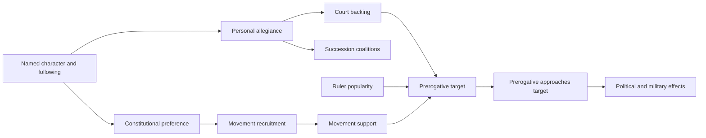
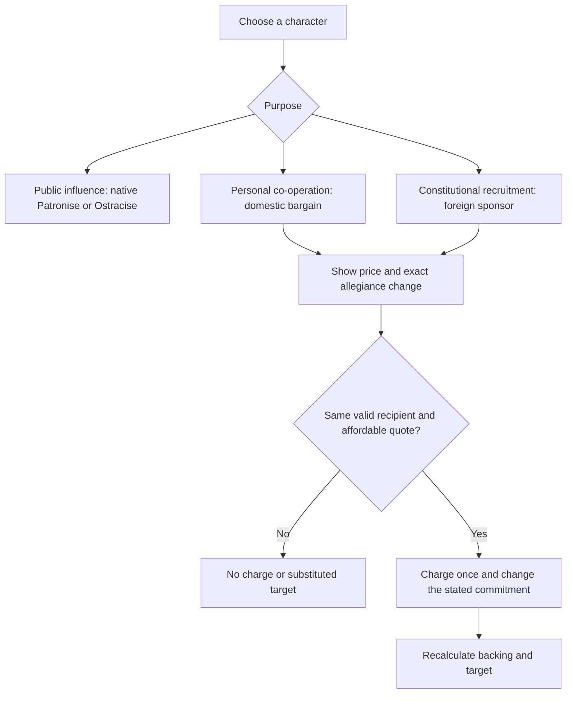
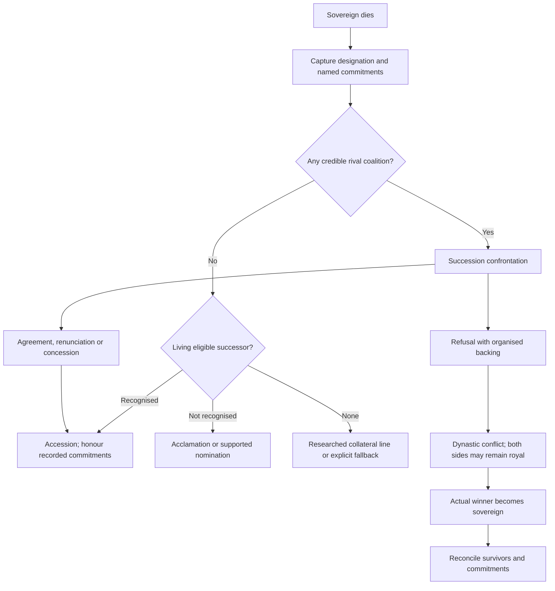

# Zulu court balance, succession and character events — exploration

**Active next-batch document:** [Zulu court implementation spec and iteration board](zulu_court_implementation_spec_2026_10_19.md). DP has chosen build-and-test increments and a dated Mpande retirement to trigger the later succession; this exploration remains background evidence.

19 October 2026. **Design proposals, not an implementation specification. No gameplay changes authorised in this pass.** DP has now confirmed the repaired in-game Prerogative title works. This discussion continues the [institutional specification](southern_african_institutions_and_zulu_politics_2026_10_18.md), the [cast research](zulu_chiefly_coalitions_research_2026_10_18.md), and the [earlier interaction proposals](zulu_court_playtest_followup_2026_10_19.md). New prices below supersede the earlier £25,000/2%-GDP recommendation as a proposal; neither has been implemented.

**Subsequent DP decisions:** the [court overview and remaining-design brief](zulu_court_overview_and_remaining_design_2026_10_19.md) records the accepted modal, shared followings, softer price curve, all-DLC baseline, Q/2 formula with simpler player guidance, deferred radicals/loyalists, and a fresh character-driven event catalogue. DP selected the standalone cash pledge with no Authority fee. Major organised succession rivals now require side choice and civil war, with the defeated rival dying but his house preserved. The follow-up explores ordinary allegiance, chiefly bargains, purges and three Dingane succession paths. It supersedes the earlier recommendations below where they differ. The original comparison remains as evidence of the alternatives considered.

## Recommendation and boundaries

Develop **politics between identifiable people and followings** using the two existing commitments. Give popularity its own visible contribution; make expensive political purchases target a chosen character; turn the four routine court events into disputes involving actual people. Make succession a test of the named candidates and their backing. An unrecognised succession opens a crisis; organised opposition and a refusal to compromise can produce war. Neither a missing heir flag nor the existence of a royal brother is sufficient on its own.

Keep constitutional alignment, allegiance to a person, native character ideology, and command loyalty distinct. Preserve the institutional exits, IR cap, gradual Prerogative adjustment, chiefly constitution, and separate Thirteen Chiefs settlement. No PB/chiefs reclassification, deadline for the political system, fixed lobby split, map rework or unrelated-war gate returns. Oral-history candidates must have plausible dates and identities; filling the roster does not justify inventing exact birth dates, family connections or personality traits.

All thresholds and costs in this brief are initial tuning proposals unless explicitly identified as current code or DP's stated preference. Launches and engine checks remain DP's.

## What the mod currently does

| Surface | Verified source behaviour | Consequence for this discussion |
|---|---|---|
| Character commitments | Alignment is royal/chiefly/neutral; endorsement is incumbent/specific claimant/uncommitted. Display traits mirror those values without changing broad ideology. | We can write character events without reinstating forced faction ideologies. |
| Royal candidates | Adult, living, royal-aligned, not renounced, and in an explicit template list or marked as an exiled claimant. | A royal identity in the cast is not automatically selectable. Hamu is currently outside this list. |
| Following weights | One most-prominent adult per following; every named royal relative currently belongs to following 1. | A prince's card can declare a claim while another royal supplies the family's entire numerical contribution. More names alone will not create competing coalitions. |
| Starting heir | The opening history creates Mpande from a template with `heir = yes`. Cetshwayo and Mbuyazi exist as children. | Zulu starts with a native heir; this is not a player-negotiated succession agreement. |
| Recognise a Successor | Costs 25 P; selects an eligible adult from the registry, sets the actual native heir, records the person, and updates the Cetshwayo/Mbuyazi route flags. | Recognition is a concrete office assignment, not a simulation of all houses accepting it. |
| While Mpande rules | His adult sons remain royal. The native heir supports the incumbent; an otherwise-uncommitted other son becomes his own rival claimant. | Rivalry can be established by monthly housekeeping, but no dedicated Ndondakusuka-like dynastic war follows from this alone. |
| Ruler change | SB reacts after native selection. A living displaced ruler causes incumbent endorsements to be released; death generally carries incumbent endorsements forward. Supporters of the new ruler's named claim become incumbent supporters. | Current inheritance of loyalty is broader than an explicit promise to accept a recognised successor. |
| Character death | Supporters of that claimant become uncommitted; a one-day refresh clears dead references and recalculates. | No bespoke “ruler dies without heir → civil war” rule exists. |
| Later royal line | Dinuzulu/Solomon templates exist, but this court's dated-cast function does not supply a complete royal-birth/succession chain. The settlement has a separate Dinuzulu creation route. | Templates and restoration helpers should not be described as a finished century-long heir story. |
| Domestic patronage | £5,000 × relative prominence; automatically chooses the most prominent eligible present non-supporter. | It buys a potentially large permanent endorsement and can target someone the player did not choose. |
| Foreign bribery | NAL/TRN buy a neutral chief's constitutional alignment, using the existing £5,000 base. | Different axis from domestic allegiance, despite the similar payment interface. |
| Routine court events | `.200–.203` still award/subtract flat P. | They largely disturb the current level without changing where it is heading. |

Source: [court effects](../common/scripted_effects/sb_court_politics_effects.txt), [action effects](../common/scripted_effects/sb_court_actions_effects.txt), [triggers](../common/scripted_triggers/sb_court_politics_triggers.txt), [on-actions](../common/on_actions/sb_court_on_actions.txt), [dynasty templates](../common/character_templates/sb_zulu_dynasty_characters.txt), [opening history](<../common/history/characters/zul - zulu.txt>), [court events](../events/sb_zulu_court_events.txt).



The interface should answer two different questions: **“Will this person co-operate with the ruler?”** and **“Whose succession will they accept?”** The latter is incompletely expressed today. A ruler's supporter is not necessarily a supporter of their chosen child or brother.

## Cast, source provenance and following representation

DP prefers a person preserved in Zulu oral history or tradition to an invented replacement. Astra at maximum reasoning has completed the [oral-history companion brief](zulu_oral_history_cast_research_2026_10_19.md), with edited testimony, genealogy, dates, relationships and separate trait suggestions. The research supplies a changing cast, rather than a large permanent list or late figures appearing in 1836.

| Priority finding | How it helps this design | Evidence boundary |
|---|---|---|
| Dambuza/Nzobo kaSobadli is documented as a councillor in 1835; Sotobe kaMpangalala held senior office under Shaka/Dingane and accompanied Mpande in 1839. | More identifiable early councillors and brokers, rather than late chiefs inserted into the opening court. | The 1839 action does not establish Sotobe's exact 1836 commitment or birthday. See companion references [2], [6] and [7]. |
| Mawa kaJama and Langazana kaGubeshe have substantive household/network roles. | Women can participate as political brokers and household representatives without invented command posts. | Langazana's household supplying shields does not by itself establish her personal allegiance; Mawa's patronymic requires correcting the weaker identification. See companion [2], [8], [9], [11]. |
| Masiphula served Mpande but backed Cetshwayo in the succession struggle. | A concrete case for separate current allegiance and future succession commitment. | Do not turn one alignment into a lifetime constitutional ideology. See companion [11]–[14]. |
| Mnyamana was active in the 1850s; testimony also places Godide in earlier Mpande-era military office. | Review the current 1872/1883 introduction dates. | Godide's connection to the 1852 campaign is an editorial, approximate dating, not an exact appointment. See companion [2], [13]. |
| Hamu kaNzibe and Hamu kaMpande are one person; a foreign scheme to offer him the throne dates to 1865. | Reuse Hamu earlier as a possible political alternative and review the candidate exclusion. | Biological descent and dynastic house affiliation differ; a scheme does not prove his acceptance. See companion [1]–[5]. |

The companion separates office, personal allegiance, constitutional interpretation, native ideology and personality traits. Most new entries warrant **no invented personality trait**. An attested office or political act is already useful content. Research priority does not mean every person should immediately receive an independent numerical following.

Use evidence-specific provenance wording:

| Evidence | Suggested presentation | What it must not imply |
|---|---|---|
| Recorded oral testimony, praise tradition or genealogy | **Recorded in oral tradition**, with a short source note | That the person is imaginary or less historical than a person documented in writing. |
| A disputed identification or relationship | **Identity disputed**, describing the actual uncertainty | A blanket “mythical” status for every attested action. |
| A genuinely legendary figure, if one is selected | **Traditional/legendary account**, with context | Documented service at a particular office/date. |
| An invented continuation of a counterfactual dynasty | **Counterfactual character** | Oral provenance manufactured to disguise invention. |

Prefer one unobtrusive provenance line with a tooltip beside the character's biographical material. If a dedicated banner requires a broader character-panel override, the existing zero-stat trait mechanism is a smaller fallback; it needs a real icon and distinct explanatory text. Do not add mechanical bonuses or a replacement faction colour for provenance. GUI placement is a design proposal, not an engine-verified feature.

**Representation recommendation:** keep a unique record for each political following, and let royal candidates gather endorsements from those records. Do not allocate an independent following to every royal relative merely because they are now named. Conversely, do not collapse genuinely distinct followings into one undifferentiated royal family. Register a following's candidate, representative and constituency once; the same people must not count as both their prince's private force and a chief's separate backing.

Exclude the incumbent's automatic self-endorsement from the *other actors' co-operation* component if popularity becomes a separate contribution. A real royal-house constituency may have a distinct representative, but must not be fabricated just to preserve a bonus. This is a proposed rebalance: it changes the starting baseline and needs scenario calculations, not a silent numerical edit.

The researched list also determines event participants. A named royal elder can broker a succession, a commander can answer for regimental conduct, and a coastal intermediary can seek a concession. Their role is not interchangeable. Historical names strengthen an event only when the date, office and relationship fit.

## Character interactions and the cost of a political bargain

### Recommended: selected-person bargains alongside native influence

Move individual transactions to character interactions. Retain the JE as a court overview and entry point to the roster. Keep national decisions and collective negotiations there.

| Action | Actor and selected recipient | Political result |
|---|---|---|
| **Secure Co-operation** | ZUL; a present representative who is uncommitted or backs another claimant | Supports the current sovereign. Constitutional preference remains. Actual self-declared claimants use the confrontation route instead. |
| **Back the Royal Cause / Back the Loyalist Chiefs** | Eligible TRN/Boer sponsor or NAL; a neutral representative in the live partition contest | Changes constitutional alignment only. Does not silently promise support for a specific monarch. |
| **Recognise as Successor** | Sovereign; an eligible named candidate | Changes the real heir and the announced designation; opens reactions among relevant brokers. It does not purchase their assent. |
| **Demand Renunciation** | Sovereign; an actual competing claimant | Submission, negotiated exile, flight or resistance. Not an ordinary cash purchase. |
| **Record an Accommodation** | Current government and the opposing leadership | An explicit constitutional settlement. Remains a JE-level negotiation, because its consequence concerns the whole contest. |

Native **Patronise** and **Ostracise** continue to affect public influence/prominence/popularity and native loyalty where applicable. They do not automatically buy allegiance. **Grant Peerage** grants native noble status; it should not be sold as the creation of a territorial chiefship or an agreement to obey a particular sovereign. A Zulu contextual name is possible, but removing/replacing its native effect requires a separate deliberate decision. Do not offer it as repeated “rank” to an already-recognised chief.

Native interactions already provide a character target and `scope:actor`; foreign payment must use that actor, not the target's owner. SB political access should not acquire an unrelated DLC dependency from copying Patronise. Source: installed `common/character_interactions/01_additional_interactions.txt` and `common/script_values/ep2_japan_values.txt`.

### DP's price proposal, worked through

Let **G** be the paying country's native `gold_reserves_limit`, and **q** the chosen representative's actual prominence (0–100). `gold_reserves_limit` is an existing script value used by Vanilla war support. At q=50, DP's proposed price is **0.8 G**. Under the base reserve factor, G is 20% of annual GDP, so this is roughly **16% of annual GDP**, before reserve-limit modifiers. It is substantially more demanding than the previous recommendation.

Do not base the charge on current cash: spending down the treasury would then make the same political bargain cheaper. Use the live reserve capacity and display the quoted amount before purchase. Revalidate the actor, recipient, commitment and affordability on acceptance; a changed target cannot silently replace the one displayed.

| Prominence | Linear scaling | Softer upper range, proposed alternative |
|---:|---:|---:|
| 10 | 16% of G | 16% of G |
| 25 | 40% | 40% |
| 50 | 80% | 80% |
| 75 | 120% | 90% |
| 100 | 160% | 100% |

Both use a provisional 10-prominence price floor to avoid a free zero-prominence purchase. The linear version is `0.8 × G × max(q,10)/50`. The softer alternative retains that line through 50, then adds 0.4% of G per prominence point through 100. It preserves DP's anchor while keeping the most influential purchase at one normal reserve capacity.

**Tradeoff:** linear pricing makes the most prominent figures exceptional expenditures. A country holding exactly its reserve limit cannot fund the 75/100-prominence prices from cash alone. Vanilla's limit is a soft diminishing-returns threshold, not an absolute prohibition on holding more, so these are not inherently impossible purchases. The softer upper range is my provisional preference for a cash-funded action; use linear if hoarding above the efficient reserve limit is part of the intended sacrifice.

Use the **payer's** G as the default reading, including NAL/TRN. This makes buying influence costly to the sponsor rather than trivial for a rich foreign country buying into a poorer one. Using ZUL's G instead would model the recipient's local price, but could make a large sponsor buy the whole coalition cheaply. A hybrid maximum of the two adds complexity without a clear need yet.

At G=£50,000, a 50-prominence purchase is £40,000. Starting with only £12,500, that government cannot immediately buy support. The purchase should be guaranteed for a valid, willing target; randomness belongs in a displayed negotiation, not an undisclosed chance to spend 80% of reserves and receive nothing. Do not offer an identical permanent conversion for £1,500 through the routine-event pool.

### Alternative: patronage contracts rather than an outright bargain

Keep native Patronise as the entry point, add a treasury-funded agreement for registered court members, and make endorsement last only while that patronage agreement is maintained. The player selects the person, sees native Authority cost plus financial commitment, and gains influence as well as temporary co-operation. On expiry, clear only an endorsement still attributable to this agreement; preserve later personal pledges and succession bargains. Foreign constitutional recruitment still needs a separate route.

This better models ongoing material dependence and can make withdrawal politically costly. It also needs provenance/expiry bookkeeping, a DLC fallback, and decisions about whether broad native ideological restrictions should block pragmatic bargains. It risks combining a large popularity/prominence buff with the purchased allegiance. **I prefer the separate interaction**: it is clearer, preserves Vanilla, and fits DP's expensive one-off proposal. An upfront 80% reserve payment is especially hard to justify for a short expiring benefit.



## Popularity and the equilibrium

Write **H** for the prominence-weighted endorsement mean, **Q** for ruler popularity, and **M** for 100 × (pro-incumbent constitutional movement support minus opposing support).

Current code:

```text
C = clamp(H + Q/5, −100, 100)
Target = clamp(0.75 C + 0.25 M, −100, 100)
```

Before clamping, +50 popularity therefore adds only **7.5 target points**, and +100 adds 15. If H already saturates C, additional popularity has no effect on that component. Native prominence already includes `0.25 × popularity`, and native popularity also affects Authority; the ruler should not receive an unexamined self-vote plus several copies of the same new bonus.

| Direction | Formula | Consequences |
|---|---|---|
| **Stronger embedded popularity** | Keep current structure; change Q/5 to Q/2 | +50 popularity contributes up to 18.75 target points, +100 up to 37.5. Smallest change, but saturation still hides popularity and court support remains bundled with it. |
| **Separate popularity — recommended** | `Target = clamp(0.50 H + 0.25 Q + 0.25 M, −100,100)` | +50 contributes 12.5; +100 contributes 25. Named followings remain the largest component; popularity is independently visible. Court weighting falls from 75% to 50%, so this is a rebalance, not a universal buff. |

Keep 15% monthly convergence and the ±4 monthly limit initially. They make changes readable over time. Spending P remains a temporary exercise of political capital; changes in allegiance and popularity alter what can subsequently be sustained.

With four equally weighted contributing followings, a neutral→incumbent switch changes H by +25: **+18.75 target today**, or **+12.5 under the separate-popularity proposal**. Rival→incumbent is twice that. This is why a routine event should not flip an entire following casually. Adding new historical representatives changes these weights, so final balance must use the expanded *contributing* roster rather than its raw character count.

The separate terms permit a popular monarch with hostile houses, and an unpopular monarch sustained by a coalition. Neither condition automatically changes the constitution. The same calculation uses the head chief's popularity under Federated Chiefdoms.

The previous popular-sentiment proposal remains open: `clamp(50 × (loyalist share − radical share), −15,15)` added to the target. It addresses DP's earlier request about radicals/loyalists, but should be evaluated alongside the new weights rather than silently folded into this pass. Sentiment is not synonymous with a particular faction. The interactive comparison holds H/M fixed and omits that optional term to isolate popularity.

## Succession: three distinguishable states

1. **Eligible relative/candidate:** a living identity with a plausible claim; not necessarily an active challenger.
2. **Designated heir:** the sovereign's publicly recognised successor, using the actual native heir slot.
3. **Accepted succession:** enough relevant houses have committed to honour that designation. This is political support, not another person or office.

Keep the sovereign's existing personal allegiance and each following's succession undertaking distinguishable. A house may support Mpande now but prefer Cetshwayo over Mbuyazi for the future. The current three-way endorsement value cannot express both simultaneously; a single optional recorded successor commitment per following is the smallest additional state that can. It should appear in the court/character information rather than becoming a hidden test.

### A — Recognition plus contestable succession (recommended)

During the reign, recognise a successor for the existing provisional 25 P, then win or negotiate commitments from the named houses. Preserve separately pledged rivals. A healthy designated heir remains first in line without guaranteeing acceptance. Replacing the designation raises reactions from people who backed the previous nominee; it does not silently rewrite their pledge.

On ruler death, capture the deceased sovereign, actual designated heir and recorded commitments before native succession mutates those references. The engine may immediately select a ruler; treat that as provisional in a live crisis rather than confusing it with a settled outcome. Refresh in the correct order and resolve once.

- **One accepted eligible successor, no organised challenger:** accession and reactions; no invented civil war.
- **No recognised heir, but one credible candidate:** an acclamation/recognition event can settle matters. Missing paperwork is not an armed faction.
- **Two viable candidates:** open a succession confrontation. Show which actual followings back each. Accept the incumbent, negotiate a concession, withdraw a claim, or resist.
- **A resisted challenge with a real coalition:** civil war if the dedicated dynastic-war route is verified; a court coup can be a different, explicitly presented outcome. Do not silently substitute an automatic coup victory for a promised civil war.
- **No viable named candidate:** do not resurrect somebody, age a child into an adult, or invent an oral source. Exhaust the researched collateral lines first. A clearly labelled counterfactual officeholder/regency remains preferable to a broken campaign; the precise fallback is an open design edge.

Initial coalition viability for exploration: a distinct living candidate supported by at least one other actual following, and roughly 20% of counted following weight. A broadly accepted accession might mean at least 60% acceptance with no viable opposing coalition. These are tunable examples, not approved gates. The incumbent's P can affect bargaining leverage; it should not manufacture a rival's soldiers or erase their identity.



An accepted minor should not automatically cause war merely because the current button only accepts adults. There are two viable implementations: keep adult political eligibility and use native regency for a historically eligible minor, or author a guardian/kingmaker episode. The latter is richer but substantially larger. Provisional recommendation: recognise genuine minor heirs through the native role where supported; do not give them adult court weight or command, and prototype the regency interaction before promising a bespoke guardian system.

Under **Federated Chiefdoms**, succession concerns the next head chief rather than a hereditary royal heir. Preserve the current vacancy selection as a starting point, with bargains/challenges among eligible chiefs if needed. A head chief's death must not trigger the royal “no heir” rule.

### B — Council ratification at every accession

Every ruler death opens a short ratification episode. A designated heir has precedence but still requires the leading houses to assent; without a designation, they nominate from the researched eligible pool. The player can accept the strongest coalition, assemble a different one through costly concessions, or attempt to impose a candidate. Rejection by an organised opposing bloc leads to the same confrontation/war branch. If a candidate dies or withdraws, their pledged supporters reconsider; the episode does not fabricate a replacement claimant. Chiefs choose their new head through the analogous process.

This makes succession consistently playable and gives the court a strong institutional identity. It also adds an unavoidable popup at every accession, risks making kingship feel like a routine elective office, and turns peaceful deaths into repeated administrative work. The native ruler-selection timing and small-roster/child-heir cases still need handling. **A is preferable** if nomination and established commitments should normally let the player avoid a crisis.

### C — No designated heir always means immediate war

This follows the strongest reading of DP's question, but I would not retain it as the recommendation. It can create war without a credible opposing person, punish a sudden heir death more than an unpopular succession, and make the 25-P designation button a binary insurance payment. It also misses a crucial case: two factions can fight while an heir has already been chosen, and even while the old ruler is alive. If retained, it still needs a viable opponent and geographical/army split rules; those qualifications turn it back into A's crisis model.

### Same crown, different claimant: technical boundary

The existing SB civil-war tracker handles royal-versus-chiefly **constitutional** movements. A Cetshwayo-versus-Mbuyazi war can put royalists on both sides. Reusing the constitutional tracker unchanged would put both claimants on the same side and could wrongly award a Thirteen Chiefs constitutional settlement. It needs separate conflict identity, participant allocation by named claimant endorsement, a winner receipt, and succession consequences distinct from changing laws.

Japan supplies a strong *selection* precedent: `shogunate.2` chooses between named people, changes the actual heir and reacts through their supporters. Its later heir-generation helpers reuse dated templates. That does not prove a generic native “start a war between two royal claimants” API. The inspected Ezo route creates a separate country and annexation play, not proof of an ordinary dynastic revolution. Prototyping a one-state dynastic conflict, character split and native ruler timing is the main technical dependency. Do not add a two-state requirement; DP has already verified one-state ideological revolutions with multiple provinces.

CMF's `no_heirs` facility also deserves care: it kills newly generated heirs in `on_heir_born`; it is not a clean switch preventing generation. Gates of the Bosphorus uses it for its own route. Do not enable it indiscriminately while scripted historical heirs might receive the same callback. Select named candidates before relying on generated fallbacks and verify the callback lifecycle.

## Reworking all four routine court events

### Direction A — Named disputes change durable commitments (recommended)

Keep a small reusable set of event situations, but select a suitable living person and their actual following before scheduling. Use dated, evidence-grounded variants where available. The character matters because an option changes their existing commitment, access, influence or successor pledge. This does not mean every encounter converts a neutral chief into an ally.

The current events are four independent 2% monthly opportunities with individual 12-month cooldowns: approximately 0.77 events per year in steady state if all remain eligible. They can arrive together. A shared pacing choice is reasonable for the rewrite, but avoid manufacturing annual demands from every chief. An actor already committed should usually be maintaining, testing or withdrawing that commitment, not cycling through allegiance for repeated rewards.

A flat +5 P at an unchanged target falls to about +1.9 after six monthly updates and +0.7 after twelve, away from the monthly cap. That is appropriate for a passing shock; it does not express a new political coalition. One full following changing sides can move the target by far more. Event outcomes need to state which kind of change they cause.

| Existing event | Current mechanical problem | Proposed situation and choices | Lasting consequence / limiting case |
|---|---|---|---|
| **`.200` Rumours in the Royal Household** | £1,500 buys +5 P; the other option gives −5 P, capital loyalists and £500. Neither identifies the alleged rival or changes their backing. | A named broker is approached by a real claimant or requests clarity over the succession. **Hear their terms:** open the same displayed political bargain used by the character interaction. **Clarify the succession:** obtain or refuse a pledge to the designated candidate, with the broker's existing ties affecting the response. **Leave the matter unsettled:** no purchased allegiance; the claimant can continue seeking support. | A pledge is to an actual candidate and can coexist with service to the current ruler. A cheap event option cannot bypass the 80%-reserve bargain. With no credible claimant, use a genuinely suitable household dispute or do not schedule this event; do not invent an anonymous rival. |
| **`.201` Affinities Among the Impis** | Purging grants +5 P while deleting 50 officers/500 soldiers and giving AF −1 approval for 12 months; tolerance gives −5 P and AF +1. The purge has no specific commander or political network. | A named commander is suspected of favouring another claimant. **Confirm the command:** preserve their role in exchange for an explicit pledge if they accept. **Relieve the commander:** remove actual command through a verified interaction/effect, provoking that person and their following. **Demand an answer:** escalate an organised rival into the court confrontation. | A dismissal affects the real command and political relationship, not an arbitrary population quota. Acceptance is not guaranteed, and a commander can keep their broad ideology. An actual claimant cannot be casually purchased. A lethal purge is a separate unresolved confrontation outcome, not an automatic +5 button. |
| **`.202` Burdening the Great Houses** | Exaction grants +5 P but also −50 Authority, −2 upper-strata SoL and 20% upper-strata radicals; conciliation trades −2 P for 20% upper-strata loyalists. No actual house supplies resources. | A named house is asked for a levy. **Collect the levy:** obtain a visible, modest material contribution and risk losing its co-operation. **Accept a reduced contribution:** smaller proceeds with less strain. **Waive the levy:** retain an existing pledge or improve a specific strained relationship, rather than gaining an unrelated new faction. | A provisional full levy around 10% of reserve capacity is an exploration value, not an approval; it is income with a political price, not a refund of an earlier bribe. The same house cannot be farmed repeatedly for cash. If no suitable house exists, do not schedule. Distinguish refusal of this levy from endorsement of a named rival. |
| **`.203` The Coastal Traders** | Guns give −10 P and advance the firearms routes; refusal gives +5 P, treating modernisation as an automatic loss of co-operation. | An actual intermediary and a court sponsor negotiate arms. **Accept on the sponsor's terms:** retain firearms progress and honour a stated concession or boost the sponsor's influence. **Obtain arms through royal arrangements:** incur a real purchase/administrative cost, avoiding that private concession. **Refuse:** no arms; the would-be sponsor can be disappointed without every chief changing allegiance. | The political consequence comes from who benefits and which promise is made. Keep the firearms gate and route compatibility. Early scenes can use a documented African intermediary where appropriate; do not summon John Dunn before his relevant period or invent a chiefdom for a trader. A guns purchase alone does not flip constitutional alignment. |

These are option structures, not replacement localisation awaiting automatic application. Re-read the installed DLC scenes before writing original final prose; preserve existing DP-reviewed namespaces until their replacement is approved. Example Japanese succession events identify candidates, concrete demands and the people who gain or lose. Use that specificity, not copied dialogue or invented historical quotations.


### Direction B — Graded obligations before allegiance changes

Retain the same four situations, but have payments, commands, levies and trade concessions move a persistent relationship score for each representative. Crossing a clearly displayed threshold produces allegiance, neutrality or opposition; one event normally shifts a score rather than an entire following. Succession promises remain separate. A representative's death ends their personal score; their successor inherits the following, not automatically the affection.

This makes a series of modest concessions matter and is less abrupt than binary switches. It also adds another resource beside P, popularity, native loyalty, constitutional alignment and personal endorsement. It needs decay rules, threshold visibility and careful explanation of why someone apparently loyal still supplies no backing. A large bribe would either bypass the whole relationship system or become another uncertain progress purchase. **Do not add it by default.** First use explicit pledges, occasional withdrawal and named confrontations; revisit graded obligations only if playtesting finds binary changes too abrupt despite proper following weights.

### Direction C — Smaller flat-P pulses plus named flavour

The smallest rewrite names the actor and improves prose but retains +/−P, perhaps adding temporary popularity or approval. It is cheap and suitable for genuine transient shocks, such as public mourning or the prestige of a ceremony. It leaves the principal complaint intact if used for succession, military allegiance and costly gifts: the target never changes and the same coalition remains. Retain this mechanism only where the event really is temporary. It is not a substitute for A's court-politics rework.

### Historical variants with useful relationships

Use the new research to author conditional branches, without compelling the historical outcome:

- **Dambuza, Ndlela and coastal diplomacy:** early council debate over fugitives, trade and outside demands. Their law ideologies need not become free-trader or anti-trader caricatures.
- **Masiphula and the succession:** a minister can serve Mpande but pledge future support to Cetshwayo. This is the clearest teaching event for the two commitments.
- **Langazana's household and the shields:** a request from the ruler benefits a particular candidate; its recipient can obey an instruction without the mod asserting an otherwise unattested personal allegiance.
- **Mawa, royal cattle and refugees:** departure, the ruler's demand and intermediaries' conduct create a real dispute. Use only when the campaign supplies appropriate causes; 1843 is evidence for a scene, not a compulsory flight date.
- **Magolwana at court:** public praise or criticism affects popularity and the audience's reaction. Do not turn every criticism into chiefly constitutional alignment or put a fabricated oral quotation in the poet's mouth.
- **Hamu and an external offer:** after the relevant political window, outside sponsorship can make a collateral royal a live alternative. The player/AI response determines acceptance; do not treat the foreign offer as evidence of Hamu's consent.

The [companion brief](zulu_oral_history_cast_research_2026_10_19.md#concrete-event-relationships) records sources and uncertainty for each relationship. An actor may remain an event participant without claiming a separate full following, agitator slot or army.

## JE actions, confrontation and the wider event balance

The JE should remain a clear summary of **who backs the current government, who backs which successor, and why P is moving**. Individual actions belong on the selected person's card; a roster entry can lead there. Keep collective accommodation and constitutional-conflict information in the JE. Keep foreign sponsorship, volunteers, policing and Loyalist Chiefs support in the NAL/TRN intervention interface, with direct recruitment of one neutral chief exposed as a character interaction.

Demanding a rival's renunciation should not be a soft purchase. A complete confrontation can end in accepted withdrawal, supervised retirement/exile, flight to an external patron, or resistance and a coup/war. DP previously raised lethal treatment. Execution is historically plausible in particular struggles, but **automatic execution has not been approved** and would reverse the earlier preserve-living-identities requirement. If added, it should be an explicit sovereign choice with the actual victim, their supporters' reactions and real risk of resistance. Losing a claim is not the same as disappearing from history.

Do not collapse every political route into bribery. Constitutional conviction, an active personal claim, exile and a recorded accommodation make some bargains unavailable or require a different confrontation. In particular, the costly neutral-chief recruitment action should not let NAL buy a self-declared royal claimant into chiefly constitutional allegiance.

Existing non-routine P changes also need a semantic pass after the four standard events:

| Existing hook | Current pulse(s), as audited | Appropriate question for the next rewrite |
|---|---|---|
| Blood River | Victory +20; defeat −10, plus Dingane's popularity penalty | Which commanders or royal relatives credit/blame the ruler? Preserve a transient shock only where it adds a distinct consequence. |
| Swazi campaign | Victory +30; defeat −30, with separate defeat/stalemate popularity handling | Do not count the same military reputation through popularity, following conversion and a large P award without an intended distinction. |
| Generic wars | Victory +20; defeat −20 | A universal flat award ignores who fought and the stakes. Avoid layering it on an authored settlement's full political response. |
| Klip River | Differing territorial outcomes presently change P by −5, +5 or +15 | Tie concessions and humiliation to actual affected leaders and followings. Do not reopen the war-goal or occupation-design hold in this pass. |
| Port Natal / British confrontation | Survival includes +20 and a separate Dingane popularity bonus; other crisis stages have their own P changes | Separate public reputation from personal bargains and constitutional change. Trace once-only outcome dispatch before altering rewards. |
| Firearms completion | +20 | Modernisation need not destroy court co-operation. A one-off achievement can be popular while its later law reform changes IR through the existing formula. |

These are an inventory for balance, not instructions to replace every P call with a character flip. A scripted following response must use the actual actors present in that campaign, and an off-screen death must not create a new anonymous failure event. The direct-annexation national movement and its modifier-preservation work remain outside this redesign.

## Walkthroughs and comparison

### An early Dingane campaign

Mpande is the native heir. The opening cast adds only suitable contemporary actors. Dambuza can speak in council; an appropriately evidenced Sotobe can later choose to accompany Mpande. A player negotiates with a selected following, sees the reserve-based cost and buys a stated personal commitment. A coastal dispute awards guns and a specific concession, rather than mechanically making every chief less co-operative. If Dingane dies with accepted succession and no organised opponent, Mpande takes over. If a real rival coalition exists, the recognised heir still faces a confrontation. Later-born princes do not appear as adult chiefs to fill vacancies.

### Mpande, Cetshwayo and Mbuyazi

Masiphula can support the reigning king while favouring Cetshwayo as successor. Recognition of Mbuyazi changes the heir slot but does not rewrite Masiphula's pledge. Royal households, commanders and other represented followings decide whom to support; their joint backing makes a claimant viable. A resisted confrontation can erupt while Mpande is alive or after his death. Both sides can favour Monarchy and Autocracy. The winner gains the throne, not a fabricated victory over chiefly institutions. A surviving defeated prince may withdraw, flee or continue a claim according to the actual outcome.

### Early or later Thirteen Chiefdoms

Partition still changes the constitution and chooses an eligible contemporary leader. Neither date automatically summons adult Zibhebhu. NAL can recruit a displayed neutral chief to the chiefly cause, while a Boer sponsor can recruit towards the royal cause. Those constitutional purchases need not buy obedience to the current head chief or a particular prince. A personal succession quarrel between royal candidates cannot complete the constitutional contest. An actual royal constitutional victory still honours earned Boer support and the agreed NRP contract; peaceful-consolidation requirements remain as agreed.

| Bundle | Play experience | Main strength | Main cost / risk |
|---|---|---|---|
| **Recommended: explicit commitments and conditional succession crisis** | Named bargains, selected interactions, meaningful endorsement/pledge changes, war only when an organised challenge is resisted | Makes the cast drive politics with limited new state; distinguishes ruler, heir and constitution | Requires accurate following allocation and a separate verified dynastic-conflict route |
| **Graded relationships plus accession councils** | Many small obligations accumulate; every accession has a negotiation | Subtle long-term relationship play and reliably visible succession content | Extra score, threshold management and compulsory episodes; greater interface and maintenance burden |
| **Light touch: stronger popularity and named flat-P events** | Mostly current mechanics with clearer characters and larger popularity effects | Smallest implementation | Leaves weak long-term consequences and an incomplete heir story; unsuitable as the full answer |

## Decision register

| Item | Status | Recorded position |
|---|---|---|
| Research delegation and oral-history preference | **Agreed** | Astra/max research completed; prioritise attested people over generated substitutes. |
| Identity/provenance presentation | **Provisional** | One source note or zero-stat trait; distinguish oral testimony, disputed detail and genuine legend. Do not classify oral history as fiction. |
| £5,000 bribery is inadequate | **Agreed direction** | DP proposes 80% of maximum reserves at 50 prominence. No price change implemented. |
| Price curve and payer | **Agreed curve; provisional payer basis** | DP accepts the softer upper range for now: 80% at 50 prominence, 100% at 100. Payer's native reserve capacity remains the working assumption. |
| Selected character interactions | **Agreed standalone pledge A** | Pure cash, no Authority or prominence benefit. Native influence tools stay separate; the conditional combined-option discount does not apply. |
| DLC baseline | **Agreed** | All Victoria 3 DLC required, including unused DLC. No no-DLC patronage fallback. |
| Royal-house overview and coalitions | **Agreed architecture** | Button opens a dedicated reopenable modal; shared followings contribute once. Detailed layout, roster and continuity remain to be authored. |
| Popularity stronger | **Agreed Q/2** | Keep the Q/2 formula and combined cap; explain the political levers rather than foregrounding exact arithmetic. Separate-additive and 50/25/25 alternatives are superseded. |
| Radicals and loyalists | **Deferred** | DP explicitly defers this contribution. |
| Ruler dies without a designated heir | **Agreed direction** | Actual candidates, commitments and viable opposition determine the crisis. Major organised competing claims mean side choice and civil war; no heir flag alone does not cause war. Mandatory accession popup accepted. |
| Succession undertakings | **Provisional** | One optional named future-successor pledge per following, separate from co-operation with the living sovereign. |
| Minors, regency and exhausted historical lines | **Open** | Preserve actual children; verify native regency and fallback behaviour before promising a bespoke system. |
| Character-driven event catalogue | **Agreed direction** | DP chooses direction A and permits discarding the old four events entirely. Their titles and situations do not constrain the new catalogue. |
| Fate of defeated dynastic rival | **DP's requested direction** | The defeated rival dies while his house survives. This narrowly revises earlier preservation; purge risks, escape and the survival of other claimants remain developed proposals. |
| Broader story outcome balance | **Provisional next pass** | Audit real political meaning and avoid duplicate rewards; preserve existing settlement contracts. |
| Wider Bantu profiles, literacy/tech maluses | **Deferred** | Not part of this court-balance exploration. |
| Runtime work / launches | **Deferred** | No gameplay implemented here; DP performs engine verification after a separately approved implementation. |

## Feasibility checks before implementation and acceptance

1. **Snapshot the actual 1836, Mpande-era and partition rosters.** Calculate the contributing following weights, not just character count. Confirm women/brokers can hold the intended non-military roles and information without inventing native offices.
2. **Prototype the dynastic split separately from constitutional revolution.** Verify character allocation, one-state geography, actual winner, native ruler/heir callbacks and no accidental Thirteen Chiefs rewards. A dynasty-specific coup is not automatically evidence that a native civil war is available.
3. **Verify minor/heir generation with CMF.** Do not kill authored heirs by indiscriminate use of `no_heirs`; retain living identities through death, exile and restoration paths.
4. **Check the selected-person payment contract.** Payer-based reserve capacity, actual prominence, valid recipient, exact displayed price, no duplicate charge, no changed-target substitution, and no accidental DLC restriction. Repeated purchases must not reward already-held commitments.
5. **Simulate new equilibrium weights across the expanded cast.** Include high popularity/hostile court, unpopular ruler/loyal court, zero backing, death of a representative, a following changing representatives, and constitutional transition. Check saturation, P spending and one-count representation.
6. **Test all rewritten event branches.** Valid actor opening/resolution, actual predecessor/successor identities, refusal, death or exile during an open event, meaningful trade-offs, no cheap bypass of major political purchases, and no arbitrary mass-population deletion.
7. **Preserve scope and prose boundaries.** No old-save migration, unrelated balance changes, approved-text overwrites, generic succession changes outside the authored profile, or game launch by Codex.

This pass reviewed current scripts and Vanilla/mod precedents, completed the research brief, and checked the comparison calculations. It does **not** establish engine behaviour for the proposed succession conflict, provenance placement, minor-regency handling or new interactions. Those remain explicit feasibility/DP checks.

