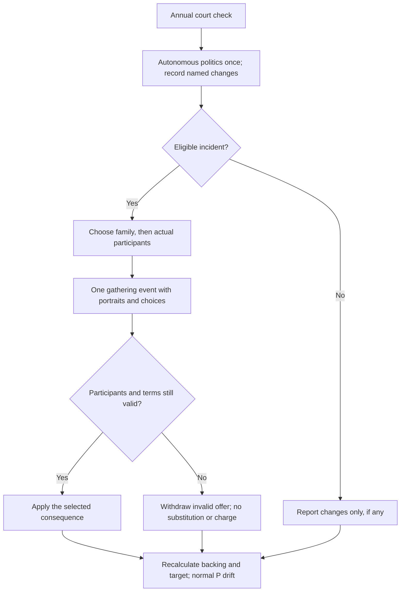

# Zulu court events: consolidated package for agreement

25 October 2026. **Approved and implemented in source on 25 October; engine checks pending DP.**

The [later annual-transition/deck revision](zulu_court_transitions_and_event_deck_2026_10_25.md) supersedes section 1’s coupled annual gathering, no-reroll policy and family-weighted scheduling. Umkhosi now reports annual model-B allegiance changes; the six incidents draw separately without replacement at 6–24-month intervals. Sections 2–4 supply the implemented incidents and geopolitical consequences. [Implementation and validation](compatibility/zulu_court_events_2026_10_25.md).

Original proposal context: The [character and reputation package](zulu_character_package_proposal_2026_10_25.md) is now **agreed and locked**. This document settles the remaining event proposal around that package; it does not reopen its traits, reputation rewards or defeat penalties, and it changes no gameplay source.

**Subsequent DP feedback — scheduling and allegiance reopened:** ordinary events are to move out of the first-fruits gathering. DP proposes persistent, Popularity-dependent transitions among neutrality and named patrons, and an independent event deck drawn without replacement with 6–24-month delays. See the [current transition/deck exploration](zulu_court_transitions_and_event_deck_2026_10_25.md). The old annual incident coupling, one-event-per-year cap and no-reroll commitment policy below are superseded design history. The six scenes and their exact consequences remain proposals; this complete event bundle was not approved.

## Decision register

| Item | Status |
|---|---|
| Annual gathering B: report autonomous politics and resolve one ordinary incident | superseded by DP: separate ordinary events from the gathering |
| One ordinary incident per year across the whole pool | superseded: implemented independent 6–24-month event deck |
| Separate present allegiance, future succession pledge and constitutional alignment | agreed |
| Thirteen opening character packages; durable campaign reputation; Retief trait exchange | agreed and locked in the linked character package |
| Generic victory → one new supporter; defeat → one new opponent; no bespoke double award | agreed |
| Six detailed incidents and values below | approved and implemented; scheduling/transition rules follow the later revision |
| Exact campaign recruitment counts and Klip River consequences below | approved and implemented |
| Explicit historical Kill → Lose → Attack → Lose war trigger | deferred by DP: playtest ordinary consequences first |
| Same-constitution claimant-war delivery and prominence-based force allocation | unverified test prototype; unchanged boundary |
| Radicals/loyalists, wider country rollout and further cast tuning | deferred |

The [earlier exploration](zulu_court_event_refinement_2026_10_24.md) contains the developed A/B/C alternatives. B remains selected. The first pass uses whole representatives and their actual house prominence rather than an artificial prominence quota. A disappointed neutral becomes a new opponent; an existing supporter defects only after a concrete grievance or broken undertaking. A harsher defeat package remains a tuning alternative if playtests show insufficient political consequences.

## 1. The annual occasion and selection

Use **Umkhosi — The First Fruits** under Monarchy/Social Monarchy. The first-harvest meaning is independently attested by [DSAE](https://dsae.co.za/entry/umkhosi/e07471). The [historical setting brief](zulu_umkhosi_and_dynastic_balance_2026_10_25.md) documents Weir's discussion of chiefly attendance and allegiance under Shaka and Dingane, with changes under Mpande. Set the business around the gathering, without claiming that a formal yearly parliament existed. Under Federated Chiefdoms, use **Gathering of the Chiefs**, explicitly an authored presentation variant.

**Scheduling default:** January, starting in January 1837 for a fresh 1836 campaign. This is a summer scheduling abstraction, not an exact historical date. Use the existing monthly pulse with a once-per-year check; move these court-specific annual rolls there rather than also running them through the native yearly hook. The installed yearly hook does not document its calendar date. Native `month` trigger usage is confirmed in Japan's `ep2_shogunate_events.txt`; the new scheduling still requires DP verification.

Resolve the existing autonomous alignment and acknowledgement rolls once, record actual changes, then select an eligible incident family and its participants. The gathering adds no extra recruitment roll. At the locked Dingane Popularity values −50 / 0 / +40, the existing acknowledgement probability is 0% / 5% / 13% per eligible neutral representative. Constitutional recruitment retains the existing competing movement-support rolls. Existing commitments do not reroll.

Use four equally weighted **eligible** families: recruitment/allegiance; succession; reputation; chiefly privileges/reform. Choose equally among eligible incidents within the chosen family. With all six available, the base chances are 12.5% each for dispute/change of patron, 25% for succession, 25% for reputation, and 12.5% each for privileges/guns. Actual odds change with eligibility. Exclude last year's incident when another valid incident exists; do not force a nonexistent alternative.

There is at most one pending ordinary gathering. An open succession, confrontation or tracked court civil war takes priority; defer the current gathering to the next safe monthly check in that year without repeating passive rolls. An unopened opportunity expires at the next annual check; missed years are not banked. An already open gathering keeps its captured participants and date until resolution and consumes any overlapping ordinary opportunity. Unrelated foreign wars do not prevent the gathering. Institutional exit cancels unresolved ordinary business; re-entry does not restore spent annual opportunities.

If there are no passive changes and no eligible business, no popup is needed. Exiled constitutional realignments may be reported as news, not narrated as physical attendance. Present scene participants must be living, adult and available. Generated registered representatives remain eligible; a generated surname does not establish a historical house.

## 2. Six incidents, with explicit trade-offs

Working titles and scenes below describe the design, not approved localisation. G is the country's **maximum gold-reserve capacity**, not current savings. Paid choices display the actual pound amount, require sufficient cash and revalidate the quote before charging. These event prices do not change the separate Secure a Pledge interaction.

### A. A disputed award — recruitment/allegiance

Two distinct, personally uncommitted house representatives contest a cattle award or appointment. A living eligible rival must exist and is named before the decision; do not invent a grievance subsystem or claimant when none exists.

- Favour A: A supports the incumbent; B supports the displayed rival.
- Favour B: reverse those commitments.
- Settle the dispute: pay **15% G**; both retain personal neutrality.

Preserve their constitutional alignments and future pledges. Display both house weights: winning a small house while mobilising a large opponent may be a bad bargain. Paying resolves this incident; it does not purchase two endorsements or freeze later politics. Choose participants from different represented constituencies.

### B. The price of co-operation — chiefly privileges/reform

A neutral representative offers **present** co-operation in return for a concrete chiefly concession. Use a chiefly-aligned or constitutionally neutral actor whose request fits their position.

- Recognise chiefly privileges: the house supports the incumbent; **+20% amaKhosi attraction for ten years**, using the existing non-stacking, once-per-reign concession.
- Accept a Chiefly Council: the house supports the incumbent and the authored Council law is enacted. Retain the current governance law, including Monarchy. This choice grants no additional attraction bonus.
- Refuse: the actor remains uncommitted.

Only offer a genuine concession: an already enacted Council cannot be sold again, and the privileges option is unavailable after that reign's concession. Current co-operation does not create a future-successor pledge. A fulfilled bargain and its beneficiary are recorded for later repudiation checks.

### C. A change of patron — recruitment/allegiance

A rival's supporter seeks recognition that displaces a current supporter from a narrated privilege or patronage arrangement. Both are actual representatives with distinct followings.

- Reconcile with the rival's backer: that house supports the incumbent; the displaced incumbent supporter withdraws to neutrality.
- Uphold the existing arrangement: retain both existing commitments.

Show the actual prominence exchanged. Neither choice automatically rewrites future pledges or constitutional alignment. An existing explicit bargain is not quietly erased: displacing its beneficiary also invokes its recorded breach consequences. The first-pass scene concerns patronage, not an unimplemented transfer of an actual army, IG leadership or law.

### D. A name on every tongue — reputation

A non-ruling pledged actor earns credit for a concrete service. Prefer an actor whose advancement presents a political tension: a rival backer, a rival prince, or a current ally promised to another future successor.

- Recognise the service: **+10 Popularity and +10 Prominence for five years** to that actor.
- Discredit the claim: pay **10% G**; the actor loses **10 Prominence for five years** and the ruler loses **5 Popularity for five years**. If the actor presently supports the ruler, they withdraw that endorsement.

These are temporary incidents, unlike the locked lifetime campaign achievements. Do not reselect an actor while either incident modifier remains active or stack repeated awards. A junior member can receive reputation, but their individual endorsement does not independently transfer their whole house. Show the resulting house effect; normal representative selection may change when member prominence changes. Do not count popularity-derived prominence a second time.

### E. Guns through the chiefs — chiefly privileges/reform

An actual chief offers an arms-procurement connection while the firearms JE is active and unfinished.

- Accept the arrangement: existing minor firearms progress; **+20% amaKhosi attraction for five years**.
- Fund royal/central procurement: the same progress for **20% G**, without the chiefly concession.
- Decline: no progress or penalty.

The existing minor helper adds **2.4 months to each track**, capped at 24. The display uses the larger track, multiplied by 2.5: this is up to **6 of 60 bar points**, not two additive rewards. Reuse the existing **once-per-country court firearms reward**; choosing either procurement route consumes it. Separate geopolitical firearms rewards retain their own contracts. Declining does not consume the reward, but cannot generate another offer that year.

Preserve the existing AI-specific access boundary for this court firearms reward: players may take it with the active JE; AI access waits for the recorded Blood River resolution. Removing that boundary would be an additional military-balance decision. This does not restrict ordinary annual politics or other incident families.

### F. An undertaking for the succession — succession

A representative serving the current king, but without a future pledge, proposes a named eligible prince as the next sovereign. This incident requires royal governance; it does not invent hereditary national succession under Federated Chiefdoms.

- Accept the proposed pledge: the house promises that prince its future backing while continuing to serve the incumbent.
- Seek a different eligible prince: obtain that future pledge through **one** existing chiefly bargain—privileges now, or a Chiefly Council promise fulfilled when the beneficiary accedes. Do not charge both prices. Respect the privileges concession's once-per-reign limit.
- Prevent the proposed pledge: spend 10 Prerogative, keeping current allegiance and no future pledge (26 October tuning). Requires at least 10 Prerogative; accepting the proposal is the unanswered event's default. Stale participants close the scene without a charge.

The alternative prince and concession are explicit, not selected after payment. No eligible alternative means no redirection option. This does not designate an heir, transfer present allegiance, or bypass the existing recognition action and its cost.

## 3. Reactions and presentation

Replace the five old ordinary templates `.210–.214` with the six incidents above, retiring their obsolete callers. The earlier “Witnesses Remember” material becomes a **reaction to an actual broken undertaking**, outside the ordinary quota; it is not another randomly selected punishment. Apply the release of the affected commitments once when the breach occurs. Its notification cannot postpone or undo the breach merely by remaining unanswered. Retain the existing **−10 ruler Popularity for five years** reaction, once per breached decision rather than once per affected house, alongside the recorded commitments actually lost. Do not independently reroll every affected house into a rival camp.

Public judgement is conveyed through those concrete decisions rather than a seventh generic ±10 Popularity event. Existing failed-coercion reactions remain tied to their actual attempt and are not also charged as an ordinary court scandal. A true defection needs its named cause and destination; no yearly reroll of committed supporters is introduced.

Use native one-/two-character event layouts with the actual captured participants. Keep the country as the mechanical event scope. Japan's installed `shogunate.1` supplies the one-character precedent; the earlier exploration records the two-character DLC/mod precedents. A short report of autonomous changes precedes the incident; the flavour then concerns the named dispute, service or bargain. Show, before selection:

- Names, represented prominence and whom each house supports afterwards.
- Whether the change concerns the present ruler, next succession or constitution.
- Exact price, modifier values/durations and any commitment released.
- Recalculated target/direction where meaningful; no guaranteed immediate P award from a changed target.

Do not display internal sequencing or modifier removal/reapplication. Attraction is a recruitment multiplier, not percentage points of movement support. Timed chiefly concessions retain their original remaining duration if their movement disappears and later returns naturally; do not recreate the movement or refresh initial enthusiasm to deliver a bonus. Where implementation needs a retained concession record, it must expire with the original grant. Duplicate callbacks never refresh it. The ten-year privileges concession is shared across court bargains; the once-only guns concession is a separate source, so taking both has its stated cumulative cost while both last.

## 4. Geopolitical consequences

The following is the proposed complete allegiance map. **One/two supporters means up to one/two distinct eligible representatives**, carrying their real prominence. Present allegiance changes apply to house heads/independent representatives, not two members of the same following. Leave future pledges and constitutional alignment intact unless the row explicitly changes them. Preserve all existing territorial, diplomatic and firearms consequences outside the superseded political rewards.

| Moment | Proposed court consequence | Reputation/P treatment |
|---|---|---|
| Kill Retief | One neutral representative supports the incumbent | Locked: Wrathful once; no Cruel escalation and no old +15 P. |
| Honour Retief | No extra supporter | Locked: Ruthless → Honourable; +40 Q from that exchange; no old −5 P. |
| Retief guns bargain | One neutral representative joins a named rival; amaKhosi attraction +20% for ten years | Keep the existing firearms bargain; remove old +5 P. This is a separate concession from the annual guns incident. |
| Blood River victory | Two neutrals support the credited incumbent | Locked: +40 permanent Q; first qualifying victory removes Usurper. No old +20 P, overlapping +15 Q or automatic Brave. |
| Blood River defeat | Two neutrals support a named rival | Locked: −20 permanent Q and −10 immediate P; replace the old timed reputation penalty. |
| Launch the Swazi campaign | One neutral campaign advocate supports the incumbent | On successful play launch, once; no extra P. |
| Decline that campaign | The displayed neutral advocate supports a named rival | Only when the invitation has a real eligible advocate and rival; no invented opponent if either is absent. Remove old −5 P. |
| Swazi conquest victory | Two neutrals support the credited incumbent | Locked: +40 permanent Q; first qualifying victory removes Usurper. No old +30 P or overlapping +10 Q. Actual conquest required. |
| Outright Swazi defeat | Two neutrals support a named rival | Locked: −20 permanent Q and −10 immediate P, replacing the old −30 P and checked-campaign penalty. |
| Swazi checked/stalemate | No two-house victory/defeat award | Retain the distinct existing −10 Q penalty decaying over ten years; no permanent defeat penalty or −10 P shock. |
| Eligible generic victory / defeat | One neutral supports the incumbent / a named rival respectively | Replace old direct +20/−20 P; no new reputation modifier and no second award on an authored route. |
| Cede Klip River | One current supporter withdraws to neutrality; where eligible, that house pledges its next succession to the displayed prince | Prefer eligible Cetshwayo, otherwise another viable prince. Preserve an existing future pledge; do not turn a child into an adult coalition leader. Remove old −5 P/Cautious. |
| Recognise the Boer arrangement | A named broker gains +10 Prominence for five years; if personally neutral, supports the incumbent | Choose an eligible neutral/current supporter, not an unexplained rival conversion. Preserve future pledge/alignment. Replace old +5 P/Tactful. |
| Defy Natal/Britain | One neutral representative supports the incumbent | The punitive play supplies the risk. Replace old +15 P/Ambitious. |

For campaign awards, select eligible neutral representatives without always taking the most powerful house. Named historical circumstances can narrow the pool, but do not backdate documented later allegiances as unconditional starting loyalties. For new opposition, use the strongest eligible living rival under the existing candidate rules, unless the event explicitly concerns another real named claimant; break ties by a fixed identity order. Capture and display that patron. A future-only pledge is not itself opposition to the living king.

If only one neutral exists for a two-house result, change that one. If none exists, do not manufacture a character, overwrite an existing endorsement, or grant substitute reputation. If no eligible rival exists, do not assign support to a dead prince or secretly use constitutional alignment instead. Decisions preview the reduced effect honestly. Victory/defeat notifications report the actual changes already applied.

Apply war results once through exact play/result identity, before scheduling their acknowledgement popup. Do not substitute a successor for a captured credited sovereign during popup delay. Preserve partial, expired, reversed, white-peace and cancelled outcomes as distinct; no missing demand is granted by script. Preserve the current generic result classification, including its authored backdown handling, rather than adding a new casualty/peace requirement. The existing generic coordinator tracks one ordinary play at a time; that coverage is not evidence that concurrent wars or every auxiliary participation already qualify. Verify its limits explicitly during implementation; do not infer one result from another war's flags. Native `benefitted_from_wargoal`/`victim_of_wargoal` flags describe enforcement at any point and alone cannot prove a surviving terminal reward.

Klip cession uses a current supporter with no future pledge where possible; if that cannot be supplied, show only the actual withdrawal/preserved pledge. Retain the initial Crown/direct-administration routes, partition settlement and NRP contracts. No new special historical sequence trigger, succession rewrite, military bonus, blanket peace requirement or save migration is part of this event package.

## 5. Balance example and acceptance

At I=200, R=100, U=200, Q=−50 and M=0, the existing formula gives H≈28.57 and T≈+2.68. Favouring one neutral house of 50 while another neutral house of 50 joins a rival gives I=250, R=150, U=100: H≈23.53, T≈−1.10. Both sides gain weight, but the king's relative backing falls. Paying 15% G keeps the original commitments and target. These are illustrative frozen inputs, not a forecast for every campaign; actual P still follows its monthly drift.

The locked reputation path remains −50 opening, 0 after one campaign victory and +40 after both; two defeats give −90, with two separate −10 P shocks. These values do not guarantee a claimant war. Observe actual recruitment, target and elapsed drift before revisiting the deferred historical trigger.

Acceptance for the eventual implementation:

1. January timing, one yearly passive roll, one ordinary opportunity, deferral, open popups, exit/re-entry and no accumulated missed events.
2. Family-first selection; all six scenes reachable; absent candidates, exhausted neutrals and unavailable bargains produce honest choices.
3. House weights counted once; juniors' reputation handled correctly; present and future commitments never conflated.
4. Cash quotes, sufficient funds, changed capacity, dead/absent participants and no replacement beneath an open choice.
5. Non-stacking reputation/privileges, once-only firearms progress, existing AI firearms access and attraction duration across natural movement absence.
6. True broken-bargain reactions occur once outside the annual quota; no escape by ignoring a popup and no duplicate coercion penalty.
7. Every geopolitical row, both campaign outcomes, mixed outcomes, exhausted pools, valid prince selection and distinct Swazi stalemate.
8. Generic/bespoke exclusion, actual exact-play results, concurrent-war limits, and no rewards from expired/reversed/partial demands.
9. All locked character/reputation changes remain intact; no old direct P rewards survive underneath the replacements except the two agreed defeat shocks.
10. DP verifies portrait rendering, target/house tooltips and a fresh campaign's Dingane trajectory. All engine scenarios remain pending.

## Source and status notes

- [Existing event exploration](zulu_court_event_refinement_2026_10_24.md): developed alternatives, native portraits, current event inventory and headcount sensitivity.
- [Umkhosi research](zulu_umkhosi_and_dynastic_balance_2026_10_25.md): historical framing and source qualifications; its old reputation numbers and forced-sequence proposal are superseded.
- [Annual selector](../common/scripted_effects/sb_court_episodes_effects.txt), [pulses](../common/on_actions/sb_institutions_on_actions.txt), [current court events](../events/sb_zulu_court_events.txt), [bargains](../common/scripted_effects/sb_court_coalitions_effects.txt): inspected, unchanged.
- [Firearms minor reward](../common/scripted_effects/sb_zulu_dynasty_effects.txt), [progress aggregation](../common/scripted_effects/sb_firearms_effects.txt), [Swazi/generic outcomes](../common/scripted_effects/sb_zulu_dynasty_succession_effects.txt), [exact-play handlers](../common/on_actions/sb_diplomatic_play_on_action_handlers.txt): inspected, unchanged.
- Installed `events/japan_events/ep2_shogunate_events.txt`, `localization/english/ep2_04_l_english.yml` and `common/on_actions/00_code_on_actions.txt` supply presentation and callback precedents, not proof of new event execution.

Historical design-stage note: this document originally changed only design records. The later implementation preserves reviewed localisation and approval evidence; new court prose is queued TO REVIEW. No engine validation is claimed.

**Design verification, 25 October:** checked the seven updated decision records and 86 local links; confirmed the six-incident inventory and approval states; recalculated the house-backing example, family weights, firearms progress, acknowledgement chances and locked reputation totals. These are document/source/arithmetic checks, not the full static suite or engine acceptance.
