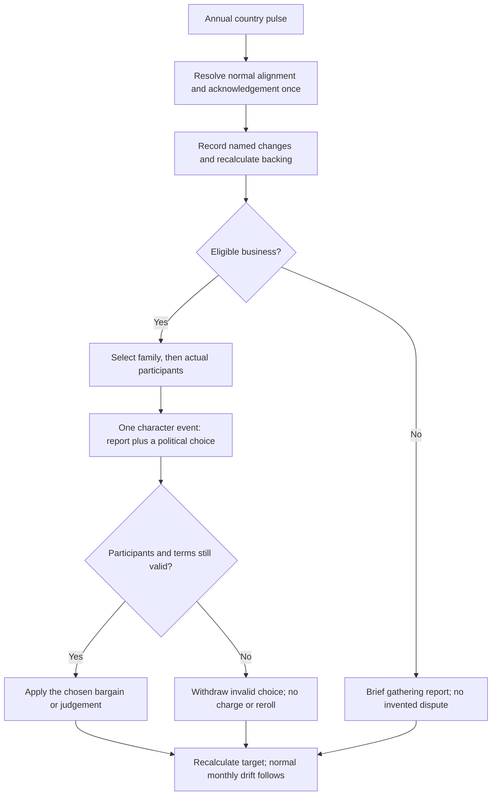

# Zulu court events: coalitions, reputation and chiefly power

24 October 2026. **Design exploration, not implementation.** This records DP's proposed event families and geopolitical consequences against the current source. The [implementation record](zulu_court_implementation_spec_2026_10_19.md) remains the implemented baseline. All new event effects, prices and trait changes below are provisional unless explicitly marked agreed.

**Current decision, 25 October:** DP has agreed and locked the [complete character/reputation package](zulu_character_package_proposal_2026_10_25.md). The remaining event choices are consolidated in the [event package for agreement](zulu_court_event_package_2026_10_25.md), including six incidents, cadence, prices, geopolitical allegiance changes and failure cases. Use those documents for the current proposal; retain the alternatives and superseded numbers below as design history. No gameplay implementation is recorded by this update.

**Latest direction, 25 October:** DP has since separated ordinary events from Umkhosi and reopened passive politics as a persistent allegiance-transition process. The [new exploration](zulu_court_transitions_and_event_deck_2026_10_25.md) compares transition models and develops a 6–24-month deck without replacement. This supersedes annual incident coupling and the earlier rule that committed actors never reroll; the character package stays locked.

Recommended direction: retain autonomous annual politics, show its results through an annual court gathering, and present one consequential incident at that gathering. Make the regular pool about competing people and interests. Geopolitical decisions feed the same political records, outside the annual incident allowance. Replace the old direct Prerogative rewards when those routes are redesigned.

**25 October follow-up:** DP accepted B and the ordinary event-family direction, confirmed generic victory → one supporter / defeat → one opponent, and required the historical Kill Retief → lose Blood River → attack Swazi → lose sequence to provoke a coup/civil war. The [Umkhosi and dynastic-balance supplement](zulu_umkhosi_and_dynastic_balance_2026_10_25.md) researches the annual setting, calculates the limits of headcount consequences and develops new reputation/crisis proposals. Its guarantee mechanism and exact values remain provisional. The earlier alternatives and numbers below are retained as design history, not implemented or universally approved effects.

**Earlier 25 October feedback:** victory achievements should be permanent. DP proposes a player choice between incumbent and claimant in a civil war, with strength influenced by coalition prominence, and fixed −10 P defeat shocks alongside new opposition. The [permanent-rewards and claimant-war exploration](zulu_court_rewards_and_claimant_wars_2026_10_25.md) develops these changes and separates verified script interfaces from unverified war delivery. Astra Max completed the first-principles review of all thirteen authored opening identities in the [new cast brief](zulu_starting_character_traits_research_2026_10_25.md). The later accepted character package is linked in the current decision above.

**Subsequent 25 October decision:** DP accepts that direction but defers the proposed explicit historical-sequence trigger: **playtest coalition/reputation changes and −10 P shocks first**. This supersedes the earlier guarantee as an implementation requirement. The [Vanilla package and role-effect comparison](zulu_vanilla_character_packages_2026_10_25.md) informed the now-completed trait decision. No source changes are made by these design records.

## Decision register

| Item | Status | Position or unresolved trade-off |
|---|---|---|
| One ordinary event per year across the whole set | superseded | DP now proposes a separate 6–24-month deck; geopolitics, succession and coercion remain separate. |
| Recruitment, changed allegiance, prominence and amaKhosi as overlapping families | agreed direction | DP accepted the event direction; six initial templates below remain subject to concrete scenes and tuning. |
| Annual chiefly meeting | event coupling superseded | The new proposal uses it only to report autonomous politics; ordinary incidents move to their own deck. |
| Separate current allegiance, future succession pledge and constitutional alignment | agreed | Existing political model; do not collapse these into one generic pledge. |
| Character portraits | provisional | Installed single- and two-character event layouts support the presentation. DP rendering remains necessary. |
| Dispute between two unpledged actors | provisional | Side with one, or pay to settle; specify whether the rejected party opposes the king now or backs another future successor. |
| Guns versus chiefly power | provisional | Tie the concession to chief-mediated procurement, not every firearm acquisition. |
| Rising prominence of a pledged character | provisional | A benefit to today's coalition may strengthen an unwanted successor tomorrow. |
| Retief, Blood River and Swazi rewards | provisional | DP's one/two-supporter examples are starting candidates, not approved effects. Compare actual prominence, existing traits and enforced outcomes. |
| Campaign popularity rewards | agreed and locked | +40 permanent Q per victory; first qualifying victory removes Usurper. Each outright defeat gives −20 permanent Q and −10 P. The character package owns the complete values; temporary alternatives below are superseded. |
| Klip River cession, Boer accommodation and defiance | provisional | Cession can separate present loyalty from a future pledge; other consequences developed below. |
| Meaning of “defector” | provisional complete proposal | Campaign recruitment uses neutrals; real betrayals require a concrete grievance/breach. The consolidated event package develops this distinction and exhausted-pool behaviour. |
| Generic victory/defeat | agreed | One new supporter/opponent respectively, confirmed by DP. Bespoke routes must not also receive the generic result. |
| Explicit historical defeat-sequence trigger | deferred by DP | Playtest ordinary coalition changes, reputation and fixed shocks first. No unconditional sequence override is authorised. |
| Claimant event and force balance | agreed direction | Player chooses a playable side; coalition prominence must materially affect the war. Native army allocation and same-constitution delivery remain unverified. |
| Immediate defeat shocks | agreed trial direction | −10 P per relevant loss. This represents an immediate setback but does not independently guarantee crossing −50. |
| Starting traits of the whole authored cast | agreed and locked | All thirteen opening identities and controlled initial generation are accepted in the character package; source inventory below remains evidence, not an outstanding approval list. |
| Exact magnitudes and repeat limits | provisional | First-pass ranges below; numerical tuning follows the trait decision and DP playtests. |
| Radicals/loyalists as population effects | deferred | “Supporter” in this brief means a court representative, not a Pop becoming Loyalist. |
| Same-constitution claimant war | open | Existing test-only prototype remains unverified. These event proposals do not establish a working war route. |

## What happens today

### Three records, three different changes

| Record | Example | Immediate effect on Prerogative |
|---|---|---|
| Current allegiance | Mawa begins supporting Dingane, or a named rival | Changes the prominence-weighted court backing H. |
| Future succession pledge | A chief serves Dingane but promises to support Mpande after his death | Does not itself change H. Changes the next succession coalition. |
| Constitutional alignment | A representative joins the amaKhosi constitutional tendency | Contributes to that movement's recruitment; movement support subsequently affects M. It does not by itself choose a king. |

A house's eligible adult prominence is summed once and follows its head's commitments. Unaffiliated councillors contribute individually. A junior member's personal endorsement does not independently transfer the whole house. Princes' own prominence already counts; do not recruit it twice. Prominence rewards can change which member leads a shared house, with consequences for its commitments.

### Annual passive politics

The current annual country pulse runs constitutional alignment, voluntary acknowledgement, one routine episode, then recalculation.

- Constitutionally neutral adult representatives receive one competing roll: royal chance = `30 × royal support fraction` percent; chiefly chance = `30 × chiefly support fraction` percent. At 5.9% support for each movement, those chances are 1.77% each. Otherwise the actor remains neutral. Existing constitutional commitments do not reroll.
- Personally uncommitted, present adult representatives have `clamp(5 + ruler popularity / 5, 0, 25)%` chance of acknowledging the incumbent. This only recruits for the incumbent. It does not allocate allegiance among princes and does not create future-successor pledges.
- At Popularity −25 or below this acknowledgement chance is zero; at 0/25/50/100 it is 5/10/15/25%. With fourteen eligible neutral representatives, the expected recruitment is respectively 0/0.7/1.4/2.1/3.5 per year. These are expectations, not guaranteed headcounts, and the pool shrinks as actors commit.
- Constitutional alignment currently checks home-country membership; personal acknowledgement requires presence. Exile therefore needs explicit treatment in a meeting design rather than silently assuming both populations are identical.

There is already one routine event per eligible annual pulse, with no extra no-event chance. Reservations, an accession episode or a tracked dynastic war can prevent it. The current selector picks an actor first, then one of the valid events. Any registered, present, living adult other than the ruler or a retired character can be the generic actor; specialised branches have additional conditions. It is not restricted to personally unpledged characters.

With a fixed pool of twenty equally selectable actors, a particular character is selected on average once in twenty years. Their specific event is rarer still. **Choosing a valid family first, then suitable actors, gives the proposed families a reliable presence without increasing the annual cadence.**

### Current ordinary pool: five templates

| Event | Current eligibility and consequences | Redesign issue |
|---|---|---|
| `.210` An Undertaking Before the Houses | Representative without a future pledge; eligible prince. Accepting promises the succession to the prince and clears current allegiance. | Future support need not automatically mean abandoning the present king. Make that a specific conflict, not the universal cost of a future pledge. |
| `.211` Service Before the Council | Any eligible actor. +10 Popularity/+10 Prominence for five years, or the existing conditional, once-only firearms reward. | The political beneficiary and opportunity cost should be visible. |
| `.212` The Price of an Undertaking | Eligible non-royal representative and prince. Chiefly privileges or a Chiefly Council promise buys a future pledge. | Useful foundation; must distinguish buying present co-operation from securing a successor. |
| `.213` The Witnesses Remember | Actor has the broken-undertaking modifier. Release commitments and lose 10 ruler Popularity for five years, or leave unresolved. | Better as a consequence of a real agreement than a generic interchangeable incident. |
| `.214` A Judgement Heard Beyond the Court | Any eligible actor. Ruler ±10 Popularity for five years; the adverse ruling also strengthens the actor. | Give the ruling concrete interests and named winners/losers. |

These are all country events. An `event_portrait.dds` icon does not supply a portrait layout. Japan's `shogunate.1` uses `event_window_1char_tabloid` with an actual character scope; Vanilla royal-wedding events and Gates of the Bosphorus use two-character layouts. SB can retain country-event scope and use those layouts for the participants. No new GUI framework is needed for the initial meeting design.

## Three ways to organise the annual politics

### A — Autonomous politics, separate annual incident

Run the existing two passive systems, recalculate, then choose a valid family and its actors. Changed commitments appear in the court; a small message can point to them. The one ordinary popup is entirely devoted to the incident. This preserves the greatest space for flavour in each event, but a player can still miss why a coalition changed before the incident appeared.

Example: Sotobe independently acknowledges the king; the year's popup concerns a dispute between two other neutral representatives. The player can fund a settlement or favour one of them. Sotobe's acknowledgement stands regardless of the dispute. If there is no valid dispute, another family can be selected; if there is no valid business, there is no fabricated confrontation.

Death or absence invalidates the affected option rather than secretly replacing its named participant. Passive changes happen once whether or not the popup is answered. This is the smallest change to the implemented system. It fits the existing cadence but only partially answers DP's visibility concern.

### B — Annual gathering: report autonomous changes and settle one matter

Run the passive systems once, record their results, recalculate, then open one court gathering with a short account of who changed position and one contextual incident. The meeting is a presentation and political opportunity; it does not grant an extra recruitment roll. A neutral representative who has just acknowledged the king is no longer eligible for that year's two-neutral-house dispute.



Example: the meeting reports Sotobe's acknowledgement, then shows Mawa and an eligible rival house head arguing over an appointment. The choices show each house's prominence and the consequences of favouring it. Paying to settle the quarrel preserves neutrality; it does not buy two endorsements at a discount. The player experiences one annual political occasion with autonomous actors and a real decision.

If no allegiance changed, say nothing about changed allegiances. If there is no eligible matter, a short report can replace the choice; do not fill the slot with a forced betrayal. An outstanding succession or court episode can defer the gathering without rerolling already completed passive politics or creating a backlog of several annual popups. The existing annual reservation provides a useful starting point, but retaining the report through deferral would need implementation and engine checks.

This is the recommendation: it makes ordinary politics visible without making every allegiance a gift from the player. The gathering is a gameplay abstraction, not a claim that a precisely dated annual parliament operated in this form. In the Chiefdoms constitution the language and participants refer to the presiding chief rather than assuming a king.

### C — Event-driven personal recruitment

Remove the silent incumbent-acknowledgement roll. At the annual event a neutral representative offers co-operation, or a dispute creates an opportunity to recruit one. Constitutional movement alignment can still operate independently and be reported; future pledges remain explicit bargains. The selected incident and its choices now determine whether any personal recruitment happens that year.

Example: a chief requests recognition of privileges. Accept and gain that following while strengthening amaKhosi; refuse and retain the current coalition. A service/reputation event selected instead produces no new endorsement that year. Under succession pressure, the player has the cash interaction and authored political episodes but cannot depend on passive acknowledgement.

This is highly legible and makes every new personal promise feel earned. It also makes one event per year a severe recruitment bottleneck, especially with a large generated court. It gives the ruler disproportionate control over apparently autonomous politics, and the AI needs comparable choice rules. Increasing the number of recruits per event or selecting several offers would undermine the agreed small annual decision. Viable, but less consistent with DP's expectation that the player tools manipulate an otherwise functioning political process.

| Criterion | A: separate incident | B: annual gathering | C: event-driven recruitment |
|---|---|---|---|
| Autonomous personal support | Retained | Retained and reported | Replaced by event opportunities |
| Ordinary player decisions | One per eligible year | One per eligible year | One per eligible year |
| Main benefit | Least interface work; more narrative room | Clear connection between court changes and player choices | Maximum control and visibility |
| Main cost | Important background changes remain easy to miss | Event must keep its report concise | Recruitment bottleneck and greater player control of other actors |
| Native precedent | Ordinary character events | Native character event plus saved report | Native character choice events |
| Fit | Good conservative option | Recommended | Alternative if passive support is unwanted |

## Six initial incidents across four overlapping families

The families are **recruitment and allegiance**, **succession undertakings**, **service and prominence**, and **chiefly privileges and reform**. They are not mutually exclusive tags: a procurement event can strengthen a chief, a movement and a future claimant. Select among valid families first; the exact weights are tuning. Avoid the same principal dispute in consecutive gatherings. Do not give every named character a mandatory bespoke annual event.

The values below are starting proposals. G means maximum gold-reserve capacity, consistent with the existing cash-pledge interaction. Ordinary event bargains must not become a cheap, repeatable substitute for buying a guaranteed endorsement.

| Incident | Participants | Developed choices and trade-off |
|---|---|---|
| **Two houses dispute an appointment or cattle award** | Two distinct, personally uncommitted representatives with a plausible contested interest | Favour A: A acknowledges the incumbent, B joins a displayed rival. Favour B: reverse them. Fund a settlement: around 15% G, both remain personally uncommitted. If no viable rival exists, the rejected party can retain a grievance; do not manufacture a claimant. A variant can send B into a rival's *future* coalition without present rebellion, explicitly labelled. |
| **An undertaking on conditions** | Neutral representative; incumbent or actual successor candidate | Gain the displayed commitment by recognising chiefly privileges (+20% amaKhosi attraction for ten years, retaining the existing once-per-reign/non-stacking bargain), or promise the Chiefly Council, or refuse. A Council promise and an attraction concession are alternative prices. The event says whether the promise is for today or the next succession. |
| **A change of patron** | Rival supporter and an incumbent supporter competing over an actual office or privilege | Reconcile with the rival's backer: that house joins the king, while the displaced supporter withdraws to neutrality. Defend the existing supporter: keep both commitments. The relative house weights make the exchange attractive or costly. A broken earlier undertaking can instead cause a genuine king-to-rival defection. Do not randomly reroll loyal houses without a grievance. |
| **A rising reputation** | A non-ruling pledged actor whose advancement has a plausible competing consequence | Recognise the achievement: +10 Popularity/+10 Prominence for five years. Discredit: provisionally 10% G, −10 actor Prominence for five years and −5 ruler Popularity for five years; if the actor currently serves the ruler, they withdraw that endorsement. Do not apply a double loss of prominence and allegiance without showing it. An ally who backs another future prince supplies the strongest dilemma. |
| **Guns through chiefly connections** | Active firearms JE; an actual chief acting as intermediary | Accept the chief's arrangement: existing minor firearms progress and +20% amaKhosi attraction for five years. Fund royal procurement: same progress for provisionally 20% G, without that concession. Delay: neither reward nor penalty; foregone progress is the opportunity cost. The attraction is not twenty percentage points of support. Access, cooldown and repeat reward limits must prevent farming progress or refreshing a large modifier through duplicate offers. |
| **A promise for the next succession** | A representative serving the incumbent but without a future pledge; an eligible prince | Accept their proposed future pledge without clearing current service; seek a different pledge through a stated concession; leave the succession open. This can put a powerful current ally behind an unwanted successor. It does not designate an heir or create hostility to the current king unless the narrative explicitly concerns that conflict. |

The dispute is not automatically a positive Prerogative event. Gaining a house of 50 prominence and losing another 50 from neutrality mobilises both camps: with λ = 0.25 it can reduce an already dominant king's relative backing. This is a worthwhile trade-off if shown clearly; paying to preserve neutrality then has a real political purpose.

Use named consequences in the choice tooltip: who joins whom, how much represented prominence moves, which future promise changes, and which movement receives attraction. Do not call a court supporter a “Loyalist” where players could mistake it for the Pop category. A junior house member is suitable for a reputation event, but a pledge transferring a house must bind its representative. Generated eligible adults remain part of the pool; their generated surnames do not establish historical kinship.

Two portraits suit disputes and bargains; one suits an emerging favourite. The event's country stays the governing scope and its icons point to the actual captured characters. Reopening a popup must not select a different actor, reprice a promise without notice or roll a second outcome.

## How large is “one supporter”?

Use the [retained February 1836 checkpoint](compatibility/zulu_court_allegiances_2026_10_24.md): incumbent I = 206, rival R = 75, neutral U = 424, ruler Popularity Q = −75 and movement balance M = 0. These are one observed court, not universal new-game totals. With λ = 0.25, the target is approximately −2.74.

```text
H = 100 × (I − R) / (I + R + 0.25U)
T = 0.75 × clamp(H + Q/2, −100, 100) + 0.25M
```

The following isolates one change, holding all other prominence and movement support constant and avoiding the caps. Native changes to prominence following a Popularity reward are additional engine behaviour, not included in these estimates.

| Change | Change in target T |
|---|---:|
| Neutral representative with 25 prominence joins the king | +3.45 |
| Neutral representative with 50 prominence joins the king | +6.59 |
| Two neutral representatives of 50 join the king | +12.11 |
| Neutral representative of 50 joins a rival | −11.08 |
| Two neutral representatives of 50 join rivals | −20.36 |
| King's supporter of 50 withdraws to neutrality | −8.01 |
| King's supporter of 50 defects to a rival | −19.38 |
| Ruler gains 10 Popularity | +3.75 |
| Ruler gains 25 Popularity | +9.38 |
| Ruler gains 50 Popularity | +18.75 |

These change the target; P approaches it through the existing capped monthly drift. The full effects are not immediate P payments.

Two possible reward units:

- **Whole people/houses:** recruit up to one/two eligible representatives, with names and weights displayed. Strong narrative fit and faithful to DP's proposal, but outcomes vary. Recommend this initially, with contextual eligibility rather than always picking the most powerful head.
- **Fixed prominence budget:** recruit until a target amount is reached. More uniform headline rewards, but whole-house weights overshoot and small houses become disproportionately convenient targets. Splitting one house's commitment to hit an exact budget conflicts with the agreed house model. Not recommended for the first pass.

“Defector from unpledged” is therefore best labelled **a new rival supporter**. A true defection removes the same weight from the incumbent and adds it to opposition. Keep the latter for broken undertakings, serious betrayal or an explicitly harsher defeat outcome. If there are fewer eligible participants than the proposed count, apply the actual available changes; do not generate replacements or secretly overwrite other commitments to meet a quota.

The harsher defeat design is defensible if losing a major war is meant to precipitate a regime crisis. In the observed opening court, Dingane has only two other personally committed representatives: Ndlela and Dambuza. Two genuine defections would therefore strip away all his external committed support, not merely give two of the fourteen neutrals a reason to oppose him. That may be the intended Blood River trajectory; it should be a conscious consequence, not an accidental interpretation of a headcount. Personal defection alone must not silently add a future-successor pledge as well.

## Geopolitical consequences

### Existing trait and reputation effects to replace or retain deliberately

| Trait/reward | Installed effect relevant here |
|---|---|
| Wrathful | No Popularity bonus; +100 ruler Authority, alongside health/command effects. |
| Honourable | +25 Popularity. |
| Brave | +25 Popularity, with additional military/health effects. |
| Cruel | −50 Popularity. The Retief branch currently adds it if the ruler is already Wrathful and lacks Cruel. |
| Cautious | −5 Prominence. |
| Tactful | No direct Popularity or Prominence bonus. |
| Ambitious | +10 Prominence. |
| Blood River victory | Direct +20 P, existing firearms progress, +15 Dingane Popularity without expiry and Brave if absent; country triumph also remains. |
| Blood River defeat | Direct −10 P and a −25 Popularity modifier for ten years, plus the existing firearms reward. |
| Swazi conquest victory | Direct +30 P and +10 Dingane Popularity without expiry; existing territorial/story effects. |
| Swazi checked/stalemate | −10 Popularity for ten years, decaying. Distinct from an outright defeat. |

The Retief choices currently also change P directly: honour −5, murder +15, guns +5. Klip River cession/accommodation/defiance give −5/+5/+15 P and Cautious/Tactful/Ambitious respectively. Swazi refusal gives −5 P. These numbers must be reviewed as replacements, not retained beneath new political consequences.

### Proposed first-pass map

| Moment | Proposed political consequence | Trade-off and boundary |
|---|---|---|
| Murder Retief | Wrathful, if retained as the chosen character consequence; one neutral representative acknowledges the king | Its Authority bonus matters even though it gives no Popularity. Remove the automatic Wrathful-to-Cruel escalation in the proposed redesign; repeated possession of a trait should not silently substitute a much larger penalty. War and diplomatic consequences remain substantial. |
| Honour the bargain | Honourable if absent | +25 Popularity already shifts the target by up to +9.38 at fixed weights. Do not also add an unexplained loyalty award to make it look competitive. Land/diplomatic consequences remain the price. |
| Guns bargain | One neutral representative backs a displayed rival; amaKhosi +20% attraction for ten years as an initial range | Modernisation and foreign accommodation empower or alienate specific interests. Keep the existing firearms bargain, not a second invented progress award. Explain why this brokered agreement strengthens chiefs. |
| Blood River victory | Up to two neutral representatives acknowledge the credited ruler | Actual verified victory once; retain useful military/firearms consequences. Replace the direct +20 P. Reconsider automatic Brave: victory by a country's armies does not necessarily establish the sovereign's personal bravery. |
| Blood River defeat | Up to two neutral representatives join a displayed rival | Recommended starting interpretation of DP's examples. Two defections by existing loyal houses are much harsher. Do not automatically stack the old −25 Popularity penalty on top; choose that combination explicitly if the defeat should be devastating. |
| Launch the Swazi campaign | One neutral supporter joins the ruler | Bind the reward to the successful play launch, not repeatedly opening an event or an invalid attack choice. Select an actor with a plausible interest in the campaign. |
| Decline the Swazi campaign | One disappointed neutral supporter joins a rival | Coherent only if a named advocate has pressed for that campaign. Otherwise “do not invade” becoming automatic betrayal is too mechanical. A weaker variant promises future support to another prince instead. |
| Win the Swazi campaign by conquest | Up to two neutral representatives acknowledge the credited ruler | Require the authored territorial result. A generic war ending, an expired demand or a white peace is not conquest. Replace +30 P and review the +10 Popularity award. |
| Lose the Swazi campaign | Up to two neutral representatives join a rival | Keep outright defeat distinct from a checked campaign or stalemate. Do not reuse victory checks for any favourable-looking peace. |
| The same ruler wins both campaigns | One substantial reputation reward: provisionally +50 Popularity for ten years | This replaces the separate +15/+10 victory reputation modifiers and automatic Brave, rather than stacking over their current possible total of +50. It adds at most +18.75 to T at fixed weights before caps. The individual victories already earn support. Treat a different ruler's inherited campaign record separately. |
| Cede Klip River | One current supporter withdraws; that same house pledges its future support to the displayed eligible prince | Models dissatisfaction with the incumbent and a succession consequence without forcing immediate rebellion. Cetshwayo is only selected when actually eligible; do not designate him automatically or use a child as an adult coalition leader. If he is unavailable, use another eligible prince or only the current withdrawal, with honest preview text. |
| Recognise the Boer settlement | A named intermediary gains +10 Prominence for five years and, if personally neutral, supports the king | Builds a broker the king must accommodate. Their existing future pledge and constitutional tendency remain intact, so the same action may strengthen an unwanted successor. An alternative is chiefly privileges for their support, but do not add both prices by default. Preserve the territorial bargain. |
| Defy Natal/Britain | One contextually eligible neutral representative acknowledges the king | Resolve through a named defender of the disputed claim. The punitive play is the real risk; do not stack free direct P, Ambitious and popularity on top. Later victory or defeat can overturn this early rally. |

Any two-person outcome should choose distinct representatives and avoid counting the same house twice. Geopolitical events are not limited by the annual incident slot. The combined-war reward needs both verified achievements under its credited ruler; it is not a repeatable national badge transferred to each successor. Preserve the exact war callbacks, subject/territory contracts and unrelated ongoing wars. No blanket peace requirement is proposed.

The +50 combined reward still only takes the observed opening Dingane from −75 to −25 Popularity if nothing else changes. Passive acknowledgement would remain zero. That is a strong reason to settle his starting package and the old Dynastic Crisis penalty alongside these rewards, rather than increasing event bonuses until they overpower an arbitrary opening penalty.

## Starting-character review

The aim is a differentiated cast, not identical princes or predetermined historical outcomes. Review political skills, popularity, prominence and military effects together. The existing opening gap is entirely explainable: Mpande has 25 prominence and Gqugqu 50 in the checkpoint; their direct trait differences account for 25. Neither has another house pledged to his next succession there.

Grobler's study places the Retief decision within Dingane's council and discusses competing, partly retrospective accounts. That supports council-led scenes, not treating the current Hedonist/Imperious/Ruthless combination as a verified psychological portrait. [Grobler, 2011](https://scielo.org.za/scielo.php?pid=S0018-229X2011000200007&script=sci_arttext). Shamase explicitly challenges portrayals of Mpande as simply incapable or passive; Compliant deserves reassessment rather than use as a historical fact. [Shamase, 2014](https://samilitaryhistory.org/vol164ms.html).

The [18 October historical brief](zulu_chiefly_coalitions_research_2026_10_18.md) and [19 October oral-history brief](zulu_oral_history_cast_research_2026_10_19.md) supply the remaining evidence qualifications. Recommendations below are interpretations and review directions, not newly established personality facts.

### Opening identities

| Character | Authored starting traits | Review direction |
|---|---|---|
| Dingane | Hedonist, Imperious, Ruthless | Combined −65 Popularity, reaching −75 with the existing crisis modifier. Reassess the triple negative package and crisis penalty together. Prefer a deliberate personality plus actual political opponents over an unsupported caricature which event rewards must constantly offset. |
| Mpande | Compliant, Honourable, Tactful, Reserved, Basic Political Operator | Compliant is questionable as a description of his political career. Honourable and Reserved cancel their direct Popularity effects. A smaller package centred on political negotiation is worth testing; no final replacement yet. |
| Gqugqu | Ambitious, Imperious, Basic Political Operator | Ambitious/Imperious give +20 direct Prominence, with no validated personality basis in the research. His claimant status already gives +5. Review those two before compensating Mpande with invented allies. |
| Mkabayi | Ambitious, Tactful, Elder | Elder and political brokerage are useful; Ambitious is an interpretation requiring a stronger basis. Do not infer cruelty from hostile descriptions. |
| Ndlela | Ambitious, Tactful, Elder | Distinguish senior office from military skill or personality. Preserve AF/commander identity; do not grant tactical upgrades merely to balance his house weight. |
| Zulu/Komfiya | Imposing, Brave, Popular Commander | Retrospective testimony provides some support for a martial portrayal; Popular Commander is still a game judgement. Keep the research's uncertainty about residence separate from traits. |
| Dambuza | Empty authored list | Native generation supplies random traits. Decide a deliberate office/skill package or deliberately controlled absence of unsupported personality traits. |
| Mawa | Empty authored list | Same generation issue. Later Gqugqu allegiance is not evidence of an 1836 pledge or personality. |
| Nongalaza | Empty authored list | Same issue. Later military service can motivate role/skill review without backdating personal allegiance. |
| Sotobe | Empty authored list | Same issue. Diplomatic/command activity is a better basis for a skill review than an invented temperament. |
| Cetshwayo | Ambitious, Imperious, Basic Diplomat | Child at launch. Keep adult coalition weight unavailable; reassess which adult-career traits should be earned rather than preset. |
| Mbuyazi | Ambitious, Direct, Basic Political Operator | Child at launch. Direct is unvalidated in the existing research; do not encode his later defeat as an inferior starting personality. |
| Uthumbu | Tactful, Basic Political Operator | Explicit alternate-history child. Label authored characterisation, maintain age restrictions and avoid presenting traits as recovered historical evidence. |

### Later creation packages: included in the review, not moved to 1836

| Identity/group | Current authored package | Review direction |
|---|---|---|
| Masiphula, Maphitha, Mnyamana, Godide, Hamu, Sekethwayo | Empty lists in the court templates | The same random-generation issue applies when they are introduced. Use the dated research and actual office; unknown commitment stays unknown. |
| John Dunn | Basic Political Operator | Review as a representation of brokerage; one skill does not itself assert a royal/chiefly allegiance. Additional native generation still needs checking. |
| Zibhebhu | Ambitious, Arrogant, Reckless, Pillager in the installed template; no matching SB/CMF template override found | Review the personality and military package against his own later career. Registration, dated availability and office assignment are separate from the template's traits; do not summon him early. |
| Dinuzulu | Ambitious, Imperious, Basic Diplomat | Currently resembles Cetshwayo's package. Review his own career rather than inheriting a personality with the dynasty. |
| Solomon | Tactful, Compliant, Basic Political Operator | Review independently; do not equate political constraints with a compliant temperament. |
| Fictional Mbuyazi/Uthumbu successors | Ambitious, Tactful, Basic Diplomat | Authored fiction, not historical evidence. Avoid guaranteed strong adult skills before their actual political careers. |

**Confirmed generation trap:** `traits = { }` does not disable Vanilla's `trait_generation`. The installed default assigns an adult with zero trait value a random personality and skill, with further age-dependent generation. “No unsupported traits authored” therefore does not mean “no random traits in the campaign.” A future trait pass should deliberately control the affected templates' generation while preserving intended childhood and experience behaviour. Do not replace the global default for every country. The exact replacement packages remain open, and all runtime appearances remain DP checks.

### Two coherent trait policies

1. **Conservative retune:** retain most Vanilla characterisation, remove demonstrably unjustified extremes and tune event rewards around what remains. Smaller scope and familiar characters, but retains some inherited assumptions and potentially leaves Gqugqu/Dingane strongly shaped by unvalidated personality choices.
2. **Evidence-led role packages, with earned reputations — recommended:** author a small supported role/skill package, add personality only where justified or explicitly authored, and let witnessed deeds produce temporary reputation or appropriate permanent traits. Preserve age, mortality, role and allegiance mechanics. More research and explicit template-generation work, but political events then explain the differences players see instead of merely compensating opening trait stacks.

Neither policy means every victory grants Brave or every accommodation grants Tactful. Temporary public reputation is usually the better instrument for the reception of a policy. A direct personal deed can warrant a permanent trait. Do not change every broad ideology while reviewing personality traits.

## Cases the design must handle

- **No neutral representatives:** use service, existing undertakings or a report; no annual creation of new clients to refill the pool.
- **No rival candidate:** grievance or future uncertainty, not an invented pretender. A prince's absence does not automatically turn a dispute into an amaKhosi conversion.
- **Mixed future/current commitments:** reward and penalise the actual affected record. A chief may remain loyal to the king while backing a rival heir.
- **Dead/exiled actor or changed ruler while the event is open:** revalidate; no unseen substitution, charge or punishment. An exile may appear in a relevant authored diplomatic event without attending the domestic gathering.
- **Prominence changes the house head:** recalculate the leader and explain who now speaks for that house; do not award both members a duplicated constituency.
- **Native popularity/prominence caps:** live engine totals take precedence over isolated arithmetic estimates. Verify the interaction rather than adding a second scripted prominence response to popularity.
- **Chiefdoms constitution:** amaKhosi strength helps the incumbent constitution rather than functioning as a universal penalty. Suppressing royal support and securing personal co-operation remain different acts.
- **Succession, geopolitical event or war during a gathering:** reserve each episode once. No extra peace gate; do not let a late answer undo an actual accession or repeat a territorial reward.
- **AI court:** passive politics remains identical; choose bargains according to the same current/future interests and affordability, not a hidden free recruitment bonus.
- **Reviewed prose:** mechanics changes require reporting contradictory approved wording to DP. Preserve the reviewed baseline and useful firearms/story rewards rather than deleting the whole old chain.

## Proposed next decision bundle

Recommend **B**, with autonomous acknowledgements reported rather than converted into player-granted favours; the six-template pool; whole named representatives as the reward unit; new opposition from neutrality as the initial war-defeat cost; and genuine incumbent-to-rival defection reserved for explicit betrayals or a deliberately harsher defeat branch. Keep future succession bargains separate. Use evidence-led trait packages and earned reputations, with the combined-war reward replacing existing stacking.

The substantive questions are whether the annual gathering should report autonomous changes or control them, and how harsh defeat-induced defection should be. Exact costs, attraction durations and household weights are tuning. Trait choices require a focused evidence-and-effects pass before new rewards are locked. No script, localisation, dependency, save or engine change is made by this exploration.

## Source trail and verification limits

Checked current SB source: `common/on_actions/sb_institutions_on_actions.txt`; `common/scripted_effects/sb_court_politics_effects.txt`, `sb_court_coalitions_effects.txt`, `sb_court_episodes_effects.txt`, `sb_zulu_dynasty_effects.txt`, `sb_zulu_dynasty_succession_effects.txt`; `events/sb_zulu_court_events.txt`, `sb_natal_crisis_events.txt`, `sb_swazi_frontier_events.txt`, `sb_klip_river_county_events.txt`; character history/templates and the retained opening-balance report.

Checked installed Vanilla: `common/character_templates/00_default_template.txt` and `country_zul.txt`; personality/skill traits; Japan's shogunate events and prose, royal-wedding events and character events. Consulted Gates of the Bosphorus two-character discussion layouts and Hail Columbia character events as presentation examples. These establish source precedents, not a successful SB engine rendering test.

The numerical table is an algebraic sensitivity calculation using one checkpoint's fixed inputs, not a forecast of the whole campaign. Movement attraction is not movement support; actual movement recruitment, participant availability, native prominence changes and event pacing need DP playtests after implementation. Same-constitution claimant-war verification remains pending independently.
