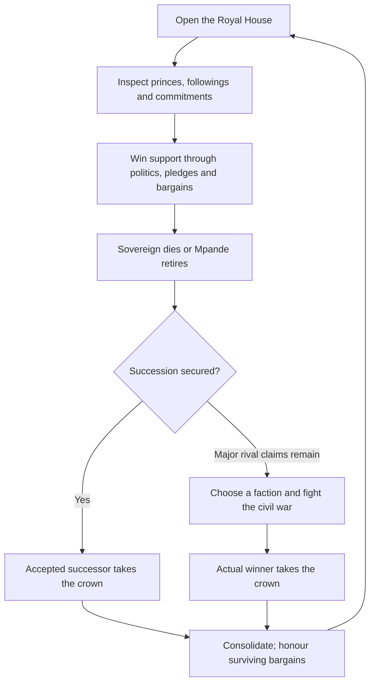

# Zulu court: implementation spec and iteration board

## 28 October, current: live claimant crises and future royal lines

DP reports a successful AI replay and explicitly authorises normal activation. The earlier explicit-test-only release hold below is historical and superseded. Low-Prerogative challenges, contested accessions/retirement and organised purge exposure now enter the existing native conflict controller without `.990` opt-in. The diagnostic event remains available; no thresholds, winner rules, sponsorship package or rebuilding formula change. Service/officer allocation is still an identified engine check, not claimed verified by the post-war saves.

- **Present a Son:** one newborn for each adult sovereign without a documented line, costing 50 P and immediately recognising the child. Dingane retains Uthumbu; Gqugqu and other undocumented lines use a generated Zulu name without historical provenance. The receipt belongs to the sovereign. No adult coalition is fabricated for a newborn; existing roughly-half supporting-Prominence recognition applies.
- **Known lines:** Dinuzulu enters in 1868 and Solomon in 1891 if the respective living father belongs to the court. Existing template-use history prevents recreation, including dead/exiled identities. Neither birth automatically selects a successor. The normal 25-P recognition action can designate minors; the existing regency controller remains in force. Mpande's existing sons are retained. No unsupported brothers of Dinuzulu are added in this pass.
- **Fecund:** +25 Popularity, +5% Health; no direct Prominence bonus. Vanilla still includes Popularity in Prominence. The amount is an explicit gameplay tuning choice, not a quantitative historical finding.

Next: DP tests Mpande's 1856 retirement and both Cetshwayo/Mbuyazi outcomes, including recruitment at the actual split, then the Thirteen Chiefdoms conflict. [Release/heir evidence](zulu_court_release_heirs_2026_10_28.md) and runtime cases 117–122 track the remaining work. No game launch, save migration, dependency update or wider Bantu rollout.

## 28 October, preceding: victory confirmed; firearms, politics and weaker-side floor

The post-war save confirms Gqugqu's original-country victory, restored Monarchy, a single institutional JE and surviving third-party princes. Native defeated-IG modifiers explain the severe Clout imbalance. Mirror firearms progress/completion at the actual split; remove only this dynastic war's newly acquired defeated-IG penalties on the winner, retaining earlier penalties and unrelated modifiers. Award +10 Prerogative, capped at 100, only on `.005.a` acknowledgement.

Regular allocation now reserves one existing level for the weaker coalition, divides the remaining levels by Prominence, rounds the weaker quota and assigns the exact remainder to the stronger side. Military households follow those whole-number barracks shares. Four levels at 177:334 therefore become 2:2 and staff 50:50. Conscription keeps its independent ratio and native caps. Preserve the strongest-side Zululand rule, original-country player choice, actual outcome controller and once-only rebuild. Retain universal temporary −20 Approval: the successful replay's sponsors were Devout/PB/RF/TU, so AF-only sufficiency is unproven.

**83 focused checks pass; all new engine checks pending.** Full discovery: 822 passed, eight historical skips and the one existing reviewed-localisation failure; no errors. Validator 15/17; compatibility/maps pass and Tiger has no changed-file diagnostics. Details are in the compatibility report. Use a checkpoint before side selection. Major performance investigation `PERF-20261028-01` is open; no speculative optimisation, saved-game migration or automatic challenge activation. [Current evidence and limits](compatibility/zulu_contested_crown_2026_10_27.md).

## 28 October, preceding: victory crash correction

The 14:18 crash is in the victory popup: `.005` used a nonexistent GUI window. Use Vanilla's single-character tabloid window and guard roster transfers against characters already owned by the actual winner. Existing outcome rules, portrait scope and prose remain intact. All 61 focused checks pass; DP must restart and replay the existing pre-victory checkpoint to verify the notification, surviving cast and cleanup. The latest saves confirm stronger Gqugqu receives Zululand, but Natal's staffing remains inadequate. [Crash evidence and remaining limits](compatibility/zulu_contested_crown_2026_10_27.md).

## 28 October, preceding: strongest homeland and military population

DP's latest replay verifies native creation after recruitment preparation, both named rulers, shared war identity and blocked generated heirs. It also exposes incorrect geography and staffing: Gqugqu has 334 backing against Dingane's 177 but receives Natal, where his three battalions stay empty; the requested eleven conscripts are absent.

Use the frozen coalition comparison to keep the stronger side in Zululand when both authored regions are held (tie: incumbent). Preserve the chosen contender in original ZUL, use native state weights with the CMF hook, and leave the one-state path unchanged. Before the once-only post-split rebuild, distribute existing servicemen and officers separately by workforce, moving the surplus with dependants to the recipient's recruitment state. Keep population totals, civilians and identities intact. No instant manpower or civilian conversion. Existing population-dependent conscription limits remain a practical constraint; do not describe requested levels as guaranteed retained forces.

**59 focused checks pass; new geography/staffing replay pending DP.** Full validator retains only the known reviewed-localisation failures. Automatic entry stays disabled. [Save evidence, implementation and limits](compatibility/zulu_contested_crown_2026_10_27.md).

## 28 October, preceding: recruitment preparation before native creation

The all-IG replay reached native creation but recorded a failed allocation on 6 June 1839, followed by Vanilla's three-month cooldown. DP authorised preparation before that stage. Either actual side choice now relocates one existing recruitment level into each empty owned state, taking it from a donor with more than one combined barracks/conscription level. Prefer barracks, retain the donor's training method, conserve each service separately and never empty a donor or invent capacity. The observed 4/17 versus 0/0 setup becomes 3/17 versus 1/0 before the movement is created. This destructive step runs once per answered episode; cancellation keeps the relocated buildings without another reset.

Retain the existing post-split rebuild to assign the frozen coalition quotas to the actual factions, independent of which state rebels. The choice tooltip discloses immediate preparations and lost unit manpower/experience/composition. Native creation, unit registration, staffing and final military advantage remain pending DP after a full restart from before the side choice. Automatic entry remains off and no cooldown/define is changed. **56 focused checks pass**; [implementation, limits and validation](compatibility/zulu_contested_crown_2026_10_27.md).

## 28 October, preceding: all-IG sponsorship trial

Broaden the reserved claimant movement's pressure and sponsor filters to every IG. Either side-selection option (`.004.a/b`, opened by `.990`) applies the existing −20 Approval modifier and temporary crisis ideology to all current-country IGs. Preserve ordinary leader ideologies, avoid stacking, retain the penalty on both actual sides, and clean up all groups on cancellation/resolution. Keep the opposition stance and other tuning fixed. Fifty-one focused checks pass; native creation remains pending DP. [Current implementation and validation](compatibility/zulu_contested_crown_2026_10_27.md).

## 28 October, preceding: opposition-stance trial

At DP's request, restore **Strongly Disapprove** for the incumbent Monarchy/Social Monarchy in the matching claimant ideology, retaining strong approval of its Contested counterpart. This supersedes the preceding approval trial. Keep +100% attraction, AF-only sponsorship/−20 Approval, 25-point activism growth, ordinary leader ideologies and the military rebuild unchanged.

February/March 1840 saves still have no organising war despite 100% activism, attached Gqugqu and AF internal backing above 13%. Preferred-law verification alone did not prove revolution eligibility. Fifty focused checks pass; native sponsorship/creation remains pending a restarted, paused pre-crisis replay. [Current evidence and limits](compatibility/zulu_contested_crown_2026_10_27.md). Automatic activation remains off.

## 28 October, preceding: claimant recruitment trial

The newest August/September replay still has no native war, although September verifies Contested Crown as the desired law and AF backing rises from 6.312% to 8.178%. Keep Monarchy approved and Contested Crown strongly approved: native demand evaluation accepts the preferred law without requiring opposition to the current one. The exact remaining creation blocker is unresolved.

DP requested additional population attraction. Add **+100%** to the existing crisis-only mobilisation modifier; preserve its cleanup, 25-point weekly activism, AF sponsorship and frozen coalition calculation. This first tuning value needs runtime verification after a full restart and pre-crisis replay. Fifty focused checks pass; full validation retains the known localisation failure. [Current evidence and verification limits](compatibility/zulu_claimant_demand_attraction_2026_10_28.md). The approved rebuilding trial below remains pending an actual split; automatic activation stays disabled.

## 28 October, preceding: approved rebuilding and stalled replay

DP approved rebuilding/dividing the forces for testing. Once the native split exists, count both actual factions' completed regular and conscript recruitment levels, give the claimant the rounded frozen `R/(I+R)` share and the incumbent the remainder, and rebuild once in each side's most populous state. Preserve existing training methods; do not add levels, combat buffs or repeated quota resets. This destroys the original units' manpower, experience and composition, as both options now disclose. The saved 177:334 quote gives Dingane 1 regular/6 conscripts and Gqugqu 3/11 under either player choice. Native capacity/staffing behaviour remains pending DP.

The latest 1 August 1839 save has 100% activism, attached Gqugqu, angry AF at −20 Approval and 6.338% internal backing, but no organising war. Correct the movement's blanket pressure prohibition to AF-only eligibility and its copied incumbent-popularity recruitment to claimant Popularity. The 10% pressure threshold differs from 5% sponsorship; these corrections do not establish the exact remaining native start blocker. Preserve the 25-point weekly growth and test opt-in. See the [current evidence and limits](compatibility/zulu_claimant_rebuild_2026_10_28.md), and replay runtime scenarios 99–102 after a full restart. No engine scenario is newly marked passed.

Validation: 49 focused checks pass; full discovery has 804 passes, eight historical skips, one unchanged reviewed-localisation failure and no errors. Validator 15/17, unchanged advisory Tiger totals. Engine creation, post-rebuild recruitment and military influence remain pending DP.

## 28 October, earlier: fixed Armed Forces sponsorship; redistribution awaits a design choice

Armed Forces are the sole permitted native sponsor. Either side choice applies −20 Approval until cancellation or conflict resolution, including the actual rebel country. The crisis ideology approves the existing royal law and strongly approves Contested Crown, reducing the Royalist-leader mismatch while retaining the distinct demand. Preserve ordinary leader ideologies and the native internal-support gate. The saved AF have 6.37% backing and +1 Approval; native creation under this change is pending a full-restart replay.

DP's proposed coalition-based military redistribution supersedes the earlier prohibition below. Its implementation awaits the requested choice about rebuilding barracks/conscription centres, which destroys the old units and their manpower/experience. No lossless script relocation effect was found. Keep existing forces intact meanwhile; no allocation fix or completed engine test is claimed. The same-country character-transfer error is separately fixed. See the [current compatibility report](compatibility/zulu_contested_crown_2026_10_27.md) for evidence, 44 passing focused tests and unchanged validation limitations. Automatic challenges remain opt-in.

## 28 October follow-up: Landowners sponsor the claimant crisis

At DP's request, move the temporary claimant sponsorship from the Armed Forces to the **Landowners**. Retain the existing crisis ideology and −30 Approval, applying and removing them on the Landowners of the actual countries. Preserve ordinary IG packages and leader ideologies; the movement's permanent leader-ideology pressure remains disabled. Activism, territorial allocation and named faction assignment are unchanged. Historical Armed Forces trial evidence below remains intact. The native 5% internal-support gate still applies; this change does not grant population backing. All 41 focused claimant checks pass; engine replay is pending from before the crisis.

## 27 October follow-up: install both contenders and retain the player's country

The completed April 1840 native split exposed an origin-only civil-war iterator: testing the rebel country's war list rejected the handoff and then cancelled the SB record. Track the exact recorded movement's war from the original country; both faction records retain that origin for monthly validation. See the [diagnosis and bounded native evidence](compatibility/zulu_contested_crown_2026_10_27.md).

At the split, replace generated rulers and heirs with the recorded contenders, preserving all members of the frozen cast. The player retains the original country whichever portrait they choose: backing the prince installs him in ZUL and places the sovereign in the rebel country. Backing the sovereign retains the previous faction assignment. AI courts retain sovereign/original versus prince/rebels. Route each frozen house to its contender, and target the **opposing** coalition's fraction of the two committed totals, bounded to 10–75%. No player switch, troop redistribution or additional combat modifier. Original laws and outcome/casualty rules still follow the actual winning identity.

This supersedes the earlier player-switching design, not the agitator attachment or complete-cast snapshot. Initial and late generated heads are removed; existing princes/children and a minor's regent remain protected. Keep heir generation blocked while the exact conflict is active. Runtime scenarios 99b–103a are updated; replay from before the side choice after reloading the mod. Existing broken split saves are not repaired, and automatic activation remains disabled. Validation results are recorded in the compatibility report; all new engine checks remain pending DP.

## 27 October follow-up: claimant agitator and frozen coalition survival

Implemented DP's revised civil-war consequences. Either side-selection option in `.004` (opened through the `.990` test opt-in) adds the **opposing prince** as an agitator. Only that named character qualifies for the crisis movement's character support; its priority weight makes it his preferred eligible movement. Weekly scripted advancement waits for his actual attachment to that exact movement. Preserve his ordinary ideology and the already-frozen Prominence ratio; remove only a crisis-added agitator role on cancellation.

Before the split, retain a separate complete character roster and political records, including children, advisers, third-party princes and uncommitted characters. Both actual countries carry the roster and frozen faction lists. Victory kills **every surviving member of the defeated coalition**, including its contender. Living third-party/uncommitted characters and the winning coalition return to the actual winner with their original identities, house membership, constitutional alignment, current patrons, future pledges and outstanding bargains. Current endorsements are rebased to the winning sovereign; accession still fulfils its separate succession promises. Do not recreate dead characters or infer victory from their death. This explicitly supersedes the earlier defeated-contender-only rule and its exile exception.

Example: Mpande defeats Dingane → Dingane, Ndlela and other recorded incumbent adherents die; Gqugqu, Cetshwayo and other surviving characters outside that losing coalition remain. A third prince is not assigned to either faction merely because he is royal. The [compatibility report](compatibility/zulu_contested_crown_2026_10_27.md) records implementation and verification; runtime scenarios 99c and 103a are pending DP. Start before reserving the challenge so the new snapshot exists. No save migration or automatic activation.

Validation: **103 focused checks pass**. Final full discovery: **790 passed, eight historical skips, one unchanged reviewed-localisation failure, zero errors** (799 tests). Full validator: **15/17 gates passed/warned/skipped**; the two failed gates report the existing `.060`/`.080`/`.050` reviewed-prose drift. Tiger retains its existing advisory totals with no changed claimant-file diagnostics. Native attachment and both victory/country-cleanup paths remain pending DP.

## 27 October follow-up: guard institutional setup during rebel creation

The two latest native crash reports reach claimant rebel-country creation, then crash in JE activation during inherited-law callbacks. Law inheritance precedes land transfer and AI creation. Add a live-country requirement to the institutional law callback; its native state-count check excludes that unfinished phase. Existing revolution-start setup then initialises the actual rebel court; ordinary reform updates remain immediate. No faction, military, sponsorship, reward or save changes. [Crash diagnosis and evidence](compatibility/zulu_contested_crown_2026_10_27.md). DP replay is pending under runtime scenario 99b.

**52 focused checks pass**. Full discovery: **784 passed, eight historical skips, one unchanged reviewed-localisation failure, zero errors** (793 tests). The full validator is **15/17 gates passed, warned or skipped**; both failures are the pre-existing `.060`/`.080`/`.050` reviewed-prose drift. Compatibility, maps and native contracts pass. Advisory Tiger retains 1,073 errors / 149 warnings with its older 1.13.5 schema. Reports: `/private/tmp/sb-claimant-crash-2026-10-27/regression-before.txt`, `focused.txt` and `static.txt`.

## 27 October follow-up: stronger campaign defeats and Ndlela exemption

At DP's request, Blood River and Swazi defeat now cost **30 Prerogative** and reserve **two** least-prominent eligible incumbent-supporting houses, alongside the existing most-prominent uncommitted house, for the same rival. Rank by aggregate house Prominence. Explicitly exclude `ZUL_ndlela_kasompisi` from both defection slots; high Prominence alone does not protect him when smaller pools are exhausted. Reserve a bounded list once and revalidate each named house independently on acknowledgement; skip stale or missing targets without replacements. Keep future-successor pledges, permanent −25 Popularity penalties, victories and generic-war rules unchanged. This supersedes the one-defector/−25 P campaign rule below.

Both event options preview the reserved defections and the −30 P shock. **68 focused checks pass**, including both campaigns, repeated acknowledgement, stale participants, a single eligible supporter, exhausted pools, aggregate ranking, two successive defeats and Ndlela at low/intermediate/high Prominence. Runtime replay remains **pending DP**, scenarios 90–91.

Full validation: **782 passed, eight historical skips, one unchanged reviewed-localisation failure, zero errors** (791 tests). The full validator has **15/17 gates passed, warned or skipped**; both failures are the existing `.060`/`.080`/`.050` reviewed-prose drift. Compatibility, maps and native script contracts pass. Advisory Tiger remains at 1,073 errors / 149 warnings with its older 1.13.5 schema; none concern the changed statements. Reports: `/private/tmp/sb-campaign-defeats-2026-10-27/focused.txt` and `static.txt`. No game launch was performed.

## 27 October follow-up: Armed Forces sponsor the claimant crisis

Implemented at DP's request after the native IG blocker diagnosis. An answered, pending crisis gives only its country's Armed Forces the matching temporary Claimant's Cause ideology (priority 250) and −30 Approval. The movement demands Contested Crown while remaining neutral on the original monarchy, allowing a Royalist leader to satisfy native ideological compatibility without replacing their personal ideology. Disable permanent leader recruitment from this crisis movement. Remove sponsorship on cancellation, abandoned-conflict cleanup and both outcomes, including inherited rebel-side packages.

Native 5% backing remains required; the retained replay had 7.852%. Weekly growth stays at 25 percentage points, coalition territorial targets are unchanged, and no troops or global defines are altered. The penalty can activate negative native Armed Forces traits while active. The source implementation is ready for explicit testing; native creation, IG inheritance/cleanup and army allocation remain pending DP. See the [current trial and historical blocker](compatibility/zulu_contested_crown_2026_10_27.md). Automatic activation remains disabled.

Validation: **31 focused claimant checks pass**. Full discovery: **781 passes, eight historical skips, one unchanged reviewed-localisation failure, zero errors** (790 tests). The full validator reports **15/17 gates pass, warn or skip**; both failed gates remain the known reviewed-prose drift in `sb_klip_river_county.060`, `.080` and `sb_natal_crisis.050`. Compatibility, maps, native contracts and delayed-event checks pass. Tiger was run separately after the wrapper's PATH-based skip: the unchanged advisory totals are **1,073 errors / 149 warnings** with no diagnostics in the changed claimant script files. Its older schema remains a limitation. Outputs: `/private/tmp/sb-af-sponsor-2026-10-27/focused-final.txt`, `static.txt`, `tiger.txt`. No game launch or live war-creation verification was performed.

## 27 October follow-up: claimant war blocked by native IG eligibility

DP's new 1 January 1840 replay reaches 100% claimant activism but still has no organising war. Read-only analysis of the installed engine establishes that a revolution requires an eligible supporting IG before `revolution.possible` is evaluated. All eight saved Zulu IGs fail at least one native check: backing within the IG, happiness, or ideological compatibility. The claimant movement's strong opposition to ordinary Monarchy is incompatible with monarchist IGs; the independent temporary law has no stance in their ordinary packages. Landowners additionally have only 4.741% internal backing and +7 approval (Happy). [Detailed blocker and evidence](compatibility/zulu_contested_crown_2026_10_27.md).

Increasing activism again, or attaching an agitator alone, does not remove those requirements. A further prototype needs an agreed crisis-only IG mobilisation mechanism; do not silently change ordinary ideologies, approval or global rules. Current gameplay code remains unchanged and automatic entry remains disabled. Native creation has failed in the replay; army allocation and actual resolution remain untested. The earlier static acceptance only exercised supplied native callback objects.

## 27 October follow-up: Mpande's Fecund trait

DP requested a permanent special **Fecund** trait to give Mpande a modest starting edge. Add it to his existing template alongside Tactful and Basic Political Operator: universal **+5% Health, +10 Popularity and +5 Prominence**. It is not available through random generation and grants no country, army or fertility-system effects. Description: “This character has a fruitful and abundant household.” Its generated greyscale rabbit uses the same Vanilla special gold frame as Mountain King; [asset, prompt and provenance](../output/imagegen/fecund_special_2026_10_27/README.md). This supplements the previously locked opening package; no other character package changes. Native appearance and initial effects remain pending DP in a fresh campaign.

Validation: opening-package checks pass; the exact three character modifiers, Mpande-only assignment, installed DDS hash and PNG/DDS pixel parity are verified. Final full discovery: **777 passes, eight historical skips, one existing reviewed-localisation failure and zero errors**. Full validator **15/17 gates pass, warn or skip**; the two failed gates still refer only to the known `.060`, `.080` and `.050` reviewed-prose drift. The single Mpande override pin is updated; Vanilla/CMF comparisons, maps and native script contracts pass. Report: `/private/tmp/sb-fecund-2026-10-27/static-final.txt`.

## 27 October follow-up: Claimant card grants +25 Prominence

The **Claimant** character trait now grants `character_prominence_add = 25` through its native `character_modifier`, following Vanilla's Ambitious/Imposing structure. Its hover therefore displays the effect directly. Remove the separate +20 Royal Claim modifier and its application/cleanup. Supporting another claimant or being an eligible but uncommitted heir does not grant the card's bonus. Adult self-claimants retain it through exile; accession, renunciation and institutional exit remove it, and eligible re-entry restores it once. Current and future coalition totals read native Prominence, so the trait is counted once. The icon and existing card prose remain unchanged. Native hover verification is pending DP.

Validation: **268 Zulu checks pass**; final full discovery has **777 passes, eight historical skips, the one existing reviewed-localisation failure and zero errors**. Compatibility, maps, native script contracts and delayed-event lifecycle checks pass. Advisory Tiger retains the same 1.13.5-schema limitation (1,073 errors, 149 warnings). Final unit output: `/private/tmp/sb-claimant-card-2026-10-27/unit-final.txt`; the static run's earlier unit results are superseded by this final run after updating the +20-based fixtures.

## 27 October follow-up: ranked campaign defections

Blood River and Swazi defeat now reserve the **most prominent eligible uncommitted house** and the **least prominent eligible incumbent-supporting house** for the same strongest current rival. Rank by each house's aggregate represented Prominence. This supersedes the three-neutral-house campaign rule recorded below. No extra house substitutes for a missing pool; a target that becomes ineligible before acknowledgement is skipped. The defector must still support the same living incumbent whose defeat was recorded. Current allegiance changes do not rewrite future-successor pledges.

Both named changes are previewed and applied once on the defeat option. Keep the permanent **−25 Popularity** penalty and **−25 P** shock per defeat, generic wars and victories unchanged. The strongest loyal house stays loyal while weaker eligible supporters remain; this is not a special exemption for Ndlela. Source checks cover aggregate ranking, both event options, stale participants, absent pools, repeated acknowledgement and two successive losses. Native replay remains pending DP under runtime scenario 90.

Validation: **67 focused checks pass**. Full discovery: **777 passes, eight historical skips, one unchanged reviewed-localisation failure, zero errors** (786 tests). Full validator: **15/17 gates pass, warn or skip**; both failed gates report the existing reviewed-prose drift in `sb_klip_river_county.060`, `.080` and `sb_natal_crisis.050`. Compatibility, map and native script-contract checks pass. Advisory Tiger retains its 1.13.5-schema limitation against 1.14.5 (1,073 errors, 149 warnings); no diagnostics name the changed frontier helper or new tooltip. Full output: `/private/tmp/sb-ranked-defections-2026-10-27/static.txt`. The existing trailing blank line in `events/sb_zulu_court_events.txt` remains outside this change.

## 27 October follow-up: 25-point activism trial; native organising war still absent

The latest replay's **1 January 1840** save has the claimant movement at **100% actual activism**, its Contested Crown demand verified, but no native civil war originating in ZUL or linked to that movement. It has no attached characters. The faster growth worked; the evidence does not prove that it prevented war creation. See [the bounded save record](compatibility/evidence/zulu_claimant_25pct_trial_2026_10_27.json).

At DP's request, reduce the movement-scoped growth multiplier from 99 to **24**, giving `0.01 × (1 + 24) = 0.25`, or **25 percentage points per week**. Retain the target pressure, exact-war progress, test gate and all resolution logic. This supersedes the 100-point trial below. Test from before claimant movement creation: existing 100% activism is not reset. **Gqugqu as an attached agitator remains the next experiment, not an implemented change.** All 27 focused claimant checks pass; actual native war creation and military allocation remain pending DP.

## 27 October follow-up: claimant mobilisation speed

DP's 1 February 1840 autosave confirms the claimant movement was created on 25 August 1839 but has only **23% actual activism**, despite its +200-percentage-point target-pressure modifier. The target and its weekly approach speed are separate. Add `political_movement_activism_growth_mult = 99` only to that crisis movement's existing mobilisation modifier: native 1 percentage point/week becomes **100 percentage points/week**, towards its target. It is not a global rate change or a change to the separate civil-war progress effect. Cancellation/resolution already removes the modifier.

The exact organising-war advance remains `add_civil_war_progress = 1` (a full fraction), and the test-only activation boundary remains in force. See [bounded save evidence](compatibility/evidence/zulu_claimant_activism_2026_10_27.json). Runtime scenario 99 now explicitly checks the next weekly activism tick; actual split timing and military allocation remain pending DP.

Validation: 27 focused checks pass; full discovery has 772 passes, eight historical skips and the unchanged reviewed-localisation failure, no errors. No new claimant diagnostics from advisory Tiger. The compatibility report records the complete run.

## 27 October: Contested Crown — complete source path, explicit testing only

This is the current claimant-conflict implementation. It supersedes the old coup route and the unchanged-law prototype described in the dated sections below. The old SB coup JE, progression, resistance options and automatic entry are retired; their source and prose are preserved under [the retirement archive](retired/zulu_court_coup_2026_10_27/README.md). Unrelated Vanilla coups and the separate royal/chiefly constitutional revolution route remain intact.

**Stage 1 is implemented; stage 2 is blocked on DP engine acceptance.** In a disposable new Zulu campaign, `event sb_court_succession.990` opts that court into testing. Without that explicit flag, low P cannot start a claimant challenge and contested accessions/organised purge exposure remain gated. The opt-in also enables later eligible episodes in that test campaign; it is not a one-click forced war. No release activation, game launch, save migration, wider profile rollout or dependency change accompanies this work.

### Frozen conflict and native demand

- A living ruler at **P ≤−50** faces the strongest eligible rival with **at least 25% of current pledged Prominence**. Death and Mpande's retirement retain the separate **25% of total represented backing** major-challenger threshold. The former snapshots present allegiance; the latter snapshots future-successor pledges. Failed purges against an organised rival enter the same controller using present allegiance.
- Reserve both actual contenders, the reason, original exact royal law, house membership and pair totals before displaying `.004`, a two-character choice. Both options start the same native conflict; the player's choice only determines which country they control after the actual rebel country exists. A dead or invalid participant cancels selection rather than being replaced. AI courts do not call `play_as`.
- Each house's aggregate Prominence counts once, including each contender's own house. Store **R / (I + R)**, then clamp its native territorial target to **10–75%**. Uncommitted houses, other princes, the Prerogative denominator's λ and additional Popularity do not enter this ratio. A zero pair or rival total cannot reserve a conflict.
- Independent **Contested Crown** and **Contested Social Crown** copy their respective royal law's modifiers. Crisis-specific ideologies support only the applicable contested law and oppose its existing royal counterpart. They do not change characters' ordinary ideologies. The movement must actually demand that contested law before its exact native organising revolution receives `add_civil_war_progress = 1`. A reserved pending episode alone owns the weekly `.991` check.
- Ordinary enactment is cancelled by a handler limited to the two temporary laws; movement demand evaluation remains possible. There is no AI enactment preference or diplomatic-imposition route. Prerogative, IR, regency, titles and heir protection recognise both laws as royal institutions. The original law is restored after the real result or invalidation cleanup.

### Split, result and limitations

At the native split, require the stored movement on the actual original/rebel pair. Transfer the named supporters and commanders to their recorded side without moving battalions or inventing military bonuses. Other princes and neutral houses retain their commitments despite native physical allocation. Keep the selected adult contender or their existing minority-regency mechanism in charge.

The native winner callback resolves the recorded war once. Restore the original exact royal law; install or retain its winning contender; honour accession bargains; apply the defeated rival's death unless a recognised exile escape applies; preserve other family members and followings. A contender's death during war does not decide it. If the winning contender has died, the winning country re-enters the existing succession controller. Missing objects clean up without fabricating victory. No dynastic result grants a Thirteen Chiefdoms reward, incorporation entitlement or NRP formation.

The territory target is **not a promised battalion share**. Installed 1.14.5 separately weights movement military support and insurrectionary IG clout at 0.75/0.25; geography and barracks also matter. **Release remains blocked unless stronger backing produces a meaningful, repeatable military advantage.** No global defines, troop redistribution or foreign-war fallback are added. See [the implementation/compatibility report](compatibility/zulu_contested_crown_2026_10_27.md), [current native contracts](compatibility/zulu_contested_crown_contracts_1_14_5.json) and runtime scenarios **99–108**. Every new engine scenario is pending DP.

Validation for Contested Crown: **25 focused tests pass; full discovery 779 tests, 770 passes, eight historical skips and one unchanged reviewed-localisation failure, no errors**. Full validation is **15/17 gates passed/warned/skipped**, with the unit/localisation failures both explained by prior reviewed-prose drift. Tiger adds no claimant-file diagnostics; its unrelated strict-scope variation and baseline limitations are recorded in the compatibility report. Engine acceptance remains pending.

## 27 October: outcome buttons, harvest names and claimant careers

Historical entry: its legacy-coup investigation is superseded by the Contested Crown implementation above; its saved evidence and unrelated fixes remain valid.

Blood River `.080`/`.082` and Swazi `.097`/`.098` now reserve their previews on opening and apply political effects only on the valid option. `.081` retains its existing button-based firearms reward and no victory/defeat politics. Defeat shocks are now **−25 P** for both campaigns and generic defeats; campaign Popularity remains permanently −25. Generic wars retain their existing terminal callback because they have no result popup. This supersedes the previous −10 Swazi shock and opening-time application.

Harvest names are read directly in separate join/withdraw/switch rows. Mpande and Gqugqu receive extended politician careers for new campaigns; their trait packages, Popularity and native mortality are unchanged. The saved October career expiry is evidence of a possible retirement, not conclusive proof against syphilis.

The missing claimant war remains unresolved: the production path still checks the legacy coup framework, while the native claimant-war route remains explicitly test-only. No automatic war or forced historical sequence has been added. See [the investigation and validation record](compatibility/zulu_outcome_options_harvest_2026_10_27.md) and runtime checks 95–98.

Validation: 80 focused tests pass; complete discovery has 761 tests, 752 passed, eight historical skips and the one unchanged reviewed-localisation failure. Full validation remains 14/16 gates; Tiger adds no diagnostics. The linked report records evidence and limits.


## 27 October: Courtly Politics and constitutional eligibility

Implemented at DP's request: the base modifier is **Courtly Politics**, giving **−25 Legitimacy at IR 50** and scaling by IR independently of P. This supersedes the earlier −20 baseline.

Industrialists, Intelligentsia and Trade Unions cannot acquire royal or chiefly alignment. Registration, annual alignment, head selection, foreign bribery/defection and native movement membership share that exclusion; the normal backing refresh clears any alignment after an IG change. Personal allegiance, succession pledges, represented prominence and a dynast's claim remain separate.

On an actual alignment change, Royalists joining amaKhosi become **Chiefly Federalists**; Chiefly Federalists joining uSuthu become native Royalists. While the character's home country has the Thirteen Chiefdoms JE, Moderates also adopt the destination faction's ideology. Other ideologies remain intact. A repeated assignment or monthly refresh does not convert an already-aligned Moderate. Chiefly Federalist copies the amaKhosi movement's narrow constitutional stances and is assigned explicitly, not generated worldwide. Foreign ROOT and CAP exile do not change which country's contest applies.

Static checks execute these changes from source. Runtime scenarios 83, 93 and 94 remain pending DP.

Validation: **243 Zulu checks pass**. Full discovery: **758 tests; 749 pass, eight historical skips, one existing reviewed-localisation failure, no errors**. Full validation: **14/16 gates pass, warn or skip**; unit/localisation gates retain the unchanged mismatches in `sb_klip_river_county.060`, `.080` and `sb_natal_crisis.050`. CMF, current-build, override, map/naval and delayed-event checks pass; remote CMF release sync was skipped. Tiger remains advisory against its older schema: 0 fatal, 1,073 errors and 149 warnings, unchanged from the preceding run. No game launch, save migration or dependency change. Reports: `/private/tmp/sb-27oct-alignment-zulu.txt`, `/private/tmp/sb-27oct-alignment-full-final.txt`, `/private/tmp/sb-27oct-alignment-tiger-final.txt`; bounded change diff `/private/tmp/sb-27oct-alignment.diff`.


## 27 October follow-up: harvest rolls and campaign defeats

The annual Markov model and Q/2 Prerogative weighting remain unchanged. Corrected native integer-weight truncation and absent-patron comparisons; annual reports remain conditional on actual allegiance changes. Generic defeat now adds up to two eligible opponents, Blood River/Swazi defeat up to three, and both permanent campaign Popularity penalties are −25. Swazi terminal outcomes queue Zulu `.097`/`.098`, which apply their results once. Existing victory, stalemate and Prerogative magnitudes remain unchanged. See [investigation and validation](compatibility/zulu_harvest_war_2026_10_27.md) and runtime scenarios 88–92. New engine verification is pending DP.

19 October 2026. **Implemented in source; engine checks pending DP.** The four increments share this implementation record. The same-constitution claimant-war mechanism remains an explicit test prototype: no verified native force-start API was found, and native revolutionary mobilisation under unchanged laws has not been demonstrated. Automatic contested succession and major-rival coercion therefore remain gated by `sb_court_succession.990`; they are not advertised as completed production behaviour. Independent court work is implemented. See the [compatibility and verification record](compatibility/zulu_court_rework_2026_10_19.md), [dated cast sheet](zulu_court_cast_roster_2026_10_19.md) and [DP scenario matrix](zulu_court_runtime_matrix_2026_10_19.md).

## 27 October: economic gates, court baseline and the princes

Confirmed by DP on 27 October and implemented: **−20 Legitimacy at IR 50**, scaled by IR independently of P; **native adulthood (16)** for court eligibility, declarations and regency; and **half by supporting Prominence** on recognition, excluding the king's own house and preserving existing pledges to other princes. Earlier dated sections preserve prior values.

- SB-authored AI countries use GDP gates for construction: first level at £100,000, further levels at £1,000,000. Completed and queued levels count across the country. This replaces the old 1850 date exception; players and unrelated countries retain native rules.
- Recognition, including newborn Uthumbu, adds future pledges from the king's supporting houses. It excludes his own house and competing princes, preserves existing pledges and counts houses already pledged to the chosen heir towards the target. Whole houses move together: descending prominence selection approximates 50% without splitting a following. Repeating recognition does not accumulate more pledges against an unchanged pool. Current allegiance remains with the incumbent.
- The saved historical Cetshwayo retired on 30 November 1843, aged 17, then disappeared. An older generated namesake already coexisted with him. Both brothers' templates now extend their politician careers to preserve the historical identities through succession; ordinary mortality and scripted removal remain available. No deleted character is reconstructed and no save is edited.
- The brothers' once-only declaration now follows native adulthood. Previously our age-18 gate missed the native age-16 transition; Mbuyazi's saved career would also have expired before 18. Both source fixes require replay from a suitable earlier checkpoint or a fresh campaign.

Evidence and new runtime scenarios are in [the test matrix](zulu_court_runtime_matrix_2026_10_19.md). All new engine checks are pending DP.


## Implemented revocation and purge, 25 October

DP approved the rework. **Renunciation requires and spends 25 P plus 100 Authority for ten years; purge requires and spends 50 P plus 200 Authority for ten years.** Model B uses current coalition backing: renunciation `clamp(K/(K+R),10%,90%)`; purge `clamp(0.5K/(0.5K+R),5%,85%)`. The displayed one-decimal probabilities are the roll weights. Changed quotes require another confirmation before charging.

Renunciation succeeds by extinguishing the claim and releasing the prince’s current backers and future promises; refusal keeps the prince at court with +10 Prominence for ten years. A failed purge exiles a rival below 25% of all current pledged backing. The stronger rival’s war branch remains opt-in and unverified. No future-only pledge is counted as present rebellion against the living ruler.

**One purge attempt per rival per ruler; a separate ten-year renunciation cooldown against that rival.** Neither consumes the other’s allowance. Authority charges accumulate and expire independently; death, ruler replacement or institutional exit does not erase the commitment. Families and ordinary house constituencies survive a renunciation or another character’s death. See the [selected model and verification details](zulu_claim_revocation_purge_exploration_2026_10_25.md) and [DP matrix](zulu_court_runtime_matrix_2026_10_19.md). All engine checks remain pending.

Validation for this revision: **74 focused checks passed**. Full discovery: **671 tests, 662 passed, eight historical skips, one existing reviewed-localisation failure, no errors**. Full validation: **15/17 gates passed, warned or skipped**. The unit/localisation gates both report the unchanged reviewed-text mismatches in `sb_klip_river_county.060`, `.080` and `sb_natal_crisis.050`; this change does not edit those namespaces or their approval baseline. CMF compatibility, map/naval, current-build, override and delayed-event checks pass; remote CMF release sync was deliberately skipped. Five existing deferred gates remain. Tiger is advisory against its older 1.13.5 schema: 0 fatal, 1,067 errors, 146 warnings, one untidy and one tip; these are not a clean engine result. The existing unrelated EOF whitespace finding in `events/sb_zulu_court_events.txt` is untouched.

Evidence: `/private/tmp/sb-court-coercion-full-validation.txt`, SHA-256 `2eb1c3b31151b3c4f2d63fbbc5b99c5b09a28e0c83d5fb7555607896971405c3`; focused report `/private/tmp/sb-court-coercion-focused.txt`, SHA-256 `51f39bfac3fca806568fdd150e97f9a1cf6d8f2da5f94df074bf1f48701e8a48`. The pre-edit source snapshot remains under `/private/tmp/sb-court-revocation-purge-before/`. No game launch, save migration, dependency patch, commit or push was performed.

## Earlier follow-up: coercion cost and pledge debt, 25 October

**Historical checkpoint:** the coercion mechanics in this subsection are superseded above; the debt-funded pledge change remains current.

Confrontation and covert purge now require and spend **50 Prerogative per valid attempt**, using the earlier renunciation price as the initial tuning value. The interaction, event choices and actual resolver all check the cost; death/invalidation or an already-used attempt does not charge. Submission/capture probabilities and existing submission/flight outcomes remain unchanged. A lesser rival still leaves the court on either capture or exposed failure; the cost limits access and frequency rather than changing that outcome model.

Secure a Pledge now uses the native treasury debit even when reserves are insufficient, allowing debt. Actor/ruler and stale-quote checks remain. The tooltip shows reserves alongside the quoted cost and represented prominence. The separate paid incident options retain their current cash checks. Engine debt/UI replay remains pending DP.

Validation: **99 focused checks passed**. Full discovery: **662 tests, 653 passed, eight historical skips, one unchanged reviewed-localisation failure, no errors**. Full static validation satisfies 14/16 gates; the unit and localisation gates report the same existing `.060`/`.080`/`.050` prose mismatch. Report: `/private/tmp/sb-court-cost-debt-validation.txt`; SHA-256 `6b39fb03b84eb88e085112d1b4e6ddf414ceeaeb6b0639d5b6d9ffca6d8175b6`. No launch or Tiger rerun for this cost/eligibility-only change.

## Current playtest follow-up, 25 October, 18:30

Claimant status now adds **20 Prominence**. All court reserve-capacity cash costs are doubled, including incident choices and renewed quotes. The pledge tooltip shows cash and prominence of backing; its body emphasises the price. Annual reports explicitly distinguish changed and unchanged commitments. Roster filters and Retief’s preview/container checks have been repaired without changing delivery times. Established royal families and hereditary chiefly houses receive native noble status; ordinary advisers and procedural councillors are not automatically ennobled. Native Grant Peerage remains available under its own rules. See [the follow-up record](compatibility/zulu_court_playtest_2026_10_25_1830.md). Earlier dated sections retain the decision history.

## DP runtime follow-up, 19 October

DP exposed tooltip-preview reads of an execution-only counter and an incorrectly embedded court popup. Source fixes and save evidence are recorded in [the runtime follow-up](compatibility/zulu_court_runtime_followup_2026_10_19.md). The court now uses Japan's native expand/collapse presentation with a bounded, scrollable inline section. This is an explicit limitation against the originally agreed detached modal; a safe detached foreign-country context has not been established. The display is awaiting DP's replay.

CMF's existing `no_heirs` facility now suppresses generated heirs while an active royal court retains living authored dynasts, including children and exiles. Only the court-owned block is released for authored appointments, institutional exit or exhaustion of the line. Ordinary confrontation chances and Prerogative arithmetic are unchanged; actual submission, capture, flight and resistance receive brief outcome notifications.

## House and coalition follow-up, 20 October

DP approved summed house prominence, named leaders and members, and a −10 native Prominence modifier for every adult court participant who does not lead a house, including unaffiliated councillors. Eligible adult princes contribute their own prominence and receive +5 Prominence while pressing a claim; minor candidates still have no adult constituency. This supersedes the original representative-only weighting and omission of princes' own backing. See [the implementation and validation record](compatibility/zulu_court_households_2026_10_20.md).

ZUL now begins without an acknowledged or apparent heir. Mpande remains a politician and candidate, with the court-owned CMF heir blocker set in character history. No new Prerogative gate or confrontation probability change is introduced. Stronger actual coalitions still affect the existing major-challenger threshold; native claimant wars remain test-only.

## Current allegiance and opening balance, 24 October

The court now separates **Current Allegiances** (including the incumbent and loyal houses) from **Next Succession**. A house can support the king today while promising a prince its backing after the king's death. Both views count the same prominence once within their own projection. Current shares divide current pledged prominence; succession shares retain their separate pledged denominator.

DP approved a trial **λ = 0.25** on personally uncommitted prominence in H's denominator. Succession shares, the 25% major-challenger threshold, prices, Q/2 and the movement balance are unchanged. The retained 1 February 1836 autosave confirms Gqugqu has 50 prominence to Mpande's 25, with no additional succession pledges to either; the direct trait difference is also 25. No starting personality or allegiance has been retuned. See [the opening-balance and validation record](compatibility/zulu_court_allegiances_2026_10_24.md). Rendering and tuning remain pending DP.

## Event refinement decision history, 24–25 October

The following paragraphs preserve the successive design decisions. Their source-status statements describe that stage; the implementation update below is current.

DP has reopened the ordinary event families, geopolitical allegiance rewards, annual gathering presentation and starting trait packages. The [event design exploration](zulu_court_event_refinement_2026_10_24.md) compares alternatives and records provisional values against current source. One ordinary event per year across the whole set is accepted; the new effects and trait packages are not yet approved or implemented. The existing passive acknowledgement recruits for the incumbent only, independently of constitutional alignment and future-successor pledges.

**25 October decisions:** B is accepted: report autonomous annual changes and present one ordinary cast-led incident. Generic victory → one supporter and defeat → one opponent is confirmed; bespoke campaigns must not pay twice. DP requires the historical Kill Retief → Blood River defeat → attack Swazi → defeat sequence to provoke a coup/civil war, and a twice-victorious Dingane to become positively popular. The [research and numerical supplement](zulu_umkhosi_and_dynastic_balance_2026_10_25.md) recommends Umkhosi, retuned reputation and a named confrontation. Those concrete mechanisms/values remain design proposals; current gameplay source is unchanged. The native claimant-war prototype is still unverified and test-only.

**Latest 25 October exploration:** DP prefers permanent character achievements for the two victories and requested Astra Max research of all starting traits without retaining a baseline by default. DP also proposes a player side-selection event for a claimant civil war, forces influenced by coalition prominence, and fixed −10 P loss shocks. See the [developed alternatives and native-interface limits](zulu_court_rewards_and_claimant_wars_2026_10_25.md). These are not implemented. A challenge to a living sovereign must use present allegiances; the existing prototype's combined present/future supporter test needs separation from death/retirement succession before production use.

**Subsequent DP decision, 25 October:** the remaining direction is accepted, but **defer the explicit historical-sequence trigger and playtest first**. The earlier guarantee is not authority to force a crisis after the four outcomes. Test ordinary coalition/reputation consequences plus trial −10 P shocks, recording the actual named rival's backing and the P trajectory. Final starting traits remain under review against the [Vanilla packages and role effects](zulu_vanilla_character_packages_2026_10_25.md). These design decisions have not changed gameplay source or validated the native claimant-war prototype.

**Character package agreed and locked, 25 October:** DP accepted the [consolidated character baseline](zulu_character_package_proposal_2026_10_25.md): all thirteen opening identities, controlled initial generation, permanent campaign rewards/defeat penalties and the Retief personality trade-off. It preserves the authored Ndlela/Komfiya command packages and the evidence qualifications. These are approved changes awaiting implementation; the current scripts still use the earlier packages.

**Event package for agreement, 25 October:** the [consolidated event proposal](zulu_court_event_package_2026_10_25.md) develops the selected annual gathering B into six incidents, exact first-pass prices/durations, geopolitical allegiance changes, named consequences and once-only handling. The ordinary cadence and generic win/loss direction were already agreed; the remaining detailed event bundle is not yet locked or implemented. The historical four-step override remains deferred, and the claimant-war mechanism remains test-only.

**Latest design revision, 25 October:** DP rejects coupling the ordinary incidents to the first-fruits gathering and requests a Popularity-driven, persistent allegiance process with possible switches and withdrawals. The [transition and independent-deck exploration](zulu_court_transitions_and_event_deck_2026_10_25.md) compares two annual transition models and develops drawing incidents without replacement, waiting 6–24 months, then drawing again after resolution. This reopens the earlier no-reroll guarantee, including the policy for bought/formal commitments. Exact probabilities and that policy remain provisional. The current source still uses the old annual incumbent-acknowledgement helper and routine selector; no gameplay implementation has occurred.

**Subsequent decisions, 25 October:** DP selects Popularity-dependent persistence, annual checks reported through Umkhosi, and a one-off cash payment that immediately moves an eligible representative into the incumbent's ordinary committed pool. Paid support subsequently uses the normal annual transitions; it has no separate protection or upkeep. DP's corrected price anchors are 20% of reserve capacity at 10 Prominence, 50% at 50 and 80% at 100, with straight-line interpolation between adjacent anchors. This gives 20/31.25/50/65/80% at q=10/25/50/75/100 and supersedes the earlier proportionally scaled proposal. The implemented prices and annual helper below remain unchanged pending implementation. See section 3 of the linked exploration.

## Implemented balance/event revision, 25 October

DP approved the complete package and requested implementation. The source now includes the thirteen controlled opening trait packages, durable campaign reputation, separate annual current/future allegiance transitions (model B), an Umkhosi results report, six independent incidents drawn without replacement, the revised pledge curve, conditional-law obligations and named geopolitical consequences. The old annual incumbent-only acknowledgement and routine selector are retired.

Annual checks run in January, first in 1837. A pending accession, court civil war or coup reserves its political commitments. Ordinary incidents use a separate stored 6–24-month timer and select current participants at delivery. No unrelated-war peace gate is added. Current/future records remain separate, and house weight changes the political consequence rather than the probability.

See [implementation, validation and limits](compatibility/zulu_court_events_2026_10_25.md) and the [updated DP matrix](zulu_court_runtime_matrix_2026_10_19.md). All engine scenarios for this revision remain pending. The explicit historical crisis trigger remains deferred and the native claimant-war path remains test-only.

## Player loop



**Latest simplification, agreed:** model the Cetshwayo–Mbuyazi succession through Mpande's dated retirement. Do not build a separate contest for future supremacy while he remains sovereign. Earlier natural death enters the same succession flow.

## 1. Commitments and the court display

Keep one leader per named house. Sum the native prominence of its eligible adult members once, using the leader's commitments for the house. Eligible adult princes without an existing named house head a personal branch; unaffiliated councillors contribute individually. Separate:

| Record | Meaning |
|---|---|
| Constitutional alignment | Royal, chiefly or neutral; Industrialists, Intelligentsia and Trade Unions remain neutral. Keep broader ideologies except the explicit Royalist/Chiefly Federalist and contest-only Moderate conversions above. |
| Personal endorsement | Co-operation with the present sovereign, support for a named rival, or uncommitted. |
| Succession pledge | The named candidate whose accession this following accepts; independent of service to the present king. |

Reuse country/character records and the existing registry. Do not infer a shared house from a generated surname or add a second numerical constituency for a claimant. A prince's own prominence is part of the normal total, not a duplicate bonus pool. Select a shared house's leader by prominence before SB's −10 non-leader penalty, so that the penalty cannot entrench its recipient's subordinate status. A new leader speaks for the surviving house but retains their own personal and succession commitments.

The court displays separate current-allegiance and next-succession totals. The incumbent's own house and loyal supporters belong to the current pledged pool. Each prince's future share divides the succession-pledged total; the existing 25% major-challenger test divides all represented prominence, including unpledged backing. Great Houses lists non-princely leaders and named members, with their individual and combined prominence. Princes appear in the succession section; unaffiliated adults appear under Other Councillors. Procedural adults enter unaligned and personally uncommitted without overwriting authored identities or earlier promises.

**Agreed presentation:** a reopenable modal, entered where Great Houses currently appears. Show the incumbent, recognised heir, alternative candidates, pledged backing, named supporters and uncommitted backing. Character details distinguish all three commitments. Show supporting commanders separately; court backing is not army strength or a victory probability. Use native event/popup styling and existing allegiance cards.

Keep the ordinary explanation practical: improve the ruler's popularity, win following support, or strengthen the movement supporting the current constitution. Display actual effects and monthly drift; put detailed arithmetic in an optional breakdown. The viewed court must remain correctly scoped, including foreign courts. Opening the modal never spends resources or advances politics.

## 2. Equilibrium and ordinary allegiance

**Agreed:** change the current Q/5 popularity contribution to Q/2, preserving the combined cap:

```text
H = 100 * (incumbent backing - rival backing) / (current pledged + 0.25 * personally uncommitted)
C = clamp(H + Q/2, -100, 100)
T = clamp(0.75*C + 0.25*M, -100, 100)
monthly change = clamp(0.15*(T-P), -4, 4)
```

H is prominence-weighted personal endorsement, with H = 0 if the denominator is zero; Q is incumbent popularity and M the constitutional movement balance. Current pledged includes incumbent and rival backing. The discount strengthens whichever committed side has the larger coalition; it is not a permanent bonus to the ruler. Keep existing IR, effect scaling, exits and re-entry. Radicals/loyalists remain deferred.

**Current annual defaults:** retain competing constitutional recruitment among neutral representatives. Separately, current allegiance and future pledges use model B. Set `a = clamp((Popularity + 100)/200, 0, 1)`. Neutrals join with `20 × best a` percent probability; committed representatives withdraw with `1 − 0.5a` percent and switch with `1 + 3 × max(0, best alternative a − current a)` percent (zero switch chance without an attractive alternative). Remaining probability retains the current patron. Destinations are proportional to attraction. Snapshot, roll once per representative/record, then commit and report through Umkhosi. AI courts use the same rules; bought support has no special immunity.

## 3. Character interactions and bargains

**Secure a Pledge — agreed A:** a standalone one-off cash purchase of the displayed representative's personal co-operation. No Authority, prominence, constitutional conversion or automatic future-successor pledge. Preserve native Patronise, Ostracise and Grant Peerage. Active claimants use confrontation; do not purchase an identical existing endorsement again. Keep foreign constitutional recruitment distinct from personal allegiance.

Implemented prices, using payer reserve capacity G and prominence q clamped to 10–100:

```text
q <= 50: cost = G * (0.4 + 0.015*(q-10))
q >  50: cost = G * (1.0 + 0.012*(q-50))
```

The approved payer basis is native `gold_reserves_limit`; q is clamped to 10–100. Costs at q 10/25/50/75/100 are now 40/62.5/100/130/160% of capacity (25 October, 18:30 tuning). A stored actor, ruler and quote are revalidated before charging, and a changed price opens a renewed confirmation without payment. Payment guarantees present co-operation immediately, after which ordinary annual persistence applies. No upkeep, protection period or fixed expiry is added.

**Chiefly bargains — implemented:** a neutral chief can back the incumbent for either +20% amaKhosi attraction for ten years (once per reign, non-stacking), or the Chiefly Council law. A succession undertaking can instead redirect future backing to a named alternative prince for those distinct terms. A future Council promise is fulfilled on accession. Voluntary departure cancels only the corresponding unfulfilled promise. Repealing a still-binding Council releases the affected personal commitments and applies one −10 ruler Popularity penalty for five years, irrespective of how many backers withdraw. Already-granted laws/concessions are not refunded or reversed by ordinary departure.

## 4. Succession controller and Mpande's retirement

**Implemented date: 1 December 1856.** This is a gameplay retirement date, not a claim about historical abdication. The first eligible monthly pulse on/after it uses the same controller as earlier natural death. Prior replacement, death or a completed retirement cannot trigger another episode. A contested episode retains its records for the explicit war prototype and releases ordinary court actions; it does not silently award a peaceful outcome. Without prototype opt-in, Mpande's contested retirement is deferred and a death still leaves the engine's native selection in place pending verification of the custom conflict route.

At entry, retain the outgoing ruler, candidates and existing commitments before native selection changes those references. One pending episode owns the popup until answered. Do not trigger again each month while it is open.

For the first build, a secured succession means an eligible acknowledged successor and no unresolved major rival claim. If there was no designation but only one viable candidate remains, the accession event can acknowledge that candidate; absence of an heir flag does not invent a war. A major rival starts around 25% of total represented backing as a **tuning default**, with genuine mobilisation eligibility to be established in the war prototype. A general's office is not a mandatory condition for civilian patrons.

- **Secured:** install the successor, retire Mpande from sovereignty and reconcile commitments once.
- **Contested:** show actual factions and commitments, choose a side, and enter the tracked dynastic conflict. Major competing claims cannot be dismissed through a lucky peaceful-resolution roll.
- **Defeat:** the defeated rival dies in the resolved struggle; retain the other living members of his house. Resolve any already-established escape through its actual route. Do not kill all unselected princes or automatically renew their rebellion.
- **Consolidation:** honour bargains and calculate the new court's actual backing. Neither victory nor accession grants maximum P or universal loyalty.

Retirement means ending Mpande's reign, not killing him. Vanilla's `events/royal_wedding.txt` abdication first installs the heir, then calls `resign_and_retire`; verify its identity consequences before adopting it. Retain the captured predecessor reference and do not convert retirement into an invented historical death.

No unrelated-war peace gate. If the exact court conflict is already in progress, reconcile the succession with that conflict instead of creating a second one. Native ruler selection, open popups, subject/country changes and repeated callbacks must not deliver duplicate accessions.

## 5. Confrontation and dynastic war

**Agreed direction:** significant rival claims have actual civil wars. A royal-versus-royal conflict must distinguish personal factions even if both support identical laws. It must not reuse the constitutional tracker in a way that puts both princes on the same side or awards a Thirteen Chiefs settlement.

**Earlier tuning, superseded by the 25 October rework above:** submission chance was `clamp(50 + (incumbent backing share − rival backing share)/2 + (incumbent popularity − rival popularity)/4, 10, 90)%`; covert capture chance is half that. A confrontation counts the rival's current adherents and future pledgers once per following; peaceful succession separately uses future pledges. A captured rival dies; exposed coercion costs the ruler 10 popularity for five years and changes the target's actual supporters' endorsement. Lesser rivals flee. One attempt is recorded per target/reigning character before the roll. Major-rival confrontation/exposure requires the war prototype; those interactions are hidden outside the explicit test mode rather than offering an action which cannot finish. These coefficients are initial tuning choices, not historical probabilities.

**Early technical proof:** establish same-constitution war creation, province/army allocation, player side choice, named-character placement and exact-winner callbacks. This belongs in the first development increment, not behind completion of every event. A foreign conquest play or event-only duel is not an authorised substitute. If the engine cannot support the requested route, isolate that blocker and continue the independent court/UI work; bring back a concrete alternative only then.

## 6. Cast and event delivery

Use the [historical/oral cast brief](zulu_oral_history_cast_research_2026_10_19.md) to author a compact dated following sheet alongside code. Start with Dingane, Mpande and Gqugqu's period; extend to Cetshwayo, Mbuyazi, Hamu and later partition as the relevant increment is built. Keep oral testimony, disputed detail and authored fiction distinct. Do not invent traits or independent constituencies to fill rows.

The three required routes are:

1. Dingane loses power → Mpande consolidates against Gqugqu → retirement and the next succession.
2. Dingane dies naturally → viable Mpande/Gqugqu contest → either winner can continue; the losing house survives.
3. Dingane consolidates → explicitly alternate-history heir → recognition and opposition from surviving brothers.

For route 3, Uthumbu is explicitly labelled authored alternate history. **26 October correction:** he is absent at campaign start and created by Present Dingane's Son, using the existing fictional template with `age = 0`: a newborn at the date of introduction. Dingane requires and spends 50 P to introduce and recognise him once (DP’s later 26 October decision supersedes the earlier 25-P charge and fixed 1828 birth date). An already-existing living identity is reused; no duplicate is created. An existing identity keeps its age; a child has no independent following. A minor successor's most prominent present adult pledged supporter becomes regent using Spain's regent-ruler/minor-heir arrangement; no immortal-regent helper is used. Regent death reselects from the same pledged pool, and age 18 installs the actual sovereign. Exhausted lines or no willing adult leave native succession available rather than inventing a historical guardian.

The six-card batch replaces the old routine templates: succession undertaking, service/reputation, chiefly bargain, change of patron, disputed award and firearms through chiefly contacts. Umkhosi and actual broken-promise reactions sit outside the deck. Effects primarily change real commitments, recruitment or popularity. Avoid free routine events that duplicate an expensive permanent pledge without a substantive consequence. Carry firearms/story rewards into appropriate replacements once; preserve reviewed-prose evidence and flag substantive rewrites for DP. Read installed DLC prose before authoring flavour.

## 7. Build, show, test, adjust

All four increments have source implementation. All engine checks remain **pending DP**, including whether the native dynastic prototype can actually produce the required war. The war-dependent parts of increments 1/3/4 are not complete production paths.

| Increment | Deliver something usable | Verify before expanding |
|---|---|---|
| **1. Court and succession skeleton** | Separate pledges/shared following records, Q/2, minimal live modal; implement a small adult-candidate retirement/conflict prototype. | No duplicate backing; correct current/next-ruler distinction; death and dated retirement dispatch once; prove same-constitution war routing early. DP checks the displayed coalitions and both sides. |
| **2. Political tools** | Cash-only character pledge, ordinary recruitment and named chiefly bargains; remove superseded JE purchases. | Correct quote/charge and unchanged prominence; no automatic expiry; AI participation; bargains survive accession; no repeat-purchase exploit. |
| **3. Opening cast and consequences** | Dated early coalitions, confrontation/purge episodes and Dingane's alternative line. | Both Mpande/Gqugqu winners; survivor identities; minor/guardian behaviour; no double outcome or fabricated historical cast. |
| **4. Later reign and integration** | Mpande retirement with the fuller later cast, short replacement event catalogue, early/later partition and foreign intervention checks. | Both succession outcomes; NGN continuity; constitutional settlement/NRP unchanged; no dynasty-war incorporation reward; useful event cadence. |

Use the existing `sb_court_*` effects, triggers, values, callbacks, interactions/events and court tests; add the modal beside the current prerogative GUI. Keep law/institution definitions unchanged except where a selected bargain uses them. Do not build a generic framework or comprehensive genealogy browser first.

Run focused behavioural tests for each increment and the full static/compatibility suite for the integrated batch. Test invalidated participants and duplicate callbacks, not just the presence of identifiers. Preserve the existing baseline and dependency pins, new-campaign scope, NGN route, annexation-movement work and Thirteen Chiefs reward contracts. DP performs launches and runtime verification. No save migration, new dependency patch or wider Bantu rollout is part of this batch.

## Reference trail

- [Decision history and explored alternatives](zulu_court_overview_and_remaining_design_2026_10_19.md)
- [Earlier balance comparison](zulu_court_balance_exploration_2026_10_19.md)
- [Implemented institutional baseline](zulu_institutions_implementation_2026_10_18.md)
- [Original institutional specification](southern_african_institutions_and_zulu_politics_2026_10_18.md)

Maintain this spec and the increment statuses during development. Update a default when testing shows why it should change; do not restart the whole design discussion for a tuning adjustment.

## Implementation status, 19 October

| Increment | Current status |
|---|---|
| 1 | Shared following projection, separate successor pledges, Q/2 and the inline court section implemented (detached modal remains a presentation limitation). Peaceful accession, death capture, dated retirement and regency have focused behavioural tests. Native dynastic split/side selection/winner handling is test-only and awaiting engine proof. |
| 2 | Cash interaction, annual acknowledgement, two bargains and lesser-rival coercion implemented and tested. Major-rival coercion shares the blocked war dependency. Native social interactions are untouched. |
| 3 | Opening four characters, Masiphula under Mpande, Maphitha and earlier later-cast windows, Uthumbu introduction, and five annual episode families implemented. Retired .200–.203 prose is archived, not reapproved. |
| 4 | Existing constitutional/NGN/partition/intervention contracts retained; focused integration and full validation recorded separately. Every fresh-game scenario is pending DP. |

## 26 October follow-up: adulthood and firearms

Cetshwayo and Mbuyazi each make a once-only declaration for their living father, Mpande, on their first adult court pulse if he is not ruler. Event `sb_court_succession.003` reports the actual current-allegiance change with paired portraits. Their own future succession claims remain distinct. The adulthood check is consumed even if Mpande is already ruler or dead, so a later loss of the throne cannot replay it. No new peace requirement or immediate Prerogative payment/shock is added.

Firearms adoption now has one counter of 104 qualifying weeks. The country's market must have positive Small Arms sell orders and no Small Arms shortage. Domestic output, treaty deliveries and other imports use that same rule; an idle factory or signed treaty alone contributes nothing. Existing event rewards remain 5%, 10%, 40% or 50%, and BST retains its 40% start. The 0–60 display/penalty scale, completion flag, ordinary army-reform unlock and one-delivery restoration archives remain. There is no save migration. Native market accounting, weekly timing, portraits and newborn/heir handling remain pending DP.
