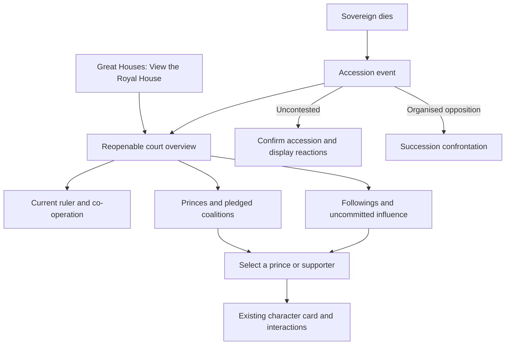
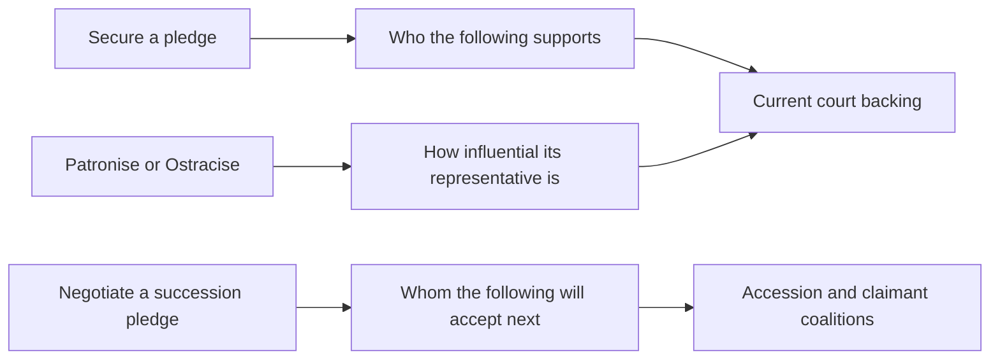
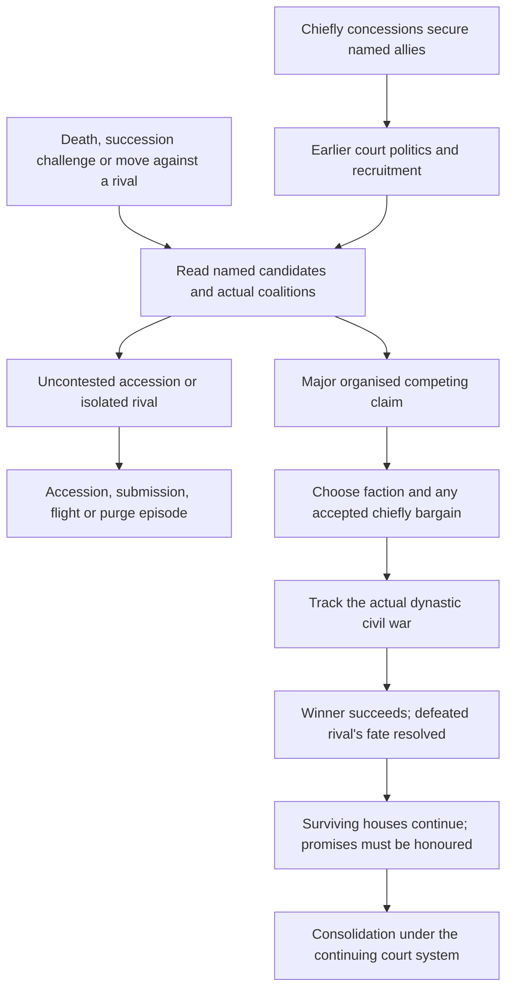

# Zulu court overview, accepted directions and remaining design

19 October 2026. **Design only.** This updates the [balance exploration](zulu_court_balance_exploration_2026_10_19.md) after DP's feedback. It does not authorise gameplay or GUI implementation. Historical identities and dating remain grounded in the [oral-history companion](zulu_oral_history_cast_research_2026_10_19.md).

**Working handoff:** use the [implementation spec and iteration board](zulu_court_implementation_spec_2026_10_19.md) for the next batch. DP has moved from exploration to a build-and-iterate specification. This document retains the alternatives and reasoning; it is not a further reading or approval gate. The latest simplification uses Mpande's dated retirement to trigger the second succession, replacing the proposed conflict over future supremacy while he remains king.

## Accepted directions

- Use the dedicated, reopenable court modal with native event/popup styling, entered by a button where the Great Houses currently appear. Show princes, their coalitions and meaningful backing. DP has accepted this container; an actual information-event wrapper is no longer an open alternative.
- Use shared followings for coalitions, with each real following counted once. The architecture is accepted; the dated roster and commitments still need authoring.
- Use the softer upper price curve for now: 80% of reserve capacity at 50 prominence, rising to 100% at 100. The payer's reserve capacity and a minimum-price floor remain working assumptions.
- **Secure a Pledge A is agreed:** a separate one-off cash purchase of personal co-operation, with no Authority charge or prominence benefit. Native influence interactions stay separate. The conditional half-price suggestion belonged to the combined option and does not apply to this standalone action.
- SB requires all Victoria 3 DLC, including unused DLC. No DLC fallback is needed. This policy is recorded in AGENTS.md; dependency enforcement is not changed during design work.
- Keep the original Q/2 formula, including its combined court/popularity cap. Explain the actions that improve Prerogative rather than foregrounding the equation. The later independent-point/additive-cap proposal is superseded.
- Defer radicals/loyalists.
- Use succession direction A: candidates, recognition and actual coalitions determine a contested succession. A mandatory accession popup is acceptable; ordinary succession need not become a compulsory negotiation.
- A major organised challenger at the succession confrontation means choosing a side and fighting a civil war. A missing heir alone does not manufacture an opposing coalition. DP's proposed dynastic-war outcome kills the defeated rival, preserving his house and its other members; this revises the earlier prohibition on lethal outcomes within that scope.
- Mpande retires at a date, triggering peaceful succession if the line is secured or war between unresolved major factions. Earlier natural death uses the same flow. The implementation spec uses December 1856 as a provisional date; no separate future-supremacy war while Mpande remains king is needed.
- Explore concessions to amaKhosi to secure a candidate's backing, strength-dependent purges, and Dingane introducing an alternate-history heir. These directions are under exploration; their detailed mechanisms below remain proposals.
- Use character-driven event direction A. Start a new catalogue; the four old court events need not survive as titles, situations or mechanical templates. Preserve useful firearms/story dependencies when eventually retiring their callers, and retain reviewed-prose records.

## 1. Court overview: visual content and three viable containers

### Recommended contents

The button opens **The Royal House** under monarchy, and an appropriate **The Court and Royal House** title under the chiefly constitution. The latter still needs to show living royal claimants and exiles. This is a contextual overview rather than a complete genealogy browser.

Show three clearly separate relationships:

1. **Government now:** incumbent, current Prerogative and target, and the following representatives who co-operate with or oppose the ruler.
2. **Succession:** designated heir and eligible alternatives, each with an expandable list of pledged followings. Display uncommitted backing explicitly. Eligible relatives with no active claim or supporters are not labelled rebels.
3. **Constitution:** royal/chiefly/neutral preference on the relevant character or following. Supporting a prince does not automatically establish a new constitutional movement, and a chiefly supporter can co-operate with a royal incumbent.

Each candidate row should show portrait, name, age, recognised-heir/claimant status, location or exile, **pledged court backing**, named supporters, and supporting commanders where applicable. Personal popularity belongs on the candidate's card; only the actual incumbent's popularity directly enters the country's target. The candidate's own political following may contribute once if independently justified by the roster, not merely because the candidate exists.

Click a portrait to inspect the existing character and interactions. The overview should not duplicate the entire character-interaction menu. Distinguish ordinary patronage from a personal pledge on a following's detail; display any expiry only if the selected allegiance design actually has one. Source provenance belongs in biographical detail, not on every coalition bar.

**Label the quantity accurately:** pledged court backing is a share of represented political influence. It is neither a percentage chance of winning nor a promised share of the army. Display named supporting commanders separately until actual army allocation is verified. Do not manufacture a military-strength bar from prominence.

Illustrative arrangement, with invented values solely to explain the display:

```text
THE ROYAL HOUSE                                      [Close]
Mpande — sovereign           Prerogative / supported target

SUCCESSION
Cetshwayo  [portrait]   Recognised heir    45% pledged backing
    [expand] Following representatives and their commitments
Mbuyazi    [portrait]   Alternative       30% pledged backing
    [expand] Following representatives and their commitments
Uncommitted                              25% of court influence

FOLLOWINGS
Representative | Government now | Succession pledge | Constitution
Masiphula      | Supports Mpande | Cetshwayo         | Royal
    Patronage / current obligation / character details
```

This table is an interface example, not a claim about historical percentages or an approved starting roster.



### Container comparison

**Decision:** DP selected the dedicated modal. The alternatives below remain as the comparison record, not pending choices.

| Container | Complete flow | Strength / limitation |
|---|---|---|
| **Dedicated modal using native event/popup styling — agreed** | JE button opens a live country-bound view; select/expand candidates, inspect characters, close and reopen without advancing events. Actual succession still uses an event. | Fits the proposed interaction while avoiding queued events or default-option timeouts for a reference display. Requires a small custom widget, country context and selection state. |
| **Actual event with a custom `gui_window`** | Button schedules one information event; the custom layout shows the cast and backing, with a neutral close option. Prevent duplicate openings and keep all meaningful decisions in separately validated actions. | Native event framing and portraits are established. A real event has a lifecycle and saved context; reopening, stale candidates and expiry need care. Standard one/two-character templates alone do not provide a dynamic court list. |
| **Expandable JE section** | Button expands the existing list in place; group by candidate and reveal supporters below, then collapse it. | Smallest extension of SB's current list and Japan's character rows. Limited width and long scrolling make it weaker for comparing several coalitions. |

**Verified source precedents:** `gui/journal_entry_widgets/ep2_japan_widgets.gui` defines named daimyo portrait rows with political contributions; SB's `gui/sb_prerogative_progress_bars.gui` already iterates `sb_court_members`. Vanilla `gui/eventwindow.gui` and `events/test_events.txt` demonstrate `gui_window`, saved portrait icons and one/two-character layouts. `gui/scripted_widgets/scripted_widgets.md` supports separately registered custom widgets; Gates of the Bosphorus's `gui/gbbf_popup.gui` supplies a working independent-popup example. Hail Columbia's inspected GUI set did not supply a closer character-overview example.

These establish the building blocks, not the finished runtime binding. In particular, preserve the inspected country explicitly, avoid a GetPlayer substitution for foreign courts, and do not assume a script ROOT survives nested localisation. Open/close must never change political commitments or spend anything. Repeated openings, an actor dying while visible and a country ceasing to exist must be verified in the eventual prototype.

## 2. What a coalition actually consists of

This is the first substantive unfinished design task: turn the researched names into a **dated following roster** with a representative and political weight. It cannot be solved by adding a portrait for every royal relative.

### Agreed: shared followings, separate commitments

Each real following contributes once to the court's total influence. Its representative can have separate constitutional preference, current personal endorsement and future-successor pledge. Candidates assemble coalitions from those pledges. Two princes cannot simultaneously own the same following, but one may be its representative while another receives its succession pledge. Ambition or royal descent alone does not create followers.

Initially retain native prominence for weighting, so this stays close to the implemented system. For a candidate's displayed share, divide pledged weight by **all active represented following weight**, including uncommitted influence. That makes a small committed minority visibly small. Recalculate when representatives die or change; don't silently treat a vacant following as a rival's new supporter. Following continuity and changes of representative need dated evidence where available.

The roster needs early Dingane/Mpande, later Mpande/Cetshwayo and early/late partition snapshots. Distinguish household networks, chiefly constituencies and command offices; the same people cannot be counted once for their chief, again for their prince, and a third time for their commander. An actor can participate in events without an independent numerical constituency.

### Alternative: give every candidate a personal following score

Each prince begins with a separate support pool; other characters add to it, and recruitment events grow it. This guarantees visible competition even when evidence for independent constituencies is thin. It also creates arbitrary starting armies, duplicates existing houses and adds a separate strength economy. I would reject it as the default. A documented independent household can receive a proper following in the shared roster instead.

**Remaining work:** the actual roster, initial commitments and continuity rules, not a decision over a percentage coefficient. Historical uncertainty should remain distinct from an in-game neutral commitment.

## 3. Influence and allegiance: separate tools

DP has selected a standalone cash pledge. Buying endorsement and increasing the same person's prominence are two different interventions. Use the following distinction in the design and eventual interface:

| Tool | Immediate purpose | What it does not silently grant |
|---|---|---|
| Native Patronise / Ostracise | Alters public influence through the existing role-dependent prominence/popularity package, with native loyalty/IG effects where applicable | A pledge to the Zulu sovereign or a named successor |
| Native Grant Peerage | Retains its noble-status/IG purpose | A new territorial chiefship or purchased allegiance |
| SB personal bargain | Changes the representative's personal endorsement | Extra prominence, a new broad ideology or a succession pledge |
| SB foreign constitutional recruitment | Changes a suitable neutral actor's royal/chiefly alignment | Allegiance to a particular living sovereign or heir |
| Succession negotiation | Records whose accession a following will accept | Automatic hostility to the current ruler |

The native effects are broader than a universal prominence adjustment, so preserve their actual role-dependent behaviour. Sources rechecked: `common/character_interactions/01_additional_interactions.txt:743`, `common/script_values/event_values.txt:41` and `common/static_modifiers/00_ep2_04_modifiers.txt`. Native patronage lasts ten years, but a standalone SB bargain need not inherit that clock or its Authority charge.

### A — Secure a pledge: one-off political bargain (agreed)

The player chooses a present following representative, sees the exact cash price and endorsement being changed, then concludes a bargain. The recipient supports the current sovereign. Their prominence, constitutional preference and chosen future successor remain unchanged. Existing supporters cannot be bought repeatedly; an active claimant uses the confrontation route. An ordinary rival's supporter can change allegiance if eligible, without erasing a separately recorded future-succession pledge.

Use the accepted soft price curve, provisionally based on the payer's reserve capacity: 80% at 50 prominence and 100% at 100. **No Authority fee and no automatic half-price reduction.** DP's proposed halving applied to the combined version that also charges Authority. Preserve that distinction instead of silently applying the discount to every option.

The pledge lasts until the political relationship changes, rather than expiring merely because ten years pass. It is not immunity to betrayal: a concrete broken bargain, dismissal, coercion or change of regime can prompt a visible reaction. Do not add an arbitrary annual reroll that quietly destroys an expensive purchase. A valid accepted offer gives its stated result; uncertain negotiation belongs before payment, not in an undisclosed failure roll afterwards.

On sovereign death, a named successor pledge governs the following's response. Without one, the representative reacts during the accession episode; no automatic second cash charge. On representative death, the actual following continues through its new representative, whose endorsement is evaluated rather than automatically inheriting a dead person's personal promise. A child or nonexistent successor is not generated solely to preserve a paid bonus. No standard cash refund for ordinary mortality is proposed; participant validity must be rechecked before charging an open offer.

Institutional exit suspends the bespoke political effects but retains commitments under the agreed lifecycle. Institutional re-entry does not charge again or automatically repledge someone whose circumstances changed. Exile or transfer outside the domestic court changes eligibility and should be handled by the existing identity-preserving routes, not by replacing the character.

**Experience:** first secure a wavering house's co-operation; later use native Patronise to increase that ally's weight if desired. Patronising an opponent instead can make that opponent more influential. Conversely, Ostracise weakens public influence without silently converting anyone to the ruler's cause.

**Strengths:** two independently useful tools, clear permanent state changes, no native interaction override, no extra relationship meter. **Costs:** another contextual character action, high up-front commitment, and explicit treatment of political breaches and succession. A very long reign can make a pledge last much longer than a native patronage modifier; that is an intended difference to assess during balance.

### B — Maintain a household allowance: support while funded

Historical alternative; DP selected A.

A separate interaction secures the same immediate endorsement with no prominence or Authority component, but the obligation depends on a recurring allowance. Show the amount before starting; withdrawal releases only support still dependent on the allowance, preserving a later independent pledge. Death, transfer and institutional exit stop the relevant bespoke expense and contribution. At accession, the following's pledge/response determines whether the new ruler continues the agreement.

An exploratory price comparison could spread the accepted one-off price over ten years: at 50 prominence, 8% of quoted reserve capacity per year. This is a comparison value, not an agreed payment model. A fixed quoted allowance is easier to understand than silently recalculating the bill every month as GDP changes. Implementation must verify a visible ongoing expense rather than conceal a treasury drain.

This makes dependence and withdrawal tangible, but cheap initial access encourages renting the entire coalition immediately before a crisis and cancelling afterwards. A minimum term, advance payment or cancellation notice could constrain that, at the cost of another contract system. The AI also needs ongoing affordability rules. **A is preferred** unless continuing financial dependence is itself a desired part of the gameplay.

### C — Combined native patronage, discounted treasury charge

Historical alternative; DP selected A.

If the combined action is ultimately retained, halve the accepted cash curve as DP suggested: 40% of reserve capacity at 50 prominence, 50% at 100, alongside native Authority/public-influence effects and their ten-year period. The discount addresses the extra Authority burden but does not separate endorsement from influence. A successful purchase still increases the weight of the following just acquired. Preserve this as the priced alternative, rather than the current recommendation.



The lifecycle choice is settled in favour of A. Exact floors and minor prices remain tuning. Cash must not be the only source of allegiance: service, succession arrangements and named event bargains should create independent commitments without a new relationship score. Do not turn every neutral character into an automatic permanent ally through a free routine option.

### Ordinary politics without a paid pledge

Source audit on 19 October distinguishes implemented behaviour from the new design:

| Relationship | Implemented now | Proposed normal flow |
|---|---|---|
| Constitutional preference | The annual pulse gives registered neutral representatives competing royal/chiefly alignment chances, proportional to movement support. Committed actors do not automatically reroll. | Retain this. Movement strength can recruit someone towards monarchy without making them loyal to its present king. |
| Personal co-operation | Initial assignments, actions, historical-heir handling and ruler/death callbacks change endorsements. Popularity contributes directly to the target at **Q/5**, but there is no general popularity-driven endorsement recruitment. | Add slow voluntary acknowledgement among personally uncommitted representatives. Positive incumbent popularity improves its likelihood. Significant service, rewards, injuries and broken agreements change commitments through cast-led scenes. |
| Future succession | The native heir and current claimant references exist; the full separate future pledge is not yet implemented. | Record one candidate per following independently of support for the living ruler. Recognition, family relationships and negotiated events shape that commitment. |

Sources: `common/scripted_effects/sb_court_politics_effects.txt`, `common/script_values/sb_court_politics_values.txt`, `common/on_actions/sb_court_on_actions.txt` and `common/on_actions/sb_institutions_on_actions.txt`. The accepted Q/2 formula is a pending design change, not the current script.

**Recommended hybrid:** evaluate voluntary co-operation once annually among present, personally uncommitted representatives. A popular ruler can gain acknowledgement without payment; an unpopular ruler receives fewer such opportunities. Use a modest chance, not automatic conversion of everyone when popularity crosses a line. Succession scenes recruit support for an actual eligible candidate. An unhappy neutral person does not spontaneously endorse a nonexistent challenger.

Committed actors reconsider after a specific political cause: repudiated undertakings, dismissal, coercion against their allies, a succession decision, defeat or a change of sovereign. Popularity can influence their response in that scene; it should not silently reroll every expensive pledge each year. Make this apply to AI courts as well. Ordinary notifications can report spontaneous acknowledgements; reserve popups for decisions. No extra numerical personal-relationship meter is needed.

An events-only model is simpler and keeps every change explicit, but can leave a popular ruler's court static between scenes. An annual reroll of everybody creates motion but undermines durable bargains and replaces character politics with noise. The hybrid retains gradual recruitment and visible causes for defections. Popularity then has a direct target contribution and a slower indirect effect through recruitment; balance that feedback deliberately rather than adding another popularity term to coalition weight.

## 4. Popularity: keep Q/2 and explain useful actions

**Agreed:** retain the original Q/2 curve and its caps. H is the following endorsement mean, Q incumbent popularity and M the constitutional support balance, on −100…100 scales:

```text
C = clamp(H + Q/2, −100, 100)
T = clamp(0.75 × C + 0.25 × M, −100, 100)
```

The separate-additive and normalised alternatives are closed for this design. The formula remains in development documentation and diagnostic checks. The ordinary player explanation should foreground current Prerogative, its real effects, direction/speed of change, and the political levers available. An optional detailed tooltip can retain the supported target and breakdown; the default should not require arithmetic to understand an action.

Explain three routes to better backing:

- Improve the **incumbent's popularity**.
- Secure co-operation from more or stronger **current following representatives**.
- Strengthen the movement supporting the **incumbent constitution**: uSuthu under the crown, amaKhosi under Federated Chiefdoms.

Do not universally tell the player to strengthen uSuthu: under a chiefly settlement that supports the opposition. Likewise, promising an heir support helps succession and does not by itself increase co-operation with the living ruler. Bolstering a hostile representative can worsen the incumbent's position. These are gameplay distinctions, not formula details, and belong in the overview/action explanations.

Use live, specific statements about the current country and visible commitments, such as which following remains uncommitted, rather than a permanent generic advice block. Where a cap or an already-satisfied pledge means an action offers no further current benefit, do not promise a numerical increase. A short explanation that support is already at its current limit is sufficient; the player need not see the internal clamp operation.

Monthly convergence and limits remain unchanged. Radicals/loyalists stay deferred. The incidence of target saturation remains a balance test, not an unresolved formula-design vote.

## 5. Succession, concessions and the removal of rivals

### Succession confrontation

DP's latest direction is explicit: **a major organised rival at the confrontation means choosing a side and civil war**. Bargaining with potential supporters happens before that commitment. It must not become a guaranteed last-minute payment that peacefully erases an established rival faction.

Use one accession event per sovereign death. If a recognised candidate has no viable organised challenger, confirm accession; if no heir was recognised but only one viable candidate exists, allow acclamation. Neither royal birth nor an empty heir slot generates an army. If two major coalitions assert competing claims, present their candidates, actual supporters and concessions before the player chooses a side. AI countries use the same political conditions.

For a first balance prototype, test a major claimant around **one quarter of all represented following weight**, including uncommitted weight in the denominator, together with a real ability to mobilise. This is a provisional design threshold, not a historical probability or a verified army-allocation rule. Civilian patrons can supply backing; holding a general's office is not mandatory. Measure the coalition, not the prince's prominence alone. Recognition matters through commitments and standing, but does not veto an organised rival's challenge.

The player may choose either viable faction. The conflict resolves from the actual winner. A dead king cannot be installed again because a saved event retained his name. A third claimant can join a side or remain outside it; do not invent a three-sided war facility. Keep a genuinely independent surviving claimant for later politics rather than killing every unselected prince at the first settlement.

DP proposes that the defeated dynastic rival dies, but his house survives. Carry living relatives and other representatives forward and resolve their own commitments. Some may acknowledge the victor; others may remain uncommitted or seek refuge. Do not erase the losing constituency, convert every surviving member into a loyalist, or script their immediate next rebellion. If a separate historical escape has already put the rival abroad, his fate needs that route's actual resolution rather than a death effect unrelated to custody or the recorded war outcome.

Coup/war accession uses its result presentation once. Chiefly vacancies remain selection of a head chief. A royal-versus-royal victory does not win the Thirteen Chiefs constitutional contest; the victor must still consolidate the inherited court.

### Concessions to the amaKhosi

This is a promising way to make constitutional division matter inside a dynastic contest. A chiefly supporter can accept a royal candidate in return for limits on royal power. Develop two materially different bargains:

| Bargain | Immediate political exchange | Continuing cost and failure case |
|---|---|---|
| **Acknowledge chiefly privileges** | Display the participating representatives. Their specified personal/succession pledges are exchanged for a public concession that increases amaKhosi attraction. | The candidate gains those followings, while the chiefly cause gains recruitment. The movement modifier does not instantly change native support by the same percentage. Repeated acknowledgements of the same privilege cannot farm pledges or stack the same concession. |
| **Accept a Chiefly Council** | Keep Monarchy but enact the authored **Chiefly Council** variant, with named backers accepting this settlement. Before accession, record the undertaking; carry it out as part of the victorious accession. | The king accepts the law's weaker central benefits. Backing bought on that promise is conditional on honouring it; repudiation prompts those actual participants to respond. Do not substitute generic Elder Council or silently enact Federated Chiefdoms as well. |

The first is a limited political precedent; the second is an institutional settlement. Do not apply an additional attraction penalty to the law bargain merely to charge twice for the same concession. Monarchy + Chiefly Council remains a mixed constitution and cannot itself complete the Thirteen Chiefs contest. Constitution and personal loyalty remain separate: these chiefs can co-operate with their chosen king while still preferring greater chiefly power.

The benefit is immediate coalition support; the cost survives victory. That gives a threatened claimant a credible reason to offer it and a strong ruler a reason to avoid it. It must recruit named willing allies, not automatically purchase the entire amaKhosi movement or force a rival prince to surrender. Exact magnitudes are tuning after the following roster is authored.

### Purges: strength and uncertainty serve different purposes

Three mechanisms were considered through the same Dingane–Mpande confrontation:

| Mechanism | Full path | Assessment |
|---|---|---|
| **Deterministic comparison** | Confront a weaker rival and force submission; confront a stronger one and fight; remove or exile a defeated person afterwards. | Readable, but one marginal supporter can turn a certain rebellion into a cost-free purge. It also suppresses individual resistance and flight. |
| **One unrestricted probability roll** | Coalitions, popularity and character circumstances determine submission, escape or rebellion; any target can choose any outcome. | More variation, but a major succession conflict can disappear through luck, and an isolated person can conjure an implausible war. Incompatible with DP's major-challenger rule. |
| **Bounded confrontation — recommended** | Establish whether the rival has a viable organised challenge; then resolve submission/escape for lesser threats, or a real war for a major claimant who refuses the settlement. Execution follows custody/defeat or a separately authored successful purge. | Preserves decisive organised conflicts while allowing weaker rivals different responses. Requires clear eligibility and one stored response per confrontation. |

For the recommended version, separate **demand submission/renunciation** from **attempt lethal removal**. A promise of safety followed by execution is a broken bargain with political consequences. A rival cannot meaningfully “accept execution” through the ordinary submission branch.

Threatening a marginal rival can produce a genuine renunciation, flight or an attempt to gather supporters. A purge can capture an isolated target, or be exposed and give him time to escape or mobilise. If a major armed challenger is openly confronted, the player is committing to the civil-war route; do not roll a lucky peaceful purge over it. Uncertainty concerns whether a covert attempt reaches its target before mobilisation, not whether a declared major succession war is wished away. A full assassination minigame is unnecessary: one contextual episode is enough.

Use relative pledged backing, control of actual supporters/commands and established commitments when assessing danger. High P indicates co-operation and can matter, but is not a substitute for the target's strength. Propose allowing a badly supported king to make a dangerous attempt rather than retaining the old high-P action gate unquestioningly. Do not turn the old 50-P expenditure into a guaranteed deletion of any rival. A failed attempt can detach some of the ruler's own supporters, making the political cost concrete.

Show the relevant supporters and likely risks before committing. For any uncertain response, determine it once for that encounter; closing/reopening the overview cannot reroll it. Another attempt requires a changed political situation rather than repeated clicks. The same conditions apply to AI. Coalition-backed resistance proceeds to actual war; the response roll never decides the war's winner.



### The three opening paths

**Historical direction: Dingane's position collapses → Mpande wins → Gqugqu becomes a threat → the next generation.** Model the first transition as capable of becoming rebellion/defection and war, rather than requiring a clean palace coup. The edited Stuart material identifies Nongalaza commanding Mpande's forces against Dingane at Maqongqo in January 1840. A low-P coup is an alternate mechanism the political system may also produce, not the whole historical event. [James Stuart Archive, vol. 3, p. 294, notes 13 and 15](https://emandulo.apc.uct.ac.za/collection/KCAL/3_VOL3/KCAL_JSAVol3_1982_edited_notes_Mpambukelwa_ka_Cangasa_098_p291_p295.pdf)

Gqugqu is not merely a convenient fictional spare prince. Hughes links him to Mawa and a potentially stronger genealogical claim, then places Mawa's flight after his death in 1843. That supports a threatened rival network and costly consolidation, but does not establish exact opening coalition percentages. Retain the cast brief's distinction between Mawa kaJama and inconsistent later patronymics. [Hughes, pp. 53–54](https://emandulo.apc.uct.ac.za/collection/Cele/publications/Politics_and_society_in_Inanda_Natal_the%20Qadi_chief_under_Mqhawe_%28HHughesPhD%29.pdf)

After a victory, removing Gqugqu need not be automatic or safe. The surviving network can react, including flight. Cetshwayo, Mbuyazi and Hamu remain distinct living identities and become politically available at their actual eligible ages. Their later contests depend on surviving houses and campaign events; they are not a checklist of predetermined deaths.

**Alternate path 1: Dingane dies naturally → Mpande and Gqugqu both have major coalitions → player chooses → civil war.** Neither needs to advocate a different government law. Either can secure named chiefly allies through one of the bargains above. The losing rival dies in the resolved dynastic struggle, while his house remains. If Mpande loses, do not delete the already-existing Cetshwayo or Mbuyazi; they may matter later, but do not automatically inherit his whole coalition or instantly begin a second war. If Gqugqu wins, the system must support his reign rather than redirecting immediately back to the historical Mpande route.

If one claimant never acquired a viable coalition, this particular civil war is absent: it is an alternative campaign outcome, not a script-delivery failure. Missing heir designation alone is insufficient. Age and a designation dispute also do not necessarily produce a constitutional war.

**Alternate path 2: Dingane consolidates → introduces a son/heir → builds acceptance → confronts Mpande and Gqugqu.** This should be explicitly alternate history. The current template `ZUL_uthumbu_claimed_son` is already `historical = no`, dated 1828; the research has not established a historical or oral-traditional identity to justify relabelling him. It is a possible reusable authored candidate, not new historical evidence.

Three realisations are possible: recognise an already-living alleged son (fastest opening story, disputed provenance); have a child during play (longer horizon and a real minority); or nominate an attested collateral (least invented genealogy, but not Dingane founding his own line). For DP's proposed branch, the first is the closest fit, provided it is plainly authored alternate history and the child keeps a believable age. It creates a candidate, not an adult commander or free independent following.

High P can make recognition easier; neither brother's supporters convert automatically. Removing one brother may drive surviving supporters towards the other. A strong king can isolate opponents before acting, but repeated purges can undo that strength. If Dingane dies before the heir is adult, adult backers represent the child's cause; a child does not contribute an invented adult following. A regency or guardian presentation remains an engine/design dependency before this branch can be called implementation-ready.

### Technical boundary

The main unresolved proof remains **royal-versus-royal civil war**, including a confrontation while the old king lives. The current constitutional tracker cannot simply put both royal factions on the same side. Province and army allocation, side selection, character placement and exact-winner callbacks need verification. Store the political dispute separately from the constitution of each side. Do not silently substitute a foreign conquest play or a resolved-by-event duel if the requested native dynastic war cannot be established.

**Superseded by DP's retirement simplification:** do not build a separate Cetshwayo–Mbuyazi war for future supremacy while Mpande remains king. His dated retirement, or earlier death, enters the common accession flow. Named claims, surviving houses, NGN continuity, existing foreign routes and once-only rewards must survive either result. See the active implementation spec for the retirement and duplicate-delivery contract.

## 6. A new event catalogue, not four repaired templates

Discard the requirement to preserve `.200–.203` as the baseline. Their useful dependencies, such as firearms progress, can be carried into appropriate new scenes. The first content pass should cover the reign's political needs and actual cast, with ordinary reusable scenes plus dated historical variants.

| Event family | Suitable actors and stakes | Durable effect / restraint |
|---|---|---|
| **Promises about the succession** | A royal candidate, minister or household representative asks for recognition or a guarantee | Creates, tests or withdraws a named succession pledge; does not necessarily change service to the living king. |
| **Service and reward** | A commander or broker claims credit for a real success | Patronage, prominence or public reputation; no automatic allegiance flip for merely appearing. |
| **Obligations to the royal household** | A represented house is asked for cattle, supplies, hospitality or labour | A material concession can preserve or strain personal co-operation. Avoid converting every local disagreement into constitutional revolt. |
| **Command and competing loyalties** | A real commander backs a prince while holding royal office | Reassignment, pledge or confrontation, with actual character consequences. No abstract slaughter for a bar reward. |
| **Public judgement of the ruler** | A gathering, a difficult decision or an appropriate court poet | Popularity changes with clear public stakes; no automatic chiefly alignment from criticism. |
| **Outside patrons and intermediaries** | A documented trader, colonial official, Boer sponsor or exile | Recruitment, arms, return or bargaining leverage according to the actor's actual role; preserve the existing foreign-intervention contracts. |
| **Death and continuity of a following** | A representative dies or retires, leaving an eligible successor/steward | Reconcile the real following and its commitments, rather than spawning a random new powerful chief or duplicating its weight. |

The catalogue needs concrete event pitches with participants, trigger context, choice, benefit, political cost, recurrence and invalidation. Prioritise scenes around otherwise-uncommitted representatives, but allow stable supporters to maintain, negotiate or withdraw an agreement. Historical identity supplies relationships, not compulsory historical outcomes. Authored scenes must work in early partition and later monarchy without summoning unavailable people.

The next exploration should produce the opening cast/coalition sheet and roughly one strong scene per family first. Event count is a content-planning target, not a requirement to pad the mod. Balance exact amounts and frequency only after the causal effects and represented followings are known.

## Remaining work: design decisions versus technical checks

| Workstream | Status | Next concrete deliverable |
|---|---|---|
| Court overview | **Agreed container; layout to author** | Dedicated reopenable modal with native portraits, pledged backing, neutral share and selected-person details. Verify bindings without reopening the container choice. |
| Shared coalitions | **Agreed architecture; roster to author** | Dated sheet of followings, representatives, initial allegiance, future pledge and succession of the following; no duplicate constituency. |
| Allegiance interaction | **Agreed A** | Standalone one-off cash pledge, no Authority or prominence component. Retain the accepted price curve; the combined-option half-price discount does not apply. |
| Ordinary allegiance | **Proposed hybrid** | Annual voluntary acknowledgement by uncommitted actors, weighted by ruler popularity; specific political events can change existing commitments. Do not reroll every paid pledge. |
| Soft price curve | **Agreed for now** | Keep 80% of reserve capacity at prominence 50 and 100% at 100. Payer basis and minor floor/affordability remain tuning. |
| Popularity | **Agreed Q/2 formula and simpler presentation** | Preserve the combined cap; explain available political actions, current effects and drift. No further coefficient/cap decision pending. |
| Succession and defeat | **Major-conflict direction agreed** | Major organised competing claims mean side choice and war. Defeated rival dies; his house survives. Author contemporary coalitions and distinguish crown versus future-succession stakes. |
| Chiefly bargains | **Proposed** | Named allies exchange support for privileges/amaKhosi recruitment or the authored Chiefly Council; promises survive accession. |
| Purges | **Proposed bounded confrontation** | Strength determines viable resistance; uncertainty applies to lesser threats and exposure/capture, not to a random war winner. Major open confrontation means war. |
| Dingane's alternate heir | **Requested direction; realisation provisional** | An explicitly authored recognised-son branch fits best; neither oral provenance nor an adult heir is established. Minority and exhausted-line handling remain open. |
| Dynastic war implementation | **Technical dependency** | Prove native same-constitution conflict routing and winner handling. No gameplay promise based only on constitutional-war examples. |
| New event catalogue | **Agreed A; content open** | Cast-led pitches, independent of the four old templates; audit story rewards for duplication. |
| DLC availability | **Settled** | All DLC is the baseline; no fallback exploration. |
| Radicals/loyalists | **Deferred** | Exclude from the current formula and interface work. |

### Historical handoff notes — now superseded by the iteration board

DP's three Dingane paths above now supply the worked lifecycle. The next substantive package is the **dated coalition sheet and concrete confrontation scenes**: who can support Dingane, Mpande or Gqugqu; which constituencies are genuinely distinct; which chiefly bargains they would accept; and what an attempt against a rival does to those actual people. Carry this forward into the later Mpande–Cetshwayo–Mbuyazi contest without forcing the same royal outcome.

The remaining consequential choices are the proposed ordinary-allegiance hybrid, chiefly concessions and bounded purge response, plus the minority/guardian treatment for Dingane's authored heir. Price coefficients, chance weights and the precise major-coalition threshold are tuning together with those flows, not individual approval gates. Verify the dynastic-war mechanism before presenting the design as implementation-ready.

The dated roster, detailed modal layout, event pitches, quote calculation and numeric thresholds are **authoring, research and tuning work**, not reasons to reopen the agreed system architecture. The new event catalogue follows the worked lifecycle; use the available cast and political opportunities rather than rewriting four old titles by obligation.

Recommended order: **following roster and succession scenario → interaction/defeat contract → modal and event content → numerical balance**. Custom modal binding and royal-versus-royal war routing are technical proofs before committing to implementation details. Scope stays Zulu-first; NGN continuity and existing settlement contracts must remain intact.

No runtime or GUI implementation, source rebase, launch or engine scenario was performed in this follow-up. Source examples demonstrate plausible building blocks; custom modal bindings, patronage lifecycle hooks and dynastic warfare remain subject to implementation validation and DP testing.
