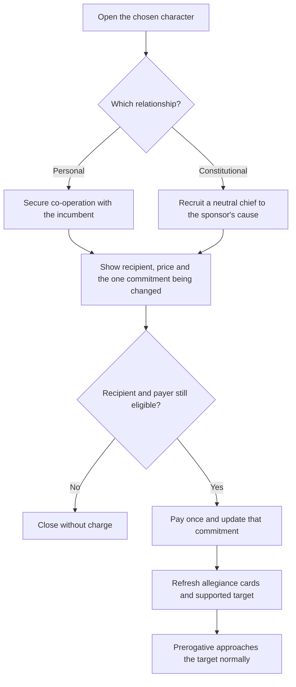
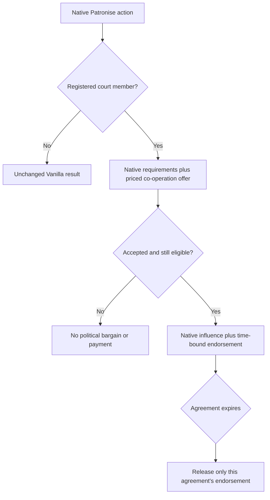

# Zulu court playtest follow-up — 19 October 2026

**Scope agreed by DP:** implement presentation fixes now; propose gameplay changes. The gameplay options and numerical defaults below are recommendations, not approved changes. They do not replace the accepted institutional specification.

**Fresh-launch correction, later on 19 October:** DP's next log disproved the initial title fix. The ROOT validity guard itself failed in the lobby, and the nested active title also lost ROOT. The [follow-up investigation](compatibility/zulu_court_lobby_title_2026_10_19.md) replaces those lookups with a global in-game check and the active JE's top scope. Its rendering is pending DP; the initial static-test result below is historical evidence, not confirmation of the first fix.

**Second correction:** DP confirmed the lobby title works, but the nested active title also loses SCOPE. The live title now reads the GUI's `JournalEntry.GetCountry` instead; the working lobby gate remains. The linked investigation records the context-loss cause and replaces the test's incorrect scope-forwarding assumption. Live rendering remains pending DP.

## Presentation delivered

| Report | Change | Verification boundary |
|---|---|---|
| Blank JE title in the country-selection lobby | A static Royal Prerogative fallback when there is no valid country; retain Royal/Chiefly selection in a campaign. | Static selection tests pass; lobby rendering pending DP. |
| Prerogative tooltip describes effects abstractly | Display the descriptions of the country's applied political and military modifiers, including their current scaling. At zero, state that there are no current effects. | Applied-modifier selection tested at zero, positive/negative P, after army reform and after clearing effects. Rendering pending DP. |
| Missing localisation for the positive Institutional Reach check | Wrap the unchanged predicate in a named, readable tooltip. | Eligibility arithmetic and boundary tests pass. |
| Actions expose repeated modifier removal and application | Hide institutional recalculation, clearing and backing maintenance at their shared helper boundary. Preserve the operations and their order. | Test interpreter executes hidden blocks normally; behaviour tests pass. Preview rendering pending DP. |
| Mountain King should use the special gold frame | Composite the unchanged approved foreground onto a reconstruction from Vanilla's special-card pixels, including the four stars and different frame shape. | Native alpha, frame, foreground and PNG/DDS parity checked. Original copper card preserved. [Art record](../output/imagegen/mountain_king_special_2026_10_19/README.md). |

No gameplay price, endorsement, faction, equilibrium, rival outcome or event balance has changed in this pass.

## What the current payments and native interactions do

Two SB actions currently have a £5,000 base price, multiplied by the recipient's prominence relative to the average registered representative:

| Action | Current selection and effect |
|---|---|
| ZUL's **Patronise a Following** | Selects the most prominent eligible present non-supporter. Sets personal endorsement to the incumbent and clears their recorded rival allegiance. Does not change constitutional alignment. |
| NAL/TRN's **Bribe a Chief** | Recruits an eligible neutral representative to the chiefly/royal constitutional side. This is a different axis from personal endorsement. |

That first purchase can be very powerful: with four equally weighted representatives, moving one from uncommitted to incumbent adds 18.75 to the court component of the target; moving a rival supporter to incumbent adds 37.5, before clamping. P still approaches the target gradually, but £5,000 can buy a lasting political change. These examples hold ruler popularity and movement support constant.

The installed Vanilla interactions provide a useful separate layer:

| Native interaction | Verified baseline | Relationship to this system |
|---|---|---|
| Patronise | Normally 100 Authority; 150 with the specified costly-habit traits. Role-dependent +20 prominence or +25 popularity; commanders also gain native loyalty. Native restrictions include ideology and an active-patronage limit. | Prominence already weights a court representative. Patronising an opponent can increase that opponent's influence; it does not mean they have pledged personal allegiance. |
| Ostracise | Normally 100 Authority. Corresponding −20 prominence or −25 popularity, with commander loyalty effects. | Can weaken an opponent's public position without turning them into an incumbent supporter. |
| Grant Peerage | 25 Authority; gives noble status and a conditional IG approval effect. Exact Monarchy and DLC conditions apply. | Noble status is not a royal/chiefly constitutional commitment. A chiefly supporter can be ennobled without becoming royalist. |

Native loyalty remains distinct from allegiance to the Zulu sovereign. These interactions are DLC-gated; a new SB political action should not silently inherit an unrelated DLC requirement.

Sources: installed `common/character_interactions/01_additional_interactions.txt`, `common/script_values/ep2_japan_values.txt` and `common/static_modifiers/00_ep2_04_modifiers.txt`; SB's [court action helpers](../common/scripted_effects/sb_court_actions_effects.txt), [court values](../common/script_values/sb_court_politics_values.txt) and [chiefdom buttons](../common/scripted_buttons/sb_zululand_chiefdoms_buttons.txt). Inspection used the installed 1.14.5 sources.

## Two interaction designs

### A — Explicit political bargains on character cards (recommended)

Remove the two paid buttons from their JEs and expose their actions on the eligible character instead. Keep the JE's court information so the player can find the people involved.

- **Secure Co-operation:** ZUL pays a selected representative for personal support of the incumbent. Constitutional alignment stays unchanged. Restrict ordinary purchase to uncommitted people and followers of a rival; an actual self-declared claimant requires the separate confrontation route.
- **Recruit to the Royal Cause / Support the Loyalist Chiefs:** the authorised Boer sponsor or NAL recruits the displayed neutral representative. This changes constitutional alignment only. Preserve existing sponsor eligibility and the live Chiefdoms contest requirement.
- Retain native Patronise and Ostracise as public influence tools. Explain that distinction in the action descriptions. Do not automatically translate their native loyalty effects into court allegiance.
- Consider **Grant Chiefly Rank** as Zulu wording for Grant Peerage, conditional on an eligible non-noble character. Keep its native status effect. Do not grant rank again to people already recorded as chiefs, or use it to create a second political conversion.

Provisional common price: `max(£25,000, 2% of the payer's GDP) × relative prominence`, with the prominence factor bounded to 0.5–2. A representative of average prominence costs at least £25,000; a figure twice as prominent costs at least £50,000. This is a starting balance formula, not an implemented value or a claim that every payer can afford it. The GDP term avoids a fixed price becoming negligible later; the floor avoids trivial purchases in the early game. Check affordability against actual ZUL/NAL/TRN budgets before finalising it.



For example, a chiefly supporter can accept royal patronage as a personal bargain while remaining chiefly in constitutional preference. A Boer sponsor buying an unaligned chief into the royal cause does not also make that chief support Dingane rather than a claimant. Subsequent political events can break a bargain; it is not a permanent immunity. The already-satisfied action becomes unavailable, and repeat clicks or stale windows cannot charge again. Death, transfer abroad or institutional exit before confirmation cancels the offer. Characters in foreign custody cannot be bought through a domestic-owner assumption.

**Strengths:** explicit actor selection, visible cost, clear separation of the two axes, limited changes to Vanilla. **Costs:** another contextual action beside native Patronise; player text must distinguish influence from allegiance. **Technical dependency:** verify actor/recipient scoping and visibility of the foreign interaction in a small engine prototype before replacing its JE entry. Do not assume domestic `owner` is the foreign payer.

### B — Political co-operation folded into Vanilla Patronise

For registered court members, extend native Patronise with a paid offer of personal co-operation; ordinary characters retain Vanilla behaviour. The preview shows both the native Authority cost/public influence and the added treasury price. Keep native ideology, role, ruler/heir and active-patronage restrictions. An accepted bargain supports the incumbent while that patronage agreement lasts; expiry releases only the endorsement belonging to that agreement, not a later allegiance established by succession or another event.

The foreign recruitment action remains a separate character interaction because constitutional alignment and cross-border sponsorship are not native Patronise effects. Grant Peerage and Ostracise retain their original purposes. A country without the DLC would need a standalone SB equivalent for political co-operation, or an explicit decision to make that action unavailable; the latter would change current access.



An opposing officer who is too distant ideologically cannot be purchased through this route even if a pragmatic political bargain would be plausible. An officer who accepts gains public influence as well as supporting the incumbent, making the bargain stronger than A. Outsiders can still be patronised normally. A later independent pledge must survive expiry of the older patronage contract.

**Strengths:** fewer domestic actions and a close connection between material patronage and political support. **Costs:** more complicated expiry bookkeeping, DLC fallback, stronger combined effects, and an override of a substantial native interaction. It also makes broad ideology constrain personal bargaining. These are reasons to prefer A rather than quietly changing Vanilla's meaning.

## Popular sentiment in the equilibrium

Recommendation: use national loyalist and radical population shares as a small, bounded adjustment to the **target**, applied equally under royal and chiefly governments:

```text
Mood = clamp(50 × (loyalist share − radical share), −15, +15)
Target = clamp(0.75 × Court + 0.25 × Constitutional backing + Mood, −100, +100)
```

Shares are fractions from 0 to 1. A net ten percentage points of loyalists adds 5 to the target; a net thirty points of radicals subtracts 15. Keep the existing monthly convergence and ±4 limit. This is a direct expression of willingness to co-operate with the government, not a claim that every radical is uSuthu or every loyalist amaKhosi. Native `radical_fraction` and `loyalist_fraction` already appear in Spain's tension calculation in `common/script_values/ip4_je_values.txt`.

An alternative is to reweight the entire target to 60% court, 25% constitutional backing and 15% sentiment. That preserves a 100% weighting but weakens the named court model everywhere, even where almost nobody is radical or loyalist. The additive capped term makes a smaller change and is easier to explain. Do not add a second monthly sentiment drift: that could keep moving P after it has reached its supported target. Test the feedback loop from legitimacy to popular sentiment, both signs and both constitutions before increasing the cap.

## Replace the soft rival offer with a confrontation

Recommend **Break a Rival's Power**, available against an actual active rival claim, rather than every eligible royal successor. Keep high Prerogative and the existing 50 P as provisional requirements; the confrontation should show the rival and their main supporters before commitment.

| Response | Proposed consequence |
|---|---|
| Submission | Renounce the claim; choose a controlled retirement or negotiated exile. Personal supporters reconsider their commitments individually rather than all converting automatically. |
| Flight | Preserve the living claimant and their supporters abroad; no fictional renunciation. Restoration/exile hooks continue to recognise that identity. |
| Resistance | Use the existing coup or constitutional conflict framework where appropriate. A failed demand does not remove the rival for free. |
| Rival defeated and captured | Permit execution or mercy/exile. Execution removes the actual person and triggers reactions among their named supporters; it does not erase the royal movement or turn every house loyal. |

This supplies a lethal outcome while making it depend on defeating or controlling the rival. An instant execution interaction would also need imprisonment/control rules; it must not remotely kill someone sheltered in CAP. Death during an open confrontation invalidates it without a second death or invented victory. Neither a dynastic replacement nor execution alone settles the Thirteen Chiefs constitutional contest.

**Decision to reopen:** the earlier accepted specification explicitly preserved living rivals through retirement or exile. Lethal outcomes therefore need approval as part of the next gameplay bundle. None have been implemented here. This is a design proposal, not a claim that every historical claimant suffered the same fate.

## Event balance pass: concrete starting points

Use events to change the relationships they describe. Preserve explicit P spending on court actions; replace generic event rewards and penalties where a person, following or popular response supplies a better cause.

| Existing event/hook | Current direct P effect | Proposed cause of the political change |
|---|---|---|
| Court rumours, `sb_zulu_court.200` | £1,500 for +5; alternative −5 with other rewards | Name the spreading following or rival. A payment seeks that actor's co-operation; leaving it to loyal houses changes the standing of those responders. Do not silently convert every claimant supporter. |
| Regimental affinities, `.201` | Purge +5, tolerate −5 | Identify the implicated commander and their following. Discipline weakens their public position but can alienate surviving supporters; accommodation may secure their personal co-operation. Retain military losses only where the event actually describes a purge. |
| Great-house exactions, `.202` | Exactions +5 despite upper-strata radicalisation; conciliation −2 | Material concessions or demands change affected chiefs' endorsements and existing popular sentiment. No additional flat P reward for antagonising the houses. |
| Coastal traders, `.203` | Firearms bargain −10; refusal +5 | Keep the firearms benefit. Apply political responses to a relevant intermediary/following where one exists, or ruler standing if the dispute is public. Do not create a fictitious chief solely to carry a penalty. |
| Firearms completion | +20 | Credit ruler standing or the relevant military supporters once; retain reform unlocks. Avoid awarding popularity and a duplicate P reward for the same success. |
| Blood River, Klip River, frontier and succession hooks | Various +5/+10/+20 and negative wrappers | Review separately by outcome: defeat may weaken an incumbent, a concession may lose a named following, and recognising an heir updates acknowledged succession commitments. Constitutional alignment changes only when the dispute is constitutional. |

Select affected actors when the event is opened, show them and the consequence, and revalidate on resolution. Preserve once-only delivery and unrelated historical outcomes. If no eligible actor exists, use an applicable public-standing effect or omit that relationship change, rather than inventing a replacement character. Reviewed prose needs DP review if the new mechanics contradict it.

## Validation and DP handoff

Presentation tests: **59 passed**. Full discovery: **591 run, 582 passed, one failure, eight skips**. Full validator: **15/17 gates passed, warned or skipped**. The failed unit and localisation gates report the same pre-existing reviewed-prose drift in `sb_klip_river_county.060`, `sb_klip_river_county.080` and `sb_natal_crisis.050`; this pass does not edit those namespaces or their approval baseline. CMF, override, map, naval and runtime-contract checks pass.

Tiger remains advisory: its parser targets 1.13.5 while the installed game is 1.14.5. It reports 1,066 errors and 146 warnings across the existing tree. Two additional warnings concern `GetTimedModifier`, which is absent from its API catalogue. The installed executable exposes and registers `Country.GetTimedModifier(string)` returning a timed-modifier object, and that object's `GetDesc`; the country getter also has a null-modifier fallback. This is evidence of API availability, not proof of the final tooltip's rendering. Raw validation output: `/private/tmp/sb-court-presentation-2026-10-19-validation.txt`.

Pending DP: lobby title before selecting a country; Royal/Chiefly title in-game; actual effect values at negative/zero/positive P; military lines disappearing after army reform; readable IR condition; clean court/intervention effect previews; Mountain King at trait-card size. **No launch performed.**

## Decision record

| Status | Item |
|---|---|
| Agreed and implemented | Presentation fixes and special gold Mountain King frame. |
| Agreed boundary | Gameplay changes remain proposals in this pass. |
| Recommended | A: explicit character-targeted political bargains; native public influence remains separate. |
| Provisional tuning | £25,000/2% GDP price basis, bounded prominence multiplier; popular mood capped at ±15 target. |
| Proposed, needs approval | Coercive rival confrontation with possible execution after capture; this reopens the earlier living-rival constraint. |
| Proposed next pass | Replace direct event P changes with identified allegiances or relevant public standing. |
| Pending DP | Engine rendering of presentation changes and subsequent acceptance of a gameplay bundle. |
