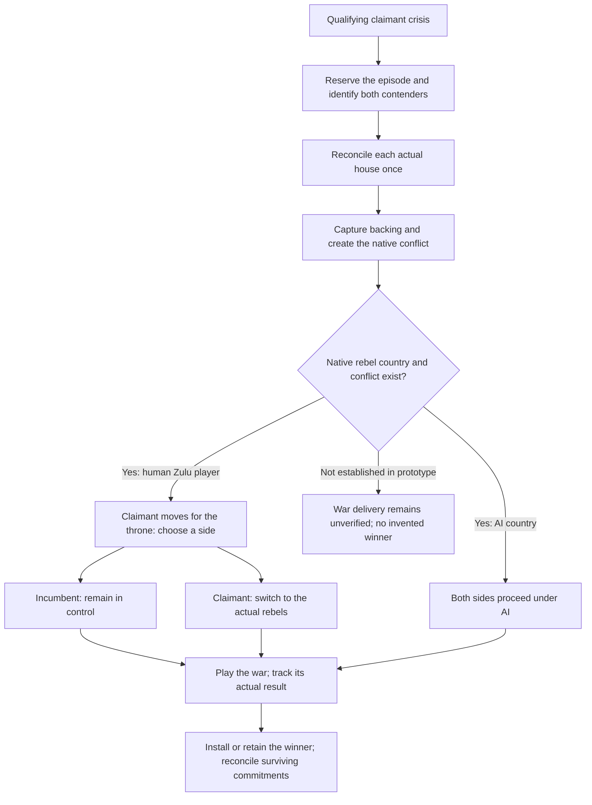

# Zulu court: permanent achievements and claimant civil wars

25 October 2026. **Design exploration only.** This incorporates DP's follow-up to the [Umkhosi and balance brief](zulu_umkhosi_and_dynastic_balance_2026_10_25.md). It supersedes that brief's temporary-victory recommendation and its yield/resist presentation. No game scripts, localisation or saves are changed.

**Latest DP decision, 25 October:** the [complete character package](zulu_character_package_proposal_2026_10_25.md) is agreed and locked. **Defer the explicit historical-sequence trigger and playtest first** remains in force. Test coalition/reputation changes and fixed −10 P shocks without an unconditional sequence override. The earlier desired historical trajectory is a balance target, not authorisation to force the event. The remaining [event package](zulu_court_event_package_2026_10_25.md) is separately proposed for agreement.

**Locked character baseline:** −40 intrinsic Dingane Popularity, the existing −10 Usurper penalty, +40 permanent rewards per campaign victory, and −20 permanent Q/−10 P per outright campaign defeat. The complete roster, generation policy and Retief exchange are approved. This replaces the illustrative −25/−25/+30 calculation below; retain that arithmetic as a superseded alternative. Approval is not implementation or engine verification.

## Decisions and outstanding questions

| Item | Status | Position |
|---|---|---|
| Blood River and Swazi victory rewards | agreed and locked | +40 permanent Q for each campaign; first qualifying victory removes Usurper. |
| Starting traits | agreed and locked | Complete thirteen-character roster and controlled initial generation accepted; historical qualifications remain in the cast brief. |
| Claimant confrontation | agreed direction | Player chooses the incumbent or the claimant, and fights the resulting civil war on that side. Neither choice is surrender. |
| Civil-war strength | required direction | The opposing coalitions' actual summed prominence must matter materially. Exact implementation remains to be verified. |
| Immediate Prerogative loss | agreed trial direction | Trial −10 for each relevant defeat, in addition to changed allegiances. |
| Explicit historical defeat-sequence trigger | deferred by DP | Playtest ordinary consequences and fixed shocks first. The earlier guarantee is not a production trigger requirement; fixed −10 shocks alone do not prove the desired trajectory. |
| Native claimant-war mechanism | unverified | Existing opt-in prototype; no production claim or substitute foreign war. |

The separate [first-principles character research](zulu_starting_character_traits_research_2026_10_25.md) owns the historical judgements. Values here are balance proposals, not measures extracted from historical evidence.

## 1. Lifetime achievements, separate from temperament

The strongest implementation direction is **two permanent earned character achievements**, one for each campaign, with a visible card or permanent character modifier. They describe what Dingane achieved rather than assigning a personal quality such as Brave merely because his army won. Award them once to the actual credited sovereign, retain them through later exile or deposition, and never inherit them onto a successor. Generic wars cannot grant these campaign-specific achievements.

Three presentations are viable:

| Presentation | Complete reward flow | Advantage | Trade-off |
|---|---|---|---|
| **Two achievement traits — preferred** | Each distinct verified victory grants its own permanent card; winning both retains both. The first qualifying victory resolves the opening contested-accession penalty. | Shows the two achievements and preserves each campaign's identity. | Adds two cards to an already detailed character sheet. Values must be checked against native prominence/popularity effects. |
| **One evolving reputation trait** | First victory grants an initial tier; the second upgrades it, replacing the first. Preserve both campaign records in the background. | Compact display and a strong sense of progression. | Needs dynamic explanation of which campaign earned the initial tier; otherwise one war becomes visually indistinguishable from the other. |
| **Two permanent modifiers** | Same once-only effects and lifetime persistence, shown among character modifiers instead of traits. | Uses the existing character-modifier presentation without introducing new personality/skill slots. | Less prominent as a major character achievement. |

All three meet permanence. No variant should silently retain the old +15/+10 bonuses, automatic Brave or extra direct victory P grants beneath the new package. Preserve independently useful firearms and territorial effects. A custom achievement should not acquire unrequested offence/defence bonuses to make its card look substantial.

### Provisional arithmetic, pending the research package

For illustration, an intrinsic **−25 Popularity** package plus an explicitly authored **−25 contested-accession** penalty starts at −50. Removing that penalty after the first major victory and granting **+30 permanently per campaign** gives:

| State | Popularity from this package |
|---|---:|
| Opening | −50 |
| One campaign won | +5 |
| Both campaigns won | **+35** |
| One won, one lost, if the proposed −20 defeat reputation is retained | −15 |
| Both lost, with two proposed −20 defeat penalties | −90 |

The permanent rewards and removal of the accession penalty produce an **85-point turnaround**. The intrinsic personality is unchanged; victory changes the king's reputation. The −25 accession and −20 defeat values are authored balance proposals, not historical findings. Permanence is accepted for the rewards; the duration and exact treatment of defeat reputation remain provisional.

The installed game defines popularity thresholds at −50/−25/+25/+50 and converts popularity into prominence at 0.25 before its other rules/cap. A prior DP screenshot displayed “Neutral (25)”; the threshold constant alone does not establish the exact boundary/rounding used by the UI. +35 deliberately leaves a margin above +25. Do not promise a UI label from equality with a define alone.

If the historical package instead includes another negative trait, recalculate the earned reward needed to finish clearly liked. Do not pick the historical traits to reverse-engineer this table. Do not erase unrelated native modifiers or guarantee positive popularity against every later scandal. Native authority and prominence effects also need inclusion in the eventual balance pass; no duplicate scripted prominence grant is proposed.

## 2. “The claimant moves for the throne”

Replace the proposed concede/resist crisis with a **choice of playable side**:

- **Stand with Dingane:** retain control of the incumbent country and fight the claimant.
- **Stand with Mpande:** transfer the player to the actual claimant side and fight Dingane.

Those names are working interface descriptions, not final flavour. The human chooses whom to play; the civil war and coalition balance do not depend on that choice. An AI-controlled Zulu country still experiences the crisis. Its incumbent and challenger are separate AI participants; there is no artificial AI “change player” decision. A human playing NAL/TRN should not be transferred into Zulu politics by an observer notification.

This exploration concerns the named dynastic crisis. It does not by itself authorise replacing every ordinary constitutional/native coup with a claimant war. The eventual shared succession controller should reuse side selection where applicable, while retaining the distinction between a living sovereign's opponent and a contender after death/retirement.



Native `play_as` is used by installed Vanilla events, and SB's current test prototype already postpones switching until a real rebel country exists. That verifies a script precedent for switching, **not the whole war mechanism**. Use the actual original/rebel country references, not whichever tag happens to be ZUL after a revolution. Revalidate before switching if a popup has remained open. Choosing the claimant must not reroll the split or change their starting resources.

A civil war against a living ruler uses **current allegiance**. A chief loyal to Dingane today but pledged to Mpande's eventual succession remains with Dingane unless an episode explicitly changes that allegiance. A death/retirement succession uses the recorded **future pledges**. The current prototype's combined current-or-future membership test cannot be reused indiscriminately for both situations.

With multiple rival princes, the active challenge has a named leader. Other princes' opposition is not automatically added to that leader's coalition. Their supporters must join explicitly or remain outside that coalition. Do not count them twice, turn them into free incumbent supporters, or kill the other branches after the selected rival loses. A successful royal-versus-royal war grants no Thirteen Chiefdoms constitutional reward and does not set P to 100.

## 3. Coalition prominence and military strength

Count each house once through its current head, including the relevant princes' and king's own prominence. For a two-sided challenge, the simplest desired strength ratio is:

```text
claimant share = claimant coalition prominence
                / (incumbent coalition prominence + claimant coalition prominence)
```

| Incumbent backing | Claimant backing | Desired claimant share |
|---:|---:|---:|
| 300 | 100 | 25% |
| 200 | 200 | 50% |
| 100 | 300 | 75% |

This is the preferred **design target**, not an assertion that 25% will yield exactly 25% of battalions. It uses the selected claimant's backing, not all rival princes combined. Presently uncommitted houses and third-party claimants are shown separately; they do not receive invented pledges. The λ=0.25 discount continues to apply only to Prerogative's H denominator, not this war ratio. Native geographic allocation still necessarily assigns territory and military infrastructure; political neutrality cannot promise a physically untouched third country.

An alternative is to allocate uncommitted prominence equally to the sides before calculating shares. That makes sparsely pledged courts much closer to 50:50, rewarding a small claimant with half the neutral pool. It also dilutes the value of explicit pledges. I prefer to leave that out unless DP wants a more evenly matched war by design. Explicit last-minute commitments can be resolved before the split without inventing them through the denominator.

### What the installed engine exposes

| Surface | Evidence | What it does not prove |
|---|---|---|
| Player switch | Vanilla `play_as = scope:revolution_scope` in `india_nationalism_events.2`; current SB prototype uses the returned rebel country. | That a same-constitution royal conflict can be started reliably. |
| Territorial target | `political_movements.md` documents `target_fraction_of_states` and `state_weight`; installed movements use them. | Exact population, GDP, province or battalion shares, especially in a one-state country. |
| Native military split | Defines weight the uprising army fraction by 0.75 movement military support and 0.25 insurrectionary IG clout. State selection also considers army distribution. | A documented per-movement “use court prominence as army fraction” override. No such knob was found in the inspected interface. |
| Movement character support | Native documentation describes agitator eligibility/weights. | That moving arbitrary court members into a movement converts all their prominence directly into military support. |
| Native war delivery | Existing SB dynastic movement probe is opt-in. | Same-law mobilisation, the split, both playable sides and exact winner callbacks remain unverified. |

**Preferred technical exploration:** feed the coalition share into the scoped native territorial target, reconcile the actual supporting characters, and measure the resulting army split. This may provide material influence without exact percentages. It only satisfies the requested design if increasing coalition backing produces a meaningful, repeatable military advantage in DP's tests.

**Alternative if the native allocation is insufficient:** retain the native split and apply a bounded, prominence-scaled mobilisation modifier for that conflict. This is easier to scope, but must not be passed off as transferring the promised share of troops. It could also count the same political advantage twice if the native split already reflects it. Exact effects and magnitude require a separate choice; no hidden combat bonus is authorised here.

One concrete candidate for that alternative is a relative conscription-capacity adjustment of `0.20 × (2 × faction share − 1)`: a 25% faction receives −10%, a 50% faction no adjustment and a 75% faction +10%. Apply once from the captured ratio to each actual war country, show it before the choice, and remove it when that exact conflict ends or invalidates. It changes mobilisation capacity, not unit quality, existing battalions or the war's winner. A large native allocation mismatch could dwarf it; it is therefore not a substitute for testing whether the accepted strength requirement is actually met. The installed modifier catalogue contains `state_conscription_rate_mult`; application and runtime usefulness remain unverified for this proposal.

**Exact scripted asset redistribution** would require verified unit/formation ownership tools and an economic/province contract. It is substantially more invasive and remains outside the settled design. Changing global civil-war defines would affect unrelated countries and is not proposed.

Spain's existing Carlist content supplies a useful conflict presentation, but its already established competing countries do not prove the required runtime split. Hail Columbia's filibuster event constructs a separate country and a `dp_revolution` play with `annex_as_civil_war`; that does not establish the native movement/army partition required here. Neither is a reason to substitute the previously excluded foreign-war approach.

The minimum engine probe is a fresh one-state Zulu country at three controlled coalition ratios, with the same movement support, IG clout, forces and buildings. Compare 25:75, 50:50 and 75:25, then repeat with two states and an uneven barracks distribution. Record actual provinces, barracks, battalions, manpower, commanders and player switching. Repeating with varied native randomness establishes whether the influence is useful, not merely present in source. DP performs these launches; every case is pending.

Each side must retain its actual named contender and surviving supporters, including after native ruler selection. Measure the existing Prerogative/Institutional Reach military effects as well; do not duplicate them through a second automatic court-power combat bonus. Capture the political split once, rather than renormalising it against the two smaller post-split courts every month.

## 4. Immediate defeat shocks

Adding a fixed **−10 P** has a coherent purpose: lost authority is felt immediately, while defections and reputation reshape the equilibrium. Apply it once per confirmed relevant campaign defeat and test the crisis after the shock, before a subsequent monthly recovery. This reopens the earlier blanket removal of direct geopolitical P effects for this explicit purpose; it does not restore every old victory/decision grant.

However:

```text
P after defeat = clamp(P before defeat − 10, −100, 100)
```

It crosses −50 only if P was already **≤−40**. For example, −43 becomes −53, but −30 becomes −40. Two rapid losses from P=0 give −20, not −50. The amount of time between defeats matters because normal drift continues.

With a fixed target −20 and initial P=−20, the first −10 shock leaves P=−30. After twelve monthly pulses P is about −21.42; a second −10 gives **−31.42**. In the uncapped part of the drift, a shock's remaining contribution is `−10 × 0.85^months`. Changed targets and capped drift alter the trajectory, so this is a counterexample to a guarantee, not a forecast of Dingane's campaign.

A concrete allocation from the earlier checkpoint also shows the problem. Hold prominence fixed, start Q at the proposed −50 and M at zero, and recruit distinct representatives of these weights:

| Step | Allegiance change | New target T |
|---|---|---:|
| Kill Retief | 37 neutral prominence joins Dingane | +11.63 |
| Lose Blood River | 71 and 47 join opposition; proposed Q becomes −70 | −18.80 |
| Attack Swazi | A different 35 joins Dingane | −14.21 |
| Lose Swazi | 40 and another distinct 35 join opposition; proposed Q becomes −90 | −32.47 |

If P had settled near −14.21 before the second loss, its −10 shock produces **−24.21**, then it drifts towards −32.47. It never reaches −50 from those effects alone. Critically, the new target created by that loss is not the P to which its immediate shock is applied. This is an illustrative frozen-weight path, not a prediction after the starting traits are revised; full inputs are in the calculation record.

The two designs considered were:

1. **Explicit historical guarantee — deferred by DP:** let the exact four-step sequence start the named crisis independently of reaching −50. This was the previous recommendation, not the accepted implementation direction. Do not add it before playtesting.
2. **Conditional political crisis — test first:** use actual Prerogative and a viable opposing coalition. The defeat chain worsens Dingane's position, while intervening political management can matter. Record P, target, popularity, actual house allegiances and named claimant backing after each outcome and between wars. Test whether the desired crisis occurs before considering an exceptional sequence rule.

Do not silently convert “−10” into “set P to at most −50”. That would be a different, adaptive penalty and must be presented as such. Likewise, a larger fixed number calibrated to one opening snapshot cannot guarantee the result across all intervening political choices.

## 5. Handoff boundaries

Permanent achievements, a player choice of faction, prominence-derived strength and fixed defeat shocks form a coherent direction. The principal unresolved engineering issue is **native war creation plus a meaningful military split**, not the choice popup. Keep the unverified path isolated until tested. No save migration, dependency patch, wider country rollout or game launch is part of this exploration.

DP has now settled the trait packages, campaign reputation amounts/durations and immediate trigger policy: playtest first, with no explicit historical-sequence override. The remaining neutral-house treatment and event choices are collected in the event package linked above; it proposes no substitute mobilisation reward for an exhausted neutral pool. Preserve the existing annual gathering direction, once-only generic outcomes, unrelated annexation-movement work, permanent incorporation entitlements and reviewed prose.

## Source and calculation trail

- [First-principles historical trait research](zulu_starting_character_traits_research_2026_10_25.md), delegated to Astra Max at DP's explicit request; historical citations and evidence limitations are maintained there.
- Installed Vanilla `common/political_movements/political_movements.md`, lines 92–130; `common/defines/00_defines.txt`, lines 215–270 and 1891–1927; `events/india_events/india_nationalism_events.txt`, player-switch option; `common/character_traits/skill_traits.txt`, Basic Political Operator. Local source inspection on 25 October 2026.
- Current SB [dynastic prototype and reconciliation](../common/scripted_effects/sb_court_rivals_effects.txt), [succession events](../events/sb_court_succession_events.txt), [runtime matrix](zulu_court_runtime_matrix_2026_10_19.md).
- Installed examples: `events/iberia_events/carlist_war_events.txt`; Hail Columbia `events/usfp_filibuster_events.txt`, event `.7`; Gates of the Bosphorus movement/coup precedents. Their presence is source evidence, not a successful SB engine test.
- [Reward, shock and coalition arithmetic](zulu_court_rewards_war_calculations_2026_10_25.json). Small deterministic calculations only; no campaign simulation.
