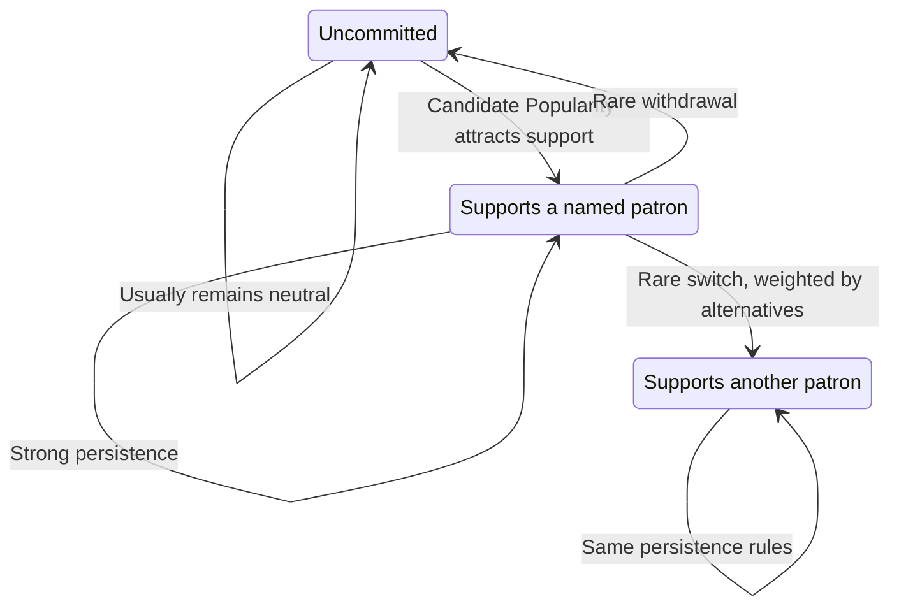
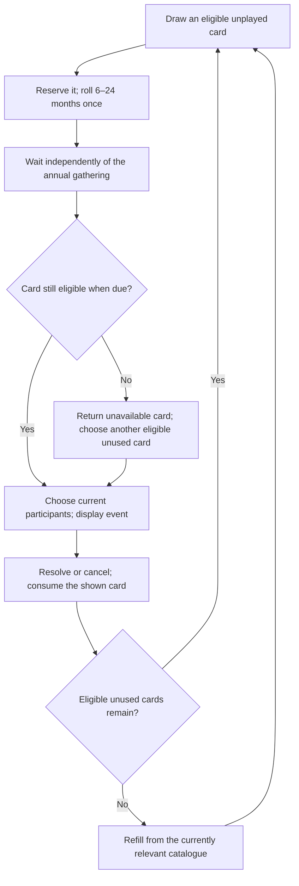

# Zulu court: persistent allegiances and an independent event deck

25 October 2026. **Approved and implemented in source; DP engine verification pending.**

The final instruction “code it up and I’ll test” authorises model B, the six-card deck, conditional-promise handling and the new cash curve below. Alternatives remain as decision history. See [implementation and validation](compatibility/zulu_court_events_2026_10_25.md).

Earlier design context: DP has reopened passive allegiance and separated ordinary court incidents from the annual first-fruits gathering. This supersedes the gathering/one-event-per-year scheduling and irreversible passive recruitment in the [previous event proposal](zulu_court_event_package_2026_10_25.md). The [locked character/reputation package](zulu_character_package_proposal_2026_10_25.md) remains unchanged. The six incidents and geopolitical effects use the accompanying approved package; this document supersedes its annual-incident timing.

**Latest decisions:** DP selects Popularity-dependent persistence, confirms that the probabilities apply annually with Umkhosi as the reporting front, and makes purchased co-operation an immediate move into the incumbent's ordinary committed pool. There is no protected paid-allegiance state or recurring maintenance charge. DP specifies purchase prices of 20% of reserve capacity at 10 Prominence, 50% at 50, and 80% at 100. Section 3 connects these exact anchors with straight-line segments; this replaces the earlier proportionally scaled curve. The source now implements these decisions.

## Decision register

| Item | Status |
|---|---|
| Separate ordinary incidents from the first-fruits gathering | agreed direction: explicit DP request |
| Allegiance can persist, change patron or return to neutrality | implemented with the first-pass coefficients below |
| Popularity-dependent persistence, model B | agreed selection; numerical coefficients remain first-pass tuning |
| Event draw without replacement, followed by a random 6–24-month delay and another draw after resolution | implemented; engine delivery pending |
| Annual checks, with Umkhosi reporting their results | agreed explicitly by DP |
| Separate application to future-successor pledges | implemented separately; preserves the current/future distinction |
| Current allegiance versus future succession pledge | retain the agreed distinction; explicitly explain its application to this rework |
| Purchased co-operation enters the ordinary committed state | agreed; immediate guaranteed transition, then normal annual persistence |
| Purchase price | agreed anchors: 20% at 10 Prominence, 50% at 50, 80% at 100; linear interpolation between adjacent anchors |
| Conditional-law agreements | preserve their terms/breach handling; this cash decision does not silently rewrite their obligations |
| Character packages, campaign reputation, Q/2, λ=0.25 and Institutional Reach | locked/current; no changes here |
| Guaranteed historical crisis and native claimant-war delivery | respectively deferred and unverified; unchanged |

Notation: **Q** is native Popularity; **P** remains Prerogative. The probabilities below are percentages for one annual check. DP's illustrative `P >80`/`P >95` is read as high retention probability, not a Popularity threshold. Returning to neutrality needs a small nonzero probability; a literal zero-probability branch would never run.

## 1. What changes state

Keep the two existing political records rather than collapsing a future promise into opposition to the living king:

| Record | Possible allegiance states | Effect |
|---|---|---|
| Present allegiance | Uncommitted; current sovereign; named eligible adult claimant | Changes present house backing and therefore the Prerogative target. |
| Future succession | Unpledged; named eligible adult successor candidate | Changes the next succession coalition; does not itself damage the living sovereign's backing. |

A following is counted once through its current representative. Its prominence determines the consequence of a transition, not another multiplier on its probability. The sovereign does not randomly abandon himself. Princes retain their own succession claims and own-house contribution; an ordinary roll cannot renounce a claim. A prince's present co-operation and his own eventual claim remain distinct. Existing special minority/regency commitments stay under their authored controller; autonomous recruitment must not manufacture adult influence for children.

Interpret “something similar for adult heirs” as applying the same transition logic separately to future succession pledges, with the incumbent excluded from that candidate set. If DP instead means princes surrendering their own claims or unifying royal branches automatically, that is a separate proposal and is not assumed here.

For both records, take the eligible patrons' Popularity and the representatives' states from a snapshot before processing the annual check. Apply at most one transition per representative per record, then recalculate the court. Do not let list order cascade into additional rolls. A representative may serve Dingane now and favour Mpande later. Constitutional alignment continues to use the movement system and is not overwritten by either personal transition.

Exile alone does not delete a retained claimant or commitment; use the existing home-court and candidate eligibility rules. Death, retirement and renunciation invalidate eligibility through their controllers. In particular, capture a deceased sovereign's outgoing commitments before succession reconciliation; do not wipe them into neutrality first. An ordinary roll must not reshuffle already reserved civil-war sides or an accession decision. This is not a general peace requirement.

## 2. Two viable transition models

### A. Fixed inertia, Popularity chooses the destination

Each year an uncommitted representative stays uncommitted with 85% probability and joins someone with 15%. A committed representative stays with the current patron with 97%, withdraws to neutrality with 1%, and switches to another patron with 2%.

For choosing a patron, convert Popularity into a non-negative attraction weight:

```text
a(j) = clamp((Q(j) + 100) / 200, 0, 1)
Destination share(j) = a(j) / sum of eligible destination weights
```

Do not include the current patron among switching destinations. If every candidate has zero attraction, a neutral stays neutral; if no alternative has positive attraction, move the unavailable switching probability back into staying. The ordinary withdrawal chance remains.

This model is simple and very stable. It gives all rivals a route to autonomous support and makes Popularity matter when a representative moves. Its weakness is substantive: all else equal, serving a hated patron is just as durable as serving a popular one. If everyone is nearly equally disliked, 15% of neutrals still join someone. Events would have to carry most changes in political enthusiasm.

### B. Popularity affects reconsideration and destination — selected

Use the same attraction weights, but let an attractive field encourage neutrals to commit and a strong alternative make an existing commitment slightly less secure.

For an **uncommitted** representative:

```text
Join someone (%) = 20 × highest eligible a(j)
Remain uncommitted (%) = 100 − Join someone
Allocate Join someone among candidates in proportion to their a(j).
```

Neutrality therefore persists with **80–100%** annual probability. If everybody has Q=−90, only 1% commit that year. If someone has Q=+100, 20% commit. Adding another equally attractive prince changes destination shares but does not by itself increase the overall probability of abandoning neutrality.

For a representative **committed to j**:

```text
Withdraw to neutrality (%) = 0.5 + 0.5 × (1 − a(j))
Switch patron (%) = 1 + 3 × max(0, best alternative a − a(j))
Stay with j (%) = 100 − Withdraw − Switch
```

Set Switch to zero if there is no positive-weight alternative. Allocate it among eligible alternative patrons in proportion to their attraction weights. Thus switching is normally **1–4%**, withdrawal **0.5–1%**, and staying is at least **95%** per year. With no attractive alternative, staying can reach 99.5%. These are the approved initial tuning values for this playtest, not empirical calibration.



B is the recommendation because a patron's own reputation influences both recruitment and retention. It also prevents negative probabilities and rows totalling more than 100%. It does not grant a special invisible crown bonus or automatically steer everyone to the single most popular prince. Broad royal unpopularity makes staying neutral more plausible.

### Worked annual transition table

Illustrative isolated Popularity: Dingane −50, Mpande 0, Gqugqu 0. This is based on the locked package, not a claim that every future save will have those totals. Each row sums to 100% before rounding.

| Present state | Uncommitted next year | Supports Dingane | Supports Mpande | Supports Gqugqu |
|---|---:|---:|---:|---:|
| Uncommitted | 90.00% | 2.00% | 4.00% | 4.00% |
| Supports Dingane | 0.88% | 97.38% | 0.88% | 0.88% |
| Supports Mpande | 0.75% | 0.33% | 98.25% | 0.67% |
| Supports Gqugqu | 0.75% | 0.33% | 0.67% | 98.25% |

If Dingane wins both campaigns and reaches the isolated +40 Q, a neutral's annual chances become **86% neutral, 5.76% Dingane, 4.12% Mpande, 4.12% Gqugqu**. An existing Dingane supporter stays with him with **98.35%** probability. Victory still separately earns the proposed named supporters and locked reputation; the transition mechanism is the ongoing background process.

For the future-pledge record with only Mpande/Gqugqu eligible at Q=0, an unpledged representative remains unpledged with 90%, pledges to Mpande with 5%, or Gqugqu with 5%. A pledged representative stays with that prince with 98.25%, withdraws with 0.75%, or switches with 1%. The king's current popularity does not silently choose his subjects' next king in that separate calculation.

### Cadence and feedback

**Agreed: annual checks**, with Umkhosi serving as the reporting front for actual changes. There is no ordinary incident attached and no extra recruitment roll. The exact presentation of an unchanged year remains a UI detail; it does not authorise another political roll.

Do not reuse annual percentages monthly: 95% monthly retention gives a **45.96% chance of at least one departure within twelve months** at unchanged rates. This differs from the end-of-year allegiance because a character might subsequently return. Monthly hazard conversion can preserve a chosen no-departure probability, but does not automatically reproduce the whole annual multi-state transition matrix. Annual checks are sufficient for the first playable balance pass.

Popularity now has two intentional effects: its existing direct Q/2 contribution, and a slower change in supporters. Retain the agreed formula initially; measure the combined effect rather than also buffing it. The event deck can move people immediately, change a candidate's Popularity or strengthen a house, then future annual checks continue from that changed state. Do not automatically reroll an event's result on the same resolution.

## 3. Purchased co-operation: ordinary commitment, paid once

The earlier specification promised that existing commitments would not reroll annually. DP has now selected ordinary persistence for purchased co-operation. The comparison below records the alternatives considered; the protected-cash alternative is not selected. Conditional-law agreements retain their separately recorded terms and breach handling.

| Treatment | Complete behaviour | Benefit | Cost |
|---|---|---|---|
| **All ordinary allegiances use the same chain** | A cash purchase guarantees co-operation immediately; thereafter the actor has the committed state's high retention. Breaches and events can also change it. A voluntary departure ends that actor's corresponding promise; no refund or reversal of already-granted concessions. Separate current/future commitments are not both cancelled without cause. | Keeps the requested small state model and autonomous political life. No arbitrary fixed expiry. | A costly purchase is no longer permanently secure. In the opening illustration, a Dingane supporter has about a 23% chance of departing at least once over ten years with frozen rates. |
| **Explicit bargains remain binding until a cause** | Ordinary voluntary allegiance follows B; paid and formally negotiated records are excluded until succession, breach, a specific event or invalidation releases them. A current cash pledge does not protect an unrelated future pledge. | Preserves the prior durable value of costly promises. | Adds a distinction between ordinary and bound commitments; the court can gradually become mostly immune to Popularity-driven movement. |

**Agreed purchase behaviour:** pay a single lump sum to move the displayed eligible representative from neutrality or rival allegiance into co-operation with the incumbent. The represented following moves once under the existing house rules. Payment guarantees this immediate transition; subsequent annual checks use the same persistence probabilities as any other committed supporter. There is no upkeep, special retention bonus, fixed expiry, Authority charge, Prominence reward, constitutional conversion or automatic future-successor pledge. Do not reroll immediately upon payment. A supporter already committed to this incumbent is ineligible for another purchase; a later departure can make them eligible again under the normal interaction rules.

Keep participant/ruler/quote revalidation and the sufficient-cash requirement. Reopening a quote does not debit funds or reroll allegiance. Native Patronise, Ostracise and Grant Peerage remain separate. Active claimants remain outside the ordinary purchase interaction.

**Agreed price anchors:** G is the payer's maximum gold-reserve capacity; q is the representative's own native Prominence clamped to 10–100, as in the existing interaction. DP sets the price fraction to 0.2 at q=10, 0.5 at q=50 and 0.8 at q=100. These points are not collinear, so use straight-line interpolation separately between 10–50 and 50–100:

```text
q <= 50: cost = G × [0.2 + 0.0075(q − 10)]
q >  50: cost = G × [0.5 + 0.006(q − 50)]
```

| Prominence q | Previous source price | Implemented price |
|---:|---:|---:|
| 10 | 16% G | 20% G |
| 25 | 40% G | 31.25% G |
| 50 | 80% G | 50% G |
| 75 | 90% G | 65% G |
| 100 | 100% G | 80% G |

The two segments are continuous at q=50 and hit all three requested prices exactly. For G=£10,000 and q=50, the one-off payment is £5,000. House prominence still determines political impact; it is not substituted for q in the price without a further design change. Current scripts use the agreed curve.

Formal conditional-law agreements still need their terms reconciled when a participant changes allegiance. The decision about a cash purchase does not grant immunity to annual transitions or automatically erase unrelated future promises. Preserve explicit obligations and identify any further change to their fulfilment/breach rules separately.

## 4. Ordinary events as a separate deck

DP's requested sequence is viable as a design. Use **one card per incident template**, not one card per character or event option. Choose uniformly from eligible, unplayed cards; the four family labels remain descriptive and no longer control first-stage selection. Character portraits and concrete stakes remain as proposed.



The invalid-card branch only displays another event if one is eligible; otherwise wait and check eligibility on later monthly pulses. No infinite resampling and no fabricated scene. Participants are chosen **at delivery**, since a 6–24-month reservation is too long to assume the same people remain alive, neutral or in office. Once displayed, names and quotes are captured and revalidated on selection; never substitute another person beneath an open choice.

Recommended edge rules:

- Draw the card and delay once and retain them in the save. Reopening the court or a popup does not reroll either.
- Mark the selected card reserved so another pulse cannot dispatch it. A shown card is consumed even if its participants later invalidate the choice; cleanup schedules the next draw exactly once.
- If a reserved card becomes unavailable before display, try another eligible unplayed card at the **existing due time**. Do not impose a fresh random delay merely because its first scene became invalid.
- Cards that can never recur, such as an already-consumed once-only firearms reward, leave the relevant catalogue. Temporarily unavailable cards remain candidates for later eligibility; they do not hold an entire cycle hostage.
- Refill when **no eligible unplayed card remains**, not when every possible historical scene has somehow happened. If no cards are eligible even after refill, wait for conditions to change.
- At a refill, avoid an immediate repeat of the last shown incident when another eligible card exists. With only one eligible template, repetition is permitted after its normal new delay.
- The next 6–24-month interval begins after resolution/cancellation, as DP suggested. Event duration and priority deferral are therefore additional time. All supported expiry/cancellation paths need the same once-only cleanup.
- One ordinary event can be pending/open at once. A higher-priority succession/confrontation can delay delivery without redrawing its timer. Unrelated foreign wars are not a blanket blocker.
- Institutional exit suspends ordinary delivery. Preserve used/reserved cards and the due date; re-entry does not refill the deck or create a backlog of several events.
- Succession, coercion, geopolitical results and actual broken-promise reactions remain outside the ordinary deck. They neither consume a random card nor reset its delay; the once-only firearm reward itself remains shared with its existing court contract.

This replaces the earlier one-ordinary-event-per-year rule. A uniform inclusive 6–24-month delay averages **15 months**, or **0.8 events per year** before resolution/deferral. Six eligible cards take **90 months / 7.5 years on average** to cycle, plus those extra delays. Actual cycles may contain fewer cards as eligibility changes. This is slower on average than the former annual proposal, but avoids repetition and lets the court evolve between incidents.

## 5. Feasibility, checks and handoff

The current SB annual helper already uses dynamic weighted `random_list` choices and records present versus future support separately. Native `common/on_actions/_on_actions.md` documents random delay ranges such as `months = { 6 12 }`, but also warns that delayed events must be valid at scheduling and delivery. That supports random intervals and explains why directly scheduling a highly conditional scene can silently lose it. A durable country-owned deck controller and delivery-time scene selection need explicit validation; this is not a claim that the native event API supplies a shuffle bag automatically. Do not assume an uninspected `trigger_event` field supports the same syntax as an on-action delay.

Use bounded country/character records and the existing monthly/annual lifecycle. No daily global scan or generic framework for unrelated content is proposed. Keep original actor/event roots and actual home-court assignment through cross-country callbacks. These source precedents establish building blocks, not engine-tested new behaviour.

The [calculation record](zulu_court_transition_calculations_2026_10_25.json) checks 1,560 transition matrices across both proposals, one to four candidates and boundary Popularities. Every row is non-negative and totals 100%; B retains at least 80% neutrality and 95% committed persistence. Cases include everyone at −100, a popular rival, both campaign victories and both defeats. These are mathematical checks, not game simulations. They do not forecast the complete moving prominence, movement or war systems.

Eventual acceptance should cover: candidate birth/adulthood/death/retirement; separate current/future changes; representatives and shared houses; succession snapshots; open quotes; paid/formal pledge policy; no re-roll on reopening; exhausted candidate sets; deck exhaustion/refill; once-only cards; eligibility changes during a 24-month delay; expiry/cancellation; save/load and exit/re-entry; both AI and human courts. Observe popularity, actual backing and P over several years. All engine scenarios remain pending DP; no claimant-war guarantee or save migration is added.

The complete selected package is implemented. Remaining work is DP engine verification and tuning against actual campaigns. Conditional promises follow their particular current/future commitment; a voluntary departure ends only that unfulfilled obligation. Already-granted concessions keep their original expiry.
