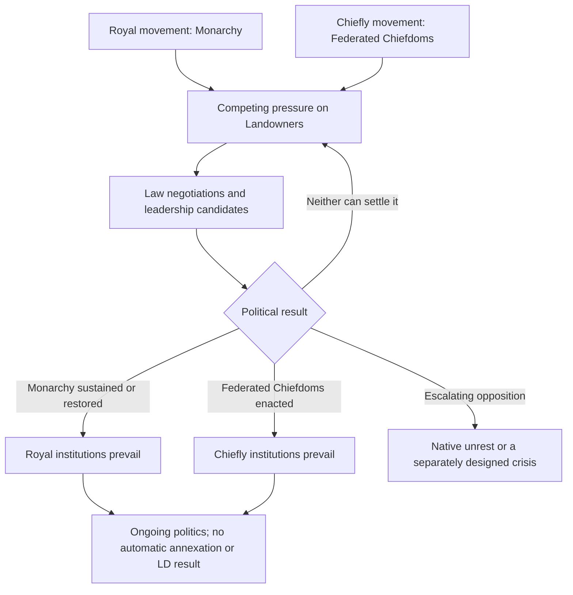
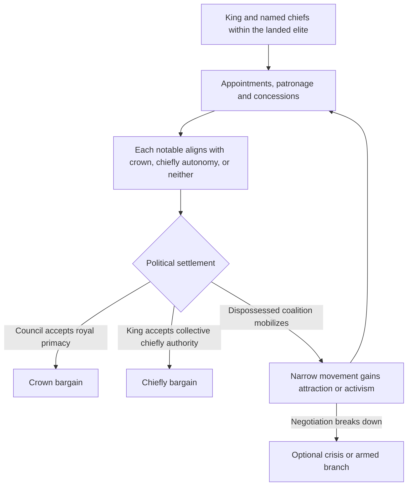
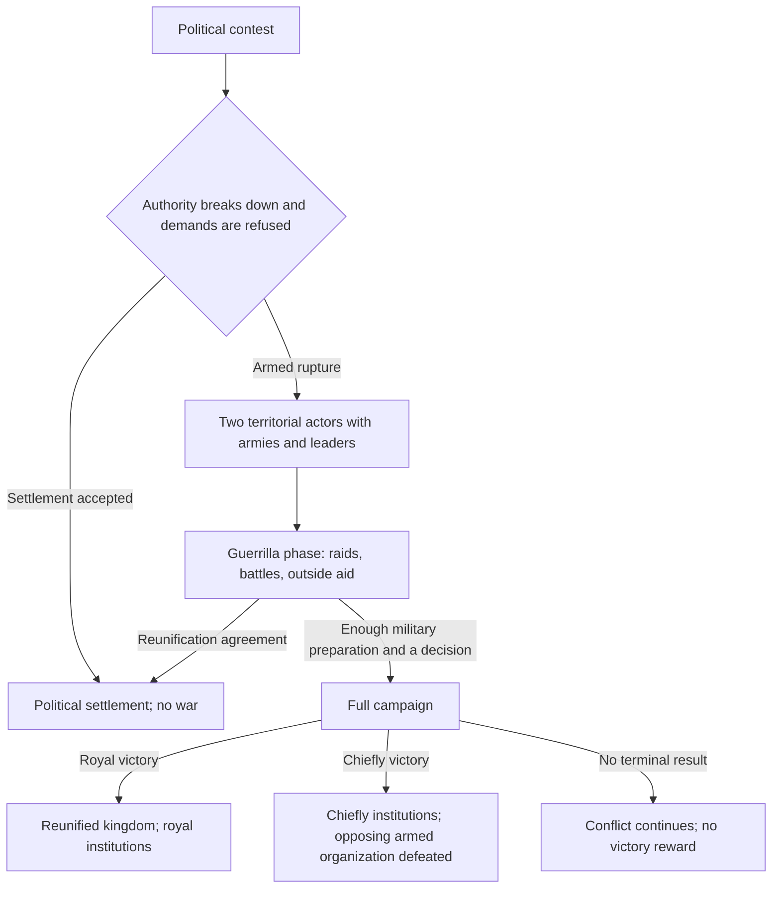

# Zulu crown and chiefs — competing authority within Landowners

18 October 2026. **Design exploration only. No gameplay changes.**

DP has rejected the LO-as-royals / PB-as-chiefs architecture. This exploration
supersedes that architecture in the earlier
[consolidated plan](zulu_chiefdoms_rework_plan_2026_10_18.md),
[effect matrix](zulu_ideology_effect_matrix_2026_09_20.md), and
[ideology reference](zulu_vanilla_ideology_reference_2026_10_18.md).
Their contents remain historical evidence; their proposed packages are not an
implementation backlog. The live mod still has its intermediate Chiefdoms design.

**Update: DP selected B**, with native movements as an integral part of it, on
18 October 2026. The [developed B design](zulu_chiefly_coalitions_design_2026_10_18.md)
and [historical cast research](zulu_chiefly_coalitions_research_2026_10_18.md) are now
the current exploration. The original A/B/C comparison below is retained as
decision history. The earlier recommendation to begin with A alone is superseded;
B's detailed mechanics remain proposals until accepted.

## Decision register

| Item | Status | Current interpretation |
|---|---|---|
| PB chiefs versus LO royalists | agreed | Abandon this proposed class split. Both coalitions draw on the landed establishment. |
| Council of Chiefs and Chiefly Militias proposals | agreed | Drop them and their proposed PB attraction/strength bonuses. This does not delete existing Amabutho or unrelated live laws. |
| Broad replacement ideological packages | agreed | Drop them from this redesign; do not carry over the bureaucracy, policing, economic or other proposed positions. |
| Federated Chiefdoms | provisional | Retained in DP's new proposal as the constitutional alternative to Monarchy. Its actual institutional meaning needs to be explicit. |
| B with native movements | agreed | DP selected named chiefly coalitions as an extension of A. See the linked development for the detailed proposals. |
| Two movements from the beginning | provisional | Develop within B. Starting availability and permanent survival remain different requirements. |
| uSuthu / amaKhosi labels | provisional | Working names. Royal Party / Chiefly Autonomists describes coalitions more accurately than all royal relatives / all chiefs. |
| Narrow law positions | provisional | Reproduce DP's three-law table below exactly; N/A elsewhere. |
| Armed Carlist-style alternative | deferred | Not selected as the core experience; retain the comparison as a possible later extension. |
| PB and AF | agreed | No faction assignment or recruitment rework for them under this direction. |
| Deadline or minimum duration | agreed | Earlier rejection remains: neither elapsed time nor a compulsory waiting period selects the winner. |
| NAL/TRN participation | provisional | Preserve their role as interested actors; rework assistance around the selected mechanism. No automatic identity between royalism and anti-Natalism. |
| Prior 99% actual-activism takeover | open | Previously accepted for the older contest. It is not silently retained as the general rule governing both new movements; C particularly requires a different consequence. |
| Chief victory conditions and incorporation rewards | open | Reassess against the selected institutional outcome. Old numeric rewards are not automatically attached to a movement majority. |
| Movement disappearance / custom category | open | Source-supported options below; engine survival has not been verified. |
| Annexation movement modifier-preservation test | deferred | Existing separate DP todo remains. This design concerns ZUL's internal politics, not NAL's annexed Zulu cultural movement. |

## Historical framing and its limits

The shared-elite model has a sound basis. Guy describes the king governing with
the *izikhulu*, a council whose members' authority combined descent, local power,
and royal patronage. Some important chiefs were royal favourites; Zibhebhu was
also a relative of Cetshwayo. This supports competing coalitions within a landed
establishment, rather than treating chiefly authority as an urban middle-class
interest. [Guy, pp. 57–59](https://emandulo.apc.uct.ac.za/collection/Jeff_Guy/K/Guy_1981_Political_Cetshwayo.pdf)

Ballard's account of succession rivalry and Dunn's support for Cetshwayo also
shows that royal kinship did not guarantee political unity and outside assistance
could strengthen a royal faction. [Ballard, publisher's extract](https://www.cambridge.org/core/journals/journal-of-african-history/article/abs/john-dunn-and-cetshwayo-the-material-foundations-of-political-power-in-the-zulu-kingdom-18571878/39C5458E7DDA2BF405A742D3A85DB837)

Design inference: Royal Party and Chiefly Autonomists should describe positions,
not immutable genealogical or occupational categories. A chief may support the
crown; a royal relative may join its opponents. Using uSuthu for the entire royal
side from 1836 would be a deliberate abstraction, not a claim that every earlier
succession dispute involved the same historical faction. A contextual early name
such as Royal Party can avoid that implication without adding a third movement.

The comparison to European crown/nobility struggles is useful for mechanics; it
does not establish that Zululand simply repeats a European constitutional path.

## Proposed ideological core

These are DP's proposed positions, not new approvals of the old matrix.

| Governance law | uSuthu / Royal Party | amaKhosi / Chiefly Autonomists |
|---|---|---|
| Monarchy | ++ | - |
| Federated Chiefdoms | -- | ++ |
| Social Monarchy | N/A | - |
| All other laws, including Autocracy, bureaucracy and army laws | N/A | N/A |

`++` strongly approves; `-` disapproves; `--` strongly disapproves;
**N/A** means no position, not an explicit neutral rating.

Two consequences need to remain visible:

- These ideologies measure a constitutional preference, not every grievance a
  supporter has. Radical supporters, interventions and enacted-law changes can
  still affect activism. Opposing Monarchy does not by itself guarantee a revolt.
- With N/A on republics and on uSuthu's Social Monarchy stance, the core alone
  cannot model a broad campaign to restore any crown under every later regime.
  Recommended interpretation: a transition beyond these traditional institutions
  can end this particular contest. Keeping royal restoration active under a
  republic would require an explicitly added position or lifecycle rule.

Federated Chiefdoms must mean **chiefs collectively hold sovereign authority** if
it replaces Monarchy. If the desired result is a king constrained by a council,
that is a different institutional arrangement: it can remain Monarchy and be
represented by B's political bargain. Calling it a new governance law cannot by
itself express the whole continuum of influence under an unchanged monarchy.

The previous +25% PB-strength package goes away. A retained Federated Chiefdoms
law should describe country-level authority/legitimacy and its actual government,
not manufacture a second estate. Its numerical modifiers are unselected.

## What the installed game actually supports

Checked against installed Vanilla 1.14.5 and the effective SB/CMF movement files.
This is source verification, not a launched prototype.

| Capability | Evidence | Implication |
|---|---|---|
| Limit which IG a movement pressures | `can_pressure_interest_group`, explicitly documented with an IG root | Both movements can target LO without rewriting PB. Needs an engine check for the new definitions. |
| Multiple movements influence one IG | Defines permit up to three influencing movements; native thresholds/stickiness apply | Two are possible, but neither is guaranteed an exclusive slot over other native movements. |
| Read pressure on one IG | `movement_pressure(scope:ig_for_calc)` in Vanilla's law-negotiation values | Show each side's pressure on LO rather than relabelling national movement support as a share of LO. |
| Influence leadership | A movement's `character_ideologies` and pressure affect ideology weights for generated characters/IG leaders | Give each coalition a matching narrow character ideology. Do not add both as permanent IG packages or swap leaders every month. |
| Influence law negotiations | The negotiation script separately counts supporting and opposing movement pressure on the negotiating IG | Their pressure can matter while the incumbent leader remains in office. |
| Support and activism differ | Native support combines popular, military and wealth components; activism has its own target and weekly adjustment | Support is not a raw pop percentage; neither value equals a guaranteed share of government power. |
| Minimum support is category-defined | Ideological category: 5% creation, 2.5% maintenance; defines give a 12-month grace | An initial spawn does not guarantee indefinite existence. A false `disband_trigger` alone does not solve this. |
| Custom category can declare its own minimum | `political_movement_categories.md` documents both thresholds | A dedicated category for these movements is a possible narrow persistence solution, not an engine-tested guarantee. Audit UI/category-dependent behavior first. |

Primary local sources:

- [Movement database documentation](</Users/depro/Library/Application Support/Steam/steamapps/common/Victoria 3/game/common/political_movements/political_movements.md>)
- [Movement/leadership defines](</Users/depro/Library/Application Support/Steam/steamapps/common/Victoria 3/game/common/defines/00_defines.txt>)
- [Law-negotiation pressure calculations](</Users/depro/Library/Application Support/Steam/steamapps/common/Victoria 3/game/common/script_values/negotiation_values.txt>)
- [Native category thresholds](</Users/depro/Library/Application Support/Steam/steamapps/common/Victoria 3/game/common/political_movement_categories/00_political_movement_categories.txt>)
- [Category documentation](</Users/depro/Library/Application Support/Steam/steamapps/common/Victoria 3/game/common/political_movement_categories/political_movement_categories.md>)

There is no basis here to claim that two movements split the LO IG into two
independent voting blocs. It still has one leader, one government membership and
one clout total. Even if the two pressures are compared visually, normalize only
as a labelled comparison of these two movements, never as the complete division
of Landowner loyalties. Other or unaffiliated Landowners remain possible.

## A — two native movements, one landed establishment

**Best fit for the smallest coherent redesign.** The substantive machinery is
recruitment, activism, law pressure and leadership, with no separate invented
faction-strength resource.

**Beginning.** Keep ZUL's starting monarchy. Reconfigure its existing absolutist
movement as the narrow royal pole and add one chiefly movement, rather than
creating a second royalist alongside the existing object. Preserve non-ZUL and
CMF behavior. Establish both at start with plausible recruitment; do not start a
civil war or impose the post-conquest settlement in 1836.

Both draw on the landed/rural political world and its dependants. They need not
recruit only aristocrats or only people affiliated with LO: a peasant's support
for a chiefly patron does not require becoming an aristocrat. Pressure eligibility
and pop recruitment are separate. Identical copied weights would make the
division arbitrary; incumbent legitimacy/popularity, coalition characters and
specific patronage events can distinguish them. These are proposed recruitment
inputs, not claims that the engine already knows each pop's chief or clan.

**Agency.** ZUL can favour the crown, accommodate chiefs, or pursue institutional
reform through native politics. A few contextual interventions can strengthen a
coalition's attraction, give a relevant character prominence, or aggravate
activism. Supporting one faction should consume money, authority or political
concessions rather than deliver a free permanent advantage. Broad law agendas
are unnecessary for these actions to have consequences.

**Interface.** Display the two movements' support, actual activism and pressure
on LO, plus the current LO leader's allegiance. Pressure can be shown as separate
readouts; it should not pretend to be a complete 100-point estate allocation.
The ordinary native IG remains intact. France's competing monarchist movements
provide a useful pattern for separate movement and character ideologies; its
additional scripted dynastic score is not required for this version.

**Partition and foreign participation.** Thirteen Chiefdoms installs the chiefly
constitutional order and makes the royal movement the dispossessed opposition.
NAL support for chiefs increases chiefly recruitment; TRN sponsorship recruits
royal supporters; volunteers affect royal activism. Policing affects unrest,
not the entire constitution by itself. Keep foreign relations and LD separate:
either domestic coalition can cooperate with or resist Natal. The old scheme
assigning loyalist PB and anti-overlord LO lobbies cannot survive unchanged.

**Settlement.** A law change establishes which institutions actually rule. A
foreign-facing JE can recognize a restored crown or a consolidated chiefly
settlement and deliver its once-only story outcome. A momentary support lead
alone does not earn incorporation rewards, change subject type, restore a named
claimant or cede NRP territory. Those are explicit consequences of an agreed
settlement, not native effects of movement pressure. No deadline is necessary.

For comparison, the least extensive version uses normal enactment and native
unrest. The previous event-at-99%-actual-activism takeover is a separate possible
post-partition shortcut: retaining it would need an explicit decision, a valid
claimant and once-only delivery. It cannot also start C's war on the same trigger.

**Worked path.** Under a strong monarchy the royal movement may be influential
but passive. Chiefly opposition recruits and pressures LO during a reform
dispute. Accommodation may settle the dispute without changing the governance
law; enacting Federated Chiefdoms transfers institutional primacy. If NAL later
imposes that settlement, the same royal movement becomes restorationist without
copying a second movement. A peaceful restoration is possible; war is not baked in.

**Later reform and failures.** Weak movements may disappear under native support
rules and return when eligible. That is acceptable if the requirement is political
availability rather than permanent visible organizations. If permanent presence
is essential, test a dedicated category with a lower/zero maintenance threshold;
do not repeatedly destroy/recreate the movements or refresh enthusiasm monthly.
A surviving zero-support movement must never count as political victory merely
because a scripted activism effect is high. Modernization can erode the coalitions'
social base without relabelling PB or forcing hereditary factions onto all later
politics. Annexed ZUL closes this country-level contest; NAL's separate cultural
movement continues under its own rules.

**Tradeoff.** This uses native politics well and has the smallest compatibility
surface. It is less deterministic and does not explicitly simulate which chief
controls tribute, appointments or an army. If that personal bargaining is the
main desired experience, B is the stronger design.

## B — a council of named chiefs, with movements expressing its conflict

**Best fit for an explicit balance of authority within the elite.** Borrow the
presentation pattern of Japan's daimyō, not its entire political or regional setup.

**Beginning.** A small historically grounded roster represents major political
actors; do not create thirteen permanent characters in 1836 just because a later
colonial settlement has that number. Both sides remain within the landed elite.
Each actor has a political alignment and an explicitly authored influence weight.
Those weights represent council influence, not an invented measurement of actual
LO clout or household genealogy.

**Agency.** ZUL chooses appointments, distributes patronage, recognizes local
prerogatives, and attempts to win particular chiefs. A chief can support the king
personally while opposing greater centralization. A refusal, dismissal or broken
promise can transfer support to the opposing movement. NAL/TRN backing can reach
particular clients after contact or partition, producing defections rather than
only changing a national percentage.

**Mechanism.** Display the named actors and a clearly labelled council-allegiance
summary. Native character loyalty is not automatically constitutional allegiance;
that distinction needs its own small authored state. Movements communicate
popular mobilization and pressure LO, while the roster decides whether a political
bargain has enough elite backing. Do not make one number stand for both.

Japan's installed restoration JE builds a daimyō list, caches character loyalty
by state and tracks a restorationist movement. Its daimyō are not all LO, and its
many-state geography does not transfer directly to compact Zululand. The useful
precedent is named political actors alongside IGs, not a literal transplant.
[JE source](</Users/depro/Library/Application Support/Steam/steamapps/common/Victoria 3/game/common/journal_entries/00_meiji_restoration.txt>),
[loyalty cache](</Users/depro/Library/Application Support/Steam/steamapps/common/Victoria 3/game/common/scripted_effects/00_victoria_ep2_scripted_effects.txt>)

**Outcomes.** A crown compact can retain Monarchy while acknowledging chiefly
prerogatives; it need not enact Federated Chiefdoms. A successful chiefly bargain
can enact that law if it really replaces royal sovereignty. If an imposed partition
is overturned, restore the eligible royal house through its explicit settlement.
A defeated coalition can remain politically present instead of being erased by a
clock. If neither bargain is secured, contention continues. In the post-partition
story, foreign rewards follow the actual bargain and any promises fulfilled.

**Worked path.** A king wins two influential chiefs through appointments but loses
another after dismissing a rival. The latter sponsors the chiefly movement. The
player can pay for reconciliation, concede authority, or mobilize royal clients.
After colonial partition the same chief may accept Natal's support while another
chief backs restoration. A royal relative is allowed on either side.

**Later reform and failures.** Death, succession, exile and altered territory
require explicit roster maintenance. New generations may retain a local following
without inheriting identical allegiance. A compact must specify what can break
it; otherwise a settlement reward becomes permanent while its supposed agreement
means nothing. Where support remains fragmented, no winner is forced. If a chief
has no living successor, remove or consolidate that actor's weight rather than
silently handing it to the king.

**Tradeoff.** This captures the user's balance-of-power concern more literally,
including tension under an unchanged Monarchy. It also creates substantially more
character authoring, interface work and succession maintenance. It risks adding a
second political minigame if appointments and concessions have no material effects.

## C — a political rupture becomes a Carlist-inspired guerrilla war

**Best fit for making armed factional conflict itself the main experience.** It
can follow A or B; it is a poor replacement for all politics from game start.

**Beginning.** Succession rupture, an imposed partition or a refusal to negotiate
can make an armed contest eligible. Political activism indicates mobilization;
it must not simultaneously trigger the old instant-restoration event. No war is
forced merely because a date arrived, and no global peace requirement is added.

**Actual Carlist precedent.** Vanilla has two country actors, a guerrilla phase,
battle-result scoring and decisions that escalate the war. Its diary describes
smaller, less frequent battles and no occupation during that phase. This is more
than a movement's activism bar.
[Paradox, Dev Diary 165](https://store.steampowered.com/news/posts/?enddate=1763046109&feed=steam_community_announcements)

The installed implementation matters: its guerrilla modifier changes advancement
speed and combat width; the zero-occupation rule is a separate explicit check for
the Spanish JE in `battle_victory_score`. Battle-condition eligibility, scoring
and escalation also refer to Spanish actors/flags. Copying the modifier does not
copy the full behavior. Porting the pattern would require narrowly scoped changes
to these shared scripts, and checks that unrelated wars retain native behavior.

- [Carlist JE](</Users/depro/Library/Application Support/Steam/steamapps/common/Victoria 3/game/common/journal_entries/06_the_carlist_wars.txt>)
- [Occupation scoring](</Users/depro/Library/Application Support/Steam/steamapps/common/Victoria 3/game/common/script_values/occupation_values.txt>)
- [Guerrilla eligibility](</Users/depro/Library/Application Support/Steam/steamapps/common/Victoria 3/game/common/scripted_triggers/ip4_carlist_war_triggers.txt>)
- [Battle-result callback](</Users/depro/Library/Application Support/Steam/steamapps/common/Victoria 3/game/common/on_actions/ip4_on_actions.txt>)
- [Escalation decisions](</Users/depro/Library/Application Support/Steam/steamapps/common/Victoria 3/game/common/scripted_buttons/spain_buttons.txt>)

**Territory and agency.** A real war needs both sides to own viable territory and
field formations. SB's starting ZUL holds Zululand and one Natal province; after
the Klip River transfer it may have only Zululand unless it has expanded elsewhere.
One cannot assume the ordinary revolution state split will produce a useful map.
An authored split-state start, army allocation and leadership handoff would need
proof. NAL could reinforce the chiefly side, while Boer volunteers and promised
concessions aid the royalists. These interventions become military/diplomatic
commitments, not just attraction bonuses.

**Resolution.** Guerrilla success provides preparation for a full campaign, not
instant national annexation. Either side can seek an agreed reunification before
escalation; that is an authored settlement, not a claim that any generic white
peace grants victory. A victorious campaign reunites the actual territory and
sets the agreed constitutional outcome. Promised NRP concessions require the
victor to own the land and fulfil the bargain. Subject relationships and foreign
claims must be resolved explicitly, including an overlord entering the war.
No timer or bare military-score lead supplies a missing terminal outcome.

**Worked path.** Partition dispossesses the royal party. Negotiations fail; the
claimant establishes a territorial base and receives Boer volunteers. Skirmish
wins improve readiness. Either a negotiated restoration ends hostilities or an
expedition begins the decisive campaign. Chiefs can still win with Natalian aid.
The war's result, not 99% activism, determines the institutional settlement.

**Failures and reversals.** An early Klip River version, an independent-ZUL version,
and an expanded-ZUL version all need viable territory and distinct external
relationships. Unrelated conquest must not receive zero occupation from the
guerrilla rules. Defeat or inconclusive hostilities cannot be awarded a restored
crown through the old monthly reconciliation. The current broad occupation-based
enforcement issue is a material risk during the full campaign; guerrilla rules
alone do not fix it. Existing ORA–BST occupation work remains on hold.

**Tradeoff.** This is the strongest military spectacle and makes outside aid
tangible. It is also the largest compatibility and regression surface. Much of
the work concerns territorial actors, formations, peace and subjects rather than
the original question of political competition within LO.

An abstract raids-only JE would avoid the territorial split, but would require a
new scripted strength/settlement model. It could depict violence; it would not
provide the armies, fronts or battle outcomes of the Carlist approach. Treat that
as a lighter narrative variant of A/B, not as an engine guerrilla-war feature.

## Comparison and recommendation

| Question | A: native movements | B: named chiefly coalitions | C: armed conflict |
|---|---|---|---|
| Same social establishment? | Yes, both pressure LO | Yes, individual elite actors | Yes narratively, represented by opposing countries during war |
| Continuous influence while Monarchy stays? | Native movement pressure and political agitation | Explicit bargaining over authority | Only through its preceding political layer |
| Peaceful outcome? | Central to the model | Central to the model | Possible before/through an authored settlement |
| From 1836 through later reform? | Strong fit; allow political relevance to change | Strong fit if succession is maintained | Poor as a permanent condition; better as an episode |
| Dependence on split-state warfare? | None added | None unless C is attached | High |
| Main cost | Recruitment, narrow ideologies, law/interface integration | Cast, succession, influence model and UI | Tags, land/armies, shared combat scripts, diplomacy and settlement |
| Main limitation | One IG still has one leader and clout total | Authored influence is not native IG clout | Can overwhelm the political design and inherit war-engine problems |

The original recommendation was A with a readable JE. **DP has now chosen B**:
personal chiefly bargaining connected to the native movements. Japan's direct
character-to-recruitment link strengthens that interpretation. The next design
question is how constitutional alignment and cooperation interact inside B, not
whether to return to A alone. See the [developed comparison within B](zulu_chiefly_coalitions_design_2026_10_18.md).

## Verification needed before implementation can claim feasibility

1. Demonstrate both narrow movements influencing ZUL LO, without creating a
   duplicate native absolutist or pressuring unrelated IGs. Check pressure values,
   law negotiations and leadership across succession; retain CMF hooks.
2. Verify start-of-game recruitment and survival beyond the native grace period.
   If a custom category is selected, prove its UI/filter behavior and that only
   these movements receive changed maintenance rules. Zero support is not victory.
3. Prove Federated Chiefdoms' availability for the intended ZUL cases, government
   selection, law-variant stances and unrelated-country boundaries. Existing live
   Chiefdom visibility is gated to the settlement flag; it does not already make
   a new lifelong constitutional alternative available.
4. Test Monarchy, imposed partition, peaceful restoration, later Social Monarchy
   or republic, dead/exiled claimant, and direct annexation. NAL allegiance must
   remain independent of the domestic faction. Reconcile the old takeover and
   reward handlers only after the new settlement mechanism is selected.
5. For selected B, exercise chief death/succession, exile, changed ownership,
   fragmented council allegiance and a broken compact without artificial winners.
6. If C is selected, prove a viable split in compact early ZUL, actual no-occupation
   behavior scoped to the intended conflict, escalation, outside intervention,
   reversals and terminal outcomes. Do not infer these from a modifier or diagram.

All engine scenarios are **pending DP**. No game launch, runtime patch, dependency
patch, save migration or localization rewrite was performed for this exploration.

The Vanilla sources above are the mechanics authority. The inspected gold-star
examples reinforce their style: HC initializes movements through history and
changes character-ideology lists; GOTB's Ottomanist movement separates its core
platform from its leader ideologies. Neither inspected example establishes a
ready-made split of one IG into two independently governing estates.
