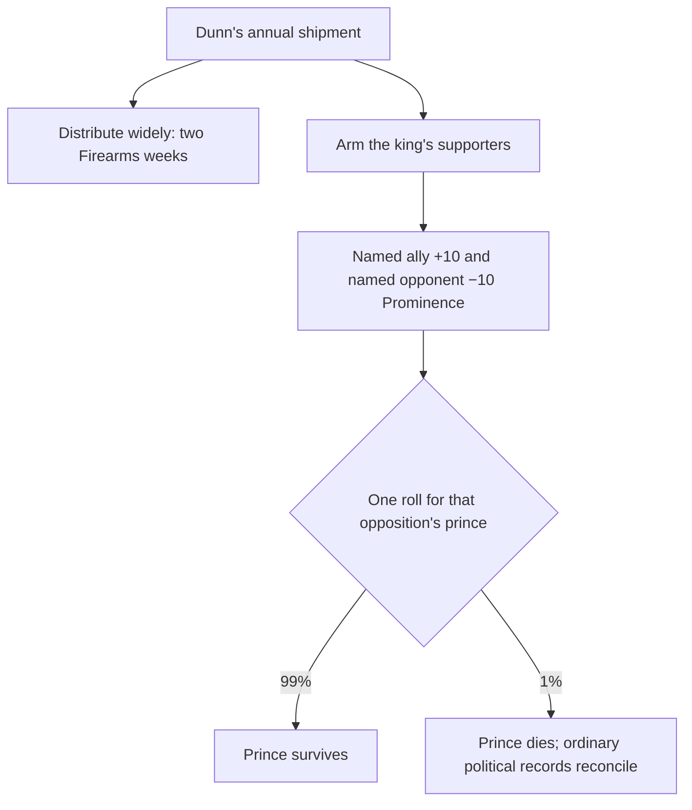
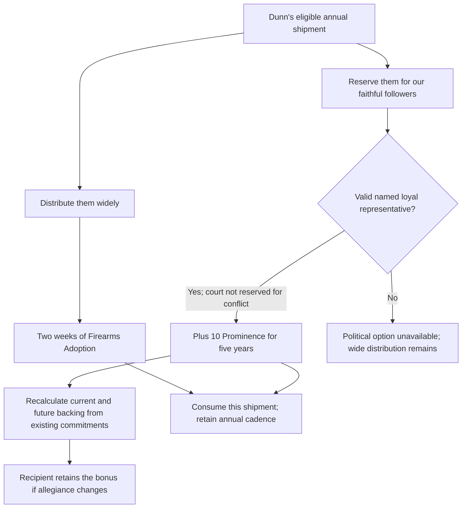

# Dunn's annual shipment: national adoption or faction patronage

30 October 2026; **31 October — combined option authorised and implemented; DP engine checks pending.**
Uses the current working source after checkpoint `dc1f65c`. The separate one-state
claimant-war recruitment trial remains outside this design.

## 31 October: paired pressure and a rare lethal outcome

DP authorised **+10 to an ally, −10 to an opposing coalition member,
and a 1% chance of killing that camp's prince** with “ok implement my version”.
This supersedes the earlier either/or framing and the recommendation to omit
the lethal roll. The implementation retains the proposed five-year durations
and per-character non-stacking refreshes as initial tuning defaults.

The paired effect directly models a rival losing political leverage, while the
favoured supporter gains it. The source material supports the political value
of Dunn's supplies: Knight describes both chiefly gun ownership strengthening
independent power and Dunn's supplies strengthening Cetshwayo's position.[2]
Re-read 31 October. It does not establish an annual chance of killing a prince;
that is an authored possibility of factional violence.



Implemented mechanics:

- Both Prominence modifiers last **five years**. Repeating on one character
  refreshes duration, without stacking another ten. Separate annual recipients
  can accumulate concurrent effects; character caps and house leadership can
  limit or alter the aggregate result.
- Show and freeze the ally, opposing member and that member's **actual rival
  patron** before selection. The negative modifier and death roll concern the
  same camp. Select genuine current opposition, not somebody's separate future
  succession preference or constitutional ideology. Retain loyal-prince and
  historical AI protections; no substitute target after the popup opens.
- Require an eligible present pair; otherwise retain wide distribution.
  Keep political allocation out of already reserved succession/civil-war
  episodes. No unrelated-war peace requirement.
- Both ten-point effects happen; the independent 1% roll is once per accepted
  shipment, not per supporter or weekly. Any death affects only that prince:
  no execution of his coalition, automatic allegiance transfer, faction victory
  or Thirteen Chiefdoms reward.
- Continue ending these offers at Firearms completion. Political allocation
  grants no Firearms weeks. Effects happen on selection, not opening/hover.
- Select the most prominent represented eligible house on each side, preferring
  a fresh modifier recipient before renewing an existing one. A prince's own
  represented house can be the opposing recipient. Eligible loyal princes can
  receive guns; merely pledging to a different successor does not make a house
  an enemy. Fresh allies at 100 Prominence are skipped; renewal at the cap is
  permitted. Native caps and zero-floored house weight still apply.
- Save ruler, ally, opponent and actual rival patron in the shipment event's
  context. Validate the same people on acceptance. If they become ineligible,
  faction allocation is unavailable while the national option remains usable.
  No new persistent target variables, monthly selection or repeated death roll.
- Reuse the existing annual delivery receipt on Dunn for both options; consume
  it before modifiers or death callbacks. Preserve the three-day first delivery
  and 365-day reservation. Ordinary death cleanup releases the deceased
  prince's current/future/council commitments and queues the existing refresh.

### Recalculated scale

With I=300 incumbent backing, R=200 opposition, U=100 uncommitted, and fixed
Q=M=0, full ten-point effects and unchanged house leadership:

| Allocation | I / R | Incumbent share of current pledges | Prerogative target |
| --- | --- | --- | --- |
| Wide / no political effect | 300 / 200 | 60% | 14.29 |
| Ally +10 only | 310 / 200 | 60.78% | 15.42 |
| Paired +10 / −10 | 310 / 190 | 62% | 17.14 |
| Five distinct active pairs | 350 / 150 | 70% | 28.57 |

One pair raises the target **2.86**, rather than awarding instant Prerogative.
At a 500-point current pledged pool, moving ten from an opponent to the king
can take a 26% rival to 24%, below the living-challenge gate. Future pledges
recalculate independently: boosting and penalising two houses pledged to the
same future prince can cancel within that prince's succession coalition.

Two weeks is **2/260 = 0.769%** of Firearms Adoption, not a large fixed national
upgrade. It contributes **0.4615** on the 0–60 penalty scale; away from completion,
it crosses at most one integer tier (about 0.83 percentage points of offence/
defence malus), and may cross none. Completion can be substantially more valuable.
Five wide shipments give 10 weeks, or 3.85% of the total. The paired faction
benefit is already consequential; the death chance is not needed to compensate
for an inherently overwhelming national reward.

| Eligible 1% rolls | Chance of at least one lethal result |
| --- | --- |
| 5 | 4.90% |
| 10 | 9.56% |
| 20 | 18.21% |

These assume independent opportunities; they are not campaign mortality forecasts.
Ordinary death, shifting allegiance, frozen episodes and JE completion limit uses.
A prince's death can dissolve his whole personal coalition, so its outcome is
much larger than ten Prominence. For example, if the sole opponent prince above
has 50 Prominence and the remaining 140 backer-Prominence becomes uncommitted
after the paired effects, the target rises from 17.14 to **62.84**. This assumes
no replacement for the prince's own following; his surviving supporters do not
become loyalists.

### Earlier recommendation and DP's decision

The pre-approval recommendation was **the paired +10/−10 as the core**. The 1% is a defensible
playtest addition if DP wants an occasional decisive death in factional clashes.
Treat it as rare narrative disruption, not a reliably balanced third numerical
bonus. Deterministic +10/−10 alone remains the cleaner alternative.

Independent Sol 6.1 Max review prefers starting without the lethal roll. It
confirms the calculations and notes the bypass of ordinary purge costs:
50 Prerogative, 200 Authority for ten years and exposure consequences. At the
example backing a deliberate purge has a 42.9% capture chance, versus 4.9%
across five annual shipment rolls. The latter is too slow to replace urgent
coercion, but remains a cheap alternative route attached to an already useful
choice. No extra charge or backlash is silently added to DP's proposal.

| Item | Status |
| --- | --- |
| Wide distribution: two Firearms weeks | Agreed retained |
| Combined +10 / −10 / 1% | Authorised and implemented |
| Five years, per-character refresh without stacking | Implemented initial tuning default |
| Same named current opposition camp; no future-heir targeting | Implemented, with loyal-prince and historical AI protections |
| Stop at completion; no frozen-conflict changes | Existing boundary retained |
| Gameplay implementation | `sb_court_dunn.002`, existing Dunn helpers, two character modifiers; DP rendering/runtime checks pending |

### Implementation verification

Source-executed regressions in `tests/test_zulu_dunn_shipments.py` cover both
choices, the exact 1/99 boundary, same-camp targeting, the death callback,
non-stacking renewal, capped Prominence, stale participants, foreign event roots,
no future-pledge targeting, Mpande's sons, and receipt reuse. Existing Dunn/later
court tests retain delivery timing, completion, identity and judgement coverage.
These do not certify native event rendering, modifier expiry or random results.
DP scenarios are numbered 160–162 in the court runtime matrix.

Final acceptance, 31 October:

- **96 focused tests pass**, including 12 shipment tests; independently repeated
  by the Sol 6.1 Max reviewer. No blocking review findings. `git diff --check`
  passes.
- Full discovery: **1,026 tests; 1,017 passes, eight historical skips, one
  pre-existing localisation-review failure**. The initial full run exposed a
  test-only double count when another test module registered episode modifiers
  first; the local shipment interpreter now counts each source modifier once.
  The corrected complete run returns to the prior failure baseline.
- Validator **15/17 passed, warned or skipped**. Unit/localisation gates both
  report the existing dangling
  `sb_swazi_frontier.098.prerogative_after_blood_river` queue row and reviewed
  prose drift in `sb_natal_crisis.050`, `sb_klip_river_county.060` and `.080`.
  These unrelated approvals/texts were not changed.
- CMF, compatibility, map/naval, lifecycle and runtime-contract checks pass.
  Tiger remains advisory: zero fatal, 1,076 errors, 149 warnings, one untidy and
  one tip against the existing unsupported 1.14.5 baseline. It reports no
  diagnostics in this shipment's Dunn or episode-modifier files.
- [Complete validation output](/private/tmp/sb-dunn-shipments-acceptance-20261031.txt).
  No launch, save migration or dependency payload change. All engine scenarios
  remain pending DP.

The following is the original 30 October exploration, retained to explain the
earlier alternatives and calculations rather than override the revision above.

## 30 October: goal, constraints and evidence

DP proposes two meaningful choices for `sb_court_dunn.002`: distribute the shipment
widely for the existing two Firearms weeks, or use it to strengthen the ruler's
faction. Suggested mechanisms are increased allied Prominence, reduced opposing
Prominence, and a chance to kill an opponent, falling back to the rival prince
when no supporters remain. These are alternatives to evaluate, not three approved
effects to bundle together.

The historical premise has support. Ballard argues that Dunn's access to firearms,
clients and trade helped Cetshwayo secure political power. His publisher abstract
does not establish annual assassinations or a fixed yearly shipment. Knight
describes both guns strengthening chiefly independence and Dunn's supply helping
Cetshwayo's position. That supports a patronage choice with an independently
empowered recipient. It is not evidence for a numerical Prominence bonus. [1][2]

Current source contracts:

- Delivery requires the admitted, living Dunn in an eligible host, British Natal,
  and an unfinished Firearms JE. The annual reservation belongs to Dunn's identity.
- The first shipment is scheduled three days after admission; subsequent offers
  are separated by the existing 365-day reservation and monthly delivery check.
- Acknowledging the current single option grants exactly two weeks, capped at 260.
  The event stops after Firearms completion. This proposal retains that boundary.
- Dunn initially promises future succession support to Mbuyazi. After Cetshwayo's
  qualifying victory, retaining him gives present allegiance to Cetshwayo. Those
  records are not interchangeable with the uSuthu movement or its character cards.
- Present and future coalitions use aggregated house Prominence. The current
  court term discounts uncommitted Prominence by 0.25; succession shares do not.
- Native character Prominence caps at 100. Court effects must preview the effective
  gain, not promise 10 when the recipient has only five points of headroom.
- Existing purges spend 50 Prerogative and commit 200 Authority for ten years, with
  the existing attempt, eligibility and flight/war consequences. Routine gun
  delivery currently has none of those costs.

Source anchors: `events/sb_court_dunn_events.txt`,
`common/scripted_effects/sb_court_dunn_effects.txt`,
`common/scripted_triggers/sb_court_dunn_triggers.txt`,
`common/script_values/sb_court_politics_values.txt`,
`common/script_values/sb_institutions_values.txt`, and
`common/scripted_effects/sb_court_coalitions_effects.txt`.
Installed Vanilla `common/defines/00_defines.txt:1926` supplies the Prominence cap.

## Recommended two-choice flow



**Direction A — armed patronage, recommended.** One named current supporter gains
an **Armed Following: +10 Prominence for five years** modifier. No direct rival
penalty, additional allegiance pledge, movement bonus, instant Prerogative grant,
or death. Foregoing the two weeks is the opportunity cost.

Select an actual, present, adult political representative who supports the
incumbent; exclude the ruler, retired/exiled/dead people and agitators. A loyal
prince may receive the grant: his extra Prominence also strengthens his own future
claim, which the preview must make clear.
This includes an independently represented councillor, so the general wording
should say supporter/followers rather than pretend every eligible person leads a
hereditary house. Prefer a recipient without this bonus, with positive headroom;
use existing house Prominence to rank otherwise eligible recipients. Freeze and
display that identity before the choice. Do not replace the recipient silently
if they die, leave or defect while the event is open.

Re-supplying the same person refreshes five years without adding another +10.
A person already at 100 because of this bonus may still receive a duration renewal;
a new grant with no effective benefit is not offered. Different people may hold
separate grants. At the annual cadence, roughly five distinct grants can overlap,
for up to +50 before caps, deaths and eligibility changes. This is a balance
abstraction for sustained armed influence, not a claim that firearms expire after
five years.

The bonus remains on its recipient after defection, replacement as house head,
retirement or a constitutional change; ordinary native role/eligibility rules
determine whether it still contributes. It does not transfer automatically to
the successor. If an old house head and a later head both receive separate annual
shipments, their surviving character bonuses can aggregate in the same house.
Accept this bounded concentration rather than introduce a second house-level
allocation ledger. Neither recipient counts twice in the house calculation.

Experience: Cetshwayo distributes Dunn's shipment through a named loyal supporter.
That person's influence increases and the king's current backing improves. If the
supporter later joins Hamu, Hamu benefits from the remaining modifier instead.
The ruler has armed a political actor, not purchased permanent obedience.

**Direction B — armed leverage over an opponent.** The stronger alternative gives
the displayed loyal recipient +10 and a displayed current opposing representative
−10 Prominence, each for five years. The same expiry/refresh and annual rules
apply. The enemy effect represents intimidation or loss of political leverage;
withholding new guns alone is not a literal confiscation of their existing power.

Both participants must be valid, separate representatives at commitment. Exclude
children, exiles and targets whose lost Prominence would give no actual effect.
A genuinely opposed prince may be the negative target; a loyal prince may not. Require a genuine present opponent; a loyal chief's future preference for
another son does not make them an enemy of the reigning father. If no pair remains,
wide distribution remains available and no alternative target is silently chosen.
The effects persist on the people if their allegiances later change.

This achieves a faster shift but crosses existing challenge thresholds much more
easily. A negative modifier on a house head may also change which member leads the
house, bringing that member's different commitments into effect. Source-executed
and native checks must cover that discontinuity; the simple calculation below
assumes leadership remains unchanged. A negative-only variant is feasible, but
does not model arming one's own followers as directly.

**Direction C — lethal intimidation, not retained for the routine event.** A chance
to kill a current opponent is mechanically possible with the established death and
reconciliation helpers, but its consequences depend on identity. A dead house
head may have a surviving replacement. A dead sole representative removes that
following's contribution. A dead prince invalidates other people's commitments
to him and can remove a succession episode altogether. These are different scales
of intervention and cannot be priced as a single −10 modifier.

The fallback to the prince is particularly problematic: retaining Dunn declares
Mthonga without giving him a free backer. A shipment that kills an isolated prince
would directly undo that consequence and offer a cheap way to eliminate newly
introduced Hamu too. A modest recurring probability accumulates rapidly. Simply
offering the unchanged purge through this event would also be inferior to taking
the two weeks and using the existing interaction separately. Making guns improve
purge access, cost or odds needs a distinct coercion design with a counterweight.
Keep that possible later escalation open; do not smuggle it into the annual grant.

## Quantitative comparison

Let I be current incumbent backing, R all current opposing backing, U uncommitted
Prominence, Q ruler Popularity, and M the constitutional movement balance. Current
source, away from the clamps, calculates:

```text
H = 100 × (I − R) / (I + R + 0.25U)
C = clamp(H + Q/2, −100, 100)
T = clamp(0.75C + 0.25M, −100, 100)
monthly change = clamp(0.15 × (T − P), −4, +4)
```

For **I = 300, R = 200, U = 100; Q = M = 0**, with no leadership replacement and full headroom:

| Shipment's political effect | Incumbent's share of current pledges | Prerogative target | Change in target |
|---|---:|---:|---:|
| None / wide distribution |60.00%|14.29|0|
|+10 to a loyal representative |60.78%|15.42|+1.13|
|−10 to an opposing representative |61.22%|16.02|+1.73|
| Both +10/−10 |62.00%|17.14|+2.86|
| Five distinct active loyal +10 grants |63.64%|19.57|+5.28|
| Remove a sole opposing representative worth 50 |66.67%|23.68|+9.40|

The last row is conditional on no surviving house replacement, not a prediction
for killing any named chief. These are direct court-term calculations with
Popularity and native movement support held fixed. Recipients retain their
constitutional alignment, so later movement recruitment can change the net target.

One grant matters more in a small court. Halving all baseline pools gives a +2.23
target gain from +10; doubling them gives +0.57. If the clamp is already reached,
the target may not rise at all, although the coalition's Prominence still changes.
The target change is not an instant P reward. From the previous equilibrium,
and with all other inputs fixed and the monthly cap inactive, P closes 62.3% of
the resulting gap after six months and 85.8% after twelve.

### Succession sensitivity in the retained retirement example

Cetshwayo's recorded 185 out of 596 pledged Prominence gives 31.04%, just above 30%.
If the named recipients happen to promise the indicated sons:

| Intervention | Cetshwayo's resulting share | Still qualifies at 30%? |
|---|---:|---|
|+10 to somebody pledging another prince |185/606 =30.53%|Yes|
|−10 to a Cetshwayo backer |175/586 =29.86%|No|
|+10 to another prince's backer and −10 to Cetshwayo's |175/596 =29.36%|No|

This is a sensitivity example, not an assertion that those backers presently
oppose Mpande. A chief can support Mpande now and Cetshwayo later. Do not apply
present opposition rules to future supporters, or overwrite commitments to make
the preview's arithmetic convenient.

### National benefit and repeated lethal risk

Two Firearms weeks is 2/260 = **0.769%** of the total. Five accepted wide shipments
contribute ten weeks; with uninterrupted ordinary weekly progress that is roughly
ten weeks saved. Actual timing depends on entry progress, supply and delivery
dates. Penalty reduction is tiered, so every delivery need not immediately change
the displayed combat penalty. The completion rewards make a near-complete JE more
valuable than its percentage alone suggests.

There is no honest fixed exchange rate between one week of military adoption and
one point of political influence. Expect wide distribution to become attractive
near completion or before external conflict, and patronage when the court is
contested. This needs playtesting; equal quantities do not prove equal utility.

For a stable eligible target and independent annual rolls, the probability of at
least one lethal result across n choices is `1 − (1 − p)^n`:

| Per-shipment lethal chance |Five uses|Ten uses|
|---|---:|---:|
|5%|22.62%|40.13%|
|10%|40.95%|65.13%|
|20%|67.23%|89.26%|

These are conditional comparisons, not campaign mortality forecasts: ordinary
death, role changes and Firearms completion can end eligibility. Even so, repeated
death rolls are a much more durable intervention than this national reward.

## Presentation and implementation boundaries

Use the event-writing skill's named-actor/clear-stakes structure. The installed
`shogunate.2` shows how a particular supporter links a choice to its political
beneficiary. Native Japanese modifiers also use ±15 character Prominence; the
Gates of the Bosphorus Senusiyya package uses +10. They verify the modelling
primitive, not the balance of this proposed shipment. Hail Columbia's inspected
older modifier catalogue does not provide a closer character-Prominence example.

Retain Dunn's portrait as the event's focus; the choice preview identifies the
actual recipient by full name and links their card. Draft choice names:

- **Distribute them widely.** Preview two Firearms weeks using the existing guns
  emphasis and progress presentation.
- **Let the uSuthu make use of them.** Appropriate in Cetshwayo's personal context;
  otherwise **Reserve them for our faithful followers.** This is not a grant to
  every member of the generic royal constitutional movement. Preview the named
  supporter, actual Prominence gain and five-year duration (or renewal).

Where a recipient's existing future pledge points to a different candidate, make
that relevant consequence inspectable through the named actor's current pledge;
do not add boilerplate about unchanged future pledges to every tooltip. No
unsupported historical quotation or automatic royalist conversion.

Both choices use the same annual shipment reservation and record that Dunn
delivered guns. Only wide distribution increments the Firearms counter. Apply
effects on pressing the option, never opening or hovering. Revalidate the frozen
host, ruler, recipient and allegiance before applying; stale political options
must not switch beneficiaries or charge another delivery. A completed/cancelled
Firearms JE retains its existing cancellation behaviour.

The faction option requires an active court with no reserved succession episode,
frozen dynastic conflict or unresolved equivalent court settlement. Wide supply
can remain available during these episodes. This prevents changing a quoted
coalition after side selection and avoids the initial three-day shipment racing
the retirement freeze. It adds no peace requirement for unrelated wars and does
not postpone retirement to wait for an optional shipment. A new reign can qualify
again through its actual current supporters. No additional campaign flags, native
troop manipulation, DLC/dependency changes or recruitment-trial changes are needed
by the design.

An AI should weigh nearby Firearms completion/external danger against current
court opposition and the displayed recipient's gain. Exact weights and ±5-point
Prominence sensitivity are tuning, not prerequisites for choosing a direction.

## Decision register

| Item | Status | Position |
|---|---|---|
| Meaningful wide/faction choice |Agreed direction|User request; design not yet authorised for implementation|
| Wide distribution |Agreed|Existing two Firearms weeks|
| Personal faction versus constitutional movement |Provisional|Current ruler's personal coalition; conditional uSuthu wording|
| Allied Prominence |Provisional recommendation|+10 to one named supporter for five years|
| Stacking and recipient replacement |Provisional|Refresh same character; separate annual recipients may aggregate in one house; no transfer of an old grant|
| Opposing Prominence reduction |Open alternative|−10 alone or paired; much stronger near succession thresholds|
| Chance to kill supporter / fallback to prince |Open, recommend defer|Not part of routine patronage; any coercion variant needs separate costs/odds and cast consequences|
| Post-Firearms offers |Agreed retained|Stop as before; no infinite faction-delivery extension|
| Current/future/constitutional commitments |Agreed retained|Do not convert them as a side effect of arming someone|
| War and succession reservations |Provisional|Suspend political allocation during frozen episodes; retain ordinary wide supply|
| Remaining tuning |Provisional|+10/five years, selection priority and AI weights; engine rendering/refresh checks pending|

Before implementation, DP needs to choose armed patronage versus direct hostile
pressure and accept/adjust the duration/repetition bundle. Do not treat the
assistant's preferred +10/five years as user approval.

## Review and evidence limits

Parallel Sol 6.1 Max review checked the arithmetic and source interactions. It
identified the succession-threshold discontinuity, isolated-claimant purge
bypass, recipient-replacement concentration, cap/renewal distinction and the
frozen-conflict race; the proposal above incorporates those findings.

Calculations were evaluated independently in Python using the source formulas.
No implementation, game launch, save mutation or new static-suite run is implied.
Native modifier refresh, household replacement, live tooltip context and AI
choices would need source checks plus DP replay after authorisation.

## References

[1] C. Ballard, “John Dunn and Cetshwayo: the Material Foundations of Political
Power in the Zulu Kingdom, 1857–1878,” *Journal of African History*, 21(1), 75–91,
1980. [Publisher abstract](https://www.cambridge.org/core/journals/journal-of-african-history/article/abs/john-dunn-and-cetshwayo-the-material-foundations-of-political-power-in-the-zulu-kingdom-18571878/39C5458E7DDA2BF405A742D3A85DB837),
DOI 10.1017/S0021853700017874. Abstract rechecked 30 October; full article not inspected.

[2] I. Knight, “‘A Gun Is a Coward's Weapon’: The Use of Firearms among the Zulus
in the War of 1879,” Anglo-Zulu War Historical Society, pp. 1–2.
[Essay](https://www.anglozuluwar.com/images/Journal_5/3%29_Zulu_use_of_firearms_-_IK.pdf).
Rechecked 30 October. Interpretive specialist synthesis; cited passages distinguish
political firearms access, national distribution and battlefield effectiveness.
