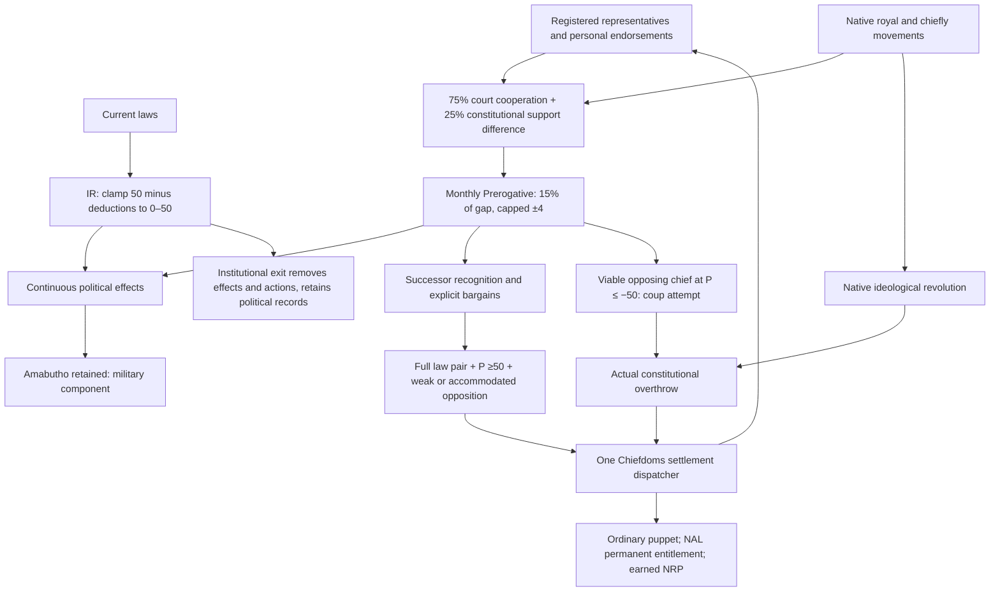

# Zulu institutions and court politics — implementation and DP handoff

18 October 2026. Implements DP's approved technical specification in the current SB maintenance batch. Game baseline remains 1.14.5, CMF 1.66.0 + `sb-1.14.3-r1`. New campaigns and checkpoints made **before partition with this implementation loaded** are the supported test baseline. No game was launched; no saved campaign was migrated.

Earlier exploration documents remain historical decision records. This implementation supersedes their PB/LO estate split, automatic 99%-activism restoration, Liberty Desire victory, ten-year deadline, permanent royalist-network bonus, and terminal Dynastic Stability endpoints.

**Launch follow-up:** DP's first supplied launch log exposed parser and lifecycle
errors that the original static fixtures missed. See the
[18 October launch audit](compatibility/zulu_institutions_launch_2026_10_18.md)
for the corrections and outstanding verification. The original results below
are historical static evidence, not certification of a clean engine launch.

## Runtime structure

| Responsibility | Source |
|---|---|
| IR, movement balance, target, capped drift, signed scaling | `common/script_values/sb_institutions_values.txt` |
| Eligibility and explicit exits | `common/scripted_triggers/sb_institutions_triggers.txt` |
| Initialization, seed-once lifecycle, monthly updates, spending | `common/scripted_effects/sb_institutions_effects.txt` |
| Law-owner routing and country pulses | `common/on_actions/sb_institutions_on_actions.txt` |
| Political / military components | `common/static_modifiers/sb_institutions_modifiers.txt` |
| Existing JE ID and projected bar | `common/journal_entries/1-03_sb_zulu_kingdom.txt`, `gui/sb_prerogative_progress_bars.gui` |
| Registry, personal commitments, following weights, successor/head selection | `common/scripted_effects/sb_court_politics_effects.txt`, `sb_court_actions_effects.txt` |
| Scoped coup/revolution receipts | `common/scripted_effects/sb_court_coup_effects.txt`, `common/on_actions/sb_court_on_actions.txt` |
| Settlement, permanent rewards, interventions and NRP | `common/scripted_effects/sb_zululand_settlement_effects.txt`, `sb_usuthu_politics_effects.txt` |

P is authoritative on the country. Bars only project it; they have no second monthly accumulator. Positive P supports the incumbent constitutional settlement, including a chiefly constitution. Local Police deducts **−5** before the final cap. Universal Suffrage can therefore leave IR 5 with Local Police and no other deductions. Technocracy, Single-Party State and Anarchy always exit. Firearms completion and institutional eligibility are separate gates.

Native law variants use parent-family checks. The two authored chiefly laws are explicit exceptions; Amabutho retains its own zero army deduction. Wider Bantu profiles are not enabled. NGN retains the inherited Zulu-content route; a tracked revolutionary country receives the authored profile explicitly.

DP approved Traditionalist strong approval for the shared Peasant Levies family, including Amabutho. The stance is authored on the parent law; this supersedes the original ordinary-Peasant-Levies N/A position without changing army reform gates or IR deductions.

The JE breakdown displays each native movement's support and actual activism, separately from intervention pressure. Court choices display constitutional alignment separately from personal endorsement.

**Presentation follow-up:** DP approved replacing forced faction ideologies with
independent allegiance traits. The JE now names the people supported, uses Royal
or Chiefly titles and a red/green scale, and separates its gameplay explanations.
See the [court presentation report](compatibility/zulu_court_presentation_2026_10_18.md)
for the startup Absolutist exclusion, source verification and pending DP checks.

Political records and once-only movement seeding survive institutional exit. Ordinary movement lifecycle remains native. Generic Absolutist eligibility/disbanding is scoped around the authored system; there is no unsupported script effect to force-disband a movement. Existing Social Mobility decrees use Vanilla's documented weekly reevaluation of `state_trigger`; engine removal timing remains a DP check.

## Historical and retired behavior

The cast follows [the historical brief](zulu_chiefly_coalitions_research_2026_10_18.md). Existing ruler/heir identities are reused; later actors are available only from their documented emergence windows. Precise unsupported birth dates and speculative traits are not supplied. Initial and later partition require separate tests, particularly the availability of an adult claimant and contemporary chief.

Retired `.090`, `.093`, `.094`, `.095` were the old collapse/secured-dynasty endpoint chain. Shared living-character installation remains for the separate initial Crown route; historical templates and mortality remain. Blood River, Swazi and Port Natal shocks now change P through their existing small helpers. The AI Gaza follow-up substitutes sustained backing (P ≥50) for the former permanently closed dynasty JE; the Port Natal AI preference translates the old 80/100 bar threshold to signed P ≥60. Their other launch restrictions are unchanged.

The coup strength adaptation retains native popularity, IG and modifier contributions. All rank and deployment terms, including the unassigned-commander bonus, require an actual general or admiral. State-owner comparisons use the captured actor rather than an event root. Candidate eligibility, progress and confrontation share this calculation.

The initial Direct Administration and Control the Crown choices remain separate. The new political contest neither annexes ZUL automatically nor opens a fresh deadline. Success records NAL's non-stacking +50% chiefly or +10% royal incorporation entitlement permanently, including later ownership. Only the existing initial Crown integration lane retains its separate integration action and ordinary incorporation request. Its old behavior did not grant the contest's 25% reward; the approved permanent 10% replaces that old contest reward, not an initial-Crown reward.

## Static evidence and known limits

See [law/movement contract review](compatibility/zulu_institutions_contract_review_2026_10_18.json) and [native coup contracts](compatibility/zulu_court_vanilla_contracts_1_14_5.json). The installed CMF payload is unchanged. Current override inventory: 38 same-path files, 119 keyed replacements, eight localisation replacement files.

Recorded results and reproduction command: [verification evidence](compatibility/evidence/zulu_institutions_2026_10_18.json).

The complete unit run contains **571 tests: 562 pass, one fails, eight skip**. The single failure is the repository-manifest test reporting the three pre-existing reviewed-localisation mismatches below. No implementation test failure or error remains. The eight skips require unavailable historical 1.14.0/1.14.2/1.14.3 manifests or installed historical game payloads; current 1.14.5 checks remain mandatory.

The full validator reports **15/17 gates passed, warned or skipped**. Its two failed gates—unit discovery and localisation—both report that same reviewed-text baseline issue. CMF pin/installed-tree verification, dependency installation/rollback tests, override comparison, map/naval checks, runtime contracts, on-action routing, stale/unused-symbol checks, release invariants and delayed-event lifecycle pass. `git diff --check` passes. Dependency sync was deliberately skipped; the installed pinned dependency was verified read-only.

Five existing deferred release gates remain: BC-20, BC-22, CP-07, QUAL-09 and SUP-05. Event/JE review coverage is 107 reviewed namespaces and 180 awaiting review. New mechanical text is queued for DP; unrelated approvals were not regenerated.

Static checks establish source contracts and modeled state transitions, not engine event delivery. Tiger completed with zero fatal reports, 1,066 errors and 145 warnings across the repository. It is advisory because its installed 1.13.5 schema lacks 1.14.5 container/region-objective APIs and `days_since_movement_defeated` present in native sources. The corrected court/core files have no Tiger diagnostics. Native petition-scope, repeated-widget and existing repository reports remain documented; this is not a claim that every Tiger finding is harmless.

Existing reviewed-localisation baseline mismatches in `sb_natal_crisis.050`, `sb_klip_river_county.060` and `.080` predate this implementation. Their reviewed narrative is preserved; no unrelated approval baseline is regenerated. The old wording in historical documents is not a runtime contract.

## DP engine matrix — every row pending

| Scenario | Required observation | Status |
|---|---|---|
| Fresh ZUL start | P 0; contemporary adult roster; three authored movements; generic Absolutist opportunity disappears without repeated enthusiasm | Pending DP |
| Equilibrium and shocks | Named following counted once; correct personal vs constitutional display; monthly convergence ≤4 points; court spending applies once | Pending DP |
| Law combinations | IR cap after Local Police offset; mixed Monarchy/Council no contest victory; explicit exits; positive P reduces morale loss | Pending DP |
| Army reform | Amabutho/Basotho levy cannot ordinarily be replaced before firearms completion; completion enables selection without forcing reform | Pending DP |
| Decrees | Block new Social Mobility during institutional JE; existing decree invalidates on weekly check; state transfers respect new owner's eligibility; unrelated countries unchanged | Pending DP |
| Institutional exit/re-entry | Effects/actions stop; returning does not reset P, endorsements, reward, seed enthusiasm or completed contest | Pending DP |
| Succession rivalry | Recognize eligible existing heir for 25 P; named rival supporters remain distinct; legitimate succession and death preserve identities | Pending DP |
| Chiefly head | Contemporary eligible supporter selected by prominence; no hereditary national crown; government reshuffle retains head; death creates vacancy | Pending DP |
| Accommodation/renunciation | Display actor/cost; actual acceptance; royal claimant relinquishes conflicting claim; refusal does not award victory | Pending DP |
| Civilian coup | Viable prominent civilian can lead at P ≤−50; leader differs from beneficiary; native resistance/confrontation/cooldown; failure/death/exit clean up | Pending DP |
| Coup settlement | Same-constitution ruler replacement is not a Chiefdoms victory; constitutional overthrow resolves once | Pending DP |
| Ideological civil war | One-state/multiple-province escalation; named actors reconciled with actual side; winner receipt, no parallel coup reward or false absent-opposition settlement | Pending DP |
| Early Klip partition | No later nineteenth-century cast summoned; actual living king/heir preserved in CAP; political contest not prematurely resolved | Pending DP |
| Later Anglo-Zulu partition | Contemporary royal/ chiefly followings; ordinary activism escalation; no ten-year automatic outcome | Pending DP |
| Peaceful winners | Complete royal/chiefly pair + P ≥50 + opposing support <5% or explicit agreement; zero activism alone insufficient | Pending DP |
| NAL/TRN interventions | Sponsorship/volunteers/policing/chief support affect intended native movement; displayed bribe charges once and revalidates actor | Pending DP |
| Refugees and indenture | Transfer 20% eligible peasants; loyalists among remaining NAL Zulu pops; existing indenture JE stays open | Pending DP |
| Settlement and ownership | Both outcomes ordinary puppet; no auto-annex; permanent non-stacking 50%/10% entitlement follows NAL ownership of Zululand | Pending DP |
| Royal NRP routes | Earned commitment ≥100 honored after peaceful, coup and actual war royal victories; original territorial contract preserved | Pending DP |
| Open notifications/callback repeats | Result is reserved before scheduling; no repeated settlements, rewards, NRP creation or altered result | Pending DP |
| Initial alternative routes | Initial Control the Crown and Direct Administration remain functional; unrelated national-movement modifier preservation remains unchanged | Pending DP |
| NGN inheritance | Eligible formed NGN retains political state and Zulu content; no fresh recruitment enthusiasm | Pending DP |

## Deferred

- Broader literacy/social/production technology penalties and comparative literacy balance.
- Institutional country profiles beyond Zulu/its existing NGN inheritance, after DP validates Zulu.
- ORA–BST occupation-rule workaround remains on hold.
- No save migration or deleted-character reconstruction.
