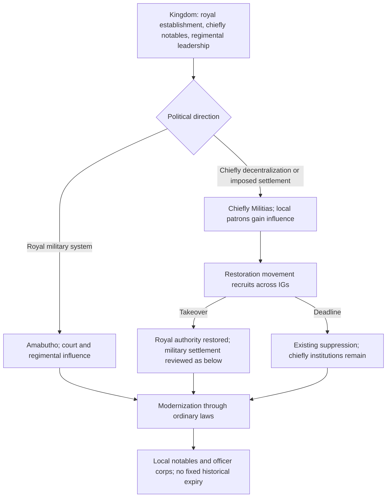
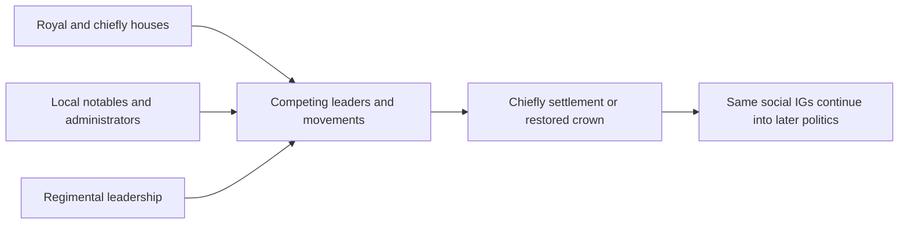
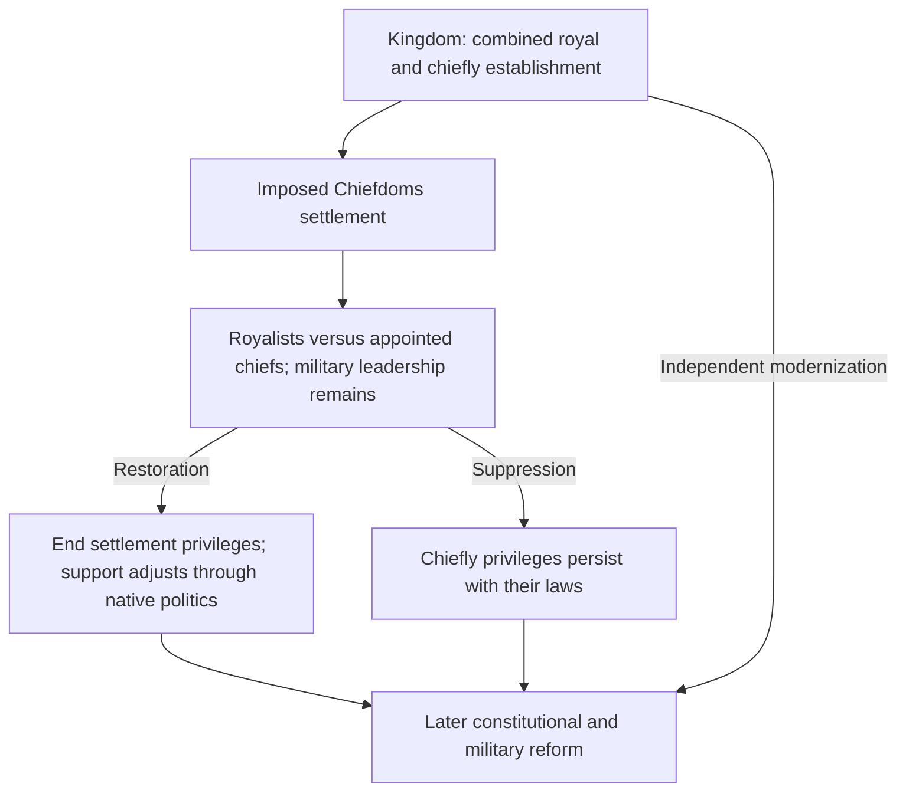

# Zulu interest groups and chiefly militias

Design exploration for DP, 20 September 2026. No runtime implementation.
Follow-up to `usuthu_ideology_exploration_2026_09_20.md`: DP leans towards a
variant of its proposal B and asks for a small ZUL IG rework that remains useful
throughout the country's history, not only during the Chiefdoms contest.

## Requirements and working interpretation

- Explore PB as chiefs/local notables, Landowners as a royal constituency, and
  a historically meaningful Armed Forces identity.
- Explore a National Militia variant, provisionally **Chiefly Militias**, which
  strengthens PB. Distinguish direct political strength from pop attraction.
- Keep historical references inline and separate historical evidence from game
  abstractions. Do not equate a game profession with a historical social identity.
- Cover the independent kingdom, dynastic competition, partition, restoration,
  suppression, modernization, and annexation. Dates should not force outcomes.
- Preserve existing contest actions/outcomes unless an additional change is
  explicitly proposed below. Previous acceptance of Zibhebhu as PB, the native
  lobbies and movement, and the two-law takeover remains relevant.

## Historical basis and its limits

Kuper argues for continuity between the kingdom and earlier chiefly/homestead
organization, with households and marriage relationships shaping political
factions. This cautions against treating royal and chiefly supporters as separate
modern economic classes. The accessible publisher extract supports this point;
it is not a full-text review of the article.
[Adam Kuper, 1993, The ‘House’ and Zulu Political Structure](https://www.cambridge.org/core/journals/journal-of-african-history/article/abs/house-and-zulu-political-structure-in-the-nineteenth-century1/3845DBD388FD72AEA89A9D169FEB113B)

Cetshwayo's struggle with Mbuyazi and his subsequent attempts to strengthen the
crown against territorial chiefs make royal versus local authority a useful
axis. The uSuthu allegiance belongs to particular dynastic struggles, however;
it is unsuitable as an invariant name for every landed interest from Dingane's
1836 kingdom onwards.
[SAHO, King Cetshwayo](https://sahistory.org.za/people/king-cetshwayo)

Royalist supporters included chiefs: Ndabankulu Ntombela was a prominent uSuthu
leader. Conversely, other hereditary chiefs aligned with Zibhebhu. The design
must allow chiefly followers on both sides, even if one IG represents a tendency
towards local autonomy.
[Siyabonga Nxumalo, 2026, British Political Hegemony and Imperialism](https://www.cambridge.org/core/journals/journal-of-african-history/article/british-political-hegemony-and-imperialism-crushing-of-the-usuthu-and-the-onkweni-sections-of-the-zulu-royal-family-1880s1913/07EC250864BDC9DDC04451959454E07B)

The amabutho combined military mobilization and other service, were connected
to royal authority, and did not operate like a permanently mobilized European
professional army. A distinction between royal regiments and locally directed
forces is defensible; the particular game-law split remains our abstraction.
[Military History Matters, Zulu Warriors — 1879](https://www.military-history.org/feature/modern-articles/the-zulu-warriors.htm)

Zibhebhu's shifting relationship with Cetshwayo and the military capabilities of
both sides also argue against making the whole Armed Forces permanently and
unconditionally royalist.
[Ken Gillings, The Zulu Civil War, 1883–1888](https://www.samilitaryhistory.org/lectures/zuluwar.html)

Ndhlovu's study emphasizes colonial appointment and intervention in chiefly
authority. An institution that exists before conquest can therefore gain a
different source of power under the settlement, rather than appearing from
nowhere in 1879. This use rests on the repository abstract, not a full thesis
review.
[Bongani Cyprian Ndhlovu, 2000, The Natal Government's Policy towards Amakhosi](https://uzspace.unizulu.ac.za/items/0ed16673-9cf9-4bc8-a3c4-444906963b5f)

## Verified game constraints

Installed Vanilla 1.14.3 and current SB establish the following:

1. PB's `pop_potential` excludes aristocrats. Its employment restrictions also
   exclude most subsistence peasants and prevent a simple rural-chiefly reading.
   A name change or attraction multiplier does not bypass those restrictions.
2. PB's `ideology_meritocratic` favours elected over hereditary bureaucrats. Calling
   it Chiefs without revising the relevant ideology would be contradictory.
3. `interest_group_ig_petty_bourgeoisie_pol_str_mult` is an existing modifier;
   `interest_group_ig_petty_bourgeoisie_pop_attraction_mult` also exists. Neither
   changes pop professions. A direct strength modifier does not recruit supporters.
4. Current Amabutho gives +50% aristocrat strength and +25% officer strength.
   Aristocrat strength benefits aristocrats in whichever IG they support; admitting
   them to a chiefly PB does not reserve that benefit for the royal establishment.
5. Amabutho has a 30% conscription-rate modifier and barracks/conscription-centre
   caps of 25/25. National Militia has 5%, caps 5/100, and -25% officer strength.
   Copying it wholesale would be a substantial military-balance change.
6. Amabutho is currently available only while already active. A design that asks
   the restored crown to re-enact it needs an explicit, ZUL-scoped availability
   revision or a specified scripted transition. Do not silently change SWZ/GZA/NGN.
7. Chiefdom creation currently changes Chiefdom and Elder Council, not army law.
   Successful claimant takeover currently restores Monarchy and Autocracy only.
8. Native IGs can be renamed and have ideologies/traits changed in place. Vanilla
   has numerous country variants; Hail Columbia's `usfp_native_igs_effect` changes
   native IGs without inventing replacements. GOTB and HC also use parented laws.
9. SB already replaces Armed Forces attraction for another feature. Preserve that
   delta. No matching replacement of these three IGs was found in installed CMF.

Primary technical sources: installed `common/interest_groups/00_petty_bourgeoisie.txt`,
`00_landowners.txt`, `00_armed_forces.txt`, `common/ideologies/00_ig_ideologies.txt`,
`common/laws/00_army_model.txt`; SB's `common/laws/03_sb_amabutho_system.txt`,
`common/scripted_effects/sb_usuthu_politics_effects.txt`, and
`common/scripted_effects/sb_zululand_settlement_effects.txt`.

## Proposal 1 — Royal establishment, territorial notables, military leadership

**Recommended:** use the existing three slots for persistent institutions, with
factions expressed through the movement, leaders and lobbies.

| Slot | Early/independent identity | Chiefdoms identity | Later development |
|---|---|---|---|
| Landowners | Royal Establishment | Royalist Notables | Royal Establishment after restoration; Landed Notables under a lasting republic |
| PB | Chiefly Notables | Chiefly Notables, with Zibhebhu | Local Notables if elected administration replaces chiefly office |
| Armed Forces | Regimental Leadership | Regimental Leadership | Officer Corps under Professional Army or Mass Conscription |

These are political constituencies, not three exclusive birth categories.
**uSuthu remains the movement**, able to attract people from more than one IG.
Where SB follows a different royal line, use generic Royalists/Restorationists
in contextual presentation rather than pretending every dynasty is Cetshwayo's
uSuthu. This naming refinement is proposed, not implemented.

In 1836, the court and regimental command remain central; chiefs can support the
king while defending their local authority. Before conquest, a player can pursue
a more decentralized military settlement through ordinary law politics. Defeat
and the Chiefdoms option strengthen an existing local constituency. Restoration
weakens its legal privileges without deleting its supporters. A modernizing ZUL
can develop urban notables and a professional officer corps through ordinary pop
and law changes rather than having the whole system expire on a fixed date.

Suggested institutional ideologies, limited to the relevant questions:

- **Chiefly Authority:** accepts a monarchy with local authority; favours Elder
  Council/oligarchic consultation and hereditary local office; prefers Chiefly
  Militias to central royal mobilization. Replace the contradictory Meritocratic
  package in this ZUL context. Do not call it automatically anti-monarchist.
- **Royal Prerogative:** favours the monarchy and central royal power; accepts
  royal regiments and a centralized professional successor; opposes the imposed
  Chiefdoms distribution of power. Review overlapping native paternalist stances
  when adding this rather than stacking contradictory packages.
- **Regimental Tradition:** favours Amabutho, while allowing Professional Army as
  modernization; resists dispersal of military authority to chiefly patrons.
  This can replace the army-policy part of native Jingoism in the traditional
  phase. Do not make military affiliation itself a permanent pledge to one king.

Keep economic/citizenship programmes out of the uSuthu movement's new core;
individual IGs and characters can retain their broader interests. IG preferences
and movement activism are separate mechanics.

Strengths: closest to DP's idea; creates meaningful politics before and after the
crisis; explains why the settlement empowers a different elite. Burden: a real PB
eligibility/attraction rework plus scoped ideology/presentation changes. Risk:
forcing two patronage networks into two IG slots can exaggerate their separation.
Allow overlapping support and a cross-IG movement to mitigate that abstraction.

## Proposal 2 — Keep the royal and chiefly aristocracy together

Landowners become **Royal and Chiefly Houses**; PB become **Local Notables**;
Armed Forces become **Regimental Leadership**. uSuthu and its opponents are
coalitions across this social structure, rather than separate elite IGs.

Before conquest, succession disputes divide an elite represented by one IG. Under
partition, local officeholders and administrators gain influence. Chiefly Militias
can give PB +25% strength, but here that represents the chiefs' local administrative
and patronage network, not every hereditary chief. Permit modest rural recruitment
for that network; no need to make PB the destination of aristocrat pops generally.
After restoration or suppression, these constituencies persist without a major
name or eligibility reversal. A modern republic and industrialization fit readily.

Strengths: strongest restraint against treating chiefs and royals as separate
classes; fewer changes to aristocrat allocation and more natural long-term urban
PB development. Costs: IG-level politics cannot visibly split the two noble camps;
the movement/lobby/character layer must carry that conflict. Current whole-IG
lobby alignment is consequently a coarser fit. Keeping Zibhebhu in PB is still a
political-role abstraction; moving him back to Landowners would reopen DP's
previous assignment and must not happen silently.

This is the strongest alternative if historical social structure matters more
than having two readily legible, opposing elite IGs. It meets the spirit of the
militia idea but less directly meets PB = Chiefs.

## Proposal 3 — Change the political constituencies with the settlement

Begin with **Royal and Chiefly Houses / Local Notables / Regimental Leadership**.
The imposed Chiefdoms settlement reorganizes the first two into **Royalists /
Appointed Chiefs**. New chiefly eligibility and attraction apply while the
chiefly institutions remain. Restoration removes their special institutional
advantage, while suppression leaves it in place even after the JE closes.

The distinction is the *institutional source of authority*: the appointed chiefs
become a separately represented constituency when colonial settlement gives them
that role. Naming and recruitment follow the laws/settlement, not a calendar year
or the mere presence of an open JE. Support is not instantaneously reassigned or
reset. Leaving chiefly institutions in force after restoring a king should leave
the relevant constituency in place too.

Strengths: gives colonial appointment its own political impact and avoids a
permanent anachronistic uSuthu label. Costs: most lifecycle maintenance, more
edge cases when laws change out of the expected order, and weak representation
of crown-versus-chief tension before the imposed settlement. Ordinary IG leaders,
government membership and pop support must survive every change. It is workable
through the whole period but offers less pre-crisis depth than proposal 1.

## Chiefly Militias: common mechanical package

The law represents local military patronage and decentralized command. Use a
**National Militia parent with explicit variant stances**, not a claim that this
was a democratic citizen militia.

| Component | Provisional recommendation | Reason |
|---|---|---|
| PB political strength | +25% while law is active | Durable institutional advantage, not a JE-only buff |
| PB eligibility | Proposal-specific ZUL exception for appropriate rural/elite supporters | A strength bonus cannot fix a missing constituency |
| PB attraction | Modest attraction from rural followers and local officials; extra soldier pull under this law | Gives local military patronage a support base |
| Officers | Retain an AF core; consider National Militia's -25% officer-strength effect | Decentralization should not delete military leadership |
| Barracks/conscription | Use a separately reviewed SB military package | Avoid silently changing 30% to 5% or 25 barracks to 5 |
| Technology | Do not require modern Mandatory Service merely to represent an existing chiefly levy system | No free technology grant; explicit variant availability |
| Other countries | ZUL only for this exploration | No inferred change to SWZ/GZA/NGN |

For proposal 1, admit ZUL aristocrats to PB without forcing them out of Landowners;
give farmers, peasants and suitable local officeholders competing attraction.
Under Chiefly Militias, soldiers gain a modest additional chiefly pull. Officers
should remain much more strongly attracted to AF. Do not give every peasant a
large weight that empties Rural Folk/Devout, and do not convert occupations into
aristocrats or shopkeepers. The native world has no directly readable attribute
that identifies every pop as a royal versus territorial retainer; the proposed
weights are an abstraction, not a claimed historical classification.

Use +25% as a first political-strength setting, not a target clout share. In an
isolated example with no other changes/modifiers, a group at 10% clout becomes
about 12.2%, not 35%. Attraction changes supporter allocation over time. Both
need a constituent base and must be assessed together rather than tuned to force
a predetermined winner.

Proposal 1 would add military change to the accepted flow as follows:

1. ZUL starts with its existing Amabutho army law.
2. Chiefdom creation replaces Amabutho/Peasant Levies with Chiefly Militias.
   An already modern Professional Army/Mass Conscription is retained in this
   proposed minimal version; do not automatically undo earlier modernization.
3. uSuthu strongly supports Monarchy, Autocracy and Amabutho, strongly opposes
   Chiefdom, Elder Council and Chiefly Militias, and accepts Professional Army
   as a centralized alternative. Neutral on unrelated economic/citizenship laws.
4. On the scripted claimant takeover, **propose** replacing Chiefly Militias with
   Amabutho as well as the two already-agreed constitutional changes. Preserve a
   modern army law if it has replaced the militias in the meantime.
5. Deadline suppression does not repeal Chiefly Militias. Its political effect
   lasts until the law changes. The ordinary puppet outcome remains unchanged.

Items 2 and 4 are new design choices, explicitly awaiting agreement. A coherent
alternative is to restore only the constitution and leave military reform to
ordinary politics: this models an incomplete restoration and gives royalists a
remaining demand. It is historically plausible but deliberately produces a less
conclusive takeover. The main recommendation is the complete royal military
settlement when the country is still using the chiefly variant.

The early-game ability to enact Chiefly Militias and the restored availability of
Amabutho are proposed law rules, not prerequisites invented for existing story
events. Whether to allow either continuously or through explicit institutions
must be written into the accepted law contract before implementation.

## Interaction with existing politics

- Keep the existing native lobby types and movement identity. A stronger chiefly
  PB can strengthen the pro-overlord lobby's clout contribution while it belongs
  to that lobby. It does not directly subtract uSuthu activism.
- Keep Landowners/AF/Devout versus PB/Industrialists/Intelligentsia as the currently
  agreed starting lobby assignments. Do not hard-lock them for the whole campaign.
  These represent initial institutional alignments, not every pop's allegiance.
- NAL/TRN actions still affect the movement's attraction/activism as agreed.
  The new law adds an actual disputed institution; it does not replace those actions.
- A chiefly PB pop can still support the restorationist movement. Neither an IG
  name nor its diplomatic lobby is a perfect faction-membership test.
- +99% actual activism, the ten-year deadline and suppression decay remain as
  agreed. The added military grievance increases pressure directionally; it does
  not guarantee takeover or prove the resulting pacing without engine observation.
- Ordinary annexation ends ZUL's country institutions. Do not rename NAL's entire
  PB or army because it owns Zululand. Existing incorporation legacies remain.
- New IG names and relevant trait descriptions must be reviewed for consistency
  (e.g. an unexplained Treasury Bonds trait under rural Chiefs). Prefer scoped
  presentation before adding a new set of trait mechanics. DP-reviewed prose
  requires separately approved substantive changes.

## Comparison, decision register and next verification

| Criterion | 1: Persistent institutions | 2: Combined aristocracy | 3: Settlement transformation |
|---|---|---|---|
| Fit with DP's PB/LO idea | Strong | Partial | Strong during settlement |
| Politics before conquest | Distinct crown/local authority | One elite, competing factions | One elite until settlement |
| Social-class abstraction | Greatest elite split | Least elite split | Split reflects colonial reorganization |
| Long-term modernization | Names/attraction follow institutions | Most natural native-class continuity | Several lifecycle transitions |
| Main implementation burden | PB constituency and scoped ideologies | Faction representation within an IG | Reversible institutional phases |

Recommend **proposal 1**, with Chiefly Notables rather than simply Chiefs, Royal
Establishment rather than permanent uSuthu, and Regimental Leadership rather than
an AF name that implies permanent loyalty. Keep a distinct movement for royalist
allegiance. Proposal 2 is the meaningful conservative alternative; proposal 3 is
most appropriate only if DP wants the imposed settlement itself to reorganize
the IG landscape.

| Item | Status | Position |
|---|---|---|
| Whole-period scope, historical grounding, proposals only | Agreed | DP's current request |
| Military dimension to restoration platform | Provisional | DP leans toward variant B |
| Persistent three-institution model | Provisional | Recommendation, not selected |
| PB = Chiefly Notables; LO = Royal Establishment; AF = Regimental Leadership | Provisional | Complete naming/role bundle |
| +25% chiefly PB strength plus targeted attraction | Provisional | Tuning default; distinguish power, membership and jobs |
| Military-law changes on settlement and takeover | Open | Explicit additions to previously accepted two-law flow |
| Exact military caps/recruitment and pop weights | Open empirical tuning | Compare army/pop composition; do not copy unrelated balance |
| Modernization and alternate-dynasty naming | Provisional | Follow institutions and identity, not dates |
| Existing JE actions, deadline, subject outcomes | Agreed | Retain unless reopened |
| Implementation | Deferred | Design selection required |

Before implementation, the chosen bundle should define the ZUL-only IG eligibility
and ideology changes, both army laws' activation/availability transitions, and
the military balance envelope. Then check Vanilla/CMF parity outside ZUL and SB's
existing AF delta; verify all supporter eligibility before weights; compare
ordinary dynasty succession, Chiefdoms, suppression, restoration, independent
modernization and annexation. Actual clout, army preservation, law tooltips and
movement pacing require DP's engine verification. No game was launched for this
exploration.

Follow-up: DP selected proposal 1 for LO/PB, excluded an AF rework, and reopened
the institutional laws and JE ending. See
`zulu_chiefdoms_outcome_design_2026_09_20.md`. Its outcome-driven exploration
supersedes the deadline-based assumption in this earlier comparison.
