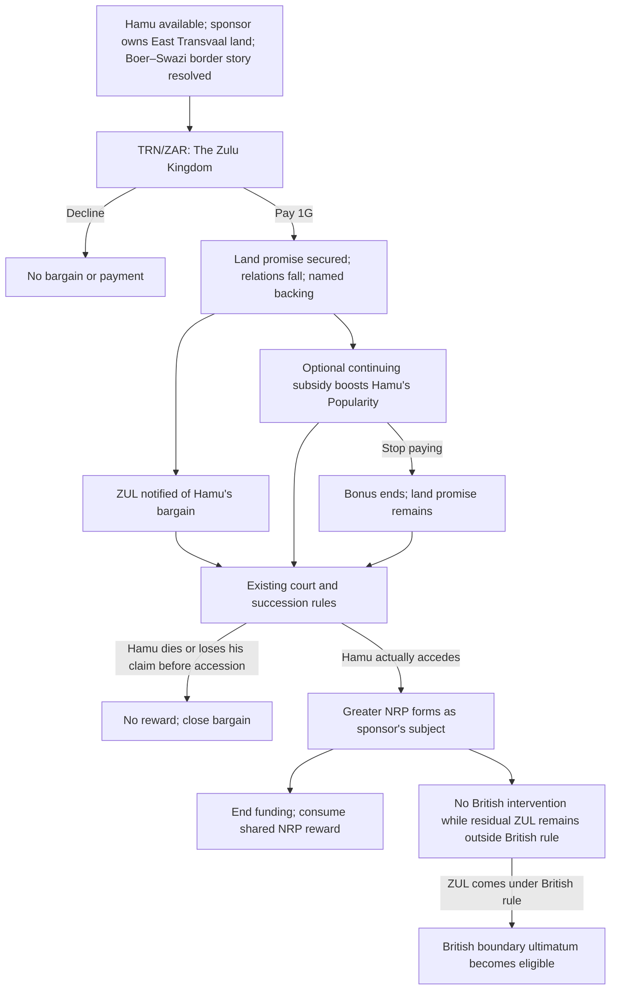

# Later Zulu court stories: Hamu's bargain and Mandlakazi

**30 October 2026 — Dunn/Mthonga/Hamu implementation authorised and applied; DP runtime checks pending.** This revision records DP's rejection of a separate Mthonga refuge event and new direction for a Hamu–Boer territorial bargain. Earlier Dunn/second-war decisions remain in [the main record](zulu_second_war_story_design_2026_10_29.md). Agreed direction, provisional mechanics and remaining choices are distinguished below.

## Agreed direction

- Retaining Dunn opens Mthonga's claim only, without transferring a supporter. The eligible 1857 fallback under another royal victor is silent. Hamu receives Claimant silently from 1860.
- Dunn's admission gives Cetshwayo the most prominent eligible house without a future-successor pledge; its present allegiance remains separate.
- **Mthonga's flight comes from ordinary coercion and a successful escape. No separate refuge event.** The earlier dated protection/return/guarantee proposal is superseded.
- Hamu's Boer approach requires TRN or future ZAR to own some of **STATE_EAST_TRANSVAAL**, and resolution of the **Boer–Swazi border settlement**, formerly discussed as `.095`. DP explicitly confirmed this means the Boer border story, not Dingane's earlier war.
- TRN/ZAR receives **The Zulu Kingdom**, framed around access to the sea. The **one-off 1G payment secures the promise**. Continuing payments are optional and improve Hamu's chances through Popularity; they neither guarantee victory nor remain necessary for the territorial reward. Stopping them retains the paid promise.
- ZUL learns of the bargain. Hamu receives coalition support, and the player is warned that his accession will cost territory for **NRP**. Ordinary court politics determine what happens next.
- A backed Hamu's actual accession forms **Greater NRP as the actual sponsor's subject**, before the later partition story. No direct annexation or scripted union offer. A fulfilled bargain blocks the later scripted Boer intervention/second NRP reward.
- **No British ultimatum merely because NRP forms.** If the residual Zulu polity comes under British rule, Britain may then press the boundary ultimatum. Preserve eligibility for this later change; NAL's existence alone is insufficient.
- A unified **ZAR** tag and audit of TRN/LYD/ZPB content access are a separate major refactor TODO: [ARCH-20261030-01](audit_issues_open.md#major-content-refactor-todo--unified-south-african-republic-zar). ZAR does not exist in the current country definitions.

## Evidence and limits

Cope describes Pretorius contemplating Hamu's installation in June 1865, seeking Swazi assistance and territorial gains. The scheme was abandoned; this is evidence for the proposed opportunity, not proof of Hamu's assent or an historical NRP contract. The coastal NRP bargain below is authored alternate history. [Cope, printed pp. 38–41](https://researchspace.ukzn.ac.za/bitstreams/508fade6-6ab1-4693-bc67-da8edca58e2e/download).

Zibhebhu succeeded Maphitha in 1872 as heir of the Great House. His chiefly position is distinct from a demonstrated claim to the national crown. [Guy, pp. 65–67](https://emandulo.apc.uct.ac.za/collection/Jeff_Guy/K/Guy_1981_Political_Cetshwayo.pdf). The Mandlakazi proposal below remains provisional; DP's Hamu feedback does not approve it implicitly.

## 1. Mthonga: use the existing escape outcome

Remove the proposed 1861 refuge opener, host/return exchange and five-year safety guarantee from this package. Retain the earlier agreed claim declaration and silent fallback.

In the current implementation, accepted renunciation removes the claim; refusal strengthens the surviving claimant and does **not** make him flee. Flight is an outcome of an exposed purge against a weaker rival; an organised rival instead enters the existing war route. Therefore the departure must follow an **actual recorded escape**, not merely pressing either interaction or refusing renunciation. Do not silently add flight to the renunciation mechanic.

Preserve the living identity, existing exile handling and surviving political records. Do not add a fresh event, territorial purchase, automatic return, new following or calendar-driven flight.

## 2. Hamu: The Zulu Kingdom

### Entry and the player experience

Use the actual sponsor and actual court country. Hamu must be living, adult, an eligible claimant and not already sovereign. The agreed 1860 availability supplies the cast prerequisite. **Recommended:** open when the ownership and border-settlement conditions hold thereafter, rather than adding an unagreed June 1865 date gate. A geographical ownership test is not a requirement to own the whole Transvaal.

Check the Boer-border resolution record, not an open popup or the earlier Zulu–Swazi campaign flag. The current split namespace is `sb_swazi_border`; `sb_swazi_boer_pressure_resolved_var` is written on SWZ by its acknowledged terminal choices, including withdrawal/resistance. Do not require a particular pro-Boer answer or add a blanket peace condition. Persist the completed outcome independently of SWZ's continued existence when implementing the new contract.

The offer should identify the proposed territory, Hamu, the actual sponsor, the initial price and continuing expenditure. Reserve the episode before opening it. A single accepted contract survives government reshuffles; a tag name alone must not determine its owner. An ordinary TRN-to-ZAR unification should carry the same sponsor's agreement; conquest by an unrelated country should not silently transfer it.

Backing another prince's faction during an intermediate war is not automatically Hamu's defeat: use his actual survival and continuing claim. Becoming a faction ruler at the split is also **not accession**, nor does its temporary removal of his Claimant card cancel the bargain. Fulfilment requires completed peaceful succession or verified victory and accession through the common controller. That confirmation reserves an **earned cession** before ordinary claimant/funding cleanup; if territorial reunion is still pending, subsequent cleanup must not erase the earned transaction. Genuine loss of claim before accession remains a failure. An earned receipt does not override sponsor disappearance or third-party ownership safeguards.

### Agreed one-off grant and optional continuing patronage

The **1G payment and lasting promise are agreed**. Other numerical values below remain first-pass proposals:

| Element | Proposed default | Reason |
|---|---|---|
| Initial grant — agreed | One sponsor reserve-capacity, `G`, quoted when the offer opens; debt permitted | This payment alone secures the promise; no minimum number of subsidy payments |
| Optional continuing cost — provisional amount | £250 per budget week, the existing Boer sponsorship expense; about £1,000 per four weeks | Improves the chance of Hamu winning; not a requirement for claiming the reward |
| Hamu benefit while funded | +25 Popularity, non-stacking | Improves his attraction in the existing annual allegiance model |
| Immediate coalition support | Most prominent eligible personally uncommitted non-prince house endorses Hamu once | Gives the Zulu warning a concrete named political consequence |
| Diplomatic cost | −10 sponsor–Zulu relations on accepting, once | Makes the interference explicit; stopping payment does not refund it |

Freeze the grant and displayed house at opening; revalidate before payment. If no house is eligible, explicitly show that the grant secures the promise but transfers no house; the sponsor may still fund the optional Popularity subsidy. Do not fabricate a house or take an incumbent supporter. A stale named house must not be silently replaced by a different actor. Future-successor pledges and constitutional alignment are unchanged by this current-allegiance transfer.

The initial grant is a bespoke foreign bargain, not permission to use the domestic paid-pledge interaction on a claimant. No extra troops, direct Prerogative shock or second Claimant/Prominence bonus is included. Let the normal calculation reflect the acquired backing. Hamu's acceptance records his pursuit of his own claim; if he previously endorsed the incumbent, the notification must describe that break explicitly. This is an authored political consequence, not an annual reroll or an automatic constitutional conversion.

Popularity does not instantly convert the court. In the current model attractiveness is `clamp((Popularity + 100) / 200, 0, 1)`. A +25 bonus adds 0.125 away from the cap; candidate selection and persistence then use the existing annual rules. His initial new house supplies the immediate change; the subsidy improves future chances. The existing engine effects of Popularity should be measured rather than supplemented with a second scripted constituency.

The Zulu event explains **who supports Hamu and what land he has promised**. Its acknowledgement does not let the king cancel a foreign bargain for free. The ruler can use ordinary recognition, patronage, coercion and court choices; no extra war controller or predetermined Hamu victory is introduced.

### Withdrawal: the paid promise remains

DP selected the lasting-promise model. A sponsor can pay **1G**, provide no continuing subsidy, and still receive the reward if Hamu eventually gains the crown. Continuing payments improve the odds; they are not a second eligibility test or a guarantee of his success. There is no five-year deadline or minimum payment term.

**End Payments to Hamu** removes the recurring expense and Popularity bonus. It does not refund the grant, erase the territorial promise or instantly reverse acquired supporters' political commitments. The one-off grant/house transfer can never repeat. The earlier alternative in which withdrawal forfeited the land is superseded.

The first-pass proposal that ending a subsidy is final for this offer remains provisional; it is not part of DP's agreement on the one-off entitlement. Whether funding can resume is a minor interface/balance detail, and must not create another grant, another house or stacked bonuses. Death, actual renunciation or sponsor disappearance retains the failure rules below.

For example, Transvaal pays the grant in 1861, stops subsidising Hamu in 1864, and Hamu wins the crown in 1867. The territorial promise is still honoured. Neither payment guarantees the 1867 victory or preserves every supporter until then.

### What NRP means for access to the sea

The existing **Greater NRP** package uses five provinces: `xE1E455`, `xE882CE`, `xBE6FEE`, `x904EBE`, `x9E9742`. The last contains the **STATE_ZULULAND port**. The reduced NRP keeps `xE1E455` and `xE882CE` and is inland. Use the mapped Greater package as the agreed concession; make ownership of all promised provinces visible and valid, not just the seed province. No third-party land may be transferred by this bargain.

**Political destination is settled: a subject republic.** “Union” in the preceding proposal meant direct annexation into TRN/ZAR. DP chose a separate Greater NRP under the sponsor instead. No immediate union offer, no disguised direct annexation and no automatic later union petition inherited from the old boundary chain. Ordinary future annexation mechanics remain separate from this reward.

**Recommended subject type, still provisional: SB Confederal Partner.** It already permits an unrecognised low-rank Boer sponsor, retains the subject on country formation, shares the sponsor's president and transfers 5% income. This uses an existing relationship rather than introducing a new category. The shared president is a meaningful distinction from a client republic with its own head of state; confirm that preference before selecting the final type.

| Subject implementation | Consequence and feasibility |
|---|---|
| Existing Confederal Partner — recommended | Separate NRP tag; sponsor's president; 5% income transfer; no higher-rank requirement; no automatic annexation on country formation |
| Confederal-style republic with its own president | Preserve the accepted subject outcome but add a narrowly scoped variant of the existing type with its own ruler; requires extra definition/localisation and relationship validation |
| Ordinary Vassal | Own ruler but 30% transfer, higher-rank and unrecognised regional/major-overlord requirements; does not reliably fit current low-rank TRN and may annex on country formation |

Ordinary Puppet/Protectorate do not permit an unrecognised overlord in the current definitions, so they are not interchangeable defaults. No recognition/rank change or dependency patch is authorised merely to force one to fit. Future ZAR must pass the same actual relationship checks once defined.

The subject arrangement keeps a coastal Boer polity under the sponsor rather than giving it direct ownership of a port. Do not promise a contiguous route simply because the sponsor owns any province in East Transvaal. Verify the subject's actual market/port connection and ordinary infrastructure; a title is not a magically constructed sea outlet.

### Conditional British boundary challenge

**Agreed:** no automatic British/Natal ultimatum on this route while the residual Zulu polity remains outside British rule. Formal British control makes the ultimatum eligible, whether that control already exists when NRP forms or arrives later. The dormant eligibility must survive an initially independent ZUL; absence of British control is a waiting condition, not permanent cancellation.

Working interpretation of **under Britain**: ZUL is a formal British subject, including through British Natal, or the residual Zulu territory has been annexed into GBR/British Natal. Alliances, market membership, occupation and the mere existence of NAL do not count. Recheck current control before opening and resolving the ultimatum. The old check requiring British control of **all STATE_ZULULAND** cannot apply because Greater NRP owns five of its provinces. Retain the real residual polity/territorial identity through regime change instead.

Because NRP is a subject, its actual overlord must receive the decision to concede or resist. Do not reuse the old subject auto-acceptance rule or the independent-NRP sequence where TRN can decline a separate request for protection. Route any resulting diplomatic play through the actual sponsor and the constitutionally appropriate British authority, with NRP as the territorial holder. This must work for future ZAR without hard-coded TRN fallbacks. If the sponsor itself is under Britain, do not fabricate an external war against Britain's own subject; escalation waits for a valid native diplomatic relationship rather than manufacturing independence.

If the boundary demand is accepted, NRP can become the reduced republic but **remains a subject**. Suppress this Hamu branch's old 24-month union petition and direct-annexation follow-up. A cutback or later subject annexation must never reopen the already-paid NRP reward. Native play eligibility and the exact settlement remain runtime checks; no new blanket peace requirement belongs on Hamu's accession or reward.

The present creation helper is more than a land-transfer helper: it depends on NAL/TRN, grants a claim on all Zululand, relocates inherited buildings, seeds a ranch, adds Boer institutions/Great Trek and schedules boundary/petition events. Proposed Hamu branch retains NRP's identity and Boer institutions but grants **no extra claim on residual Zululand**, does not blindly strip its economy to one ranch, and starts only the selected handoff. Check building/population allocation and any Great Trek eligibility during implementation. Reuse reviewed prose only where its circumstances remain true; otherwise draft new, unreviewed namespaces.

### Failure, timing and the later Boer route

- Preserve the actual Hamu and sponsor through popups, revolutions and accepted retags. Do not depend on `c:ZUL` still identifying the winner.
- If the promised land is already outside the court's ownership at offer time, the displayed full package is unavailable. A split between the **two authenticated claimant factions** is not a third-party loss: carry the bargain through that conflict and revalidate the full footprint after actual victory/reunification. If the native victory callback arrives before territorial reunion, retain a pending handover rather than declaring failure or creating NRP prematurely. For a genuine transfer to an unrelated country, do not seize its provinces or substitute a smaller package silently. Proposed handling: stop further subsidy, record the undeliverable bargain and its sunk costs; no alternate cash/land compensation or forced reconquest.
- Death, actual loss of claim or sponsor disappearance ends ongoing expense. Another living prince's accession alone does not erase Hamu's continuing claim. There is no blanket peace check and no automatic invasion.
- **25 November 2026.** Hamu’s sponsor can take part in the Thirteen Chiefs. An eligible TRN/ZAR can send commandos, sponsor the uSuthu, bribe neutral chiefs, answer the volunteer appeal and earn Boer Commitment while paying Hamu. Natal reviews membership in the active journal monthly. Sharing Natal’s overlord still forfeits TRN’s participation for that contest.
- The two stories can grant the same land only once. A completed handover consumes the concession permanently, including after NRP joins another country. The reservation applies when taking or settling a territorial promise. Stopping the optional payments to Hamu leaves his signed bargain in force.

The earlier five-year Hamu obligation-only proposal is superseded. It remains decision history, not an alternative hidden inside this territorial contract.

## 3. Zibhebhu — The Mandlakazi Inheritance

Bring the existing Zibhebhu identity forward as an eligible adult member of **the existing Mandlakazi house**. Maphitha and Zibhebhu already share following ID 9. Neither acquires a duplicate house or an automatic claim to the Zulu throne.

**Proposed timing:** actual earlier loss of the house leader permits normal adult succession. Otherwise use 1872 as a handover opportunity. If Maphitha is still alive, he retires from the house leadership rather than being scripted dead; this is an explicitly authored pacing fallback. Retain his ordinary mortality and the usual non-head prominence treatment. If Zibhebhu is dead or unavailable, preserve the actual house succession instead of recreating him.

The living-father fallback requires an explicit, retained **Mandlakazi house-leadership handover**. Merely picking the most prominent member again could reinstall Maphitha; the current court-retirement flag instead excludes his contribution altogether. Neither implements the proposed outcome. Honour the named successor for this house while he remains eligible, count each living eligible member once, and use the ordinary vacancy rule if he dies. This is a limited new house-office rule to implement and verify, not an existing helper assumed to work.

A royal-government bargain opens only if the new leader is not already personally committed to the king. A loyal succession needs an acknowledgement, not a fabricated quarrel. Mixed or chiefly constitutions use the existing institutional checks; early partition must not be undone to stage the historical scene.

| Choice | Proposed result, reusing existing bargains |
|---|---|
| **Let him govern his house as his father did.** | Zibhebhu endorses the incumbent. Use the existing once-per-reign local-privileges concession: +20% amaKhosi attraction for ten years, non-stacking. His constitutional alignment remains a separate record. |
| **The great chiefs shall have their council.** | Only if Zibhebhu's own Prominence is at least 50. Enact Chiefly Council, retain royal governance and gain his personal endorsement. No additional attraction bonus. |
| **His inheritance does not diminish the king.** | No concession; −5 P. Preserve his actual alignment and allegiance; no automatic defection or forced civil war. The ordinary priced pledge remains available afterwards. |

If a bargain is already exhausted or its law is already enacted, its event choice must reflect that rather than sell the same benefit again. If he already leads Mandlakazi, the scene concerns confirming his position; do not announce a second inheritance. New commitments replace no unrelated successor pledge.

This creates a reason for an independent-minded chief to co-operate personally with the king while the amaKhosi movement remains a constitutional opponent. Do not make him a royal pretender merely to reuse the claimant-war system.

**Draft scene, TO REVIEW:** Zibhebhu's messengers bring the news from Mandlakazi and ask how the new chief is to deal with the royal homestead. The king can confirm the house's accustomed privileges, make a wider concession to the chiefs, or insist that inheritance brings service as well as authority.

## 4. Handoff to the Anglo-Zulu war and partition

- These stories do not force invasion, partition or a third civil war on a calendar. Early Klip partition keeps its contemporary cast and actual outcome.
- Carry actual survival, allegiance, constitutional alignment, foreign residence and continuing promises. Do not preassign Dunn, Hamu and Zibhebhu to one permanent coalition.
- The Hamu bargain is an **explicit exception** allowing NRP after a qualifying royal accession. Other dynastic victories still do not earn Thirteen Chiefs rewards, incorporation bonuses or NRP. Use one shared territorial entitlement so the two authorised routes cannot pay twice.
- Preserve Dunn's agreed post-1856 judgement. Do not silently extend his survival exception to every defeated prince.
- Historical royal recognition in 1872–73 is not a second accession if Cetshwayo has already become king. Mandlakazi inheritance grants no national Claimant trait.

## Presentation and implementation evidence

Installed full scripts and localisation for **shogunate.2** and **austria_events.2** were read on 30 October: named participants and clear institutional concessions are the relevant precedents. Also inspected Gates of the Bosphorus `balkfm_serbia.028` and Hail Columbia's `acw_je_events.txt` transfer branch. They do not justify inventing a new Mthonga refuge chain.

**The Zulu Kingdom** should explain the sponsor's dependence on neighbouring routes and the possibility of a coastal settlement through Hamu. Its choice preview names the actual prince, grant, recurring price, diplomatic cost and promised territory. The Zulu counterpart should use the incumbent/Hamu two-character format and name any house actually gained. Write final original flavour with the event skill during implementation; this revision adds no approved localisation.

Keep mechanical detail out of the prose. Apply political and financial consequences on the accepting option, freeze the quoted transaction, and hide sequencing. Use ordinary monthly checks over the contract/registered actors, not new daily global scans. Source inspection supports a scoped expense and character Popularity modifier; engine rendering, market access and cross-country payout still require DP verification after implementation.

## Decision register

| Item | Status | Position |
|---|---|---|
| Dunn and earlier claim decisions | Agreed | Main record retained |
| Mthonga refuge event | Agreed: removed from proposal | Actual coercion escape only; no new event |
| Renunciation causes flight | Not implemented; not assumed | Current refusal stays at court; do not silently redesign it |
| Hamu entry | Agreed | TRN/future ZAR owns part of East Transvaal; Boer–Swazi border settlement resolved |
| Additional calendar gate | Provisional | None beyond actual Hamu availability from the agreed 1860 date |
| Hamu bargain direction | Agreed | Financial/diplomatic stake; recurring Popularity support; Zulu warning; NRP on qualifying success |
| Initial grant | Agreed | 1G secures the lasting promise; continuing payments not required |
| Immediate support/relations | Provisional | One eligible uncommitted house; −10 relations |
| Recurring funding | Optional principle agreed; values provisional | £250 weekly expense scale; +25 Popularity while paid; no guaranteed victory |
| Withdrawal and land rights | Agreed | Stop payments removes the bonus, not the paid promise; no minimum funded term |
| NRP political destination | Agreed | Greater NRP is the actual sponsor's subject; no scripted union/direct annexation |
| Exact subject type | Agreed and implemented | Existing Confederal Partner; DP explicitly selected this type |
| British boundary | Agreed condition; routing to implement | Only eligible under actual British rule of residual ZUL; preserve later eligibility; overlord handles ultimatum |
| NRP setup | Provisional | No residual whole-state claim; retain viable economy; exclude old automatic union chain |
| Shared NRP concession | Revised 25 November 2026 | TRN can support both struggles. A completed grant consumes the concession permanently. |
| ZAR refactor | Agreed TODO | Major registry item; no tag or code change now |
| Mandlakazi handover and bargain | Still provisional | Section 3 unchanged by the Hamu decisions |
| Event prose and runtime | Implemented, TO REVIEW; runtime pending | New character events, scoped transactions and numbered DP matrix; no engine verification |

## Checks before implementation is accepted

Trace both Swazi outcomes, current/future sponsor identity, paid/withdrawn/failed contracts, stale popups, Hamu's peaceful and war accessions, all five provinces and the port, normal claimant splits and delayed reunification, NRP subject/ruler behaviour, British control before and after formation, annexed residual ZUL, sponsor-controlled ultimatum and no inherited union petition, reward reservations in both route orders and reopening after failure. Verify debt, end-of-funding cleanup, once-only house transfer, annual Popularity effects, existing early partition and ordinary unrelated-country behaviour. Keep successful static checks separate from DP's pending engine scenarios.

## Implementation disposition — 30 October

DP selected **Confederal Partner** and authorised the agreed batch. Defaults used:
1G upfront; optional £250/week and +25 Popularity, resumable without another grant
or house; −10 initial relations; strongest eligible uncommitted house once.
Mandlakazi section 3 remains a proposal and was not implemented. The ZAR refactor
remains ARCH-20261030-01. See [implementation record and DP matrix](zulu_later_court_implementation_2026_10_30.md).
