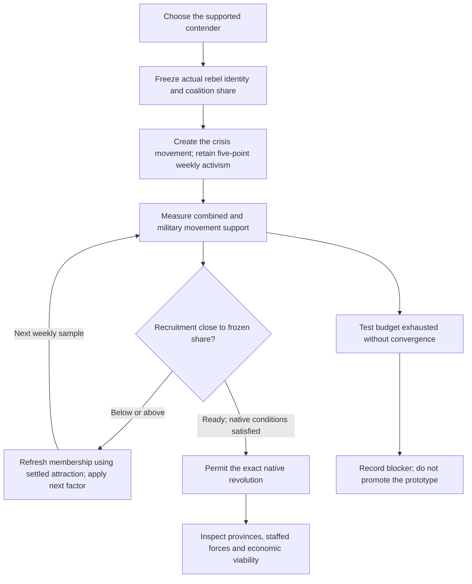

# One-state claimant wars: coalition recruitment proposal

**31 October result: the first active replay failed to converge.** Native annual
Pop membership updates cannot satisfy this trial's weekly recruitment assumption.
The saved episode reached its 26-sample failure limit. A supported country-specific
recalculation effect has been identified. **The authorised follow-up now implements bounded country
refreshes, with the timing described below.** [Diagnosis and evidence](compatibility/zulu_recruitment_stall_2026_10_31.md).
Restart from before side selection; the failed April episode is not reset.

30 October 2026. **DP authorised the trial after checkpoint `dc1f65c` (SB 0.20.3).
Source implemented; native convergence and allocation remain pending DP.
Evening follow-up: new one-state side choices activate the trial automatically.**

## Implemented trial and how to run it

The controller starts when either side is selected in a new one-state episode.
The existing multi-state muster and already-created movements retain their
previous behaviour. This is the next DP test build, not engine acceptance.

1. Restart the game with this source and load a checkpoint **before the claimant
   movement is created**. The inspected September 1856–January 1857 autosaves are
   already past that point; use an earlier checkpoint. No save migration.
2. Choose a side in the two-contender event (`sb_court_succession.004`) normally.
   No console command is required. `debug.log` should immediately contain
   `SB recruitment trial started:` with the actual rebel, frozen target and
   initial attraction factor. This does not force a non-qualifying challenge.
3. The claimant movement should show **Mustering the Coalition**
   as well as its ordinary mobilisation modifier. It remains a genuine native
   revolution; the named prince's agitator role is separate from the actual
   rebel ruler installed on division.
4. Keep the pre-choice checkpoint for repeats. Record the split and staffing,
   and retain `debug.log` plus a save around the division. Search the log for
   `SB recruitment trial` for weekly target, total/popular/military/wealth support
   and attraction factor. Log interpolation itself remains an engine check.
   The follow-up adds `SB recruitment refresh:` after each permitted native
   membership turn. Expect at most 25, and none after readiness or expiry.

Initial tuning uses `factor = clamp(16 × frozen rebel share, 0.25, 32)`.
Outside the accepted support band, each weekly sample multiplies that factor by
`1 + clamp(4 × (target − observed support), −0.5, +0.5)`, then clamps it again.
Inside the band it holds steady. The separately scaled attraction modifier
subtracts the native base and existing +100% mobilisation contribution from its
multiplier, so the controller does not scale activism. Other native recruitment
factors, including the actual rebel's Popularity, still apply.

### 31 October: bounded native membership refresh

The weekly `.991` delivery now samples settled support, checks advancement, then
checks the existing 26-sample expiry. If recruitment is still eligible and outside
the accepted band, samples 1–25 each perform one country-specific
`recalculate_pop_ig_support` call. Ready, failed, invalidated, advanced and active-war
episodes do not refresh; neither do multi-state or unrelated countries.

Before that call, calculate and store the next attraction factor from the sampled
support. The movement modifier itself remains at **last week's factor** for the
recalculation. Apply the new modifier afterwards, for use by the next refresh.
The first modifier has seven days to settle after side selection; later modifiers
and refreshed support likewise have a native update interval before use. This
adds a deliberate feedback delay and does not query support for advancement again
in the same delivery. It needs no additional event or saved queue state.

The native effect updates **all movements and IG memberships in this country**,
using its normal bounded membership adjustment. It does not assign a target
support percentage. Measure those political side effects and tick cost alongside
support convergence; every engine check of this follow-up remains pending DP.
Source acceptance: **109 focused checks**, **149 independently reviewed checks**;
full discovery **997 passed, eight existing skips and the known localisation
failure** (1,006 total). [Full validation and limitations](compatibility/zulu_recruitment_stall_2026_10_31.md#authorised-follow-up-bounded-refresh-implemented).

Readiness requires the exact recorded movement's support from the frozen target
to five percentage points above it. Both native `revolution.possible` and SB's
advance helper use that predicate. No unverified province-count accessor is used.
The military component is logged separately; it is not silently set to the target
or made a second, potentially unreachable gate. Weekly sampling uses the existing
reserved `.991` chain; monthly checks and repeated previews do not add samples.

After 26 samples without qualified scripted advancement or an actual split,
the trial is marked failed and further scripted polling stops, including when an
organising object already exists. Advancement is checked before expiry on the
last sample. This does not resolve the political dispute or cancel an existing
native war: preserve the result and reload the pre-trial checkpoint. A changed
state count likewise invalidates this one-state experiment. Participant death
and other ordinary invalidations retain the existing cancellation cleanup.

The budget ends when SB issues qualified advancement, before the engine confirms
creation of the rebel country. That operation is not proof of a successful split.
DP must still verify the actual country and war callbacks; a failed native split
after advancement remains a failed trial even though recruitment qualified.

The controller must demonstrate convergence and useful military allocation before
release acceptance. There is no automatic fallback to a tiny rebellion, territory
rewriting, a rolled victor or an invented peaceful settlement.

### Evening replay: the controller was inactive

The original implementation required a manual `.990` invocation while the choice
was unanswered. The 22:23–22:24 replay contains none of its variables or its
modifier in any of the five saves, and no trial log lines. It reproduced the old
one-province result; it did not test support convergence. The final rebel army
has one staffed battalion (732 manpower) and two empty unit records.
[Save/log evidence and correction](compatibility/zulu_second_succession_replay_2026_10_30.md).

The follow-up wires activation into the actual side choice and logs it immediately.
Both choices are executed by source tests without the diagnostic event; repeated
choices cannot reset the controller, and existing movements are not retrofitted.
105 focused checks pass; independent review passed 145 related checks. Full
discovery is 993 passed, eight existing skips and one unchanged localisation
failure (1,002 total); validator 15/17 and advisory Tiger totals are unchanged.
See the linked evening report for the separate existing failures and output path.

### Source verification before the evening follow-up

- 104 focused recruitment, claimant-war and muster tests pass. They inject native
  support and callbacks; they do not simulate native recruitment or allocation.
- Independent Sol 6.1 Max review: 144 focused checks passed and no remaining
  blocking source finding. The review caught the stalled-organiser budget case;
  its correction and final-sample precedence are covered by regression checks.
- Full discovery: **1,001 tests; 992 passed, eight existing skips and one existing
  localisation-review failure**. The metadata test now matches checkpoint 0.20.3.
- Full validator: **15/17 passed, warned or skipped**. Unit and localisation gates
  both report the pre-existing dangling `.098.prerogative_after_blood_river` review
  row and reviewed text drift in Natal `.050` and Klip `.060`/`.080`. This trial
  does not change those namespaces or approve their wording.
- CMF verification, compatibility inventory, map/naval checks and script contracts
  pass. Advisory Tiger remains at 0 fatal, 1,076 errors and 149 warnings, matching
  the previous baseline; no diagnostic names the new recruitment files.
- `git diff --check` passes. No game launch or save mutation. All native scenarios
  in runtime cases 151–153 remain pending DP.

Final full-run output: `/private/tmp/sb-recruitment-acceptance-20261030.txt`.

## Evidence and objective

The five inspected autosaves run from 1 September 1856 to 1 January 1857.
Zulu owns one state with nine provinces before division. The reserved contest
records Mbuyazi at 248 Prominence and Cetshwayo at 185. DP backs Cetshwayo, so
the actual native rebel side is Mbuyazi, with a frozen target of 57.275%.
The final save gives Mbuyazi one province and Cetshwayo eight. Activism rises
5%, 30%, 50%, 70%, 95% over those monthly snapshots; slower mobilisation works.

The [native investigation](compatibility/zulu_second_succession_split_2026_10_29.md)
establishes that this one-state branch uses combined movement support, rather
than `target_fraction_of_states`, for its provincial count. Its support is
34% popular, 33% military and 33% wealth support. The exact cached support at
division is not stored in the inspected saves.

The objective is for stronger frozen coalitions to produce meaningfully stronger
native factions in a one-state war. Provincial rounding and native unit allocation
remain relevant; a promised exact battalion percentage would be misleading.

## Boundaries retained

- Determine the one-state path from the origin before division. Preserve the
  existing multi-state muster, population return and provisioning behaviour.
- Keep the two named contenders, frozen current/succession coalition calculation,
  player-side choice, ordinary mortality and exact-war cleanup.
- Keep five percentage points of weekly activism as the first test's pacing.
- Do not change global movement defines or unrelated coups, and do not impose
  peace with unrelated countries. The bounded country refresh also updates local
  ordinary movements and IGs; it does not refresh other countries.
- Do not change the 30% succession eligibility or 25% living-ruler eligibility
  rules. They select a conflict, not its territorial size.

## Alternatives

| Direction | Full flow | Strength | Principal limit |
|---|---|---|---|
| Larger fixed recruitment boost | Choose sides; scale a temporary attraction bonus by the actual rebels' frozen share; allow the existing native timing; remove it during terminal cleanup. | Smallest change; preserves predictable pacing. | Attraction competes with other movements and recruits over time. A larger bonus may still produce too little support, or overshoot. It does not ensure the desired split. |
| **Measured recruitment target — recommended prototype** | Choose sides; identify the actual rebel coalition; increase or reduce crisis recruitment according to measured native support; allow this movement's revolution only when recruitment is sufficiently close; let the exact native war divide the state; remove crisis additions in existing cleanup. | Uses the support the engine actually reads; retains native population, military and territorial division. | The target must be reachable quickly enough. Readiness and native update timing require engine testing; cannot be presented as a proven fix. |
| Correct territory and forces after division | Permit native creation, then transfer a chosen provincial footprint and reconstruct/rebalance the two factions' resources to the frozen ratio; reconcile ownership and restoration afterwards. | Potentially more direct control of authored geography. | Province-transfer/callback order and resource consequences need a separate proof. Rebuilding loses unit history and reopens employment, food, manpower and cleanup problems. It reverses the agreed native one-state boundary. Do not use as an automatic fallback. |

Directly assigning a percentage of Pops to a movement is not a verified scripting
capability in this assessment. Do not make an implementation depend on it without
an actual installed API contract and engine demonstration.

## Recommended prototype

1. **Separate native roles from political sides.** The eventual rebels are the
   opposition to the player's chosen contender. Base the target and recruitment
   calculation on that side. The movement's legal agitator and its eventual rebel
   ruler are separate records: an incumbent must not be blindly made an agitator
   while still ruler. Existing named ruler installation remains authoritative.
2. **Target actual support.** Use the existing clamped rebel fraction as the
   target. Read `political_movement_support`, with popular, military and wealth
   support recorded separately. A large number of peasant recruits is not proof
   of adequate military support.
3. **Use bounded recruitment feedback.** A weekly check for the reserved crisis
   adjusts its own attraction up below the target and down above the accepted
   band. Initially accept support from the target to five percentage points above
   it, rather than a symmetric tolerance which could allow a
   smaller allocation. Where the owned passable province
   count is verified, use the native integer band: five provinces requires support
   from 5/9 to below 6/9. Verify the scope and passability semantics of any province
   count accessor before using it; a full state-region count is not equivalent.
   Gains and ceiling are test tuning, not an approved balance contract.
   Do not add repeated global Pop scans or
   permanently change other movements, IG identities, character ideologies or Pops.
4. **Prevent premature creation in the test.** Put readiness in this movement's
   native revolution eligibility as well as in SB's advancement helper; delaying
   `add_civil_war_progress` alone does not prevent the engine creating a weak war.
   Keep the existing native law/IG/activism requirements. Verify the readiness
   result remains stable through creation rather than assuming callback order.
5. **Constrain the experiment.** Aim for the existing three-to-five-month build-up.
   Assess a test that has not converged after six months as a failed prototype.
   This is a test budget, not a new political deadline, automatic peace or victory.
   Do not enable an indefinitely waiting readiness gate in ordinary campaigns.
6. **Clean up once.** Recruitment and pending controls are tied to this movement
   and reserved conflict, and removed on resolution or invalidation. Do not erase
   unrelated constituencies, revive the movement for a new enthusiasm bonus, or
   rebuild armies as a hidden fallback.

For this save, support near 57.3% would imply roughly five Mbuyazi provinces and
four Cetshwayo provinces under the inspected formula, rather than one and eight.
Do not accept a tolerance crossing into four rebel provinces merely because it
is numerically close to the target. Native timing and the relevant province-count
accessor still need verification before promising the count. One province can
remain reasonable for genuinely weak coalitions or very small territories.

## Engine acceptance and decision register

Test 25%, 50% and 75% frozen shares, both player choices, and both a living-ruler
challenge and retirement. Record weekly combined/military/wealth/popular support,
time to split, provinces, staffed regulars, conscripts and manpower. Stronger backing
must give a repeatable military advantage; a larger coloured map alone is insufficient.
Test cancellation and participant death, and retain a multi-state negative control.
All engine scenarios are **pending DP**. No game launch performed by Codex.

| Item | Status |
|---|---|
| Native one-state allocation; existing multi-state handling | Agreed existing boundary |
| Frozen side selection and existing challenge thresholds | Agreed existing boundary |
| Measured recruitment target and readiness gate | Authorised; automatic for new one-state side choices in the next DP test build; release acceptance pending |
| Five-point weekly activism retained for first test | Retained |
| Target to five points above; 26 weekly samples | Implemented initial tuning; DP convergence check pending |
| Bounded native country refresh | Authorised and implemented 31 October; maximum 25, using the previous week's modifier; native convergence, political side effects and cost pending DP |
| Direct movement-support assignment | Unverified; not assumed |
| Post-split province/force correction | Alternative requiring a separate decision and proof |

Independent Sol 6.1 Max review concurs with the measured-support prototype,
above-target readiness and separate military verification. It found no verified
direct support setter. None of this establishes in-engine convergence.
