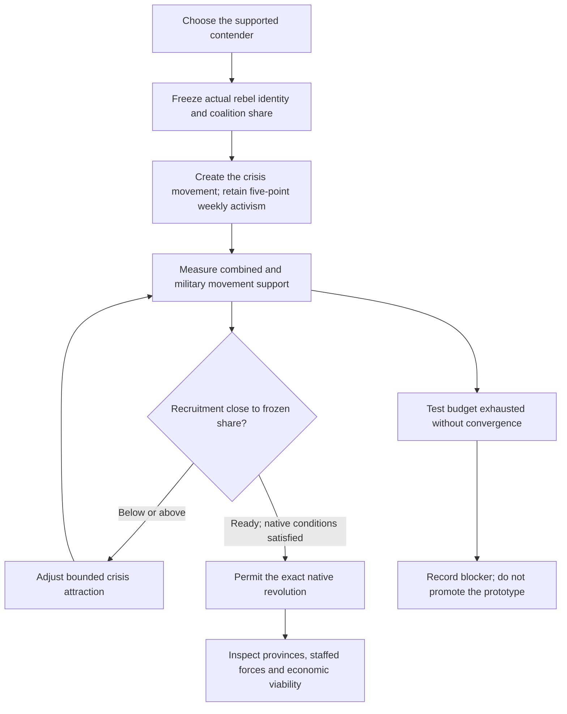

# One-state claimant wars: coalition recruitment proposal

30 October 2026. **Design proposal only; not approved or implemented.**

## Evidence and objective

The five inspected autosaves run from 1 September 1856 to 1 January 1857.
Zulu owns one state with nine provinces before division. The reserved contest
records Mbuyazi at 248 Prominence and Cetshwayo at 185. DP backs Cetshwayo, so
the actual native rebel side is Mbuyazi, with a frozen target of 57.275%.
The final save gives Mbuyazi one province and Cetshwayo eight. Activism rises
5%, 30%, 50%, 70%, 95% over those monthly snapshots; slower mobilisation works.

The [native investigation](compatibility/zulu_second_succession_split_2026_10_29.md)
establishes that this one-state branch uses combined movement support, rather
than `target_fraction_of_states`, for its provincial count. Its support is
34% popular, 33% military and 33% wealth support. The exact cached support at
division is not stored in the inspected saves.

The objective is for stronger frozen coalitions to produce meaningfully stronger
native factions in a one-state war. Provincial rounding and native unit allocation
remain relevant; a promised exact battalion percentage would be misleading.

## Boundaries retained

- Determine the one-state path from the origin before division. Preserve the
  existing multi-state muster, population return and provisioning behaviour.
- Keep the two named contenders, frozen current/succession coalition calculation,
  player-side choice, ordinary mortality and exact-war cleanup.
- Keep five percentage points of weekly activism as the first test's pacing.
- Do not change global movement defines, ordinary movement recruitment or unrelated
  coups, and do not impose peace with unrelated countries.
- Do not change the 30% succession eligibility or 25% living-ruler eligibility
  rules. They select a conflict, not its territorial size.

## Alternatives

| Direction | Full flow | Strength | Principal limit |
|---|---|---|---|
| Larger fixed recruitment boost | Choose sides; scale a temporary attraction bonus by the actual rebels' frozen share; allow the existing native timing; remove it during terminal cleanup. | Smallest change; preserves predictable pacing. | Attraction competes with other movements and recruits over time. A larger bonus may still produce too little support, or overshoot. It does not ensure the desired split. |
| **Measured recruitment target — recommended prototype** | Choose sides; identify the actual rebel coalition; increase or reduce crisis recruitment according to measured native support; allow this movement's revolution only when recruitment is sufficiently close; let the exact native war divide the state; remove crisis additions in existing cleanup. | Uses the support the engine actually reads; retains native population, military and territorial division. | The target must be reachable quickly enough. Readiness and native update timing require engine testing; cannot be presented as a proven fix. |
| Correct territory and forces after division | Permit native creation, then transfer a chosen provincial footprint and reconstruct/rebalance the two factions' resources to the frozen ratio; reconcile ownership and restoration afterwards. | Potentially more direct control of authored geography. | Province-transfer/callback order and resource consequences need a separate proof. Rebuilding loses unit history and reopens employment, food, manpower and cleanup problems. It reverses the agreed native one-state boundary. Do not use as an automatic fallback. |

Directly assigning a percentage of Pops to a movement is not a verified scripting
capability in this assessment. Do not make an implementation depend on it without
an actual installed API contract and engine demonstration.

## Recommended prototype

1. **Separate native roles from political sides.** The eventual rebels are the
   opposition to the player's chosen contender. Base the target and recruitment
   calculation on that side. The movement's legal agitator and its eventual rebel
   ruler are separate records: an incumbent must not be blindly made an agitator
   while still ruler. Existing named ruler installation remains authoritative.
2. **Target actual support.** Use the existing clamped rebel fraction as the
   target. Read `political_movement_support`, with popular, military and wealth
   support recorded separately. A large number of peasant recruits is not proof
   of adequate military support.
3. **Use bounded recruitment feedback.** A weekly check for the reserved crisis
   adjusts its own attraction up below the target and down above the accepted
   band. Initially accept support from the target to five percentage points above
   it, rather than a symmetric tolerance which could allow a
   smaller allocation. Where the owned passable province
   count is verified, use the native integer band: five provinces requires support
   from 5/9 to below 6/9. Verify the scope and passability semantics of any province
   count accessor before using it; a full state-region count is not equivalent.
   Gains and ceiling are test tuning, not an approved balance contract.
   Do not add repeated global Pop scans or
   permanently change other movements, IG identities, character ideologies or Pops.
4. **Prevent premature creation in the test.** Put readiness in this movement's
   native revolution eligibility as well as in SB's advancement helper; delaying
   `add_civil_war_progress` alone does not prevent the engine creating a weak war.
   Keep the existing native law/IG/activism requirements. Verify the readiness
   result remains stable through creation rather than assuming callback order.
5. **Constrain the experiment.** Aim for the existing three-to-five-month build-up.
   Assess a test that has not converged after six months as a failed prototype.
   This is a test budget, not a new political deadline, automatic peace or victory.
   Do not enable an indefinitely waiting readiness gate in ordinary campaigns.
6. **Clean up once.** Recruitment and pending controls are tied to this movement
   and reserved conflict, and removed on resolution or invalidation. Do not erase
   unrelated constituencies, revive the movement for a new enthusiasm bonus, or
   rebuild armies as a hidden fallback.

For this save, support near 57.3% would imply roughly five Mbuyazi provinces and
four Cetshwayo provinces under the inspected formula, rather than one and eight.
Do not accept a tolerance crossing into four rebel provinces merely because it
is numerically close to the target. Native timing and the relevant province-count
accessor still need verification before promising the count. One province can
remain reasonable for genuinely weak coalitions or very small territories.

## Engine acceptance and decision register

Test 25%, 50% and 75% frozen shares, both player choices, and both a living-ruler
challenge and retirement. Record weekly combined/military/wealth/popular support,
time to split, provinces, staffed regulars, conscripts and manpower. Stronger backing
must give a repeatable military advantage; a larger coloured map alone is insufficient.
Test cancellation and participant death, and retain a multi-state negative control.
All engine scenarios are **pending DP**. No source implementation or game launch.

| Item | Status |
|---|---|
| Native one-state allocation; existing multi-state handling | Agreed existing boundary |
| Frozen side selection and existing challenge thresholds | Agreed existing boundary |
| Measured recruitment target and readiness gate | Provisional recommendation |
| Five-point weekly activism retained for first test | Provisional retention of current setting |
| Target to five points above; six-month test budget | Provisional tuning |
| Direct movement-support assignment | Unverified; not assumed |
| Post-split province/force correction | Alternative requiring a separate decision and proof |

Independent Sol 6.1 Max review concurs with the measured-support prototype,
above-target readiness and separate military verification. It found no verified
direct support setter. None of this establishes in-engine convergence.
