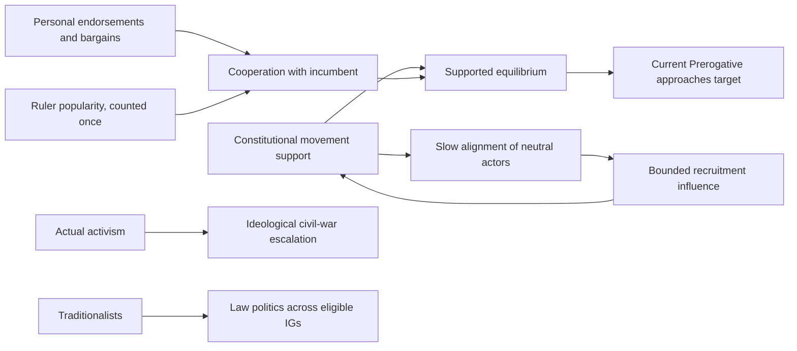
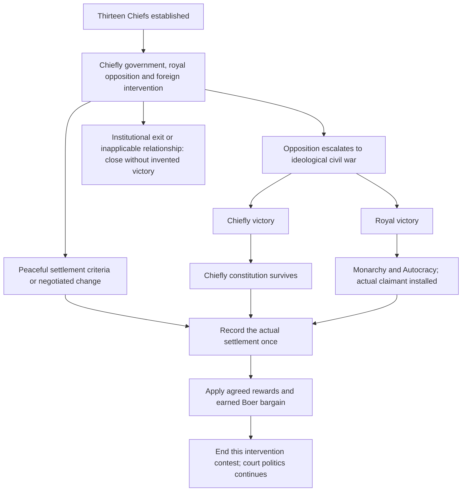

# Zulu political rework — consolidated current plan

18 October 2026. **Design handoff; not yet approved as a complete implementation specification. No gameplay implementation in this consolidation.**

This is the concise current plan. The [institutional exploration](southern_african_institutions_and_zulu_politics_2026_10_18.md), [equilibrium exploration](zulu_royal_authority_exploration_2026_10_18.md), and [cast brief](zulu_chiefly_coalitions_research_2026_10_18.md) contain the alternatives and supporting evidence. Older PB/LO and deadline-based proposals do not override this record.

**Agreed** identifies DP's direction. **Working proposal** identifies a recommended realization or balance value not yet accepted. The decision table at the end collects substantive gaps; individual coefficients need not become separate approval gates.

## 1. Scope and replacements

**Agreed:** replace terminal Dynastic Stability with an ongoing institutional/political system, using named people and native movements. Build reusable calculations and lifecycle helpers, with Zulu succession and story content attached. Keep wider literacy, society-tech and production-tech reform on the TODO list.

The first authored political experience is ZUL; preserve the existing NGN inheritance path until explicitly changed. This is the recommended initial rollout, not a promise of new Gaza/Basotho dynastic stories in the same batch. The shared army-reform gate applies to the existing eligible users of Amabutho and the Basotho levy.

Remove or replace the obsolete behavior within this redesign:

- PB as a separate chiefly estate, the forced chiefly-PB framing and proposed Chiefly Militias law.
- Dynastic Stability ending permanently when a bar reaches an endpoint.
- The Thirteen Chiefs ten-year deadline and automatic restoration at 99% activism.
- Liberty Desire as the measure of royal versus chiefly allegiance.
- Old setup that treats choosing Thirteen Chiefs as already winning its subsequent contest.
- Story-specific LD changes used merely as proxies for faction support. Retain actual diplomatic LD mechanics.

The current source still contains the ten-year deadline, broad Absolutist/uSuthu reconfiguration, old lobby setup and event-settlement machinery. This plan is not a description of already-rebased gameplay.

## 2. Political position and institutional reach

**Agreed direction:** a signed, spendable political position P starts at 0, ranges from −100 to +100 and approaches a supported equilibrium. Positive means effective cooperation with the incumbent settlement. Under Monarchy it is Royal Prerogative; under Federated Chiefdoms it is Chiefly Prerogative. These remain working names, separate from native Authority capacity.

Backing determines the target; it does not add unlimited points every month. Spending temporarily reduces current P, while an unpopular action can also lower the backing that would replenish it. High P opens opportunities; low P creates vulnerability. Neither endpoint should blindly kill a ruler or resolve every constitutional dispute.

Three distinct inputs remain visible:

1. **Constitutional alignment:** royal primacy, chiefly primacy or neutral.
2. **Personal endorsement/cooperation:** this incumbent, a named rival, or uncommitted.
3. **Movement support and actual activism:** backing versus readiness to fight.

**Working calculation:** 75% weighted personal cooperation plus 25% net support for the incumbent constitution. A modest ruler-popularity contribution enters cooperation once, rather than being repeated as a full separate bonus. Actual activism and Traditionalist support do not directly add to the target. The earlier 15%-of-gap monthly adjustment, capped at ±4, is a useful trial setting, not an approved final rate.

### Effects and law attenuation

DP's proposed nominal reach E is 50. At full reach:

| Current P | Legitimacy | Native Authority capacity | Amabutho training rate | Amabutho morale loss |
|---|---:|---:|---:|---:|
| −100 | −50 | −25% | −25% | +25% |
| 0 | 0 | 0 | 0 | 0 |
| +100 | +50 | +25% | +25% | −25% |

These endpoints are the working balance schedule. The inverse morale sign is explicitly confirmed. Effects scale proportionally with P and remaining E. Army-specific effects stop when Amabutho ends; the political JE need not end with it.

| Law group | Deduction from nominal E = 50 |
|---|---|
| Governance | Monarchy 0; Social Monarchy 10; Federated Chiefdoms 0 provisionally |
| Economy | Traditionalism/Industry Banned 0; Agrarianism 5; other economic systems 10, with variants explicitly mapped |
| Police | Local Police 0; Dedicated/Militarized Police 5; No Police 10 |
| Power | Autocracy 0; Oligarchy 5; Landed Voting 10; Wealth Voting 20; Census 30; Universal 50 |
| Bureaucracy | Hereditary 0; Appointed 5; Elected 10 |
| Army | Amabutho 0; another system 5, with Amabutho military effects removed |

Clamp E at zero. A chiefly-council variant and any other relevant unlisted law require an explicit mapping; no silent Autocracy fallback. Nominal E = 50 does not mean every opening country receives 50: No Police with otherwise zero-deduction laws gives E = 40.

**Agreed exit:** close the special political JE when E reaches zero or the government is no longer Monarchy, Social Monarchy or Federated Chiefdoms. Remove its special effects and close inapplicable intervention actions without granting a faction victory. Re-entry after reversing reforms remains a lifecycle decision below.

## 3. Two separate reform gates

- **Agreed:** Promote Social Mobility is unavailable while the Prerogative/institutional JE is active. On institutional exit, restore its ordinary Vanilla eligibility. Preserve its existing restrictions and check already-active decrees and ownership changes.
- **Agreed:** countries start with Amabutho/the Basotho levy; firearms JE completion unlocks reform away through normal law enactment. Completing the JE does not force a replacement law or unlock Promote Social Mobility by itself.

No additional education-growth or technology penalty is in this batch. The wider investigation remains `PT-20261017-05`. The decree's +25 percentage points Education Access is a plausible contributor to rapid literacy growth, not a measured explanation of the whole trajectory.

## 4. Movements and ideologies

**Agreed:** keep three movements. The constitutional factions contest power within the landed establishment; there is no separate chiefly PB estate. Traditionalists can also pressure other eligible IGs, including Devout and Armed Forces. LO's own ideology does not replace that movement. Recruitment competition is assessed in playtesting, without pre-emptively deleting the third movement.

| Movement | Agreed purpose and positive positions | Still to finish |
|---|---|---|
| uSuthu / royal party | Royal constitutional primacy; Monarchy and Autocracy | Position on Social Monarchy, the possible council and other constitutional alternatives |
| amaKhosi / great chiefs | Federated Chiefdoms; opposition to Monarchy and Social Monarchy | Whether its power law is a chiefly council or whether both regimes retain Autocracy |
| Traditionalists | Strong support for Amabutho, Hereditary Bureaucrats, Traditionalism and Local Police; support for Oligarchy, Agrarianism and Dedicated Police | Full negative/neutral stance matrix, especially elections, replacement army systems, bureaucracy and economic alternatives |

Local Police ++ versus Dedicated Police + deliberately expresses resistance to the reform. Do not duplicate these shared customary positions in both constitutional movements: that would revive the broad active-law satisfaction problem.

Use `N/A` for an intentional absence of a position, and `open` for an undecided position. They are not interchangeable. The full movement/character ideology matrix must be approved as a package before implementation; it does not require a separate question for every cell.

The proposed Zulu Traditionalist movement replaces the generic Absolutist opportunity in the authored scope. The current broad uSuthu-on-Absolutist arrangement must be reconciled with the new constitutional movement. Preserve unrelated Vanilla/CMF behavior elsewhere and avoid duplicate Absolutist/uSuthu movements.

## 5. Named followings and succession

**Agreed mechanism:** movement support slowly creates competing alignment opportunities for eligible neutral chiefs. Aligned actors then modestly influence recruitment. Use one mutually exclusive resolution, not independent rolls that can align one person twice. Probabilities, following weights and cadence are tuning. A committed actor's later defection requires an actual event, grievance or bargain, not perpetual neutral-pool rerolls.

Do not assume constitutional alignment means obedience to the current ruler. A royalist can support another prince; a chiefly autonomist can accept a king's concessions. Native loyalty contains IG/law satisfaction and cannot by itself identify which sovereign a person endorses. Count each following once and preserve existing character identities across office changes, exile and restoration.

The cast research is complete as a brief, not as approved templates. Initial core actors are the existing Dingane, Mpande, Mkabayi and Ndlela. Cetshwayo and Mbuyazi mature into rival royal coalitions. Later actors include Zibhebhu and Dinuzulu, with Mnyamana, Hamu, Sekethwayo, Masiphula, John Dunn and others prioritized according to their documented availability and gameplay role. Their proposed traits and historical dates are not all equally established; unresolved facts remain research work.

Keep existing military actors in AF. Remove Zibhebhu's PB reassignment as part of abandoning the PB estate model. An early partition needs an eligible early leader; it must not summon the entire later cast. The exact early leader/roster needs factual authoring, rather than asking DP to invent missing biographies.

**Working action package:**

- Recognize or negotiate a successor, spending P and changing actual endorsements.
- Bargain with a following through offices, patronage or a bounded chiefly privilege.
- Secure a rival's renunciation/retirement/exile; a substantial rival coalition can resist.
- At low P, open a specific succession crisis around a viable claimant and named backers. Resolve through a bargain or a supported dynastic coup rather than automatic ruler death.

This makes the Cetshwayo–Mbuyazi dispute a continuing coalition contest. A dynastic replacement can leave Monarchy intact. Constitutional overthrow at extreme movement activism follows the ideological civil-war route. The exact crisis/action consequences, and the council/privilege bargain, remain decisions rather than approved mechanics.

## 6. Thirteen Chiefs and continuing Zulu politics

Partition changes the incumbent settlement; it does not simply negate P. Establish the chosen chiefly constitution, actual leadership, royal exile/claimant arrangements and a reassessed coalition. Retain living royal identities and CAP exile/return handling. Use the existing special puppet-category relationship during the contest as the working continuation.

The court JE continues as Chiefly Prerogative. The international situation is the NAL/TRN intervention interface. It has no compulsory deadline or minimum duration. Keeping a popup open cannot defer a terminal result or repeat its rewards.

**Agreed:** ideological civil-war victory defeats the opponents for this round. No further P, support or activism gate delays recognition of the winner. One-state countries with multiple provinces can have ideological revolutions; do not replace this route with secession or impose an extra owned-state requirement.

During the actual constitutional war, the opposition moving to the rebel country is not peaceful disappearance. Resolve from the tracked conflict's outcome, with character, army, territory and subject continuity handled explicitly.

**Peaceful settlement remains open.** The working proposal is the actual constitution plus P around +50, and opposition below 5% native support or an explicit accepted accommodation. DP's alternative of 0% activism also remains in the comparison; it can represent temporary demobilisation despite substantial support. Recommend omitting a separate legitimacy threshold because P already modifies legitimacy. None of these peaceful conditions should be added to wartime victory.

### Outcomes and foreign bargains

| Route | Current design status |
|---|---|
| Chiefly victory | Chiefly institutions survive. The intended NAL reward remains permanent **+50% incorporation speed in Zululand when NAL owns the relevant territory**. This is an earned entitlement, not immediate progress or annexation. The exact post-contest subject handling is still to confirm. |
| Royal victory | Restore the actual claimant and Monarchy/Autocracy. Ordinary Puppet is the working continuation; Protectorate is an unselected alternative. The proposed permanent **+10% incorporation speed** reward for NAL remains open. |
| Control the Crown immediately | Preserve its separate existing protectorate route, king and +15 relations with NAL/GBR. A new +25% reward has not been approved. The ongoing Zulu court system can still apply without a Thirteen Chiefs contest. |
| Direct administration | Preserve the existing annexation branch and its separate Zulu national-movement work. It is not converted into the constitutional contest. |

Chiefly +50% was already the intended permanent reward before the latest political redesign; it should not be silently treated as withdrawn. Its qualification and interaction with any later royal outcome must be explicit. Do not stack faction rewards, revoke a permanent entitlement automatically, or farm it through repeated JE entry.

Retain Boer Commitment and the existing conditional NRP bargain as the starting contract: sufficiently committed Boer aid plus a qualifying royal victory can activate the authored concession, subject to its actual country/territory conditions. The current threshold is 100. The redesign must decide how a negotiated restoration or separate dynastic coup qualifies; P alone cannot create NRP. NRP territorial loss is part of the route's risk when comparing the proposed royal +10% reward with Control the Crown.

Annexation remains ordinary subject diplomacy, not an automatic reward for winning the faction contest. Remove obsolete special-contest blocks when the contest ends while retaining native diplomatic eligibility.

## 7. Player actions, incidents and interface

| Action/source | Intended direct effect | Status/details |
|---|---|---|
| Boer sponsorship | uSuthu attraction | Agreed direction; existing costs and commitment are the initial balance baseline |
| Boer volunteers | uSuthu activism pressure | Agreed; actual activism and native civil-war progress determine escalation |
| NAL policing | Reduce opposing activism pressure | Agreed; do not count temporary suppression as erased support |
| Support Loyalist Chiefs | Strengthen chiefly organisation | The direct target needs final mapping: current code reduces uSuthu attraction, while the new two-sided proposal boosts amaKhosi recruitment; do not silently apply both |
| Bribe a neutral chief | Buy the named actor's public alignment | Proposed one-off action; recommended guaranteed eligible-target result, distinct from temporary personal loyalty |
| Personal patronage/concessions | Improve cooperation with the incumbent | Working succession package; may differ from constitutional alignment |
| Native payments, dependence and diplomatic lobbies | Ordinary subject relationship/LD | Keep distinct from faction support; do not recreate a custom hut-tax lever |

Retool existing faction incidents deliberately: skirmishes and claimant attacks principally affect mobilisation; defections affect the actual actor/alignment and recruitment; refugee returns affect recruitment; return of an agitator uses that character's native contribution. Avoid a universal LD-to-activism exchange rate and duplicate bonuses from one event.

Preserve the agreed refugee handling: 20% eligible Zulu peasants, loyalists among the remaining NAL Zulu pops, and no closure of an already-open indenture JE. Keep internal sequencing hidden and show actual active/decaying contributions.

Opening recruitment is still unresolved. Recommended first pass: rely on the new platforms, real followings and native initial enthusiasm without an extra automatic story boost; test before selecting a special partition surge. The currently permanent royalist-network bonus is not a survival requirement. A defeated faction's native civil-war penalty and any bespoke suppression reward must also be checked for double application.

Show current P, supported target, live change and cause breakdown; reach and its law deductions; each relevant movement's native support/actual activism; named alignments versus endorsements; and Boer Commitment during intervention. The international JE should expose these actual values, rather than preserve a falsely labelled LD bar. Exact layout is implementation/design tuning.

The old fixed native-lobby split—LO/AF/Devout as royalists and PB/Intelligentsia/Industrialists as chiefs—no longer represents the within-LO model. Recommended cleanup: retain native pro-/anti-overlord diplomacy without forcing those lobbies to be constitutional factions. Confirm that as part of the intervention package below.

## 8. Decisions needed before implementation

| Decision | What remains consequential | Recommended coherent starting package |
|---|---|---|
| **D1: Constitution and ideology package** | Autocracy in both regimes versus a narrow chiefly-council variant; Federated Chiefdoms' actual modifiers; Social Monarchy and the remaining ideology positions | Keep the constitutional movements narrow and Traditionalists separate. Use the council only if collective chiefly powers and a Monarchy+council compromise are intended; no PB effects. Review the completed stance matrix as one package. |
| **D2: Peaceful settlement and succession actions** | Exact peaceful win/accommodation conditions; which low-P crises allow bargains or dynastic coups; privileges and rival-removal consequences | Actual constitution + roughly +50 P + weak opposition or explicit accommodation for peaceful settlement; no extra legitimacy gate. Four bounded succession actions as above; no automatic ruler death or low-P constitutional flip. |
| **D3: Post-contest subject status, rewards and NRP** | Confirm ordinary Puppet after each outcome; decide royal +10% versus no bonus; settle permanent-reward interaction and which restorations earn the existing Boer bargain | Preserve chief +50%; ordinary Puppet is the least disruptive continuation. Assess royal +10% with NRP risk rather than deleting it automatically. Keep initial Crown's existing protectorate and relations package; do not invent compensation. |
| **D4: Intervention and initial organisation** | Positive chiefly recruitment versus negative royal recruitment for Support Loyalist Chiefs; neutral-chief bribery; fixed-lobby cleanup; extra partition attraction/suppression bonuses | Boost chiefly recruitment with that action, buy neutral alignment with the separate bribe, keep diplomatic lobbies independent. Begin without extra opening attraction and avoid duplicating native defeat penalties; all are proposals to accept together. |
| **D5: Lifecycle and rollout** | Whether institutional reversal reopens the JE and what position/obligations it resumes; scope of other-country profiles | Author ZUL and preserve existing NGN inheritance first. If laws return to eligibility, resume from current backing and retained obligations without a free reset or repeated reward. Other full political profiles remain later content; shared army gates still cover existing users. |

**Remaining authoring/research work, not a set of questions DP must answer:** final dated cast/early-partition leader, following affiliations and character ideology/trait mapping; explicit mapping of uncommon laws; exact event-to-new-effect conversion table; and an implementation contract for civil-war ownership/characters/subjects. Research unresolved identities instead of assigning fictional certainty.

**Tuning, not separate approval gates:** monthly convergence rate/cap, influence weights, annual neutral-alignment chances, action costs and cooldowns, modest popularity influence, modifier magnitudes/durations, and the working resource name. Tune these together once the gameplay packages above are settled. Opening-bonus presence and permanent victory rewards are gameplay choices, not merely a 5%-versus-10% tuning discussion.

## 9. Implementation sequence and acceptance

1. Freeze the accepted law/movement/outcome packages and complete cast authoring. Produce a mapping from every old dynasty/partition input and callback to its replacement.
2. Implement shared eligibility, reach, equilibrium and live effect display; add the two distinct reform gates. Verify law boundaries, human/AI consistency, exit, re-entry and unaffected countries.
3. Introduce the movement/character model and succession interactions. Verify one representative per following, actual claimant identities, alignment versus endorsement, native movement pressure and no duplicate generic movement.
4. Rework the partition situation, foreign actions/incidents and native ideological civil-war callbacks. Remove the deadline and old instant-takeover handlers together. Verify both winners and peaceful settlements resolve once, without unrelated-war restrictions.
5. Apply the agreed subject/reward/NRP contract, reconcile normal annexation and retire obsolete state. Preserve common helpers used elsewhere, reviewed prose and the separate national-movement preservation work.
6. Run focused and full static validation, compatibility checks and story regressions; hand DP a fresh-campaign/checkpoint matrix. DP launches and verifies the engine behavior.

Engine checks must cover early and later partition; the one-state multi-province civil-war split; correct royal/AF/chief identities and armies on both sides; subject continuity; native war-goal outcomes; NRP eligibility; peaceful accommodation with strong but passive opposition; character death/exile during a pending decision; institutional exit/re-entry; active-decree invalidation; and firearms completion without forced army reform. No save migration or game launch is part of this design task.
