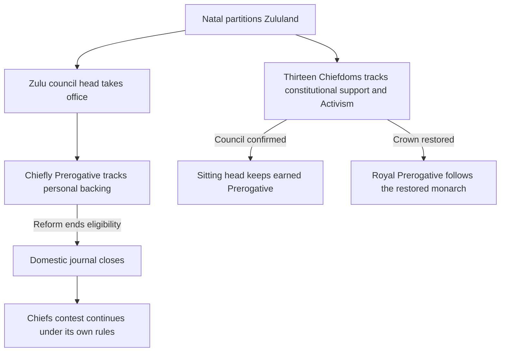
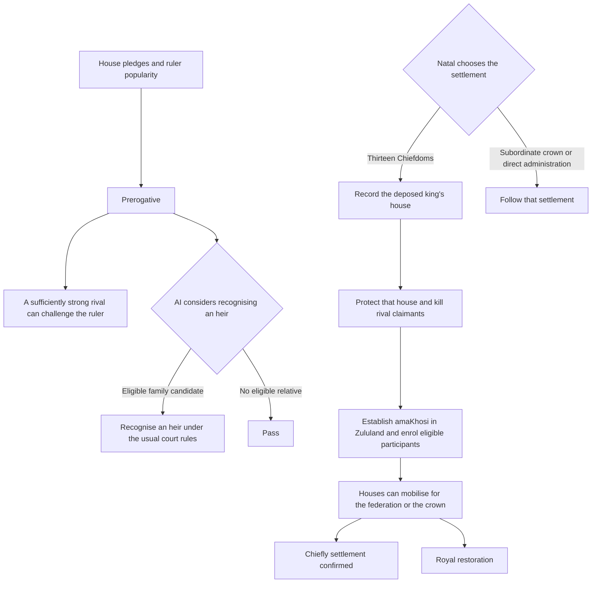

# Prerogative and the amaKhosi movement

26 November 2026 · Playtest register item 7 and Zulu royal succession · Implemented, with in-game replay pending.

**Prerogative** measures the ruler’s backing at court. **The Thirteen Chiefdoms** asks whether Natal’s settlement can hold against restoration of the deposed royal house. Natal’s choice of partition establishes amaKhosi in Zululand. A chief can favour a council and still pledge personal support to the king. [Court allegiances](../common/scripted_effects/sb_court_allegiance_effects.txt) · [Council bargains](../common/scripted_effects/sb_court_coalitions_effects.txt)

## Recognition and the deposed royal house

On **8 April 1861**, Hamu was already both Cetshwayo’s native heir and the court’s recognised successor. Dinuzulu was born in **1868**. On **1 December 1870** and **1 August 1879**, Hamu and Dinuzulu were both present and Hamu still held the title. In a source check using the August roles, the current AI recognition action admitted both Hamu and eleven-year-old Dinuzulu. Its special candidate rules currently cover Dingane and Mpande. [1861 checkpoint](<../../../save games/trn-swz_1861_04_08.v3>) · [1870 checkpoint](<../../../save games/pre-kimberly-sb-21-1_1870_12_01.v3>) · [AI eligibility](../common/scripted_triggers/sb_court_politics_triggers.txt#L36)

| Occasion | Agreed rule |
|---|---|
| AI uses *Recognise a Successor* | Only a valid dynast from the reigning ruler’s own house qualifies, including an eligible child. With nobody eligible, the AI passes and spends zero Prerogative. The player retains the existing choice of eligible dynasts. |
| Mpande rules | Both Cetshwayo and Mbuyazi count as his sons despite their distinct SB house IDs. Once either son rules, his own branch supplies the family candidates. |
| Natal chooses the Thirteen Chiefdoms | Record the deposed king and his house before changing the ruler. Protect its members, including minors. Kill the other living royal claimants registered to that court, including a recognised heir from another house and claimants living abroad. Ordinary chiefs and people who merely backed a claimant survive. |
| The uSuthu need a successor | Restrict the return and installation of a restoration claimant to the protected family throughout this JE, including after a civil-war split. Children born in exile belong to the protected house. A minor can inherit through a regent and takes office at sixteen. |

For recognition, apply the same family test when the AI considers the button, selects a candidate and pays the existing **25 Prerogative**. The AI retains a valid recognised family heir. An AI that inherited an outside heir can replace him once an eligible relative exists and the usual political conditions permit. An unanswered choice rechecks the reigning family before payment. At an actual pre-partition vacancy, ordinary succession can still elevate an outside prince with sufficient backing. [Recognition button](../common/scripted_buttons/sb_court_buttons.txt#L1) · [Recognition and payment](../common/scripted_effects/sb_court_actions_effects.txt#L36) · [Vacant throne](../common/scripted_effects/sb_court_succession_effects.txt#L28)

Dingane’s separate presentation of Uthumbu and Mpande’s choice between his two sons retain their own handling. A ruler with an unassigned house can identify his own presented child through the recorded parent–child link. House ID zero is shared by unrelated courtiers. If Britain annexes and then releases Zululand, retain the relevant claimant identities through the handover. Natal’s partition choice is the point at which a rival can die, including a rival already in exile. [House assignments](../common/scripted_effects/sb_court_house_identity_effects.txt#L3) · [Presented child](../common/scripted_effects/sb_court_succession_effects.txt#L260) · [British handover](../common/scripted_effects/sb_zululand_settlement_effects.txt#L2327)

After the **24 August 1879** partition, the September autosave still records Hamu as the recognised heir, alive in Cape exile and receiving Boer patronage. Replaying that choice under the agreed rule would protect Cetshwayo and Dinuzulu. Hamu would die as an outside claimant, his pledges would lapse and his unearned bargain with TRN would close before the JE assesses Boer participation. Zibhebhu could still head the federation. If Hamu himself is the deposed king in another campaign, his own house receives protection. Partition cancels even an earned grant that has yet to found NRP. A republic already founded by Hamu survives. An early partition also needs the family test when a later prince such as Hamu would otherwise enter the restoration contest. [September autosave](<../../../save games/autosave.v3>) · [Partition choice](../common/scripted_effects/sb_zululand_settlement_effects.txt#L677) · [Claimant selection](../common/scripted_effects/sb_court_politics_effects.txt#L425) · [Hamu’s contract](../common/scripted_effects/sb_hamu_bargain_effects.txt#L66)

## Prerogative at partition

Court cooperation sets the ordinary target. During an open contest the target is half court cooperation plus half the governing side’s lead in local movement Support. Reform can close the domestic institution while the international contest stays open. With a court score of −27.4115 and equal Support the active target is −13.71. From zero, the first monthly change is −2.06. On settlement the target returns to −27.41. A new head starts at zero once. A sitting head, a new regent and a child attaining majority keep the Prerogative earned during that reign.

### Alternatives considered on 25 November

The table and checkpoint comparisons below record the earlier proposals. The selected version of option 2 gives movement Support a 50% weight.

| Option | While the settlement is contested | After settlement and tradeoff |
|---|---|---|
| **1. End Prerogative with the monarchy** | The federation uses the Chiefs JE alone. Its roster, protected claimant, house alignments and interventions continue. The council loses personal pledge bargaining and the domestic effects on Legitimacy and Authority. | Chiefly victory leaves Prerogative closed. A crown-only version lets an eligible restored monarch reopen it. Permanent closure would also retire the restored monarch’s court gameplay. |
| **2. Give movements a temporary 25% weight** | Keep Chiefly Prerogative. During the contest, use 75% court backing and 25% of the governing side’s lead in movement Support. A popular federation can sustain an unpopular council head. | At victory or interruption, return to 100% court backing if eligible. The target can change on that date even if the incumbent, houses and population all stay the same. The final decision increased the movement weight to 50%. |
| **3. Keep Prerogative court-only** | ZUL can secure personal pledges for its council head. Natal and Transvaal can recruit chiefs to a constitutional side. A chief can cooperate with the man in office while favouring restoration. | A confirmed council continues with the backing it earned. Royal restoration puts the new monarch’s own court backing into effect. Both face the ordinary reform conditions. This uses the two existing JEs and the existing house alignments. |
| **4. Suspend Prerogative for the contest** | Retain the roster, house alignment, restoration claimant and international interventions through the existing limited court routines. Pause domestic bargaining, the monthly Prerogative change and its national modifiers. | Resume for either eligible winner, or follow the surviving government on interruption. The player gets one active journal during partition but can lose domestic court actions for the full decade or longer under mixed laws. |

The current monthly review reopens Prerogative for an eligible federation. Options 1 and 4 would therefore change institutional eligibility as well as the visible journal. Under option 2 the June 1883 movements are evenly matched, so the 75/25 target is **−20.56**. Option 3 gives that same court a target of **−27.41**. The difference persists even with zero net movement advantage because option 2 gives court backing three quarters of its ordinary weight. [Monthly reconciliation](../common/scripted_effects/sb_institutions_effects.txt#L62) · [Target weights](../common/script_values/sb_institutions_values.txt#L45)

In the **1 September 1879** autosave Zibhebhu governs the same Zulu country that Cetshwayo ruled on 1 August. The August reading was **+70.38**. In September the council still has **+70.82**, while its own court backing is **−81.91** and the 75/25 target is **−65.79**. At Reach 45 the positive reading contributes about **+32 Legitimacy** before the separate base cost. In the **1 June 1883** checkpoint a reconstituted Zululand has both JEs active and starts the council at **0**, with court backing **−27.41**. The two routes give the same officeholder very different starting authority. [August 1879](<../../../save games/autosave_1.v3>) · [September 1879](<../../../save games/autosave.v3>) · [June 1883](<../../../save games/13-chiefs-local_1883_06_01.v3>) · [National modifiers](../common/static_modifiers/sb_institutions_modifiers.txt#L2)

**Handover proposed for options 2 and 3.** Set the incoming council head’s Prerogative to **0 once** when they replace the deposed king. Apply the existing partition rules for whom each house backs and recalculate the target for that head. With September’s court held fixed, the first monthly change under option 3 is **−4**. On restoration, apply the same principle to the incoming monarch. Confirmation of a sitting ruler, including a royalist already installed on the winning side of a civil war, preserves the authority earned in office. Opening a journal, reloading, and reform under the same incumbent do not constitute accessions. Existing saves already past partition retain their accumulated Prerogative. [House allegiances at partition](../common/scripted_effects/sb_court_politics_effects.txt#L404) · [Royal accession reset](../common/scripted_effects/sb_court_succession_effects.txt#L148) · [Council selection](../common/scripted_effects/sb_court_politics_effects.txt#L298) · [Settlement outcomes](../common/scripted_effects/sb_zululand_settlement_effects.txt#L2465)

Here **closes with reform** means Institutional Reach falls to zero, the country leaves the eligible royal or federated constitutions, or it adopts Technocracy, Single-Party State or Anarchy. A later eligible government can regain the journal. Closing Prerogative alone awards neither side the settlement. The Chiefs JE keeps its original clock, and mixed laws can leave it open past the ten-year review. A separate dynastic challenge is already blocked for participants during the contest. [Institutional eligibility](../common/scripted_triggers/sb_institutions_triggers.txt#L5) · [Court work after exit](../common/scripted_effects/sb_institutions_effects.txt#L107) · [Settlement review](../common/scripted_effects/sb_chiefdoms_contest_effects.txt#L145) · [Dynastic challenge](../common/scripted_triggers/sb_court_dynastic_triggers.txt#L30)

For replay, compare partition with the original Zulu country intact and with a reconstituted protectorate. Confirm one handover per incoming ruler on both paths. Check a saved, active settlement and a civil-war winner already in office for a repeated reset. Under option 3, with all personal endorsements held fixed, buying a neutral house with 100 Prominence for uSuthu raises its Activism target by **10 percentage points** while there is room under the cap. The purchase itself grants no personal pledge to the council head. [Buying constitutional support](../events/sb_zululand_settlement_events.txt#L585) · [Securing a personal pledge](../common/scripted_effects/sb_court_coalitions_effects.txt#L167)

## What the court-only calculation would do in play

Use the existing court cooperation score as **100% of the Prerogative target**. A house head speaks for the house’s combined Prominence. Uncommitted Prominence counts at one quarter in the denominator. Half the ruler’s Popularity then enters the score, bounded at −100 and +100. Each month Prerogative closes 15% of the gap, up to four points. Institutional Reach scales the effects. Recalculate the target on an existing save and let the current value move towards it. [Court calculation](../common/script_values/sb_court_politics_values.txt) · [Target and monthly change](../common/script_values/sb_institutions_values.txt)

| Checkpoint, using the live ZUL country | Saved Prerogative | Saved 75/25 target | Court-only target |
|---|---:|---:|---:|
| 6 April 1843, before partition | +24.56 | +24.88 | +33.47 |
| 1 August 1879, before partition | +70.38 | +72.30 | +91.25 |
| 1 June 1882, before partition | +74.92 | +75.52 | +100.00 |
| 1 June 1883, Thirteen Chiefdoms active | 0.00 | −20.56 | −27.41 |

The proposed column uses the cooperation already recorded in each checkpoint, with the houses and ruler held as saved. In the 1882 game the first month would take Prerogative from +74.92 to about +78.68 if the court held steady. An adverse court also has more leverage. With cooperation at −60 and the movements evenly matched, the old target was −45. The proposed −60 can bring the ruler into reach of the existing −50 challenge threshold if an eligible rival commands at least a quarter of pledged Prominence. [1843 save](<../../../save games/prussia_1843_04_06.v3>) · [1882 save](<../../../save games/anglo-zulu-war-local_1882_06_01.v3>) · [1883 save](<../../../save games/13-chiefs-local_1883_06_01.v3>) · [Claimant challenge](../common/scripted_triggers/sb_court_dynastic_triggers.txt)

## When the movements appear

Item 7 moves the founding of **amaKhosi** from ordinary court setup to Natal’s partition choice. Early uSuthu and Customary Traditionalists retain their existing founding rules. At partition, ensure Zululand has both uSuthu and amaKhosi by creating each missing movement once. Reusing an existing movement preserves its supporters, enthusiasm and any organising revolt. Subsequent survival follows the existing movement rules. [Current founding effect](../common/scripted_effects/sb_institutions_effects.txt#L12) · [Zulu political movements](../common/political_movements/sb_zulu_constitutional_movements.txt#L331)

| Design | Before partition | At partition | After settlement |
|---|---|---|---|
| **Create amaKhosi at partition** · selected founding rule | uSuthu can advocate royal laws. Chiefs bargain, endorse rivals and promise their support in the succession. | Natal’s actual partition choice establishes amaKhosi in the live Zulu country. Use the existing uSuthu movement or create it if absent so the restoration has a constituency. | Let both movements follow their support. A chiefly victory retains an organised constituency for the new system. A restored king can face surviving chiefly opposition, including a later constitutional revolt. |
| **Create both at partition** | Customary Traditionalists, named houses and personal claimant wars provide early politics. Pre-partition ZUL gives up a dedicated popular movement for royal laws. SB also excludes generic Absolutists while these institutions operate. | Partition organises both constituencies together. The settlement retains the two movements and their distinct interventions. | Both can endure and press for their constitutions under the same rules as above. This changes early royalist politics as well as chiefly politics. |

An earlier alternative would dissolve amaKhosi on royal restoration. That would make the restored monarchy more durable and remove one route to a later chiefly revolt. It is deferred alongside moving uSuthu’s founding date. [Contest resolution](../common/scripted_effects/sb_chiefdoms_contest_effects.txt) · [Native revolution eligibility](../common/scripted_triggers/sb_chiefdoms_contest_triggers.txt)

## Earlier proposals and player feedback

The annual-alignment and firearms changes below were explored in the original note. Both are deferred. Item 7 changes the Prerogative calculation and its explanation in the court interface. Support and Activism continue to drive the settlement.

- **Annual alignment.** At present a neutral representative’s chance to take a constitutional side is 30 times that movement’s share of supporters, expressed as a fraction. With 20% uSuthu support and an absent amaKhosi movement, the roll gives 6% royal, 0% chiefly and 94% neutral. An earlier proposal would run this roll only during the settlement. Personal pledges to the current ruler or a prince, succession promises and choices in court events continue throughout. Existing alignments carry into partition. A claimant war already creates its own temporary movement. [Alignment roll](../common/scripted_effects/sb_court_politics_effects.txt) · [Personal allegiance rolls](../common/scripted_effects/sb_court_allegiance_effects.txt) · [Dynastic war](../common/scripted_effects/sb_court_dynastic_effects.txt)
- **Privileges and guns.** The early privileges bargain already buys a named house’s pledge, and Retief’s firearms deal can move a named house to a rival. Both also promise ten years of amaKhosi attraction. An unexpired attraction promise can take effect when the movement forms, for the remainder of its original term. In the separate court firearms offer, the chiefs can broker the guns for free or the crown can pay. The deferred proposal would give the named broker **+10 Prominence for five years** when amaKhosi is absent, using SB’s frontier-broker precedent. [Privileges bargain](../common/scripted_effects/sb_court_coalitions_effects.txt) · [Retief’s offer](../events/sb_natal_crisis_events.txt) · [Court firearms offer](../events/sb_zulu_court_events.txt) · [Broker precedent](../common/scripted_effects/sb_court_frontier_effects.txt) · [Concession expiry](../common/scripted_effects/sb_court_concession_effects.txt)
- **What the player sees.** Put the explanation of pledges, popularity, target and monthly change in Prerogative. The Thirteen Chiefdoms already shows movement Support, Activism and the Prominence of the houses on each side. Its ordinary resolution checks 100% uSuthu Activism and a valid claimant for restoration, or both chiefly laws at the ten-year review. Its native-war option can settle the contest through the recorded winner. Natal’s patronage and policing, Transvaal’s sponsorship and the return of a claimant retain their purpose there. [Court widget](../gui/sb_prerogative_progress_bars.gui) · [Settlement widget](../gui/sb_zululand_chiefdoms_progress_bars.gui) · [Outcome checks](../common/scripted_effects/sb_chiefdoms_contest_effects.txt)

## Decision register

| Status | Item |
|---|---|
| agreed | The AI recognises its own valid family members and otherwise abstains. Mpande’s two sons qualify while he rules. Partition preserves the deposed king’s family and kills other active royal claimants. |
| agreed · item 7 | Natal’s partition choice creates amaKhosi in the Zulu polity. Outside the settlement, the existing court cooperation score supplies the entire Prerogative target. |
| agreed · Prerogative during partition | The court and local movement Support differential each supply 50%. Each government in a split uses its own population. Reform closes the domestic journal when its normal conditions fail. |
| agreed · compatibility | Fresh starts and pre-war checkpoints enter the new rules at the relevant choices. Save and reload preserve family membership, regency, a recorded civil-war result and the delivered verdict. |
| agreed · succession | Preserve and return the full household. Prefer the deposed sovereign, the recognised family heir, a lineal successor and then another eligible member by Prominence. A child inherits with a local regent. An earned victory can wait for a regent or majority. |
| agreed · extinction | The last family death gives the amaKhosi an immediate chiefly victory. Natal and Zululand receive the reason. Participants including TRN/ZAR see it in the concluding journal. Territorial reunion applies the verdict once. |
| agreed · Hamu | An unfulfilled grant closes before Boer eligibility is checked. A completed Hamu founding leaves its borders intact. Following a British victory over residual Zululand, Natal’s partition confirms the council immediately. A Chiefs-founded NRP supplies no such entitlement. |
| deferred | Moving early uSuthu, scripted dissolution of amaKhosi after restoration, changing annual alignment and adding a firearms-broker reward. |

For replay, start before partition and check a Cetshwayo court with Hamu and Dinuzulu, an early Mpande court with both sons, and an outside claimant already in exile. Verify that only actual claimants die and that repeating the settlement cannot charge, kill or grant land again. Compare a fresh court, direct administration, a subordinate crown and partition for movement founding. On a legacy save with amaKhosi already present, verify the same movement identity and formation date after partition. With the August 1879 court held fixed, the first monthly update should take Prerogative from **+70.38 to +73.51**. Changing only movement support should give the same target. [Partition decision](../events/sb_natal_interwar_events.txt#L186) · [August checkpoint](<../../../save games/autosave_1.v3>)

For a future implementation, the opening belongs to the shared settlement choice on live ZUL, including a reconstituted protectorate. The one-time setup should reuse an existing movement without refreshing enthusiasm. Check repeat delivery, an observer opening the journal, departure from and return to an eligible government, and loading with a war already organising. Ordinary institutional setup currently creates all three movements together. Vanilla’s Meiji Restoration, Hail Columbia’s Long Reconstruction, and Gates of the Bosphorus’s Yugoslav journal all demonstrate checking for an existing movement at the political occasion that calls for it. [SB setup](../common/scripted_effects/sb_institutions_effects.txt) · [Meiji Restoration](</Users/depro/Library/Application Support/Steam/steamapps/common/Victoria 3/game/common/journal_entries/00_meiji_restoration.txt>) · [Long Reconstruction](<../../Example Mods/hc - Hail Coloumbia [1.13]/common/journal_entries/usfp_reconstruction.txt>) · [Yugoslav journal](<../../Example Mods/gotb - gates of the bosphorus [1.13]/common/journal_entries/2-02_balkfm_yugoslavia.txt>)

## DP checkpoint replay

Start with the [June 1882 pre-war save](<../../../save games/anglo-zulu-war-local_1882_06_01.v3>). Compare British protectorate and annexation followed by release. At partition inspect the royal household in exile and the movements’ existing supporters. Return the family, then compare restoration with a living child and extinction when the last child dies. Hold the event across a save and reload and check the concluding journal from Pretoria. In a split, let a royal victory await reunion before the last family death. Both sides should receive the chiefly settlement only once and Transvaal should receive no land. The [December 1870 checkpoint](<../../../save games/pre-kimberly-sb-21-1_1870_12_01.v3>) records a live Hamu bargain. Branch there, let Hamu found NRP before the British victory, then inspect the remaining provinces under each British and Natal choice.
