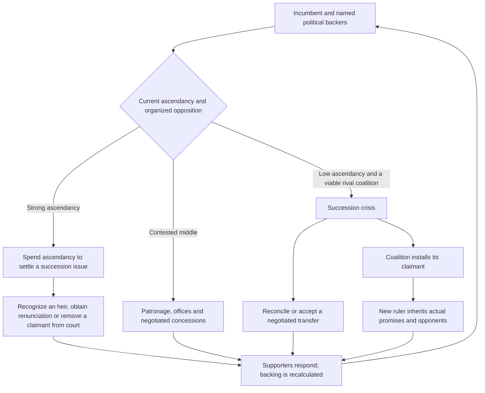
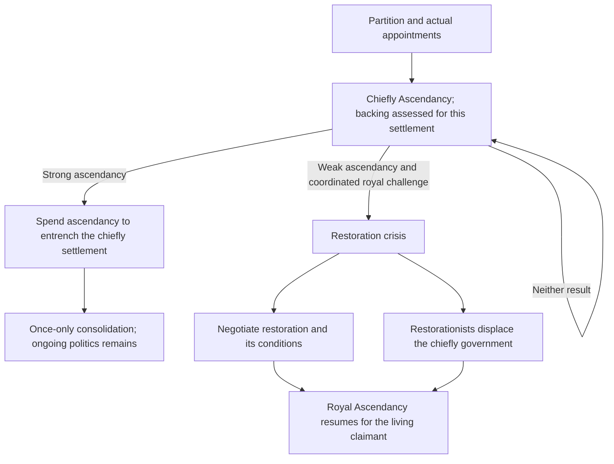
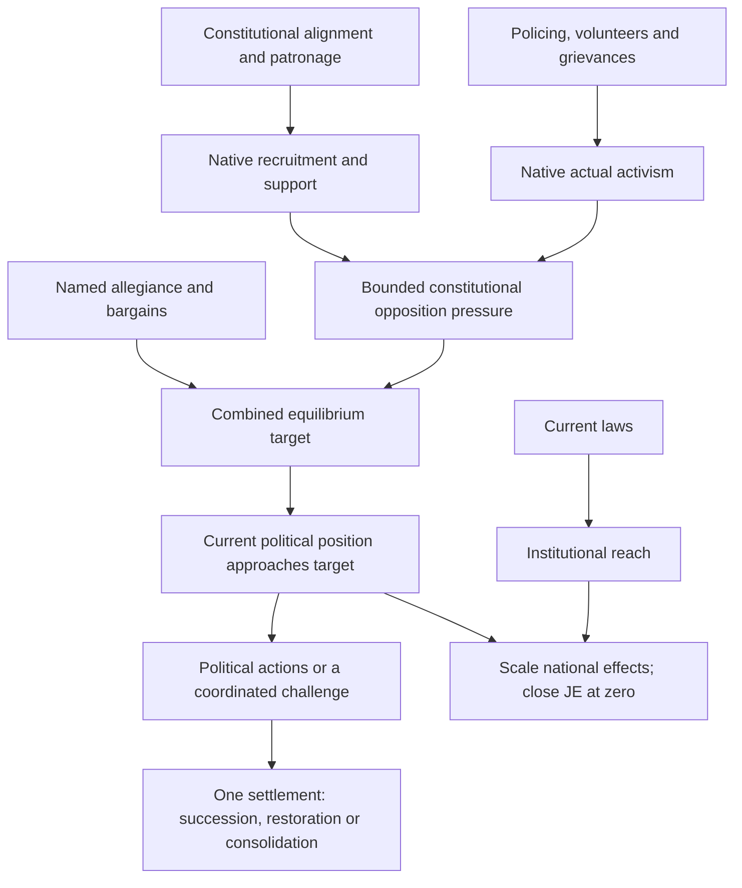

# Royal Ascendancy — equilibrium, institutional reach and movements

18 October 2026. **Design development; no gameplay implementation.** The filename preserves the earlier working name.

**Latest iteration:** the [institutions and constitutional-conflict exploration](southern_african_institutions_and_zulu_politics_2026_10_18.md) now owns the current decision register. DP sets No Police to −10 and Industry Banned to 0, confirms that firearms completion unlocks reform away from the starting army systems, and separates movement support from activism. The support-times-activism formula and event-showdown alternatives below are retained as earlier proposals, **superseded by support influencing the equilibrium and activism escalating towards civil war**. The earlier calculator and worked law examples record the preceding schedule; use the corrected schedule in the new exploration.

DP has accepted the equilibrium approach and the separation of Amabutho military effects from the political JE. DP now specifies an eligible constitution, a law-based reduction in the effects, and closure when their maximum strength reaches zero. Exact balance and the movement connection remain under discussion. **Royal Ascendancy / Chiefly Ascendancy** is the assistant's proposed replacement name; DP's **Royal Prerogative** remains a working alternative. Neither is the game's native Authority capacity.

This extends the [B design](zulu_chiefly_coalitions_design_2026_10_18.md). The delegated [historical cast brief](zulu_chiefly_coalitions_research_2026_10_18.md) owns historical identities, ideology/trait notes and their evidence. The mechanics below are design inferences, not measurements of historical power.

## Recommendation and the meaning of the number

Use **one persistent, spendable ascendancy score for the current ruling settlement**, starting at 0 and provisionally bounded from −100 to +100. Call it **Royal Ascendancy** under Monarchy and **Chiefly Ascendancy** under the imposed chiefly order. High means the current government can command cooperation; negative means organized resistance exceeds its ability to secure compliance. Zero is ordinary, contested equilibrium, without a bonus or penalty from this system.

Keep constitutional preference separate. A royalist can oppose this king; a chiefly autonomist can cooperate with him in exchange for concessions. The first affects the movement they organize; the second affects the current government's ascendancy. A successful coup can install another king without changing the governance law.

The central recommendation is that support determines **where ascendancy tends to settle**, rather than adding ascendancy forever. Major decisions spend current ascendancy and can alter the coalition that sustains it. This combines the user's political resource with B's characters without making a narrow majority inevitably reach maximum power.

Royal/Chiefly Ascendancy is distinct from Victoria 3's native **Authority capacity**. The interface should name the particular resource being spent. A king can enjoy stable political backing while concessions leave him with less native Authority to issue decrees.

## What currently exists in SB

The existing system supplies useful story connections, but its terminal lifecycle needs replacement:

| Existing behavior | Consequence for this proposal |
|---|---|
| Dynasty JE starts at 50 on a 0–100 bar | New zero should be a neutral midpoint, not a relabelled collapse threshold. |
| Reaching 100 completes the JE and opens `.093` | High ascendancy must become an opportunity to act, not permanent retirement of dynasty politics. |
| Reaching 0 opens `.090`; collapse kills the ruler and resets the bar to 33 | A new negative extreme should resolve a specific challenger and settlement, not blindly reuse this effect. |
| Mpande's `.093` options select Cetshwayo or Mbuyazi; the Cetshwayo route later offers withdrawal | Convert the election of an heir into an ongoing endorsement contest, preserving actual character identities. |
| Many ruler traits provide fixed monthly drift; merely being at war gives +1 | Reconsider these inputs. Success in a relevant war can matter; staying in any war should not automatically accumulate political supremacy. |
| Existing maluses run up to −20% native Authority and +50% morale loss | New symmetrical bonuses/penalties replace these tiers; they should not stack unnoticed. |
| Enforce Dynastic Claims consumes 200 native Authority; AI receives a matching assistance modifier | Decide whether this becomes a concrete political action. Do not preserve an obsolete capacity subsidy by accident. |
| Blood River, Swazi, Port Natal, Klip and firearms events call stability helpers | Audit each consequence and map it to reputation, character cooperation or an ascendancy shock. Renaming every ±5 as an identical permanent gain would miss the redesign. |
| NGN can inherit this content through an existing flag | Preserve or explicitly redesign that supported branch; do not silently restrict existing content to ZUL alone. |

Local evidence: [JE](../common/journal_entries/1-03_sb_zulu_kingdom.txt), [progress and drift](../common/scripted_progress_bars/sb_progress_bars.txt:696), [buttons](../common/scripted_buttons/sb_zulu_buttons.txt), [succession effects](../common/scripted_effects/sb_zulu_dynasty_succession_effects.txt), [dynasty events](../events/sb_zulu_dynasty_events.txt), [modifier tiers](../common/static_modifiers/sb_modifiers.txt:584), [scope eligibility](../common/scripted_triggers/sb_firearms_triggers.txt:12).

## Three contribution models — comparison retained; equilibrium now accepted

| Model | How supporters matter | How spending works | Strength | Problem |
|---|---|---|---|---|
| **Direct total** | Political position is recalculated from current backing | An action must change backing or impose a lasting/temporary deduction | Immediate and highly legible | A plain spend disappears on recalculation; a death or defection can cause an abrupt national crisis. |
| **Accumulating momentum** | Each supporter/opponent adds/subtracts points every month | Deduct from the stored score | Simple political currency; close to the existing bar | Any persistent positive balance eventually reaches the cap; ruler traits and small majorities can become automatic victory. |
| **Position tending towards coalition backing** | Characters establish a bounded target; current ascendancy approaches it | Spend stored ascendancy; it recovers only towards the supported level | Makes both backing and expenditure meaningful; allows political inertia | Needs a clearly explained current value, supported level and monthly change. |

### Direct total: a viable alternative if ascendancy is primarily a readout

At the start, calculate the net weighted coalition. Patronage, concessions and appointments change who accepts the incumbent. A defection or succession recalculates immediately. Strong backing allows succession decisions; weak backing opens a challenge. The chiefly phase uses the same calculation against its government, with the old dynasty now a potential opposition.

Spending requires an actual political consequence: a concession lowers central control, a disinheritance alienates supporters, or an exertion modifier temporarily subtracts ascendancy. This can work, but a separate recovering deduction recreates much of the recommended model. Without one, “spend 25 ascendancy” is not a meaningful operation: the total returns on its next refresh. It also does not naturally start at exactly zero unless the opening coalition is balanced.

### Accumulating momentum: a viable resource, but a weak fit for continuing bargaining

Start at zero. Each cooperating following supplies positive monthly drift and opponents supply negative drift. A sufficiently strong government spends points to designate an heir or remove a claimant. Defeats and defections reverse the direction; under partition, chiefly clients supply positive drift and restorationists negative drift.

Its best experience is building up political momentum for decisive actions. Its weakness is long-run saturation: even a small unchanged advantage ultimately gives maximum ascendancy, while a minor unchanged deficit ultimately guarantees collapse. Keeping the bar below a cap would require resistance, diminishing returns or mean reversion, which leads towards the third model. Keeping the old strong personality drift would let the ruler's trait package overshadow the named cast.

### Coalition-supported ascendancy: accepted approach, provisional tuning

Start the campaign at zero. Backing creates a target. A new king initially has to consolidate; successes, crises and political actions move the current score, while bargains and realignments change its target. Spending can leave a strong coalition temporarily unable to impose another costly decision. An unpopular settlement cannot recover indefinitely just because time passes.

Each following contributes once, according to influence and **support for the current settlement**. An explicitly declared challenger supporter counts against that settlement, regardless of whether they favour Monarchy. An uncommitted following contributes neither way. Native character loyalty can inform willingness to cooperate or accept a bargain; it cannot by itself identify which claimant they support. In particular, an exile's loyalty towards their host country is not loyalty towards the Zulu ruler.

Provisional calculation for comparison:

```text
supported ascendancy = 100 × weighted net backing / total active following weight
monthly change = 15% × (supported ascendancy − current ascendancy), capped at ±4
current ascendancy = current ascendancy + monthly change + immediate political shocks
```

Keep all values bounded. Neutral followings remain in the denominator. Do not generate influence by appointing additional characters to the same following. The current ruler's office does not produce a huge automatic self-vote.

Illustrative results from a simple calculation, not game balance commitments:

| Supported ascendancy | Start | Month 12 | Month 24 | Long-run result |
|---|---:|---:|---:|---:|
| +20 | 0 | +17.2 | +19.6 | Approaches +20, never becomes a dominant government by waiting alone |
| +60 | 0 | +45.3 | +57.9 | Strong coalition can build substantial ascendancy |
| −60 | 0 | −45.3 | −57.9 | Organized opposition progressively undermines the incumbent |

Spending 30 at +60 reduces current ascendancy to +30. With backing unchanged, it recovers to about +48.5 after six months. If the decision alienated important supporters, the recovery target falls too. That second consequence is what makes a disputed succession more than a cooldown.

These figures illustrate the mechanism; there is no compulsory minimum duration. A dramatic defeat or political settlement can change the score immediately. Thresholds must be placed below a reachable supported value rather than accidentally requiring an asymptote to reach exactly its target.

## Name, institutional reach and the latest effect proposal

**Royal Ascendancy / Chiefly Ascendancy** is the current naming recommendation. It describes effective political predominance. **Royal Prerogative / Chiefly Prerogative** is a workable alternative, though prerogative more naturally describes formal rights than changing cooperation. **Royal Standing / Chiefly Standing** is plainer but can sound like popularity. All remain naming proposals; native Authority capacity retains its existing name.

Keep two quantities distinct:

- **Political position P:** the spendable −100 to +100 bar, approaching the coalition-supported target. The opening value remains 0.
- **Institutional reach E:** 0 to 50, computed from laws. It determines how strongly that political position affects the country. Starting laws give E = 50, meaning full strength; they do not start the political bar at +50.

For the worked comparison, interpret DP's deductions as additive across law groups and mutually exclusive within a group:

| Law cluster | Deduction from starting E = 50 |
|---|---|
| Governance | Monarchy 0; Social Monarchy 10; Federated Chiefdoms 0 provisionally; every other government closes the JE |
| Economy | Traditionalism 0; Agrarianism 5; other economic systems 10 |
| Policing | No/Local Police 0; Dedicated or Militarized Police 5 |
| Distribution of power | Autocracy 0; Oligarchy 5; Landed Voting 10; Wealth Voting 20; Census Suffrage 30; Universal Suffrage 50 |
| Bureaucracy | Hereditary 0; Appointed 5; Elected 10 |
| Army | Amabutho 0; another army law 5, and the military modifiers end |

Elder Council is provisionally treated as a zero deduction because the chiefly order is explicitly in scope and this council is not a replacement of chiefly political power. This is not a newly approved numerical choice. Unlisted distribution laws such as Technocracy or Single-Party State, Crownland Diets, and variants must receive an explicit mapping before implementation. Do not accidentally give every unlisted law Autocracy's treatment. The installed governance law is still `law_chiefdom`; the proposed Federated Chiefdoms presentation/law remains design work.

```text
E = max(0, 50 − sum of applicable law deductions)
Legitimacy change, in points = (P / 100) × E
Native Authority capacity change, in percent = (P / 100) × E / 2
Training Rate change, in percent = (P / 100) × E / 2, while Amabutho
Morale loss change, in percent = −(P / 100) × E / 2, while Amabutho
```

**DP confirmed the inverse morale sign:** high political position reduces morale loss; low position increases it. Installed `unit_morale_loss_mult` treats positive values as harmful. Thus starting-law endpoints are +25% morale loss at −100 and −25% at +100. The Agrarianism example is symmetrical: ±45 legitimacy and ±22.5% capacity/training, with morale in the opposite direction.

| Law combination | E | Maximum legitimacy magnitude | Maximum capacity modifier magnitude |
|---|---:|---:|---:|
| Starting laws | 50 | 50 points | 25% |
| Agrarianism only | 45 | 45 points | 22.5% |
| Agrarianism + Appointed Bureaucrats + Dedicated Police | 35 | 35 points | 17.5% |
| Wealth Voting + another economy + Appointed Bureaucrats + Dedicated Police + no Amabutho | 5 | 5 points | 2.5% |
| Census Suffrage + another economy + Elected Bureaucrats | 0 | None; JE closes | None |
| Social Monarchy + Census Suffrage + Agrarianism + Appointed Bureaucrats | 0 | None; JE closes | None |
| Universal Suffrage alone | 0 | None; JE closes | None |

At P = +60 and E = 35, the result is +21 legitimacy, +10.5% capacity, and—under Amabutho—+10.5% Training Rate and −10.5% morale loss. At P = 0 there are no effects at any E. Reach changes neither the displayed −100…+100 range nor the spending unit; shrinking the range itself would make fixed political thresholds unreachable.

### Assessment of this scaling

The additive schedule is legible and can retire the JE before Universal Suffrage through several reforms. It represents **reduced dependence on court and chiefly cooperation**, rather than a claim that every listed law is more Western or democratic. Dedicated and Militarized Police can both substitute standing state institutions for personal cooperation even though their politics differ.

Three consequences need to remain visible:

1. **±50 legitimacy makes this a central governing system.** Spending 30 at E = 50 immediately reduces its legitimacy contribution by 15 points and capacity contribution by 7.5 percentage points. Those are real political costs in addition to any money or alienated backers. Show them in the action preview. Retain DP's proposed scale for comparison; do not quietly substitute the earlier ±10 example.
2. **“Other economic laws” needs one semantic pass.** Installed Vanilla includes Industry Banned and Extraction Economy as well as Interventionism and other systems. The literal proposal gives all of them −10. That is easy to implement, but Industry Banned is a questionable proxy for reduced dependence on the landed establishment. The worked calculator preserves the literal −10; exempting or reducing that case is a recommendation to consider, not an applied exception.
3. **The law score is a proxy for relevance.** Landowners becoming marginal under otherwise unchanged laws would not lower E. Multiplying E again by LO clout would cover that case but adds a moving, self-referential dependency. Prefer the explicit law schedule for the first design; record this limit rather than adding a hidden clout guard.

The current bar's legitimacy-driven drift must not be retained: the new bar grants legitimacy, so using that same legitimacy to improve its target would create a feedback loop. Native Authority income and ruler traits must likewise not automatically become duplicate contributions to their own cause. New effects replace the old dynasty tiers. Training Rate is not experience gain, and the new modifier coexists with Amabutho's separate existing law effects.

### Lifetime and declining political reach

DP's specified active scope is **Monarchy, Social Monarchy or Federated Chiefdoms, with E > 0**. Leaving that scope or reaching E = 0 closes the JE and removes its special effects. Removing Amabutho alone subtracts 5 and removes training/morale effects; the rest can continue. This carries forward the accepted distinction between a political contest and a regimental military system.

Shrinking passive modifiers does not by itself weaken the power of a scripted constitutional takeover. The coherent initial approach is to let succession still change the ruler while leaving enacted constraints in place. A royal claimant does not automatically repeal voting, economic reform or bureaucracy, and changing Monarchy does not silently enact Autocracy. If diminishing E should also restrict particular coup actions, that is a substantive additional rule requiring agreement; no new threshold is assumed here.

Closure is a constitutional exit, not a victory for either side. It must not grant the chiefly incorporation reward, return a claimant, generate NRP or annex territory. Native movements can retain their ordinary political role under an appropriate lifecycle. A foreign Thirteen Chiefdoms situation must reconcile to the constitutional exit rather than keep waiting forever for a special-JE outcome. Existing obligations still need an explicit handoff.

Reopening after a reversal of reforms remains a lifecycle choice. Either allow contextual re-entry with actual surviving actors and once-only historical results, or treat this as a permanently retired episode. Do not accidentally implement a law-cycling reset to zero or repeatable consolidation rewards. No permanence flag has been approved.

The arithmetic was checked for 432 combinations of the specified deduction bands and 201 political positions each. That checks bounded calculations, not law-enactment compatibility, engine modifiers or play balance. Installed modifier sources: [legitimacy and capacity](</Users/depro/Library/Application Support/Steam/steamapps/common/Victoria 3/game/common/modifier_type_definitions/00_modifier_types.txt:979>), [morale-loss sign](</Users/depro/Library/Application Support/Steam/steamapps/common/Victoria 3/game/common/modifier_type_definitions/00_modifier_types.txt:3481>), [Training Rate](</Users/depro/Library/Application Support/Steam/steamapps/common/Victoria 3/game/common/modifier_type_definitions/01_building_modifier_types.txt:1095>).

## Succession becomes a campaign within the continuing JE

The permanent interface shows the incumbent, eligible claimants, named endorsements and the ascendancy available to enforce a decision. It does not require a permanent third national movement for each prince.



“Depose the pretender” means resolving their claim: renunciation, disinheritance, retirement from court or exile as appropriate to the chosen option. It need not kill the character. A ruler can spend ascendancy to attempt coercion, but a claimant with a substantial following should have a response; one cheap button should not erase a major coalition.

At the low end, ascendancy alone is not a person to put on the throne. A coup needs an eligible living claimant and identifiable backers who can coordinate. With no viable claimant, the opposition can instead extract concessions or leave the government weakened. These are proposed political requirements, not a blanket peace or diplomatic-play restriction. Unrelated wars do not suspend the system automatically.

For a first comparison, consider strong/weak thresholds around +50/−50 and consequential expenditures around 20–35. The exact values can be tested together; no separate approval gate is needed for every number. The threshold opens a political opportunity or crisis, not an automatic monthly reroll or ruler execution.

### Mpande, Cetshwayo and Mbuyazi: worked counterfactual

1. The two princes are available only at suitable ages and in their actual campaign circumstances. Their supporters can differ while both remain royalists.
2. Mpande builds ascendancy through cooperation and successes. His succession choice becomes a visible political objective, not the terminal prize for filling the old dynasty bar.
3. Recognizing Cetshwayo or Mbuyazi costs ascendancy. Choosing a widely accepted candidate is easier to stabilize; imposing the less accepted one may immediately lose backers and lower the future ascendancy target.
4. The disappointed coalition can accept offices/concessions, reconcile, or continue backing its candidate. Its capacity depends on the living cast and player decisions, not solely on a historical date.
5. Low ascendancy can let that coalition force a transfer. An agreed transfer can preserve the monarch temporarily with a succession settlement; a successful coup installs the rival. An armed expansion would need separate design and is not silently added here.
6. After resolution, the dynasty JE continues. It does not recreate the same resolved challenge the next month. Later succession or a new political rupture can create a different dispute.

This walkthrough is a gameplay possibility, not a claim that either prince had a timeless anti-monarchical ideology. The cast brief supplies the historical constraints.

### A king installed by chiefs

If chiefly actors make the coalition decisive, the new monarch may owe them a concrete privilege. Start with one bounded bargain rather than a second law system: **recognition of chiefly prerogatives**, lowering native Authority capacity and strengthening chiefly organization while it stands. It can secure cooperation immediately without changing Monarchy.

Revoking that bargain later requires political strength and spending Royal Ascendancy; the affected chiefs respond. Thus a successful coup can produce a stable but constrained monarch. Avoid always setting a new ruler to +100 or simply negating the old ruler's score. Rebase from the new coalition, carry actual obligations and unresolved consequences, and limit any automatic transition windfall. Initial campaign zero is not permission to reset every inconvenient crisis to zero.

## Thirteen Chiefdoms flips the ruling settlement

Use the same core number with the name **Chiefly Ascendancy**. Its positive end means the installed chiefly government can maintain the partition settlement; its negative end means that settlement cannot command compliance. Royalist and chiefly labels on individual actors remain their constitutional preferences.

Do not merely negate the old Royal Ascendancy value. A chief opposing Dingane might still want Mpande as king and oppose partition too. Reassess who supports the *new* settlement after its actual appointments, exiles and bargains.

Likewise, chiefs disputing the current chiefly leadership do not automatically become restorationists. Weak Chiefly Ascendancy opens a restoration route only when a royal challenger and supporting coalition actually exist; otherwise the result can be a new leading chief or another chiefly bargain. This is the same distinction between opposition to a person and opposition to the constitution that applies under Monarchy.



Entrenchment should be an action that settles the immediate partition contest, not the high endpoint automatically annexing ZUL. It can use the earlier institutional/legitimacy conditions alongside strong chiefly backing. The exact retention of the previous royal-support-under-5% condition needs to be considered with the new bar; adding every old condition indiscriminately would overconstrain the outcome.

NAL still influences cooperating chiefs; Boer support strengthens restorationist organization and commitment. Sponsorship affects attraction; volunteers affect activism and the existing commitment system. Foreign allegiance and native Liberty Desire remain separate. NRP consequences follow the earned and promised bargain, never an isolated ascendancy threshold.

The permanent +50% incorporation reward previously proposed for chief consolidation also needs to be evaluated against a continuing system: it must not be awarded repeatedly, and a later restoration raises the question of whether the original reward still makes sense. Do not silently revoke DP's proposed permanent reward or stack the old +10% restoration reward on top. Keep those terms open as one settlement package.

## Earlier movement alternatives — superseded by the latest iteration

The following comparison records the preceding exploration. Its recommended formula is no longer the current proposal: DP subsequently excluded activism from equilibrium and proposed civil war at extreme activism. See the [current movement and conflict model](southern_african_institutions_and_zulu_politics_2026_10_18.md).

The previous reply recommended **99% actual activism forces a showdown, with the political bar shaping the response**. DP has accepted equilibrium and the Amabutho distinction, but has reopened the movement layer. That showdown proposal was not accepted merely by accepting equilibrium.

The new recommendation is to **retain the two narrow native movements, but let mobilized constitutional opposition influence the same equilibrium**. Neither movement has a separate scripted victory meter. This differs both from the old automatic restoration and from the previous compulsory-showdown suggestion.

| Model | What determines the political contest? | NAL/TRN actions | Cost and fit |
|---|---|---|---|
| **Characters only** | Named backing, bargains and political position | Retool sponsorship, volunteers and policing around named followings and position | Smallest bespoke system, but abandons the agreed recruitment/activism channel and Japan-inspired mass-political link. |
| **Movements feed the shared equilibrium** | Named backing plus bounded pressure from actual constitutional opposition | Retain attraction and activism effects, which alter real movement strength and then political pressure | Recommended: one political resolution, with both people and organizations mattering. Requires a legible pressure term and native lifecycle tests. |
| **99% forces a separate showdown** | Named equilibrium, plus an activism threshold opening a compulsory crisis | Volunteers remain the most direct way to force that crisis; sponsorship must establish a credible base | More dramatic, but adds another decisive trigger and the danger of tiny hyperactive movements forcing national confrontations. |

### Characters only: a complete simpler route

At the opening, named actors establish the equilibrium; the player bargains over offices, privileges and succession. Later partition replaces the governing settlement and recalculates their cooperation. Natal funds cooperating chiefs; Boer sponsorship organizes a named royal claimant's following; volunteers help that following exert pressure. A low political position and a viable rival coalition resolve through the succession/restoration handler, while high chiefly position permits consolidation. Reform closes the JE under DP's law rules.

This route drops the *bespoke two-movement architecture*. Ordinary native movements continue under normal rules. It must not leave decorative uSuthu/amaKhosi movements that imply influence they no longer exercise. Existing attraction/activism actions would need explicit replacement effects; silently converting them into flat political points would misrepresent the earlier decisions. Its strength is clarity and a smaller implementation. Its weakness is that pop politics and native pressure on LO no longer explain why the court's opposition grows. A well-funded named minority can dominate independently of broader backing. This is viable if DP prefers a court-management story, but it gives up part of the selected B experience.

### Integrated movements: recommended complete route

The named cast establishes the base equilibrium. The movements continue to recruit, express actual activism and pressure the existing LO through native systems. **Mobilized opposition to the current constitution** subtracts a bounded amount from the supported political position. Current position then approaches that combined target. Changes to laws, rulers or governing settlement still use one resolution/reconciliation path.

Do not count a monarchist movement as unconditional personal support for whoever is king. Under Monarchy, rival royal claimants are distinguished by their named backers; their shared preference for kingship does not identify which prince their supporters want. Under Federated Chiefdoms, the royal movement becomes constitutional opposition and can exert restorationist pressure. Under Monarchy, the chiefly movement can exert pressure for the alternative constitution. A satisfied movement's incidental activism is not automatically a pro-incumbent bonus.

An illustrative pressure term, to expose the scale rather than prescribe final tuning:

```text
opposition pressure = 50 × native movement support × actual activism
combined target = clamp(named-backing target − opposition pressure, −100, +100)
```

Support and activism use fractions from 0 to 1. The coefficient caps this contribution at 50 points. This formula is only applied to a movement whose narrow platform opposes the current governing settlement. A more general allegiance or all-movement penalty is not implied. Native movement support is its political backing measure, not the percentage of all Zulu pops or a share of LO clout.

| Royal movement under Chiefdoms | Illustrative pressure on the target |
|---|---:|
| 1% support, 99% actual activism | −0.495 |
| 40% support, 30% actual activism | −6 |
| 40% support, 99% actual activism | −19.8 |

Worked partition: the named chiefly coalition supports a target of −35 after defections. A royal movement at 40% support and 99% activism shifts it to −54.8. If the illustrative crisis threshold remains around −50, the political position can cross it and open restoration for the actual living claimant. With strong chiefly backing at +60, that same movement instead reduces the target to +40.2: it weakens the settlement but cannot bypass the coalition. Further bargaining, defections, a defeat or a negotiated restoration would be needed. These are substantive consequences of recommending a shared equilibrium, including the loss of the old guaranteed 99% takeover.

Natal's policing lowers calculated activism and, as actual activism responds, reduces that pressure. Its existing £500 support for loyalist chiefs can improve chiefly recruitment; native recruitment may consequently weaken restorationist backing, without instantly transferring support or converting a character. Boer sponsorship increases royal attraction; volunteers increase calculated activism and the existing Boer commitment. Each still matters in its own native unit. Appointments and personal bargains remain the direct way to influence named backing. Reduced subject payments retains its separate native LD effect. No LD-to-faction substitution returns.

An elite succession challenge remains possible through named backing without mass activism at 99%. Negotiated restoration can resolve directly through an agreed settlement. A royal movement lacking a viable claimant can exert pressure but does not manufacture an adult historical king. A chiefly leadership dispute without constitutional opposition can change the leading chief without becoming restoration.

The dependency runs from constitutional alignment to recruitment, from actual movement mobilization to pressure, and from that pressure to the shared target. Do not add an automatic reverse rule whereby high political position multiplies recruitment for its own side every month. A specific suppression, bargain or appointment can have an explicit recruitment consequence; the standing number does not generate its own supporters for free.



This is source-plausible, not engine-verified. Japan establishes the character-to-recruitment direction; reading native support/actual activism is already used in SB. The exact composed calculation, movements' maintenance, law-pressure behavior and live breakdown need testing. Native revolution behavior must remain coordinated with the existing designated event-settlement route so an ordinary civil war and a scripted takeover do not independently resolve the same contest. No whole-world revolution suppression or unrelated-war requirement follows from that technical need.

### Separate 99% showdown: retain only if a second decisive channel is wanted

Start with the same named equilibrium and the native movements. Once opposition actual activism reaches 99%, open a specific crisis regardless of the bar's present direction. High position permits a costly rally, concessions or negotiation; low position lets a coordinated claimant impose the settlement. Natal can try to avert the crisis with policing; volunteers can force it earlier. After a resisted challenge, it needs a concrete political resolution that changes grievances/mobilization and marks that challenge handled. A still-99% movement must not reopen the same popup every pulse.

This produces sharper episodes and lets mass organization challenge an otherwise secure elite coalition. It also needs an explicit meaningful-backing criterion or a differently weighted threshold; 99% activism by a negligible movement alone cannot establish national leverage. That would be a newly agreed condition, not a hidden guard. Requiring both 99% and a low bar instead is another realization, but two independent requirements can stall indefinitely; it is less attractive than the shared-target model.

This option intentionally preserves a separate confrontation trigger. It should not also include an unrelated automatic-restoration effect. Settlement remains once-only, without a suppression deadline or a minimum wait. DP has not chosen between these models in this iteration.

### Chiefdom consolidation and constitutional exit

The earlier legitimacy ≥75 condition becomes easier to satisfy because high position now grants up to +50 legitimacy. Counting it as an independent proof of chief consolidation would partly count the bar twice. Reassess that condition alongside the strong-position action, actual chiefly law and weak royal support; do not simply accumulate every historical condition. The permanent +50% incorporation reward, restoration reward/status and NRP obligations remain the same open settlement package.

At E = 0 or a constitution outside scope, the bespoke competition retires without awarding either faction a win. Movements remain subject to the agreed native lifecycle; retiring this JE does not necessarily mean destroying all royal or chiefly political organization. Natal's and Transvaal's external interface must end or hand off the special contest consistently. A late constitutional change is not a reason to keep an obsolete foreign timer or a pending restoration popup alive.

## Interface and current consequences

```text
ROYAL ASCENDANCY       −100 ───────── 0 ───────●──────── +100
Current: +32       Backing supports: +60       Monthly change: +4
Institutional reach: 35/50 — Agrarianism, Appointed Bureaucrats, Dedicated Police
Effects: +11.2 legitimacy / +5.6% native Authority / +5.6% training / −5.6% morale loss
Military effects require Amabutho; high position reduces morale loss.

Following             Constitution     Current endorsement       Contribution
Royal councillor      Royal primacy    Supports the incumbent    +…
Territorial chief     Chiefly primacy  Accepts a privilege       +…
Rival's supporter     Royal primacy    Backs named claimant       −…

Succession: incumbent / recognized heir / organized challenger
[Recognize heir] [Negotiate with backers] [Resolve rival claim]

Movement panel: native support / actual activism / pressure on LO
Partition phase: Chiefly Ascendancy, Natal backing and Boer commitments
```

“Backing supports” describes an equilibrium, not a hard spendable cap. A recent victory can temporarily put current ascendancy above that level; its drift then falls back unless the political coalition changes. Every live contribution and actual cost must be visible. Avoid a projected bar whose default tooltip only prints a title or static source strength.

## Precedents and implementation boundaries

- **Vanilla Japan:** named characters, cached loyalty and movement recruitment; already documented in the B design.
- **Vanilla Ryukyu:** a signed progress bar starting at zero, demonstrating source support for a negative minimum. [Definition](</Users/depro/Library/Application Support/Steam/steamapps/common/Victoria 3/game/common/scripted_progress_bars/00_ep2_ryukyu_rivalry_progress_bars.txt:3>).
- **Vanilla Morocco:** explicit monthly contributions from government, ruler and appointed tribal leader conditions. Useful for readable causes, not a formula to copy wholesale. [Definition](</Users/depro/Library/Application Support/Steam/steamapps/common/Victoria 3/game/common/scripted_progress_bars/00_ip4_morocco_progress_bars.txt>).
- **GOTB Serbia:** named dynasty scopes, competing support, a character widget and political consolidation. It demonstrates the combined presentation pattern, but uses accumulated rival support and a terminal JE. Its foreign-power conditions are specific to that design. [JE](</Users/depro/Documents/Paradox Interactive/Victoria 3/mod/Example Mods/gotb - gates of the bosphorus [1.13]/common/journal_entries/2-04_balkfm_serbia.txt>), [calculation](</Users/depro/Documents/Paradox Interactive/Victoria 3/mod/Example Mods/gotb - gates of the bosphorus [1.13]/common/scripted_effects/2-04_balkfm_serbia_effects.txt:212>).
- **HC:** country and state modifiers use native Training Rate, morale and legitimacy effects. This supports modifier vocabulary, not an already-built ZUL ascendancy mechanic. [Examples](</Users/depro/Documents/Paradox Interactive/Victoria 3/mod/Example Mods/hc - Hail Coloumbia [1.13]/common/static_modifiers/usfp_country_modifiers.txt>).

The illustrative update rule was checked for bounds, monotonic approach and no overshoot over integer inputs from −100 to +100. That is a design calculation only. Signed UI presentation, modifiers, native movement interactions, succession, scope transitions and pending choices remain untested in-engine. **DP performs engine tests; no game launch is authorized here.**

Before an implementation is considered verified, exercise: a neutral opening; weak and strong coalitions; spending with unchanged versus damaged backing; claimant death during a dispute; succession with surviving opponents; exiled character support independent of host-country loyalty; early and later partition; a chiefly leadership dispute without royal restoration; army reform during a crisis; and an unrelated foreign war. Coordinate native revolution behavior with the selected event settlement so two handlers cannot independently install rulers or resolve the same challenge.

## Previous-iteration decision register

Use the [current register](southern_african_institutions_and_zulu_politics_2026_10_18.md) for subsequent planning. This table preserves the decisions and open choices at the time of the preceding proposal.

| Item | Status | Current position |
|---|---|---|
| Named-character B | agreed | Develop the cast and internal coalition; the movement link is reopened below. |
| Cast fact-check with ideology/traits | agreed task; completed | Astra max brief supplied with source confidence and unresolved identities; no templates changed. |
| Name | open | Royal/Chiefly Ascendancy recommended; Royal/Chiefly Prerogative remains DP's working alternative; avoid native Authority collision. |
| Opening 0; signed −100 to +100 position | agreed direction | E = 50 describes full effect strength, not an opening political position of +50. |
| Equilibrium approach | agreed | DP explicitly accepted; approach rate, cap, weights and action costs remain tuning. |
| Law-based attenuation | agreed direction; proposed schedule | Record every deduction supplied by DP; additive across groups, exclusive within each group, bounded E. |
| ±50 legitimacy and ±25% remaining endpoints | provisional balance | DP's latest proposed starting maximum replaces the earlier assistant example; actual effects scale with position. |
| Morale sign | agreed | DP explicitly confirmed high position reduces morale loss and low position increases it; calculator and formula match. |
| Amabutho | agreed | Military effects require it; its removal also deducts 5 under DP's latest schedule without closing the political JE by itself. |
| Eligible governance | agreed | Monarchy, Social Monarchy, Federated Chiefdoms only. |
| E = 0 | agreed | Close JE, remove its special effects; no automatic faction victory. |
| Unlisted laws and Industry Banned | open mapping | Elder Council/Federated Chiefdoms provisionally no deduction; audit named missing law cases rather than silently falling through. |
| Re-entry after reform reversal | open | No permanent retirement flag or free political reset has been approved. |
| Coups and succession | provisional continuation | Living claimant/backers; new ruler retains enacted constraints unless separately agreed. |
| Chiefly privileges | provisional | One material bargain initially; rejected broad law package remains excluded. |
| Chiefly Ascendancy | provisional continuation | Reassess support for the new settlement rather than negating the old number. |
| Bespoke movements | reopened | Recommend bounded opposition pressure into equilibrium; compare character-only and separate-showdown models. |
| 99% actual activism | reopened | Current recommendation removes the standalone trigger; this is a new proposal, not an accepted change. |
| No deadline/minimum period | agreed | Law-driven constitutional exit is not a ten-year suppression timer. |
| PB/LO split and AF overhaul | agreed | Still excluded. |
| Chief consolidation conditions and rewards | open package | New legitimacy bonus overlaps the old ≥75 condition; permanent +50%, restored status/reward and NRP terms remain to settle. |
| Foreign JE constitutional exit | provisional handoff | End/reconcile special intervention without falsely granting a win or losing obligations. |
| NGN scope and existing helpers | implementation audit | Preserve existing scope until explicitly changed; no broad new guards. |
| Engine verification | deferred to DP | Calculation and document checks do not establish engine behavior. |

No runtime files, reviewed localization, dependency, save or character templates were changed by this exploration.
