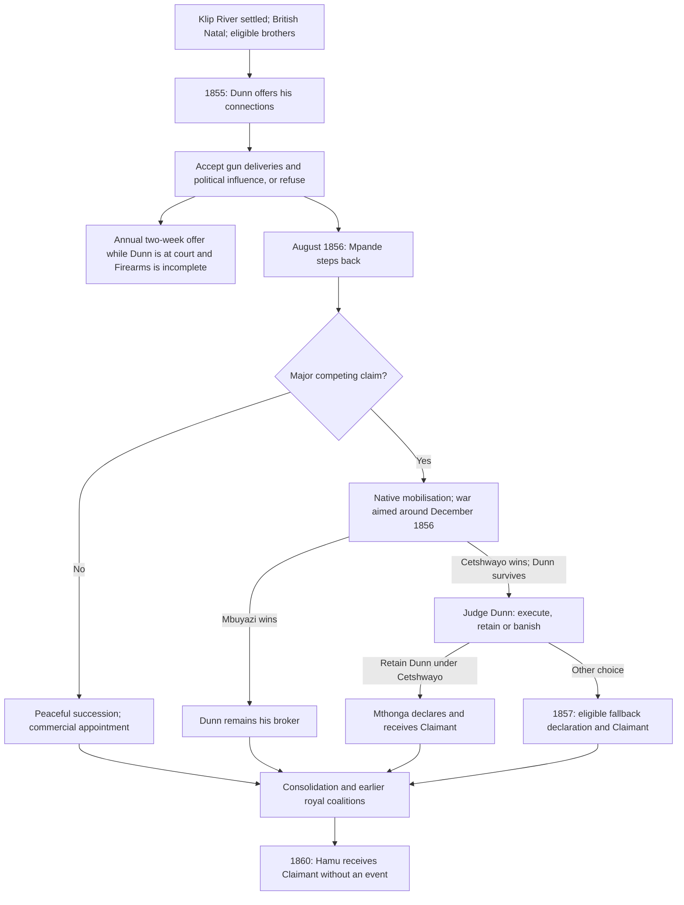

# Second Zulu civil war: Dunn, firearms and the surviving royal houses

Created 29 October; revised **30 October 2026** following DP's final corrections. **Implemented 30 October 2026; engine verification pending DP.** Dunn now opens from 1855 after the settled Klip/British-Natal context; retirement remains August and claimant activism remains five percentage points per week. See [implementation and numbered tests](zulu_later_court_implementation_2026_10_30.md).

## 30 October decisions

- Dunn's annual delivery grants exactly **two supplied weeks** of Firearms adoption, replacing the earlier 1% / 2.6-week proposal. After Firearms completion there are **no further annual offers or replacement rewards**.
- Replace the proposed temporary +5 Prominence modifier with a permanent **Trader** character trait giving **+10 Prominence**, the first-pass value accepted within DP's +10–15 range. It applies once to Dunn, not once per shipment, and does not expire or imply noble/chief status.
- Mpande's retirement is eligible from **1 August 1856**, allowing the five-point weekly mobilisation to aim for **approximately December 1856**. This supersedes January retirement and a spring war; actual outbreak still depends on eligibility and acknowledgement.
- Execute Dunn: **−10 GBR relations**. Retain him: **+5 GBR relations**.
- Mthonga declares when a victorious Cetshwayo retains Dunn, with an eligible 1857 fallback. Declaration grants the **Claimant** trait and its existing **+25 Prominence** once. **Hamu arrives in 1860 and receives Claimant directly, without an arrival/declaration event**.
- The authored arc requires **Klip River settled and current British Natal**, because the boundary dispute can itself produce a Zulu–Natal war. A historical colony marker or mere Natal existence is insufficient.

### Further decisions, 30 October

- Retaining Dunn triggers Mthonga's declaration only: **no automatic transfer of an existing supporter**.
- The eligible **1857 fallback also works under another royal victor**, silently, without an event. Do not reuse Cetshwayo's Dunn grievance for another ruler.
- Dunn's admission gives Cetshwayo the **most prominent eligible house without a future-successor pledge**, ranked by aggregated house Prominence. Keep its present allegiance to Mpande. Freeze and show the actual house; no eligible house means no pledge transfer, and a stale named house is not silently replaced.
- DP wants the **later rival stories settled now**, rather than deferred. The updated [later-story exploration](zulu_later_court_story_design_2026_10_30.md) removes the standalone Mthonga refuge event: departure follows an actual escape through ordinary coercion. Hamu's new direction is a paid Boer territorial bargain, after TRN/future ZAR owns part of East Transvaal and the **Boer–Swazi border settlement** is resolved. ZUL is notified and Hamu gains support. DP confirmed that the **one-off 1G secures the promise**, with optional continuing payments improving his chances. His actual accession forms **Greater NRP as the sponsor's subject**, excludes the later scripted Boer reward, and does not offer direct annexation. A British boundary ultimatum becomes eligible only if the residual Zulu polity comes under British rule, including later. Exact subject type and remaining support/subsidy values are provisional; Mandlakazi remains a separate unapproved proposal.
- The proposed common **ZAR** tag and TRN/LYD/ZPB content-access audit are recorded as major refactor TODO **ARCH-20261030-01** in [the open register](audit_issues_open.md#major-content-refactor-todo--unified-south-african-republic-zar). No tag or gameplay change is implemented by these design records.

These decisions supersede the earlier five-percent and one-percent deliveries, temporary Prominence, post-completion research bonus/popups, January retirement, −20/+10 relations and unresolved British-Natal prerequisite. Earlier cast availability below supersedes using 1861/1865 as first-appearance dates. The later 1861 refuge episode is now dropped; 1865 is evidence for the Hamu opportunity, not an agreed new calendar gate.

## Recommendation and evidence

Develop DP's suggested earlier introduction as a **trader becoming a political liability**, then an accommodation after victory. Distinguish early access from Dunn's later established chiefdom. He should not arrive with the wealth, clients and territorial authority he acquired subsequently.

The [research brief](zulu_second_war_dunn_cast_research_2026_10_29.md) distinguishes mid-1850s hunting/trading, support for Mbuyazi in 1856 and settled service under Cetshwayo in 1857. An annual delivery is a gameplay abstraction, not a documented quota. Walmsley's contemporary account admits lending Dunn guns while disputing official responsibility; the narrative can make Cetshwayo suspicious of Natal without asserting an official British military intervention. [Walmsley letter](https://www.whiteswritingwhiteness.ed.ac.uk/traces/shepstone-jan-1857/); [Ballard, publisher abstract](https://doi.org/10.1017/S0021853700017874).

Mpande's scripted retirement is already a gameplay departure from the history. The agreed August eligibility allows time for mobilisation towards December. No story choice should guarantee a war when the rival is dead, renounced or too weak.

## Selected structure and the earlier alternative

DP accepted direction A's earlier trading relationship, with August retirement to target December. Direction B remains here as a comparison record, not a pending choice.

| | A. Earlier trading relationship — selected | B. Intervention first, settled service afterwards |
|---|---|---|
| Entry | Klip River resolved and current British Natal; eligible Mpande/brothers; introduction from 1855 | Klip River resolved and current British Natal; eligible brothers' contest in 1856 |
| Dunn's first role | A young trader/intermediary admitted to the court; contacts and a modest personal following | An armed intermediary supporting Mbuyazi near the conflict |
| Before succession | First gun offer at admission; then annually. The court debates the advantage given to Mbuyazi | A single intervention scene establishes Mbuyazi's assistance; no invented established annual contract |
| Calendar | 1 August 1856 retirement eligibility; roughly December outbreak if acknowledged promptly and native gates hold | Same August/December calendar |
| Cetshwayo victory | The named trader who helped his brother is spared for a judgement event: execute, retain or banish | Dunn returns seeking settlement after defeat; same three substantive choices, then service from 1857 |
| Mbuyazi victory | Dunn remains his broker; annual offers continue without a fabricated reconciliation | Reward the successful intermediary and begin annual trade |
| Peaceful succession | Address Dunn's political alignment as a commercial appointment; no accusation that he fought a nonexistent war | No wartime judgement; ordinary later trading introduction remains possible |
| Benefit | Player sees why Dunn matters before deciding his fate; creates concrete choices before war | Closer to the documented chronology and fewer invented early commitments |
| Cost | The 1855 appointment and annual cadence are explicit adaptations | Less preparation for Mbuyazi and fewer prewar player decisions |

Both retain normal native succession outside this authored story. A dead Dunn stops his personal chain; another trader does not silently replace him. A late Klip settlement does not recreate a concluded brothers' struggle. Ordinary court politics can continue without these particular events.

The gate waits for the actual Klip settlement, including its tracked war/outcome handoff, and verifies that the living Natal country is still the British colony. It does not require a particular winner or Zulu ownership of Klip River, and it does not require unrelated wars to end. It gates this introduction, not ordinary mortality/succession or later royal births. Recheck the Natal context before opening its offers; losing British control does not erase already-earned personal commitments or a reserved war outcome.

Implementation note: `sb_natal_is_british_colony` currently compares a British subject to `ROOT`. Entering `c:NAL` inside a Zulu event does not rebind that root. A new cross-country gate must compare the captured actual Natal actor; do not reuse that helper unchanged or infer current colonial status from `sb_natalia_british_colony_resolved_var` alone.

## Event sequence and proposed tradeoffs

The mechanics and values in the decision register are agreed unless explicitly marked open. Draft titles and new prose remain proposals, not reviewed localisation or historical quotations. Native `shogunate.2` supplies the coalition-dispute structure; its actual script and localisation were inspected. The existing two-character Dunn presentation is suitable for admission and judgement. Use one-character presentation for a routine shipment; do not make every scene another two-prince dispute.

### 1. A Trader from the Thukela — 1855 introduction

Describe what Dunn offers: language, routes and contacts among traders. Let Mbuyazi's interest give the introduction its political point. The scene should show the broker negotiating access, not bestowing a mature chiefdom on himself.

- **Admit him:** the existing identity enters the court and promises future support to Mbuyazi. His permanent Trader trait represents his commercial connections. The first arms offer follows as part of the same episode. No invented adult clients or territorial grant.
- **Decline:** no recurring personal supply relationship or automatic Dunn pledge. Keep his identity alive outside the court; a later independently eligible encounter can reuse it.

Admitting him provokes an objection from the **most prominent eligible house without a future-successor pledge**, which pledges to Cetshwayo. Rank the existing eligible-backer pool by aggregated house Prominence, counting each house once and excluding the princes, incumbent and Dunn. Freeze the actual house for the admission preview and revalidate it on acknowledgement; if it becomes ineligible, do not replace it silently. With no eligible house, Dunn's admission still works without a pledge transfer. This is an authored political tradeoff, not a finding that Dunn's arrival caused the historical uSuthu coalition. Preserve existing successor pledges and present allegiance to Mpande.

### 2. Guns at the River — annual while in court and Firearms is incomplete

Offer one delivery immediately after admission, then once per year while the receiving court's Firearms JE remains incomplete. Track the delivery on Dunn's chain so a civil-war split cannot award it to both countries. During war the offer belongs to the court actually hosting him. Foreign residence, banishment and death suspend/end the offers; re-entry must not reset a consumed annual delivery. Use a native year/365-day interval rather than assuming twelve script months equal a calendar year.

DP's revised reward contract:

- Accept: **two supplied weeks** of Firearms progress, capped at the existing 260-week completion threshold. This is a fixed increment, not a percentage reward.
- **Trader:** permanent **+10 Prominence**, visible on the trait card. Award once when the actual Dunn identity is introduced; accepting or refusing later deliveries neither stacks nor removes it. Preserve it through character transfers and court snapshots.
- Refuse: no shipment benefit. No automatic allegiance conversion, trait removal or unrequested Prerogative toll.
- Once Firearms is complete, **stop the annual offers and rewards**. They must not create a new progress counter, research modifier, renewed completion reward or empty flavour-only popup. Cancel or invalidate a pending offer if completion occurs before acknowledgement; Dunn keeps his permanent Trader trait.

The progress grant represents access and learning; it does not claim to insert actual goods into the market. A genuine continuing small-arms treaty is the more elaborate alternative, requiring a real supplier, sustainable article and interruption handling. Prefer the existing event-progress machinery for this first story iteration.

Do not make one house defect every year merely because a shipment arrives. Put the opposition choice in the initial privilege dispute, then let prominence, ordinary annual allegiance and later court episodes do their work. That preserves an annual gun event without mechanically emptying one coalition.

### 3. Mpande steps back — August 1856, aiming towards December

Use **1 August 1856** retirement eligibility, four months before the intended approximate December outbreak. An unanswered admission offer reserves scheduled retirement as the current Dunn offer does; ordinary death still uses the common succession controller. Dunn's 1855 introduction precedes this reservation. The first delivery and annual anniversary are separate.

That reservation must cover the **whole introductory episode** if admission, the first shipment and the named objection use separate windows. Finish or invalidate their promised future-pledge changes before freezing the succession coalitions. Later ordinary annual deliveries do not indefinitely postpone retirement. A ruler/participant change cancels stale introductory choices rather than redirecting them silently.

Use the current future-pledge selection, major-rival threshold, both playable sides and actual native-war outcome. At five points/week there are about fifteen ticks to native organising and twenty to full activism from zero. Early-August acknowledgement therefore aims towards late November/December; monthly pulses, unanswered windows and native eligibility can delay it. Source timing does not promise sufficient support, equal provinces or an exact outbreak date.

### 4. The Man Who Armed My Brother — Cetshwayo's victory

Illustrative description: *John Dunn supplied Mbuyazi's supporters with guns from Natal. Now he offers his services to the prince they failed to defeat.* The flavour can show a practical offer of routes and correspondence alongside the hostility of a particular victorious chief. Name the actual critic; avoid treating all Zulu opinion as one voice.

Use that title and gun-specific accusation only with a recorded accepted delivery. If he backed Mbuyazi but every shipment was refused, use **My Brother's Intermediary** and describe his political assistance instead. Keep the outcome choices and diplomatic stakes intelligible without inventing a shipment or participation in a battle.

| Choice | Proposed consequence | Tradeoff |
|---|---|---|
| **He will answer for those guns.** | Execute Dunn; end his chain; **−10 GBR relations** | Removes the broker and satisfies the named objection; loses his services permanently |
| **His connections will serve my house.** | Dunn endorses Cetshwayo; continue eligible annual offers; **+5 GBR relations** | Living eligible Mthonga declares his own claim and receives Claimant; no existing supporter transfers |
| **Let him return across the Thukela.** | Exile Dunn to the relevant living Natal/Cape host; end domestic offers | Avoids execution and loses his services; no invented automatic British declaration of war |

GBR effects require GBR to exist. The text should refer to Natal traders or authorities according to the actual political situation, not assume every present Natal tag is a British administration. Positive relations represent the act of accommodation; they do not prove Dunn fought under British orders.

The agreed Mthonga declaration below gives the accommodation a named political consequence. It opens his eligibility to gather a coalition; it does **not** transfer Cetshwayo's houses or guarantee a third civil war. DP explicitly chose declaration only. No whole-movement conversion, resurrection or substitute prince. A dead, renounced or otherwise invalid Mthonga makes the declaration unavailable; Dunn's diplomatic/commercial choice still works.

**Required integration change:** reserve the judgement and exempt the named Dunn from the losing-coalition death loop before country removal. Transfer the same living identity to the winner and preserve the independent aftermath receipt through generic war cleanup. No exemption for the entire defeated coalition. Natural death remains possible; a dead Dunn cannot be resurrected by this event. This exception is necessary for the proposed choices and is not implemented yet.

## Cast pacing: presence is not an active crown challenge

### Mthonga: earlier presence, declaration through Dunn or 1857

Use a **1855–1856 family introduction**, then a once-only active claim either when a victorious Cetshwayo keeps Dunn or at the first eligible court pulse from **1857**. The fallback covers the other Dunn choices, Dunn's absence, and another royal victor after the succession is resolved. It silently establishes Mthonga's candidature and Claimant trait without an event. Both routes require the actual living, eligible Mthonga, not already sovereign or renounced; only the keep-Dunn shortcut requires victorious Cetshwayo. No unrelated ruler receives the Dunn accusation.

Before declaration, presence alone must not admit Mthonga to the independent successor-pledge/candidate pools. This keeps the brothers' initial contest from being crowded by another pre-built faction. On declaration establish his actual candidature and give the existing **Claimant** trait, including its **+25 Prominence**, once. The trait must survive normal allegiance-card reconciliation while he remains eligible; ordinary accession, renunciation and retirement still remove claimant status as appropriate. Do not add a second manual prominence modifier. He then joins ordinary recruitment without an invented established clientele or guaranteed defection. This earlier availability is an authored pacing choice, not a newly established birth date or a claim that his documented 1861 crisis already occurred.

Defer a due declaration through an open side-selection popup, organising revolution, active tracked war and terminal roster restoration. Activate once after that episode finishes, with current participants revalidated. The keep-Dunn shortcut requires the actual Cetshwayo victory receipt plus that selected option; peaceful accession and a Mbuyazi victory do not fabricate the same wartime grievance.

If an early family role joins a defeated house, the current cleanup can still kill him. Do not imply that withholding his claim makes him immune. Any deliberately authored escape would require its own agreed route; an absent/dead historical identity is not recreated for 1857.

### Hamu: arrival and coalition-building from 1860

DP answered the timing question with “Bring him in later 60?”; this is recorded as **1860**. Bring the existing Hamu identity into the court from that year, replacing both the earlier proposed 1855 presence and the current script's 1865 introduction. From arrival he can gather his own coalition through the ordinary adult claimant/pledge rules. There is no separate 1856–1857 opening for his claim. The historical 1865 foreign scheme informs the later bargain; its revised entry depends on East Transvaal ownership and the Boer–Swazi border outcome, with no additional calendar gate agreed.

**No arrival or declaration event for Hamu.** The dated cast helper grants the existing **Claimant** trait and establishes his normal candidate eligibility directly. Its +25 Prominence comes from the trait alone. Reuse the living identity, grant once, and keep ordinary character transfers and trait reconciliation consistent with that status.

Preserve the existing tracked-crisis roster freeze: an introduction due during a still-open conflict waits for safe reconciliation, rather than changing frozen coalitions. Outside that reservation, use the ordinary eligibility and recruitment rules. Preserve his actual surviving identity and house weight once; later historical opposition does not assign automatic hostility or free supporters on arrival. The 1860 availability is a gameplay pacing choice, not a newly established historical court appointment.

| Window | Featured actors | Recommendation |
|---|---|---|
| 1855–1856 | Cetshwayo, Mbuyazi, Dunn; earlier Mthonga | Mthonga can appear in a family role before his declaration. Hamu's introduction waits until 1860. Maphitha still represents Mandlakazi. |
| After Cetshwayo's victory, or 1857 | Mthonga's declaration | Keeping Dunn can accelerate Mthonga's declaration; otherwise use the eligible 1857 fallback. |
| 1857–1860 | Dunn and the consequences of Mbuyazi's defeat | Consolidation, trade, exile and ordinary coalition growth. A surviving or already-exiled Mkhungo can provide continuity with Mbuyazi's household without instantly supplying another adult rebel army. |
| 1860 | Hamu kaNzibe/kaMpande | Introduce the existing identity and grant Claimant directly, without an event. Open normal eligible coalition-building. |
| Actual coercion escape | Mthonga kaMpande, if surviving | The documented 1861 flight supplies context only. No separate refuge/border episode; use the existing interaction's actual outcome. |
| Hamu available; Boer border conditions satisfied | Hamu kaNzibe/kaMpande, if surviving | Paid foreign support and a promised NRP concession; neither first introduction nor forced rebellion. The 1865 scheme is historical context, not an agreed date gate. |
| 1872 onward | Zibhebhu kaMaphitha | His chiefly succession gives him an independent political role. Keep chiefly autonomy distinct from claiming Cetshwayo's crown; do not duplicate his father's house weight. |
| 1879 / partition | Surviving network | Reuse surviving decisions and identities for the Thirteen Chiefs arc. Earlier royal support does not predetermine later cooperation with partition. |

Hamu kaNzibe and kaMpande are one person; c.1834 is an approximate and internally problematic reference date, not a verified birthday. Mthonga is Mpande's son. Zibhebhu was a collateral royal relative, about fifteen in 1856, and supported Cetshwayo then. These points and the 1861/1865/1872 anchors are sourced individually in the [cast brief](zulu_second_war_dunn_cast_research_2026_10_29.md).

Avoid crowding by staging **featured episodes**, not imposing a new cap on ordinary court membership or deleting living brothers. Initially expose only eligible adult candidates with actual backing. Keep family/adviser roles distinct from an independent following. Existing succession and claim eligibility need auditing before earlier registrations can be called safe.

Mkhungo's historical exile does not override the implemented losing-coalition death rule. If registration places him in Mbuyazi's defeated household, he can die under that rule. Any authored escape must be separately agreed and recorded before cleanup; otherwise later episodes require his actual survival. Dunn's proposed judgement exception protects only Dunn.

## Decision register

| Item | Status | Position |
|---|---|---|
| Richer second-war story with Klip link | Agreed, 30 October | Direction A with August retirement aiming for December; no new story scripts yet |
| Meaning of “requires Klip River” | Agreed, 30 October | Actual settlement of the dispute plus current British Natal. Check both; no unrelated-war peace condition or required territorial winner |
| Dunn around 1855 | Agreed | Earlier visitor/broker; no backdated mature chiefdom |
| Annual delivery amount | Agreed, final 30 October correction | Fixed two supplied weeks, capped at 260; replaces 1% / 2.6 weeks |
| Trader trait | Agreed | +10 permanent Prominence once for Dunn, no timed or per-delivery stacking |
| Annual offers after Firearms completion | Agreed | Nothing: no further offers, empty popups or substitute rewards |
| Retirement calendar | Agreed | 1 August 1856 eligibility at five points/week, aiming towards December; no forced outbreak |
| Dunn judgement after Cetshwayo victory | Agreed | Execute −10 GBR relations; retain +5; banish remains the third option; explicit survival exception necessary |
| Mthonga's earlier claim | Agreed, including alternate victor | Keep-Dunn declaration under victorious Cetshwayo; otherwise silent eligible 1857 fallback under a royal victor; grant Claimant once; actual survival required |
| Named supporter loss on retaining Dunn | Agreed: none | Declaration only; ordinary allegiance changes build Mthonga's coalition |
| House objection to Dunn's admission | Agreed | Most prominent eligible house without a successor pledge backs Cetshwayo; aggregate house Prominence, preserve present allegiance, preview/revalidate the same house |
| Hamu's arrival | Agreed, 30 October follow-up | 1860; Claimant granted directly without an event; normal coalition-building, preserving the tracked-crisis roster freeze |
| Later rival stories | Direction updated; details open | No Mthonga refuge event; conditional Hamu–Boer funding/NRP bargain; separate provisional 1872 Mandlakazi handover. See linked exploration. |
| Firearms 260 weeks and presentation | Implemented | 260 supplied weeks; native Effects; no stability/Prerogative; existing percentage rewards preserved |
| Broad balance/automatic forced second war | Deferred/not requested | Do not replace current coalition and native-war eligibility checks |

## Verification before implementation acceptance

Rehearse Klip non-occurrence, each settlement outcome, a pending Klip war, Boer/independent/absent versus British Natal, early annexation/partition, absent or foreign Dunn, dead/renounced brothers, peaceful accession and both war winners. Exercise the Natal prerequisite with a Zulu event root. Check a yearly delivery spanning the split cannot duplicate; each accepted offer grants exactly two weeks capped at 260, completed Firearms gets no new offer or reward, and the permanent Trader trait neither stacks nor expires. Test completion while a shipment popup is open. Verify the judgement's −10/+5 GBR effects, Dunn's survival reservation before both character and defeated-country cleanup, stale judgement, exile and ordinary post-accommodation allegiance. Preserve the other losing-coalition rules and neither invent casualties nor restore dead relatives.

For earlier princes, test actual candidate/recruitment eligibility before and after declaration, a due 1857 introduction during organising or war, repeated callbacks, dead/renounced identities, a changed victor and court restoration. Confirm Claimant and its single +25 bonus persist through normal trait reconciliation for both Mthonga and Hamu. Hamu must not be introduced by this route before 1860; from arrival he can receive eligible pledges normally, with no arrival/declaration popup. Check deferred arrival during a tracked crisis and prevent duplicate creation by the former 1865 route.

No runtime result is claimed for this story. The separate Firearms change passed 73 focused checks and independent review; full validation retains only the prior localisation-review failure. Native Firearms tooltip rendering remains pending DP.
