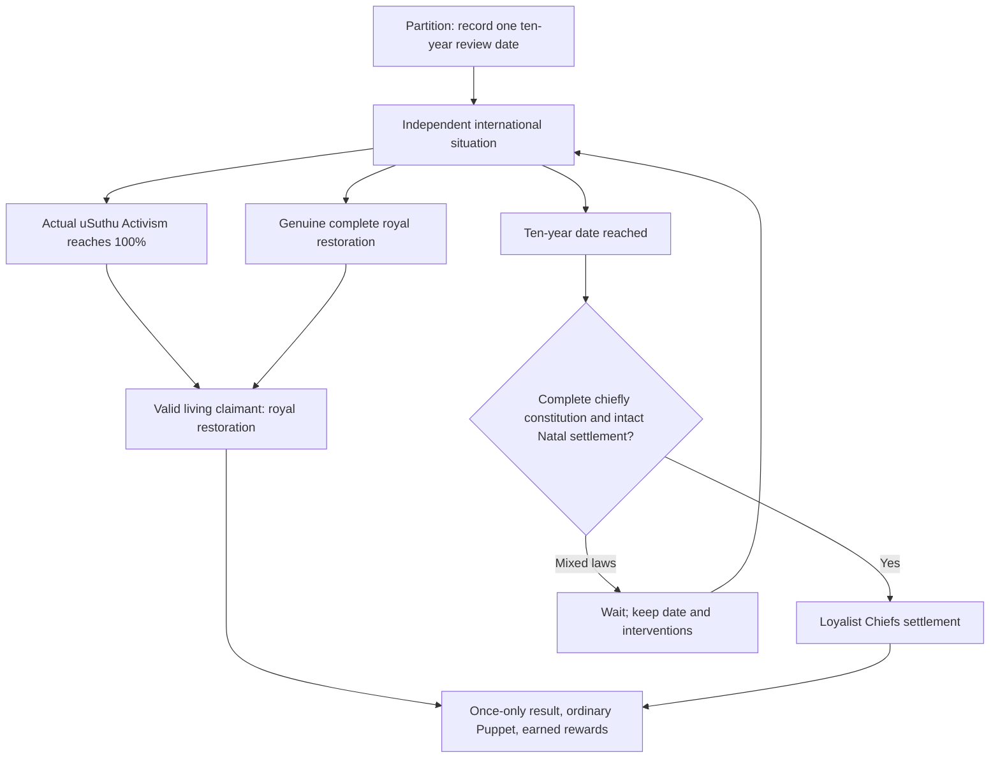

# Thirteen Chiefdoms refinement and persistent houses

10 November 2026. DP approved implementation of the refinement following the
[intervention discussion](zulu_thirteen_chiefs_intervention_and_houses_2026_11_09.md)
and [fixed-house research](zulu_fixed_houses_research_2026_11_09.md). This is the
current implementation record; earlier proposals and validation reports remain
historical evidence.

**Source implemented; engine verification pending DP.** SB remains 0.20.3 on
Victoria 3 1.15.0, build 26453692, with CMF 1.67.2 + sb-1.15.0-r2. All DLC and new
campaigns remain the supported baseline. No game launch, save migration,
dependency payload change or wider country rollout was performed.

## 1. Contest lifecycle

The existing international `je_sb_zululand_chiefdoms` owns the partition contest.
It no longer resolves through the Prerogative JE, its score, its eligibility or
its accommodation action. Native Support and actual Activism remain distinct;
there is no new political score or gameplay slider.

The complete chiefly pair is **Federated Chiefdoms + Chiefly Council**. The
settlement also requires the living Zulu polity to own all of Zululand and be
Natal's actual direct subject. Mixed constitutions wait after year ten, without
restarting the clock. An already completed restoration means the actual recorded
claimant rules under Monarchy + Autocracy. It can resolve before the review.
A lost pact, destroyed polity or lost territory interrupts the ordinary contest
without granting a faction result. Unrelated wars are not a blocking condition.

The normal release path is the **event restoration at 100% actual Activism**.
Both constitutional movements' new native uprisings are blocked during this
mode. The claimant must satisfy the real royal-candidate predicate; an absent,
dead, retired or renounced claimant is not replaced merely to award a result.
The once-only dispatcher reserves the result before notifications. It preserves
ordinary Puppet aftermath, permanent non-stacking **+50% chiefly / +10% royal**
NAL incorporation entitlements and earned **100 Boer Commitment** NRP promises.
It does not annex ZUL. Initial Control the Crown, direct administration and the
annexation-movement modifier work remain separate.

14 November correction: the shared JE's native age owns the 3,650-day deadline;
the container retains the native-test flag and conflict receipts. A permanent
JE-age receipt deduplicates weekly callbacks without relying on container expiry.
Law changes and monthly reconciliation still evaluate the same controller. The
[playtest follow-up](compatibility/chiefdoms_playtest_2026_11_14.md) also records
15% temporary tribute, movement Prominence totals and withdrawal of the current
Boer/NRP undertaking when TRN joins Natal's overlord. DP subsequently approved
half G-based prices for Chiefdoms bribes only; domestic prices remain unchanged.
No daily global character scan or observer-owned copy of the clock is added.

Later 14 November follow-up: the same deadline is displayed as whole days
remaining, avoiding the raw date's hour suffix. Active-contest claimant refresh
no longer requires the former institutional flag; the existing return action
can admit a living adult successor without repeating Natal's rewards. Returned
claimants receive an explicit agitator career. Natal's two return buttons now
have conditional AI weights: Dynamic Historical at 50% royal Activism, Strict
Historical after three years, and zero in Off. uSuthu strongly opposes both
chiefly laws. See the [follow-up evidence and limits](compatibility/chiefdoms_followup_2026_11_14.md).
The 100% event endpoint and recruitment coefficients remain unchanged.

15 November approved refinement: full political house backing now feeds the
JE totals and a native uSuthu target modifier of 0.1 percentage point per
prominence advantage, capped at ±30 points. Local agitators remain counted once
in this political pool; their exclusion from scripted attraction remains.
Dynamic AI now considers claimant return at ≥20% radicals among Natal's Zulu
Pops, and offloads only while that threshold still holds and the current
claimant has returned and is present in ZUL. Strict Historical keeps the
three-year delay; Off remains disabled. The 100% restoration endpoint is
retained. See the [implementation and verification limits](compatibility/chiefdoms_prominence_2026_11_15.md).

## 2. Native-war experiment and competing uprisings

The native constitutional-war route remains **explicit testing only**. Its
release criterion is exclusion of **all foreign regular armies**, including
NAL, GBR and TRN, from both sides. The side-joining rule now denies foreign
joining for the recorded partition pair. Existing Chiefdoms protection-pact
behaviour is retained. Source inspection does not establish coverage of every
native automatic-participant path; no removal-after-joining workaround is
claimed as proof of non-intervention.

To test: make a checkpoint after partition but before any organising civil war,
use the console to set `sb_chiefdoms_test_tools_enabled_var` globally
(`effect set_global_variable = sb_chiefdoms_test_tools_enabled_var`), then take
**TEST: Enable Native Chiefdoms Conflict** as the actual Zulu polity. The decision
requires the authored Chiefdoms subject type and no existing civil-war object.
It is never an AI choice. Do not change modes during a crisis; reload the
checkpoint to test the other mode.

The controller follows the constitutional movement's own organising object,
then the exact origin, rebel and war. Organising or fighting defers review.
A vanished organising object is refreshed rather than retained as a permanent
block. A winner receipt is accepted only in native test mode, from the recorded
pair, following the existing exact-war end handshake. Territorial reunion must
finish before subject changes or NRP cession. A victorious independent **recorded
rebel** can become Natal's Puppet; an unrelated country or somebody else's
subject cannot be taken over. Missing objects are not treated as victory.

During the exact contest, competing **ideological** uprising modes are gated.
This includes an ideological movement's secession mode where supplied by CMF.
Cultural and religious secession definitions remain untouched. Existing started
conflicts are not cancelled. Movement creation, membership, recruitment and
ordinary law pressure remain native. NAL, TRN and other viewers are not subjected
to Zulu's veto. Sixteen additional CMF keyed definitions are copied with only
this gate; see the [compatibility report](compatibility/chiefdoms_refinement_2026_11_10.md).

## 3. Institutional independence

P, IR, Courtly Politics, Amabutho effects and the current equilibrium coefficients
are unchanged. IR exit removes their governing effects as before. It no longer
stops partition interventions or removes partition house recruitment. Dated
membership, claimant maintenance, chiefly vacancies, house accounting and the
existing annual constitutional-alignment roll continue during an active contest
even with the institutional JE closed. Ordinary royal succession episodes are
not newly enabled by this exception. Annual checks retain their reservation and
once-per-year protections.

Dynastic claimant challenges cannot open concurrently with the partition
contest. The superseded court accommodation button, handlers and unreferenced
helpers are removed; their bodies are preserved in the
[archive](archive/zulu_accommodation_route_2026_11_10.md). Reviewed localisation
and earlier evidence are not regenerated or silently approved.

## 4. Persistent houses and shared accounting

The approved leadership rule is **the most prominent eligible head speaks for
the combined house**. Individual commitments remain recorded. A new head brings
those commitments; the old head's promise is not inherited automatically.
The existing junior penalty and eligibility remain unchanged.

| Identity | Treatment |
| --- | --- |
| Existing IDs 2–14 | Retain memberships, weights and dated availability; labels distinguish houses and non-dynastic followings. |
| 15 — Dingane | Dingane and the already authored Uthumbu line. |
| 16 — Mpande | Mpande's branch. |
| 17 — Gqugqu | Gqugqu's branch. |
| 18 — Cetshwayo | Existing Cetshwayo, Dinuzulu and Solomon identities. |
| 19 — Mbuyazi | Mbuyazi and the existing authored successor. |
| Hamu, ID 6 | Retain the existing Nzibe/Ngenetsheni following. |
| Mthonga and unaffiliated actors | Keep following 0; display separately as councillors rather than inventing a house. |

The former office-following ID 1 is no longer rebound to whoever becomes king.
Explicit authored branch assignment takes precedence over paternal inference.
An introduced child uses the parent's existing branch unless it has an explicit
founder assignment. This work adds no character, birth date, invented genealogy
or succession schedule; it does not infer a house from a surname.

Each living eligible member contributes once to a head's aggregate. Each head
contributes that total once to coalition and constitutional accounting. A junior
prince can receive pledges and remain a candidate without acquiring a second
copy of his house's weight. Annual recruitment, events, prices and conflict
snapshots continue to use the same representative records. A reserved dynastic
war explicitly places its principals on their own sides, preventing a junior
contender from also appearing in the other house list.

A native constitutional split snapshots head alignment before transfers. Its
actual country sections show the resulting membership rather than counting an
individual in both courts. Native allegiance and unrelated third-party pledges
are retained. No eligible survivor means no invented replacement following.

## 5. Presentation and interventions

Both journals use `gui/sb_court_house_roster.gui` in an explicit **Country**
context. The house summary shows its name/type, leader, total Prominence, named
allegiance and constitutional alignment. Its own arrow expands the named members
with their current roles and Prominence. Unaffiliated councillors and commanders
remain separate. Existing character navigation is reused. Scroll widths remain
bounded; runtime rendering is pending.

The international situation shows the named chiefly and uSuthu leadership,
separate Support and Activism readings, the first review date or waiting/conflict
state, active interventions and Boer Commitment. During the native test it reads
each faction from its actual polity, not the viewer or a synthetic combination
of two countries. The shared house panels cover the actual recorded countries.

Existing sponsorship, volunteers, policing, chief support, claimant return and
refugee effects retain their balance. The foreign **Bribe a Neutral Chief** quote
uses the actual payer's reserve capacity G and the selected contributing neutral
head's native Prominence q. The highest eligible q is selected. Following DP's
14 November approval, Chiefdoms bribes use half the domestic patronage curve:

| q | 10 | 25 | 50 | 75 | 100 |
| --- | ---: | ---: | ---: | ---: | ---: |
| Price / G | 0.20 | 0.3125 | 0.50 | 0.65 | 0.80 |

q is clamped to 10–100. Existing open quotes retain their stored price. The
quoted amount is frozen while the event is open;
reserves and borrowing required remain visible. Debt is permitted. The target,
neutral status and active contest are revalidated before charging. Payment
changes constitutional alignment only, never personal allegiance or future
pledges. An already committed, dead or unavailable target is not charged, and
repeating an old choice cannot pay or align twice. Existing AI choice policy is
unchanged.

## 6. Validation and remaining acceptance

Source-executed regressions cover timer expiry, mixed laws, 100% Activism,
claimant validity, lost territory/pacts, exact war receipts, both winners,
reunion delay and duplicate callbacks. House tests cover authored branches,
accession, junior claimants, principal deduplication, payer-based prices, frozen
quotes, borrowing and invalidated targets. Full validation and upstream parity
are recorded in the [compatibility report](compatibility/chiefdoms_refinement_2026_11_10.md).

The [numbered DP matrix](zulu_thirteen_chiefs_runtime_matrix_2026_11_10.md) is the
handoff. **Every new engine scenario is pending**, including actual Activism
reaching the endpoint while native uprising is gated, timer expiry and GUI
rendering. The native war must remain opt-in unless its foreign-participation
criterion passes. No previous playtest is counted as verification of this change.
